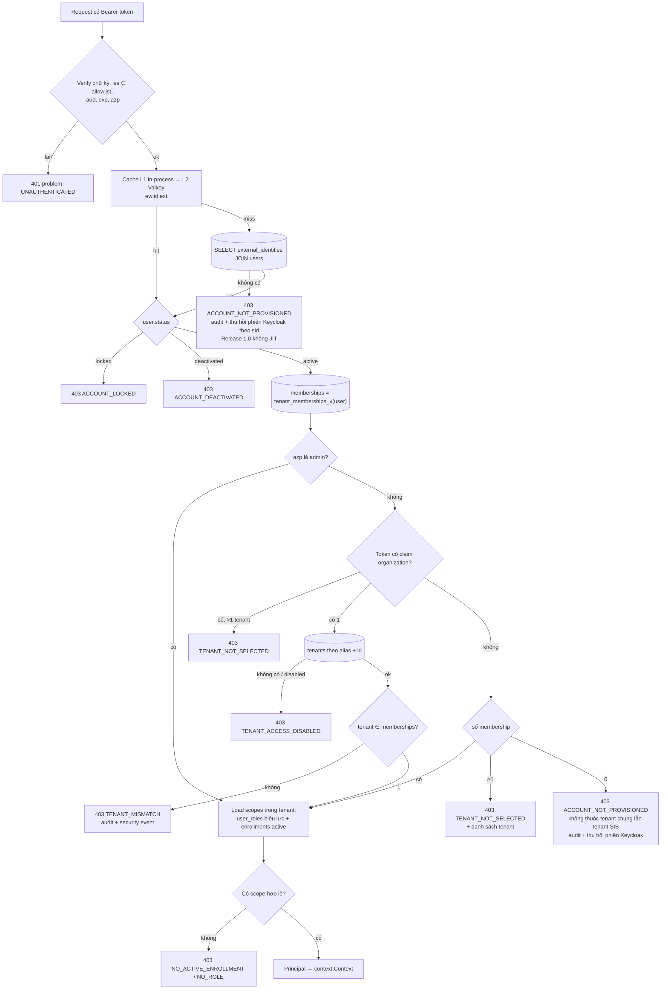
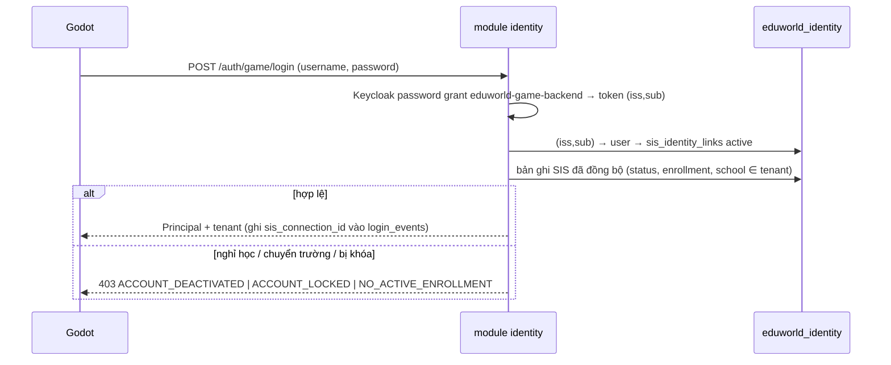
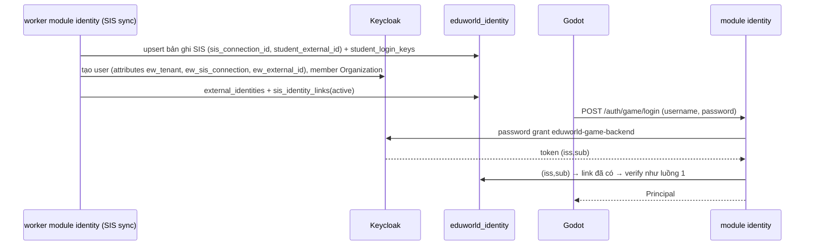
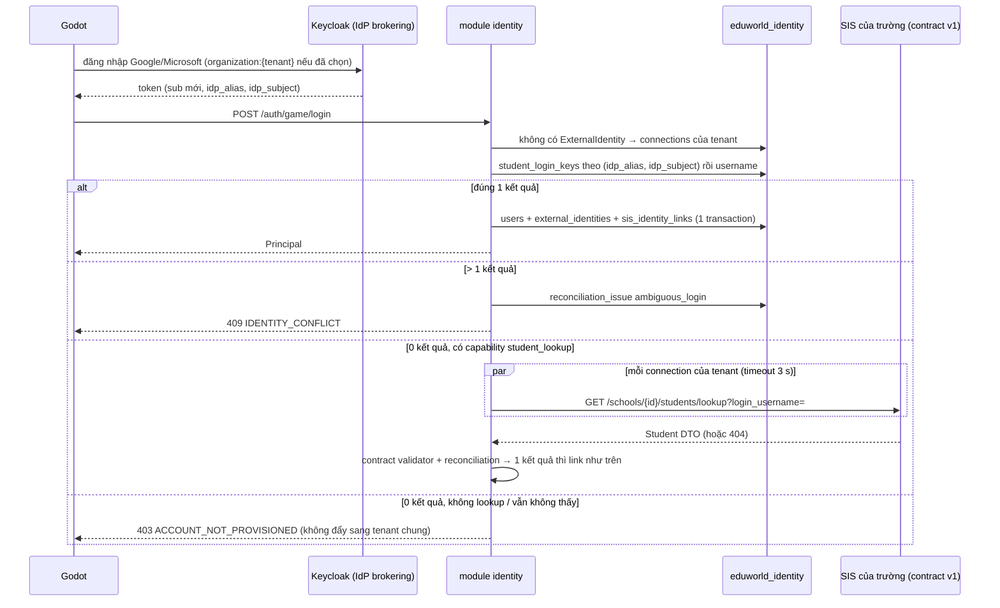
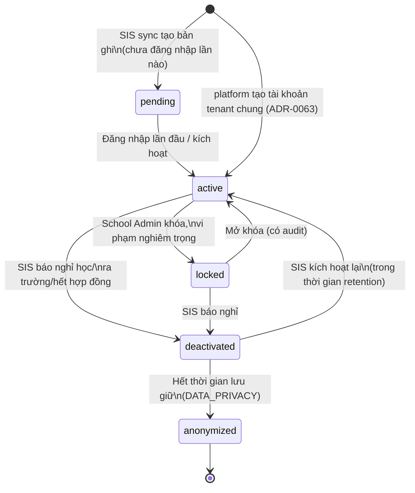

# Identity Mapping

> Trạng thái: Draft · Phiên bản: 0.5 · Owner: Identity & Security Engineer · Cập nhật: 2026-11-17 (ADR-0074: Principal resolve qua facade trong tiến trình, saga gọi facade platform) · 2026-11-16 (ADR-0086: vào lại game bằng refresh token)
> Liên quan: [DOMAIN_MODEL §2](../06-architecture/DOMAIN_MODEL.md) · [KEYCLOAK_SSO](KEYCLOAK_SSO.md) · [ACCOUNT_PROVISIONING](ACCOUNT_PROVISIONING.md) · [MULTITENANCY](../06-architecture/MULTITENANCY.md) · ADR-0005, ADR-0006, ADR-0008, ADR-0026

**Mục đích & phạm vi.** Nguồn chuẩn cho thuật toán ánh xạ token → User → tenant → SIS nguồn → Principal, mã lỗi bootstrap theo thứ tự kiểm tra, trạng thái tài khoản và nghiệp vụ chuyển lớp/chuyển trường. Luồng OIDC ở KEYCLOAK_SSO; vòng đời tài khoản ở ACCOUNT_PROVISIONING.

## 0. Module sở hữu (ADR-0074, ADR-0037)

- **module `identity`** sở hữu toàn bộ dữ liệu định danh trong tài liệu này, lưu ở database `eduworld_identity` (các schema `identity`, `org`, `platform`, `sis` vẫn dùng để tách nhóm bảng bên trong database đó). Không module nào khác đọc trực tiếp các bảng này.
- Middleware `src/backend/pkg/httpx` của `core-api` **kiểm tra token** (JWKS) rồi lấy Principal bằng một trong hai cách:
  1. Gọi facade `principals:resolve` của module identity trong tiến trình (`src/backend/pkg/modcall`, ADR-0074 mục 3), đầu vào `{issuer, subject, azp, tenant_hint}`, trả `{user_id, user_type, status, tenant_id, school_id, roles, permissions, scopes}`. Kết quả cache trong Valkey, key `ew:<module>:principal:<user_id>:<tenant_id>` (prefix theo ACL module, [VALKEY_DESIGN](../07-backend/VALKEY_DESIGN.md); TTL `principal_cache_ttl`), bị xóa khi có event `user.status_changed`/`user.access_revoked`/`user_role.changed`/`role.updated`/`tenant_membership.changed`. `tenant_hint` = header `X-Tenant-Id` của request (ADR-0065); module identity chỉ trả Principal khi tenant đó thuộc membership của user, nếu không → `TENANT_MISMATCH`.
  2. Khi database `eduworld_identity` tạm không sẵn sàng (facade trả lỗi), `core-api` dùng cache còn hạn; hết cache thì trả `503 UNAVAILABLE` cho request cần quyền, **không** cho qua khi không xác định được quyền.
- Dữ liệu tham chiếu module khác cần thường xuyên (tenant, trường, lớp, học sinh: tên hiển thị tối thiểu, `grade_level`, trạng thái) được chiếu vào bảng `ref_*` của module đó từ event `EVT_IDENTITY` (`tenant.*`, `student.synced`, `enrollment.changed`, `user.status_changed`…). Projection chỉ chứa trường cần thiết (data minimization).

## 1. Mục tiêu

Ánh xạ một token OIDC thành một `Principal` có phạm vi quyền chính xác, với các đảm bảo:

1. Định danh ngoài là `(issuer, subject)` — **không** dùng email, tên hiển thị hay `preferred_username` làm khóa liên kết [Confirmed]. Riêng **định danh đăng nhập** (`username`, `email`) là duy nhất trên SSO (Keycloak) và `identity.users`, không phân biệt hoa thường, để đăng nhập không chọn tenant vẫn xác định đúng một tài khoản (ADR-0067, [ADR-0069](../adr/ADR-0069-username-email-duy-nhat-theo-tenant-va-dang-nhap-khong-chon-tenant.md)); một người có một User dù thuộc nhiều tenant; dữ liệu theo tenant có `tenant_id NOT NULL` nên trong cùng tenant không bao giờ trùng. **Thứ tự đăng nhập:** SSO xác thực username + mật khẩu trước (sai → `401 INVALID_CREDENTIALS`), sau đó module identity kiểm tra tài khoản theo `keycloak_sub` (loại người dùng, tenant còn hiệu lực, enrollment/UserRole, đồng bộ SIS) rồi mới quyết định tenant (§3).
2. Phạm vi (school/class/subject) lấy từ DB đồng bộ SIS, không tin claim trong token (ADR-0006).
3. **Mỗi phiên thuộc đúng một tenant** (trường độc lập, đơn vị nhiều trường, hoặc tenant chung — ADR-0005). Sau đăng nhập, mọi request mang header `X-Tenant-Id` (ADR-0065); header (và claim `organization` của token portal nếu có) chỉ được chấp nhận khi DB xác nhận membership; nếu không có claim, backend xác định theo membership: 1 tenant → dùng, nhiều → `TENANT_NOT_SELECTED`, 0 → `ACCOUNT_NOT_PROVISIONED` (ADR-0026, ADR-0063). **Không** tự đưa người dùng vào tenant chung. Username/email/mã học sinh không bao giờ dùng để suy ra tenant.
4. Tài khoản bị khóa/vô hiệu hóa bị chặn trong ≤ 60 giây ở REST và realtime.
5. Lịch sử học tập không mất khi học sinh chuyển lớp/chuyển trường.

## 2. Phân biệt các khái niệm

| Khái niệm | Nằm ở | Khóa | Vòng đời | Ví dụ |
|---|---|---|---|---|
| **Keycloak User** | Keycloak | `id` (UUID KC) | Tạo bởi provisioning hoặc brokering | user trong realm `eduworld` |
| **ExternalIdentity** | `identity.external_identities` | `(issuer, subject)` unique | Tạo lần đầu login/link | `(https://auth.../realms/eduworld, f3b0...)` |
| **EduWorld User** | `identity.users` | `user_id` UUIDv7 | Tồn tại suốt đời học sinh trên nền tảng | user_type=`student` |
| **Tenant** | `platform.tenants` | `tenant_id`; `keycloak_org_id`, `keycloak_org_alias`, `login_code` (unique) | 1 Tenant = 1 Keycloak Organization (ADR-0026); loại `school`/`unit`/`common` | Phòng GD Cầu Giấy, alias `pgd-caugiay` |
| **TenantMembership** | view `identity.tenant_memberships_v` | `(user_id, tenant_id)` | Suy ra từ enrollment active (học sinh) / UserRole (nhân sự); đúng một dòng mỗi `(user_id, tenant_id)` (ADR-0067, ADR-0069) | HS X ∈ tenant `pgd-caugiay` |
| **Student** | `org.students` | `student_id = user_id` | Gắn `tenant_id`, `school_id` hiện tại | grade_level=6 |
| **Nhân sự nhà trường** | `identity.users` (`user_type = staff`, `primary_tenant_id` có giá trị) + `identity.user_roles` | `user_id` | Không có bảng giáo viên/phân công giảng dạy (ADR-0072); chỉ nhận role tenant, phạm vi qua UserRole scope `tenant`/`school`/`subject` (ADR-0081) | `qlcm.truong.a` |
| **Nhân sự platform** | `identity.users` (`user_type = staff`, `primary_tenant_id = NULL`) + `identity.user_roles` | `user_id` | Chỉ nhận role platform (`tenant_id = NULL`, ADR-0081); một người làm cả việc trường và platform dùng hai tài khoản | `sa.admin` |
| **School** | `org.schools` | `school_id`, `tenant_id` | Chiều bên trong tenant; tenant `common` có School ảo | THCS Yên Hòa ∈ tenant `pgd-caugiay` |
| **Class** | `org.classes` | `class_id` | Theo năm học | 6A 2026–2027 |
| **Enrollment** | `org.enrollments` | `enrollment_id` | Có `start_date/end_date`, lưu lịch sử | HS X ∈ 6A |
| **SISLink** | `sis.sis_links` | `(sis_connection_id, entity_type, external_id)` | Đồng bộ | mã HS trong SIS |
| **Role** | `identity.roles` + `identity.role_permissions` | `role_id`; `code` duy nhất trong phạm vi (dùng chung hoặc tenant) | Role hệ thống seed (`is_system`), role tùy biến của tenant [Confirmed] | `school_admin`, `academic_manager`, `safety_moderator` |
| **UserRole** | `identity.user_roles` (thay `role_assignments`, ADR-0066) | `(user_id, role_id, scope_type, scope_id)` | Có `valid_from/valid_to`, `source = manual` (SIS không cấp UserRole, ADR-0072), `granted_by`, soft-delete | academic_manager @ school X, subject Toán |

Quan hệ: một EduWorld User có **0..n** ExternalIdentity (vd. vừa local user vừa link Google), nhưng mỗi `(issuer, subject)` chỉ trỏ đến **đúng một** user.

Lưu ý Keycloak brokering: khi học sinh đăng nhập qua IdP được brokering, token do **Keycloak** phát hành nên `iss` luôn là realm EduWorld và `sub` là Keycloak user id — dù có nhiều IdP phía sau. `idp` claim chỉ để audit. Hỗ trợ nhiều issuer (ADR-0008) dành cho trường hợp tương lai có realm thứ hai hoặc migration.

## 3. Thuật toán resolve

**Nguồn tài khoản và kết quả sau đăng nhập (ADR-0063).** Release 1.0 học sinh chỉ đăng nhập username + password; tài khoản chỉ đến từ **tenant SIS** (provisioning, [ACCOUNT_PROVISIONING §2](ACCOUNT_PROVISIONING.md)) hoặc **tenant chung** do platform tạo/import có chủ đích ([ACCOUNT_PROVISIONING §3.4](ACCOUNT_PROVISIONING.md#34-tài-khoản-tenant-chung-do-platform-tạo-adr-0063)). Không có JIT trong Release 1.0.

| Membership của user (DB) | Kết quả `POST /api/v1/auth/game/login` (game, ADR-0068) / `GET /api/v1/me/tenants` (portal, ADR-0067) |
|---|---|
| Đúng 1 tenant (tenant SIS hoặc tenant chung) | Vào thẳng tenant đó (các kiểm tra §4.1 khác vẫn áp dụng) |
| Nhiều tenant (hiếm) | `403 TENANT_NOT_SELECTED` kèm `choices[]`; game: kèm `login_ticket` (2 phút, một lần) → `POST /auth/game/tenant:select`; portal: chọn **sau** đăng nhập rồi gửi `X-Tenant-Id` (không token mới, không scope `organization` — ADR-0091). Không nhập lại mật khẩu |
| Không thuộc tenant chung và không thuộc tenant SIS nào (kể cả không có ExternalIdentity) | **Không cho đăng nhập**: `403 ACCOUNT_NOT_PROVISIONED`, audit `account_not_provisioned`, `keycloak-provisioner` thu hồi phiên Keycloak vừa tạo theo `sid`; không tạo user/membership nào |



Pseudo-code Go:

```go
type Principal struct {
    UserID        uuid.UUID
    UserType      UserType          // student|staff (ADR-0081)
    TenantID      *uuid.UUID        // tenant của phiên (ADR-0026); nil với System Admin
    TenantType    TenantType        // school|unit|common
    Roles         []Role            // gộp từ UserRole hiệu lực (ADR-0066)
    SchoolIDs     []uuid.UUID       // trường trong tenant mà user có phạm vi (lọc bên trong tenant)
    ClassIDs      []uuid.UUID       // student: lớp đang học (nhân sự không có phạm vi lớp)
    SubjectIDs    []uuid.UUID       // academic_manager scope subject; rỗng = mọi môn trong phạm vi
    GradeLevel    *int              // student
    ClientID      string            // azp
    SessionID     string            // sid của Keycloak
    AuthTime      time.Time
}

func (r *Resolver) Resolve(ctx context.Context, tok VerifiedToken) (*Principal, error) {
    var claimed *Tenant
    if alias, orgID, ok, err := tok.Organization(); err != nil {
        return nil, err // ErrTenantNotSelected nếu claim có > 1 tenant
    } else if ok {
        if claimed, err = r.tenants.ByKeycloakOrg(ctx, alias, orgID); err != nil {
            return nil, err // ErrTenantAccessDisabled nếu không có/tắt
        }
    }
    ext, err := r.cache.GetOrLoad(ctx, extKey(tok.Issuer, tok.Subject), func() (*ExtIdentity, error) {
        return r.repo.FindExternalIdentity(ctx, tok.Issuer, tok.Subject)
    })
    if errors.Is(err, ErrNotFound) {
        // Release 1.0 (ADR-0063): không JIT — tài khoản chỉ từ SIS provisioning hoặc do platform tạo trong tenant chung.
        return nil, r.rejectNotProvisioned(ctx, tok, uuid.Nil) // audit + thu hồi phiên Keycloak theo tok.SessionID
    }
    if err := ext.User.EnsureActive(); err != nil { return nil, err } // locked/deactivated
    if tok.AZP == "eduworld-portal" && r.roles.HasPlatformRole(ctx, ext.User) {
        if !tok.HasMFA() { return nil, ErrMFARequired } // acr/amr — ADR-0027 mục 3
        return r.scopes.BuildSystemAdmin(ctx, ext.User) // không gắn tenant; CrossTenantScope + audit
    }
    members, err := r.membership.TenantsOf(ctx, ext.User) // từ DB, không từ token
    if err != nil { return nil, err }
    tenant, err := chooseTenant(claimed, members)
    // claimed != nil && claimed ∉ members → ErrTenantMismatch (audit + security event)
    // claimed == nil: 1 member → dùng; >1 → ErrTenantNotSelected{Choices: members}; 0 → ErrAccountNotProvisioned (không tự vào common)
    if errors.Is(err, ErrTenantMismatch) {
        r.audit.SecurityEvent(ctx, "tenant_mismatch", ext.User.ID, claimed.ID)
    }
    if errors.Is(err, ErrAccountNotProvisioned) {
        return nil, r.rejectNotProvisioned(ctx, tok, ext.User.ID) // audit + thu hồi phiên Keycloak (ADR-0063)
    }
    if err != nil { return nil, err }
    return r.scopes.Build(ctx, ext.User, tenant) // chỉ scope trong tenant, cache 60s theo (user, tenant)
}
```

### 3.0. Kiểm tra SIS nguồn ở mỗi lần tạo phiên (ADR-0046 mục 7)

Sau khi có User, module identity đọc `identity.sis_identity_links` đang `active` của user (cache 60 s cùng Principal) và kiểm tra bản ghi SIS đã đồng bộ tương ứng còn `active`, không `inactive/suspended/transferred_out`, có enrollment active, trường thuộc tenant của phiên. Không đạt → mã lỗi tương ứng ở §4.1 (`ACCOUNT_DEACTIVATED`, `ACCOUNT_LOCKED`, `NO_ACTIVE_ENROLLMENT`, `TENANT_MISMATCH`). Học sinh tenant chung không có link SIS nên bỏ qua bước này. `sis_connection_id` đã dùng để verify được ghi vào `identity.login_events` và `game.login_events` (chỉ ID).

**Login sync (ADR-0061):** bước kiểm tra này đồng thời chọn nhánh đồng bộ — **A** đủ dữ liệu và mới (không gọi SIS), **B** thiếu trường/lớp/enrollment (lookup blocking ≤ 3 s rồi mới kết luận `NO_ACTIVE_ENROLLMENT`), **C** dữ liệu cũ hơn 24 giờ (đăng nhập ngay, job làm mới nền). Chi tiết, sequence và giới hạn tải: [SIS_INTEGRATION §4.5](SIS_INTEGRATION.md). Bootstrap trả về trường (tên song ngữ, tỉnh/thành), lớp, khối do module identity đọc trực tiếp, không chờ projection của module khác.

### 3.1. Cache

| Key | Nội dung | TTL | Invalidate khi |
|---|---|---|---|
| `ew:id:ext:<sha256(iss|sub)>` | `user_id` | 24h | link/unlink identity |
| `ew:<module>:principal:<user_id>:<tenant_id\|_platform>` (mỗi module một prefix) | Principal đã build cho tenant đó (không gồm token) | 60s | event `user.status_changed`, `enrollment.changed`, `user_role.changed`, `role.updated`, `tenant_membership.changed`, `tenant.updated` (xóa key + pub/sub tới L1) |
| `ew:id:memberships:<user_id>` | Danh sách tenant_id user là thành viên | 60s | như trên |
| L1 in-process (LRU 50k) | như trên | 15s | pub/sub `ew:id:invalidate` |

Cache chỉ tối ưu; nguồn sự thật là PostgreSQL. Valkey lỗi → đọc trực tiếp DB (degraded mode, có metric).

**Fast path đăng nhập (ADR-0045):** ở 10.000 CCU, phần resolve sau khi có token (trong `POST /api/v1/auth/game/login`, `POST /api/v1/auth/game/token:refresh` với `mode=resume` và `GET /api/v1/me/tenants`, `GET /api/v1/me/permissions` của portal) phải đạt p95 ≤ 150 ms phía module identity, chưa tính lời gọi token endpoint Keycloak (ADR-0068). Vì vậy JWT được kiểm bằng **JWKS cache** trong bộ nhớ (làm mới nền mỗi 10 phút, làm mới ngay khi gặp `kid` lạ, tối đa 1 lần/30 s), Principal và membership lấy từ cache trên (tỷ lệ hit mục tiêu ≥ 95% [Confirmed]; ADR-0086 cho học sinh trên thiết bị cá nhân vào lại bằng refresh token (`mode=resume`, vẫn kiểm tra lại tài khoản/tenant/enrollment), máy dùng chung vẫn đăng nhập mật khẩu — TTL cache L2 phải được kiểm chứng đủ cho bão đăng nhập đầu giờ), thông tin tenant (`ew:id:tenant:<tenant_id>`, TTL 60 s). Không có lời gọi đồng bộ sang module khác trên đường đăng nhập.

### 3.2. Xác định SIS nguồn khi đăng nhập (ADR-0046)

**Nguyên tắc:** SIS nguồn luôn được xác định qua chuỗi liên kết trong database của module identity `Tenant → School → SISConnection → bản ghi SIS`; **không** đoán từ username, email hay định dạng mã; **không** gọi SIS trên đường đăng nhập thông thường (verify dựa trên dữ liệu đã đồng bộ, phù hợp ADR-0045). Khóa nguồn của học sinh là `(sis_connection_id, student_external_id)`: `student_external_id` chỉ duy nhất trong một SIS, nên hai SIS trùng mã không bao giờ bị nhầm.

| # | Trường hợp | Cách xác định SIS nguồn |
|---|---|---|
| 1 | **Đã từng đăng nhập** (có ExternalIdentity) | `(iss, sub)` → User → `sis_identity_links` active → `sis_connection_id` + `student_external_id`; verify như §3.0 |
| 2 | **Lần đầu, tài khoản do EduWorld cấp từ SIS** (username/password — cách duy nhất trong Release 1.0) | Tài khoản Keycloak được tạo từ dữ liệu SIS nên đã có ExternalIdentity + `sis_identity_links` từ lúc provisioning ([ACCOUNT_PROVISIONING §2](ACCOUNT_PROVISIONING.md)); xử lý như #1 |
| 3 | **Ngoài Release 1.0 (ADR-0063)** — **Lần đầu qua IdP của trường/đơn vị** (Google/Microsoft, JIT) | Tenant lấy từ claim `organization` (tenant đã chọn) hoặc Organization gắn IdP → các connection của các trường trong tenant (`sis.sis_connection_schools`) → tìm `sis.student_login_keys` theo `(idp_alias, idp_subject)` của token, rồi theo `username` nếu SIS cung cấp → xử lý theo số kết quả (bảng dưới) |
| 4 | **Không thấy trong dữ liệu đã đồng bộ** | Nếu connection của các trường trong tenant có capability `student_lookup` → gọi `GET /schools/{school_external_id}/students/lookup` của **đúng các SIS đó**, song song, timeout 3 s mỗi connection. Kết quả qua contract validator + reconciliation rồi mới tạo link. Không có lookup hoặc vẫn không thấy → mục "0 kết quả" |

| Số kết quả khớp | Xử lý |
|---|---|
| **Đúng 1** | Tạo User (nếu chưa có) + ExternalIdentity + `sis_identity_links` trong một transaction; thêm membership Keycloak; audit `user.provisioned{source=jit_idp}` |
| **0** | `403 ACCOUNT_NOT_PROVISIONED`, **không** đẩy sang tenant chung (ADR-0063); audit + thu hồi phiên Keycloak |
| **> 1** (cùng khóa đăng nhập khớp nhiều bản ghi, ví dụ hai SIS cùng gửi một `idp_subject`) | Không tự liên kết; tạo `reconciliation_issue: ambiguous_login` cho School Admin/System Admin; trả `409 IDENTITY_CONFLICT`; audit |

**Luồng 1 — đã đăng nhập trước đó**



**Luồng 2 — lần đầu, tài khoản EduWorld cấp từ SIS**



**Luồng 3 — lần đầu qua IdP của trường + lookup** (mở rộng sau, ngoài Release 1.0 — ADR-0063)



**Chuyển trường giữa hai SIS (ADR-0046 mục 6):** SIS mới đồng bộ học sinh có `national_student_id` (hash) trùng → reconciliation đề xuất chuyển link sang `(connection mới, external_id mới)`; link cũ `status = superseded`. User EduWorld và toàn bộ dữ liệu học tập/game giữ nguyên. Cùng tenant đơn vị: tự động theo policy; khác tenant: cần xác nhận (ADR-0026, §6.2).

### 3.3. Cập nhật `last_login_at`

`identity.users.last_login_at` là **lần vào game gần nhất** của học sinh (ADR-0031): module game ghi `game.login_events`, `game.game_profiles.last_game_login_at` và outbox `student.game_logged_in` trong transaction tạo game session (`POST /api/v1/game/sessions`); module identity cập nhật `users.last_login_at` **bất đồng bộ** khi tiêu thụ event đó (idempotent, không lùi thời gian — [DATABASE_DESIGN §3.12](../07-backend/DATABASE_DESIGN.md)), vì hai bảng ở hai database khác nhau (ADR-0036); không cập nhật mỗi request. `identity.external_identities.last_login_at` vẫn ghi lần xác thực gần nhất qua issuer đó (mọi client). Worker dọn học sinh (ADR-0032) dùng `COALESCE(users.last_login_at, users.provisioned_at)`.

## 4. Xây Principal & scopes

| Loại người dùng | Nguồn scope | `TenantID` / `SchoolIDs` | `ClassIDs` |
|---|---|---|---|
| Student | Enrollment `status=active` năm học hiện tại **trong tenant của phiên**; tenant chung: lớp ảo theo khối | tenant phiên / `{students.school_id}` | lớp đang học (thường 1) |
| School Admin | UserRole(scope=school) trong tenant | tenant phiên / trường được gán | tất cả lớp trong trường (lazy) |
| Academic Manager | UserRole(scope=school hoặc tenant, kèm scope=subject tùy chọn) | tenant phiên / trường được gán (hoặc mọi trường nếu scope tenant) | tất cả lớp trong phạm vi (lazy), lọc theo `SubjectIDs` |
| Safety Moderator | UserRole(scope=platform), đăng nhập `eduworld-portal` có MFA | không gắn tenant; chỉ module moderation đọc liên tenant qua `tenancy.Bypass(ctx, "moderation_case")` + audit (ADR-0072) | — |
| Tenant Admin | UserRole(scope=tenant) | tenant phiên / mọi trường trong tenant | — |
| System Admin | UserRole(scope=platform), đăng nhập `eduworld-portal` có MFA | không gắn tenant khi đọc liên tenant (`tenant_ids`, không gửi header); ghi dữ liệu tenant gửi `X-Tenant-Id` = tenant đích (ADR-0065); `CrossTenantScope` theo dropdown, DB role `<module>_platform` + audit (ADR-0005, ADR-0027 §6) | — |

Quy tắc:

- Role trong token phải **là tập cha** của role thực tế trong DB: nếu DB cấp `school_admin` nhưng token không có realm role `tenant_staff` tương ứng → vẫn dùng DB, ghi cảnh báo đồng bộ. Nếu token có role mà DB không có → bỏ qua role đó.
- `UserRole.valid_to < now()` hoặc `deleted_at` khác NULL → không tính. Role tùy biến bị soft-delete → mọi UserRole của nó không tính.
- Mỗi use case gọi `authz.Require(ctx, p, perm, resource)`; repository bắt buộc nhận `TenantScope` từ Principal (xem [MULTITENANCY](../06-architecture/MULTITENANCY.md)).
- System Admin **không** mặc định có quyền đọc nội dung chat của mọi tenant (Master Prompt §6.3) — quyền đọc tin nhắn chỉ có ở `safety_moderator` trong phạm vi case moderation (ADR-0072); role tenant không đọc chat.

### 4.1. Mã lỗi khi resolve (thứ tự kiểm tra)

| Thứ tự | `code` | HTTP | Điều kiện |
|---|---|---|---|
| 1 | `UNAUTHENTICATED` | 401 | Chữ ký, `iss`, `aud`, `exp`, `azp` sai |
| 2 | `TENANT_ACCESS_DISABLED` | 403 | Claim `organization` có alias/id không khớp `platform.tenants` hoặc tenant bị tắt |
| 3 | `ACCOUNT_NOT_PROVISIONED` | 403 | Không có ExternalIdentity (Release 1.0 không JIT), **hoặc** user không thuộc tenant chung và không thuộc tenant SIS nào (0 membership — kiểm tra sau bước 4). Ghi audit `account_not_provisioned`, thu hồi phiên Keycloak theo `sid`; không bao giờ tự đưa vào tenant chung (ADR-0063) |
| 4 | `ACCOUNT_LOCKED` / `ACCOUNT_DEACTIVATED` | 403 | `user.status` |
| 5 | `TENANT_NOT_SELECTED` | 403 | Claim có > 1 tenant, hoặc không có claim mà user thuộc > 1 tenant; response kèm danh sách tenant (`choices[]`: alias, tên, loại) |
| 6 | `TENANT_MISMATCH` | 403 | Tenant trong claim không thuộc membership của user; ghi audit + security event `tenant_mismatch` (cảnh báo khi một user/IP lặp lại > 5 lần/giờ [Confirmed]) |
| 7 | `NO_ACTIVE_ENROLLMENT` | 403 | Học sinh thuộc tenant thường nhưng chưa có enrollment active (một trường, một lớp — ADR-0060) **sau** login sync nhánh B; tạo `reconciliation_issue` `missing_class`. Không áp dụng cho tenant chung (luôn có lớp ảo theo khối) |
| 8 | `ACCESS_OUTSIDE_ALLOWED_HOURS` | 403 | Ngoài khung giờ trường cấu hình |
| 8b | `GAME_ACCESS_STUDENT_ONLY` | 403 | Đăng nhập game (`/auth/game/login`, token `azp = eduworld-game-backend`) nhưng `user_type ≠ student` (ADR-0031, ADR-0068). Kiểm tra **trước** JIT: không bao giờ JIT tạo tài khoản qua client game cho người không phải học sinh |
| 8c | `PORTAL_ACCESS_STAFF_ONLY` | 403 | Token `azp = eduworld-portal` của `user_type = student`, hoặc nhân sự không còn UserRole portal hiệu lực ở tenant nào và không có role platform (ADR-0066, ADR-0067) |
| 9 | `IDENTITY_CONFLICT` | 409 | `(iss, sub)` trỏ tới user đang bị merge/superseded, **hoặc** lần đầu qua IdP mà khóa đăng nhập khớp > 1 bản ghi SIS (ADR-0046, §3.2) |

Ở các request sau đăng nhập, tenant middleware so header `X-Tenant-Id` (bắt buộc, thiếu → `400 TENANT_HEADER_REQUIRED`) với membership + claim `organization` (nếu có) + tenant của game session; khác → `403 TENANT_MISMATCH` (ADR-0065) ([MULTITENANCY §8.4](../06-architecture/MULTITENANCY.md#84-mỗi-request-sau-khi-có-phiên)).

## 5. Trạng thái tài khoản



| Trạng thái | Đăng nhập | Dữ liệu học tập | Keycloak user | Hiển thị cho người khác |
|---|---|---|---|---|
| `pending` | Cho phép (chuyển `active`) | — | enabled | Không |
| `active` | Có | Ghi/đọc | enabled | Nickname |
| `locked` | Không (403) | Giữ nguyên, nhà trường vẫn xem | `enabled=false` + logout sessions | Ẩn khỏi presence |
| `deactivated` | Không | Giữ đến hết retention, read-only cho trường cũ | `enabled=false` | Ẩn; leaderboard hiển thị "Người chơi đã rời" |
| `anonymized` | Không | Giữ dạng ẩn danh cho thống kê | `enabled=false`, thuộc tính được ẩn danh hóa (không xóa vật lý, ADR-0070) | — |

## 6. Chuyển lớp / chuyển trường

### 6.1. Chuyển lớp (cùng trường)

1. SIS sync (hoặc login sync, ADR-0061) phát hiện enrollment mới → đóng enrollment cũ (`status=transferred`, `end_date`), tạo enrollment mới **trong cùng transaction** — không có thời điểm học sinh không có lớp hoặc có hai lớp (ADR-0060).
2. Event `enrollment.changed` → invalidate Principal cache; thoát khỏi Class Chat cũ, vào Class Chat mới; assignment chưa hết hạn của lớp cũ chuyển trạng thái theo policy [Confirmed: vẫn nhìn thấy kết quả đã nộp, không làm tiếp bài mới của lớp cũ].
3. Attempt/learning event giữ nguyên `class_id` tại thời điểm làm (snapshot), không cập nhật hồi tố.

### 6.2. Chuyển trường

**Trong cùng tenant `unit`:** chỉ đổi `students.school_id` và enrollment; `tenant_id`, membership Keycloak và phiên giữ nguyên; lịch sử vẫn trong tenant.

**Sang trường thuộc tenant khác:**

| Bước | Hành động |
|---|---|
| 1 | SIS trường cũ báo học sinh rời (`status=transferred_out`) → enrollment đóng; `students.tenant_id`/`school_id` vẫn trỏ trường cũ cho đến khi có trường mới. Trong thời gian chờ trường mới, đăng nhập nhận `NO_ACTIVE_ENROLLMENT`; nếu đã bị gỡ khỏi mọi tenant → `ACCOUNT_NOT_PROVISIONED`. Không tự đưa vào tenant chung (ADR-0063) |
| 2 | SIS trường mới gửi bản ghi học sinh → **reconciliation** cố gắng khớp với user hiện có (mã định danh học sinh quốc gia nếu SIS cung cấp, hoặc School Admin xác nhận thủ công) — xem [SIS_INTEGRATION §6](SIS_INTEGRATION.md) |
| 3 | Khớp thành công: cùng `user_id`, cập nhật `students.tenant_id`/`school_id`, tạo enrollment mới, `UserRole` mới; worker **gỡ membership Keycloak Organization của tenant cũ, thêm vào Organization tenant mới, thu hồi phiên/refresh token đang gắn tenant cũ (kể cả refresh token game lưu trên thiết bị — `game_auth_sessions`, ADR-0086)** và phát `user.access_revoked` (ADR-0026, [ACCOUNT_PROVISIONING §5](ACCOUNT_PROVISIONING.md)); từ đây token còn mang tenant cũ → `TENANT_MISMATCH`, lần đăng nhập sau backend tự xác định tenant mới; dữ liệu tenant cũ: learning record của học sinh **theo học sinh** (học sinh vẫn xem được lịch sử của mình), trường cũ giữ quyền đọc dữ liệu phát sinh trong thời gian học ở trường cũ theo policy [Confirmed] |
| 4 | Không khớp được: tạo user mới, mở `ReconciliationIssue` để admin hợp nhất sau (merge có audit) |
| 5 | Party, friend, chat: rời party; friendship khác trường xử lý theo chat/friend policy (mặc định: giữ quan hệ nhưng DM bị chặn nếu policy yêu cầu cùng trường) |

Dữ liệu tenant-scoped (attempt, learning event) lưu `tenant_id`/`school_id` tại thời điểm phát sinh → RLS theo `tenant_id` tự nhiên phân tách dữ liệu tenant cũ/mới.

## 7. Liên kết tài khoản (account linking)

- Chỉ thực hiện qua luồng có kiểm soát: (a) first-broker-login khớp SIS attribute; (b) admin trường thao tác link trên CMS; (c) reconciliation job.
- Không bao giờ tự động link dựa trên email trùng khớp.
- Hợp nhất 2 user (`merge`): là **saga** do module identity điều phối. Bước 1 (identity): chuyển ExternalIdentity, ghi `identity.user_merges(from_user_id, into_user_id, merged_by, merged_at)`. Các bước sau gọi facade `platform/users/{from_user_id}:merge-into` ([ACCOUNT_PROVISIONING §7b](ACCOUNT_PROVISIONING.md#7b-facade-platform-mà-mỗi-module-phải-cung-cấp-saga-adr-0074)) của từng module trong tiến trình với `Idempotency-Key = merge_id`: module game chọn một GameProfile và cộng gộp ledger XP bằng bản ghi bù; module learning giữ attempts theo `student_id` gốc và thêm liên kết sang user đích; module competition và module chat cập nhật tham chiếu. Thao tác cần quyền `school_admin` + audit.

### 7.1. Job `identity-relink` (khôi phục sau khi dựng lại Keycloak)

Dùng khi DB Keycloak phải dựng lại từ đầu ([BACKUP_RECOVERY](../11-operations/BACKUP_RECOVERY.md)): user được SIS sync provisioning lại nên `subject` mới khác `subject` cũ, và `(issuer, subject)` cũ không còn khớp [Confirmed].

1. Chạy trong binary `worker` (profile `jobs`, module identity), chỉ do System Admin kích hoạt; mọi bước được audit. Không ảnh hưởng module khác vì chúng tham chiếu `user_id` nội bộ, không tham chiếu `subject`.
2. Với mỗi Keycloak user mới, đọc attribute `school_code` + `student_code` (hoặc `staff_code`). Tra `org.students` theo **`school_id` + `student_code`**; nhân sự tra `identity.users` theo `username`/email đã chuẩn hóa kèm xác nhận System Admin (không bao giờ theo tên).
3. Khớp đúng 1 bản ghi → cập nhật `identity.external_identities` sang `subject` mới (giữ dòng cũ ở trạng thái `superseded` để truy vết).
4. Không khớp hoặc khớp nhiều bản ghi → tạo `ReconciliationIssue` loại `IDENTITY_CONFLICT`. Không tự tạo user mới. School Admin xử lý qua CMS.
5. Báo cáo kết quả gồm số đã relink, số xung đột, số bỏ qua; metric `eduworld_identity_relink_total{result}`.

## 8. API liên quan

| Method | Path | Mô tả | Quyền |
|---|---|---|---|
| POST | `/api/v1/auth/game/login`, `/auth/game/tenant:select`, `/auth/game/token:refresh`, `/auth/game/logout` | Đăng nhập game bằng form trong game qua backend (ADR-0068); chi tiết [API_DESIGN §9.1](../07-backend/API_DESIGN.md#91-auth--profile--apiv1auth-apiv1students) | Public (login, tenant:select) / học sinh |
| GET | `/api/v1/me/permissions` | Permission hiệu lực của Principal trong tenant của header `X-Tenant-Id` (System Admin bỏ header = phạm vi platform), dùng dựng menu portal. Portal **không** gọi `POST /api/v1/auth/session` (endpoint trả `PlayerBootstrap` của game); luồng sau đăng nhập: `GET /me/tenants` → chọn tenant → `GET /me/permissions` ([KEYCLOAK_SSO](KEYCLOAK_SSO.md)) | Đã xác thực qua `eduworld-portal` |
| GET | `/api/v1/me/tenants` | Tenant có membership + UserRole portal hiệu lực; portal dùng để vào thẳng/chọn tenant sau đăng nhập (ADR-0067) | Đã xác thực (không cần `X-Tenant-Id`) |
| GET | `/api/v1/auth/me` | Thông tin Principal hiện tại (không PII thừa) | Đã xác thực |
| POST | `/api/v1/auth/logout` | Đóng game session, thu hồi ticket | Đã xác thực |
| GET | `/api/v1/students/{student_id}` | Hồ sơ học sinh (theo quyền) | school_admin/academic_manager cùng scope, chính học sinh |
| POST | `/api/v1/admin/users/{user_id}:lock` / `:unlock` | Khóa/mở khóa | school_admin (scope) — chỉ APISIX internal (ADR-0009) |
| POST | `/api/v1/admin/users:merge` | Hợp nhất tài khoản (dùng khi xử lý `duplicate_identifier`: một người có hai tài khoản, ADR-0067) | school_admin + platform review |
| POST/DELETE | `/api/v1/lms/classes/{class_id}/login-codes` | **Ngoài Release 1.0 (ADR-0063)** — mở/đóng mã QR đăng nhập lớp (ADR-0045) | school_admin (khi bật lại; ADR-0072) |
| POST | `/api/v1/tenant/students/{student_id}/login-card` | **Ngoài Release 1.0 (ADR-0063)** — cấp/cấp lại thẻ QR cá nhân (thu hồi thẻ cũ) | school_admin |
| PUT | `/api/v1/tenant/students/{student_id}/login-pin`, `/picture-password` | **Ngoài Release 1.0 (ADR-0063)** — đặt lại PIN / mật khẩu hình ảnh | school_admin |
| POST | `/internal/v1/login-credentials:verify` | **Ngoài Release 1.0 (ADR-0063)** — Keycloak authenticator tùy biến kiểm tra mã QR lớp + PIN / thẻ QR / mật khẩu hình ảnh | chỉ client `svc-keycloak-authn` |

Chi tiết schema: `specs/openapi`.

## 8b. Học sinh bị dọn quay lại (ADR-0032)

Resolver nhận diện `(iss, sub)` trỏ tới User đã soft-delete với `delete_reason = inactive_cleanup` và **không** trả `ACCOUNT_NOT_PROVISIONED`; quy trình khôi phục (saga) ở [ACCOUNT_PROVISIONING §6b.1](ACCOUNT_PROVISIONING.md#6b1-học-sinh-bị-dọn-quay-lại).

## 9. Kiểm thử

- Unit: resolver với các trạng thái, cache invalidation, merge.
- Integration (testcontainers: Postgres + Valkey + Keycloak): token thật từ Keycloak test realm.
- Security: token học sinh trường A truy cập `/students/{id}` trường B → 404/403 (không lộ tồn tại); token có role giả mạo không có trong DB → bị bỏ qua.
