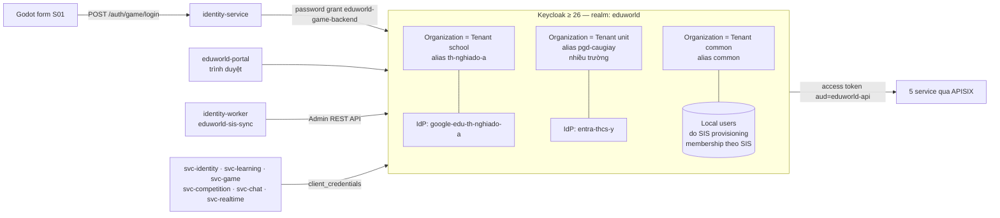
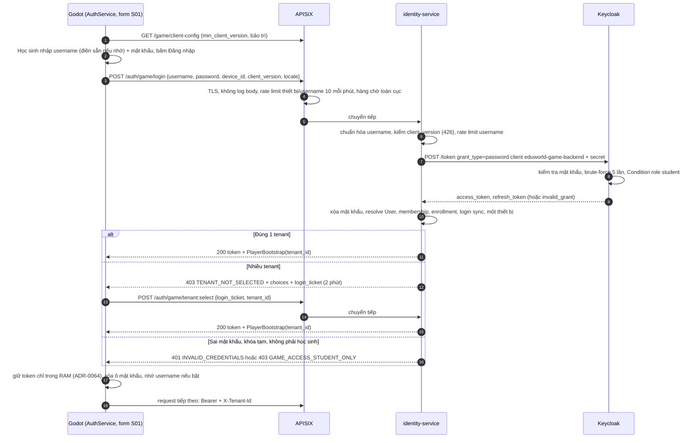

# Keycloak SSO

> Trạng thái: Draft · Phiên bản: 0.4 · Owner: Identity & Security Engineer · Cập nhật: 2026-11-15
> Liên quan: [ADR-0006, ADR-0007 (portal), ADR-0008, ADR-0009, ADR-0026, ADR-0063…ADR-0068](../adr/README.md) · [MULTITENANCY §8](../06-architecture/MULTITENANCY.md) · [IDENTITY_MAPPING](IDENTITY_MAPPING.md) · [ACCOUNT_PROVISIONING](ACCOUNT_PROVISIONING.md) · [SIS_INTEGRATION](SIS_INTEGRATION.md) · [SECURITY_ARCHITECTURE](../10-security/SECURITY_ARCHITECTURE.md) · OQ-02, OQ-04

## 1. Phạm vi

Keycloak là nhà cung cấp danh tính (OIDC Provider) duy nhất của EduWorld. Keycloak chịu trách nhiệm: xác thực, SSO, identity brokering tới IdP của trường/Sở, phát hành token, quản lý phiên, role thô. Mỗi **tenant** (một trường độc lập, một đơn vị nhiều trường, hoặc tenant chung) là một **Keycloak Organization**; khi client yêu cầu một tenant (scope `organization:{alias}` — trong Release 1.0 chỉ dùng sau bước chọn tenant lúc người dùng thuộc nhiều tenant), Keycloak kiểm tra người đăng nhập có là member của tenant đó hay không (ADR-0026, ADR-0063). Release 1.0: học sinh chỉ đăng nhập **username + password** (ADR-0063) bằng **form trong game**, gửi qua API của identity-service (ADR-0068); mỗi lần mở game đều nhập mật khẩu (ADR-0064). Nhân sự đăng nhập **Admin Portal** trên trang Keycloak riêng (theme vận hành), bằng username hoặc email, không chọn tenant trước (ADR-0066, ADR-0067). Keycloak **không** quyết định phạm vi lớp/môn, và backend **luôn** đối chiếu tenant (header `X-Tenant-Id`, claim nếu có) với membership trong DB ([MULTITENANCY §8](../06-architecture/MULTITENANCY.md), ADR-0065).

Nguyên tắc bắt buộc [Confirmed]:

- Học sinh dùng tài khoản do nhà trường cấp; không có self-registration (`registrationAllowed = false`).
- **Game:** form username/password vẽ bằng Godot → `POST /api/v1/auth/game/login` → identity-service gọi token endpoint Keycloak bằng client **confidential** `eduworld-game-backend` (Direct Access Grants). Game không biết client secret, không mở trình duyệt/WebView/Custom Tab (ADR-0068). **Portal:** Authorization Code + PKCE trên trình duyệt (ADR-0007 vẫn áp dụng cho portal).
- **Username và email duy nhất toàn realm** (không phân biệt hoa thường; "Duplicate emails" tắt), một người một tài khoản, nhiều membership (ADR-0067, [ADR-0069](../adr/ADR-0069-username-email-duy-nhat-theo-tenant-va-dang-nhap-khong-chon-tenant.md)). Không có username nội bộ theo tenant; Keycloak xác thực trước, identity-service kiểm tra tenant sau.
- EduWorld không lưu mật khẩu học sinh (mật khẩu nằm ở Keycloak hoặc IdP của trường).
- Không hardcode realm/client/URL trong mã nguồn: mọi giá trị qua environment/config.

## 2. Topology



| Thành phần | Giá trị | Nhãn |
|---|---|---|
| Phiên bản | Keycloak ≥ 26 (Organizations GA) | [Proposed] |
| Service sở hữu tích hợp | `identity-service` là service duy nhất gọi Keycloak Admin API (provisioning, membership, revoke session); service khác chỉ kiểm tra token bằng JWKS | [Confirmed] ADR-0036 |
| Realm | `eduworld` — một realm cho mỗi môi trường (dev/staging/prod là deployment riêng) | [Proposed] ADR-0006 |
| Hostname | `auth.<domain>` (public), admin console chỉ qua `auth-admin.<internal>` | [Proposed] |
| DB | PostgreSQL riêng (instance/database tách khỏi DB nghiệp vụ) | [Proposed] |
| Cluster | ≥ 3 node, mỗi node 4 vCPU / 8 GB, chạy trên Docker Swarm (ADR-0024): tăng replica 3 → 5 trước khung giờ cao điểm theo lịch học (`ops-scheduler`), alert khi CPU > 60% để scale thủ công; cache Infinispan phân tán; **persistent user sessions** (Keycloak 26, phiên lưu DB nên restart/scale không mất phiên) — ADR-0045 | [Proposed] |
| Năng lực mục tiêu | 10.000 CCU; bão đăng nhập 3.000 lượt/10 phút, đỉnh 50 đăng nhập mật khẩu/giây, 500 refresh/giây — §12 | [Confirmed] CCU / [Proposed] tải |

### 2.1. Organizations: mỗi Tenant là một Organization (ADR-0026)

| Quy tắc | Nhãn |
|---|---|
| Mỗi **Tenant** (`school`, `unit` hoặc `common`, ADR-0005) = 1 Keycloak Organization. Lưu `platform.tenants.keycloak_org_id` và `keycloak_org_alias` (duy nhất, chữ thường, ví dụ `th-nghiado-a`, `pgd-caugiay`, `common`). Alias là mã tenant dùng trong scope `organization:{alias}` | [Confirmed] |
| Tenant loại `unit` có **một** Organization chung cho mọi trường trong đơn vị; **không** tạo Organization cho từng School bên trong tenant | [Confirmed] |
| Membership do worker (`eduworld-sis-sync`) đồng bộ từ dữ liệu EduWorld (SIS + UserRole, ADR-0066): học sinh là member đúng 1 tenant (tenant chứa trường có enrollment active); giáo viên/nhân sự là member của mọi tenant có phân công. Chuyển trường trong cùng tenant `unit` không đổi membership. Học sinh tenant chung là member của Organization `common`. Không thêm tay ([ACCOUNT_PROVISIONING §2.1](ACCOUNT_PROVISIONING.md)) | [Confirmed] |
| Organization attribute: `tenant_id` (UUID EduWorld), `tenant_type`, `display_name`, `logo_url`, `login_code` để theme hiển thị đúng tenant | [Proposed] |
| **Organization domain** (vd. `thcs-demo.edu.vn`, đã xác minh, không trùng giữa các Organization): dùng cho **identity-first login** theo tên miền email (chuyển tới IdP của tenant). **Ngoài Release 1.0** (ADR-0063) — mở rộng sau; Release 1.0 không khai báo domain, học sinh đăng nhập bằng username EduWorld cấp | Mở rộng sau |
| Tạo/tắt Organization khi System Admin tạo/tắt tenant (event `tenant.created`/`tenant.updated`). Tenant tắt → Organization `enabled=false`. SIS sync thêm trường mới vào tenant `unit` không tạo Organization mới | [Proposed] |

**Tải với nhiều Organization:** số Organization bằng số tenant (≤ số trường, vì tenant `unit` gom nhiều trường). Phải chạy load test Keycloak với số org và member mục tiêu (OQ-03): thời gian đăng nhập p95, thời gian Admin API khi sync membership, kích thước cache [Proposed].

**Cần kiểm chứng trên bản Keycloak triển khai** (spike Phase 1): (1) scope `organization:{alias}` khi user không là member thì Keycloak từ chối hay phát token thiếu claim; (2) định dạng claim `organization` theo cấu hình mapper; (3) IdP chỉ liên kết được với một Organization hay nhiều. Dù kết quả thế nào, backend vẫn chặn đúng vì luôn kiểm tra chéo với DB.

### 2.2. Identity Providers (brokering)

> **Release 1.0 (ADR-0063):** học sinh chỉ đăng nhập bằng tài khoản local (username/password) do EduWorld cấp. Brokering IdP trường/Sở (Google, Microsoft, SSO Sở) cho học sinh là **mở rộng sau**, bật bằng ADR mới; thiết kế dưới đây giữ làm điểm mở rộng.

| Loại IdP | Giao thức | Ghi chú |
|---|---|---|
| Google Workspace for Education | OIDC | `hd` claim kiểm tra domain; restrict theo organization |
| Microsoft Entra ID (M365 Education) | OIDC | Tenant ID cố định, không dùng `common` |
| SSO của SIS / Sở | OIDC hoặc SAML 2.0 | Theo OQ-01/OQ-02. Nhiều trường dùng chung IdP của Sở: nếu các trường cùng một tenant `unit` thì chỉ cần một IdP gắn với Organization của tenant; nếu thuộc nhiều tenant thì tạo một bản cấu hình IdP (alias riêng) cho từng tenant cùng trỏ về một IdP gốc [Proposed — chờ kiểm chứng ở §2.1] |
| Không có IdP | Local user | Tài khoản tạo bởi SIS provisioning (ACCOUNT_PROVISIONING) |

Mỗi IdP được **liên kết với Organization của tenant** (`Redirect when email domain matches` tắt với học sinh; trang đăng nhập của trường hiển thị nút IdP đó). Cấu hình bắt buộc cho mỗi IdP:

- `Sync mode = FORCE` cho các attribute được map (để thay đổi ở IdP phản ánh vào Keycloak).
- **First broker login flow tùy chỉnh** `eduworld-first-broker-login`: không tự quyết định liên kết theo email/username. Keycloak chỉ tạo/giữ brokered identity; **identity-service quyết định SIS nguồn và liên kết** theo `(idp_alias, idp_subject)` trong `sis.student_login_keys` của các connection thuộc tenant (ADR-0046, [IDENTITY_MAPPING §3.2](IDENTITY_MAPPING.md)). Không khớp và người dùng đã chọn tenant → lỗi thân thiện “Tài khoản chưa được nhà trường kích hoạt” (`ACCOUNT_NOT_PROVISIONED`); khớp nhiều bản ghi → `IDENTITY_CONFLICT`, chờ nhà trường xử lý. Xem [ACCOUNT_PROVISIONING §3](ACCOUNT_PROVISIONING.md).
- `Trust email = false` (không link tự động theo email) — **không dùng email làm khóa định danh** [Confirmed].
- Mapper: `idp_alias` (hardcoded attribute), **`idp_subject`** (giữ nguyên `sub` của IdP gốc vào user attribute và token claim `idp_subject`, sync mode FORCE) để identity-service đối chiếu `sis.student_login_keys` (ADR-0046); `external_student_code` (nếu IdP cung cấp, chỉ là gợi ý).

**Thuộc tính user Keycloak do identity-service ghi (ADR-0046) — chỉ là gợi ý tra cứu nhanh, database của identity-service là nguồn quyết định:**

| Attribute | Giá trị | Ai ghi | Ghi chú |
|---|---|---|---|
| `eduworld_user_id` | UUID user EduWorld | provisioning | Dùng khi đối soát/relink |
| `ew_tenant` | `tenant_id` | provisioning, chuyển tenant | Không dùng để quyết định tenant (ADR-0026) |
| `ew_sis_connection` | `sis_connection_id` | provisioning, chuyển SIS | Gợi ý SIS nguồn; khi lệch với `identity.sis_identity_links` thì DB thắng và job reconciliation ghi đè |
| `ew_external_id` | `student_external_id` trong SIS đó | provisioning | Chỉ duy nhất trong một SIS |
| `idp_alias`, `idp_subject` | từ IdP mapper | Keycloak | Học sinh đăng nhập qua IdP |

Các attribute này **không** đưa vào access token của client game/CMS (giảm lộ thông tin); identity-service đọc qua Admin API hoặc từ DB của mình.

## 3. Clients

| Client ID | Loại | Flow | Người dùng | Ghi chú |
|---|---|---|---|---|
| `eduworld-game-backend` | **Confidential** | **Chỉ Direct Access Grants** (password grant) + refresh; tắt Standard Flow, Implicit, Service Account, Device Grant (ADR-0068) | **Chỉ học sinh** (ADR-0031) — giáo viên/vận hành/System Admin không vào game | Chỉ **identity-service** giữ secret (secret manager, xoay 90 ngày); game không biết secret. Điều kiện realm role `student` trong direct grant flow (§3.1b). Thay client public `eduworld-game` (PKCE) — client này **bỏ** khỏi realm |
| `eduworld-portal` | Public (SPA) | Auth Code + PKCE S256; **MFA bắt buộc có điều kiện** với realm role `platform_staff` (conditional OTP/WebAuthn); login theme riêng `eduworld-ops`; đăng nhập bằng username **hoặc email** (ADR-0066, ADR-0067) | Mọi người dùng Admin Portal (học sinh bị chặn): vận hành tenant (Teacher, Tenant/School Admin, Academic Manager, Content Editor/Reviewer, Moderator) và đội platform (System Admin, Content Admin/Reviewer, Game Designer, Live-ops, Competition Admin) | Admin Portal `web/apps/portal`, 5 workspace (ADR-0027 mục 7). Route `/api/v1/game-admin/*`, `/api/v1/admin/*`: chỉ gateway nội bộ, backend yêu cầu `acr` mức MFA + role platform; token của vận hành tenant không bao giờ được chấp nhận ở đó |
| `eduworld-api` | Bearer-only / resource server | — | — | Đích của audience; không đăng nhập trực tiếp |
| `eduworld-sis-sync` | Confidential | Client Credentials | Service account của worker | [Proposed] Quyền admin tối thiểu: `manage-users`, `view-users` trong realm, giới hạn bằng fine-grained admin permissions |
| `eduworld-apisix` | Confidential (tùy chọn) | — | APISIX nếu dùng introspection | Mặc định APISIX kiểm tra JWT bằng JWKS, không cần secret [Proposed] |
| `svc-identity`, `svc-learning`, `svc-game`, `svc-competition`, `svc-chat`, `svc-realtime` | Confidential | Client Credentials **duy nhất** (tắt standard flow, implicit, direct grant) | Service account của từng microservice (ADR-0040) | Gọi `/internal/v1/*` của service khác. Xem §3.2 |

### 3.1. `eduworld-game-backend` — client confidential cho đăng nhập game (ADR-0068)

| Thiết lập | Giá trị |
|---|---|
| `publicClient` | `false` (client authentication bật; secret `${env.KC_GAME_BACKEND_SECRET}`, chỉ mount vào identity-service) [Proposed: chuyển sang `client-jwt` (private key JWT) khi vận hành ổn định] |
| `directAccessGrantsEnabled` | `true` — **chỉ** client này bật; mọi client khác `false` |
| `standardFlowEnabled`, `implicitFlowEnabled`, `serviceAccountsEnabled`, device grant | `false` (không redirect URI, không web origin) |
| Direct grant flow | Override `eduworld-game-direct-grant`: Username Validation → Password → **Condition – User Role `student`** → Deny Access; brute-force của realm áp dụng (§10) |
| Scope mặc định | `openid profile eduworld-api-audience eduworld-roles`; **không** `organization` (tenant xác định ở backend qua membership + `X-Tenant-Id`, ADR-0065), không `offline_access` |
| Token | Access 5 phút, refresh rotation (`revokeRefreshToken=true`, reuse 0); client session idle 30 phút, max 10 giờ (ADR-0064) |
| Khác | `frontchannelLogout=false`, `consentRequired=false` (đồng ý xử lý qua nhà trường — [DATA_PRIVACY](../10-security/DATA_PRIVACY.md)) |

Client public `eduworld-game` (Authorization Code + PKCE, redirect loopback/custom scheme/web) **bị bỏ** cho game: không còn redirect URI `http://127.0.0.1/*`, `vn.eduworld.game:/oauth2/callback`, `https://play.<domain>/auth/callback`. Godot gọi API của EduWorld, không gọi Keycloak trực tiếp.

### 3.1b. Chỉ học sinh được đăng nhập game (ADR-0031, ADR-0068)

- **Keycloak (lớp bổ sung):** direct grant flow của `eduworld-game-backend` có bước **Condition – User Role** (`student`) + **Deny Access**; Keycloak trả `invalid_grant`, identity-service ánh xạ thành `403 GAME_ACCESS_STUDENT_ONLY` (thông điệp game: "Tài khoản này không dùng để vào game. Thầy cô và cán bộ vui lòng dùng trang quản trị.") [Proposed — kiểm chứng phân biệt được lỗi role với lỗi mật khẩu trên bản Keycloak triển khai; nếu không phân biệt được, dựa vào lớp backend].
- **Backend (bắt buộc, không phụ thuộc Keycloak):** `POST /api/v1/auth/game/login` sau khi nhận token kiểm tra `identity.users.user_type = 'student'`; khác → thu hồi phiên vừa tạo, `403 GAME_ACCESS_STUDENT_ONLY` + audit `game_access_denied_non_student`. Middleware `game_player` (`azp = eduworld-game-backend` + `user_type = student`) lặp lại ở `POST /game/sessions`, mọi API người chơi và khi cấp realtime ticket.
- Giáo viên xem thử trải nghiệm qua **preview trong CMS** (Godot Web export, dữ liệu mẫu, không tạo game session/login event) [Proposed].
- Ghi `sid` (Keycloak session id) của token vào `game.game_sessions.keycloak_sid` để khi tài khoản đăng nhập thiết bị khác, backend thu hồi đúng Keycloak user session của thiết bị cũ (Admin API `DELETE /admin/realms/{realm}/sessions/{sid}`) — refresh token của thiết bị cũ hết hiệu lực (ADR-0031).

### 3.2. Client service-to-service `svc-*` (ADR-0040)

| Thuộc tính | Giá trị |
|---|---|
| Loại | Confidential, `serviceAccountsEnabled=true`, chỉ `client_credentials`; secret xoay vòng 90 ngày [Proposed], mỗi service chỉ nhận secret của mình (DEPLOYMENT §13) |
| Audience | Mỗi service nhận có audience riêng: `svc-identity-api`, `svc-learning-api`, `svc-game-api`, `svc-competition-api`, `svc-chat-api`. Client scope `internal-<service>` (optional) thêm audience mapper tương ứng; client gọi xin đúng scope của service đích (`scope=internal-learning`) |
| Phân quyền | Client chỉ được gán client scope của service mà nó được phép gọi theo ma trận gọi (DEPLOYMENT §4.3). Ví dụ `svc-game` có `internal-learning`, `internal-identity`; không có `internal-chat` |
| Claim | `azp = svc-<caller>`, `aud = svc-<callee>-api`, `scope`; **không** có `organization`, không có role người dùng. Tenant đang xử lý truyền bằng header `X-Tenant-Id`, người dùng gốc bằng `X-On-Behalf-Of` |
| TTL | Access token 5 phút; service cache token đến còn 30 s rồi xin mới; không có refresh token |
| Kiểm tra phía nhận | Middleware internal: chữ ký JWKS, `iss`, `aud` = audience của chính service, `azp` nằm trong allowlist **của từng endpoint internal** (khai báo cạnh spec, ví dụ `x-allowed-callers: [svc-game, svc-competition]`); token người dùng (`azp` = `eduworld-*`) bị từ chối trên `/internal/v1/*` |
| Client đặc biệt `svc-keycloak-authn` — **mở rộng sau, ngoài Release 1.0 (ADR-0063)**; không tạo trong realm Release 1.0 | Dùng bởi authenticator tùy biến chạy **bên trong Keycloak** (`ew-class-qr`, `ew-card-qr`, `ew-picture-password`, ADR-0045), chỉ có scope `internal-identity` và chỉ được gọi `POST /internal/v1/login-credentials:verify` ([ACCOUNT_PROVISIONING §6c](ACCOUNT_PROVISIONING.md)) [Proposed] |
| Khác với `eduworld-game-backend` | `svc-identity` chỉ dùng client credentials cho lời gọi giữa service; đăng nhập học sinh dùng client riêng `eduworld-game-backend` để token người dùng có `azp` riêng và brute-force/role flow riêng (ADR-0068) |
| Lý do không dùng token người dùng để gọi service khác | Tránh lan quyền người dùng sang service không liên quan, và vì nhiều lời gọi xuất phát từ worker/consumer không có người dùng |

### 3.3. `eduworld-portal` (Admin Portal)

- Redirect: `https://portal.<domain>/auth/callback` (một origin cho mọi workspace; workspace platform gọi API qua gateway nội bộ khi người dùng ở trong VPN) [Proposed]. **Không** có URL theo tenant (`/t/{tenant_alias}` đã bỏ, ADR-0067).
- Web origins tương ứng; không wildcard.
- **Màn đăng nhập riêng** (ADR-0066): client override login theme `eduworld-ops` (giao diện vận hành, khác theme game): logo EduWorld + "Cổng quản trị", ô "Tên đăng nhập hoặc email", ô mật khẩu, "Quên mật khẩu?" (reset qua email — nhân sự bắt buộc có email), chọn ngôn ngữ. Không có bước chọn tenant/trường.
- Realm: `loginWithEmailAllowed=true`, `duplicateEmailsAllowed=false`, `registrationEmailAsUsername=false`; username/email so sánh không phân biệt hoa thường (Keycloak lưu chữ thường) — ADR-0067. Game chỉ gửi username (ADR-0063), identity-service từ chối chuỗi có `@` ở `/auth/game/login` [Proposed].
- Authentication flow `eduworld-portal-browser`: chặn `student` bằng authenticator "Allow access only for role" (`tenant_staff` hoặc `platform_staff`) — thông điệp "Tài khoản học sinh không dùng được cổng quản trị"; backend chặn lần hai bằng `403 PORTAL_ACCESS_STAFF_ONLY` (ADR-0066); **Conditional OTP/WebAuthn**: bắt buộc MFA khi người dùng có realm role `platform_staff`, tùy chọn với vận hành tenant [Proposed]. Token sau MFA có `acr` mức MFA và `amr` chứa `otp`/`webauthn`.
- Step-up: khi người dùng platform đăng nhập không qua MFA (lỗi cấu hình) hoặc `auth_time` quá 8 giờ, backend trả `403 MFA_REQUIRED`, portal yêu cầu đăng nhập lại với `acr_values` mức MFA [Proposed].
- Phiên: SSO idle 30 phút, tối đa 10 giờ cho mọi người dùng portal; với role platform, backend chỉ chấp nhận `auth_time` trong 8 giờ gần nhất cho route platform [Proposed].
- Backend kiểm tra thêm theo route: `/api/v1/game-admin/*` và `/api/v1/admin/*` chỉ chấp nhận `azp = eduworld-portal` có MFA (`acr`) và Principal có role platform; `/api/v1/cms/learning/*`, `/api/v1/lms/*`, `/api/v1/schools/*`, `/api/v1/tenant/*` chấp nhận `eduworld-portal` với `user_type ≠ student` (ADR-0027, ADR-0066, [SECURITY_ARCHITECTURE §5](../10-security/SECURITY_ARCHITECTURE.md)).
- **Sau đăng nhập (ADR-0067):** portal gọi `GET /api/v1/me/tenants` (không cần `X-Tenant-Id`): có role platform → vào phạm vi platform; đúng 1 tenant → vào thẳng; nhiều tenant → màn chọn tenant, rồi xin token mới với scope `organization:{alias}` qua SSO (không nhập lại mật khẩu) và gửi `X-Tenant-Id`; đổi tenant ở bộ chọn trên topbar (token mới + header mới); không có UserRole portal hiệu lực ở tenant nào và không có role platform → màn "Tài khoản chưa được cấp quyền quản trị" (`403 PORTAL_ACCESS_STAFF_ONLY`) và đăng xuất.

## 4. Roles, groups, scopes

### 4.1. Realm roles (thô)

Realm role chỉ là **cổng đăng nhập thô** cho từng client, không phải permission (ADR-0027):

| Realm role | Gán cho | Cho phép đăng nhập |
|---|---|---|
| `student` | Học sinh (từ SIS) | `eduworld-game-backend` (đăng nhập game qua backend, ADR-0068); **bị chặn** ở `eduworld-portal` |
| `tenant_staff` | Mọi vận hành tenant: giáo viên, Tenant Admin, School Admin, Academic Manager (tổ chuyên môn), Tenant Content Editor/Reviewer, Tenant Moderator (từ SIS hoặc Tenant Admin/School Admin gán) | `eduworld-portal` (không vào được game — ADR-0031) |
| `platform_staff` | Đội EduWorld: System Admin, Content Admin/Reviewer, Game Designer, Live-ops, Competition Admin | `eduworld-portal` (MFA bắt buộc có điều kiện theo role này) |

- Role nghiệp vụ chi tiết (`teacher`, `school_admin`, `game_designer`, ...) và permission **không nằm trong Keycloak**: chúng là Role/UserRole trong DB (`identity.roles`, `identity.user_roles`) + permission catalog trong code (ADR-0066). Realm role `tenant_staff`/`platform_staff` được worker gán/gỡ theo event `user_role.changed` (có ít nhất một UserRole portal hiệu lực → `tenant_staff`; có UserRole platform → `platform_staff`) ([ADMIN_PORTAL §2](../04-admin-portal/ADMIN_PORTAL.md#2-permission-model), [IDENTITY_MAPPING §6](IDENTITY_MAPPING.md)). Khi có mâu thuẫn, **DB thắng**.
- `platform_staff` chỉ được gán bởi System Admin qua workspace Platform Administration (hoặc quy trình IaC realm); worker SIS (`eduworld-sis-sync`) chỉ được gán `student`/`tenant_staff` và không có quyền gán `platform_staff` (fine-grained admin permissions) [Proposed].
- Role game/thi đấu (`game_designer`, `liveops`, `competition_admin`) chỉ có hiệu lực với token `eduworld-portal` có MFA; backend từ chối permission platform-only nếu `azp` khác hoặc thiếu MFA.

Client roles: không dùng trong Release 1.0 [Proposed].

### 4.2. Groups

Không dùng group để biểu diễn trường/lớp (dữ liệu đó thuộc SIS/DB). Group chỉ dùng cho vận hành nội bộ: `/ops/platform-admins`, `/ops/content-team`. [Proposed]

### 4.3. Client scopes

| Scope | Loại | Mappers | Dùng bởi |
|---|---|---|---|
| `openid`, `profile` (rút gọn) | Default | `sub`, `preferred_username`, **không** map `given_name/family_name/email` vào access token | Tất cả |
| `eduworld-api-audience` | Default | Audience mapper → `aud: eduworld-api` | `eduworld-game-backend`, `eduworld-portal` |
| `eduworld-roles` | Default | Realm roles → claim `roles` (mảng phẳng) | `eduworld-game-backend`, `eduworld-portal` |
| `organization` (built-in, Keycloak ≥ 26) | **Optional**, client yêu cầu dạng `organization:{alias}` | Organization Membership mapper, bật "Add organization id" → claim `organization` chỉ chứa **tenant đã yêu cầu** | Chỉ `eduworld-portal` sau bước chọn tenant; **không** gán cho `eduworld-game-backend` (ADR-0068) |
| `offline_access` | **Không cấp** | — | Cấm refresh token offline cho trẻ em [Proposed] |

Nguyên tắc data minimization: access token **không** chứa họ tên, email, ngày sinh, mã học sinh.

Học sinh **không chọn trường** khi đăng nhập game (ADR-0063): token game không bao giờ có claim `organization`; identity-service xác định tenant theo membership trong DB ngay trong `POST /auth/game/login` (1 tenant → dùng; nhiều → `403 TENANT_NOT_SELECTED` + `login_ticket`, chọn bằng `POST /auth/game/tenant:select`; không thuộc tenant chung và không thuộc tenant SIS nào → `403 ACCOUNT_NOT_PROVISIONED`). Tenant đã chọn gắn vào game session và mọi request mang `X-Tenant-Id` (ADR-0065, ADR-0068). Portal: nhân sự thuộc nhiều tenant chọn tenant **sau** đăng nhập rồi xin token mới với `scope=openid profile organization:{tenant_alias}` qua SSO. **Không** gửi scope `organization` trống (Keycloak có thể trả mọi organization của user).

### 4.4. Access token mẫu

```json
{
  "iss": "https://auth.eduworld.vn/realms/eduworld",
  "sub": "f3b0c2a1-5d7e-4c9a-9e61-2b7a0c11d4e2",
  "aud": ["eduworld-api"],
  "azp": "eduworld-game-backend",
  "exp": 1763190300,
  "iat": 1763190000,
  "auth_time": 1763189990,
  "jti": "0193f0a2-...-7c1e",
  "sid": "5b1e9c3d-....",
  "typ": "Bearer",
  "scope": "openid profile",
  "roles": ["student"],
  "preferred_username": "hs.thnda.000123"
}
```

Token game không có claim `organization` (tenant đi bằng header `X-Tenant-Id`, kiểm tra với membership — ADR-0065, ADR-0068). Token portal sau bước chọn tenant có thêm `"organization": {"th-nghiado-a": {"id": "8d2c…"}}` và `azp = eduworld-portal`.

Backend kiểm tra: chữ ký (JWKS, cache theo `kid`, refresh khi gặp `kid` lạ, tối đa 1 lần/phút), `iss ∈ allowed_issuers`, `aud` chứa `eduworld-api`, `exp`/`nbf` (leeway 30s), `azp ∈ {eduworld-game-backend, eduworld-portal}`, `typ = Bearer`. Endpoint `/api/v1/admin/*` và `/api/v1/game-admin/*` yêu cầu `azp = eduworld-portal` + MFA (`acr`) + role platform; route portal yêu cầu `azp = eduworld-portal` và `user_type ≠ student` (`403 PORTAL_ACCESS_STAFF_ONLY`).

Kiểm tra tenant (ADR-0026, ADR-0065, chi tiết [MULTITENANCY §8](../06-architecture/MULTITENANCY.md)): mọi request tenant-scoped phải có `X-Tenant-Id` và header phải thuộc membership của user theo DB (và trùng tenant của game session với token game) — không khớp → `403 TENANT_MISMATCH`. Với người dùng tenant của `eduworld-portal`, nếu có claim `organization` thì phải chứa **đúng một** tenant (nhiều → `403 TENANT_NOT_SELECTED`), alias và id phải khớp `platform.tenants` (không khớp/tenant tắt → `403 TENANT_ACCESS_DISABLED`) và tenant phải nằm trong membership của user theo DB (không → `403 TENANT_MISMATCH`). Không có claim → backend chọn theo membership (1 → dùng; nhiều → `403 TENANT_NOT_SELECTED` kèm danh sách; không thuộc tenant chung và không thuộc tenant SIS nào → `403 ACCOUNT_NOT_PROVISIONED`, audit, thu hồi phiên Keycloak theo `sid` — ADR-0063). Không bao giờ tự đưa người dùng vào tenant chung. Backend chấp nhận cả dạng claim mảng alias và dạng object có id (tùy cấu hình mapper), nhưng chỉ tin id/alias sau khi đối chiếu `platform.tenants`. `preferred_username` **không** dùng để suy ra tenant.

## 5. Session & token policy [Proposed]

| Tham số | eduworld-game-backend (game) | eduworld-portal |
|---|---|---|
| Access token lifespan | 5 phút | 5 phút |
| SSO Session Idle | **30 phút** (ADR-0064) | 30 phút |
| SSO Session Max | **10 giờ** (ADR-0064) | 10 giờ (route platform: `auth_time` ≤ 8 giờ) |
| Remember me | **Tắt** (ADR-0064) | Tắt |
| Lưu token trên thiết bị | **Không** — access/refresh token chỉ trong RAM của tiến trình game (ADR-0064) | Không lưu bền |
| Bắt nhập mật khẩu mỗi lần mở game | **Có** — form S01 luôn trống ô mật khẩu khi khởi động; không có cookie SSO nào được dùng vì game không qua trình duyệt (ADR-0064, ADR-0068) | — |
| Refresh token | Rotation bật (`revokeRefreshToken=true`, reuse = 0); làm mới qua `POST /auth/game/token:refresh` (client confidential) | Rotation bật |
| Offline session | Không | Không |
| MFA | Không | Bắt buộc với `platform_staff`, tùy chọn với vận hành tenant |
| MFA | Không (học sinh) — tùy chọn cho giáo viên | Khuyến nghị cho School Admin | **Bắt buộc** |

Thiết lập ở mức client (`client.session.idle.timeout`, `client.session.max.lifespan`), realm giữ giá trị lớn nhất. **Mỗi lần mở game là một lần đăng nhập mới bằng username + password** (ADR-0064): không có "Ghi nhớ đăng nhập", không tự đăng nhập; client chỉ được nhớ **username** (checkbox "Nhớ tên đăng nhập" trên S01, mặc định bật, tắt sẵn trên máy phòng tin học `shared_device`) để điền sẵn ô tên đăng nhập. Trong lúc game đang mở, refresh token **trong bộ nhớ** dùng để gia hạn access token (5 phút, qua `/auth/game/token:refresh`) và kết nối lại khi rớt mạng mà không hỏi mật khẩu. Game thoát bình thường → `POST /auth/game/logout` (identity-service thu hồi refresh token + phiên Keycloak); game bị tắt đột ngột → phiên Keycloak tự hết theo idle 30 phút; lần mở sau vẫn phải nhập mật khẩu vì không có token trên đĩa và game không dùng trình duyệt. Mobile: app ở nền quá 30 phút hoặc bị hệ điều hành đóng → đăng nhập lại. Một thiết bị/tài khoản (ADR-0031), refresh token rotation + phát hiện reuse, thu hồi ngay khi khóa/dọn tài khoản vẫn áp dụng. Không dùng `offline_access`.

Khi refresh token bị reuse (dấu hiệu bị đánh cắp) → Keycloak thu hồi toàn bộ phiên; client quay về màn hình đăng nhập.

## 6. Luồng đăng nhập game — form trong Godot qua backend (ADR-0068)

### 6.1. Mọi nền tảng (Windows/macOS/Linux, Android/iOS, Web)



- Không trình duyệt hệ thống, không Custom Tabs/`ASWebAuthenticationSession`, không WebView, không TCPServer loopback, không PKCE/`prompt=login`/`login_hint` cho game. Web export gọi cùng API bằng `fetch` (CORS chỉ origin `https://play.<domain>`).
- Token chỉ nằm trong bộ nhớ tiến trình, **không** lưu Android Keystore/iOS Keychain/`user://`/localStorage (ADR-0064). App ở nền quá 30 phút hoặc bị hệ điều hành đóng → đăng nhập lại; reload tab Web = mở game mới.
- Certificate pinning cho tên miền API trên bản desktop/mobile [Proposed]; Web dựa vào HSTS.

### 6.2. Kết quả xác định tenant (trong `POST /auth/game/login`)

identity-service xác định tenant theo membership trong DB (ADR-0063):

| Membership | Kết quả |
|---|---|
| Đúng 1 tenant (tenant SIS hoặc tenant chung do platform tạo) | Vào thẳng tenant đó: `200` + `bootstrap.tenant_id` |
| Nhiều tenant (hiếm) | `403 TENANT_NOT_SELECTED` kèm `choices[]` + `login_ticket` (Valkey, 2 phút, một lần, gắn `device_id`); game hiển thị chọn tenant **sau** đăng nhập rồi gọi `POST /auth/game/tenant:select` — không nhập lại mật khẩu. Ticket hết hạn → `401 LOGIN_TICKET_INVALID`, quay về form |
| Không thuộc tenant chung và không thuộc tenant SIS nào | `403 ACCOUNT_NOT_PROVISIONED`: không tạo session, ghi audit, thu hồi phiên Keycloak vừa tạo theo `sid`; game quay về form |

Tiếp theo → `POST /api/v1/game/sessions` (header `X-Tenant-Id`) → realtime ticket. Vị trí trong lượt chơi: [SYSTEM_ARCHITECTURE §5](../06-architecture/SYSTEM_ARCHITECTURE.md). Thuật toán kiểm tra và **mã lỗi bootstrap** (thứ tự kiểm tra, HTTP, điều kiện): [IDENTITY_MAPPING §4.1](IDENTITY_MAPPING.md#41-mã-lỗi-khi-resolve-thứ-tự-kiểm-tra). Thông điệp tiếng Việt hiển thị cho học sinh: [GODOT_ARCHITECTURE §9](../08-game-client/GODOT_ARCHITECTURE.md#9-error-handling--offline). Ticket và WebSocket: [REALTIME_ARCHITECTURE §3](../06-architecture/REALTIME_ARCHITECTURE.md#3-vòng-đời-kết-nối).

## 7. Refresh, logout, revoke

| Hành động | Cơ chế |
|---|---|
| Refresh | Godot gọi `POST /api/v1/auth/game/token:refresh` chủ động khi access token còn < 60s, hoặc khi nhận 401 `TOKEN_EXPIRED` (retry 1 lần); identity-service đổi refresh token với Keycloak bằng client `eduworld-game-backend`. Refresh lỗi (`401 UNAUTHENTICATED`) → về màn hình đăng nhập. Portal refresh trực tiếp với Keycloak (client public PKCE) |
| Logout | Godot: `POST /api/v1/auth/game/logout` (identity-service thu hồi refresh token + phiên Keycloak theo `sid`, đóng game session, thu hồi realtime ticket, ngắt WS) → xóa token trong RAM. Portal: `POST /api/v1/auth/logout` rồi end-session Keycloak |
| Thoát game (ADR-0064) | Thoát bình thường = Logout như trên; tắt đột ngột → phiên hết theo idle 30 phút, không có token nào trên đĩa |
| Admin khóa tài khoản | Backend set `status=locked` → Keycloak `enabled=false` + logout all sessions (Admin API) → event `user.access_revoked` → realtime ngắt kết nối (ACCOUNT_PROVISIONING §6) |
| Đăng nhập thiết bị khác (ADR-0031) | Backend kết thúc game session cũ, gửi `session.session.replaced` + close 4409 tới thiết bị cũ, rồi `keycloak-provisioner` thu hồi Keycloak session theo `sid` của session cũ. Keycloak cho phép nhiều SSO session song song; quy tắc một thiết bị được thực thi ở game session của EduWorld, không dùng giới hạn session của Keycloak |
| Backchannel logout | Cấu hình `backchannel_logout_url` cho `eduworld-api` (`/internal/auth/backchannel-logout`, chỉ mạng nội bộ) để backend đóng game session khi phiên Keycloak bị hủy [Proposed] |

Access token 5 phút nghĩa là khoảng trễ thu hồi tối đa 5 phút cho REST; backend còn kiểm tra `user.status` (cache ≤ 60s) ở mỗi request nên khoảng trễ thực tế ≤ 60s.

## 8. Trải nghiệm đăng nhập cho học sinh

- **Release 1.0: chỉ username + password** [Confirmed, ADR-0063]: tài khoản local Keycloak do EduWorld cấp (từ SIS provisioning hoặc do platform tạo trong tenant chung, [ACCOUNT_PROVISIONING](ACCOUNT_PROVISIONING.md)). Học sinh **không chọn trường**, không có ô "nhập mã trường", không có nút đăng nhập nhanh; sau xác thực, identity-service xác định tenant theo §6.2.
- **Mỗi lần mở game phải nhập mật khẩu** [Confirmed, ADR-0064]: không "Ghi nhớ đăng nhập"; ô tên đăng nhập có thể điền sẵn nếu học sinh bật "Nhớ tên đăng nhập" — tắt sẵn trên máy phòng tin học.
- **Mật khẩu nhập trong form của game** (S01, [STUDENT_GAME_UX_CORE](../05-ux/STUDENT_GAME_UX_CORE.md)) và gửi qua API của identity-service (ADR-0068, thay ADR-0007 cho game). Biện pháp bảo vệ: TLS, không log body, rate limit thiết bị/username, brute-force Keycloak, thông điệp lỗi chung ([SECURITY_ARCHITECTURE §3.1b](../10-security/SECURITY_ARCHITECTURE.md)).
- Admin Portal (ADR-0066, ADR-0067): màn đăng nhập riêng theme `eduworld-ops`, username **hoặc email** + mật khẩu (+ MFA với role platform), **không chọn tenant trước**, không có URL theo tenant. Sau đăng nhập: role platform → phạm vi platform; 1 tenant → vào thẳng; nhiều tenant → chọn tenant, đổi ở bộ chọn trên topbar (token mới qua SSO + `X-Tenant-Id` mới, không nhập lại mật khẩu). Trong tenant `unit`, đổi trường chỉ là bộ lọc trong cùng phiên. System Admin ghi dữ liệu tenant gửi `X-Tenant-Id` = tenant đích, đọc liên tenant lọc bằng dropdown (`tenant_ids`, ADR-0027 §6, ADR-0065).
- Giao diện đăng nhập game là **form Godot** (không còn theme Keycloak cho học sinh): tiếng Việt mặc định, font lớn (≥18px), nút to, hình minh họa thân thiện, không thuật ngữ kỹ thuật. Chỉ gồm: logo, chọn ngôn ngữ, ô tên đăng nhập, ô mật khẩu (nút hiện/ẩn), nút "Đăng nhập", checkbox "Nhớ tên đăng nhập", dòng "Quên mật khẩu? Nhờ thầy cô đặt lại". Không có "Ghi nhớ đăng nhập"; không hiển thị tên/logo trường trước khi đăng nhập. Theme Keycloak `eduworld` cho học sinh chỉ còn dùng nếu bật lại IdP brokering sau này (§8.1).
- Học sinh nhỏ: tài khoản do giáo viên in phát (username ngắn + mật khẩu ngắn do trường cấp), vẫn là local user Keycloak.
- Thông điệp lỗi: không tiết lộ "tài khoản tồn tại hay không" hay "đang bị khóa tạm", không tiết lộ tài khoản thuộc trường nào — sai mật khẩu, không có tài khoản và khóa tạm đều là `INVALID_CREDENTIALS` "Tên đăng nhập hoặc mật khẩu chưa đúng". `ACCOUNT_NOT_PROVISIONED` → "Tài khoản của em chưa được kích hoạt trong EduWorld. Em hãy nhờ thầy cô kiểm tra nhé."
- Quên mật khẩu: tắt reset qua email cho học sinh; hướng dẫn "Quên mật khẩu? Nhờ thầy cô đặt lại" — giáo viên/School Admin của **đúng tenant/trường** reset qua Admin Portal (backend gọi Admin API, có audit). [Proposed]

### 8.1. Mở rộng sau — ngoài Release 1.0 (ADR-0063)

Các phương thức dưới đây **không hiển thị trên UI và không triển khai trong Release 1.0**; giữ thiết kế làm điểm mở rộng, chỉ bật bằng ADR mới (thay một phần ADR-0045 mục 4):

| Cách | Thiết kế dự kiến |
|---|---|
| SSO qua IdP trường/đơn vị (Google Workspace for Education, Microsoft Entra ID) + identity-first theo tên miền email | Organization khai báo domain đã xác minh; Keycloak chuyển tới IdP của tenant; liên kết tài khoản theo ADR-0046. Cần ADR mới vì đăng nhập game qua form không hỗ trợ IdP ngoài (ADR-0068 hệ quả) |
| Mã QR lớp + PIN 4 số | Giáo viên mở mã lớp (TTL 60 s, xoay vòng), authenticator `ew-class-qr` |
| Thẻ QR cá nhân | Mã bí mật dài in từ portal, authenticator `ew-card-qr` |
| Mật khẩu hình ảnh (lớp 1–3) | Chuỗi 3–4 hình từ lưới 9 hình, authenticator `ew-picture-password` |
| Device Authorization Grant | Máy dùng chung, xác nhận trên thiết bị khác (mã hết hạn 10 phút, polling 5 s) |
| "Nhập mã trường" (`login_code`) | `GET /api/v1/auth/tenants:resolve?code=...` rồi mở Keycloak với `organization:{alias}` |

Authenticator tùy biến (nếu bật sau) viết bằng Keycloak SPI (Java), đóng gói provider JAR, có test tích hợp và review bảo mật mỗi lần nâng cấp Keycloak.

## 9. Máy dùng chung (phòng tin học)

Release 1.0 không dùng Device Authorization Grant (§8.1). Máy phòng tin học cấu hình `device.cfg` với `shared_device: true`: không nhớ username; thoát game hoặc 30 phút không hoạt động → logout + revoke. Vì token chỉ nằm trong RAM (ADR-0064), học sinh sau không thể vào tài khoản của học sinh trước.

## 10. Bảo vệ brute-force & chính sách mật khẩu

| Thiết lập | Giá trị [Proposed] |
|---|---|
| Brute force detection | Bật **theo tài khoản** (không khóa theo IP vì cả trường dùng chung NAT); `failureFactor=5`, wait increment 1 phút, max wait 15 phút, quick login check 1s |
| Băm mật khẩu | argon2id (hoặc pbkdf2-sha512) với tham số **benchmark trên phần cứng triển khai** để ≤ 80 ms/lần mà vẫn đạt khuyến nghị bảo mật hiện hành (OWASP Password Storage); **rehash on login** khi đổi tham số (ADR-0045) |
| Permanent lockout | Tắt (tránh DoS khóa tài khoản học sinh) |
| Password policy (local user) | Học sinh: tối thiểu 6 ký tự (cân bằng với trẻ nhỏ), không trùng username; Giáo viên/Admin: ≥ 10 ký tự, `notUsername`, `passwordHistory(3)` |
| Rate limit tại APISIX / identity-service | `POST /auth/game/login`: theo **thiết bị** (`X-Device-Id`) 10/phút và theo **username** 10/phút, không theo IP đơn lẻ (NAT trường học), cộng ngưỡng toàn cục; vượt ngưỡng trả `429` + `Retry-After` (`RATE_LIMITED` hoặc `LOGIN_QUEUE_BUSY`), client thử lại có jitter và hiển thị hàng chờ — chi tiết [SECURITY §14](../10-security/SECURITY_ARCHITECTURE.md#14-rate-limiting-proposed) |
| Định danh (ADR-0067) | `duplicateEmailsAllowed=false`, `loginWithEmailAllowed=true` (dùng ở portal), `editUsernameAllowed=false` (đổi username chỉ qua identity-service sau khi kiểm tra trùng trên SSO và trong tenant, ADR-0069) |
| Events | Bật login events & admin events, xuất sang hệ thống log tập trung, lưu 90 ngày |

## 11. Cấu hình theo môi trường

- `deploy/keycloak/realm-eduworld.json`: realm export **không chứa secret** (client secret, IdP secret, SMTP password được thay bằng placeholder `${env.KC_...}`) và **không chứa user**.
- Import bằng `keycloak-config-cli` (declarative, idempotent) trong pipeline; biến môi trường cung cấp: `KC_HOSTNAME`, `EW_CMS_URL`, `EW_ADMIN_URL`, `KC_GAME_BACKEND_SECRET`, secrets từ secret manager (không còn `EW_GAME_REDIRECTS` vì game không redirect, ADR-0068).
- Backend config (không hardcode):

```env
EW_OIDC_ISSUERS=https://auth.eduworld.vn/realms/eduworld
EW_OIDC_AUDIENCE=eduworld-api
EW_OIDC_ALLOWED_AZP=eduworld-game-backend,eduworld-portal
EW_OIDC_PLATFORM_REQUIRED_ACR=mfa
EW_OIDC_PLATFORM_MAX_AUTH_AGE=8h
# service-to-service (mỗi service một bộ, ADR-0040)
EW_SVC_CLIENT_ID=svc-learning
EW_SVC_CLIENT_SECRET_FILE=/run/secrets/svc_learning
EW_SVC_INTERNAL_AUDIENCE=svc-learning-api            # audience mà service này chấp nhận trên /internal/v1
# chỉ identity-service
EW_KC_ADMIN_BASE_URL=https://auth-admin.internal/admin/realms/eduworld
EW_KC_SYNC_CLIENT_ID=eduworld-sis-sync
EW_KC_SYNC_CLIENT_SECRET_FILE=/run/secrets/kc_sis_sync
EW_KC_GAME_CLIENT_ID=eduworld-game-backend          # đăng nhập game qua backend (ADR-0068)
EW_KC_GAME_CLIENT_SECRET_FILE=/run/secrets/kc_game_backend
EW_KC_TOKEN_TIMEOUT=3s
EW_GAME_LOGIN_TICKET_TTL=2m
```

- Godot đọc URL API từ `res://config/env/<env>.json` được sinh lúc build + `GET /game/client-config`; không có cấu hình OIDC hay client secret trong game (ADR-0068).

## 12. Năng lực đăng nhập 10.000 CCU (ADR-0045)

| Hạng mục | Thiết kế [Proposed] |
|---|---|
| Tải mục tiêu | 10.000 CCU; bão đăng nhập **5.000 lượt trong 10 phút** đầu giờ học; đỉnh **100 đăng nhập mật khẩu/giây** (ADR-0064 — mọi lượt mở game đều băm mật khẩu); 500 refresh/giây |
| SLO | Đăng nhập mật khẩu → vào hub p95 ≤ 3 s; Keycloak xác thực p95 ≤ 800 ms; refresh p95 ≤ 200 ms |
| Ước lượng CPU | 100 login/s × ≤ 80 ms băm ≈ 8 vCPU chỉ cho băm → tối thiểu 4 node × 4 vCPU (16 vCPU) giữ được đỉnh với dư địa ~2×; refresh không băm mật khẩu. Sizing chi tiết: [DEPLOYMENT](../11-operations/DEPLOYMENT.md) |
| Giảm số lần nhập mật khẩu | Không áp dụng giữa các lần mở game (ADR-0064). Trong một lần mở game: refresh token trong RAM gia hạn token và reconnect không băm mật khẩu; chọn tenant sau đăng nhập dùng `login_ticket` (không băm lại). Phương thức đăng nhập nhanh: mở rộng sau (§8.1) |
| identity-service trên đường đăng nhập | Thêm một chặng (Godot → identity-service → Keycloak): pool HTTP giữ kết nối tới Keycloak, timeout 3 s, circuit breaker; identity-service scale theo CPU cùng lịch warm-up với Keycloak (ADR-0068) |
| Keycloak | Persistent sessions, Infinispan phân tán, DB riêng (pool ≥ 100 kết nối/node), tắt event listener không cần trên đường đăng nhập, theme tĩnh qua CDN, JVM heap 70% RAM |
| Hàng chờ | APISIX/identity-service trả `429 LOGIN_QUEUE_BUSY` + `Retry-After` tại `/auth/game/login` khi vượt ngưỡng toàn cục (ADR-0068); Godot hiển thị "Đang vào lớp…" và thử lại theo backoff có jitter ([GAME_NETWORKING §3](../08-game-client/GAME_NETWORKING.md)) |
| Warm-up | Tăng replica trước khung giờ cao điểm theo lịch học (`ops-scheduler` chạy `docker service scale`, DEPLOYMENT §4.4), giáo viên có thể "mở lớp sớm" |
| Kiểm chứng | keycloak-benchmark (luồng đăng nhập, refresh) + k6 (luồng game) trên staging tương đương production — TC-PERF-014…017 ([TEST_STRATEGY](../12-project/TEST_STRATEGY.md)). Không tuyên bố đạt 10.000 CCU khi chưa có kết quả |

## 13. Kiểm thử bắt buộc

| ID | Kịch bản | Kỳ vọng |
|---|---|---|
| AC-AUTH-001 | Học sinh đăng nhập username/password, có bản ghi SIS và enrollment active | Vào game thành công |
| AC-AUTH-002 | Token hết hạn khi đang chơi | Refresh tự động, không gián đoạn |
| AC-AUTH-003 | Refresh token bị reuse | Toàn bộ phiên bị thu hồi |
| AC-AUTH-004 | Logout game (`/auth/game/logout`) | Refresh token revoke, phiên Keycloak (`sid`) kết thúc, WS đóng |
| AC-AUTH-005 | Người có `platform_staff` đăng nhập `eduworld-portal` | Bắt buộc MFA; không hoàn tất MFA thì không vào được |
| AC-AUTH-006 | Học sinh đăng nhập `eduworld-portal` (username hoặc email) | Keycloak từ chối ở màn đăng nhập portal; nếu Keycloak cấu hình sai, mọi route portal trả `403 PORTAL_ACCESS_STAFF_ONLY` + audit (ADR-0066) |
| AC-AUTH-160 | Nhân sự đăng nhập portal bằng email (khác hoa thường) | Đăng nhập được; email trùng tài khoản khác không thể tồn tại (`duplicateEmailsAllowed=false`) |
| AC-AUTH-161 | Nhân sự thuộc 1 tenant / 2 tenant / chỉ role platform / không còn UserRole portal | Lần lượt: vào thẳng tenant / màn chọn tenant sau đăng nhập, đổi ở topbar không nhập lại mật khẩu / phạm vi platform / `403 PORTAL_ACCESS_STAFF_ONLY` (ADR-0067) |
| AC-AUTH-162 | Đăng nhập game: mật khẩu sai, username không tồn tại, tài khoản đang khóa tạm | Cùng `401 INVALID_CREDENTIALS`, cùng thông điệp, thời gian phản hồi tương đương (ADR-0068) |
| AC-AUTH-163 | Gửi `password` mẫu tới `/auth/game/login` rồi quét log APISIX, log service, trace, error reporter | Không nơi nào chứa chuỗi mật khẩu mẫu |
| AC-AUTH-164 | `login_ticket` dùng lần hai / sau 2 phút / từ `device_id` khác | `401 LOGIN_TICKET_INVALID` |
| AC-AUTH-165 | `client_version` thấp hơn `min_client_version` | `426 CLIENT_VERSION_UNSUPPORTED`, không gọi Keycloak |
| AC-AUTH-166 | Gọi token endpoint Keycloak trực tiếp bằng password grant với client khác `eduworld-game-backend` hoặc không có secret | Bị từ chối (`unauthorized_client`) |
| AC-AUTH-007b | Token `eduworld-portal` không MFA gọi `/api/v1/game-admin/*` | `403 MFA_REQUIRED` |
| AC-AUTH-130 | Giáo viên / Tenant Admin / System Admin đăng nhập bằng form game (`/auth/game/login`) | Keycloak từ chối (nếu flow role đã bật) hoặc identity-service trả `403 GAME_ACCESS_STUDENT_ONLY` và thu hồi phiên vừa tạo; không tạo game session, có audit |
| AC-AUTH-131 | Học sinh đăng nhập thiết bị B khi đang chơi trên A, xác nhận takeover | A nhận thông báo + bị đăng xuất; refresh token của A bị từ chối (`invalid_grant`) |
| AC-AUTH-007 | Token có `aud` sai / `iss` lạ | 401 tại APISIX và backend |
| AC-AUTH-008 | Password grant với `eduworld-portal` hoặc client public bất kỳ | Bị từ chối (chỉ `eduworld-game-backend` bật Direct Access Grants) |
| AC-AUTH-120 | Học sinh tenant A gửi `X-Tenant-Id` = tenant B (token hợp lệ) | `403 TENANT_MISMATCH`; có audit + security event (ADR-0065) |
| AC-AUTH-121 | Đăng nhập game: user thuộc 1 tenant / nhiều tenant / không tenant nào | Lần lượt: vào đúng tenant đó / `403 TENANT_NOT_SELECTED` kèm danh sách + `login_ticket` / `403 ACCOUNT_NOT_PROVISIONED`, phiên Keycloak bị thu hồi, có audit, **không** tự tạo trong tenant chung |
| AC-AUTH-122 | Giáo viên member 2 tenant đổi tenant trên topbar portal | Token mới chỉ chứa tenant mới + header mới, không nhập lại mật khẩu; header tenant cũ với token mới → `403 TENANT_MISMATCH` |
| AC-AUTH-123 | Học sinh chuyển sang trường thuộc tenant khác sau SIS sync | Membership org cũ bị gỡ, refresh token cũ bị thu hồi, đăng nhập tenant mới thành công; chuyển trường trong cùng tenant `unit` không đổi membership |
| AC-AUTH-124 | Học sinh thuộc 2 tenant chọn một tenant sau đăng nhập | `POST /auth/game/tenant:select` với `login_ticket` trả token + bootstrap của tenant đã chọn, không nhập lại mật khẩu; header tenant còn lại → `403 TENANT_MISMATCH` |
| AC-AUTH-127 | Học sinh mở game | Form S01 trong game chỉ có username/password, "Nhớ tên đăng nhập", "Quên mật khẩu? Nhờ thầy cô"; không mở trình duyệt/WebView, không có bước chọn trường, ô mã trường, nút IdP, đăng nhập nhanh hay "Ghi nhớ đăng nhập"; sau xác thực vào đúng trường theo SIS (hoặc tenant chung nếu platform đã tạo tài khoản ở đó) |
| AC-AUTH-128 | Tài khoản Keycloak hợp lệ nhưng không thuộc tenant chung và không thuộc tenant SIS nào | `403 ACCOUNT_NOT_PROVISIONED`; không tạo session; phiên Keycloak (`sid`) bị thu hồi; audit; không có bản ghi mới trong tenant chung |
| AC-AUTH-150 | Thoát game rồi mở lại ngay | Bắt buộc nhập mật khẩu; ô tên đăng nhập có thể điền sẵn; không có access/refresh token trên đĩa, `user://`, Keychain/Keystore (ADR-0064) |
| AC-AUTH-151 | Game đang mở, mất mạng 2 phút rồi có lại | Reconnect bằng refresh token trong RAM, không hỏi mật khẩu |
| AC-AUTH-152 | Game bị tắt đột ngột rồi mở lại sau 10 phút | Bắt buộc nhập mật khẩu; phiên Keycloak cũ tự hết theo idle 30 phút |
| AC-AUTH-153 | Mật khẩu sai 5 lần | Áp brute-force theo tài khoản, không ảnh hưởng học sinh khác cùng IP |
| AC-AUTH-154 | Vượt ngưỡng đăng nhập toàn cục / 11 lần trong 1 phút từ một thiết bị hoặc một username | `429 LOGIN_QUEUE_BUSY` + `Retry-After`, client hiển thị "Đang vào lớp…" và tự vào khi đến lượt / `429 RATE_LIMITED` |
| AC-AUTH-155 | Thiết bị chế độ dùng chung | Không nhớ username; thoát game hoặc 30 phút không hoạt động → đăng xuất + revoke |

Danh sách đầy đủ: [ACCOUNT_PROVISIONING §8](ACCOUNT_PROVISIONING.md).
