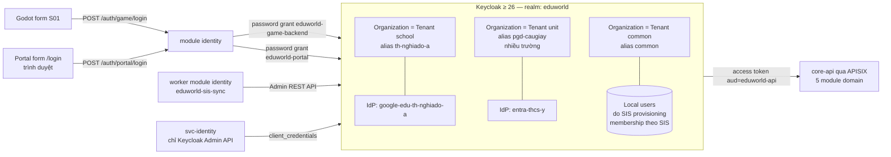
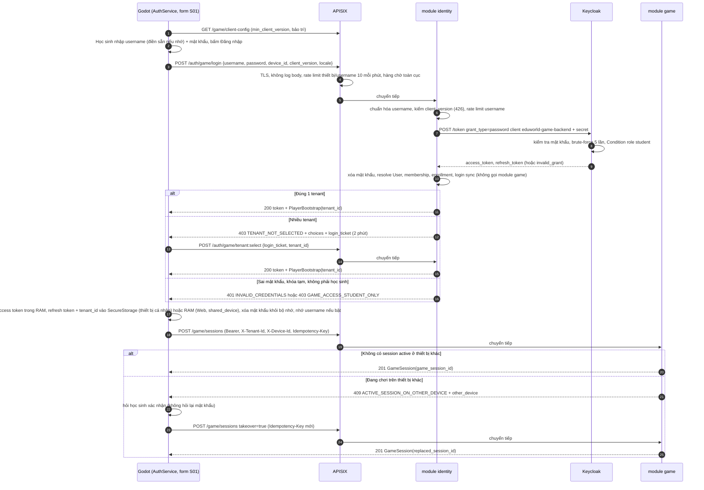
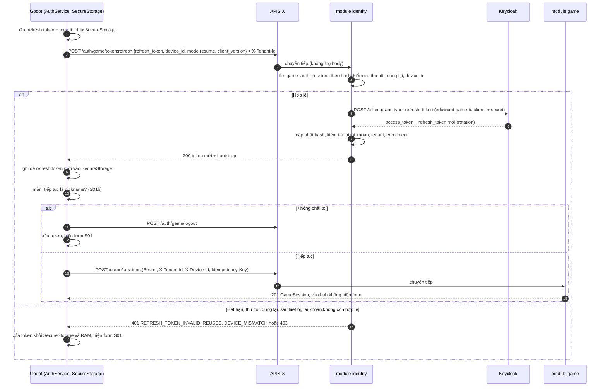

# Keycloak SSO

> Trạng thái: Draft · Phiên bản: 0.11 · Owner: Identity & Security Engineer · Cập nhật: 2026-11-24 (ADR-0101: bỏ Windows, client chỉ Web/Android/iOS) · 2026-11-21 (ADR-0094: bỏ MFA/TOTP cho đăng nhập Admin Portal, mọi role kể cả platform; bỏ mapper AMR/LoA, `MFA_REQUIRED`, đăng ký OTP) · 2026-11-17 (ADR-0091: portal đăng nhập bằng form riêng qua module identity, client `eduworld-portal` confidential + Direct Access Grants, bỏ PKCE/redirect và scope `organization:{alias}` cho portal; ADR-0074: bỏ client `svc-learning`/`svc-game`/`svc-competition`/`svc-chat`/`svc-realtime`, chỉ giữ `svc-identity` cho Keycloak Admin API; ADR-0076 Rejected: bỏ kế hoạch QR/PIN/mật khẩu hình; máy dùng chung, màn "Tiếp tục là…"; giờ giới nghiêm ADR-0078) · 2026-11-16 (ADR-0083, ADR-0086)
> Liên quan: [ADR-0006, ADR-0008, ADR-0009, ADR-0026, ADR-0063…ADR-0068](../adr/README.md) · [ADR-0083](../adr/ADR-0083-dang-nhap-game-va-tao-game-session-tach-biet.md) · [ADR-0086](../adr/ADR-0086-giu-phien-game-bang-refresh-token.md) · [ADR-0091](../adr/ADR-0091-dang-nhap-portal-bang-form-rieng-qua-backend.md) · [MULTITENANCY §8](../06-architecture/MULTITENANCY.md) · [IDENTITY_MAPPING](IDENTITY_MAPPING.md) · [ACCOUNT_PROVISIONING](ACCOUNT_PROVISIONING.md) · [SIS_INTEGRATION](SIS_INTEGRATION.md) · [SECURITY_ARCHITECTURE](../10-security/SECURITY_ARCHITECTURE.md) · OQ-02, OQ-04

## 1. Phạm vi

Keycloak là nhà cung cấp danh tính (OIDC Provider) duy nhất của EduWorld. Keycloak chịu trách nhiệm: xác thực, SSO, identity brokering tới IdP của trường/Sở, phát hành token, quản lý phiên, role thô. Mỗi **tenant** (một trường độc lập, một đơn vị nhiều trường, hoặc tenant chung) là một **Keycloak Organization**; Organization giữ membership đồng bộ từ DB; Release 1.0 không client nào xin scope `organization:{alias}` (game: ADR-0068; portal: thay bởi ADR-0091), tenant của phiên do header `X-Tenant-Id` + membership trong DB quyết định (ADR-0026, ADR-0063, ADR-0065). Release 1.0: học sinh chỉ đăng nhập **username + password** (ADR-0063) bằng **form trong game**, gửi qua API của module identity (ADR-0068); trên thiết bị cá nhân, phiên được giữ bằng refresh token trong kho bảo mật của hệ điều hành nên mở lại game khi phiên còn hạn không phải nhập lại mật khẩu; Web và máy dùng chung phải đăng nhập mỗi lần mở (ADR-0086, §5). Nhân sự đăng nhập **Admin Portal** bằng **form riêng của portal** (username hoặc email + mật khẩu, không có mã OTP — [ADR-0094](../adr/ADR-0094-bo-mfa-totp-cho-dang-nhap-admin-portal.md)) qua API `/api/v1/auth/portal/*` của module identity; không chuyển hướng sang Keycloak, không chọn tenant trước (ADR-0066, ADR-0067, ADR-0091). Keycloak **không** quyết định phạm vi lớp/môn, và backend **luôn** đối chiếu tenant (header `X-Tenant-Id`, claim nếu có) với membership trong DB ([MULTITENANCY §8](../06-architecture/MULTITENANCY.md), ADR-0065).

Nguyên tắc bắt buộc [Confirmed]:

- Học sinh dùng tài khoản do nhà trường cấp; không có self-registration (`registrationAllowed = false`).
- **Game:** form username/password vẽ bằng Godot → `POST /api/v1/auth/game/login` → module identity gọi token endpoint Keycloak bằng client **confidential** `eduworld-game-backend` (Direct Access Grants). Game không biết client secret, không mở trình duyệt/WebView/Custom Tab (ADR-0068). **Portal:** form `/login` của portal → `POST /api/v1/auth/portal/login` → module identity gọi token endpoint bằng client **confidential** `eduworld-portal` (Direct Access Grants, chỉ username + mật khẩu — ADR-0094); trình duyệt không gọi Keycloak, trừ trang action-token `UPDATE_PASSWORD` mở từ email tạo tài khoản platform (§3.3). Authorization Code + PKCE của ADR-0007 không còn dùng cho portal (thay bởi ADR-0091).
- **Username và email duy nhất toàn realm** (không phân biệt hoa thường; "Duplicate emails" tắt), một người một tài khoản, nhiều membership (ADR-0067, [ADR-0069](../adr/ADR-0069-username-email-duy-nhat-theo-tenant-va-dang-nhap-khong-chon-tenant.md)). Không có username nội bộ theo tenant; Keycloak xác thực trước, module identity kiểm tra tenant sau.
- EduWorld không lưu mật khẩu học sinh (mật khẩu nằm ở Keycloak hoặc IdP của trường).
- Không hardcode realm/client/URL trong mã nguồn: mọi giá trị qua environment/config.

## 2. Topology



| Thành phần | Giá trị | Nhãn |
|---|---|---|
| Phiên bản | Keycloak ≥ 26 (Organizations GA) | [Confirmed] |
| Module sở hữu tích hợp | module `identity` là module duy nhất gọi Keycloak Admin API (provisioning, membership, revoke session); module khác chỉ dùng Principal do middleware `src/backend/pkg/httpx` dựng từ token đã kiểm tra bằng JWKS | [Confirmed] ADR-0074 (thay ADR-0036) |
| Realm | `eduworld` — một realm cho mỗi môi trường (dev/staging/prod là deployment riêng) | [Confirmed] ADR-0006 |
| Hostname | `auth.<domain>` (public), admin console chỉ qua `auth-admin.<internal>` | [Confirmed] |
| DB | PostgreSQL riêng (instance/database tách khỏi DB nghiệp vụ) | [Confirmed] |
| Cluster | ≥ 3 node, mỗi node 4 vCPU / 8 GB, chạy trên Docker Swarm (ADR-0024): tăng replica 3 → 5 trước khung giờ cao điểm theo lịch học (`ops-scheduler`), alert khi CPU > 60% để scale thủ công; cache Infinispan phân tán; **persistent user sessions** (Keycloak 26, phiên lưu DB nên restart/scale không mất phiên) — ADR-0045 | [Confirmed] |
| Năng lực mục tiêu | 10.000 CCU; bão đăng nhập 3.000 lượt/10 phút, đỉnh 50 đăng nhập mật khẩu/giây, 500 refresh/giây — §12 | [Confirmed] CCU / [Confirmed] tải |

### 2.1. Organizations: mỗi Tenant là một Organization (ADR-0026)

| Quy tắc | Nhãn |
|---|---|
| Mỗi **Tenant** (`school`, `unit` hoặc `common`, ADR-0005) = 1 Keycloak Organization. Lưu `platform.tenants.keycloak_org_id` và `keycloak_org_alias` (duy nhất, chữ thường, ví dụ `th-nghiado-a`, `pgd-caugiay`, `common`). Alias là mã tenant của Organization (Release 1.0 không client nào xin scope `organization:{alias}` — ADR-0068, ADR-0091) | [Confirmed] |
| Tenant loại `unit` có **một** Organization chung cho mọi trường trong đơn vị; **không** tạo Organization cho từng School bên trong tenant | [Confirmed] |
| Membership do worker (`eduworld-sis-sync`) đồng bộ từ dữ liệu EduWorld (SIS + UserRole, ADR-0066): học sinh là member đúng 1 tenant (tenant chứa trường có enrollment active); nhân sự là member của mọi tenant có UserRole hiệu lực. Chuyển trường trong cùng tenant `unit` không đổi membership. Học sinh tenant chung là member của Organization `common`. Không thêm tay ([ACCOUNT_PROVISIONING §2.1](ACCOUNT_PROVISIONING.md)) | [Confirmed] |
| Organization attribute: `tenant_id` (UUID EduWorld), `tenant_type`, `display_name`, `logo_url`, `login_code` để theme hiển thị đúng tenant | [Confirmed] |
| **Organization domain** (vd. `thcs-demo.edu.vn`, đã xác minh, không trùng giữa các Organization): dùng cho **identity-first login** theo tên miền email (chuyển tới IdP của tenant). **Ngoài Release 1.0** (ADR-0063) — mở rộng sau; Release 1.0 không khai báo domain, học sinh đăng nhập bằng username EduWorld cấp | Mở rộng sau |
| Tạo/tắt Organization khi System Admin tạo/tắt tenant (event `tenant.created`/`tenant.updated`). Tenant tắt → Organization `enabled=false`. SIS sync thêm trường mới vào tenant `unit` không tạo Organization mới | [Confirmed] |

**Tải với nhiều Organization:** số Organization bằng số tenant (≤ số trường, vì tenant `unit` gom nhiều trường). Phải chạy load test Keycloak với số org và member mục tiêu (OQ-03): thời gian đăng nhập p95, thời gian Admin API khi sync membership, kích thước cache [Confirmed].

**Cần kiểm chứng trên bản Keycloak triển khai** (spike Phase 1): (1) ~~scope `organization:{alias}` khi user không là member~~ — không còn cần cho Release 1.0 vì không client nào xin scope này (ADR-0068, ADR-0091); (2) ~~định dạng claim `organization`~~ — như (1); (3) IdP chỉ liên kết được với một Organization hay nhiều. Dù kết quả thế nào, backend vẫn chặn đúng vì luôn kiểm tra chéo với DB.

### 2.2. Identity Providers (brokering)

> **Release 1.0 (ADR-0063):** học sinh chỉ đăng nhập bằng tài khoản local (username/password) do EduWorld cấp. Brokering IdP trường/Sở (Google, Microsoft, SSO Sở) cho học sinh là **mở rộng sau**, bật bằng ADR mới; thiết kế dưới đây giữ làm điểm mở rộng.

| Loại IdP | Giao thức | Ghi chú |
|---|---|---|
| Google Workspace for Education | OIDC | `hd` claim kiểm tra domain; restrict theo organization |
| Microsoft Entra ID (M365 Education) | OIDC | Tenant ID cố định, không dùng `common` |
| SSO của SIS / Sở | OIDC hoặc SAML 2.0 | Theo OQ-01/OQ-02. Nhiều trường dùng chung IdP của Sở: nếu các trường cùng một tenant `unit` thì chỉ cần một IdP gắn với Organization của tenant; nếu thuộc nhiều tenant thì tạo một bản cấu hình IdP (alias riêng) cho từng tenant cùng trỏ về một IdP gốc [Confirmed — chờ kiểm chứng ở §2.1] |
| Không có IdP | Local user | Tài khoản tạo bởi SIS provisioning (ACCOUNT_PROVISIONING) |

Mỗi IdP được **liên kết với Organization của tenant** (`Redirect when email domain matches` tắt với học sinh; trang đăng nhập của trường hiển thị nút IdP đó). Cấu hình bắt buộc cho mỗi IdP:

- `Sync mode = FORCE` cho các attribute được map (để thay đổi ở IdP phản ánh vào Keycloak).
- **First broker login flow tùy chỉnh** `eduworld-first-broker-login`: không tự quyết định liên kết theo email/username. Keycloak chỉ tạo/giữ brokered identity; **module identity quyết định SIS nguồn và liên kết** theo `(idp_alias, idp_subject)` trong `sis.student_login_keys` của các connection thuộc tenant (ADR-0046, [IDENTITY_MAPPING §3.2](IDENTITY_MAPPING.md)). Không khớp và người dùng đã chọn tenant → lỗi thân thiện “Tài khoản chưa được nhà trường kích hoạt” (`ACCOUNT_NOT_PROVISIONED`); khớp nhiều bản ghi → `IDENTITY_CONFLICT`, chờ nhà trường xử lý. Xem [ACCOUNT_PROVISIONING §3](ACCOUNT_PROVISIONING.md).
- `Trust email = false` (không link tự động theo email) — **không dùng email làm khóa định danh** [Confirmed].
- Mapper: `idp_alias` (hardcoded attribute), **`idp_subject`** (giữ nguyên `sub` của IdP gốc vào user attribute và token claim `idp_subject`, sync mode FORCE) để module identity đối chiếu `sis.student_login_keys` (ADR-0046); `external_student_code` (nếu IdP cung cấp, chỉ là gợi ý).

**Thuộc tính user Keycloak do module identity ghi (ADR-0046) — chỉ là gợi ý tra cứu nhanh, database của module identity là nguồn quyết định:**

| Attribute | Giá trị | Ai ghi | Ghi chú |
|---|---|---|---|
| `eduworld_user_id` | UUID user EduWorld | provisioning | Dùng khi đối soát/relink |
| `ew_tenant` | `tenant_id` | provisioning, chuyển tenant | Không dùng để quyết định tenant (ADR-0026) |
| `ew_sis_connection` | `sis_connection_id` | provisioning, chuyển SIS | Gợi ý SIS nguồn; khi lệch với `identity.sis_identity_links` thì DB thắng và job reconciliation ghi đè |
| `ew_external_id` | `student_external_id` trong SIS đó | provisioning | Chỉ duy nhất trong một SIS |
| `idp_alias`, `idp_subject` | từ IdP mapper | Keycloak | Học sinh đăng nhập qua IdP |

Các attribute này **không** đưa vào access token của client game/CMS (giảm lộ thông tin); module identity đọc qua Admin API hoặc từ DB của mình.

## 3. Clients

| Client ID | Loại | Flow | Người dùng | Ghi chú |
|---|---|---|---|---|
| `eduworld-game-backend` | **Confidential** | **Chỉ Direct Access Grants** (password grant) + refresh; tắt Standard Flow, Implicit, Service Account, Device Grant (ADR-0068) | **Chỉ học sinh** (ADR-0031) — nhân sự nhà trường/vận hành/System Admin không vào game | Chỉ **module identity** giữ secret (secret manager, xoay 90 ngày); game không biết secret. Điều kiện realm role `student` trong direct grant flow (§3.1b). Thay client public `eduworld-game` (PKCE) — client này **bỏ** khỏi realm |
| `eduworld-portal` | **Confidential** (ADR-0091; giữ nguyên client id) | **Chỉ Direct Access Grants** (password grant, không OTP — ADR-0094) + refresh; tắt Standard Flow, Implicit, Service Account, Device Grant; không redirect URI/web origin/PKCE. Direct grant flow `eduworld-portal-direct-grant` (§3.3): chỉ `tenant_staff`/`platform_staff`, không có bước OTP với bất kỳ role nào (ADR-0094); đăng nhập bằng username **hoặc email** (ADR-0066, ADR-0067). Secret chỉ module identity giữ | Mọi người dùng Admin Portal (học sinh bị chặn): vận hành tenant (Tenant/School Admin, Academic Manager, Tenant Content Editor/Reviewer) và đội platform (System Admin, Content Admin/Reviewer, Game Designer, Live-ops, Competition Admin, Safety Moderator) — không có role giáo viên (ADR-0072) | Admin Portal `src/cms/frontend/apps/portal`, 5 workspace (ADR-0027 mục 7). Route `/api/v1/game-admin/*`, `/api/v1/admin/*`: chỉ gateway nội bộ, backend yêu cầu `azp = eduworld-portal` + role platform (không MFA, ADR-0094); token của vận hành tenant không bao giờ được chấp nhận ở đó |
| `eduworld-api` | Bearer-only / resource server | — | — | Đích của audience; không đăng nhập trực tiếp |
| `eduworld-sis-sync` | Confidential | Client Credentials | Service account của worker | [Confirmed] Quyền admin tối thiểu: `manage-users`, `view-users` trong realm, giới hạn bằng fine-grained admin permissions |
| `eduworld-apisix` | Confidential (tùy chọn) | — | APISIX nếu dùng introspection | Mặc định APISIX kiểm tra JWT bằng JWKS, không cần secret [Confirmed] |
| `eduworld-ops-tools` | Confidential (F131) | **Chỉ Authorization Code + PKCE S256**; tắt Direct Access Grants, Implicit, Service Account; redirect URI chỉ từ biến môi trường (`KC_OPS_GRAFANA_REDIRECT_URI`, `KC_OPS_GLITCHTIP_REDIRECT_URI`), `fullScopeAllowed = false`, secret `KC_OPS_TOOLS_CLIENT_SECRET` (Docker secret `ops_grafana_oauth_client_secret` phía Grafana). Không MFA (ADR-0094) | Nhân sự vận hành platform (realm role `platform_staff`); client role `admin` (System Admin → Grafana Admin), `editor` (DevOps trực → Editor), còn lại Viewer; người không có `platform_staff` (nhân sự trường, học sinh) bị Grafana từ chối (`role_attribute_strict`) | Grafana, GlitchTip — chỉ trong network `admin` (VPN), [MONITORING §8](../11-operations/MONITORING.md#8-logging) |
| `svc-identity` | Confidential | Client Credentials **duy nhất** (tắt standard flow, implicit, direct grant) | Service account của module identity | **Chỉ** gọi Keycloak Admin API (revoke session, membership Organization, cập nhật user) — ADR-0074 mục 5. Xem §3.2 |

### 3.1. `eduworld-game-backend` — client confidential cho đăng nhập game (ADR-0068)

| Thiết lập | Giá trị |
|---|---|
| `publicClient` | `false` (client authentication bật; secret `${env.KC_GAME_BACKEND_SECRET}`, chỉ mount vào module identity) [Confirmed: chuyển sang `client-jwt` (private key JWT) khi vận hành ổn định] |
| `directAccessGrantsEnabled` | `true` — chỉ client này và `eduworld-portal` (confidential, ADR-0091, §3.3) bật; mọi client khác `false` |
| `standardFlowEnabled`, `implicitFlowEnabled`, `serviceAccountsEnabled`, device grant | `false` (không redirect URI, không web origin) |
| Direct grant flow | Override `eduworld-game-direct-grant`: Username Validation → Password → **Condition – User Role `student`** → Deny Access; brute-force của realm áp dụng (§10) |
| Scope mặc định | `openid profile eduworld-api-audience eduworld-roles`; **không** `organization` (tenant xác định ở backend qua membership + `X-Tenant-Id`, ADR-0065), không `offline_access` |
| Token | Access 5 phút, refresh rotation (`revokeRefreshToken=true`, `refreshTokenMaxReuse=0`); client session idle **7 ngày**, max **30 ngày** (`client.session.idle.timeout`, `client.session.max.lifespan`, tham số `game_session_sso`, ADR-0086); không `offline_access` |
| Khác | `frontchannelLogout=false`, `consentRequired=false` (không có màn đồng ý trên Keycloak; mô hình consent ngoài version này, ADR-0082) |

Client public `eduworld-game` (Authorization Code + PKCE, redirect loopback/custom scheme/web) **bị bỏ** cho game: không còn redirect URI `http://127.0.0.1/*`, `vn.eduworld.game:/oauth2/callback`, `https://play.<domain>/auth/callback`. Godot gọi API của EduWorld, không gọi Keycloak trực tiếp.

### 3.1b. Chỉ học sinh được đăng nhập game (ADR-0031, ADR-0068)

- **Keycloak (lớp bổ sung):** direct grant flow của `eduworld-game-backend` có bước **Condition – User Role** (`student`) + **Deny Access**; Keycloak trả `invalid_grant`, module identity ánh xạ thành `403 GAME_ACCESS_STUDENT_ONLY` (thông điệp game: "Tài khoản này không dùng để vào game. Thầy cô và cán bộ vui lòng dùng trang quản trị.") [Confirmed — kiểm chứng phân biệt được lỗi role với lỗi mật khẩu trên bản Keycloak triển khai; nếu không phân biệt được, dựa vào lớp backend].
- **Backend (bắt buộc, không phụ thuộc Keycloak):** `POST /api/v1/auth/game/login` sau khi nhận token kiểm tra `identity.users.user_type = 'student'`; khác → thu hồi phiên vừa tạo, `403 GAME_ACCESS_STUDENT_ONLY` + audit `game_access_denied_non_student`. Middleware `game_player` (`azp = eduworld-game-backend` + `user_type = student`) lặp lại ở `POST /game/sessions`, mọi API người chơi và khi cấp realtime ticket.
- Nhân sự xem thử trải nghiệm qua **preview trong CMS** (Godot Web export, dữ liệu mẫu, không tạo game session/login event) [Confirmed].
- Ghi `sid` (Keycloak session id) của token vào `game.game_sessions.keycloak_sid` và vào phiên đăng nhập game `identity.game_auth_sessions` (§5.1) để khi tài khoản đăng nhập thiết bị khác, backend thu hồi đúng Keycloak user session của thiết bị cũ (Admin API `DELETE /admin/realms/{realm}/sessions/{sid}`) — refresh token lưu trên thiết bị cũ hết hiệu lực (ADR-0031, ADR-0086).

### 3.2. Client `svc-identity` cho Keycloak Admin API (ADR-0074 mục 5)

Backend là modular monolith ([ADR-0074](../adr/ADR-0074-modular-monolith-co-ranh-gioi-cuong-che.md)): module gọi nhau trong tiến trình qua facade, ngữ cảnh (tenant, Principal gốc, trace) truyền bằng `context.Context` qua `src/backend/pkg/modcall`, nên **không có token service-to-service**. Các client `svc-learning`, `svc-game`, `svc-competition`, `svc-chat`, `svc-realtime`, audience `svc-<module>-api` và client scope `internal-<module>` của thiết kế cũ (ADR-0040) đã bị bỏ khỏi realm.

| Thuộc tính | Giá trị |
|---|---|
| Loại | Confidential, `serviceAccountsEnabled=true`, chỉ `client_credentials`; secret xoay vòng 90 ngày [Confirmed]; Docker secret `kc_svc_identity` chỉ mount vào Swarm service chạy module identity ([DEPLOYMENT §13](../11-operations/DEPLOYMENT.md#13-secret-management)) |
| Mục đích duy nhất | Module identity gọi Keycloak Admin API (revoke session khi đăng nhập thiết bị khác, membership Organization, cập nhật user); không dùng để gọi API của EduWorld |
| Quyền | Service account chỉ có các role `realm-management` tối thiểu cần cho các thao tác trên (fine-grained admin permissions) [Confirmed] |
| TTL | Access token 5 phút; adapter cache token đến còn 30 s rồi xin mới; không có refresh token. Adapter có timeout, retry cho thao tác idempotent và circuit breaker như mọi tích hợp ngoài (ADR-0074 mục 5) |
| Client đặc biệt `svc-keycloak-authn` — **không tạo** | Từng dự kiến cho authenticator QR/PIN/mật khẩu hình chạy bên trong Keycloak; **không làm** vì ADR-0076 Rejected (2026-11-17). Realm không có authenticator tùy biến nào cho học sinh |
| Khác với `eduworld-game-backend` | `svc-identity` chỉ dùng client credentials cho Keycloak Admin API; đăng nhập học sinh dùng client riêng `eduworld-game-backend` để token người dùng có `azp` riêng và brute-force/role flow riêng (ADR-0068) |
| API EduWorld không chấp nhận token service | `EW_OIDC_ALLOWED_AZP` chỉ gồm client người dùng (`eduworld-game-backend`, `eduworld-portal`); không route nào của `core-api` nhận token `svc-*` |

### 3.3. `eduworld-portal` (Admin Portal) — đăng nhập bằng form riêng qua backend (ADR-0091)

Admin Portal tự vẽ trang `/login` (Ant Design, theme từ `design/admin-tokens/`, ADR-0047) và gọi API `/api/v1/auth/portal/*` của module identity; **không** chuyển hướng sang Keycloak, không Authorization Code + PKCE, không bước chọn trường trước đăng nhập (thay ADR-0066 mục 1, ADR-0067 phần chọn tenant bằng scope, ADR-0068 mục 4 theo [ADR-0091](../adr/ADR-0091-dang-nhap-portal-bang-form-rieng-qua-backend.md)). Màn hình và thông điệp: [ADMIN_PORTAL §1.3b](../04-admin-portal/ADMIN_PORTAL.md); endpoint và mã lỗi: [API_DESIGN §9.1](../07-backend/API_DESIGN.md); mô hình đe dọa, cookie và CSRF: [SECURITY_ARCHITECTURE §3.3](../10-security/SECURITY_ARCHITECTURE.md#33-đăng-nhập-admin-portal-qua-backend-adr-0091).

**Thiết lập client** [Confirmed — ADR-0091 / chi tiết [Confirmed]]:

| Thiết lập | Giá trị |
|---|---|
| `publicClient` | `false` — client authentication bật, secret `${env.KC_PORTAL_SECRET}` chỉ mount vào module identity (`EW_KC_PORTAL_CLIENT_SECRET_FILE`, §11), xoay 90 ngày. Client id giữ `eduworld-portal` nên mọi kiểm tra `azp = eduworld-portal` (R20, R23, ADR-0066) không đổi |
| `directAccessGrantsEnabled` | `true` |
| `standardFlowEnabled`, `implicitFlowEnabled`, `serviceAccountsEnabled`, device grant | `false`; **không** redirect URI, web origin hay PKCE (redirect `https://portal.<domain>/auth/callback` cũ đã bỏ) |
| Direct grant flow | Override `eduworld-portal-direct-grant` (bảng dưới) |
| Scope mặc định | `openid profile eduworld-api-audience eduworld-roles`; **không** `organization`, không `offline_access`; không còn scope `eduworld-amr-loa` (ADR-0094) |
| Token | Access 5 phút; refresh rotation (`revokeRefreshToken=true`, `refreshTokenMaxReuse=0`) [Confirmed]; client session idle 30 phút / max 10 giờ (`portal_session_sso`, §5.2) |
| Realm | `loginWithEmailAllowed=true`, `duplicateEmailsAllowed=false`, `registrationEmailAsUsername=false`; username/email so sánh không phân biệt hoa thường (Keycloak lưu chữ thường) — ADR-0067. Game chỉ gửi username (ADR-0063), module identity từ chối chuỗi có `@` ở `/auth/game/login` [Confirmed] |

**Direct grant flow `eduworld-portal-direct-grant`** (thứ tự bắt buộc; brute-force của realm áp dụng, §10):

| Bước | Authenticator | Yêu cầu | Kết quả khi không đạt |
|---|---|---|---|
| 1 | Username Validation (username hoặc email) | REQUIRED | `invalid_grant` → `401 INVALID_CREDENTIALS` |
| 2 | Password (reference value `pwd`) | REQUIRED | `invalid_grant` → `401 INVALID_CREDENTIALS` (kể cả tài khoản Keycloak bị tắt hoặc đang khóa tạm) |
| 3 | Required action còn tồn đọng (`UPDATE_PASSWORD`) | — | Keycloak trả "Account is not fully set up" **sau** khi mật khẩu đúng → `403 ACCOUNT_SETUP_REQUIRED` + `setup_ticket` (bên dưới) |

- **Chỉ nhân sự, kiểm tra ở module identity** ([ADR-0096](../adr/ADR-0096-chan-hoc-sinh-o-portal-khong-tinh-la-dang-nhap-sai.md)): flow **không** có bước chặn role. Keycloak cấp token khi mật khẩu đúng; `portalLogin` tra User EduWorld theo `(issuer, subject)`, tài khoản không phải `staff` có role portal hiệu lực → `403 PORTAL_ACCESS_STAFF_ONLY`, thu hồi ngay phiên Keycloak vừa tạo, audit (mật khẩu đã đúng nên không lộ thông tin tài khoản); lớp thứ hai là guard `portal_staff` (`azp` + `user_type = staff`) ở mọi route portal (ADR-0066). Lý do: Keycloak tính mọi authenticator trả `FAILURE` (kể cả `deny-access-authenticator`) là một lần đăng nhập sai, nên học sinh vào nhầm portal hai lần trong 1 giây bị khóa tạm khỏi **game** (đo trên 26.4). `check-realm.mjs` và `post-apply.mjs` chặn việc thêm lại bước từ chối vào flow portal.
- **Không có MFA** ([ADR-0094](../adr/ADR-0094-bo-mfa-totp-cho-dang-nhap-admin-portal.md), owner chấp nhận rủi ro): flow không có bước OTP với bất kỳ role nào, kể cả `platform_staff`; tài khoản từng đăng ký OTP vẫn đăng nhập bằng mật khẩu (credential OTP cũ để nguyên, không flow nào đọc). Required action `CONFIGURE_TOTP` bị tắt ở mức realm và `deploy/keycloak/scripts/post-apply.mjs` gỡ nó khỏi mọi người dùng còn tồn đọng sau mỗi lần apply realm. Không còn mapper AMR/LoA; backend không dựa vào `amr`/`acr`. Rủi ro và kiểm soát bù trừ: ADR-0094 mục 3, [SECURITY_ARCHITECTURE §3.3](../10-security/SECURITY_ARCHITECTURE.md#33-đăng-nhập-admin-portal-qua-backend-adr-0091).
- **Mã lỗi chung:** sai username/mật khẩu, tài khoản Keycloak tắt hoặc khóa tạm → **một** lỗi `401 INVALID_CREDENTIALS`, thông điệp "Tên đăng nhập hoặc mật khẩu chưa đúng". `User.status` của EduWorld không active (kiểm tra sau khi Keycloak chấp nhận) → `403 ACCOUNT_DEACTIVATED`.

**Mật khẩu lần đầu, quên mật khẩu** (ADR-0091 mục 3; đăng ký OTP bỏ theo ADR-0094):

| Luồng | Thiết kế |
|---|---|
| `ACCOUNT_SETUP_REQUIRED` | Module identity đọc required action của user qua Admin API (`svc-identity`, §3.2) và trả `403 ACCOUNT_SETUP_REQUIRED` kèm `required_steps[]` (chỉ còn `update_password`) và `setup_ticket`: ngẫu nhiên, **dùng một lần**, gắn `user_id`, lưu Valkey dạng hash ([VALKEY_DESIGN](../07-backend/VALKEY_DESIGN.md)), không chứa mật khẩu, hết hạn sau `portal_setup_ticket_ttl` |
| Đổi mật khẩu tạm | Màn riêng của portal → `POST /auth/portal/setup:password` `{setup_ticket, new_password}`; module identity đặt mật khẩu qua Admin API (áp password policy của realm, vi phạm → `422 VALIDATION_FAILED` sub-code `PASSWORD_POLICY_VIOLATION`), gỡ required action `UPDATE_PASSWORD`; ticket sai/hết hạn/đã dùng → `401 SETUP_TICKET_INVALID`. Người dùng đăng nhập lại |
| Quên mật khẩu | Portal tự xử lý: `POST /auth/portal/password:forgot` **luôn** trả `202` (không lộ tài khoản có tồn tại). Nếu khớp một tài khoản **nhân sự** (học sinh không bao giờ nhận), module identity tạo token ngẫu nhiên, lưu **SHA-256** trong `identity.portal_password_reset_tokens` ([DATABASE_DESIGN](../07-backend/DATABASE_DESIGN.md)), gửi email link `https://portal.<domain>/reset-password?token=…`; token dùng một lần, hết hạn sau `portal_password_reset_ttl`, cấp token mới vô hiệu token cũ. `POST /auth/portal/password:reset` đặt mật khẩu qua Admin API (password policy), sai/hết hạn/đã dùng → `401 PASSWORD_RESET_TOKEN_INVALID`; thành công thu hồi mọi phiên portal (và phiên game nếu có) của user. Mật khẩu học sinh vẫn do quản trị trường đặt lại trên portal |

**Tham số sở hữu ở đây:**

| Tham số | Giá trị | Nhãn |
|---|---|---|
| `portal_setup_ticket_ttl` | 10 phút, dùng một lần | [Confirmed] (ADR-0091) |
| `portal_password_reset_ttl` | 30 phút, dùng một lần | [Confirmed] |

**Token và phiên trên trình duyệt** (chi tiết bảo vệ: [SECURITY_ARCHITECTURE §3.3](../10-security/SECURITY_ARCHITECTURE.md#33-đăng-nhập-admin-portal-qua-backend-adr-0091)):

- Access token trả trong body, SPA **chỉ giữ trong bộ nhớ** (không `localStorage`/`sessionStorage`). Refresh token đặt trong cookie `__Secure-ew_portal_rt` (`HttpOnly; Secure; SameSite=Strict; Path=/api/v1/auth/portal`), JavaScript không đọc được. `token:refresh` và `logout` đòi header `X-EW-CSRF` khớp cookie double-submit `__Host-ew_portal_csrf` (sai/thiếu → `403 CSRF_TOKEN_INVALID`).
- APISIX public phục vụ `/api/v1/*` dưới origin của portal (`https://portal.<domain>/api/v1/...`) để cookie là first-party [Confirmed]; workspace platform vẫn gọi gateway nội bộ bằng Bearer token trong bộ nhớ.
- Tải lại trang → `POST /auth/portal/token:refresh` khôi phục phiên (§5.2). Đăng xuất → `POST /auth/portal/logout`: module identity thu hồi refresh token và phiên Keycloak (`sid`), xóa cookie.
- **Giới hạn tuổi phiên của nhân sự platform** (ADR-0094 mục 2, thay step-up `MFA_REQUIRED`): module identity nhớ thời điểm nhập mật khẩu của phiên (Valkey, theo `sid`) và từ chối `token:refresh` của phiên có realm role `platform_staff` khi đã quá `EW_OIDC_PLATFORM_MAX_AUTH_AGE` (8 giờ) hoặc không còn bản ghi phiên → `401 REFRESH_TOKEN_INVALID`, portal về `/login` (nhập lại mật khẩu). Không còn `403 MFA_REQUIRED` hay hộp đăng nhập lại.
- Backend kiểm tra theo route (không đổi): `/api/v1/game-admin/*` và `/api/v1/admin/*` chỉ chấp nhận `azp = eduworld-portal`, `user_type = staff` và Principal có role platform (guard `platform_role`, thiếu → `403 PERMISSION_DENIED`; không MFA — ADR-0094); `/api/v1/cms/learning/*`, `/api/v1/lms/*`, `/api/v1/schools/*`, `/api/v1/tenant/*` chấp nhận `eduworld-portal` với `user_type = staff` (ADR-0027, ADR-0066, ADR-0081, [SECURITY_ARCHITECTURE §5](../10-security/SECURITY_ARCHITECTURE.md)).

**Sau đăng nhập — chọn tenant không cần token mới** (ADR-0091 mục 4, ADR-0065): portal gọi `GET /api/v1/me/tenants` (không cần `X-Tenant-Id`): có role platform → phạm vi platform; đúng 1 tenant → vào thẳng; nhiều tenant → màn chọn đơn vị làm việc; mọi request sau đó gửi `X-Tenant-Id` và backend kiểm tra membership. Đổi tenant ở bộ chọn trên topbar chỉ đổi header (không xin token mới, không scope `organization:{alias}`); không có UserRole portal hiệu lực ở tenant nào và không có role platform → `403 PORTAL_ACCESS_STAFF_ONLY`, portal gọi `logout`. **Không** có URL theo tenant (`/t/{tenant_alias}` đã bỏ, ADR-0067).

## 4. Roles, groups, scopes

### 4.1. Realm roles (thô)

Realm role chỉ là **cổng đăng nhập thô** cho từng client, không phải permission (ADR-0027):

| Realm role | Gán cho | Cho phép đăng nhập |
|---|---|---|
| `student` | Học sinh (từ SIS) | `eduworld-game-backend` (đăng nhập game qua backend, ADR-0068); **bị chặn** ở `eduworld-portal` |
| `tenant_staff` | Mọi vận hành tenant: Tenant Admin, School Admin, Academic Manager (tổ chuyên môn), Tenant Content Editor/Reviewer (Tenant Admin/School Admin gán UserRole; SIS không đồng bộ nhân sự — ADR-0072) | `eduworld-portal` (không vào được game — ADR-0031) |
| `platform_staff` | Đội EduWorld: System Admin, Content Admin/Reviewer, Game Designer, Live-ops, Competition Admin, Safety Moderator | `eduworld-portal` (không OTP — ADR-0094; phiên tối đa 8 giờ từ lúc nhập mật khẩu, §3.3) |

- Role nghiệp vụ chi tiết (`school_admin`, `academic_manager`, `game_designer`, `safety_moderator`, ...) và permission **không nằm trong Keycloak**: chúng là Role/UserRole trong DB (`identity.roles`, `identity.user_roles`) + permission catalog trong code (ADR-0066). Realm role `tenant_staff`/`platform_staff` được worker gán/gỡ theo event `user_role.changed` (có ít nhất một UserRole portal hiệu lực → `tenant_staff`; có UserRole platform → `platform_staff`) ([ADMIN_PORTAL §2](../04-admin-portal/ADMIN_PORTAL.md#2-permission-model), [IDENTITY_MAPPING §6](IDENTITY_MAPPING.md)). Khi có mâu thuẫn, **DB thắng**.
- `platform_staff` chỉ được gán bởi System Admin qua workspace Platform Administration (hoặc quy trình IaC realm); worker SIS (`eduworld-sis-sync`) chỉ được gán `student`/`tenant_staff` và không có quyền gán `platform_staff` (fine-grained admin permissions) [Confirmed].
- Role game/thi đấu (`game_designer`, `liveops`, `competition_admin`) chỉ có hiệu lực với token `eduworld-portal`; backend từ chối permission platform-only nếu `azp` khác (không còn điều kiện MFA — ADR-0094).

Client roles: không dùng trong Release 1.0 [Confirmed].

### 4.2. Groups

Không dùng group để biểu diễn trường/lớp (dữ liệu đó thuộc SIS/DB). Group chỉ dùng cho vận hành nội bộ: `/ops/platform-admins`, `/ops/content-team`. [Confirmed]

### 4.3. Client scopes

| Scope | Loại | Mappers | Dùng bởi |
|---|---|---|---|
| `openid`, `profile` (rút gọn) | Default | `sub`, `preferred_username`, **không** map `given_name/family_name/email` vào access token | Tất cả |
| `eduworld-api-audience` | Default | Audience mapper → `aud: eduworld-api` | `eduworld-game-backend`, `eduworld-portal` |
| `eduworld-roles` | Default | Realm roles → claim `roles` (mảng phẳng) | `eduworld-game-backend`, `eduworld-portal` |
| `organization` (built-in, Keycloak ≥ 26) | **Không gán cho client nào** trong Release 1.0 | Organization Membership mapper | ~~`eduworld-portal` sau bước chọn tenant~~ — thay bởi ADR-0091: portal chọn tenant bằng `X-Tenant-Id` + membership; `eduworld-game-backend` không dùng (ADR-0068) |
| `offline_access` | **Không cấp** | — | Cấm refresh token offline cho trẻ em [Confirmed] |

Nguyên tắc data minimization: access token **không** chứa họ tên, email, ngày sinh, mã học sinh.

Học sinh **không chọn trường** khi đăng nhập game (ADR-0063): token game không bao giờ có claim `organization`; module identity xác định tenant theo membership trong DB ngay trong `POST /auth/game/login` (1 tenant → dùng; nhiều → `403 TENANT_NOT_SELECTED` + `login_ticket`, chọn bằng `POST /auth/game/tenant:select`; không thuộc tenant chung và không thuộc tenant SIS nào → `403 ACCOUNT_NOT_PROVISIONED`). Tenant đã chọn gắn vào game session và mọi request mang `X-Tenant-Id` (ADR-0065, ADR-0068). Portal (ADR-0091): nhân sự thuộc nhiều tenant chọn tenant **sau** đăng nhập và chỉ đổi header `X-Tenant-Id` (backend kiểm tra membership); không xin token mới, không gửi scope `organization` (cách xin token mới với `organization:{tenant_alias}` của ADR-0067 đã bị thay).

### 4.4. Access token mẫu

```json
{
  "iss": "https://auth.eduworld.vn/realms/eduworld",
  "sub": "f3b0c2a1-5d7e-4c9a-9e61-2b7a0c11d4e2",
  "aud": ["eduworld-api"],
  "azp": "eduworld-game-backend",
  "exp": 1763190300,
  "iat": 1763190000,
  "auth_time": 1763189990,
  "jti": "0193f0a2-...-7c1e",
  "sid": "5b1e9c3d-....",
  "typ": "Bearer",
  "scope": "openid profile",
  "roles": ["student"],
  "preferred_username": "hs.thnda.000123"
}
```

Token game không có claim `organization` (tenant đi bằng header `X-Tenant-Id`, kiểm tra với membership — ADR-0065, ADR-0068). Token portal (ADR-0091) cũng không có claim `organization`; có `azp = eduworld-portal`; không còn claim `amr`/`acr` do mapper AMR/LoA đặt (ADR-0094).

Backend kiểm tra: chữ ký (JWKS, cache theo `kid`, refresh khi gặp `kid` lạ, tối đa 1 lần/phút), `iss ∈ allowed_issuers`, `aud` chứa `eduworld-api`, `exp`/`nbf` (leeway 30s), `azp ∈ {eduworld-game-backend, eduworld-portal}`, `typ = Bearer`. Endpoint `/api/v1/admin/*` và `/api/v1/game-admin/*` yêu cầu `azp = eduworld-portal` + `user_type = staff` + role platform (không MFA, ADR-0094); route portal yêu cầu `azp = eduworld-portal` và `user_type = staff` (`403 PORTAL_ACCESS_STAFF_ONLY`).

Kiểm tra tenant (ADR-0026, ADR-0065, chi tiết [MULTITENANCY §8](../06-architecture/MULTITENANCY.md)): mọi request tenant-scoped phải có `X-Tenant-Id` và header phải thuộc membership của user theo DB (và trùng tenant của game session với token game) — không khớp → `403 TENANT_MISMATCH`. Với `eduworld-portal`, token không có claim `organization` (ADR-0091); nếu một token cũ hoặc cấu hình sai vẫn mang claim này thì backend bỏ qua nó và chỉ dựa vào `X-Tenant-Id` + membership. Header thiếu ở route tenant-scoped → backend chọn theo membership (1 → dùng; nhiều → `403 TENANT_NOT_SELECTED` kèm danh sách; không thuộc tenant chung và không thuộc tenant SIS nào → `403 ACCOUNT_NOT_PROVISIONED`, audit, thu hồi phiên Keycloak theo `sid` — ADR-0063). Không bao giờ tự đưa người dùng vào tenant chung. Backend chấp nhận cả dạng claim mảng alias và dạng object có id (tùy cấu hình mapper), nhưng chỉ tin id/alias sau khi đối chiếu `platform.tenants`. `preferred_username` **không** dùng để suy ra tenant.

## 5. Session & token policy [Confirmed]

Tham số `game_session_sso` [Confirmed — Technical Architect 2026-11-16] (ADR-0086); `portal_session_sso` giữ idle/max cũ [Confirmed], cách lưu token theo ADR-0091.

| Tham số | eduworld-game-backend (game) | eduworld-portal |
|---|---|---|
| Access token lifespan | 5 phút | 5 phút |
| Client Session Idle | **7 ngày** (ADR-0086) | 30 phút |
| Client Session Max | **30 ngày** (ADR-0086) | 10 giờ (`platform_staff`: refresh bị từ chối sau 8 giờ từ lúc nhập mật khẩu, ADR-0094) |
| Realm SSO Session Idle / Max | 7 ngày / 30 ngày — giá trị lớn nhất của các client vì Keycloak giới hạn phiên client không vượt phiên realm | (như bên trái; portal tự cưỡng chế idle/max — §5.2) |
| Remember me | Tắt | Tắt |
| Lưu refresh token trên thiết bị | **Thiết bị cá nhân:** kho bảo mật của hệ điều hành (Android Keystore, iOS Keychain); **Web (gồm PC phòng máy, ADR-0101) và máy `shared_device`:** chỉ RAM. Access token luôn chỉ trong RAM; không bao giờ lưu mật khẩu (ADR-0086) | Cookie `HttpOnly; Secure; SameSite=Strict; Path=/api/v1/auth/portal` do module identity đặt, JavaScript không đọc được; access token chỉ trong bộ nhớ SPA (ADR-0091) |
| Mở lại ứng dụng khi phiên còn hạn | **Thiết bị cá nhân:** `POST /auth/game/token:refresh` `mode = resume`, hiện màn "Tiếp tục là <nickname>?" rồi vào game, không nhập mật khẩu; Web (gồm PC phòng máy)/máy dùng chung: nhập mật khẩu (ADR-0086, ADR-0101, [Confirmed — Technical Architect 2026-11-17]) | Tải lại trang: `POST /auth/portal/token:refresh` (cookie + `X-EW-CSRF`), không nhập lại mật khẩu (§5.2) |
| Refresh token | Rotation bật (`revokeRefreshToken=true`, reuse = 0) + phát hiện dùng lại + gắn `device_id` (§5.1); làm mới qua `POST /auth/game/token:refresh` (client confidential) | Rotation bật; làm mới qua `POST /auth/portal/token:refresh` (client confidential, ADR-0091); token hết hạn/đã thu hồi/dùng lại → `401 REFRESH_TOKEN_INVALID` |
| Offline session / `offline_access` | Không | Không |
| MFA | Không (học sinh) | **Không** với mọi tài khoản, kể cả `platform_staff` (`system_admin`, `safety_moderator`…) — ADR-0094, rủi ro owner chấp nhận |

Thiết lập ở mức client (`client.session.idle.timeout`, `client.session.max.lifespan`), realm giữ giá trị lớn nhất. Không dùng `offline_access`/offline token (thời hạn quá dài, khó thu hồi theo thiết bị — ADR-0086). Hết idle 7 ngày hoặc quá 30 ngày kể từ lần nhập mật khẩu → học sinh đăng nhập lại.

### 5.1. Giữ phiên game bằng refresh token (ADR-0086)

| Hạng mục | Thiết kế |
|---|---|
| Lưu trên client | Sau đăng nhập thành công, game lưu **refresh token** + `tenant_id` của phiên vào kho bảo mật OS (adapter `SecureStorage` theo nền tảng — [GODOT_ARCHITECTURE](../08-game-client/GODOT_ARCHITECTURE.md)); access token chỉ trong RAM; không lưu mật khẩu. Web và máy `shared_device = true` dùng adapter chỉ-RAM: mở lại phải đăng nhập, thoát game = đăng xuất (§9). Không có bản Windows: PC phòng máy chơi bản Web (`shared_device_default`, [Confirmed — Technical Architect 2026-11-17]; ADR-0101) |
| Mở lại game | Có token → `POST /auth/game/token:refresh` với `{refresh_token, device_id, mode: resume, client_version}` + `X-Tenant-Id` đã lưu → module identity kiểm tra lại tài khoản như bước 2 của `gameLogin` (`user_type`, trạng thái, tenant, enrollment, khung giờ) và trả token mới + `bootstrap` → game ghi đè token mới vào kho bảo mật, hiện màn **"Tiếp tục là <nickname>?"** (S01b, nickname lấy từ `bootstrap`): bấm "Tiếp tục" → gọi `POST /game/sessions` (ADR-0083) và vào game, **không** hiện form; bấm **"Không phải tôi"** → `POST /auth/game/logout` (thu hồi phiên), xóa token khỏi kho bảo mật và RAM, hiện form S01 (`resume_confirm_screen`, mọi nền tảng, [Confirmed — Technical Architect 2026-11-17]). Trong giờ giới nghiêm (`platform_curfew`, [CHILD_SAFETY §4.1](../10-security/CHILD_SAFETY.md#41-giờ-giới-nghiêm-cấp-platform-adr-0078)) refresh `mode = resume` bị từ chối với mã lỗi giới nghiêm và **giữ** token để vào lại sau. Thất bại xác định (`401 REFRESH_TOKEN_*`, `403` tài khoản/tenant) → xóa token, hiện form S01. Lỗi mạng/`429`/`503` → giữ token, thử lại |
| Phiên đăng nhập game (server) | module identity ghi `identity.game_auth_sessions` khi `gameLogin`/`selectGameLoginTenant` thành công: `tenant_id`, `user_id`, `keycloak_sid`, `device_id`, `platform`, SHA-256 của refresh token hiện hành và ≤ 20 hash đã xoay gần nhất, `last_refreshed_at`, `revoked_at`/`revoke_reason`. **Không lưu token thô** |
| Xoay vòng (rotation) | Mỗi lần refresh thành công Keycloak trả refresh token mới, token cũ vô hiệu (`revokeRefreshToken=true`, reuse 0); module identity cập nhật hash. Client refresh **đơn luồng** (single-flight) và ghi đè token mới vào kho bảo mật ngay |
| Phát hiện dùng lại | Token gửi lên trùng một hash **đã xoay** của phiên → `401 REFRESH_TOKEN_REUSED`, thu hồi **cả** phiên (Admin API theo `sid`, `revoke_reason = refresh_reuse`), audit + security event, metric `eduworld_auth_game_sessions_revoked_total{reason}`. So khớp theo hash token đã cấp (không dựa vào claim chưa xác minh) nên không thể giả token để thu hồi phiên của người khác |
| Gắn thiết bị | `device_id` trong body phải trùng `game_auth_sessions.device_id` → khác: `401 REFRESH_TOKEN_DEVICE_MISMATCH`, không gọi Keycloak, không phát token, audit; phiên của thiết bị gốc giữ nguyên |
| Hết hạn / không nhận ra | Hash không thuộc phiên nào còn hiệu lực, phiên đã thu hồi, hoặc Keycloak trả `invalid_grant` (idle 7 ngày / max 30 ngày) → `401 REFRESH_TOKEN_INVALID` |
| Thu hồi (đánh dấu `revoked_at` + xóa phiên Keycloak theo `sid`) | Đăng xuất chủ động (`gameLogout`, `logout`); takeover sang thiết bị khác (consume `game_session.replaced`, `takeover`, ADR-0031); đổi/đặt lại mật khẩu (mọi phiên game của user, `password_changed`); khóa tài khoản hoặc xử phạt cấm vào game (`user.status_changed`/`user.access_revoked`, `account_locked`/`sanction`); thu hồi quyền truy cập — rời tenant, chuyển trường sang tenant khác, tenant bị tắt (`user.access_revoked`, `access_revoked`); dọn học sinh (`student.cleaned_up`, `cleanup`, ADR-0085); System Admin thu hồi thủ công (`admin`) |

Rủi ro còn lại: thiết bị cá nhân bị người khác dùng khi phiên còn hạn — giảm bằng màn "Tiếp tục là <nickname>?" mỗi lần tự vào lại, PC phòng máy chơi bản Web không lưu phiên (ADR-0101), thời hạn idle 7 ngày/tối đa 30 ngày, nút **Đăng xuất** trong game, thu hồi từ xa khi đặt lại mật khẩu ([SECURITY_ARCHITECTURE](../10-security/SECURITY_ARCHITECTURE.md)).

### 5.2. Phiên portal (ADR-0086 mục 7, ADR-0091 mục 4)

Portal giữ chính sách phiên hiện hành: idle 30 phút, tối đa 10 giờ, `platform_staff` tối đa 8 giờ từ lúc nhập mật khẩu (`portal_session_sso`, ADR-0094). Refresh token nằm trong cookie `HttpOnly` do module identity đặt (§3.3), access token chỉ trong bộ nhớ SPA. Tải lại trang hoặc mở tab mới: SPA gọi `POST /auth/portal/token:refresh` (cookie + header `X-EW-CSRF`) nên **không phải đăng nhập lại khi phiên còn hạn**; refresh lỗi (`401 REFRESH_TOKEN_INVALID`) → về `/login` của portal, giữ URL để quay lại. Giới hạn idle 30 phút / tối đa 10 giờ là client session idle/max của `eduworld-portal` (cấu hình ở mức client; realm giữ 7 ngày/30 ngày cho game): quá idle thì refresh token hết hạn; module identity còn kiểm tra `auth_time` ≤ 10 giờ khi refresh [Confirmed — kiểm chứng trên bản Keycloak triển khai]. Phiên có realm role `platform_staff` bị từ chối refresh khi đã quá 8 giờ từ lúc nhập mật khẩu (`EW_OIDC_PLATFORM_MAX_AUTH_AGE`, `401 REFRESH_TOKEN_INVALID`, portal về `/login`); không còn `403 MFA_REQUIRED` (ADR-0094). Không còn `prompt=none`, `max_age`, `prompt=login` hay RP-initiated logout từ trình duyệt (thay bởi ADR-0091).

## 6. Luồng đăng nhập game — form trong Godot qua backend (ADR-0068)

### 6.1. Mọi nền tảng (Android/iOS, Web; Windows/macOS/Linux chỉ khi chạy từ editor — ADR-0101)



- Không trình duyệt hệ thống, không Custom Tabs/`ASWebAuthenticationSession`, không WebView, không TCPServer loopback, không PKCE/`prompt=login`/`login_hint` cho game. Web export gọi cùng API bằng `fetch` (CORS chỉ origin `https://play.<domain>`).
- Access token chỉ trong bộ nhớ tiến trình. Refresh token: thiết bị cá nhân lưu trong kho bảo mật OS (Android Keystore, iOS Keychain); **không bao giờ** lưu vào `user://`, file thường hay localStorage; Web và máy `shared_device` chỉ giữ trong RAM (reload tab Web = đăng nhập lại). App bị hệ điều hành đóng trên thiết bị cá nhân → mở lại theo §5.1, không hỏi mật khẩu khi phiên còn hạn (ADR-0086).
- Certificate pinning cho tên miền API trên bản Android/iOS [Confirmed] (không có bản desktop, ADR-0101); Web dựa vào HSTS.

Mở lại game trên thiết bị cá nhân khi còn refresh token (ADR-0086):



### 6.2. Kết quả xác định tenant (trong `POST /auth/game/login`) và tạo game session

`POST /auth/game/login` (`gameLogin`) và `POST /auth/game/tenant:select` chỉ **xác thực, xác định tenant, trả `tokens.*` và `bootstrap`**; không tạo game session, không trả `game_session_id`, không gọi module game và không có `409` takeover ([ADR-0083](../adr/ADR-0083-dang-nhap-game-va-tao-game-session-tach-biet.md)). module identity xác định tenant theo membership trong DB (ADR-0063):

| Membership | Kết quả |
|---|---|
| Đúng 1 tenant (tenant SIS hoặc tenant chung do platform tạo) | Vào thẳng tenant đó: `200` + `bootstrap.tenant_id` |
| Nhiều tenant (hiếm) | `403 TENANT_NOT_SELECTED` kèm `choices[]` + `login_ticket` (Valkey, 2 phút, một lần, gắn `device_id`); game hiển thị chọn tenant **sau** đăng nhập rồi gọi `POST /auth/game/tenant:select` — không nhập lại mật khẩu. Ticket hết hạn → `401 LOGIN_TICKET_INVALID`, quay về form |
| Không thuộc tenant chung và không thuộc tenant SIS nào | `403 ACCOUNT_NOT_PROVISIONED`: không tạo session, ghi audit, thu hồi phiên Keycloak vừa tạo theo `sid`; game quay về form |

Tiếp theo → game client gọi `POST /api/v1/game/sessions` (`createGameSession` của module game; header `X-Tenant-Id` = `bootstrap.tenant_id`, `X-Device-Id`, `Idempotency-Key`). Quy tắc một thiết bị (ADR-0031) thực thi ở endpoint này: `409 ACTIVE_SESSION_ON_OTHER_DEVICE` kèm `other_device` → game hỏi học sinh rồi gọi lại với `takeover: true` và `Idempotency-Key` **mới** (body khác), không nhập lại mật khẩu; game không giữ mật khẩu sau lời gọi login. Sau đó → realtime ticket. Vị trí trong lượt chơi: [SYSTEM_ARCHITECTURE §5](../06-architecture/SYSTEM_ARCHITECTURE.md). Thuật toán kiểm tra và **mã lỗi bootstrap** (thứ tự kiểm tra, HTTP, điều kiện): [IDENTITY_MAPPING §4.1](IDENTITY_MAPPING.md#41-mã-lỗi-khi-resolve-thứ-tự-kiểm-tra). Thông điệp tiếng Việt hiển thị cho học sinh: [GODOT_ARCHITECTURE §9](../08-game-client/GODOT_ARCHITECTURE.md#9-error-handling--offline). Ticket và WebSocket: [REALTIME_ARCHITECTURE §3](../06-architecture/REALTIME_ARCHITECTURE.md#3-vòng-đời-kết-nối).

## 7. Refresh, logout, revoke

| Hành động | Cơ chế |
|---|---|
| Refresh | Godot gọi `POST /api/v1/auth/game/token:refresh` (`mode = renew`, kèm `device_id`) chủ động khi access token còn < 60s, hoặc khi nhận 401 `TOKEN_EXPIRED` (retry 1 lần), đơn luồng; module identity kiểm tra phiên (§5.1) rồi đổi refresh token với Keycloak bằng client `eduworld-game-backend`; token mới ghi đè vào SecureStorage. Refresh lỗi (`401 REFRESH_TOKEN_INVALID`/`REFRESH_TOKEN_REUSED`/`REFRESH_TOKEN_DEVICE_MISMATCH`) → xóa token, về màn hình đăng nhập. Portal: `POST /api/v1/auth/portal/token:refresh` (cookie `HttpOnly` + `X-EW-CSRF`), module identity đổi refresh token với Keycloak bằng client confidential `eduworld-portal` và xoay cookie (§5.2, ADR-0091) |
| Logout | Godot: `POST /api/v1/game/sessions/{game_session_id}:end` (module game đóng game session, ngắt WS) rồi `POST /api/v1/auth/game/logout` (module identity **chỉ** thu hồi refresh token + phiên Keycloak theo `sid`, `revoke_reason = logout`, không đóng game session — ADR-0083) → xóa token khỏi SecureStorage và RAM (nút **Đăng xuất**, ADR-0086). Không gọi được `:end` (mất mạng, tắt đột ngột) → module game đóng phiên theo heartbeat timeout. Portal: `POST /api/v1/auth/portal/logout` (cookie + `X-EW-CSRF`) — module identity thu hồi refresh token và phiên Keycloak (`sid`), xóa cookie (ADR-0091) |
| Thoát game (ADR-0086) | **Thiết bị cá nhân:** chỉ gọi `:end` game session (best effort), **giữ** refresh token trong SecureStorage để lần mở sau tự vào (§5.1); tắt đột ngột → game session đóng theo heartbeat timeout. **Web / máy `shared_device`:** thoát = Logout như trên; tắt đột ngột → phiên Keycloak hết theo idle, không có token nào trên đĩa |
| Admin khóa tài khoản / xử phạt cấm vào game | Backend set `status=locked` → Keycloak `enabled=false` + logout all sessions (Admin API), `game_auth_sessions` của user `revoked_at` (`account_locked`/`sanction`) → event `user.access_revoked` → realtime ngắt kết nối (ACCOUNT_PROVISIONING §6); refresh/resume sau đó → `401 REFRESH_TOKEN_INVALID` |
| Đổi / đặt lại mật khẩu | module identity (F016) thu hồi mọi `game_auth_sessions` của user (`password_changed`) + phiên Keycloak theo `sid` — thiết bị đang lưu token phải đăng nhập lại bằng mật khẩu mới (ADR-0086); đặt lại mật khẩu học sinh: [ACCOUNT_PROVISIONING §6d](ACCOUNT_PROVISIONING.md#6d-đặt-lại-mật-khẩu-học-sinh) |
| Thu hồi quyền truy cập / dọn học sinh | `user.access_revoked` (rời tenant, chuyển trường sang tenant khác, tenant tắt) và `student.cleaned_up` (ADR-0085) → identity thu hồi `game_auth_sessions` liên quan (`access_revoked`/`cleanup`) + phiên Keycloak |
| Đăng nhập thiết bị khác (ADR-0031) | Khi `POST /game/sessions` có `takeover: true` (ADR-0083), module game kết thúc game session cũ, gửi `session.session.replaced` + close 4409 tới thiết bị cũ, rồi `keycloak-provisioner` (consume `game_session.replaced`) thu hồi Keycloak session theo `sid` của session cũ và đánh dấu `game_auth_sessions` của thiết bị cũ `revoked_at` (`takeover`) — refresh token lưu trên thiết bị cũ bị từ chối (`401 REFRESH_TOKEN_INVALID`). Keycloak cho phép nhiều SSO session song song; quy tắc một thiết bị được thực thi ở game session của EduWorld, không dùng giới hạn session của Keycloak |
| Backchannel logout | Cấu hình `backchannel_logout_url` cho `eduworld-api` (`/internal/auth/backchannel-logout`, chỉ mạng nội bộ) để backend đóng game session khi phiên Keycloak bị hủy [Confirmed] |

Access token 5 phút nghĩa là khoảng trễ thu hồi tối đa 5 phút cho REST; backend còn kiểm tra `user.status` (cache ≤ 60s) ở mỗi request nên khoảng trễ thực tế ≤ 60s.

## 8. Trải nghiệm đăng nhập cho học sinh

- **Chỉ username + password** [Confirmed, ADR-0063; ADR-0076 Rejected 2026-11-17 — không làm thẻ QR, PIN, mật khẩu hình cho lớp 1–3]: tài khoản local Keycloak do EduWorld cấp (từ SIS provisioning hoặc do platform tạo trong tenant chung, [ACCOUNT_PROVISIONING](ACCOUNT_PROVISIONING.md)). Học sinh **không chọn trường**, không có ô "nhập mã trường", không có nút đăng nhập nhanh; sau xác thực, module identity xác định tenant theo §6.2.
- **Giữ phiên trên thiết bị cá nhân** [Confirmed, ADR-0086]: mở lại game khi phiên còn hạn (idle 7 ngày, tối đa 30 ngày) thì hiện "Tiếp tục là <nickname>?" (nút "Không phải tôi" đăng xuất và xóa token) rồi vào game, không hiện form [Confirmed — Technical Architect 2026-11-17]; không có checkbox "Ghi nhớ đăng nhập" (hành vi theo loại thiết bị). Phiên hết hạn/bị thu hồi, Web, máy phòng tin học (`shared_device`) → nhập mật khẩu; ô tên đăng nhập có thể điền sẵn nếu học sinh bật "Nhớ tên đăng nhập" — tắt sẵn trên máy phòng tin học. Nút **Đăng xuất** trong game xóa phiên khỏi thiết bị.
- **Mật khẩu nhập trong form của game** (S01, [STUDENT_GAME_UX_CORE](../05-ux/STUDENT_GAME_UX_CORE.md)) và gửi qua API của module identity (ADR-0068, thay ADR-0007 cho game). Biện pháp bảo vệ: TLS, không log body, rate limit thiết bị/username, brute-force Keycloak, thông điệp lỗi chung ([SECURITY_ARCHITECTURE §3.1b](../10-security/SECURITY_ARCHITECTURE.md)).
- Admin Portal (ADR-0066, ADR-0067, ADR-0091): form `/login` do portal tự vẽ (không phải trang Keycloak), username **hoặc email** + mật khẩu (không mã OTP, ADR-0094) trong **một** lần gửi, **không chọn tenant trước**, không có URL theo tenant (§3.3). Sau đăng nhập: role platform → phạm vi platform; 1 tenant → vào thẳng; nhiều tenant → chọn tenant, đổi ở bộ chọn trên topbar (chỉ đổi `X-Tenant-Id`, không token mới, không nhập lại mật khẩu). Trong tenant `unit`, đổi trường chỉ là bộ lọc trong cùng phiên. System Admin ghi dữ liệu tenant gửi `X-Tenant-Id` = tenant đích, đọc liên tenant lọc bằng dropdown (`tenant_ids`, ADR-0027 §6, ADR-0065).
- Giao diện đăng nhập game là **form Godot** (không còn theme Keycloak cho học sinh): tiếng Việt mặc định, font lớn (≥18px), nút to, hình minh họa thân thiện, không thuật ngữ kỹ thuật. Chỉ gồm: logo, chọn ngôn ngữ, ô tên đăng nhập, ô mật khẩu (nút hiện/ẩn), nút "Đăng nhập", checkbox "Nhớ tên đăng nhập", dòng "Quên mật khẩu? Liên hệ nhà trường để đặt lại". Không có checkbox "Ghi nhớ đăng nhập" (giữ phiên theo loại thiết bị, ADR-0086); không hiển thị tên/logo trường trước khi đăng nhập. Theme Keycloak `eduworld` cho học sinh chỉ còn dùng nếu bật lại IdP brokering sau này (§8.1).
- Học sinh nhỏ: tài khoản do nhà trường in phát (username ngắn + mật khẩu ngắn do trường cấp), vẫn là local user Keycloak.
- Thông điệp lỗi: không tiết lộ "tài khoản tồn tại hay không" hay "đang bị khóa tạm", không tiết lộ tài khoản thuộc trường nào — sai mật khẩu, không có tài khoản và khóa tạm đều là `INVALID_CREDENTIALS` "Tên đăng nhập hoặc mật khẩu chưa đúng". `ACCOUNT_NOT_PROVISIONED` → "Tài khoản của em chưa được kích hoạt trong EduWorld. Em hãy nhờ nhà trường kiểm tra nhé."
- Quên mật khẩu: tắt reset qua email cho học sinh; hướng dẫn "Quên mật khẩu? Liên hệ nhà trường để đặt lại" — School Admin của **đúng tenant/trường** (hoặc Tenant Admin, System Admin) đặt lại qua Admin Portal (`resetStudentPassword`; quy tắc ở [ACCOUNT_PROVISIONING §6d](ACCOUNT_PROVISIONING.md#6d-đặt-lại-mật-khẩu-học-sinh)).

### 8.1. Mở rộng sau — ngoài Release 1.0 (ADR-0063)

**Không làm (ADR-0076 Rejected 2026-11-17):** mã QR lớp + PIN, thẻ QR cá nhân, mật khẩu hình ảnh, authenticator tùy biến `ew-class-qr`/`ew-card-qr`/`ew-picture-password`. Đăng nhập học sinh giữ username/password + refresh token (§5.1); học sinh nhỏ dùng username/mật khẩu ngắn do trường in phát.

Các phương thức dưới đây **không hiển thị trên UI và không triển khai**; giữ thiết kế làm điểm mở rộng, chỉ bật bằng ADR mới (thay một phần ADR-0045 mục 4):

| Cách | Thiết kế dự kiến |
|---|---|
| SSO qua IdP trường/đơn vị (Google Workspace for Education, Microsoft Entra ID) + identity-first theo tên miền email | Organization khai báo domain đã xác minh; Keycloak chuyển tới IdP của tenant; liên kết tài khoản theo ADR-0046. Cần ADR mới vì đăng nhập game qua form không hỗ trợ IdP ngoài (ADR-0068 hệ quả) |
| Device Authorization Grant | Máy dùng chung, xác nhận trên thiết bị khác (mã hết hạn 10 phút, polling 5 s) |
| "Nhập mã trường" (`login_code`) | `GET /api/v1/auth/tenants:resolve?code=...` rồi mở Keycloak với `organization:{alias}` |

Nếu sau này cần authenticator tùy biến cho một phương thức ở bảng trên, viết bằng Keycloak SPI (Java), đóng gói provider JAR, có test tích hợp và review bảo mật mỗi lần nâng cấp Keycloak.

## 9. Máy dùng chung (phòng tin học)

Không dùng Device Authorization Grant (§8.1). PC phòng máy chơi bản Web nên không giữ phiên (không có bản Windows, ADR-0101); thiết bị Android/iOS dùng chung cấu hình `shared_device: true` (`shared_device_default`, [GODOT_ARCHITECTURE §5.1](../08-game-client/GODOT_ARCHITECTURE.md#51-đăng-nhập-và-xác-định-tenant-adr-0063-adr-0064-adr-0065-adr-0068)). Máy `shared_device: true` và Web: không nhớ username; refresh token **chỉ trong RAM**, không ghi vào kho bảo mật (ADR-0086 mục 2); thoát game hoặc 30 phút không hoạt động (`shared_device_idle_logout`) → logout + revoke; mở lại game phải nhập mật khẩu. Vì không có token nào trên máy, học sinh sau không thể vào tài khoản của học sinh trước.

## 10. Bảo vệ brute-force & chính sách mật khẩu

| Thiết lập | Giá trị [Confirmed] |
|---|---|
| Brute force detection | Bật **theo tài khoản** (không khóa theo IP vì cả trường dùng chung NAT); `failureFactor=5`, wait increment 1 phút, max wait 15 phút, quick login check 1s |
| Băm mật khẩu | argon2id (hoặc pbkdf2-sha512) với tham số **benchmark trên phần cứng triển khai** để ≤ 80 ms/lần mà vẫn đạt khuyến nghị bảo mật hiện hành (OWASP Password Storage); **rehash on login** khi đổi tham số (ADR-0045) |
| Permanent lockout | Tắt (tránh DoS khóa tài khoản học sinh) |
| Password policy (local user) | Học sinh: tối thiểu 6 ký tự (cân bằng với trẻ nhỏ), không trùng username; Nhân sự: ≥ 10 ký tự, `notUsername`, `passwordHistory(3)` |
| Rate limit tại APISIX / module identity | `POST /auth/game/login`: theo **thiết bị** (`X-Device-Id`) 10/phút và theo **username** 10/phút, không theo IP đơn lẻ (NAT trường học), cộng ngưỡng toàn cục; vượt ngưỡng trả `429` + `Retry-After` (`RATE_LIMITED` hoặc `LOGIN_QUEUE_BUSY`), client thử lại có jitter và hiển thị hàng chờ. `/auth/portal/*` theo `portal_login_rate` (username, `device_id`, toàn cục; không theo IP) — chi tiết [SECURITY §14](../10-security/SECURITY_ARCHITECTURE.md#14-rate-limiting-confirmed) |
| Brute force qua portal | Direct grant của `eduworld-portal` dùng cùng brute-force detection theo tài khoản (khóa tạm sau 5 lần sai); lỗi luôn là `401 INVALID_CREDENTIALS` chung (ADR-0091 mục 2). Chỉ **mật khẩu sai** được đếm: flow portal không có bước từ chối role, nên học sinh đăng nhập portal đúng mật khẩu (bị `identity` từ chối) không làm tăng bộ đếm và không bị khóa game ([ADR-0096](../adr/ADR-0096-chan-hoc-sinh-o-portal-khong-tinh-la-dang-nhap-sai.md)) |
| Định danh (ADR-0067) | `duplicateEmailsAllowed=false`, `loginWithEmailAllowed=true` (dùng ở portal), `editUsernameAllowed=false` (đổi username chỉ qua module identity sau khi kiểm tra trùng trên SSO và trong tenant, ADR-0069) |
| Events | Bật login events & admin events, xuất sang hệ thống log tập trung, lưu 90 ngày |

## 11. Cấu hình theo môi trường

- `deploy/keycloak/realm-eduworld.json`: realm export **không chứa secret** (client secret, IdP secret, SMTP password được thay bằng placeholder `${env.KC_...}`) và **không chứa user**.
- Import bằng `keycloak-config-cli` (declarative, idempotent) trong pipeline; biến môi trường cung cấp: `KC_HOSTNAME`, `EW_PORTAL_BASE_URL` (link đặt lại mật khẩu, redirect sau trang action-token), `KC_GAME_BACKEND_SECRET`, `KC_PORTAL_SECRET`, secrets từ secret manager (không còn `EW_GAME_REDIRECTS` vì game không redirect, ADR-0068; không còn redirect URI của portal, ADR-0091).
- Backend config (không hardcode):

```env
EW_OIDC_ISSUERS=https://auth.eduworld.vn/realms/eduworld
EW_OIDC_AUDIENCE=eduworld-api
EW_OIDC_ALLOWED_AZP=eduworld-game-backend,eduworld-portal
EW_OIDC_PLATFORM_MAX_AUTH_AGE=8h   # tuổi tối đa phiên platform_staff khi refresh (ADR-0094 mục 2)
# chỉ module identity (không có biến token service-to-service, ADR-0074)
EW_KC_ADMIN_CLIENT_ID=svc-identity                   # chỉ Keycloak Admin API
EW_KC_ADMIN_CLIENT_SECRET_FILE=/run/secrets/kc_svc_identity
EW_KC_ADMIN_BASE_URL=https://auth-admin.internal/admin/realms/eduworld
EW_KC_SYNC_CLIENT_ID=eduworld-sis-sync
EW_KC_SYNC_CLIENT_SECRET_FILE=/run/secrets/kc_sis_sync
EW_KC_GAME_CLIENT_ID=eduworld-game-backend          # đăng nhập game qua backend (ADR-0068)
EW_KC_GAME_CLIENT_SECRET_FILE=/run/secrets/kc_game_backend
EW_KC_PORTAL_CLIENT_ID=eduworld-portal              # đăng nhập portal qua backend (ADR-0091)
EW_KC_PORTAL_CLIENT_SECRET_FILE=/run/secrets/kc_portal
EW_PORTAL_SETUP_TICKET_TTL=10m                       # portal_setup_ticket_ttl
EW_PORTAL_PASSWORD_RESET_TTL=30m                     # portal_password_reset_ttl
EW_KC_TOKEN_TIMEOUT=3s
EW_GAME_LOGIN_TICKET_TTL=2m
```

- Godot đọc URL API từ `res://config/env/<env>.json` được sinh lúc build + `GET /game/client-config`; không có cấu hình OIDC hay client secret trong game (ADR-0068).

## 12. Năng lực đăng nhập 10.000 CCU (ADR-0045)

| Hạng mục | Thiết kế [Confirmed] |
|---|---|
| Tải mục tiêu | 10.000 CCU; bão đăng nhập **5.000 lượt trong 10 phút** đầu giờ học; đỉnh **100 đăng nhập mật khẩu/giây** (ADR-0064 mục 6, giữ làm giả định thận trọng cho máy phòng tin học/Web và phiên hết hạn); 500 refresh/giây (gồm `resume` khi mở lại game — ADR-0086) |
| SLO | Đăng nhập mật khẩu → vào hub p95 ≤ 3 s; Keycloak xác thực p95 ≤ 800 ms; refresh p95 ≤ 200 ms |
| Ước lượng CPU | 100 login/s × ≤ 80 ms băm ≈ 8 vCPU chỉ cho băm → tối thiểu 4 node × 4 vCPU (16 vCPU) giữ được đỉnh với dư địa ~2×; refresh không băm mật khẩu. Sizing chi tiết: [DEPLOYMENT](../11-operations/DEPLOYMENT.md) |
| Giảm số lần nhập mật khẩu | Thiết bị cá nhân: mở lại game khi phiên còn hạn dùng `resume` (refresh, không băm mật khẩu — ADR-0086). Trong một lần mở game: refresh token gia hạn token và reconnect không băm mật khẩu; chọn tenant sau đăng nhập dùng `login_ticket` (không băm lại). Phương thức đăng nhập nhanh: mở rộng sau (§8.1) |
| module identity trên đường đăng nhập | Thêm một chặng (Godot → module identity → Keycloak): pool HTTP giữ kết nối tới Keycloak, timeout 3 s, circuit breaker; module identity scale theo CPU cùng lịch warm-up với Keycloak (ADR-0068) |
| Keycloak | Persistent sessions, Infinispan phân tán, DB riêng (pool ≥ 100 kết nối/node), tắt event listener không cần trên đường đăng nhập, theme tĩnh qua CDN, JVM heap 70% RAM |
| Hàng chờ | APISIX/module identity trả `429 LOGIN_QUEUE_BUSY` + `Retry-After` tại `/auth/game/login` khi vượt ngưỡng toàn cục (ADR-0068); Godot hiển thị "Đang vào lớp…" và thử lại theo backoff có jitter ([GAME_NETWORKING §3](../08-game-client/GAME_NETWORKING.md)) |
| Warm-up | Tăng replica trước khung giờ cao điểm theo lịch học (`ops-scheduler` chạy `docker service scale`, DEPLOYMENT §4.4) |
| Kiểm chứng | keycloak-benchmark (luồng đăng nhập, refresh) + k6 (luồng game) trên staging tương đương production — TC-PERF-014…017 ([TEST_STRATEGY](../12-project/TEST_STRATEGY.md)). Không tuyên bố đạt 10.000 CCU khi chưa có kết quả |

## 13. Kiểm thử bắt buộc

| ID | Kịch bản | Kỳ vọng |
|---|---|---|
| AC-AUTH-001 | Học sinh đăng nhập username/password, có bản ghi SIS và enrollment active | Vào game thành công |
| AC-AUTH-002 | Token hết hạn khi đang chơi | Refresh tự động, không gián đoạn |
| AC-AUTH-003 | Refresh token bị reuse | `401 REFRESH_TOKEN_REUSED`; toàn bộ phiên (`sid`) bị thu hồi, kể cả token mới nhất (TC-AUTH-085) |
| AC-AUTH-004 | Logout game (`/auth/game/logout`) | Refresh token revoke, phiên Keycloak (`sid`) kết thúc, WS đóng |
| AC-AUTH-005 | Người có `platform_staff` đăng nhập form portal (`/auth/portal/login`) chỉ với username + mật khẩu đúng | Đăng nhập thành công, không có bước OTP; gọi được route platform qua gateway nội bộ theo permission; refresh sau 8 giờ từ lúc nhập mật khẩu → `401 REFRESH_TOKEN_INVALID` (ADR-0094) |
| AC-AUTH-006 | Học sinh đăng nhập form portal (username hoặc email, mật khẩu đúng) | Flow `eduworld-portal-direct-grant` từ chối ở bước role → `403 PORTAL_ACCESS_STAFF_ONLY`; nếu Keycloak cấu hình sai, mọi route portal vẫn trả `403 PORTAL_ACCESS_STAFF_ONLY` + audit (ADR-0066, ADR-0091) |
| AC-AUTH-160 | Nhân sự đăng nhập portal bằng email (khác hoa thường) | Đăng nhập được; email trùng tài khoản khác không thể tồn tại (`duplicateEmailsAllowed=false`) |
| AC-AUTH-161 | Nhân sự thuộc 1 tenant / 2 tenant / chỉ role platform / không còn UserRole portal | Lần lượt: vào thẳng tenant / màn chọn tenant sau đăng nhập, đổi ở topbar chỉ bằng `X-Tenant-Id` (không token mới, không nhập lại mật khẩu) / phạm vi platform / `403 PORTAL_ACCESS_STAFF_ONLY` (ADR-0067, ADR-0091) |
| AC-AUTH-162 | Đăng nhập game: mật khẩu sai, username không tồn tại, tài khoản đang khóa tạm | Cùng `401 INVALID_CREDENTIALS`, cùng thông điệp, thời gian phản hồi tương đương (ADR-0068) |
| AC-AUTH-163 | Gửi `password` mẫu tới `/auth/game/login` rồi quét log APISIX, log service, trace, error reporter | Không nơi nào chứa chuỗi mật khẩu mẫu |
| AC-AUTH-164 | `login_ticket` dùng lần hai / sau 2 phút / từ `device_id` khác | `401 LOGIN_TICKET_INVALID` |
| AC-AUTH-165 | `client_version` thấp hơn `min_client_version` | `426 CLIENT_VERSION_UNSUPPORTED`, không gọi Keycloak |
| AC-AUTH-166 | Gọi token endpoint Keycloak trực tiếp bằng password grant với client khác `eduworld-game-backend`/`eduworld-portal` hoặc không có secret | Bị từ chối (`unauthorized_client`/`invalid_client`) |
| AC-AUTH-007b | Token `eduworld-portal` của người không có role platform gọi `/api/v1/game-admin/*` | `403 PERMISSION_DENIED` (guard `platform_role`; không còn `MFA_REQUIRED` — ADR-0094) |
| AC-AUTH-130 | School Admin / Tenant Admin / System Admin đăng nhập bằng form game (`/auth/game/login`) | Keycloak từ chối (nếu flow role đã bật) hoặc module identity trả `403 GAME_ACCESS_STUDENT_ONLY` và thu hồi phiên vừa tạo; không tạo game session, có audit |
| AC-AUTH-131 | Học sinh đăng nhập thiết bị B khi đang chơi trên A, xác nhận takeover | A nhận thông báo + bị đăng xuất; refresh token lưu trên A bị từ chối (`401 REFRESH_TOKEN_INVALID`), A xóa token và hiện form |
| AC-AUTH-007 | Token có `aud` sai / `iss` lạ | 401 tại APISIX và backend |
| AC-AUTH-008 | Password grant với client khác `eduworld-game-backend`/`eduworld-portal`, hoặc với hai client này mà không có client secret | Bị từ chối (chỉ hai client confidential này bật Direct Access Grants, secret chỉ module identity giữ — ADR-0068, ADR-0091); Authorization Code với `eduworld-portal` cũng bị từ chối (Standard Flow tắt) |
| AC-AUTH-120 | Học sinh tenant A gửi `X-Tenant-Id` = tenant B (token hợp lệ) | `403 TENANT_MISMATCH`; có audit + security event (ADR-0065) |
| AC-AUTH-121 | Đăng nhập game: user thuộc 1 tenant / nhiều tenant / không tenant nào | Lần lượt: vào đúng tenant đó / `403 TENANT_NOT_SELECTED` kèm danh sách + `login_ticket` / `403 ACCOUNT_NOT_PROVISIONED`, phiên Keycloak bị thu hồi, có audit, **không** tự tạo trong tenant chung |
| AC-AUTH-122 | Nhân sự member 2 tenant đổi tenant trên topbar portal | Cùng access token, chỉ đổi `X-Tenant-Id` (ADR-0091); header của tenant đã bị thu hồi membership → `403 TENANT_MISMATCH`; không nhập lại mật khẩu |
| AC-AUTH-123 | Học sinh chuyển sang trường thuộc tenant khác sau SIS sync | Membership org cũ bị gỡ, refresh token cũ bị thu hồi, đăng nhập tenant mới thành công; chuyển trường trong cùng tenant `unit` không đổi membership |
| AC-AUTH-124 | Học sinh thuộc 2 tenant chọn một tenant sau đăng nhập | `POST /auth/game/tenant:select` với `login_ticket` trả token + bootstrap của tenant đã chọn, không nhập lại mật khẩu; header tenant còn lại → `403 TENANT_MISMATCH` |
| AC-AUTH-127 | Học sinh mở game | Form S01 trong game chỉ có username/password, "Nhớ tên đăng nhập", "Quên mật khẩu? Liên hệ nhà trường để đặt lại"; không mở trình duyệt/WebView, không có bước chọn trường, ô mã trường, nút IdP, đăng nhập nhanh hay "Ghi nhớ đăng nhập"; sau xác thực vào đúng trường theo SIS (hoặc tenant chung nếu platform đã tạo tài khoản ở đó) |
| AC-AUTH-128 | Tài khoản Keycloak hợp lệ nhưng không thuộc tenant chung và không thuộc tenant SIS nào | `403 ACCOUNT_NOT_PROVISIONED`; không tạo session; phiên Keycloak (`sid`) bị thu hồi; audit; không có bản ghi mới trong tenant chung |
| AC-AUTH-150 | Thiết bị cá nhân: thoát game rồi mở lại khi phiên còn hạn | Tự vào game qua `token:refresh` `mode = resume` + `POST /game/sessions`, không hiện form; refresh token mới ghi đè trong kho bảo mật; không có access token/mật khẩu trên đĩa, không token trong `user://` (ADR-0086, TC-AUTH-082) |
| AC-AUTH-151 | Game đang mở, mất mạng 2 phút rồi có lại | Reconnect bằng refresh token hiện có, không hỏi mật khẩu |
| AC-AUTH-152 | Phiên hết hạn (idle > 7 ngày hoặc quá 30 ngày) hoặc đã bị thu hồi, rồi mở game | `401 REFRESH_TOKEN_INVALID`; game xóa token khỏi kho bảo mật và hiện form, ô tên đăng nhập có thể điền sẵn (TC-AUTH-083) |
| AC-AUTH-153 | Mật khẩu sai 5 lần | Áp brute-force theo tài khoản, không ảnh hưởng học sinh khác cùng IP |
| AC-AUTH-154 | Vượt ngưỡng đăng nhập toàn cục / 11 lần trong 1 phút từ một thiết bị hoặc một username | `429 LOGIN_QUEUE_BUSY` + `Retry-After`, client hiển thị "Đang vào lớp…" và tự vào khi đến lượt / `429 RATE_LIMITED` |
| AC-AUTH-155 | Thiết bị chế độ dùng chung (`shared_device`) hoặc Web | Không nhớ username (máy dùng chung); refresh token không ghi vào kho bảo mật; thoát game hoặc 30 phút không hoạt động → đăng xuất + revoke; mở lại phải nhập mật khẩu (TC-AUTH-084) |
| AC-AUTH-156 | Refresh với `device_id` khác thiết bị gắn phiên | `401 REFRESH_TOKEN_DEVICE_MISMATCH`, không phát token, audit; thiết bị gốc vẫn refresh được (TC-AUTH-086) |
| AC-AUTH-157 | Đổi/đặt lại mật khẩu, khóa/xử phạt, thu hồi quyền, dọn học sinh, takeover | Lần refresh/resume kế tiếp từ thiết bị đã lưu token → `401 REFRESH_TOKEN_INVALID` (TC-AUTH-087) |
| AC-AUTH-158 | Bấm **Đăng xuất** trong game | `:end` → `gameLogout` → token bị xóa khỏi kho bảo mật; mở lại → form; token cũ bị từ chối (TC-AUTH-088) |
| AC-AUTH-159 | Portal: tải lại trang khi phiên còn hạn / sau 30 phút không hoạt động / quá 10 giờ | Không phải đăng nhập lại (`token:refresh` bằng cookie) / về `/login` của portal / về `/login` của portal (TC-AUTH-089) |
| AC-AUTH-160 | ~~Cài game Windows bằng bộ cài mặc định rồi đăng nhập~~ — **không làm** (ADR-0101, 2026-11-24: bỏ bản Windows); mã giữ để truy vết, không tái sử dụng | — |
| AC-AUTH-161 | Mở game có refresh token hợp lệ (mọi nền tảng) | Hiện "Tiếp tục là <nickname>?" trước `POST /game/sessions`; "Không phải tôi" → `gameLogout`, token bị xóa, form S01; token cũ bị từ chối (TC-AUTH-091) |
| AC-AUTH-162 | Đăng nhập hoặc resume trong giờ giới nghiêm `platform_curfew` | Bị từ chối với mã lỗi giới nghiêm, thông báo giờ mở lại; resume giữ token để vào lại sau giờ giới nghiêm (TC-AUTH-092) |

Danh sách đầy đủ: [ACCOUNT_PROVISIONING §8](ACCOUNT_PROVISIONING.md).
