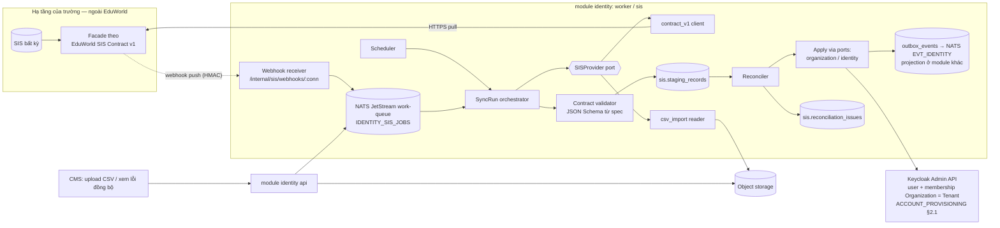
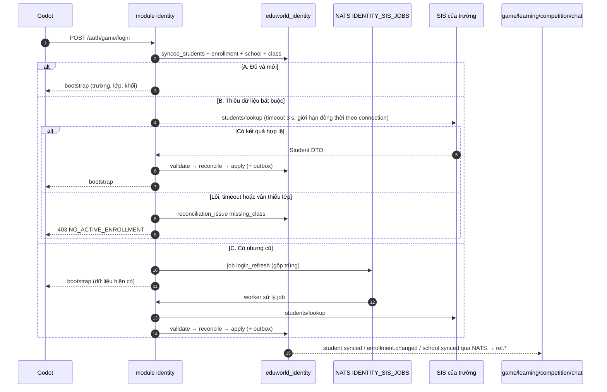
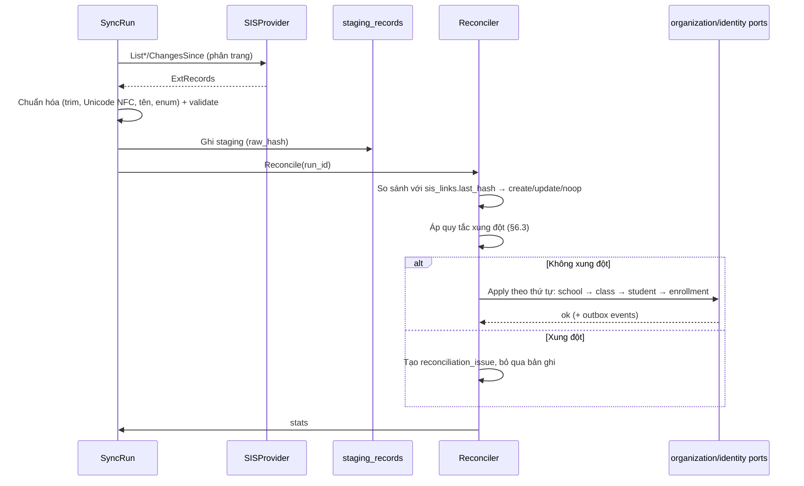

# SIS Integration

> Trạng thái: Draft · Phiên bản: 0.4 · Owner: Backend Architect + Identity & Security Engineer · Cập nhật: 2026-11-15
> Liên quan: [ADR-0021](../adr/ADR-0021-sis-integration-theo-contract-do-eduworld-so-huu.md) · [EduWorld SIS Contract v1](../../specs/sis/eduworld-sis-contract.v1.yaml) · [ACCOUNT_PROVISIONING](ACCOUNT_PROVISIONING.md) · [IDENTITY_MAPPING](IDENTITY_MAPPING.md) · [DATA_PRIVACY](../10-security/DATA_PRIVACY.md) · OQ-01, OQ-12

**Mục đích & phạm vi.** Nguồn chuẩn cho tích hợp SIS: contract do EduWorld sở hữu, hai cách nhận dữ liệu, chế độ đồng bộ, staging/reconciliation, lỗi, audit. Cách dùng dữ liệu SIS khi đăng nhập ở IDENTITY_MAPPING §3.2.

## 1. Nguyên tắc

| # | Nguyên tắc | Nhãn |
|---|---|---|
| 1 | **EduWorld sở hữu contract tích hợp (DTO + API).** Mỗi trường cung cấp endpoint triển khai đúng [EduWorld SIS Contract v1](../../specs/sis/eduworld-sis-contract.v1.yaml). EduWorld **không** nhận DTO riêng của từng SIS và **không** viết adapter ánh xạ theo cấu trúc SIS, vì làm vậy sẽ phá vỡ cấu trúc domain | [Confirmed] |
| 2 | Không giả định SIS cụ thể. Trường dùng SIS nào thì trường (hoặc nhà cung cấp SIS) tự dựng lớp facade theo contract; phần này nằm ngoài EduWorld | [Confirmed] |
| 3 | Godot và CMS SPA **không bao giờ** gọi SIS. Chỉ adapter SIS của module identity gọi (job `sis-sync` trong profile `worker-jobs`, lookup lúc đăng nhập trong `core-api`; ADR-0074) | [Confirmed] |
| 4 | SIS là nguồn sự thật cho học sinh, trường, lớp, enrollment và trạng thái tài khoản học sinh (các trường dữ liệu có trong contract). SIS **không** cung cấp giáo viên hay phân công giảng dạy; nhân sự nhà trường được tạo thủ công trên Admin Portal kèm UserRole (ADR-0072) | [Proposed] / [Confirmed] ADR-0072 |
| 5 | Contract chỉ chứa trường dữ liệu EduWorld cần (data minimization): không địa chỉ, số điện thoại, phụ huynh, ảnh, điểm SIS | [Confirmed] |
| 6 | Mọi dữ liệu từ SIS đi qua validate contract → staging → reconciliation → apply, có audit | [Proposed] |
| 7 | Credential SIS nằm trong secret manager, không lưu plaintext trong DB, không đi qua public gateway | [Confirmed] |
| 8 | Trường chưa có API dùng `csv_import`. File CSV có cùng tên trường với DTO của contract | [Proposed] |

## 2. Contract do EduWorld sở hữu

### 2.1. Thành phần

| Thành phần | Ai triển khai | Ai gọi | Đặc tả |
|---|---|---|---|
| **Pull API** (`/eduworld/v1/...` trên hạ tầng của trường) | Trường / nhà cung cấp SIS | Module identity (binary `worker`) | `paths` trong `specs/sis/eduworld-sis-contract.v1.yaml` |
| **Push webhook** (tùy chọn) | EduWorld (`POST /internal/sis/webhooks/{connection_id}`) | SIS của trường | `webhooks.sisChanges` trong cùng file |
| **CSV import** | EduWorld (upload qua CMS) | School Admin | §4.2, cột = tên trường DTO |

### 2.2. Endpoint trường phải cung cấp

| Endpoint | Bắt buộc | Capability |
|---|---|---|
| `GET /health` (trả `contract_version`, `capabilities`) | Có | — |
| `GET /schools` | Có | `full_sync` |
| `GET /schools/{school_external_id}/academic-years` | Có | `full_sync` |
| `GET /schools/{id}/classes?academic_year=` | Có | `full_sync` |
| `GET /schools/{id}/students` | Có | `full_sync` |
| `GET /schools/{id}/enrollments?academic_year=` | Có | `full_sync` |
| `GET /changes?since=` | Tùy chọn | `delta` |
| `GET /schools/{id}/students/lookup?login_username=` | Tùy chọn | `student_lookup` |
| Gửi `POST` webhook tới EduWorld | Tùy chọn | `webhook` |

Quy ước chung: JSON `snake_case`, phân trang cursor (`data` + `page.next_cursor/has_more`, `limit` ≤ 1000), ngày ISO-8601, lỗi theo RFC 9457, tôn trọng `Retry-After` khi 429. Xác thực: OAuth2 client credentials (khuyến nghị), API key + IP allowlist, mTLS (tùy chọn kết hợp).

### 2.3. DTO chính (tóm tắt, chuẩn nằm trong spec)

| DTO | Trường bắt buộc | Trường tùy chọn |
|---|---|---|
| `School` | `school_external_id`, `school_code`, `name`, `status`, `updated_at` | `organization_external_id` |
| `AcademicYear` | `academic_year` (YYYY-YYYY), `start_date`, `end_date`, `is_current` | — |
| `Class` | `class_external_id`, `school_external_id`, `academic_year`, `grade_level` (1–9), `name`, `updated_at` | — |
| `Student` | `student_external_id`, `school_external_id`, `student_code`, `full_name`, `grade_level`, `status`, `updated_at` | `date_of_birth`, `national_student_id` (EduWorld chỉ lưu hash), `login{username, idp_alias, idp_subject}` |
| `Enrollment` | `student_external_id`, `class_external_id`, `start_date`, `status`, `updated_at` | `end_date` |
| `Change` / `ChangeBatch` | `sequence`, `entity_kind`, `operation` (upsert/delete), `external_id`, `occurred_at` (+ `record` khi upsert) | — |

EduWorld SIS Contract v1 **không có** thực thể `Teacher`, `TeachingAssignment` và trường `Class.homeroom_teacher_external_id` (ADR-0072). Facade gửi kèm các trường/thực thể này bị bỏ qua, không lỗi.

`School.organization_external_id` là **mã đơn vị** phía SIS. EduWorld **không** suy ra tenant từ trường này: System Admin cấu hình mỗi `sis_connection` thuộc một tenant và ánh xạ `school_external_id` → trường trong tenant đó. Trường lạ (chưa ánh xạ) xuất hiện trong dữ liệu → reconciliation issue `unmapped_school`, không tự tạo tenant/trường. Học sinh không thuộc trường nào đã ánh xạ sẽ không được đồng bộ (khi đăng nhập sẽ vào tenant chung, ADR-0026).

Enum (`status`, `role`, `subject_code`…) dùng **giá trị của EduWorld**. Trường có mã nội bộ khác (ví dụ mã môn riêng) thì tự chuyển đổi trong facade của mình.

### 2.4. Quản lý phiên bản contract

- EduWorld là bên duy nhất được sửa contract. Thay đổi đi qua merge request vào `specs/sis/` và phải có ghi chú phát hành gửi các trường.
- Trong `v1` chỉ thêm trường **tùy chọn** hoặc giá trị enum mới, báo trước tối thiểu 1 học kỳ [Proposed]. Breaking change → `/v2` chạy song song, mỗi connection khai báo `contract_version` đang dùng.
- `GET /health` trả `contract_version`. Worker từ chối đồng bộ nếu major version khác version connection đã đăng ký.

### 2.5. Khi dữ liệu không đúng contract

| Tình huống | Xử lý |
|---|---|
| Bản ghi thiếu trường bắt buộc, sai kiểu, sai enum | Từ chối bản ghi, ghi `sis.sync_record_errors` với mã `SIS_CONTRACT_VIOLATION`, tiếp tục bản ghi khác |
| Có trường lạ ngoài contract | Bỏ qua, **không lưu**; tăng metric `eduworld_sis_contract_unknown_fields_total` để báo trường sửa facade |
| > 10% bản ghi của một run vi phạm contract (`sis_contract_violation_threshold`) | Dừng run, connection chuyển `status=contract_error`, cảnh báo School Admin + ops |
| `contract_version` major không khớp | Không chạy, `status=contract_error` |

### 2.6. Onboarding một trường

1. EduWorld cung cấp cho trường: file spec, tài liệu này, **bộ conformance test** và mock server sinh từ spec (Postman collection chạy bằng Postman CLI hoặc tương đương, ở `specs/postman/sis-conformance/`).
2. Trường/nhà cung cấp SIS dựng facade theo contract trên môi trường test, chạy conformance test đến khi pass.
3. Platform Admin tạo `sis_connection` (base URL, phương thức auth, `secret_ref`, `contract_version`, lịch sync), chạy `HealthCheck` + full sync **dry-run**, rồi School Admin duyệt diff.
4. Bật lịch đồng bộ. Chưa có facade thì dùng `csv_import` song song.

## 3. Kiến trúc



## 4. Port `SISProvider` và hai cách nhận dữ liệu

### 4.1. Port

Port dùng trực tiếp DTO của contract (sinh từ `specs/sis/eduworld-sis-contract.v1.yaml` bằng `oapi-codegen` client mode). Không có kiểu `Ext*` riêng cho từng SIS.

```go
package sis

import contract "eduworld/modules/identity/internal/infrastructure/sis/contractv1" // sinh từ specs/sis

type Capability string

const (
    CapFullSync            Capability = "full_sync"
    CapDelta               Capability = "delta"
    CapWebhook             Capability = "webhook"
    CapStudentLookup       Capability = "student_lookup"
)

type Cursor string

type Page[T any] struct {
    Items      []T
    NextCursor Cursor // rỗng = hết
}

// SISProvider có đúng hai implementation: contractV1Client (HTTP) và csvImportReader.
type SISProvider interface {
    Kind() string // "contract_v1" | "csv_import"
    Health(ctx context.Context) (contract.Health, error)

    ListSchools(ctx context.Context, cur Cursor) (Page[contract.School], error)
    ListAcademicYears(ctx context.Context, schoolExtID string) ([]contract.AcademicYear, error)
    ListClasses(ctx context.Context, schoolExtID, year string, cur Cursor) (Page[contract.Class], error)
    ListStudents(ctx context.Context, schoolExtID string, cur Cursor) (Page[contract.Student], error)
    ListEnrollments(ctx context.Context, schoolExtID, year string, cur Cursor) (Page[contract.Enrollment], error)

    // Tùy chọn theo capability; không hỗ trợ trả ErrUnsupported.
    ListChanges(ctx context.Context, since Cursor) (Page[contract.Change], error)
    LookupStudent(ctx context.Context, schoolExtID, loginUsername string) (*contract.Student, error)
}

// Webhook không thuộc provider: receiver xác thực HMAC rồi validate ChangeBatch theo cùng spec.
func VerifyAndParseWebhook(secret []byte, h http.Header, body []byte, now time.Time) (contract.ChangeBatch, error)
```

Bước `mapping` chỉ chuyển DTO contract → entity domain (`org`, `identity`) theo một bảng ánh xạ cố định do EduWorld viết. Không có mapping cấu hình theo từng SIS (không JSONPath, không field-mapping trong `sis_connections.config`).

### 4.2. `contract_v1`: pull qua HTTP [Proposed, Phase 1]

- Cấu hình connection: `base_url`, `auth_type` (`oauth2_client_credentials` | `api_key` | `mtls`), `token_url` (nếu OAuth2), `secret_ref`, `contract_version`, `schools[]` (danh sách `school_external_id` thuộc connection).
- Client giới hạn tốc độ `sis_client_rate`: 10 req/s mỗi connection, timeout 15 s/request, tôn trọng `Retry-After` [Confirmed — Technical Architect 2026-11-16].
- Mỗi response được validate theo JSON Schema trích từ spec trước khi vào staging (§2.5).

### 4.3. `csv_import`: cho trường chưa có API [Proposed, Phase 1]

School Admin upload qua CMS (`POST /api/v1/schools/{school_id}/sis-imports`; System Admin dùng `/api/v1/sis/imports` trên gateway nội bộ), ≤ 10 MB/file, có quét malware. Một import gồm một hoặc nhiều file UTF-8 (chấp nhận BOM), phân cách `,`, header bắt buộc. **Tên cột trùng tên trường DTO của contract**. Riêng `login` tách thành `login_username`, `login_idp_alias`, `login_idp_subject`.

`schools.csv`
```csv
school_external_id,school_code,name,organization_external_id,status
TH-DEMO-001,THDEMO,Trường Tiểu học Demo,ORG-DEMO,active
```

`classes.csv`
```csv
class_external_id,school_external_id,academic_year,grade_level,name
C-2026-3A,TH-DEMO-001,2026-2027,3,3A
```

`students.csv`
```csv
student_external_id,school_external_id,student_code,full_name,date_of_birth,grade_level,status,login_username
HS-000123,TH-DEMO-001,2026000123,Nguyễn Văn An,2018-03-14,3,active,hs.thdemo.000123
```

`enrollments.csv`
```csv
student_external_id,class_external_id,start_date,end_date,status
HS-000123,C-2026-3A,2026-09-05,,active
```

Validate bằng cùng contract validator với `contract_v1`. Lỗi từng dòng ghi `sis.sync_record_errors` (số dòng, cột, mã lỗi). Import theo chế độ **all-or-nothing theo file** [Proposed] để tránh trạng thái nửa vời. Có **dry-run** hiển thị diff trước khi áp dụng.

Luồng (F011): tạo import (`dry_run` mặc định `true`) → presigned PUT ký cả `Content-Length` (`sis_import_upload_ttl`) vào bucket private `ew-sis-imports` → job watcher HEAD object mỗi `sis_import_watch_interval` và xếp job `csv_import` vào `IDENTITY_SIS_JOBS` (`Nats-Msg-Id import:<id>`) → worker kiểm kích thước, quét clamd, đọc theo contract, chạy pipeline §6 với actor `system:sis-sync:<connection_id>`; quá hạn upload → `expired`. Mỗi import một file một loại bản ghi [Proposed].

## 4.4. Nhận biết SIS nguồn khi đăng nhập (ADR-0046)

- Mỗi connection gắn **một tenant** và **một tập trường** (`sis_connection_schools`); mỗi trường chỉ một connection active. Do đó từ trường của học sinh luôn suy ra đúng một SIS nguồn.
- Mỗi bản ghi học sinh đồng bộ mang khóa nguồn `(sis_connection_id, student_external_id)` và các khóa đăng nhập lấy từ trường `login` của DTO contract (`username`, `idp_alias` + `idp_subject`) lưu ở `student_login_keys`.
- Provisioning ghi `identity.sis_identity_links` (nguồn quyết định) và thuộc tính Keycloak `ew_tenant`/`ew_sis_connection`/`ew_external_id` (chỉ gợi ý) — [ACCOUNT_PROVISIONING §2](ACCOUNT_PROVISIONING.md).
- Verify khi đăng nhập dựa trên dữ liệu đã đồng bộ; SIS chỉ được gọi theo các nhánh của **login sync** (§4.5, ADR-0061). Thuật toán nhận diện: [IDENTITY_MAPPING §3.2](IDENTITY_MAPPING.md).
- Sync phát hiện học sinh `inactive/suspended/transferred_out` → cập nhật trạng thái → phiên sau bị chặn và phiên hiện tại bị thu hồi (event `user.access_revoked`).

## 4.5. Đồng bộ khi đăng nhập — login sync (ADR-0061)

Mục tiêu: học sinh thuộc SIS luôn có trong database EduWorld đủ dữ liệu game cần hiển thị (trường, lớp, khối, thông tin theo DTO contract) ngay khi vào game, mà không biến SIS thành điểm nghẽn ở giờ cao điểm (ADR-0045). Login sync **bổ sung** cho full/delta/webhook (§5), không thay thế.

| Nhánh | Điều kiện (tại `POST /api/v1/auth/game/login`, sau khi Keycloak xác thực) | Hành vi | Đăng nhập |
|---|---|---|---|
| **A. Đủ & mới** | Có `synced_students` + enrollment active + trường + lớp; `last_synced_at` trong `sis_login_refresh_after_hours` (mặc định 24 giờ) | Không gọi SIS | Tiếp tục ngay |
| **B. Thiếu dữ liệu bắt buộc** | Lần đầu đăng nhập, hoặc chưa có trường/lớp/enrollment | **Blocking lookup**: `GET /schools/{school_external_id}/students/lookup` của đúng connection (ADR-0046), timeout `sis_login_sync_timeout_ms` (3.000 ms) → contract validator → reconciliation → apply (cùng pipeline §6) | Có lớp → tiếp tục; vẫn thiếu lớp → `NO_ACTIVE_ENROLLMENT` + `reconciliation_issue` `missing_class`; SIS lỗi/timeout/không có capability `student_lookup` → dùng dữ liệu đồng bộ gần nhất, nếu vẫn thiếu → `NO_ACTIVE_ENROLLMENT` |
| **C. Có nhưng cũ** | Đủ dữ liệu nhưng `last_synced_at` cũ hơn ngưỡng | **Refresh nền**: đặt job `login_refresh` vào JetStream work-queue `IDENTITY_SIS_JOBS` (khóa gộp trùng `student:<sis_connection_id>:<student_external_id>`, `Nats-Msg-Id` chống trùng trong 10 phút) | Tiếp tục ngay bằng dữ liệu hiện có |



- **Bootstrap trả về trường, lớp, khối, tỉnh/thành từ module identity**, nên lần đăng nhập đầu hiển thị đúng ngay; các module khác cập nhật projection `ref.students`, `ref.schools`, `ref.classes`, `ref.enrollments` qua event ([DATABASE_DESIGN §2.17](../07-backend/DATABASE_DESIGN.md)).
- **Bảo vệ khi tải cao:** tối đa `sis_login_sync_concurrency` (20) lookup đồng thời mỗi connection; vượt giới hạn hoặc circuit breaker connection đang mở → nhánh B dùng dữ liệu đồng bộ gần nhất (nếu đủ) hoặc trả `NO_ACTIVE_ENROLLMENT` kèm thông điệp "thử lại sau ít phút"; nhánh C chỉ xếp job. Không có retry đồng bộ trên đường đăng nhập.
- **Circuit breaker theo connection** (`sis_login_sync_breaker`): 5 lookup lỗi liên tiếp mở mạch 30 giây [Proposed]; khi mở, nhánh B xử lý như vượt giới hạn.
- **Quan sát:** metric `eduworld_sis_login_sync_total{branch,result}` (`branch` = `fresh`/`blocking`/`background`; `result` = `ok`/`timeout`/`error`/`missing_class`/`throttled`), `eduworld_sis_login_sync_duration_seconds`; cảnh báo khi tỷ lệ `timeout` nhánh B > 5% trong 10 phút ([MONITORING](../11-operations/MONITORING.md)).
- `login_events.sis_connection_id` và kết quả sync được ghi lại (ADR-0046 mục 8).
- Phạm vi dữ liệu đúng DTO contract (ADR-0021); không lấy trường ngoài contract.

### 4.6. Ánh xạ trường SIS vào danh mục trường và tỉnh/thành (ADR-0060)

- DTO `School` của contract **v1.1** có thêm trường tùy chọn `province_code` (mã tỉnh theo danh mục EduWorld, ví dụ `vn.ha-noi`), `moet_code`, `school_level` — thay đổi bổ sung, tương thích ngược ([spec](../../specs/sis/eduworld-sis-contract.v1.yaml)).
- `province_code` là mã **đơn vị cũ** (`vn.old.*`) → tự ánh xạ sang đơn vị hiện hành qua `catalog.province_successions`, ghi cảnh báo `province_outdated`.
- Thiếu `province_code` hoặc mã không có trong danh mục → trường vào trạng thái `pending_review`; Tenant Admin chọn tỉnh/thành khi duyệt (Admin Portal) — `reconciliation_issue` `school_province_missing`. Học sinh của trường vẫn đăng nhập được (tỉnh/thành chỉ dùng hiển thị và báo cáo).
- `moet_code` trùng với trường khác → không tự gộp, tạo `reconciliation_issue` `school_duplicate`.

## 5. Chế độ đồng bộ

| Chế độ | Khi nào | Phạm vi | Ghi chú |
|---|---|---|---|
| Full sync | Hằng đêm 01:00 ICT [Proposed]; đầu năm học; theo yêu cầu admin | Toàn bộ trường của connection | Phát hiện xóa (bản ghi biến mất) → đánh dấu `missing_in_source`, **không xóa ngay**; sau 2 lần full sync liên tiếp vẫn thiếu → đề xuất deactivate (`deactivation_review`); vượt `sis_missing_review_ratio` (5%) hai lần liên tiếp → một issue `deactivation_review` cấp trường. Import CSV có file học sinh được coi là full của trường |
| Delta sync | Mỗi 15 phút giờ hành chính [Proposed], khi trường khai báo capability `delta` | `ListChanges(since)` (`GET /changes`); 410 → full sync | Watermark lưu `sis.sis_connections.delta_watermark` sau khi apply thành công |
| Webhook | Real-time khi SIS hỗ trợ | Thay đổi đơn lẻ | Endpoint `/internal/sis/webhooks/{connection_id}` chỉ trên gateway nội bộ/allowlist IP; payload `ChangeBatch` theo contract; xác thực HMAC + timestamp ±5 phút + chống replay theo `delivery_id` (`ew:identity:sis:wh:nonce:<id>` TTL 10 phút); đẩy vào JetStream work-queue `IDENTITY_SIS_JOBS`, xử lý như delta |
| CSV import | Thủ công | File | Như §4.3 |
| On-demand lookup | Lần đầu đăng nhập qua IdP mà không tìm thấy trong dữ liệu đã đồng bộ (ADR-0046) | 1 học sinh | Chỉ gọi **đúng các connection** của các trường thuộc tenant xác định được, có capability `student_lookup`; gọi **song song**, timeout 3 s mỗi connection; kết quả vẫn qua contract validator + reconciliation trước khi tạo link |

| Login sync | Mỗi lần học sinh đăng nhập (§4.5, ADR-0061) | 1 học sinh | Nhánh B blocking (thiếu dữ liệu) hoặc nhánh C nền (dữ liệu cũ > 24 giờ); không phải SyncRun, không giữ lock connection |

Một connection chỉ có một SyncRun chạy tại một thời điểm (Valkey lock `ew:identity:sis:lock:<connection_id>`, TTL 10 phút, gia hạn heartbeat).

## 6. Staging & reconciliation

### 6.1. Bảng

| Bảng (schema `sis`) | Mục đích |
|---|---|
| `sis_connections` | `connection_id`, `tenant_id` (connection thuộc một tenant; tenant `unit` có thể dùng một connection cho nhiều trường, hoặc mỗi trường một SIS khác nhau), danh sách trường ở bảng `sis_connection_schools` (không dùng mảng), `provider_kind` (`contract_v1` | `csv_import`), `contract_version`, `config` (base_url, auth_type, token_url, schools[] — không secret, không field-mapping), `secret_ref`, `status` (active/auth_error/contract_error/paused), `delta_watermark`, `schedule` |
| `sync_runs` | `run_id`, `connection_id`, `mode` (`full`/`delta`/`webhook`/`csv_import`), `status` (`queued`/`running`/`succeeded`/`partially_failed`/`failed`), `started_at`, `finished_at`, `stats` (jsonb: fetched/created/updated/unchanged/errors) |
| `staging_records` | `run_id`, `entity_kind`, `external_id`, `payload` (jsonb, đã chuẩn hóa), `raw_hash`, `action` (create/update/noop/deactivate), `status` |
| `sis_connection_schools` | `(sis_connection_id, school_id)`, `active_from`, `active_to`; **một trường chỉ có một connection active** (unique partial index `school_id WHERE active_to IS NULL AND deleted_at IS NULL`) — ADR-0046 |
| `sis_links` | Ánh xạ bản ghi SIS ↔ entity nội bộ. **Khóa nguồn học sinh `(sis_connection_id, student_external_id)`** là unique; `student_external_id` chỉ duy nhất trong một SIS (hai SIS trùng mã không bị nhầm); `last_hash` |
| `student_login_keys` | `(sis_connection_id, login_type ∈ {username, idp}, login_key, student_external_id)`; `login_key` = `login.username` hoặc `login.idp_alias + ":" + login.idp_subject` từ DTO contract; unique `(sis_connection_id, login_type, login_key)`. Dùng để xác định SIS nguồn khi đăng nhập lần đầu qua IdP ([IDENTITY_MAPPING §3.2](IDENTITY_MAPPING.md)) |
| `sync_record_errors` | Lỗi validate/apply theo bản ghi |
| `reconciliation_issues` | Xung đột cần người xử lý: `issue_type`, `entity refs`, `suggested_action`, `status`, `resolved_by` |

Staging giữ `sis_staging_retention` (30 ngày) rồi **ẩn danh hóa** payload (chứa PII) và bị loại khỏi truy vấn; ứng dụng không hard-delete (ADR-0028), partition cũ giữ lại, không gỡ trong Release 1.0 (ADR-0070).

### 6.2. Luồng



Apply trong transaction theo **lô 500 bản ghi**, mỗi lô idempotent (dựa trên `raw_hash`). Event sinh ra: `student.synced`, `enrollment.changed`, `user.status_changed`, `class.synced`, `school.synced`.

**UserRole không đến từ SIS (ADR-0066, ADR-0072):** Release 1.0 SIS không đồng bộ nhân sự, nên mọi UserRole của nhân sự nhà trường là `source = manual` do Tenant Admin/School Admin gán trên Admin Portal; enum `source` không có giá trị `sis`. Học sinh không bao giờ nhận role portal.

**SIS quyết định tenant của người dùng (ADR-0026).** Các event trên được consumer `keycloak-membership` dùng để đồng bộ membership Keycloak Organization (mỗi **Tenant** là một Organization, ADR-0026): học sinh là member đúng tenant chứa trường có enrollment active (membership nhân sự theo UserRole, không theo SIS); chuyển sang trường thuộc tenant khác → gỡ org cũ, thêm org mới, thu hồi phiên cũ; chuyển trường trong cùng tenant `unit` không đổi membership ([ACCOUNT_PROVISIONING §2.1](ACCOUNT_PROVISIONING.md)). Vì vậy dữ liệu SIS sai trường có thể khiến học sinh vào sai tenant hoặc rơi vào tenant chung: lỗi `school_external_id` của học sinh/enrollment phải được xử lý ở reconciliation trước khi apply.

### 6.3. Conflict matrix

| Tình huống | Phát hiện | Xử lý tự động | Cần người |
|---|---|---|---|
| Bản ghi mới, chưa có link | Không có `sis_links` | Tạo entity + link | — |
| Bản ghi đổi nội dung | `raw_hash` khác | Update trường do SIS sở hữu | — |
| `external_id` mới nhưng trùng `student_code` + ngày sinh với HS khác trong cùng trường | Rule trùng lặp | Không | `possible_duplicate` |
| HS xuất hiện ở trường mới, có `national_student_id` hash trùng HS trường khác | Rule chuyển trường | Link vào user cũ nếu chính sách cho phép auto-transfer [Proposed: tự động khi trong cùng tenant `unit`] | Khác tenant → `transfer_confirmation` |
| **Chuyển trường giữa hai SIS** (trường mới dùng connection khác), `national_student_id` hash trùng | Rule chuyển SIS (ADR-0046 mục 6) | Chuyển `identity.sis_identity_links` sang `(connection mới, external_id mới)`, link cũ `status = superseded`; cập nhật thuộc tính Keycloak `ew_sis_connection`/`ew_external_id`; User và dữ liệu học tập/game giữ nguyên. Tự động trong cùng tenant `unit` theo policy | Khác tenant → `transfer_confirmation` |
| **Username hoặc email trùng** (không phân biệt hoa thường) với tài khoản khác trên toàn hệ thống, kể cả tenant khác hoặc tài khoản soft-delete chưa ẩn danh hóa (ADR-0067, [ADR-0069](../adr/ADR-0069-username-email-duy-nhat-theo-tenant-va-dang-nhap-khong-chon-tenant.md)) | Unique `lower(username)`/`lower(email)` ở `identity.users` + Keycloak `duplicateEmailsAllowed=false` | Không tạo, không ghi đè tài khoản kia; bản ghi chờ `pending_identifier` | `duplicate_identifier` — **cùng một người** (liên kết định danh SIS hoặc Tenant Admin xác nhận) → thêm membership vào tài khoản sẵn có (nhân sự làm nhiều trường: thêm UserRole; học sinh: enrollment tenant mới); **người khác** → trường đổi username theo mẫu có mã trường |
| Khóa đăng nhập (`student_login_keys`) trùng giữa hai bản ghi | Unique theo connection; trùng **giữa hai connection** → phát hiện khi đăng nhập | Không tự chọn | `ambiguous_login` → `IDENTITY_CONFLICT` khi đăng nhập |
| Bản ghi biến mất trong full sync | Thiếu trong run | `missing_in_source` | Sau 2 lần → `deactivation_review` nếu vượt ngưỡng |
| Enrollment trỏ lớp không tồn tại | FK fail | Không | `orphan_enrollment` |
| **Học sinh không có lớp** trong SIS (ADR-0060) | Không có enrollment active sau apply | Không tự gán lớp; học sinh không vào được game (`NO_ACTIVE_ENROLLMENT`) | `missing_class` — trường bổ sung lớp trong SIS hoặc CSV |
| Enrollment mới thuộc lớp của **trường khác** với trường của học sinh | FK ghép `(class_id, school_id)` | Không apply | `class_school_mismatch` |
| Chuyển lớp trong năm học | Enrollment mới khác lớp, cùng trường | Đóng enrollment cũ (`transferred`) và mở mới trong cùng transaction | — |
| Trường thiếu/không khớp tỉnh/thành | `province_code` thiếu hoặc không có trong danh mục; mã cũ | Mã cũ → ánh xạ qua kế thừa; thiếu → trường `pending_review` | `school_province_missing` (§4.6) |
| Grade level SIS khác grade của lớp | Validate | Dùng grade của lớp, cảnh báo | `grade_mismatch` |
| Trường do EduWorld sở hữu (nickname, avatar, settings game) | — | **Không bao giờ ghi đè từ SIS** | — |
| Admin sửa tay trường do SIS sở hữu | `override` flag | Lần sync sau ghi đè + cảnh báo trong CMS | — |
| Status `inactive` / `graduated` | Status | `user.status=deactivated`, đóng enrollment | — |
| Status `suspended` | Status | `user.status=locked` | — |
| Học sinh **đã bị dọn do không đăng nhập** (`delete_reason = 'inactive_cleanup'`, ADR-0032) xuất hiện lại trong sync | `sis_links` trỏ tới user đã soft-delete | **Không tự khôi phục**; cập nhật trường do SIS sở hữu trên bản ghi đã xóa; khôi phục chỉ khi học sinh đăng nhập lại hoặc School Admin khôi phục | `cleaned_up_student_in_sis` (thông tin) |
| Học sinh có enrollment active ở **hai trường** cùng lúc | Rule tenant duy nhất | Không apply enrollment thứ hai; giữ membership tenant hiện tại | `multi_school_enrollment` (học sinh chỉ thuộc một tenant, ADR-0026) |

Quyền sở hữu trường: SIS sở hữu `full_name`, `student_code`, `date_of_birth`, `grade_level`, `status`, enrollment; EduWorld sở hữu mọi dữ liệu game/học tập.

## 7. Error handling & retry

| Lỗi | Phân loại | Xử lý |
|---|---|---|
| Timeout, 5xx, network | Transient | Retry theo `sis_retry_backoff`: exponential backoff + jitter 1 s, 2 s, 4 s… tối đa 6 lần; tôn trọng `Retry-After` |
| 429 | Rate limit | Backoff theo header; giảm concurrency của client `contract_v1` |
| 401/403 | Credential | Dừng run, `status=failed`, cảnh báo ops + School Admin; connection `status=auth_error` |
| Payload sai schema | Data | Ghi `sync_record_errors`, tiếp tục bản ghi khác |
| Lỗi apply DB | Bug/ràng buộc | Rollback lô, ghi lỗi, tiếp tục lô sau; > 10% lô lỗi → dừng run (`sis_contract_violation_threshold`) |
| Webhook xử lý lỗi | — | Giữ trong JetStream work-queue `IDENTITY_SIS_JOBS` (ack sau khi xử lý xong), redeliver sau 5 phút, tối đa 5 lần → `DLQ_IDENTITY` |

Circuit breaker cho mỗi connection (`sis_circuit_breaker`): 5 run liên tiếp thất bại → tạm dừng lịch, chỉ chạy khi admin kích hoạt lại. Các giá trị trong mục này [Confirmed — Technical Architect 2026-11-16].

## 8. Audit & quan sát

- Mỗi SyncRun và mọi thay đổi apply ghi `audit.audit_logs` (`actor = system:sis-sync:<connection_id>`, `action`, `entity`, diff trường thay đổi — **không** ghi full PII payload).
- Metrics (Prometheus):
  - `eduworld_sis_sync_runs_total{connection,mode,status}`
  - `eduworld_sis_sync_duration_seconds{connection,mode}`
  - `eduworld_sis_records_total{connection,entity,action}`
  - `eduworld_sis_record_errors_total{connection,entity,code}`
  - `eduworld_sis_reconciliation_issues_open{connection,type}`
  - `eduworld_sis_last_success_timestamp{connection}` → alert nếu > 26 giờ
- Dashboard CMS cho School Admin: lần đồng bộ gần nhất, số lỗi, danh sách issue cần xử lý.

## 9. Bảo mật

- Credential (API key, client secret, cert) lưu secret manager; `sis_connections.secret_ref` chỉ là tham chiếu. Worker đọc lúc chạy, không log.
- Outbound tới SIS qua egress cố định (IP tĩnh để SIS allowlist), TLS 1.2+, kiểm tra cert; mTLS nếu SIS hỗ trợ.
- Endpoint `/api/v1/sis/*` (API quản trị cho người, **chỉ trên APISIX internal**/VPN quản trị — ADR-0009, [API_DESIGN §9.15](../07-backend/API_DESIGN.md)) chỉ cho School Admin/Platform Admin: upload CSV, xem run, xử lý issue — không bao giờ trả credential. Endpoint machine-to-machine (webhook SIS, trigger nội bộ) ở `/internal/sis/*`, không publish ra public gateway.
- File CSV upload: mã hóa at-rest, xóa sau 30 ngày, quét malware, giới hạn kích thước, chống CSV injection khi xuất lại (prefix `'` cho ô bắt đầu bằng `=+-@`).

## 10. API

| Method | Path | Quyền |
|---|---|---|
| GET | `/api/v1/sis/connections` | school_admin (scope), system_admin |
| POST | `/api/v1/schools/{school_id}/sis-imports` (+ `dry_run`) | school_admin (scope trường) |
| GET | `/api/v1/schools/{school_id}/sis-imports/{import_id}` | school_admin |
| POST | `/api/v1/sis/imports` | system_admin (`X-Tenant-Id` tenant đích) |
| POST | `/api/v1/sis/connections/{connection_id}/sync-runs` | school_admin (scope trường), system_admin (Idempotency-Key) |
| GET | `/api/v1/sis/connections/{connection_id}/sync-runs` · `/api/v1/sis/runs/{run_id}` · `/errors` | school_admin |
| PUT | `/api/v1/admin/sis/connections/{connection_id}/schools` | system_admin (bảng nối `sis_connection_schools`) |
| GET | `/api/v1/sis/reconciliation-issues` | school_admin |
| POST | `/api/v1/sis/reconciliation-issues/{id}:resolve` | school_admin (audit) |
| POST | `/internal/sis/webhooks/{connection_id}` | SIS (HMAC), chỉ mạng nội bộ/allowlist |

## 11. Kiểm thử

- Contract validator: fixture hợp lệ và vi phạm cho từng DTO (thiếu trường bắt buộc, sai enum, trường lạ), CSV mẫu cùng tên cột với DTO.
- Mock SIS server sinh từ `specs/sis/eduworld-sis-contract.v1.yaml` dùng làm môi trường test cho worker; cùng bộ conformance test được giao cho trường để kiểm tra facade của họ.
- Fake SIS server (httptest) mô phỏng phân trang, 429, 5xx, webhook có/không chữ ký hợp lệ.
- Kịch bản: import lần đầu; import lại không đổi (0 update); đổi lớp; chuyển trường cùng org/khác org; học sinh biến mất; dữ liệu lỗi một dòng; webhook replay bị chặn.
- Nhận biết SIS nguồn (ADR-0046): hai SIS cùng gửi `student_external_id = HS-0001` cho hai học sinh khác nhau → hai bản ghi, hai link, không nhầm; đăng nhập IdP khớp 0/1/2 bản ghi; lookup timeout ở một connection không chặn connection khác; chuyển trường giữa hai SIS giữ nguyên User và dữ liệu (TC-AUTH-030…035 trong [TEST_STRATEGY](../12-project/TEST_STRATEGY.md)).
- Hiệu năng: full sync 50.000 học sinh trong < 15 phút [Proposed].
