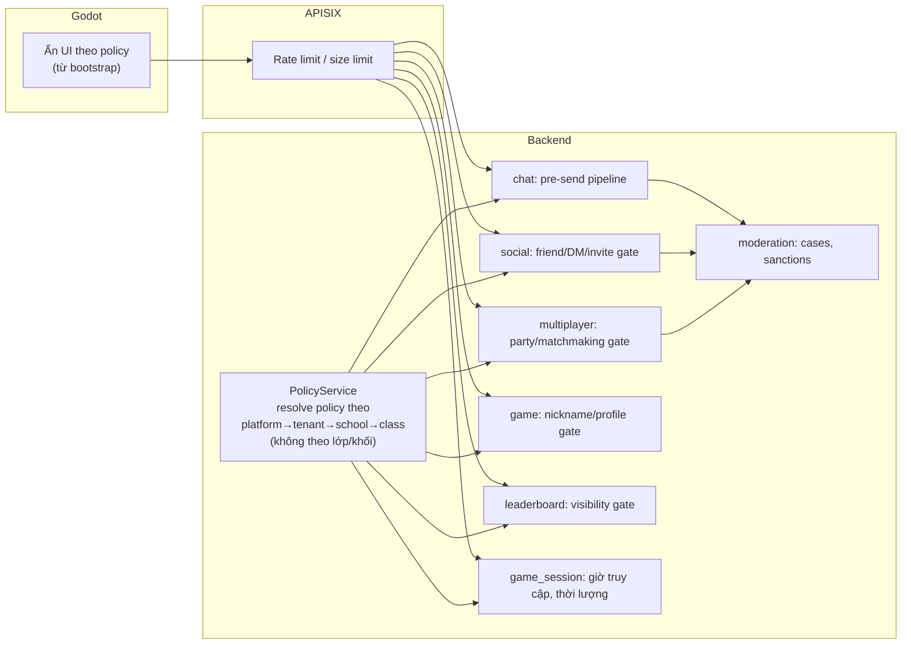
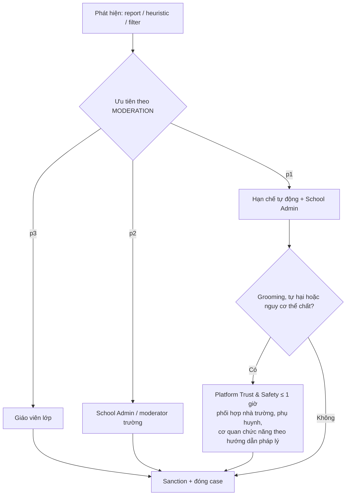

# Child Safety — An toàn trẻ em

> Trạng thái: Draft · Phiên bản: 0.2 · Owner: Product Manager + Identity & Security Engineer + Trust & Safety · Cập nhật: 2026-11-15
> Liên quan: [ADR-0020](../adr/ADR-0020-chat-thong-nhat-cho-moi-lop-moi-tin-nhan-phai-qua-kiem-tra-h.md) · [ADR-0030](../adr/ADR-0030-chinh-sach-tu-nhay-cam-trong-chat-danh-muc-quan-ly-duoc-va-c.md) · [ADR-0054](../adr/ADR-0054-tuong-tac-xa-hoi-lien-truong-cross-school-social-interaction.md) · [SOCIAL_SYSTEM](../03-social-multiplayer/SOCIAL_SYSTEM.md) · [CHAT_SYSTEM](../03-social-multiplayer/CHAT_SYSTEM.md) · [MODERATION](../03-social-multiplayer/MODERATION.md) · [DATA_PRIVACY](DATA_PRIVACY.md) · [SECURITY_ARCHITECTURE](SECURITY_ARCHITECTURE.md) · OQ-09, OQ-12, OQ-17

**Mục đích.** Nguồn duy nhất về **chính sách an toàn trẻ em** (cái gì được phép, mặc định ra sao) và **nơi hệ thống thực thi** chính sách đó (hợp nhất CHILD_SAFETY + CHILD_SAFETY, 2026-11-15).

**Phạm vi và quyền sở hữu.**

| Chủ đề | Tài liệu sở hữu |
|---|---|
| Chính sách an toàn, danh tính hiển thị, thời gian chơi, dark pattern, enforcement points, ma trận quyền giáo viên/trường, tín hiệu rủi ro trẻ em (grooming, bắt nạt, tự hại) và phản hồi, đào tạo moderator, checklist phát hành | **Tài liệu này** |
| Pipeline kiểm duyệt tin nhắn (normalize → danh mục từ nhạy cảm → PII → spam → bắt nạt), công tắc kiểm duyệt, report flow, hàng đợi case, **SLA xử lý**, sanction, lưu & purge bằng chứng | [MODERATION](../03-social-multiplayer/MODERATION.md) |
| Loại channel, tham số chat (độ dài, rate limit), tính năng chat | [CHAT_SYSTEM](../03-social-multiplayer/CHAT_SYSTEM.md) |
| Bạn bè, block, guild/club, tương tác liên trường | [SOCIAL_SYSTEM](../03-social-multiplayer/SOCIAL_SYSTEM.md), ADR-0054 |
| Dữ liệu cá nhân, đồng ý, retention | [DATA_PRIVACY](DATA_PRIVACY.md) |

## 1. Nguyên tắc

1. **Safety by default**: quyền vào channel xác định theo quan hệ (cùng trường, cùng nhóm, bạn bè) và policy; **mọi tin nhắn phải qua kiểm tra hợp lệ** phía server trước khi phát (ADR-0020), dựa trên danh mục từ nhạy cảm quản lý trong CMS. Kiểm tra **bật mặc định**; chỉ System Admin có thể tắt có kiểm soát (ADR-0030, §3.3).
2. **Data minimization**: không thu thập/hiển thị thông tin không cần thiết; giám sát chat không được dùng làm lý do thu thập dữ liệu vượt mục đích.
3. **Không công khai thông tin cá nhân**: người chơi khác chỉ thấy nickname + avatar.
4. **Phân quyền hẹp**: không ai truy cập toàn bộ chat của tất cả trường; moderator chỉ thấy phạm vi trường/lớp được giao.
5. **Không gây nghiện, không ép buộc, không áp lực tiêu cực**.
6. **Trường và giáo viên có quyền kiểm soát** trong phạm vi của mình.
7. Đánh giá pháp lý Việt Nam trước production (OQ-12) [TBD].

## 2. Danh tính hiển thị

| Quy tắc | Chi tiết | Nhãn |
|---|---|---|
| Nickname | Sinh tự động dạng `<Tính từ/Màu><Con vật><2 số>` (vd. "MèoXanh42") từ danh sách đã duyệt; học sinh được đổi bằng cách chọn lại từ bộ sinh, **không gõ tự do** | [Proposed] |
| Tên thật | Chỉ hiển thị cho giáo viên/quản trị có quyền; bạn cùng lớp thấy tên thật nếu trường bật | [Proposed] |
| Avatar | Chỉ từ bộ customization; không upload ảnh | [Proposed] |
| Hồ sơ người chơi khác | Nickname, avatar, level, badge công khai; không trường, lớp, tuổi, ngày sinh | [Proposed] |
| Liên trường | Hiển thị "Trường khác" thay tên trường | [Proposed] |
| Leaderboard | Nickname; không ảnh, không tên thật (trừ leaderboard lớp nếu trường bật tên thật) | [Proposed] |

## 3. Chính sách chat: một bộ quy tắc cho mọi lớp

> **Quyết định stakeholder (ADR-0020, Accepted 2026-11-15):** chat **không phân biệt theo lớp** và **mọi tin nhắn phải hợp lệ**. Quyết định này **thay thế** mục "Age/Grade-based Policy" trong Master Prompt §6.3. An toàn cho học sinh nhỏ tuổi được bảo đảm bằng kiểm tra hợp lệ bắt buộc, moderation và quyền của giáo viên/trường, không bằng cách giới hạn chat theo khối.

### 3.1. Nội dung được phép (như nhau cho học sinh lớp 1–9)

Giá trị khởi tạo của `chat_policy` cấp platform. Cấp tenant/school/class chỉ được siết chặt hơn (ADR-0020); khi siết chặt, quy tắc áp dụng cho **mọi** học sinh trong phạm vi đó.

| Channel | Ai gửi được | Loại tin |
|---|---|---|
| `world` | Người chơi cùng trường (tenant `unit` có thể mở rộng toàn tenant) | Text, emoji, quick message, reaction |
| `area` | Người trong cùng instance | Text, emoji, quick message, reaction |
| `match` **(luôn có)** | Người chơi cùng trận 1v1/đội/giải | Text, emoji, quick message, reaction |
| `party` **(luôn có)** / `team` (team trong trận luôn có) | Thành viên nhóm/đội | Text, emoji, quick message, reaction |
| `class` | Học sinh + giáo viên của lớp | Text, emoji, quick message, reaction |
| `study_group` | Thành viên nhóm | Text, emoji, quick message, reaction |
| `direct` | Hai người đã là bạn bè, không block nhau | Text, emoji, quick message, reaction |
| Liên trường | Theo channel ở trên | Như trên; chỉ hiện nickname/avatar |

### 3.2. Kiểm tra hợp lệ và tham số [Proposed — giá trị số]

| Tham số | Giá trị mặc định (mọi lớp) |
|---|---|
| Kiểm tra hợp lệ | **Bật mặc định** cho mọi tin: normalize → định dạng → danh mục từ nhạy cảm (tiếng Việt có/không dấu, teencode, leetspeak, tiếng Anh) → PII → spam → bắt nạt → `allow / mask / block / hold_for_review / block_and_alert` ([MODERATION](../03-social-multiplayer/MODERATION.md) §3). System Admin có thể tắt từng bước hoặc toàn bộ (ADR-0030, §3.3) |
| Danh mục từ nhạy cảm | Quản lý trong CMS theo nhóm và mức độ; tenant chỉ thêm từ, không nới danh mục platform ([MODERATION](../03-social-multiplayer/MODERATION.md) §11) |
| Mức nghiêm bộ lọc | `strict`; trường/lớp có thể nâng lên `very_strict` |
| Rate limit | Theo channel (6–15 tin/phút), tổng ≤ 30 tin/phút/người ([CHAT_SYSTEM §3.1](../03-social-multiplayer/CHAT_SYSTEM.md)) |
| Độ dài text tối đa | World/Area 120 · Party/Team 200 · Class/Study Group/DM 300 |
| Link/URL | Chặn, trừ link nội bộ EduWorld trong allowlist |
| Số điện thoại/email/địa chỉ/mạng xã hội | Chặn |
| Giờ chat (trường có thể thu hẹp) | 06:30–21:30 |
| Lưu lịch sử chat | 180 ngày (OQ-12) |
| Học sinh xem lịch sử | 30 ngày gần nhất |

### 3.2b. Chat gameplay luôn có (ADR-0020 mục 6) và lưu giữ ngắn hạn (ADR-0033)

Chat trong trận 1v1, trận đội và party **không tắt được** bằng cài đặt trường/lớp. Biện pháp an toàn thay thế:

| Biện pháp | Chi tiết |
|---|---|
| Kiểm tra nội dung | Mọi tin trong `match`/`team`/`party` qua pipeline kiểm tra như mọi channel (theo công tắc ADR-0030) |
| Công cụ tại chỗ | Tắt tiếng · Chặn · Báo cáo trên từng tin, nút báo cáo ở màn hình kết quả trận |
| Sanction | Moderator mute/restrict cá nhân; người bị mute vẫn chơi được nhưng không gửi tin |
| Phạm vi | Chỉ người cùng trận/party; người ngoài trường chỉ thấy nickname |
| Lưu giữ | Tin gameplay bị xóa vật lý sau `gameplay_chat_retention_days` (mặc định 7, **tối thiểu 3** để kịp báo cáo); tin đã bị báo cáo được giữ làm bằng chứng; channel có case mở không bị xóa |
| Minh bạch | Học sinh được thông báo trong game: "Tin nhắn trong trận được giữ {N} ngày" |

### 3.3. Khi công tắc kiểm duyệt bị tắt (ADR-0030)

Stakeholder quyết định công tắc có thể tắt **toàn bộ** kiểm tra nội dung (kể cả PII). Rủi ro: học sinh 6–15 tuổi có thể nhận tin tục tĩu, bắt nạt, hoặc bị xin/chia sẻ số điện thoại, địa chỉ, mạng xã hội mà hệ thống không chặn. Biện pháp giảm thiểu bắt buộc:

| Biện pháp | Chi tiết |
|---|---|
| Chỉ System Admin được tắt | Tenant Admin không tắt được bước nào; chỉ bật/tắt category khi được phép |
| Lý do + audit | Mọi lần tắt/bật có lý do, actor, thời điểm, phạm vi |
| Thời hạn | Khuyến nghị luôn đặt `expires_at`; tự bật lại khi hết hạn [Proposed] |
| Hiển thị trạng thái | Banner "Đang tắt kiểm duyệt" trong CMS cho System Admin và Tenant Admin/moderator của tenant; alert vận hành `eduworld_chat_policy_disabled` |
| Vẫn giữ | Độ dài tối đa, rate limit, quyền channel, sanction, block/mute/report, moderation thủ công khi có report |
| Truy vết | Tin gửi khi tắt được đánh dấu `unchecked` để điều tra khi có báo cáo |

Khuyến nghị vận hành [Proposed]: chỉ tắt từng bước có lý do cụ thể (ví dụ false positive hàng loạt sau khi đổi danh mục) và trong thời gian ngắn; không tắt `pii` cho tenant có học sinh tiểu học trừ khi có văn bản đồng ý của nhà trường.

### 3.3b. An toàn cho các tính năng chat mở rộng (ADR-0034)

| Tính năng | Rủi ro | Biện pháp |
|---|---|---|
| Thu hồi | Bắt nạt rồi xóa dấu vết | Nội dung gốc giữ làm bằng chứng; tin đã thu hồi vẫn báo cáo được |
| Sửa | Đổi nội dung sau khi đã qua kiểm duyệt | Bản sửa chạy lại kiểm duyệt; revision lưu cho moderator; chỉ 15 phút |
| Forward | Phát tán tin nhắn riêng để bêu xấu | Chỉ trong cùng tenant, chạy lại kiểm duyệt tại channel đích, tối đa 5 nơi, có nhãn nguồn; forward từ DM được ghi nhận làm tín hiệu cho phân tích bất đồng bộ |
| Mention | Gắn tên liên tục để quấy rối | ≤ 5 mention/tin, rate limit, không mention được người đã block mình; mention lặp là tín hiệu bắt nạt |
| Sticker / GIF | Nội dung hình ảnh không phù hợp | Chỉ thư viện nội bộ đã duyệt, không upload, không dịch vụ GIF Internet |
| Receipts / typing | Áp lực "đã xem sao không trả lời" | Không có ở World/Area; lớp chỉ hiện số người đã xem; người bị block không thấy trạng thái đọc [Proposed: cho phép học sinh tắt hiển thị "đã xem" của mình ở DM] |
| Tìm kiếm | Tra cứu thông tin người khác | Chỉ trong channel mình là thành viên, chỉ trên nội dung đã che |

### 3.4. Quan hệ xã hội

| Hành động | Mặc định |
|---|---|
| Kết bạn | Cùng trường (như nhau cho mọi lớp) |
| Mời party | Bạn bè hoặc bạn cùng lớp; không mời người lạ |
| Party liên trường | Không (mặc định Release 1.0) [Proposed] |
| Party khác grade band | Được nếu cùng trường, chỉ hoạt động phù hợp grade thấp nhất (COMPETITION_DESIGN §5) |
| Block | Chặn mọi tương tác (chat, mời, ghép party, ghép trận nếu còn lựa chọn khác) |

## 4. Thời gian chơi và sức khỏe (OQ-17)

| Biện pháp | Mặc định [Proposed] | Ai cấu hình |
|---|---|---|
| Nhắc nghỉ | Sau 45 phút liên tục: Mây nhắc nghỉ mắt + gợi ý vận động; g1_3 sau 30 phút | Platform, trường siết thêm |
| Nhắc lần 2 | Sau 90 phút: nhắc nổi bật hơn, tổng kết phiên | Platform |
| XP cap ngày | Giảm động lực chơi dài (GAME_DESIGN §6) | Platform |
| Khung giờ truy cập | Trường cấu hình (vd. không cho đăng nhập 22:00–06:00) | School Admin |
| Chế độ "trong giờ học" | Giáo viên khóa Arena/Social khi đang dùng game trong tiết học | Teacher (lớp mình) |
| Giới hạn cứng/ngày | Không áp mặc định; trường có thể bật (vd. 120 phút/ngày) | School Admin [TBD] |

## 5. Không dark pattern, không cơ chế cờ bạc

| Cấm | Lý do |
|---|---|
| Loot box, gacha, quay thưởng (kể cả bằng tiền ảo miễn phí) có phần thưởng ngẫu nhiên giá trị | Cơ chế cờ bạc với trẻ em |
| In-app purchase, tiền thật | Không pay-to-win/pay-to-learn (OQ-14) [Proposed] |
| Streak bị mất gây lo âu | Thay bằng mục tiêu tuần linh hoạt |
| Đếm ngược FOMO, vật phẩm "chỉ một lần" | Sự kiện và vật phẩm có lặp lại |
| Push notification kéo người chơi quay lại | Không push marketing |
| Nút "Tiếp tục" mặc định chuyển hoạt động mới | Mỗi hoạt động kết thúc bằng điểm dừng tự nhiên |
| Thứ hạng thấp hiển thị công khai | Chỉ top N + vị trí của mình |
| Thông điệp làm trẻ xấu hổ khi sai/thua | Phản hồi tích cực (LEARNING_EXPERIENCE §4) |
| Quảng cáo bên thứ ba | Không có quảng cáo |

## 6. Điểm thực thi (enforcement points)

Nguyên tắc: **mọi kiểm soát an toàn được thực thi ở server**. Godot chỉ ẩn UI tương ứng (để trẻ không thấy tính năng không được phép) nhưng không phải là lớp bảo vệ.

| # | Điểm thực thi | Module | Kiểm soát | Mặc định |
|---|---|---|---|---|
| EP-01 | Gửi tin nhắn | `chat` | ChatPolicy theo channel (không theo grade, ADR-0020); **mọi tin** qua pipeline kiểm tra hợp lệ normalize → định dạng → danh mục từ nhạy cảm → PII → spam → bắt nạt → allow/mask/block/hold/block_and_alert; từng bước có thể bị System Admin tắt (công tắc kiểm duyệt, §3.1) — giới hạn độ dài, rate limit, quyền channel, sanction luôn chạy | ADR-0020, ADR-0030 |
| EP-02 | Tạo DM channel | `chat`, `social` | Chỉ khi hai người là bạn bè, không block nhau, trường không tắt DM | Như nhau cho mọi lớp |
| EP-03 | Gửi friend request | `social` | Cùng trường (mặc định); rate limit; không với người đã block/bị block | Cùng trường, như nhau cho mọi lớp |
| EP-04 | Mời vào party / join party | `multiplayer/party` | Party policy: school/class/grade, private cần lời mời; chặn người đã block; rate limit lời mời | Cùng trường |
| EP-05 | Matchmaking | `multiplayer/matchmaking` | Ràng buộc cứng grade (không ghép lớp 1 với lớp 9); cross-school chỉ hiển thị nickname; chat sau trận theo ChatPolicy chung | Grade exact (1–5), ±1 (6–9) |
| EP-06 | Nickname & tên party | `game`, `party` | Nickname sinh tự động hoặc chọn từ danh sách duyệt; tên party qua pipeline lọc + danh sách gợi ý cho lớp 1–3 | Không gõ tự do lớp 1–5 |
| EP-07 | Hồ sơ người chơi | `game` | Người khác chỉ thấy nickname, avatar, level, badge; không tên thật/trường/lớp với người khác trường | — |
| EP-08 | Leaderboard | `competition/leaderboard` | Phạm vi hiển thị theo policy; người ngoài trường chỉ thấy nickname; trường có thể tắt global | Global hiển thị nickname |
| EP-09 | Phiên chơi | `game_session` | Giờ truy cập do trường cấu hình; nhắc nghỉ; giới hạn thời lượng/ngày [TBD OQ-17] | Nhắc sau 45 phút |
| EP-10 | Phần thưởng | `gamification` | Không loot box trả tiền, không cơ chế FOMO gây áp lực (streak phạt), cap XP | — |
| EP-11 | Nội dung học tập/NPC | `cms` | Workflow duyệt; reviewer kiểm tra phù hợp lứa tuổi | — |
| EP-12 | Upload media | `cms`, `learning` | Nội dung: chỉ vai trò nội dung/giáo viên. Học sinh chỉ nộp bài trong ngoại lệ có kiểm soát (ghi âm speaking, sản phẩm dự án, ảnh bài làm — tắt mặc định): bucket private `ew-student-submissions`, quét virus, chỉ người chấm xem ([ADR-0044](../adr/ADR-0044-luu-tru-hinh-anh-va-media-object-storage-s3-compatible-cdn.md) mục 3) | Tắt ảnh bài làm |

Policy resolution: cấp dưới chỉ **siết chặt hơn** (ADR-0020). Kết quả resolve được cache theo `(school_id, class_id)` 5 phút, invalidate khi policy đổi, và gửi xuống client trong bootstrap để ẩn UI.

## 7. Vai trò và quyền của giáo viên, nhà trường

| Vai trò | Quyền an toàn (chỉ trong phạm vi được giao) |
|---|---|
| Teacher | Moderator `class`/`study_group` channel của lớp mình; xem báo cáo liên quan học sinh lớp mình; mute tạm (≤ 24h); khóa Arena/Social trong giờ học; tạo nhóm bạn/study group cho lớp mình |
| School Admin | Cấu hình `chat_policy` cấp trường (siết chặt); bật/tắt DM, world chat, tên thật (không tắt được chat trận/party — ADR-0020 mục 6); xử lý escalation; sanction dài hạn; cấu hình giờ truy cập |
| Tenant Admin (đơn vị) | Chính sách liên trường trong tenant; báo cáo tổng hợp ẩn danh |
| Platform Trust & Safety (`system_admin`) | Chỉ xử lý case được escalate hoặc case liên trường, có lý do và audit; không duyệt chat tự do của trường |
| System Admin | Quản lý danh mục từ nhạy cảm, quick message, policy mặc định, công tắc kiểm duyệt (ADR-0030) |

Không có vai trò nào đọc được toàn bộ chat mọi trường [Confirmed — §6.3].

**Ma trận quyền chi tiết**

| Hành động | Teacher (lớp mình) | School Admin | Platform Safety Team |
|---|---|---|---|
| Xem Class Chat / Team Chat của lớp | ✔ | ✔ (trường) | Chỉ trong ModerationCase được giao |
| Xem DM/Party chat | ✘ — chỉ khi có report liên quan, qua ModerationCase | ✔ qua case | ✔ qua case |
| Mute học sinh trong channel lớp | ✔ (≤ 24h) | ✔ | ✔ |
| Tạm khóa chat của học sinh | ✘ (đề xuất) | ✔ | ✔ |
| Khóa tài khoản | ✘ | ✔ | ✔ (cần lý do + audit) |
| Đóng Class Chat / bật chế độ "chỉ giáo viên" | ✔ | ✔ | — |
| Cấu hình ChatPolicy, giờ truy cập | ✘ | ✔ (trong giới hạn platform) | Platform defaults |
| Xử lý report | Report trong lớp mình | Mọi report của trường | Escalated cases |
| Xuất bằng chứng | ✘ | ✔ (audit) | ✔ |

Mọi thao tác đọc nội dung chat ngoài channel mà người đó là thành viên đều **ghi audit** (`chat.message.read_for_moderation`) và hiển thị trong báo cáo minh bạch cho School Admin. Không ai có quyền đọc toàn bộ chat của mọi trường (Master Prompt §6.3).

## 8. Tín hiệu rủi ro an toàn trẻ em [Proposed]

Phát hiện đồng bộ (pipeline trước khi gửi) và cơ chế worker bất đồng bộ thuộc [MODERATION](../03-social-multiplayer/MODERATION.md) §3–§4, §11–§12. Bảng dưới là **ngưỡng và phản hồi** đặc thù an toàn trẻ em mà worker `async_analysis` của MODERATION áp dụng:

| Tín hiệu | Mô tả | Ngưỡng ban đầu | Hành động |
|---|---|---|---|
| Bullying — lặp mục tiêu | Một người gửi nhiều tin bị mask/block hướng tới cùng một người (mention/DM/party) | ≥ 3 lần/24h | ModerationCase mức Medium, thông báo giáo viên lớp |
| Bullying — hội đồng | ≥ 3 người cùng gửi tin bị lọc tới 1 người trong 1 giờ | 3 người | Case High, hạn chế tạm channel |
| Loại trừ | Một học sinh bị kick khỏi party liên tục bởi nhiều leader | ≥ 5 lần/7 ngày | Gợi ý giáo viên quan tâm (không trừng phạt) |
| Grooming / tiếp cận bất thường | Tài khoản gửi friend request/lời mời tới nhiều học sinh nhỏ hơn ≥ 3 khối, hoặc cố chia sẻ liên hệ (PII bị chặn) lặp lại, hoặc yêu cầu "chuyển sang app khác" | ≥ 2 lần PII-block + mục tiêu nhỏ tuổi | Case **Critical**, tự động hạn chế social của tài khoản gửi, escalate Safety Team |
| Spam | Tần suất cao, nội dung trùng lặp | Theo rate policy | Mute tự động 10 phút → 1 giờ |
| Tự hại / khủng hoảng | Từ khóa liên quan tự làm hại bản thân | Bất kỳ | Không phạt người gửi; tin nhắn giữ lại; thông báo ngay giáo viên chủ nhiệm/School Admin theo quy trình hỗ trợ của trường; hiển thị cho học sinh thông điệp hỗ trợ (vd. Tổng đài quốc gia bảo vệ trẻ em 111) |
| Nhiều report | ≥ 3 report độc lập về cùng người trong 24h | 3 | Case High |

Mọi phát hiện tự động chỉ **tạo case/hạn chế tạm thời**; xử phạt kéo dài cần con người xác nhận. Từ khóa và ngưỡng nằm trong cấu hình phiên bản hóa (`moderation_rules`), review mỗi tháng để giảm false positive.

## 9. Báo cáo, leo thang và phản hồi

- Report flow, phân loại ưu tiên `p1`/`p2`/`p3` và **SLA** xử lý: nguồn duy nhất ở [MODERATION §5–§6](../03-social-multiplayer/MODERATION.md). Ánh xạ: grooming, đe dọa, tự hại, chia sẻ thông tin cá nhân → `p1`; bắt nạt, xúc phạm → `p2`; spam, ngôn ngữ thô → `p3`.
- Leo thang khi có nguy cơ an toàn thể chất hoặc pháp lý (bổ sung cho SLA của MODERATION):

Học sinh bị báo cáo được đối xử theo nguyên tắc giáo dục: cảnh báo thân thiện trước, giải thích quy tắc, sanction tăng dần (cảnh báo → mute ngắn → hạn chế chat → khóa chat → khóa tài khoản). Học sinh báo cáo nhận phản hồi "Cảm ơn em, thầy cô đã nhận được" và không bị tiết lộ danh tính với người bị báo cáo.

## 10. Bằng chứng

Cơ chế lưu, thời hạn và giữ bằng chứng trước khi purge chat gameplay: [MODERATION §10](../03-social-multiplayer/MODERATION.md). Quy tắc an toàn trẻ em đối với bằng chứng:

- Khi tạo ModerationCase: snapshot bất biến (`chat.moderation_evidence`): tin nhắn liên quan ± 20 tin ngữ cảnh, metadata (channel, thời gian, người gửi), kết quả filter, hash SHA-256 của snapshot.
- **Trước khi purge chat gameplay (ADR-0033):** job `gameplay-chat-purge` sao chép vào `chat.moderation_evidence` mọi tin của channel gameplay có report, case (mở hoặc đã đóng còn trong thời hạn giữ) hoặc sanction; channel có case **đang mở** được hoãn purge đến khi case đóng. Vì vậy thời hạn tối thiểu 3 ngày là thời gian để học sinh/giáo viên kịp báo cáo sau trận.
- Snapshot không bị xóa bởi retention chat thông thường cho đến khi case đóng + thời gian giữ của case ([DATA_PRIVACY §2](DATA_PRIVACY.md)); không bị xóa bởi người gửi "xóa tin".
- Truy cập evidence: chỉ người được gán case; mọi lượt xem/xuất ghi audit; xuất dưới dạng PDF có watermark người xuất.
- Không lưu bằng chứng ngoài hệ thống (screenshot cá nhân) — quy trình moderator cấm.
- **Tin sửa và thu hồi (ADR-0034):** mọi revision (`chat.message_revisions`) và nội dung gốc của tin đã thu hồi được đưa vào snapshot evidence khi tin nằm trong case; người dùng không có API xem chúng. Purge gameplay (ADR-0033) sao chép cả revision của tin có case.

## 11. Đào tạo và vận hành moderator

| Nội dung | Đối tượng | Tần suất |
|---|---|---|
| Hướng dẫn công cụ moderation trong CMS | Giáo viên, School Admin | Khi kích hoạt trường |
| Nhận diện bắt nạt, grooming, khủng hoảng tâm lý ở trẻ | Moderator trường, Safety Team | Trước khi được cấp quyền + hằng năm |
| Bảo mật dữ liệu & quyền riêng tư khi xem chat | Mọi người có quyền moderation | Trước khi cấp quyền |
| Quy trình leo thang & liên hệ khẩn cấp | Safety Team | Hằng quý (diễn tập) |

Quyền moderation (`chat.moderate`) chỉ được cấp sau khi hoàn thành đào tạo (`identity.user_roles` có `training_completed_at`, ADR-0066) [Proposed]. Safety Team có lịch trực trong giờ học; ngoài giờ, chat lớp 1–5 có thể tự động tắt theo policy trường.

## 12. An toàn nội dung học tập và game

- Mọi nội dung (câu hỏi, NPC dialogue, quest, quick message, emote, item) qua workflow Draft → Review → Approved → Published (ADR-0015) với Content Reviewer.
- Checklist review: phù hợp lứa tuổi, không bạo lực, không định kiến giới/vùng miền/dân tộc, không thương hiệu/quảng cáo, đúng kiến thức.
- Không có UGC công khai (học sinh tạo nội dung người khác thấy) trong Release 1.0, ngoài chat đã qua kiểm tra hợp lệ [Proposed].

## 13. Đồng ý và minh bạch

- Học sinh dùng tài khoản do trường cấp; đồng ý xử lý dữ liệu thực hiện qua nhà trường/phụ huynh theo quy định (OQ-12) [TBD].
- Màn hình "Quy tắc ứng xử" bằng hình ảnh khi vào game lần đầu (g1_5) / dạng chữ ngắn (g6_9); học sinh xác nhận đã đọc.
- Thông báo rõ: "Tin nhắn có thể được thầy cô xem khi có báo cáo" — phù hợp lứa tuổi.

## 14. Chỉ số theo dõi

`eduworld_moderation_cases_open{school,severity}`, thời gian xử lý trung vị theo mức, tỉ lệ false positive (case đóng "không vi phạm"), số tin bị block theo loại (`pii`, `profanity`, `spam`), số học sinh bị sanction/1.000 học sinh hoạt động. Báo cáo tháng cho School Admin (tổng hợp, không nội dung).

## 15. Kiểm thử

- Test pipeline với bộ dữ liệu tiếng Việt (có dấu/không dấu/teencode/chèn ký tự) — đo precision/recall; mục tiêu recall PII ≥ 95% trên bộ test [Proposed].
- Test policy: tin vi phạm (PII, tục tĩu) gửi thẳng qua WS bằng client bị sửa vẫn bị chặn; cùng một tin cho cùng quyết định với học sinh lớp 2 và lớp 8 (không có nhánh theo lớp); DM tới người không phải bạn bè bị từ chối; học sinh trường A không mời được học sinh trường B vào party private khi policy cấm; teacher không đọc được DM nếu không có case.
- Red-team nội bộ trước Phase 5: thử lách filter, chia sẻ số điện thoại, tạo nickname phản cảm.
- Red-team tính năng ADR-0034: sửa tin sạch thành tin vi phạm, forward tin vi phạm đã bị che, quote để lộ phần đã che, thu hồi rồi báo cáo, spam mention, gửi sticker_id/gif_id không thuộc thư viện → đều phải bị chặn hoặc ghi nhận đúng.

## 16. Checklist phát hành (Child Safety gate)

| # | Tiêu chí | Phase |
|---|---|---|
| CS-01 | Policy mặc định §3 được seed và có test tự động cho từng channel; test chứng minh cùng một tin cho cùng quyết định với học sinh mọi lớp | 5 |
| CS-01b | Bộ lọc đạt recall ≥ 95%, false positive ≤ 3% trên bộ test tiếng Việt (có/không dấu, teencode) trước khi bật chat [Proposed] | 4 (trước khi bật chat gameplay), 5 |
| CS-01c | Danh mục từ nhạy cảm platform được seed, có quy trình review và test hồi quy khi publish; công tắc kiểm duyệt có audit, banner CMS và alert hoạt động (ADR-0030) | 5 |
| CS-01d | Chat `match`/`team`/`party` tự có khi vào trận/party, không tắt được bằng policy trường/lớp; mute/chặn/báo cáo trong trận hoạt động; purge gameplay chat đúng hạn và giữ bằng chứng của report (ADR-0033) | 4 |
| CS-02 | Không thể gửi SĐT/email/link qua bất kỳ channel nào (test với biến thể có/không dấu, khoảng trắng, chữ số viết bằng chữ) | 4, 5 |
| CS-03 | Học sinh trường A không thấy tin nhắn/nickname-tên thật của trường B trừ trường hợp policy cho phép | 5 |
| CS-04 | Report → case xuất hiện trong queue đúng phạm vi trong ≤ 5 s | 4, 5 |
| CS-05 | Không tồn tại loot box/IAP/quảng cáo trong build | 2, 6 |
| CS-06 | Nhắc nghỉ hoạt động theo cấu hình | 2 |
| CS-07 | Đánh giá pháp lý (OQ-12) hoàn thành | 6 |
