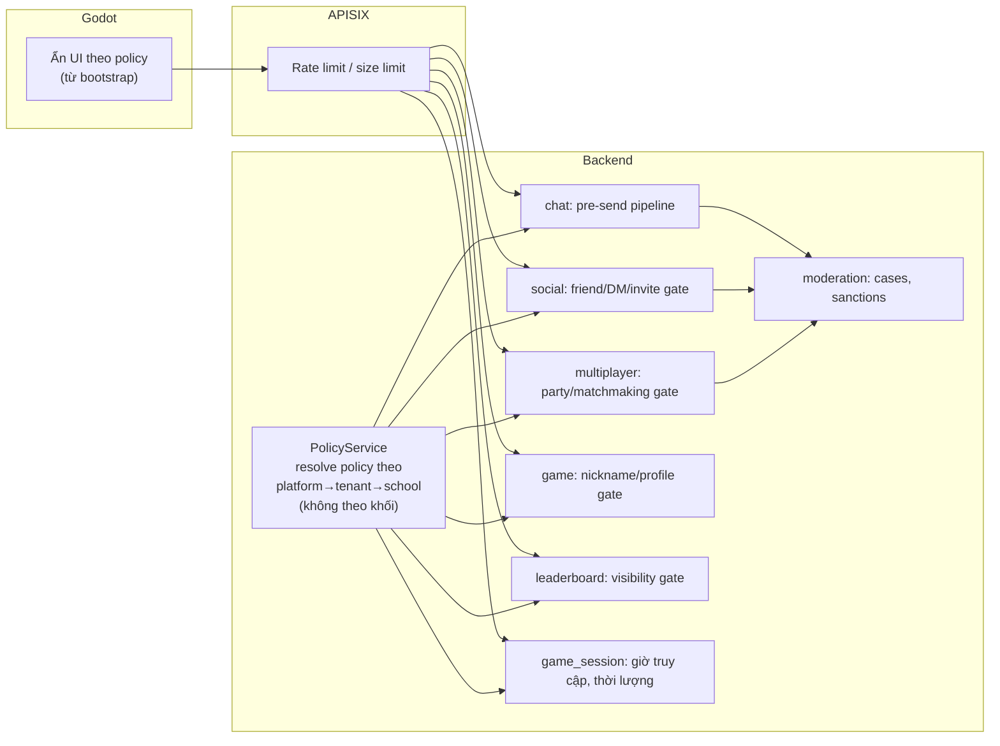
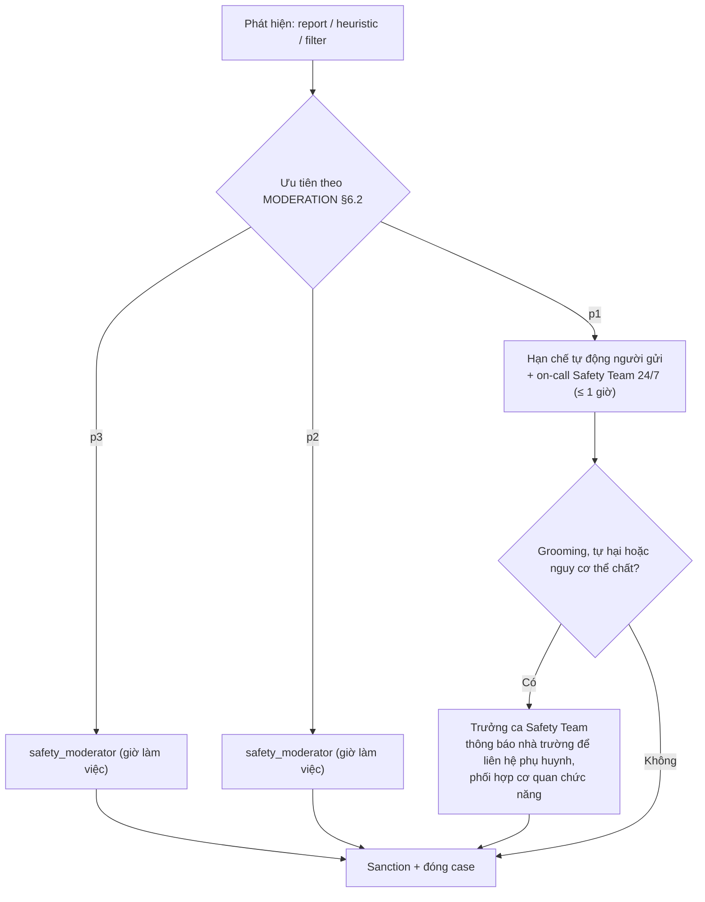

# Child Safety — An toàn trẻ em

> Trạng thái: Draft · Phiên bản: 0.4 · Owner: Product Manager + Identity & Security Engineer + Platform Safety Team · Cập nhật: 2026-11-20 (§4.2 cưỡng chế giới hạn chơi/ngày: module game cưỡng chế chính, module identity chặn đăng nhập bằng projection từ `game_session.ended`, mã `DAILY_PLAY_LIMIT_REACHED` — owner chốt OQ-17, F013/F014/F015) · 2026-11-17 (ADR-0078 Accepted: PII/grooming luôn chạy, giờ giới nghiêm platform, tenant `common`, preset quick message + emote)
> Liên quan: [ADR-0020](../adr/ADR-0020-chat-thong-nhat-cho-moi-lop-moi-tin-nhan-phai-qua-kiem-tra-h.md) · [ADR-0030](../adr/ADR-0030-chinh-sach-tu-nhay-cam-trong-chat-danh-muc-quan-ly-duoc-va-c.md) · [ADR-0072](../adr/ADR-0072-bo-vai-tro-giao-vien-hoc-sinh-tu-hoc-kiem-duyet-tap-trung.md) · [ADR-0078](../adr/ADR-0078-mac-dinh-an-toan-cho-tre-nho.md) · [ADR-0054](../adr/ADR-0054-tuong-tac-xa-hoi-lien-truong-cross-school-social-interaction.md) · [SOCIAL_SYSTEM](../03-social-multiplayer/SOCIAL_SYSTEM.md) · [CHAT_SYSTEM](../03-social-multiplayer/CHAT_SYSTEM.md) · [MODERATION](../03-social-multiplayer/MODERATION.md) · [DATA_PRIVACY](DATA_PRIVACY.md) · [SECURITY_ARCHITECTURE](SECURITY_ARCHITECTURE.md) · OQ-09, OQ-12, OQ-17

> [!IMPORTANT]
> **Bỏ khái niệm lớp — [ADR-0095](../adr/ADR-0095-bo-khai-niem-lop-hoc-sinh-theo-khoi.md) (owner chốt 2026-11-21).** Không có channel `class`/`study_group` và **không** tạo kênh theo khối; chat policy 3 cấp platform → tenant → school; mọi người chơi khác chỉ thấy nickname + avatar (bỏ ngoại lệ "bạn cùng lớp"); party lớp 1–3 chỉ `friend`/`quest`, thành viên cùng đúng khối, khác trường được trong cùng tenant theo ADR-0054, không liên tenant ([PARTY_SYSTEM](../03-social-multiplayer/PARTY_SYSTEM.md) R12). R15 không đổi. Đã áp ở WP-C1 (2026-11-21): bảng channel §3, tên thật, mời party, sơ đồ policy, EP-04, cache policy, quyền School Admin. Nội dung bên dưới còn nhắc lớp/enrollment/course/learning path/lịch/nhóm học tập sẽ được viết lại ở WP-C1 (cùng MR với CHAT_SYSTEM theo R15) ([CODE_PLAN §4.2](../12-project/CODE_PLAN_CMS_LMS_FIRST.md#42-kế-hoạch-bỏ-khái-niệm-lớp-adr-0095)); khi mâu thuẫn, ADR-0095 và đoạn này thắng.

**Mục đích.** Nguồn duy nhất về **chính sách an toàn trẻ em** (cái gì được phép, mặc định ra sao) và **nơi hệ thống thực thi** chính sách đó (đã gộp tài liệu bảo vệ trẻ em cũ vào đây, 2026-11-15).

**Phạm vi và quyền sở hữu.**

| Chủ đề | Tài liệu sở hữu |
|---|---|
| Chính sách an toàn, danh tính hiển thị, thời gian chơi, dark pattern, enforcement points, ma trận quyền nhà trường/Platform Safety Team, tín hiệu rủi ro trẻ em (grooming, bắt nạt, tự hại) và phản hồi, đào tạo và lịch trực Safety Team, checklist phát hành | **Tài liệu này** |
| Pipeline kiểm duyệt tin nhắn (normalize → danh mục từ nhạy cảm → PII → spam → bắt nạt), công tắc kiểm duyệt, report flow, hàng đợi case, **phân loại ưu tiên và SLA xử lý**, sanction, thông báo vụ việc cho nhà trường, lưu & purge bằng chứng | [MODERATION](../03-social-multiplayer/MODERATION.md) |
| Loại channel, tham số chat (độ dài, rate limit), tính năng chat | [CHAT_SYSTEM](../03-social-multiplayer/CHAT_SYSTEM.md) |
| Bạn bè, block, guild/club, tương tác liên trường | [SOCIAL_SYSTEM](../03-social-multiplayer/SOCIAL_SYSTEM.md), ADR-0054 |
| Dữ liệu cá nhân, retention | [DATA_PRIVACY](DATA_PRIVACY.md) |
| Pháp lý (consent, quy định game cho người dưới 18 tuổi) | Ngoài version này (ADR-0082) — [LEGAL_COMPLIANCE](../99-deferred/LEGAL_COMPLIANCE.md) |

## 1. Nguyên tắc

1. **Safety by default**: quyền vào channel xác định theo quan hệ (cùng trường, cùng nhóm, bạn bè) và policy; **mọi tin nhắn phải qua kiểm tra hợp lệ** phía server trước khi phát (ADR-0020), dựa trên danh mục từ nhạy cảm quản lý trong CMS. Kiểm tra **bật mặc định**; bước PII và phát hiện grooming **luôn chạy**; các bước khác chỉ System Admin tắt được, có thời hạn ≤ 24 giờ và phê duyệt hai người (ADR-0030, ADR-0078, §3.3).
2. **Data minimization**: không thu thập/hiển thị thông tin không cần thiết; giám sát chat không được dùng làm lý do thu thập dữ liệu vượt mục đích.
3. **Không công khai thông tin cá nhân**: người chơi khác chỉ thấy nickname + avatar.
4. **Phân quyền hẹp**: không ai truy cập toàn bộ chat của tất cả trường; Platform Safety Team chỉ đọc nội dung trong ngữ cảnh một moderation case, có audit.
5. **Không gây nghiện, không ép buộc, không áp lực tiêu cực**.
6. **Kiểm duyệt tập trung, nhà trường kiểm soát chính sách** (ADR-0072): Platform Safety Team (`safety_moderator`) xử lý mọi vụ việc nhất quán giữa các trường; nhà trường đặt chính sách cấp trường (chat, giờ truy cập) trong giới hạn platform và là đầu mối liên hệ phụ huynh.
7. **Mặc định an toàn cho trẻ nhỏ, như nhau cho mọi học sinh** (ADR-0078): giờ giới nghiêm cấp platform (§4.1), mặc định siết chặt cho tenant `common` (§3.6), preset "chỉ quick message + emote" cấp trường (§3.5) — không có điều kiện theo khối (R15).

## 2. Danh tính hiển thị

| Quy tắc | Chi tiết | Nhãn |
|---|---|---|
| Nickname | Sinh tự động dạng `<Tính từ/Màu><Con vật><2 số>` (vd. "MèoXanh42") từ danh sách đã duyệt; học sinh được đổi bằng cách chọn lại từ bộ sinh, **không gõ tự do** | [Confirmed] |
| Tên thật | Chỉ hiển thị cho nhân sự nhà trường có quyền trong portal (`school_admin`, `academic_manager`); người chơi khác (kể cả cùng khối) chỉ thấy nickname + avatar — bỏ ngoại lệ "bạn cùng lớp" (ADR-0095) | [Confirmed] |
| Avatar | Chỉ từ bộ customization; không upload ảnh | [Confirmed] |
| Hồ sơ người chơi khác | Nickname, avatar, level, badge công khai; không trường, lớp, tuổi, ngày sinh | [Confirmed] |
| Liên trường | Hiển thị "Trường khác" thay tên trường | [Confirmed] |
| Leaderboard | Nickname; không ảnh, không tên thật (trừ leaderboard lớp nếu trường bật tên thật) | [Confirmed] |

## 3. Chính sách chat: một bộ quy tắc cho mọi lớp

> **Quyết định stakeholder (ADR-0020, Accepted 2026-11-15):** chat **không phân biệt theo lớp** và **mọi tin nhắn phải hợp lệ**. Quyết định này **thay thế** mục "Age/Grade-based Policy" trong Master Prompt §6.3. An toàn cho học sinh nhỏ tuổi được bảo đảm bằng kiểm tra hợp lệ bắt buộc, kiểm duyệt tập trung của Platform Safety Team và chính sách cấp trường, không bằng cách giới hạn chat theo khối. Mặc định chặt hơn cho trẻ nhỏ theo [ADR-0078](../adr/ADR-0078-mac-dinh-an-toan-cho-tre-nho.md) (Accepted 2026-11-17): bước PII/grooming luôn chạy (§3.3), giờ giới nghiêm cấp platform (§4.1), preset cấp trường (§3.5), siết tenant `common` (§3.6) — đều áp như nhau cho mọi học sinh trong phạm vi.

### 3.1. Nội dung được phép (như nhau cho học sinh lớp 1–9)

Giá trị khởi tạo của `chat_policy` cấp platform. Cấp tenant/school chỉ được siết chặt hơn (ADR-0020; không còn cấp class — ADR-0095); khi siết chặt, quy tắc áp dụng cho **mọi** học sinh trong phạm vi đó.

| Channel | Ai gửi được | Loại tin |
|---|---|---|
| `world` | Người chơi cùng trường (tenant `unit` có thể mở rộng toàn tenant) | Text, emoji, quick message, sticker, GIF (thư viện nội bộ đã duyệt), reaction |
| `area` | Người trong cùng instance | Text, emoji, quick message, sticker, GIF (thư viện nội bộ đã duyệt), reaction |
| `match` **(luôn có)** | Người chơi cùng trận 1v1/đội/giải | Text, emoji, quick message, sticker, GIF (thư viện nội bộ đã duyệt), reaction |
| `party` **(luôn có)** / `team` (team trong trận luôn có) | Thành viên nhóm/đội | Text, emoji, quick message, sticker, GIF (thư viện nội bộ đã duyệt), reaction |
| `direct` | Hai người đã là bạn bè, không block nhau | Text, emoji, quick message, sticker, GIF (thư viện nội bộ đã duyệt), reaction |
| Liên trường | Theo channel ở trên | Như trên; chỉ hiện nickname/avatar |

### 3.2. Kiểm tra hợp lệ và tham số [Confirmed — giá trị số]

| Tham số | Giá trị mặc định (mọi lớp) |
|---|---|
| Kiểm tra hợp lệ | **Bật mặc định** cho mọi tin: normalize → định dạng → danh mục từ nhạy cảm (tiếng Việt có/không dấu, teencode, leetspeak, tiếng Anh) → PII → spam → bắt nạt → `allow / mask / block / hold_for_review / block_and_alert` ([MODERATION](../03-social-multiplayer/MODERATION.md) §3). Bước PII và phát hiện grooming luôn chạy; System Admin tắt được các bước khác có thời hạn và phê duyệt hai người (ADR-0030, ADR-0078, §3.3) |
| Danh mục từ nhạy cảm | Quản lý trong CMS theo nhóm và mức độ; tenant chỉ thêm từ, không nới danh mục platform ([MODERATION](../03-social-multiplayer/MODERATION.md) §11) |
| Mức nghiêm bộ lọc | `strict`; trường/lớp có thể nâng lên `very_strict` |
| Rate limit | Theo channel (6–15 tin/phút), tổng ≤ 30 tin/phút/người ([CHAT_SYSTEM §3.1](../03-social-multiplayer/CHAT_SYSTEM.md)) |
| Độ dài text tối đa | World/Area 120 · Party/Team 200 · DM 300 |
| Link/URL | Chặn, trừ link nội bộ EduWorld trong allowlist |
| Số điện thoại/email/địa chỉ/mạng xã hội | Chặn |
| Giờ chat | Ngoài giờ giới nghiêm `platform_curfew` (§4.1); trường chỉ mở rộng khung giới nghiêm, không thu hẹp |
| Lưu lịch sử chat | Channel bền vững: `persistent_chat_retention_days`; chat gameplay: `gameplay_chat_retention_days` (giá trị ở [CHAT_SYSTEM §2, §6.1](../03-social-multiplayer/CHAT_SYSTEM.md)) |
| Học sinh xem lịch sử | 30 ngày gần nhất |

### 3.2b. Chat gameplay luôn có (ADR-0020 mục 6) và lưu giữ ngắn hạn (ADR-0033)

Chat trong trận 1v1, trận đội và party **không tắt được** bằng cài đặt trường/lớp. Biện pháp an toàn thay thế:

| Biện pháp | Chi tiết |
|---|---|
| Kiểm tra nội dung | Mọi tin trong `match`/`team`/`party` qua pipeline kiểm tra như mọi channel (theo công tắc ADR-0030) |
| Công cụ tại chỗ | Tắt tiếng · Chặn · Báo cáo trên từng tin, nút báo cáo ở màn hình kết quả trận |
| Sanction | Safety Team mute/restrict cá nhân; người bị mute vẫn chơi được nhưng không gửi tin |
| Phạm vi | Chỉ người cùng trận/party; người ngoài trường chỉ thấy nickname |
| Lưu giữ | Tin gameplay bị xóa vật lý sau `gameplay_chat_retention_days` (mặc định 7, **tối thiểu 3** để kịp báo cáo); tin đã bị báo cáo được giữ làm bằng chứng; channel có case mở không bị xóa |
| Minh bạch | Học sinh được thông báo trong game: "Tin nhắn trong trận được giữ {N} ngày" |

### 3.3. Khi công tắc kiểm duyệt bị tắt (ADR-0030, ADR-0078)

ADR-0030 cho phép tắt từng bước kiểm tra nội dung; [ADR-0078](../adr/ADR-0078-mac-dinh-an-toan-cho-tre-nho.md) (Accepted 2026-11-17) thu hẹp phạm vi: **bước PII và phát hiện grooming luôn chạy**, không nằm trong công tắc. Khi các bước còn lại bị tắt, học sinh 6–15 tuổi có thể nhận tin tục tĩu hoặc bắt nạt mà hệ thống không chặn tự động. Biện pháp giảm thiểu bắt buộc:

| Biện pháp | Chi tiết |
|---|---|
| Chỉ System Admin được tắt | Tenant Admin không tắt được bước nào và không bật/tắt được category; bật/tắt category cho một tenant do Platform Safety Team làm theo yêu cầu (ADR-0072, [MODERATION §11.3](../03-social-multiplayer/MODERATION.md#113-phạm-vi-platform-và-tenant)) |
| Lý do + audit | Mọi lần tắt/bật có lý do, actor, thời điểm, phạm vi |
| Bước luôn chạy | PII (SĐT, email, link, mạng xã hội, địa chỉ, mã định danh) và tín hiệu grooming không tắt được ở bất kỳ cấp nào [Confirmed — Technical Architect 2026-11-17] |
| Thời hạn | **Bắt buộc** `expires_at` ≤ `moderation_switch_max_duration` (24 giờ); tự bật lại khi hết hạn [Confirmed — Technical Architect 2026-11-17] |
| Phê duyệt hai người | Yêu cầu tắt chỉ có hiệu lực khi một System Admin khác phê duyệt (`moderation_switch_approvals`) [Confirmed — Technical Architect 2026-11-17]; quy trình: [MODERATION §12.2](../03-social-multiplayer/MODERATION.md#122-quy-tắc-thao-tác) |
| Hiển thị trạng thái | Banner "Đang tắt kiểm duyệt" trong CMS cho System Admin, Tenant Admin của tenant và Safety Team; alert vận hành `eduworld_chat_policy_disabled` |
| Vẫn giữ | PII, grooming, độ dài tối đa, rate limit, quyền channel, sanction, block/mute/report, moderation thủ công khi có report |
| Truy vết | Tin gửi khi tắt được đánh dấu `unchecked` để điều tra khi có báo cáo |

Khuyến nghị vận hành [Confirmed]: chỉ tắt từng bước có lý do cụ thể (ví dụ false positive hàng loạt sau khi đổi danh mục), trong thời gian ngắn nhất có thể trong giới hạn 24 giờ.

### 3.3b. An toàn cho các tính năng chat mở rộng (ADR-0034)

| Tính năng | Rủi ro | Biện pháp |
|---|---|---|
| Thu hồi | Bắt nạt rồi xóa dấu vết | Nội dung gốc giữ làm bằng chứng; tin đã thu hồi vẫn báo cáo được |
| Sửa | Đổi nội dung sau khi đã qua kiểm duyệt | Bản sửa chạy lại kiểm duyệt; revision lưu làm bằng chứng cho Safety Team; chỉ 15 phút |
| Forward | Phát tán tin nhắn riêng để bêu xấu | Chỉ trong cùng tenant, chạy lại kiểm duyệt tại channel đích, tối đa 5 nơi, có nhãn nguồn; forward từ DM được ghi nhận làm tín hiệu cho phân tích bất đồng bộ |
| Mention | Gắn tên liên tục để quấy rối | ≤ 5 mention/tin, rate limit, không mention được người đã block mình; mention lặp là tín hiệu bắt nạt |
| Sticker / GIF | Nội dung hình ảnh không phù hợp | Chỉ thư viện nội bộ đã duyệt, không upload, không dịch vụ GIF Internet |
| Receipts / typing | Áp lực "đã xem sao không trả lời" | Không có ở World/Area; lớp chỉ hiện số người đã xem; người bị block không thấy trạng thái đọc [Confirmed: cho phép học sinh tắt hiển thị "đã xem" của mình ở DM] |
| Tìm kiếm | Tra cứu thông tin người khác | Chỉ trong channel mình là thành viên, chỉ trên nội dung đã che |

### 3.4. Quan hệ xã hội

| Hành động | Mặc định |
|---|---|
| Kết bạn | Cùng trường (như nhau cho mọi lớp); tenant `common`: tắt mặc định (§3.6) |
| Mời party | Bạn bè (party `friend`) hoặc học sinh cùng trường theo luật party (lớp 1–3 cùng đúng khối, khác trường chỉ trong tenant bật liên trường — ADR-0095, ADR-0054); không mời người lạ ngoài tenant |
| Party liên trường | Không (mặc định Release 1.0) [Confirmed] |
| Party khác grade band | Được nếu cùng trường và thỏa điều kiện ghép nhóm ([PARTY_SYSTEM §6.2](../03-social-multiplayer/PARTY_SYSTEM.md#62-kiểm-tra-ở-bước-3--eligibility): cùng band hoặc band liền kề khi activity cho phép); câu hỏi theo khối thấp hơn của nhóm ([COMPETITION_SYSTEM §5](../01-game-design/COMPETITION_SYSTEM.md#5-công-bằng-theo-khối-lớp)). Đây là điều kiện ghép **hoạt động học tập**, không áp vào chat (ADR-0020) |
| Block | Chặn mọi tương tác (chat, mời, ghép party, ghép trận nếu còn lựa chọn khác) |

### 3.5. Preset "chỉ quick message + emote" (ADR-0078)

School Admin có thể chọn khi onboarding hoặc bất kỳ lúc nào `chat_policy_preset = quick_message_emote_only` [Confirmed — Technical Architect 2026-11-17]:

| Mục | Quy tắc |
|---|---|
| Phạm vi | Cả trường, mọi channel kể cả `match`/`team`/`party`; **không** theo khối hay lớp (R15) |
| Được gửi | Quick message (danh mục platform đã duyệt, không tham số tự do) và emote/reaction |
| Bị từ chối | Text tự do, sticker, GIF, forward; server từ chối (Godot chỉ ẩn ô nhập) |
| Chat gameplay luôn có | Channel gameplay vẫn tự tạo (ADR-0020 mục 6) nhưng chỉ cho quick message + emote; preset không tắt channel |
| Đổi preset | Chỉ School Admin, có audit; hiệu lực theo `chat_policy_cache` |

Giai đoạn pilot áp mặc định tương đương preset này cho mọi trường ([ROADMAP §3.4](../12-project/ROADMAP.md#34-pilot-slice--m-p1-pilot-start)).

### 3.6. Tenant `common` (ADR-0078)

Tenant `common` ([MULTITENANCY §8.3](../06-architecture/MULTITENANCY.md)) gom học sinh không thuộc trường độc lập, nên "cùng tenant" là hàng nghìn người lạ và không có `school_admin` thu consent hay nhận thông báo. Mặc định `common_tenant_social_defaults` [Confirmed — Technical Architect 2026-11-17]:

| Mục | Mặc định tenant `common` |
|---|---|
| Kết bạn, DM, World chat | **Tắt**; chỉ System Admin bật lại cho một tenant `common` cụ thể, có lý do + audit |
| Channel còn lại | `area` chỉ quick message + emote; `match`/`team`/`party` luôn có theo ADR-0020 mục 6, qua pipeline đầy đủ |
| Giờ giới nghiêm | Bắt buộc `platform_curfew` (§4.1), không có `school_admin` để siết thêm |
| Kiểm duyệt | Platform Safety Team (ADR-0072); không có thông báo nhà trường, liên hệ theo [MODERATION §6.4](../03-social-multiplayer/MODERATION.md#64-thông-báo-vụ-việc-cho-nhà-trường-confirmed) |
| Consent | Platform thu trực tiếp (ADR-0077); pháp lý ngoài version này (ADR-0082) |

## 4. Thời gian chơi và sức khỏe (OQ-17)

| Biện pháp | Mặc định [Confirmed] | Ai cấu hình |
|---|---|---|
| Nhắc nghỉ | Sau 45 phút liên tục: Mây nhắc nghỉ mắt + gợi ý vận động; g1_3 sau 30 phút | Platform, trường siết thêm |
| Nhắc lần 2 | Sau 90 phút: nhắc nổi bật hơn, tổng kết phiên | Platform |
| XP cap ngày | Giảm động lực chơi dài (GAME_DESIGN §6) | Platform |
| Giờ giới nghiêm platform | `platform_curfew` 21:30–06:30 cho game và chat (§4.1) | Platform; trường chỉ siết thêm |
| Khung giờ truy cập | Trường cấu hình khung giờ được đăng nhập game, áp như nhau cho mọi học sinh của trường; luôn nằm ngoài giờ giới nghiêm platform (trường chỉ thu hẹp thêm) | School Admin |
| Giới hạn cứng/ngày | Không áp mặc định (`daily_play_limit_minutes` tắt); `school_admin` có thể bật cho cả trường với số phút do trường đặt (ví dụ 120; khoảng hợp lệ **15–300** phút, ngoài khoảng → `422 VALIDATION_FAILED`), áp như nhau mọi học sinh của trường; tính tổng thời gian game session active trong ngày (ICT); đạt giới hạn → cảnh báo trước `curfew_warning_minutes`, lưu tiến độ và kết thúc phiên như giờ giới nghiêm (§4.1), từ chối đăng nhập game/tạo game session kèm `reopen_at` tới 00:00 ICT hôm sau; cưỡng chế ở §4.2 | School Admin [Confirmed — owner 2026-11-20, OQ-17] |

### 4.1. Giờ giới nghiêm cấp platform (ADR-0078)

[Confirmed — Technical Architect 2026-11-17]: `platform_curfew` mặc định **21:30–06:30** giờ Việt Nam mỗi ngày, áp cho **game và chat**, như nhau cho mọi học sinh (không theo khối, R15). Tenant `common` bắt buộc áp.

| Mục | Quy tắc |
|---|---|
| Trong giờ giới nghiêm | Không đăng nhập game (`/auth/game/login`), không vào lại bằng refresh token, không tạo game session (`POST /game/sessions`), không cấp realtime ticket, không gửi chat; mã lỗi giới nghiêm thống nhất `403 CURFEW_ACTIVE` kèm `reopen_at` ([API_DESIGN §4.1](../07-backend/API_DESIGN.md)) |
| Phiên đang chạy | Cảnh báo trong game trước `curfew_warning_minutes` (10 phút); tới giờ: lưu tiến độ, attempt đang làm giữ để resume, trận/party đang chơi kết thúc như rời trận không bị phạt, kết thúc game session |
| Nhà trường | `school_admin` chỉ **mở rộng** khung giới nghiêm (ví dụ 21:00–07:00) hoặc thu hẹp khung giờ truy cập; không nới quá `platform_curfew` (API từ chối) |
| Platform | Chỉ System Admin đổi `platform_curfew`, có audit; đổi giá trị phải sửa tài liệu này và [CONFIG_DEFAULTS](../00-overview/CONFIG_DEFAULTS.md) |
| Thực thi | Ở server (module identity, module game, realtime, module chat) theo giờ server và múi giờ tenant; Godot chỉ hiển thị thông báo "giờ mở lại" |
| Không áp | Portal nhân sự (không phải game); job nền |

### 4.2. Cưỡng chế giới hạn chơi/ngày (OQ-17)

[Confirmed — owner 2026-11-20, OQ-17; F013, F014, F015]: giới hạn cứng/ngày (`daily_play_limit_minutes`, §4) chỉ áp khi trường bật; trường không bật hoặc tenant `common` thì không áp. Cưỡng chế ở server, cùng cách xử lý với giờ giới nghiêm (§4.1); Godot chỉ hiển thị thông báo "giờ mở lại".

| Mục | Quy tắc |
|---|---|
| Cấu hình | `school_admin` bật/sửa/tắt `daily_play_limit_minutes` cho cả trường qua `updateSchoolSettings` (`null` = tắt, mặc định), lưu theo `If-Match`, audit có lý do; module identity đưa giá trị vào `settings_subset` của event `school.updated` cho module game (F015-AC-30) |
| Cách tính | Tổng thời gian game session active của học sinh trong ngày ICT (00:00–24:00 giờ Việt Nam), so với giới hạn của trường |
| Module game — nơi cưỡng chế chính | Đọc giới hạn từ projection `ref.schools.settings_subset` (từ `school.updated`). Đã đạt giới hạn → `createGameSession` (kể cả `takeover`) trả `403 DAILY_PLAY_LIMIT_REACHED` kèm `reopen_at` = 00:00 ICT hôm sau. Session đang chạy sắp đạt giới hạn → job đóng phiên cảnh báo trước `curfew_warning_minutes`, tới giới hạn thì lưu tiến độ và kết thúc session như giờ giới nghiêm, `game_session.ended` có `end_reason = daily_limit` (F014-AC-27) |
| Module identity — chặn ở đăng nhập | Từ chối `gameLogin`, `selectGameLoginTenant`, `refreshGameToken` `mode = resume` bằng `403 DAILY_PLAY_LIMIT_REACHED` kèm `reopen_at` (cùng shape `CURFEW_ACTIVE`), kiểm sau xác thực SSO, không thu hồi phiên game lưu trên thiết bị (F013-AC-33). Không gọi module game đồng bộ (R30, ADR-0045): identity dựng projection thời gian chơi trong ngày từ `game_session.ended` (`duration_ms`, [EVENT_DESIGN](../07-backend/EVENT_DESIGN.md)) và đọc giới hạn trong cài đặt trường của chính module |
| Mã lỗi | `403 DAILY_PLAY_LIMIT_REACHED` ([API_DESIGN §4.1](../07-backend/API_DESIGN.md)) |

## 5. Không dark pattern, không cơ chế cờ bạc

| Cấm | Lý do |
|---|---|
| Loot box, gacha, quay thưởng (kể cả bằng tiền ảo miễn phí) có phần thưởng ngẫu nhiên giá trị | Cơ chế cờ bạc với trẻ em |
| In-app purchase, tiền thật | Không pay-to-win/pay-to-learn (OQ-14) [Confirmed] |
| Streak bị mất gây lo âu | Thay bằng mục tiêu tuần linh hoạt |
| Đếm ngược FOMO, vật phẩm "chỉ một lần" | Sự kiện và vật phẩm có lặp lại |
| Push notification kéo người chơi quay lại | Không push marketing |
| Nút "Tiếp tục" mặc định chuyển hoạt động mới | Mỗi hoạt động kết thúc bằng điểm dừng tự nhiên |
| Thứ hạng thấp hiển thị công khai | Chỉ top N + vị trí của mình |
| Thông điệp làm trẻ xấu hổ khi sai/thua | Phản hồi tích cực (LEARNING_EXPERIENCE §4) |
| Quảng cáo bên thứ ba | Không có quảng cáo |

## 6. Điểm thực thi (enforcement points)

Nguyên tắc: **mọi kiểm soát an toàn được thực thi ở server**. Godot chỉ ẩn UI tương ứng (để trẻ không thấy tính năng không được phép) nhưng không phải là lớp bảo vệ.

| # | Điểm thực thi | Module | Kiểm soát | Mặc định |
|---|---|---|---|---|
| EP-01 | Gửi tin nhắn | `chat` | ChatPolicy theo channel (không theo grade, ADR-0020); **mọi tin** qua pipeline kiểm tra hợp lệ normalize → định dạng → danh mục từ nhạy cảm → PII → spam → bắt nạt → allow/mask/block/hold/block_and_alert; PII và grooming luôn chạy, bước khác System Admin tắt được có thời hạn + hai người duyệt (§3.3); giờ giới nghiêm (§4.1), preset (§3.5) — giới hạn độ dài, rate limit, quyền channel, sanction luôn chạy | ADR-0020, ADR-0030, ADR-0078 |
| EP-02 | Tạo DM channel | `chat`, `social` | Chỉ khi hai người là bạn bè, không block nhau, trường không tắt DM; tenant `common` tắt mặc định (§3.6) | Như nhau cho mọi lớp |
| EP-03 | Gửi friend request | `social` | Cùng trường (mặc định); rate limit; không với người đã block/bị block; tenant `common` tắt mặc định (§3.6) | Cùng trường, như nhau cho mọi lớp |
| EP-04 | Mời vào party / join party | `multiplayer/party` | Party policy: school/grade (lớp 1–3 cùng đúng khối — ADR-0095), private cần lời mời; chặn người đã block; rate limit lời mời | Cùng trường |
| EP-05 | Matchmaking | `multiplayer/matchmaking` | Ràng buộc cứng grade (không ghép lớp 1 với lớp 9); cross-school chỉ hiển thị nickname; chat sau trận theo ChatPolicy chung | Grade exact (1–5), ±1 (6–9) |
| EP-06 | Nickname & tên party | `game`, `party` | Nickname sinh tự động hoặc chọn từ danh sách duyệt; tên party qua pipeline lọc + danh sách gợi ý cho lớp 1–3 | Không gõ tự do lớp 1–5 |
| EP-07 | Hồ sơ người chơi | `game` | Người khác chỉ thấy nickname, avatar, level, badge; không tên thật/trường/lớp với người khác trường | — |
| EP-08 | Leaderboard | `competition/leaderboard` | Phạm vi hiển thị theo policy; người ngoài trường chỉ thấy nickname; trường có thể tắt global | Global hiển thị nickname |
| EP-09 | Phiên chơi | `identity`, `game_session`, `realtime` | Giờ giới nghiêm platform (§4.1); giờ truy cập do trường cấu hình (chỉ siết thêm); nhắc nghỉ; giới hạn thời lượng/ngày do trường bật (mặc định tắt, §4) | Giới nghiêm 21:30–06:30; nhắc sau 45 phút |
| EP-10 | Phần thưởng | `gamification` | Không loot box trả tiền, không cơ chế FOMO gây áp lực (streak phạt), cap XP | — |
| EP-11 | Nội dung học tập/NPC | `cms` | Workflow duyệt; reviewer kiểm tra phù hợp lứa tuổi | — |
| EP-12 | Upload media | `cms`, `learning` | Chỉ vai trò nội dung (platform/tenant) upload media. Học sinh **không upload** trong version này (hoạt động nộp bài ngoài version này, ADR-0072, ADR-0082) | Không có upload của học sinh |

Policy resolution: cấp dưới chỉ **siết chặt hơn** (ADR-0020). Kết quả resolve được cache theo `(school_id, channel_type)` trong `chat_policy_cache` (không còn `class_id` — ADR-0095) (5 phút) [Confirmed — Technical Architect 2026-11-16], invalidate qua pub/sub khi policy đổi, và gửi xuống client trong bootstrap để ẩn UI.

## 7. Vai trò và quyền an toàn của nhà trường và platform

Kiểm duyệt tập trung theo ADR-0072. Nhân sự nhà trường không vào game, không là thành viên channel chat và không đọc nội dung chat.

| Vai trò | Quyền an toàn (chỉ trong phạm vi được giao) |
|---|---|
| School Admin | Cấu hình `chat_policy` cấp trường (chỉ siết chặt, áp như nhau cho mọi học sinh trong phạm vi; không còn cấp lớp, channel lớp, study group, tên thật cho bạn cùng lớp — ADR-0095): bật/tắt DM, world chat, mở rộng khung giới nghiêm (không nới quá giờ giới nghiêm platform, §4.1); chọn preset "chỉ quick message + emote" cho cả trường (§3.5) (không tắt được chat trận/party — ADR-0020 mục 6); cấu hình khung giờ truy cập; nhận và xác nhận thông báo vụ việc nghiêm trọng để liên hệ phụ huynh ([MODERATION §6.4](../03-social-multiplayer/MODERATION.md#64-thông-báo-vụ-việc-cho-nhà-trường-confirmed)) |
| Academic Manager | Tạo study group cho môn trong phạm vi; không có quyền an toàn khác |
| Tenant Admin | Chính sách liên trường trong tenant; báo cáo tổng hợp ẩn danh; gửi yêu cầu thêm từ nhạy cảm cho Safety Team |
| Platform Safety Team (`safety_moderator`; đăng nhập portal không MFA — ADR-0094) | Xử lý mọi moderation case của mọi tenant, đọc nội dung chỉ trong ngữ cảnh case qua `tenancy.Bypass(ctx, "moderation_case")` có audit và metric `eduworld_tenant_filter_bypass_total`; áp/thu hồi sanction; ghi mục từ bổ sung và bật/tắt nhóm từ của tenant; gửi thông báo nhà trường |
| System Admin | Danh mục từ nhạy cảm platform, quick message, policy mặc định, `platform_curfew`, mặc định tenant `common`, công tắc kiểm duyệt (ADR-0030; tắt cần System Admin thứ hai duyệt, ADR-0078); break-glass (hai người duyệt) khi cần truy cập ngoài phạm vi case |

Không có vai trò nào đọc được toàn bộ chat mọi trường [Confirmed — Master Prompt §6.3].

**Ma trận quyền chi tiết**

| Hành động | School Admin | Tenant Admin | Platform Safety Team (`safety_moderator`) | System Admin |
|---|---|---|---|---|
| Đọc Team/DM chat | ✘ | ✘ | Chỉ trong case được giao | Chỉ break-glass |
| Đọc DM/Party/Match chat | ✘ | ✘ | Chỉ trong case được giao | Chỉ break-glass |
| Mute / hạn chế chat học sinh | ✘ | ✘ | ✔ | ✘ |
| Khóa tài khoản do vi phạm | ✘ (chỉ khóa/mở vì lý do quản trị: nghỉ học, chuyển trường) | ✘ | ✔ (trưởng ca, lý do + audit) | ✔ (yêu cầu pháp lý) |
| Bật/tắt DM, world chat của trường | ✔ (trong giới hạn platform) | ✘ | ✘ | Platform defaults |
| Cấu hình giờ chat, giờ truy cập | ✔ (chỉ siết thêm so với giờ giới nghiêm platform) | ✘ | ✘ | `platform_curfew` |
| Chọn preset "chỉ quick message + emote" | ✔ (cả trường) | ✘ | ✘ | Định nghĩa preset |
| Danh mục từ nhạy cảm | ✘ | Gửi yêu cầu | Ghi mục từ bổ sung của tenant | Danh mục platform |
| Xử lý report | ✘ | ✘ | ✔ mọi report | ✘ |
| Nhận thông báo vụ việc nghiêm trọng (tóm tắt, không nội dung chat) | ✔ học sinh trường mình | ✘ | Gửi | ✘ |
| Xuất bằng chứng | ✘ | ✘ | ✔ (audit, watermark) | Chỉ break-glass |

Mọi thao tác đọc nội dung chat ngoài channel mà người đó là thành viên đều **ghi audit** (`chat.message.read_for_moderation`, kèm `tenant_id` đích) và được tổng hợp (số lượt, không nội dung) trong báo cáo minh bạch hằng tháng cho School Admin.

## 8. Tín hiệu rủi ro an toàn trẻ em [Confirmed]

Phát hiện đồng bộ (pipeline trước khi gửi) và cơ chế worker bất đồng bộ thuộc [MODERATION](../03-social-multiplayer/MODERATION.md) §3–§4, §11–§12. Bảng dưới là **ngưỡng và phản hồi** đặc thù an toàn trẻ em mà worker `async_analysis` của MODERATION áp dụng:

| Tín hiệu | Mô tả | Ngưỡng ban đầu | Hành động |
|---|---|---|---|
| Bullying — lặp mục tiêu | Một người gửi nhiều tin bị mask/block hướng tới cùng một người (mention/DM/party) | ≥ 3 lần/24h | Case `p2` cho Safety Team |
| Bullying — hội đồng | ≥ 3 người cùng gửi tin bị lọc tới 1 người trong 1 giờ | 3 người | Case `p2`, hạn chế tạm channel |
| Loại trừ | Một học sinh bị kick khỏi party liên tục bởi nhiều leader | ≥ 5 lần/7 ngày | Case `p3` "theo dõi" (không trừng phạt); Safety Team có thể gửi thông báo nhà trường để quan tâm học sinh bị loại trừ |
| Grooming / tiếp cận bất thường | Tài khoản gửi friend request/lời mời tới nhiều học sinh nhỏ hơn ≥ 3 khối, hoặc cố chia sẻ liên hệ (PII bị chặn) lặp lại, hoặc yêu cầu "chuyển sang app khác" | ≥ 2 lần PII-block + mục tiêu nhỏ tuổi | Case `p1`, tự động hạn chế social của tài khoản gửi, gọi on-call Safety Team |
| Spam | Tần suất cao, nội dung trùng lặp | Theo rate policy | Mute tự động 10 phút → 1 giờ |
| Tự hại / khủng hoảng | Từ khóa liên quan tự làm hại bản thân | Bất kỳ | Không phạt người gửi; tin nhắn giữ lại; case `p1`, gọi on-call Safety Team; thông báo nhà trường ngay ([MODERATION §6.4](../03-social-multiplayer/MODERATION.md#64-thông-báo-vụ-việc-cho-nhà-trường-confirmed)) để trường liên hệ phụ huynh; hiển thị cho học sinh thông điệp hỗ trợ (vd. Tổng đài quốc gia bảo vệ trẻ em 111) |
| Nhiều report | ≥ 3 report độc lập về cùng người trong 24h | 3 | Case `p2` |

Mọi phát hiện tự động chỉ **tạo case/hạn chế tạm thời**; xử phạt kéo dài cần con người xác nhận. Từ khóa và ngưỡng nằm trong cấu hình phiên bản hóa (`moderation_rules`), review mỗi tháng để giảm false positive.

## 9. Báo cáo, leo thang và phản hồi

- Report flow, **phân loại ưu tiên** `p1`/`p2`/`p3` (kể cả cách xếp các loại vụ việc liên quan thông tin cá nhân) và **SLA** xử lý: nguồn duy nhất ở [MODERATION §5–§6](../03-social-multiplayer/MODERATION.md#62-trạng-thái-case); tài liệu này không định nghĩa lại.
- Leo thang khi có nguy cơ an toàn thể chất hoặc pháp lý (bổ sung cho SLA của MODERATION):

Học sinh bị báo cáo được đối xử theo nguyên tắc giáo dục: cảnh báo thân thiện trước, giải thích quy tắc, sanction tăng dần (cảnh báo → mute ngắn → hạn chế chat → khóa chat → khóa tài khoản). Học sinh báo cáo nhận phản hồi "Cảm ơn em, đội an toàn EduWorld đã nhận được" và không bị tiết lộ danh tính với người bị báo cáo.

## 10. Bằng chứng

Cơ chế lưu, thời hạn và giữ bằng chứng trước khi purge chat gameplay: [MODERATION §10](../03-social-multiplayer/MODERATION.md). Quy tắc an toàn trẻ em đối với bằng chứng:

- Khi tạo ModerationCase: snapshot bất biến (`chat.moderation_evidence`): tin nhắn liên quan ± 20 tin ngữ cảnh, metadata (channel, thời gian, người gửi), kết quả filter, hash SHA-256 của snapshot.
- **Trước khi purge chat gameplay (ADR-0033):** job `gameplay-chat-purge` sao chép vào `chat.moderation_evidence` mọi tin của channel gameplay có report, case (mở hoặc đã đóng còn trong thời hạn giữ) hoặc sanction; channel có case **đang mở** được hoãn purge đến khi case đóng. Vì vậy thời hạn tối thiểu 3 ngày là thời gian để học sinh kịp báo cáo sau trận.
- Snapshot không bị xóa bởi retention chat thông thường cho đến khi case đóng + thời gian giữ của case ([DATA_PRIVACY §2](DATA_PRIVACY.md)); không bị xóa bởi người gửi "xóa tin".
- Truy cập evidence: chỉ người được gán case; mọi lượt xem/xuất ghi audit; xuất dưới dạng PDF có watermark người xuất.
- Không lưu bằng chứng ngoài hệ thống (screenshot cá nhân) — quy trình moderator cấm.
- **Tin sửa và thu hồi (ADR-0034):** mọi revision (`chat.message_revisions`) và nội dung gốc của tin đã thu hồi được đưa vào snapshot evidence khi tin nằm trong case; người dùng không có API xem chúng. Purge gameplay (ADR-0033) sao chép cả revision của tin có case.

## 11. Đào tạo và vận hành moderator

| Nội dung | Đối tượng | Tần suất |
|---|---|---|
| Chat policy cấp trường, giờ truy cập, quy trình nhận và xác nhận thông báo vụ việc, liên hệ phụ huynh | School Admin | Khi kích hoạt trường |
| Công cụ moderation trong Admin Portal (case, bằng chứng, sanction, thông báo nhà trường) | Safety Team | Trước khi được cấp quyền |
| Nhận diện bắt nạt, grooming, khủng hoảng tâm lý ở trẻ | Safety Team | Trước khi được cấp quyền + hằng năm |
| Bảo mật dữ liệu & quyền riêng tư khi xem chat, quy tắc đọc liên tenant chỉ trong case | Safety Team, System Admin | Trước khi cấp quyền |
| Quy trình leo thang & liên hệ khẩn cấp | Safety Team | Hằng quý (diễn tập) |

Quyền moderation (`moderation.case.*`, `moderation.sanction.*`) chỉ được cấp cho role `safety_moderator` sau khi hoàn thành đào tạo (`identity.user_roles` có `training_completed_at`, ADR-0066) [Confirmed].

**Lịch trực Safety Team** [Confirmed]: case `p2`/`p3` xử lý trong giờ làm việc theo SLA của [MODERATION §6.3](../03-social-multiplayer/MODERATION.md#63-sla-xử-lý-confirmed); case `p1` grooming, tự hại, đe dọa có **on-call 24/7** (ca chính + ca dự phòng, alert khi case `p1` chưa được nhận sau 15 phút). Ngoài giờ làm việc, pipeline vẫn kiểm tra mọi tin như trong giờ và hệ thống tự hạn chế tạm thời người gửi khi có tín hiệu `p1`. Giờ chat (§3.2) và giờ truy cập (§4) là chính sách áp như nhau cho mọi học sinh trong phạm vi policy; không có quy tắc bật/tắt chat theo khối lớp (ADR-0020, R15).

## 12. An toàn nội dung học tập và game

- Mọi nội dung (câu hỏi, NPC dialogue, quest, quick message, emote, item) qua workflow Draft → Review → Approved → Published (ADR-0015) với Content Reviewer.
- Checklist review: phù hợp lứa tuổi, không bạo lực, không định kiến giới/vùng miền/dân tộc, không thương hiệu/quảng cáo, đúng kiến thức.
- Không có UGC công khai (học sinh tạo nội dung người khác thấy) trong Release 1.0, ngoài chat đã qua kiểm tra hợp lệ [Confirmed].

## 13. Minh bạch

- Học sinh dùng tài khoản do trường cấp.
- Màn hình "Quy tắc ứng xử" bằng hình ảnh khi vào game lần đầu (g1_5) / dạng chữ ngắn (g6_9); học sinh xác nhận đã đọc.
- Thông báo rõ: "Tin nhắn có thể được đội an toàn EduWorld xem khi có báo cáo" — phù hợp lứa tuổi.
- Đồng ý xử lý dữ liệu và vai trò dữ liệu: ngoài version này (ADR-0082).

## 14. Chỉ số theo dõi

`eduworld_moderation_cases_open{school,severity}`, thời gian xử lý trung vị theo mức, tỉ lệ false positive (case đóng "không vi phạm"), số tin bị block theo loại (`pii`, `profanity`, `spam`), số học sinh bị sanction/1.000 học sinh hoạt động. Báo cáo tháng cho School Admin (tổng hợp, không nội dung).

## 15. Kiểm thử

- Test pipeline với bộ dữ liệu tiếng Việt (có dấu/không dấu/teencode/chèn ký tự) — đo precision/recall; mục tiêu recall PII ≥ 95% trên bộ test [Confirmed].
- Test policy: tin vi phạm (PII, tục tĩu) gửi thẳng qua WS bằng client bị sửa vẫn bị chặn; cùng một tin cho cùng quyết định với học sinh lớp 2 và lớp 8 (không có nhánh theo lớp); DM tới người không phải bạn bè bị từ chối; học sinh trường A không mời được học sinh trường B vào party private khi policy cấm; role tenant (`school_admin`, `tenant_admin`, `academic_manager`) không đọc được nội dung chat; `safety_moderator` chỉ đọc qua case và mọi lượt đọc có audit.
- Test ADR-0078: yêu cầu tắt `pii`/grooming bị từ chối và khi `enabled_all` tắt tin có SĐT vẫn bị chặn (TC-CHAT-044); tắt bước khác thiếu `expires_at`/quá 24 giờ hoặc tự duyệt bị từ chối (TC-CHAT-045); giờ giới nghiêm chặn đăng nhập, game session, chat và trường không nới được (TC-CHAT-046, TC-AUTH-092); tenant `common` không kết bạn/DM/World chat (TC-CHAT-047); preset chỉ quick message + emote từ chối text tự do ở mọi channel của trường (TC-CHAT-048).
- Red-team nội bộ trước Phase 5: thử lách filter, chia sẻ số điện thoại, tạo nickname phản cảm.
- Red-team tính năng ADR-0034: sửa tin sạch thành tin vi phạm, forward tin vi phạm đã bị che, quote để lộ phần đã che, thu hồi rồi báo cáo, spam mention, gửi sticker_id/gif_id không thuộc thư viện → đều phải bị chặn hoặc ghi nhận đúng.

## 16. Checklist phát hành (Child Safety gate)

| # | Tiêu chí | Phase |
|---|---|---|
| CS-01 | Policy mặc định §3 được seed và có test tự động cho từng channel; test chứng minh cùng một tin cho cùng quyết định với học sinh mọi lớp | 5 |
| CS-01b | Bộ lọc đạt recall ≥ 95%, false positive ≤ 3% trên bộ test tiếng Việt (có/không dấu, teencode) trước khi bật chat [Confirmed] | 4 (trước khi bật chat gameplay), 5 |
| CS-01c | Danh mục từ nhạy cảm platform được seed, có quy trình review và test hồi quy khi publish; công tắc kiểm duyệt có audit, banner CMS và alert hoạt động (ADR-0030) | 5 |
| CS-01d | Chat `match`/`team`/`party` tự có khi vào trận/party, không tắt được bằng policy trường/lớp; mute/chặn/báo cáo trong trận hoạt động; purge gameplay chat đúng hạn và giữ bằng chứng của report (ADR-0033) | 4 |
| CS-02 | Không thể gửi SĐT/email/link qua bất kỳ channel nào (test với biến thể có/không dấu, khoảng trắng, chữ số viết bằng chữ) | 4, 5 |
| CS-03 | Học sinh trường A không thấy tin nhắn/nickname-tên thật của trường B trừ trường hợp policy cho phép | 5 |
| CS-04 | Report → case xuất hiện trong queue đúng phạm vi trong ≤ 5 s | 4, 5 |
| CS-05 | Không tồn tại loot box/IAP/quảng cáo trong build | 2, 6 |
| CS-06 | Nhắc nghỉ hoạt động theo cấu hình | 2 |
| CS-07 | **Deferred (ADR-0082)** — đánh giá pháp lý không thuộc version này | — |
| CS-08 | Safety Team có nhân sự, lịch trực on-call 24/7 cho `p1` và đã diễn tập leo thang trước khi bật chat gameplay [Confirmed] | 4 |
| CS-09 | Luồng thông báo vụ việc cho nhà trường (gửi, xác nhận, nhắc lại) hoạt động và không lộ nội dung chat thô [Confirmed] | 4, 5 |
| CS-10 | PII và grooming luôn chạy, không tắt được; tắt bước khác cần `expires_at` ≤ 24 giờ + hai người duyệt (ADR-0078; TC-CHAT-044, 045) | Pilot, 4 |
| CS-11 | Giờ giới nghiêm platform chặn game và chat, trường chỉ siết thêm (TC-AUTH-092, TC-CHAT-046) | Pilot |
| CS-12 | Tenant `common` tắt kết bạn, DM, World chat; preset "chỉ quick message + emote" hoạt động (TC-CHAT-047, 048) | Pilot, 5 |
