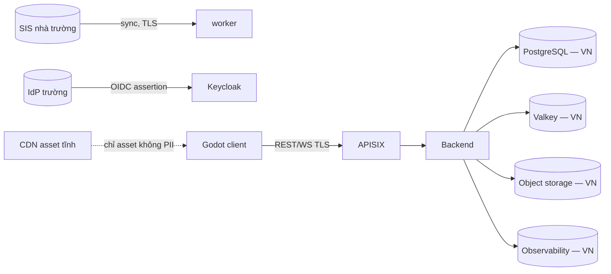

# Data Privacy

> Trạng thái: Draft · Phiên bản: 0.1 · Owner: Identity & Security Engineer + Product Manager · Cập nhật: 2026-11-15
> Liên quan: [SECURITY_ARCHITECTURE](SECURITY_ARCHITECTURE.md) · [CHILD_SAFETY](CHILD_SAFETY.md) · [SIS_INTEGRATION](../09-identity/SIS_INTEGRATION.md) · [DATABASE_DESIGN](../07-backend/DATABASE_DESIGN.md) · OQ-12, OQ-13

**Mục đích & phạm vi.** Nguồn duy nhất về dữ liệu cá nhân: inventory, mục đích, cơ sở xử lý, **retention**, quyền chủ thể, xóa/ẩn danh hóa, luồng dữ liệu, consent, yêu cầu pháp lý cần đánh giá. An toàn trẻ em → [CHILD_SAFETY](CHILD_SAFETY.md); bảo mật kỹ thuật → [SECURITY_ARCHITECTURE](SECURITY_ARCHITECTURE.md).

> **Lưu ý pháp lý:** Tài liệu này là thiết kế kỹ thuật, **không phải ý kiến pháp lý**. Mọi tham chiếu văn bản pháp luật, cơ sở xử lý, thời hạn lưu giữ và nghĩa vụ thông báo phải được **tư vấn pháp lý xác nhận trước Production** (OQ-12). Các giá trị retention dưới đây là [Proposed].

## 1. Nguyên tắc

| Nguyên tắc | Áp dụng cụ thể |
|---|---|
| Data minimization | Chỉ đồng bộ từ SIS các trường có trong DTO của [EduWorld SIS Contract v1](../../specs/sis/eduworld-sis-contract.v1.yaml) (không địa chỉ, SĐT, phụ huynh, ảnh, điểm SIS; trường lạ bị bỏ qua và không lưu); access token không chứa họ tên/email/ngày sinh; không thu thập vị trí, danh bạ, ảnh, giọng nói |
| Purpose limitation | Dữ liệu học tập chỉ dùng cho học tập, đánh giá, cải thiện nội dung; không quảng cáo, không bán, không profiling thương mại; dữ liệu chat chỉ dùng cho giao tiếp và an toàn |
| Access control | RBAC + scope tenant/trường/lớp (IDENTITY_MAPPING); mọi truy vấn lọc `tenant_id` + RLS (ADR-0005); chỉ System Admin xem liên tenant, có audit; quyền đọc chat để kiểm duyệt cấp theo tenant/trường, có audit |
| Storage limitation | Retention theo bảng §2; job **ẩn danh hóa** tự động (ứng dụng chỉ soft-delete, không hard-delete — ADR-0028); Release 1.0 không xóa vật lý ([ADR-0070](../adr/ADR-0070-release-1-khong-voice-chat-khong-xoa-vat-ly-khong-purge-analytics.md)) |
| Integrity & confidentiality | TLS, mã hóa at-rest, mã hóa cột nhạy cảm, backup mã hóa |
| Accountability | Audit log, data inventory này được review mỗi quý, DPIA trước Production |
| Privacy by default | Hồ sơ ẩn với người ngoài lớp; chat default-deny (ADR-0020); nickname thay tên thật |

## 2. Data inventory

| Nhóm dữ liệu | Trường chính | Mục đích | Cơ sở xử lý (cần xác nhận pháp lý) | Nơi lưu | Retention [Proposed] | Ai truy cập |
|---|---|---|---|---|---|---|
| Định danh học sinh | `full_name`, `student_code`, `grade_level`, `school_id` | Đăng nhập, phân lớp, báo cáo giáo viên | Thỏa thuận với nhà trường + đồng ý của cha mẹ/người giám hộ qua nhà trường | `org.students`, Keycloak | Suốt thời gian học + 1 năm sau khi deactivated, sau đó anonymize | Học sinh (bản thân), giáo viên lớp, School Admin |
| Ngày sinh | `date_of_birth` (mã hóa cột) | Đối soát SIS, policy theo độ tuổi khi thiếu grade | Như trên | `org.students` | Như trên | Hệ thống; School Admin |
| Mã định danh học sinh (`national_student_id`, tùy chọn trong contract) | `national_id_hash` (HMAC, không lưu bản rõ) | Khớp chuyển trường | Như trên | `org.students` | Như trên | Chỉ hệ thống reconciliation |
| Thông tin giáo viên | `full_name`, `staff_code`, email công việc | Đăng nhập, phân công | Hợp đồng với trường | `org.teachers`, Keycloak | Suốt thời gian công tác + 1 năm | School Admin |
| Định danh đăng nhập | `(issuer, subject)`, username, login events | Xác thực, bảo mật | Thỏa thuận | `identity.*`, Keycloak | ExternalIdentity theo user; login events 90 ngày | Hệ thống, security team |
| Lịch sử đăng nhập game (ADR-0031) | `game.login_events`: thời điểm vào/ra, nền tảng, tên thiết bị rút gọn, `device_id` (UUID bản cài, không phải định danh phần cứng), `ip_hash` (HMAC, khóa xoay vòng; **không lưu IP thô**), lý do kết thúc; `users.last_login_at` | Báo cáo hoạt động cho trường, quy tắc một thiết bị, dọn tài khoản không dùng (ADR-0032), điều tra an ninh | Thỏa thuận với trường | PG `game.*`, `identity.users` | `login_events` 1 năm rồi ẩn danh hóa (`ip_hash`, `device_model` = NULL) [Proposed]; `last_login_at` theo vòng đời tài khoản | Teacher (lớp), TA/SA (tenant), System Admin; không hiển thị IP/device_id cho ai |
| Learning records | attempts, answers, learning events, mastery | Học tập, đánh giá, gợi ý ôn tập | Thỏa thuận cung cấp dịch vụ giáo dục | `assessment.*`, `learning.*` | Suốt thời gian học + 1 năm; sau đó ẩn danh cho thống kê | Học sinh, giáo viên (scope), School Admin; analytics dạng tổng hợp |
| **Ghi âm giọng nói học sinh** (`speaking`, [AUDIO_LANGUAGE_LEARNING](../02-learning/AUDIO_LANGUAGE_LEARNING.md)) | File Ogg trong bucket private `ew-student-submissions/recordings/` (ADR-0044 mục 3; hết hạn 90 ngày sau khi chấm); điểm rubric và nhận xét của giáo viên | Luyện nói, giáo viên chấm | Thỏa thuận + **đồng ý của nhà trường/phụ huynh** (tenant phải bật) [TBD OQ-12] | object storage private, `assessment.audio_recordings` | File ghi âm **90 ngày sau khi chấm** [Proposed] (hết hạn: ẩn khỏi API, file giữ lại theo ADR-0070 [TBD người duyệt]); điểm/nhận xét theo learning records | Học sinh đó; giáo viên được phân công lớp/môn; moderator trong case. **Không xử lý tự động nội dung giọng nói** (không nhận dạng giọng nói/chấm phát âm trong Release 1.0, ADR-0059; OQ-22 đã trả lời); không gửi ra dịch vụ bên ngoài; không dùng huấn luyện mô hình |
| **Bài viết, lời giải, sản phẩm dự án** ([WRITTEN_RESPONSE_RUBRIC](../02-learning/WRITTEN_RESPONSE_RUBRIC.md)) | `assessment.written_responses.body`, file/ảnh bài làm nộp trong project (bucket private `ew-student-submissions/submissions/`, quét virus, chỉ người chấm được phân công xem qua signed URL, giữ 1 năm học [Proposed]) | Học tập, chấm bài | Thỏa thuận cung cấp dịch vụ giáo dục | DB `eduworld_learning`; file ở bucket private, quét virus | Như learning records; file nộp 1 năm học sau khi chấm [Proposed] | Học sinh (và thành viên nhóm với bài nhóm); giáo viên được phân công; moderator khi bài bị gắn cờ nguy hại. Gắn cờ PII/từ nhạy cảm chỉ hiển thị cho giáo viên |
| Tiến độ video/mô phỏng | `video_progress`, `simulation_runs.action_log` (thao tác trong mô phỏng, không có vị trí/thiết bị) | Hoàn thành, kiểm chứng | Thỏa thuận | `assessment.*` | Như learning records | Học sinh, giáo viên lớp |
| Kết quả kiểm tra | exam results | Đánh giá | Như trên | `assessment.*` | Như trên (tối thiểu 1 năm học sau kỳ kiểm tra) | Như trên |
| Dữ liệu game | nickname, avatar, inventory, XP, quest progress | Trải nghiệm game | Thỏa thuận | `game.*`, `gamification.*` | Theo user; xóa khi anonymize | Học sinh; bạn bè thấy nickname/avatar/level |
| Dữ liệu thi đấu | match, rating, leaderboard | Thi đấu | Thỏa thuận | `competition.*` | Match history 2 năm; leaderboard snapshot mùa 2 năm | Theo phạm vi leaderboard (nickname) |
| Quan hệ xã hội | friend, block, party history | Kết nối an toàn | Thỏa thuận | `social.*`, `multiplayer.*` | Party history 90 ngày; friend/block theo user | Bản thân; moderator theo trường |
| Nội dung chat gameplay (ADR-0033) | tin trong channel `match`, `team` theo trận, `party`; tin ephemeral World/Area | Giao tiếp khi chơi | Thỏa thuận + nghĩa vụ bảo vệ trẻ em | `chat.gameplay_messages` (partition ngày tạo `created_on`; gồm cả revision, reaction, pin của tin), `chat.ephemeral_messages` | **Purge vật lý** sau `gameplay_chat_retention_days` kể từ khi channel đóng (mặc định 7, tối thiểu 3) / 24 h; tin thuộc report/case được sao chép sang evidence trước | Thành viên channel trong lúc chơi; moderator qua case |
| Nội dung chat | message body | Giao tiếp, an toàn | Thỏa thuận + nghĩa vụ bảo vệ trẻ em | `chat.messages` (partition tháng) | 180 ngày [TBD OQ-09/OQ-12]; tin bị report giữ theo ModerationCase | Thành viên channel; moderator được chỉ định theo trường (audit) |
| Báo cáo & kiểm duyệt | reports, moderation cases, sanctions, evidence snapshot | An toàn trẻ em | Nghĩa vụ bảo vệ trẻ em | `chat.reports`, `chat.moderation_cases` | 2 năm sau khi đóng case; case nghiêm trọng theo yêu cầu pháp lý | Moderator trường, platform safety team |
| Telemetry client | crash, FPS, thiết bị (model, OS), không PII | Ổn định & hiệu năng | Lợi ích hợp pháp/thỏa thuận | Observability stack | 30 ngày | Dev/ops |
| Game Analytics ([GAME_ANALYTICS](../11-operations/GAME_ANALYTICS.md), ADR-0058) | Sự kiện chơi (phiên, khu, quest, challenge, kinh tế, xã hội) và telemetry sản phẩm/hiệu năng; định danh giả danh `player_key`/`session_key` (HMAC, xoay khóa 24 tháng); khối, nền tảng, ngôn ngữ, hạng thiết bị; **không** tên, nickname, `student_id`, nội dung chat | Cải thiện trải nghiệm, cân bằng độ khó, chơi lành mạnh, hiệu năng | Thỏa thuận với nhà trường/lợi ích hợp pháp [TBD OQ-12] | `eduworld_game`, schema `analytics` | Raw 90 ngày; `player_days` 400 ngày; tổng hợp 2 năm; hết hạn → ẩn danh hóa (ADR-0028) | Platform (product, live-ops, game design); tenant chỉ xem tổng hợp, ô < 5 bị ẩn |
| Logs & traces | request metadata, `user_id`, IP | Vận hành, bảo mật | Như trên | Loki/Tempo | Log 30 ngày, trace 7 ngày; IP rút gọn sau 30 ngày | Ops |
| Audit log | actor, action, target | Trách nhiệm giải trình | Nghĩa vụ | `audit.audit_logs` | 2 năm | Security, compliance |
| SIS staging & CSV | bản ghi thô | Đồng bộ | Thỏa thuận | `sis.staging_records`, object storage | 30 ngày | Hệ thống, School Admin của trường |
| Media nội dung học tập/game (ảnh, âm thanh, video, mô hình 3D) | Không phải dữ liệu học sinh — chỉ nội dung do vận hành upload qua CMS; EXIF/GPS bị xóa khi xử lý (ADR-0044) | Giảng dạy | — | Object storage (`ew-media-public`/`ew-media-private`) + CDN; metadata `media_assets` | Theo vòng đời nội dung; asset còn được version tham chiếu thì không xóa | Công khai qua CDN (platform) hoặc signed URL (riêng tenant, đề kiểm tra) |
| Backup | toàn bộ DB | Khôi phục | — | Backup storage mã hóa | 35 ngày (PITR 7 ngày) | Ops (break-glass) |

**Vị trí theo microservice (ADR-0036, ADR-0037).** Cột "Nơi lưu" ghi schema; mỗi nhóm schema nằm trong database của service sở hữu: `identity.*`, `org.*`, `platform.*`, `sis.*`, `audit.*` → `eduworld_identity` (identity-service); `assessment.*`, `learning.*`, `content.*`, `curriculum.*`, `lms.*` → `eduworld_learning`; `game.*`, `gamification.*` → `eduworld_game`; `competition.*`, `multiplayer.*` → `eduworld_competition`; `chat.*`, `social.*` → `eduworld_chat`. Ngoài ra:
- **Projection `ref_*`** ở các service (bản sao tối thiểu của tenant/trường/lớp/học sinh) là dữ liệu cá nhân thứ cấp: chỉ chứa trường thật sự cần (thường là `user_id`, `tenant_id`, `school_id`, `class_id`, `grade_level`, `status`, tên hiển thị khi màn hình cần), không chứa ngày sinh, mã định danh. Mọi yêu cầu ẩn danh/xóa phải lan tới projection (§4).
- **Bản sao trên đường truyền:** NATS JetStream giữ event 7 ngày và tin chat 72 h; Valkey giữ cache ngắn hạn. Đây là lưu trữ tạm, được tính vào inventory, mã hóa đường truyền (TLS) và không sao lưu.
- **Truy cập liên service** chỉ qua API internal có allowlist (ADR-0040); không service nào có quyền đọc database của service khác.

Không thu thập: ảnh học sinh, giọng nói (không có voice chat trong Release 1.0, ADR-0070), vị trí GPS, danh bạ, định danh quảng cáo, dữ liệu sinh trắc.

## 3. Quyền chủ thể dữ liệu

Chủ thể là học sinh (trẻ em) — quyền thường được thực hiện qua **cha mẹ/người giám hộ** và **nhà trường** (đơn vị ký thỏa thuận với EduWorld). Luồng đề xuất:

| Quyền | Kênh | Xử lý kỹ thuật | SLA [Proposed] |
|---|---|---|---|
| Được biết / truy cập | Yêu cầu qua trường → School Admin dùng chức năng "Xuất dữ liệu học sinh" | Export JSON/PDF: hồ sơ, learning records, game profile, danh sách bạn bè (không xuất chat của người khác) | 15 ngày |
| Chỉnh sửa | Dữ liệu SIS sửa ở SIS; dữ liệu game sửa trong app | Đồng bộ SIS | Theo chu kỳ sync |
| Xóa | Qua trường | Job `erase_student`: vô hiệu hóa và ẩn danh hóa user Keycloak (không xóa, ADR-0070), **ẩn danh hóa** PII trong EduWorld, soft-delete + ghi đè nội dung chat do học sinh gửi ("Tin nhắn đã bị xóa") trừ khi đang trong ModerationCase mở. Release 1.0 không xóa vật lý (ADR-0070) | 30 ngày |
| Hạn chế xử lý / rút đồng ý | Qua trường | `users.status=locked` + cờ `processing_restricted` (ngừng analytics cá nhân) | 72 giờ |
| Phản đối | Qua trường | Đánh giá theo trường hợp | — |

Mọi yêu cầu được ghi `audit` với mã yêu cầu (`dsr_id`).

## 4. Xóa & ẩn danh hóa

- **Anonymize** (mặc định khi hết retention): `identity.users.display_name = NULL`, `org.students` xóa `full_name`, `date_of_birth`, `student_code`, `national_id_hash`; GameProfile nickname → `Người chơi #<hash>`; giữ `user_id` để thống kê tổng hợp không liên kết được người thật; xóa ExternalIdentity và Keycloak user.
- **Ứng dụng không hard-delete (ADR-0028):** "xóa" trong ứng dụng là soft-delete (`deleted_at`) và dữ liệu đã xóa không hiển thị ở bất kỳ API nào (trừ Thùng rác của System Admin). Vì soft-delete vẫn giữ dữ liệu, nghĩa vụ xóa dữ liệu cá nhân được đáp ứng bằng **ẩn danh hóa** (ghi đè cột PII, giữ dòng).
- **Erase** (theo yêu cầu): như anonymize + thay `student_id` trong learning events chi tiết bằng pseudonym không đảo ngược, ghi đè `response`; XP ledger, inventory được ẩn danh theo user. Release 1.0 không xóa vật lý (ADR-0070); nếu tư vấn pháp lý kết luận ẩn danh hóa chưa đủ thì cần ADR mới ([RISKS](../12-project/RISKS.md) RISK-45).
- **Thực hiện liên service:** anonymize/erase là **saga** do identity-service điều phối: bước trong `eduworld_identity`, sau đó gọi `POST /internal/v1/platform/users/{id}:anonymize` của learning, game, competition, chat (mỗi service ẩn danh dữ liệu của mình và projection `ref_*`). Yêu cầu chỉ được đánh dấu hoàn tất khi mọi service trả `done`; bước lỗi thử lại và có alert `SagaStuck` ([ACCOUNT_PROVISIONING §7b](../09-identity/ACCOUNT_PROVISIONING.md)). Event `user.anonymized` giúp service nào chưa nhận lời gọi tự xử lý khi đọc event.
- Backup: dữ liệu đã ẩn danh còn dạng gốc trong backup tới hết vòng đời backup (35 ngày); khi restore phải chạy lại danh sách (`platform.erasure_log`) trước khi mở dịch vụ.
- Partition cũ (`chat.messages`, `learning.learning_events`, `audit.audit_logs`) hết hạn: ứng dụng ẩn danh hóa; partition được giữ lại, Release 1.0 không gỡ partition (ADR-0028, ADR-0070).
- **Ngoại lệ duy nhất của ADR-0028 — chat gameplay (ADR-0033):** job `gameplay-chat-purge` của chat-service với role DB riêng `chat_purger` xóa vật lý tin nhắn, thành viên, read state, reaction và channel của chat gameplay đã đóng quá thời hạn, cùng tin ephemeral World/Area quá 24 h. Trước khi purge: rollup chỉ số (không nội dung), sao chép tin thuộc report/case/sanction sang `chat.moderation_evidence`; channel có case mở được hoãn. Audit chỉ ghi số lượng. Ngoài phạm vi này, ứng dụng không xóa vật lý.
- **Dọn học sinh không đăng nhập (ADR-0032):** là soft-delete (giữ dữ liệu, ẩn khỏi truy vấn), giảm dữ liệu cá nhân đang được xử lý tích cực; ẩn danh hóa tiếp theo vẫn theo retention ở mục này. Học sinh đăng nhập lại và còn hợp lệ được khôi phục.
- **Clone giữa tenant** (ADR-0029) không bao giờ sao chép dữ liệu cá nhân/học tập của học sinh; **gán dữ liệu** chỉ áp dụng cho nội dung/cấu hình.

## 5. Luồng dữ liệu và xuyên biên giới

- [Proposed] Mọi dữ liệu cá nhân lưu và xử lý **tại Việt Nam** (DB, backup, log, object storage). Chỉ asset tĩnh không PII (Godot build, texture, audio) có thể phục vụ qua CDN quốc tế. Học sinh **không** upload media; nội dung đề kiểm tra và media riêng tenant chỉ phục vụ bằng signed URL ngắn hạn, không cache công khai (ADR-0043/0044).
- Dịch vụ bên thứ ba xử lý dữ liệu cá nhân (email, error tracking, dịch thuật, AI moderation nếu dùng): phải ký thỏa thuận xử lý dữ liệu, ưu tiên self-host hoặc nhà cung cấp tại VN; nếu chuyển ra nước ngoài → cần đánh giá tác động chuyển dữ liệu ra nước ngoài theo pháp luật hiện hành [TBD OQ-12].
- Error tracking/telemetry: scrub PII trước khi gửi (không username, không nội dung chat).

## 6. Consent

- [Proposed] Mô hình: EduWorld ký thỏa thuận xử lý dữ liệu với nhà trường/Sở; nhà trường thu thập **đồng ý của cha mẹ/người giám hộ** (đối với trẻ em theo quy định) bằng mẫu do EduWorld cung cấp; trường xác nhận trạng thái đồng ý theo lớp/học sinh trong CMS (`org.students.consent_status`, `consent_recorded_at`, `consent_version`).
- Học sinh chưa có consent: [Proposed] được dùng chức năng học tập cốt lõi nếu thỏa thuận với trường cho phép, nhưng **tắt** các tính năng social (chat tự do, friend, DM, leaderboard ngoài lớp) cho đến khi có consent — cấu hình được ở cấp trường.
- Học sinh từ đủ tuổi theo luật định (ví dụ từ 7 tuổi trở lên trong một số quy định về dữ liệu trẻ em) có thể cần được thông báo và đồng ý thêm — **cần tư vấn pháp lý xác nhận**.
- Thông báo quyền riêng tư phiên bản dành cho trẻ em (ngôn ngữ đơn giản, hình minh họa) hiển thị trong game; phiên bản đầy đủ cho phụ huynh/trường.

## 7. Yêu cầu pháp lý Việt Nam cần đánh giá (OQ-12)

Danh sách cần tư vấn pháp lý rà soát và xác nhận văn bản đang có hiệu lực tại thời điểm triển khai:

| Văn bản / lĩnh vực | Điểm cần đánh giá |
|---|---|
| Luật Bảo vệ dữ liệu cá nhân và các nghị định hướng dẫn | Dữ liệu cá nhân của trẻ em là dữ liệu nhạy cảm/đặc thù; điều kiện đồng ý của cha mẹ/người giám hộ; nghĩa vụ của bên kiểm soát/bên xử lý; DPIA; chuyển dữ liệu ra nước ngoài; thông báo vi phạm |
| Nghị định 13/2023/NĐ-CP về bảo vệ dữ liệu cá nhân (và các văn bản thay thế/sửa đổi nếu có) | Hồ sơ đánh giá tác động xử lý dữ liệu; xử lý dữ liệu trẻ em; thời hạn thông báo vi phạm |
| Luật Trẻ em 2016 và văn bản hướng dẫn | Quyền bí mật đời sống riêng tư của trẻ em; bảo vệ trẻ em trên môi trường mạng |
| Quy định về cung cấp trò chơi điện tử trực tuyến và nội dung số (nghị định về quản lý dịch vụ Internet, trò chơi điện tử) | Phân loại game giáo dục có phải đăng ký/cấp phép không; giới hạn thời gian chơi cho người dưới 18 tuổi |
| Luật An ninh mạng và văn bản hướng dẫn | Lưu trữ dữ liệu tại Việt Nam |
| Quy định của Bộ GD&ĐT về chuyển đổi số, CSDL ngành, học bạ/dữ liệu học sinh | Tích hợp SIS, ranh giới dữ liệu với CSDL ngành |

Kết quả rà soát ghi vào OPEN_QUESTIONS (nhật ký trả lời) và cập nhật tài liệu này; đổi nhãn [Proposed] → [Confirmed] tương ứng.

## 8. Kiểm soát kỹ thuật & kiểm thử

- Test tự động: response API của học sinh A không bao giờ chứa `full_name` học sinh khác trường; endpoint public không trả `date_of_birth`.
- Log scanning job trên staging: regex SĐT/email/tên trong log → cảnh báo.
- Retention jobs có test tích hợp (chạy với đồng hồ giả).
- DPIA hoàn thành và được phê duyệt trước Phase 6 Production Release.
