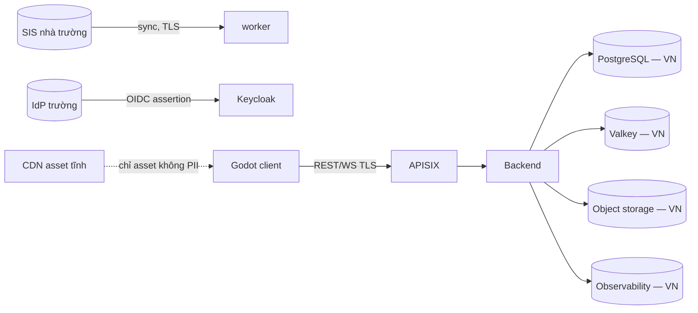

# Data Privacy

> Trạng thái: Draft · Phiên bản: 0.3 · Owner: Identity & Security Engineer + Product Manager · Cập nhật: 2026-11-16 (ADR-0086: phiên đăng nhập game)
> Liên quan: [SECURITY_ARCHITECTURE](SECURITY_ARCHITECTURE.md) · [CHILD_SAFETY](CHILD_SAFETY.md) · [ADR-0072](../adr/ADR-0072-bo-vai-tro-giao-vien-hoc-sinh-tu-hoc-kiem-duyet-tap-trung.md) · [ADR-0082](../adr/ADR-0082-spec-driven-development-va-noi-dung-deferred.md) · [ADR-0028](../adr/ADR-0028-chi-soft-delete-khong-hard-delete-mac-dinh-khong-doc-du-lieu.md) · [ADR-0070](../adr/ADR-0070-release-1-khong-voice-chat-khong-xoa-vat-ly-khong-purge-analytics.md) · [SIS_INTEGRATION](../09-identity/SIS_INTEGRATION.md) · [DATABASE_DESIGN](../07-backend/DATABASE_DESIGN.md) · OQ-13

**Mục đích & phạm vi.** Nguồn duy nhất về **nguyên tắc kỹ thuật** bảo vệ dữ liệu cá nhân: inventory, mục đích, **retention**, yêu cầu về dữ liệu học sinh (xuất, ẩn danh hóa, khóa xử lý), xóa/ẩn danh hóa, luồng dữ liệu, kiểm soát kỹ thuật. An toàn trẻ em → [CHILD_SAFETY](CHILD_SAFETY.md); bảo mật kỹ thuật → [SECURITY_ARCHITECTURE](SECURITY_ARCHITECTURE.md).

> **Pháp lý ngoài version này (ADR-0082).** Rà soát theo luật bảo vệ dữ liệu cá nhân, cơ sở pháp lý xử lý, mô hình consent, DPIA và thời hạn thông báo vi phạm theo luật không thuộc version này; thiết kế tham khảo ở [LEGAL_COMPLIANCE](../99-deferred/LEGAL_COMPLIANCE.md) (không triển khai). Giá trị retention dưới đây là tham số kỹ thuật [Confirmed].

## 1. Nguyên tắc

| Nguyên tắc | Áp dụng cụ thể |
|---|---|
| Data minimization | Chỉ đồng bộ từ SIS các trường có trong DTO của [EduWorld SIS Contract v1](../../specs/sis/eduworld-sis-contract.v1.yaml) (không địa chỉ, SĐT, phụ huynh, ảnh, điểm SIS; trường lạ bị bỏ qua và không lưu); access token không chứa họ tên/email/ngày sinh; không thu thập vị trí, danh bạ, ảnh, giọng nói |
| Purpose limitation | Dữ liệu học tập chỉ dùng cho học tập, đánh giá, cải thiện nội dung; không quảng cáo, không bán, không profiling thương mại; dữ liệu chat chỉ dùng cho giao tiếp và an toàn |
| Access control | RBAC + scope tenant/trường/môn (IDENTITY_MAPPING; không có scope lớp theo phân công giảng dạy, ADR-0072); mọi truy vấn lọc `tenant_id` + RLS (ADR-0005); chỉ System Admin xem liên tenant, có audit; quyền đọc chat để kiểm duyệt chỉ cấp cho Platform Safety Team (`safety_moderator`) trong ngữ cảnh một case, có audit (ADR-0072) |
| Storage limitation | Retention theo bảng §2; job **ẩn danh hóa** tự động (ứng dụng chỉ soft-delete, không hard-delete — ADR-0028); Release 1.0 không xóa vật lý ([ADR-0070](../adr/ADR-0070-release-1-khong-voice-chat-khong-xoa-vat-ly-khong-purge-analytics.md)) |
| Integrity & confidentiality | TLS, mã hóa at-rest, mã hóa cột nhạy cảm, backup mã hóa |
| Accountability | Audit log; data inventory này được review mỗi quý |
| Privacy by default | Hồ sơ ẩn với người ngoài lớp; chat default-deny (ADR-0020); nickname thay tên thật |

## 2. Data inventory

| Nhóm dữ liệu | Trường chính | Mục đích | Nơi lưu | Retention [Confirmed] | Ai truy cập |
|---|---|---|---|---|---|
| Định danh học sinh | `full_name`, `student_code`, `grade_level`, `school_id` | Đăng nhập, phân lớp, báo cáo cho nhà trường | `org.students`, Keycloak | Suốt thời gian học + 1 năm sau khi deactivated, sau đó anonymize | Học sinh (bản thân), School Admin, Academic Manager (scope trường/môn) |
| Ngày sinh | `date_of_birth` (mã hóa cột) | Đối soát SIS, policy theo độ tuổi khi thiếu grade | `org.students` | Như trên | Hệ thống; School Admin |
| Mã định danh học sinh (`national_student_id`, tùy chọn trong contract) | `national_id_hash` (HMAC, không lưu bản rõ) | Khớp chuyển trường | `org.students` | Như trên | Chỉ hệ thống reconciliation |
| Thông tin nhân sự (`staff`: nhân sự trường và nhân sự platform, ADR-0081) | `full_name`, email công việc | Đăng nhập portal, phân quyền | `identity.users`, Keycloak | Suốt thời gian công tác + 1 năm | Tenant Admin, School Admin (trường mình) |
| Định danh đăng nhập | `(issuer, subject)`, username, login events | Xác thực, bảo mật | `identity.*`, Keycloak | ExternalIdentity theo user; `identity.login_events` (nhật ký xác thực) 90 ngày (`login_events_retention`, tối thiểu hóa dữ liệu) [Confirmed — Technical Architect 2026-11-16] | Hệ thống, security team |
| Lịch sử đăng nhập game (ADR-0031) | `game.login_events`: thời điểm vào/ra, nền tảng, tên thiết bị rút gọn, `device_id` (UUID bản cài, không phải định danh phần cứng), `ip_hash` (HMAC, khóa xoay vòng; **không lưu IP thô**), lý do kết thúc; `users.last_login_at` | Báo cáo hoạt động cho trường, quy tắc một thiết bị, dọn tài khoản không dùng (ADR-0032), điều tra an ninh | PG `game.*`, `identity.users` | `game.login_events` 1 năm rồi ẩn danh hóa (`ip_hash`, `device_model` = NULL) (`login_events_retention`) [Confirmed — Technical Architect 2026-11-16]; `last_login_at` theo vòng đời tài khoản | School Admin (trường mình), Tenant Admin (tenant), System Admin; không hiển thị IP/device_id cho ai |
| Phiên đăng nhập game (ADR-0086) | `identity.game_auth_sessions`: `keycloak_sid`, `device_id`, nền tảng, SHA-256 của refresh token hiện hành và các token đã xoay (không lưu token thô), thời điểm tạo/refresh/thu hồi, lý do thu hồi. Trên thiết bị cá nhân, refresh token chỉ nằm trong kho bảo mật OS (DPAPI/Keystore/Keychain), bị xóa khi đăng xuất hoặc phiên hết hạn; Web và máy dùng chung không lưu | Giữ phiên game, phát hiện dùng lại token, quy tắc một thiết bị, thu hồi | `identity.*`, kho bảo mật OS trên thiết bị | Phiên hết hạn tối đa 30 ngày (`game_session_sso`); bản ghi phiên đã thu hồi/hết hạn theo login events 90 ngày [Confirmed] | Hệ thống, security team |
| Learning records | attempts, answers, learning events, mastery | Học tập, đánh giá, gợi ý ôn tập | `assessment.*`, `learning.*` | Suốt thời gian học + 1 năm; sau đó ẩn danh cho thống kê | Học sinh, School Admin, Academic Manager (scope trường/môn); analytics dạng tổng hợp |
| Tiến độ video/mô phỏng | `video_progress`, `simulation_runs.action_log` (thao tác trong mô phỏng, không có vị trí/thiết bị) | Hoàn thành, kiểm chứng | `assessment.*` | Như learning records | Học sinh, School Admin, Academic Manager (scope) |
| Kết quả kiểm tra | exam results | Đánh giá | `assessment.*` | Như trên (tối thiểu 1 năm học sau kỳ kiểm tra) | Như trên |
| Dữ liệu game | nickname, avatar, inventory, XP, quest progress | Trải nghiệm game | `game.*`, `gamification.*` | Theo user; xóa khi anonymize | Học sinh; bạn bè thấy nickname/avatar/level |
| Dữ liệu thi đấu | match, rating, leaderboard | Thi đấu | `competition.*` | Match history 2 năm; leaderboard snapshot mùa 2 năm | Theo phạm vi leaderboard (nickname) |
| Quan hệ xã hội | friend, block, party history | Kết nối an toàn | `social.*`, `multiplayer.*` | Party history 90 ngày; friend/block theo user | Bản thân; Platform Safety Team qua case (audit) |
| Nội dung chat gameplay (ADR-0033) | tin trong channel `match`, `team` theo trận, `party`; tin ephemeral World/Area | Giao tiếp khi chơi | `chat.gameplay_messages` (partition ngày tạo `created_on`; gồm cả revision, reaction, pin của tin), `chat.ephemeral_messages` | **Purge vật lý** sau `gameplay_chat_retention_days` kể từ khi channel đóng (mặc định 7, tối thiểu 3) / 24 h; tin thuộc report/case được sao chép sang evidence trước | Thành viên channel trong lúc chơi; Platform Safety Team qua case |
| Nội dung chat | message body | Giao tiếp, an toàn | `chat.messages` (partition tháng) | `persistent_chat_retention_days` (180 ngày) cho channel bền vững; chat gameplay theo `gameplay_chat_retention_days` (ADR-0033); tin bị report giữ theo ModerationCase | Thành viên channel; Platform Safety Team qua case (audit) |
| Báo cáo & kiểm duyệt | reports, moderation cases, sanctions, evidence snapshot, thông báo vụ việc cho nhà trường (tóm tắt, thời điểm gửi/xác nhận) | An toàn trẻ em | `chat.reports`, `chat.moderation_cases`, `chat.moderation_evidence` | Theo `moderation_snapshot_retention` ([MODERATION §10](../03-social-multiplayer/MODERATION.md#10-data-minimization--retention)) | Platform Safety Team (đọc liên tenant chỉ trong module moderation, ADR-0072); School Admin chỉ thấy thông báo tóm tắt về học sinh trường mình ([MODERATION §6.4](../03-social-multiplayer/MODERATION.md#64-thông-báo-vụ-việc-cho-nhà-trường-confirmed)) |
| Telemetry client | crash, FPS, thiết bị (model, OS), không PII | Ổn định & hiệu năng | Observability stack | 30 ngày | Dev/ops |
| Game Analytics ([GAME_ANALYTICS](../11-operations/GAME_ANALYTICS.md), ADR-0058) | Sự kiện chơi (phiên, khu, quest, challenge, kinh tế, xã hội) và telemetry sản phẩm/hiệu năng; định danh giả danh `player_key`/`session_key` (HMAC, xoay khóa 24 tháng); khối, nền tảng, ngôn ngữ, hạng thiết bị; **không** tên, nickname, `student_id`, nội dung chat | Cải thiện trải nghiệm, cân bằng độ khó, chơi lành mạnh, hiệu năng | `eduworld_game`, schema `analytics` | Raw 90 ngày; `player_days` 400 ngày; tổng hợp 2 năm; hết hạn → ẩn danh hóa (ADR-0028) | Platform (product, live-ops, game design); tenant chỉ xem tổng hợp, ô < 5 bị ẩn |
| Logs & traces | request metadata, `user_id`, IP | Vận hành, bảo mật | Loki/Tempo | Log 30 ngày, trace 7 ngày; IP rút gọn sau 30 ngày | Ops |
| Audit log | actor, action, target | Trách nhiệm giải trình | `audit.audit_logs` | 2 năm (`audit_log_retention`), hết hạn ẩn danh hóa, giữ partition (ADR-0070) | Security |
| SIS staging & CSV | bản ghi thô | Đồng bộ | `sis.staging_records`, object storage | 30 ngày | Hệ thống, School Admin của trường |
| Media nội dung học tập/game (ảnh, âm thanh, video, mô hình 3D) | Không phải dữ liệu học sinh — chỉ nội dung do vận hành upload qua CMS; EXIF/GPS bị xóa khi xử lý (ADR-0044) | Giảng dạy | Object storage (`ew-media-public`/`ew-media-private`) + CDN; metadata `media_assets` | Theo vòng đời nội dung; asset còn được version tham chiếu thì không xóa | Công khai qua CDN (platform) hoặc signed URL (riêng tenant, đề kiểm tra) |
| Backup | toàn bộ DB | Khôi phục | Backup storage mã hóa | 35 ngày (PITR 7 ngày) | Ops (break-glass) |

**Vị trí theo module (ADR-0074, ADR-0037).** Cột "Nơi lưu" ghi schema; mỗi nhóm schema nằm trong database của module sở hữu: `identity.*`, `org.*`, `platform.*`, `sis.*`, `audit.*` → `eduworld_identity` (module identity); `assessment.*`, `learning.*`, `content.*`, `curriculum.*`, `lms.*` → `eduworld_learning`; `game.*`, `gamification.*` → `eduworld_game`; `competition.*`, `multiplayer.*` → `eduworld_competition`; `chat.*`, `social.*` → `eduworld_chat`. Ngoài ra:
- **Projection `ref_*`** ở các module (bản sao tối thiểu của tenant/trường/lớp/học sinh) là dữ liệu cá nhân thứ cấp: chỉ chứa trường thật sự cần (thường là `user_id`, `tenant_id`, `school_id`, `class_id`, `grade_level`, `status`, tên hiển thị khi màn hình cần), không chứa ngày sinh, mã định danh. Mọi yêu cầu ẩn danh/xóa phải lan tới projection (§4).
- **Bản sao trên đường truyền:** NATS JetStream giữ event 7 ngày và tin chat 72 h; Valkey giữ cache ngắn hạn. Đây là lưu trữ tạm, được tính vào inventory, mã hóa đường truyền (TLS) và không sao lưu.
- **Truy cập liên module** chỉ qua facade có `x-allowed-callers` (gọi trong tiến trình, ADR-0074); không module nào có quyền đọc database của module khác (role DB theo module).

Không thu thập: ảnh học sinh, giọng nói (không có voice chat trong Release 1.0, ADR-0070), vị trí GPS, danh bạ, định danh quảng cáo, dữ liệu sinh trắc.

## 3. Yêu cầu về dữ liệu học sinh

Yêu cầu về dữ liệu học sinh đi qua **nhà trường** (đơn vị ký thỏa thuận với EduWorld). Cơ chế kỹ thuật [Confirmed] (danh mục quyền và SLA theo luật: ngoài version này, [LEGAL_COMPLIANCE](../99-deferred/LEGAL_COMPLIANCE.md)):

| Yêu cầu | Kênh | Xử lý kỹ thuật | SLA [Confirmed] |
|---|---|---|---|
| Được biết / truy cập | Yêu cầu qua trường → School Admin dùng chức năng "Xuất dữ liệu học sinh" | Export JSON/PDF: hồ sơ, learning records, game profile, danh sách bạn bè (không xuất chat của người khác) | 15 ngày |
| Chỉnh sửa | Dữ liệu SIS sửa ở SIS; dữ liệu game sửa trong app | Đồng bộ SIS | Theo chu kỳ sync |
| Xóa | Qua trường | Job `erase_student`: vô hiệu hóa và ẩn danh hóa user Keycloak (không xóa, ADR-0070), **ẩn danh hóa** PII trong EduWorld, soft-delete + ghi đè nội dung chat do học sinh gửi ("Tin nhắn đã bị xóa") trừ khi đang trong ModerationCase mở. Release 1.0 không xóa vật lý (ADR-0070) | 30 ngày |
| Hạn chế xử lý | Qua trường | `users.status=locked` + cờ `processing_restricted` (ngừng analytics cá nhân) | 72 giờ |

Mọi yêu cầu được ghi `audit` với mã yêu cầu (`dsr_id`).

### 3.1. Release 1: không có kênh Portal, xử lý thủ công

> [!WARNING]
> **Rủi ro được chấp nhận ([ADR-0097](../adr/ADR-0097-bo-yeu-cau-du-lieu-ca-nhan-va-dich-noi-dung-hoc-tap-khoi-portal-release-1.md), owner chốt 2026-11-22; [RISKS](../12-project/RISKS.md) RISK-57).** Release 1 **không có** chức năng Portal nào để tiếp nhận, theo dõi hay thực hiện yêu cầu của chủ thể dữ liệu theo Nghị định 13/2023/NĐ-CP: menu "Yêu cầu dữ liệu" và API `/admin/data-requests` đã gỡ, chức năng "Xuất dữ liệu học sinh" ở bảng trên chưa có. Bảng trên là thiết kế đích; đáp ứng đúng thời hạn phụ thuộc hoàn toàn vào quy trình thủ công dưới đây.

Quy trình thủ công [Proposed] (chưa có runbook riêng; người thực hiện là System Admin được vận hành chỉ định; owner duyệt trước pilot):

1. **Tiếp nhận:** chỉ nhận văn bản từ nhà trường (đơn vị ký thỏa thuận). Ghi vào sổ theo dõi ngoài hệ thống (mã yêu cầu `dsr_id`, ngày nhận, trường, `user_id` học sinh, loại yêu cầu, hạn xử lý theo bảng trên). Không ghi họ tên/ngày sinh vào ticket, chat hay log (R14).
2. **Xác minh:** đối chiếu `user_id` với tenant của trường gửi yêu cầu trên Portal (đọc theo tenant đó, có audit); từ chối nếu học sinh không thuộc tenant.
3. **Thực hiện:**
   - *Hạn chế xử lý:* khóa tài khoản (`lockUser`, lý do ghi `dsr_id`).
   - *Xóa:* vô hiệu hóa tài khoản (`deactivateUser`, lý do ghi `dsr_id`); ẩn danh hóa chạy bằng job `retention-anonymizer` khi hết `student_data_retention` (CONFIG_DEFAULTS). Nếu thời hạn luật ngắn hơn retention, báo owner — Release 1 **không có** đường ẩn danh hóa ngay theo yêu cầu.
   - *Truy cập:* trích xuất thủ công từ read replica bởi DBA có quyền, chỉ dữ liệu của học sinh đó, gửi lại nhà trường qua kênh đã thỏa thuận; ghi audit thủ công vào sổ theo dõi.
4. **Đóng:** ghi ngày hoàn tất và người thực hiện vào sổ theo dõi; thao tác trên Portal (khóa, vô hiệu hóa) đã có audit với lý do chứa `dsr_id`.

## 4. Xóa & ẩn danh hóa

- **Anonymize** (mặc định khi hết retention): `identity.users.display_name = NULL`, `org.students` xóa `full_name`, `date_of_birth`, `student_code`, `national_id_hash`; GameProfile nickname → `Người chơi #<hash>`; giữ `user_id` để thống kê tổng hợp không liên kết được người thật; xóa ExternalIdentity và Keycloak user.
- **Ứng dụng không hard-delete (ADR-0028):** "xóa" trong ứng dụng là soft-delete (`deleted_at`) và dữ liệu đã xóa không hiển thị ở bất kỳ API nào (trừ Thùng rác của System Admin). Vì soft-delete vẫn giữ dữ liệu, yêu cầu xóa dữ liệu cá nhân được đáp ứng bằng **ẩn danh hóa** (ghi đè cột PII, giữ dòng).
- **Erase** (theo yêu cầu): như anonymize + thay `student_id` trong learning events chi tiết bằng pseudonym không đảo ngược, ghi đè `response`; XP ledger, inventory được ẩn danh theo user. Release 1.0 không xóa vật lý (ADR-0070); đánh giá ẩn danh hóa có đủ theo luật hay không nằm ngoài version này ([RISKS](../12-project/RISKS.md) RISK-45).
- **Thực hiện liên module:** anonymize/erase là **saga** do module identity điều phối: bước trong `eduworld_identity`, sau đó gọi facade `platform/users/{id}:anonymize` của learning, game, competition, chat trong tiến trình (mỗi module ẩn danh dữ liệu của mình và projection `ref_*`). Yêu cầu chỉ được đánh dấu hoàn tất khi mọi module trả `done`; bước lỗi thử lại và có alert `SagaStuck` ([ACCOUNT_PROVISIONING §7b](../09-identity/ACCOUNT_PROVISIONING.md)). Event `user.anonymized` giúp module nào chưa nhận lời gọi tự xử lý khi đọc event.
- Backup: dữ liệu đã ẩn danh còn dạng gốc trong backup tới hết vòng đời backup (35 ngày); khi restore phải chạy lại danh sách (`platform.erasure_log`) trước khi mở dịch vụ.
- Partition cũ (`chat.messages`, `learning.learning_events`, `audit.audit_logs`) hết hạn: ứng dụng ẩn danh hóa; partition được giữ lại, Release 1.0 không gỡ partition (ADR-0028, ADR-0070).
- **Ngoại lệ duy nhất của ADR-0028 — chat gameplay (ADR-0033):** job `gameplay-chat-purge` của module chat với role DB riêng `chat_purger` xóa vật lý tin nhắn, thành viên, read state, reaction và channel của chat gameplay đã đóng quá thời hạn, cùng tin ephemeral World/Area quá 24 h. Trước khi purge: rollup chỉ số (không nội dung), sao chép tin thuộc report/case/sanction sang `chat.moderation_evidence`; channel có case mở được hoãn. Audit chỉ ghi số lượng. Ngoài phạm vi này, ứng dụng không xóa vật lý.
- **Dọn học sinh không đăng nhập (ADR-0032):** là soft-delete (giữ dữ liệu, ẩn khỏi truy vấn), giảm dữ liệu cá nhân đang được xử lý tích cực; ẩn danh hóa tiếp theo vẫn theo retention ở mục này. Học sinh đăng nhập lại và còn hợp lệ được khôi phục.
- **Clone giữa tenant** (ADR-0029) không bao giờ sao chép dữ liệu cá nhân/học tập của học sinh; **gán dữ liệu** chỉ áp dụng cho nội dung/cấu hình.

## 5. Luồng dữ liệu

- [Confirmed] Mọi dữ liệu cá nhân lưu và xử lý **tại Việt Nam** (DB, backup, log, object storage). Chỉ asset tĩnh không PII (Godot build, texture, audio) có thể phục vụ qua CDN quốc tế. Học sinh **không** upload media; nội dung đề kiểm tra và media riêng tenant chỉ phục vụ bằng signed URL ngắn hạn, không cache công khai (ADR-0043/0044).
- Dịch vụ bên thứ ba xử lý dữ liệu cá nhân (email, error tracking, dịch thuật, AI moderation nếu dùng): ưu tiên self-host hoặc nhà cung cấp tại VN.
- Error tracking/telemetry: scrub PII trước khi gửi (không username, không nội dung chat).

## 6. Kiểm soát kỹ thuật & kiểm thử

- Test tự động: response API của học sinh A không bao giờ chứa `full_name` học sinh khác trường; endpoint public không trả `date_of_birth`.
- Log scanning job trên staging: regex SĐT/email/tên trong log → cảnh báo.
- Retention jobs có test tích hợp (chạy với đồng hồ giả).
- DPIA và runbook thông báo vi phạm theo luật: ngoài version này ([LEGAL_COMPLIANCE](../99-deferred/LEGAL_COMPLIANCE.md)).
