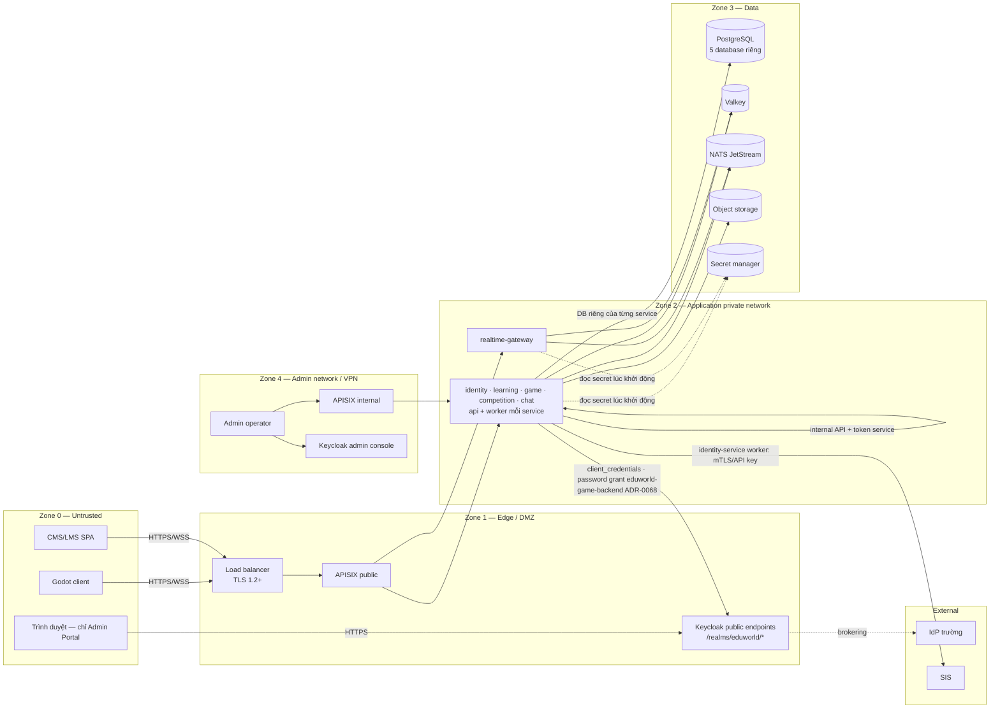
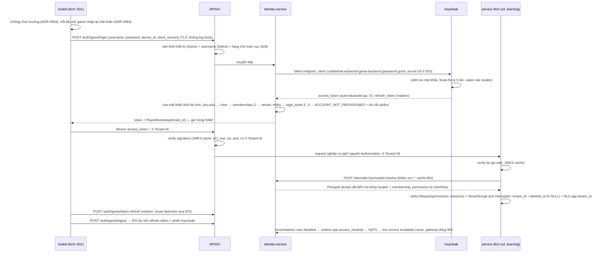

# Security Architecture & Program

> Trạng thái: Draft · Phiên bản: 0.4 · Owner: Identity & Security Engineer · Cập nhật: 2026-11-15
> Liên quan: [ADR-0005..0009, 0016, 0020, 0036, 0040](../adr/README.md) · [MULTITENANCY](../06-architecture/MULTITENANCY.md) · [REALTIME_ARCHITECTURE](../06-architecture/REALTIME_ARCHITECTURE.md) · [KEYCLOAK_SSO](../09-identity/KEYCLOAK_SSO.md) · [DATA_PRIVACY](DATA_PRIVACY.md) · [CHILD_SAFETY](CHILD_SAFETY.md) · [ANTI_CHEAT](ANTI_CHEAT.md) · [MODERATION](../03-social-multiplayer/MODERATION.md)

> **Thay đổi v0.3:** backend là 6 microservice (ADR-0036) — thêm ranh giới tin cậy giữa service, xác thực service-to-service bằng Keycloak client credentials + allowlist `azp` (ADR-0040, §5.5), NATS account/user theo service (§8.1), database riêng mỗi service (ADR-0037).

**Mục đích.** Nguồn duy nhất về bảo mật của EduWorld (hợp nhất từ SECURITY.md cũ, 2026-11-15).
**Phạm vi.** Phần A (§1–§10): kiến trúc — ranh giới tin cậy, luồng token/phiên, ủy quyền, secret, mã hóa, mạng, threat model, logging. Phần B (§11–§18): chương trình bảo mật — secure SDLC, OWASP, lập trình an toàn, rate limit, scanning, kiểm thử/pentest, incident response, checklist phát hành.
**Không thuộc phạm vi (tài liệu sở hữu riêng):** an toàn trẻ em → [CHILD_SAFETY](CHILD_SAFETY.md); pipeline kiểm duyệt chat → [MODERATION](../03-social-multiplayer/MODERATION.md); dữ liệu cá nhân/retention → [DATA_PRIVACY](DATA_PRIVACY.md); gian lận game/thi đấu → [ANTI_CHEAT](ANTI_CHEAT.md); cấu hình Keycloak → [KEYCLOAK_SSO](../09-identity/KEYCLOAK_SSO.md).

## Phần A — Kiến trúc bảo mật

## 1. Nguyên tắc

1. **Zero trust với client:** Godot và SPA là môi trường không tin cậy; mọi kết quả có giá trị do server quyết định (ADR-0016).
2. **Defense in depth:** APISIX → service authn/authz (ent interceptor) → RLS PostgreSQL → audit; giữa service: token service + allowlist `azp` + mạng private.
3. **Least privilege:** role DB theo database của service, Keycloak client riêng mỗi service, NATS user/Valkey ACL riêng mỗi service, network segment tối thiểu. Không service nào có credential database của service khác.
4. **Privacy by default:** dữ liệu tối thiểu, nickname thay tên thật, mọi tin nhắn qua kiểm duyệt theo chính sách (ADR-0020, ADR-0030).
5. **Secure by configuration:** không secret trong code/Git; cấu hình qua env + secret manager.
6. **Auditability:** thao tác nhạy cảm đều có audit log bất biến.

## 2. Trust boundaries



| Ranh giới | Kiểm soát |
|---|---|
| Zone 0 → 1 | TLS, WAF rule cơ bản (APISIX), rate limit, body size limit, CORS whitelist; kiểm tra có mặt/định dạng `X-Tenant-Id` ở route tenant-scoped (`400 TENANT_HEADER_REQUIRED`, ADR-0065); route đăng nhập game `/auth/game/*` không ghi body vào log/trace (ADR-0068) |
| Zone 1 → 2 | Chỉ APISIX/LB gọi được cổng public của service; JWT đã kiểm tra nhưng app **kiểm tra lại**; header `X-Request-Id` chuẩn hóa; header nội bộ (`X-User-*`) bị APISIX **xóa** khỏi request vào |
| Zone 2 ↔ 2 (service ↔ service) | Chỉ cổng internal (`/internal/v1/*`, `EW_INTERNAL_HTTP_ADDR`) mở giữa service; mọi lời gọi mang token client credentials của service gọi, bên nhận kiểm `azp` theo allowlist endpoint (§5.5); mTLS [Proposed]; không đi qua APISIX public |
| Zone 2 → 3 | Overlay network `data` của Docker Swarm (chỉ service cần dữ liệu mới gắn vào) + credential riêng: mỗi service chỉ tới **database của mình**, Valkey, NATS; TLS nội bộ [Proposed]; role DB riêng; Valkey ACL và NATS user theo service |
| Zone 4 | Chỉ qua VPN/bastion + MFA; route `/api/v1/admin/*`, `/api/v1/sis/*` (API quản trị cho người), `/internal/*` (machine-to-machine: SIS webhook, Keycloak backchannel logout), Keycloak admin **không** có trên APISIX public |
| External | SIS credential chỉ trong worker của identity-service, lưu secret manager; IdP qua Keycloak brokering, backend không nói chuyện trực tiếp với IdP |

## 3. Luồng token và phiên



| Token / credential | TTL | Lưu ở | Nhãn |
|---|---|---|---|
| Mật khẩu học sinh (đăng nhập game, ADR-0068) | Chỉ trong thời gian xử lý `POST /auth/game/login` | RAM của Godot (xóa ô nhập sau khi gửi) và RAM của identity-service (xóa sau khi gọi Keycloak, best effort); **không** log, trace, audit, lưu DB/Valkey | [Confirmed] |
| `login_ticket` (chọn tenant khi thuộc nhiều tenant) | 2 phút, một lần, gắn `device_id` | Valkey (hash) `ew:id:login_ticket:<hash>`; giữ token chờ chọn tenant, không giữ mật khẩu | [Proposed] tham số |
| Access token | 5 phút | Memory client | [Proposed] |
| Refresh token (game) | SSO idle **30 phút**, max **10 giờ**, rotation + reuse detection; không Remember me, không offline token (ADR-0064); thuộc client confidential `eduworld-game-backend` nên chỉ làm mới qua `POST /auth/game/token:refresh` (ADR-0068) | **Chỉ RAM** của tiến trình game — không ghi đĩa, `user://`, Keychain/Keystore, localStorage (ADR-0064) | [Confirmed] chính sách / [Proposed] tham số |
| Mã QR lớp (đăng nhập nhanh) — ngoài Release 1.0 | 60 s, một lần, xoay vòng; chỉ khi giáo viên mở (tối đa 15 phút) | Valkey (hash), hiển thị trên màn hình giáo viên | [Proposed] ADR-0045 |
| PIN / thẻ QR cá nhân / mật khẩu hình ảnh — ngoài Release 1.0 | Đến khi đặt lại/thu hồi | `identity.login_credentials` (băm) | [Proposed] ADR-0045 |
| Signed URL media riêng tenant (CDN) | 5–15 phút | Tham số URL ký bởi khóa CDN | [Proposed] ADR-0044 |
| Refresh token (CMS/admin) | idle 30 phút, max 10 h | Memory + `sessionStorage` không dùng; dùng silent refresh | [Proposed] |
| Realtime ticket | 60 s, 1 lần | Valkey (hash) | [Proposed] ADR-0008 |
| Idempotency key | 24 h | PG/Valkey | [Proposed] ADR-0010 |
| Service account (identity worker → Keycloak admin API) | client_credentials, token 5' | Secret manager | [Proposed] |
| Token service-to-service (`svc-*`) | client_credentials, token 5', cache đến 30 s trước hết hạn | Memory của service; secret client trong secret manager | [Proposed] ADR-0040 |

Admin Portal **không** dùng luồng trên: đăng nhập trên trang Keycloak riêng (theme vận hành) bằng Authorization Code + PKCE trong trình duyệt, MFA cho role platform, không chọn tenant trước đăng nhập; sau đăng nhập gọi `GET /me/tenants` để vào thẳng/chọn tenant (ADR-0066, ADR-0067). Chi tiết cấu hình Keycloak: [KEYCLOAK_SSO](../09-identity/KEYCLOAK_SSO.md). Kiểm tra tenant khi đăng nhập và ở mỗi request: [MULTITENANCY §8](../06-architecture/MULTITENANCY.md).

### 3.1. Phiên trong bộ nhớ và thu hồi (ADR-0064)

Phiên game chỉ sống trong lúc tiến trình game chạy: mỗi lần mở game nhập username + password vào form trong game (ADR-0068), token chỉ trong RAM, thoát game → logout + revoke, game bị tắt đột ngột → phiên Keycloak hết theo idle 30 phút; trong lúc chơi refresh token trong RAM dùng để gia hạn và reconnect. Thay cho phiên dài 7/30 ngày của ADR-0045 (đổi lại tải băm mật khẩu tăng — đỉnh 100 lượt/giây, [KEYCLOAK_SSO §12](../09-identity/KEYCLOAK_SSO.md#12-năng-lực-đăng-nhập-10000-ccu-adr-0045)). Thu hồi:

| Sự kiện | Thu hồi | Độ trễ tối đa |
|---|---|---|
| Đăng nhập thiết bị khác (takeover, ADR-0031) | Đóng game session cũ, close 4409, Admin API thu hồi Keycloak session theo `sid` | Ngay lập tức (WS), refresh tiếp theo bị từ chối |
| Khóa / vô hiệu hóa / dọn tài khoản | Keycloak `enabled=false` + logout all sessions, event `user.access_revoked` | ≤ 60 s cho REST (cache `user.status`), ngay lập tức cho WS |
| Refresh token bị dùng lại | Keycloak thu hồi toàn bộ phiên (reuse detection) | Ngay lập tức |
| Chuyển sang tenant khác | Gỡ membership org cũ + thu hồi phiên | Ngay sau SIS sync |
| Thoát game (mọi thiết bị) | `POST /auth/game/logout`: identity-service thu hồi refresh token + phiên Keycloak; game xóa token trong RAM | Ngay lập tức |
| `ACCOUNT_NOT_PROVISIONED` (ADR-0063) | Backend thu hồi phiên Keycloak vừa tạo theo `sid`, audit | Ngay lập tức |
| Thiết bị dùng chung | Không nhớ username; 30 phút không hoạt động → đăng xuất | — |

### 3.1b. Mật khẩu học sinh đi qua backend (ADR-0068)

Game không mở trình duyệt; mật khẩu học sinh đi qua Godot → APISIX → identity-service → Keycloak. Đây là thay đổi trust boundary: EduWorld chịu trách nhiệm bảo vệ mật khẩu khi truyền qua (vẫn **không lưu** mật khẩu, Keycloak giữ hash).

| Mối đe dọa | Biện pháp bắt buộc |
|---|---|
| Lộ mật khẩu qua log/trace/APM | APISIX route `/auth/game/*` tắt ghi body (logger, `opentelemetry` không thu `request_body`); identity-service: handler không log request, middleware redaction che field `password`, `refresh_token`, `login_ticket` trong mọi log/trace/panic dump; span không gắn body; error reporter lọc field. Test tự động kiểm log không chứa mật khẩu mẫu (TEST_STRATEGY) |
| Lộ mật khẩu trên đường truyền | TLS 1.2+ bắt buộc, HSTS; certificate pinning trong Godot cho tên miền API [Proposed]; chặn client quá cũ bằng `min_client_version` (`426 CLIENT_VERSION_UNSUPPORTED`) |
| Dò mật khẩu / credential stuffing | Rate limit 10 lần/phút theo thiết bị và 10 lần/phút theo username, ngưỡng toàn cục theo năng lực Keycloak (§14); Keycloak brute-force khóa tạm sau 5 lần sai (1–15 phút); thông điệp lỗi chung `INVALID_CREDENTIALS` (không lộ tài khoản tồn tại/bị khóa) |
| Lộ client secret `eduworld-game-backend` | Secret chỉ ở identity-service (secret manager, xoay 90 ngày), không có trong game; client chỉ bật Direct Access Grants, tắt Standard Flow; chỉ cho realm role `student` |
| Nhân sự dùng form game | Keycloak flow + identity-service từ chối user không có realm role `student` → `403 GAME_ACCESS_STUDENT_ONLY`, audit |
| Bot/app giả mạo gọi API đăng nhập | Rate limit + hàng chờ, `X-Device-Id` bắt buộc, theo dõi `eduworld_game_login_failed_total{reason}` và cảnh báo đột biến; không có MFA cho học sinh (chấp nhận, ADR mới nếu cần) |
| `login_ticket` bị đánh cắp | TTL 2 phút, một lần (`GETDEL`), gắn `device_id`, chỉ chọn được tenant trong `choices[]` |

### 3.2. Đăng nhập nhanh không mật khẩu (ADR-0045)

> **Ngoài Release 1.0 (ADR-0063):** Release 1.0 học sinh chỉ đăng nhập username + password; các cơ chế dưới đây là thiết kế mở rộng, chỉ bật bằng ADR mới sau khi qua review bảo mật.

| Cơ chế | Kiểm soát bảo mật |
|---|---|
| Mã QR lớp + PIN | Mã một lần, TTL 60 s, xoay vòng, chỉ tồn tại khi giáo viên mở (≤ 15 phút); gắn `tenant_id + class_id`; PIN 4 số băm argon2id; brute-force theo tài khoản; danh sách lớp sau khi quét chỉ hiển thị tên rút gọn/nickname |
| Thẻ QR cá nhân | Bí mật ngẫu nhiên 256-bit, lưu băm + pepper; cấp lại = vô hiệu thẻ cũ ngay; chỉ hợp lệ cho đăng nhập game qua identity-service (ADR-0068); in thẻ có audit |
| Mật khẩu hình ảnh (lớp 1–3) | Không gian khóa nhỏ → bắt buộc brute-force theo tài khoản và chỉ bật khi trường chọn; không dùng cho giáo viên/vận hành |
| Device Authorization Grant | `user_code` 8 ký tự, hết hạn 10 phút, polling 5 s; thiết bị chế độ dùng chung không lưu refresh token |
| Authenticator tùy biến Keycloak (mở rộng sau, ngoài Release 1.0 — ADR-0063) | Code review + SAST + pen-test trước khi bật; client `svc-keycloak-authn` chỉ gọi được `login-credentials:verify`; kiểm thử lại mỗi lần nâng cấp Keycloak |

**Tenant là một trust boundary riêng** (ADR-0026, ADR-0065): mọi request tenant-scoped mang header `X-Tenant-Id`, nhưng header **không bao giờ được tin một mình** — nó phải khớp tenant của phiên (claim `organization` do Keycloak ký khi có, với portal sau bước chọn tenant; token game không có claim này, ADR-0068) **và** membership trong DB (dữ liệu SIS/UserRole); không khớp → `403 TENANT_MISMATCH`. Không có claim → backend xác định theo membership; không thuộc tenant chung và không thuộc tenant SIS nào → `403 ACCOUNT_NOT_PROVISIONED`, audit, thu hồi phiên Keycloak — **không** tự đưa vào tenant chung (ADR-0063). Mỗi phiên có đúng một tenant; đổi tenant = token mới + header mới; WebSocket giữ tenant cố định từ lúc cấp ticket. Chỉ `system_admin` có chế độ liên tenant (dropdown, `CrossTenantScope`, audit — ADR-0027 §6). Username/email không bao giờ được dùng để suy ra tenant. Mọi `TENANT_MISMATCH` là security event (audit + metric `eduworld_auth_tenant_mismatch_total`, cảnh báo khi tăng đột biến).

## 4. Defense in depth

| Lớp | Kiểm soát | Không làm |
|---|---|---|
| **APISIX** | TLS termination, JWT validation (`openid-connect` bearer-only / `jwt-auth`), có mặt/định dạng `X-Tenant-Id` (ADR-0065), `limit-req`/`limit-count` (theo IP + `sub`, tenant, thiết bị/username ở route đăng nhập game), `client-control` max body (1 MB mặc định, 20 MB cho upload media qua presigned URL thì không đi qua gateway), CORS, strip header nội bộ, `ip-restriction` cho route nhạy cảm, WebSocket proxy | Quyết định tenant, quyền trên tài nguyên |
| **Service authn (public)** | Verify chữ ký, `iss` ∈ allowlist, `aud` chứa `eduworld-api`, `exp/nbf` (skew 30s), `azp` ∈ client cho phép theo route (vd. route Admin Portal chỉ chấp nhận `eduworld-portal`) | Tin claim `organization`/roles làm phạm vi |
| **Tenant middleware** | identity-service xác định tenant lúc tạo phiên; mọi service so header `X-Tenant-Id` với `memberships:check`/Principal từ identity-service (cache) — header ↔ claim `organization` (nếu có) ↔ membership, lệch → `403 TENANT_MISMATCH` + audit (ADR-0065); không có claim → chọn theo membership (0 → `ACCOUNT_NOT_PROVISIONED`); `Principal.TenantID` cố định cho phiên (ADR-0026); mọi query `tenant_id` + `deleted_at IS NULL` (ADR-0005, ADR-0028) | Tin `X-Tenant-Id` một mình; suy ra tenant từ username, query string |
| **Authz** | Permission (catalog trong code) gom thành Role (DB) và gán qua UserRole có scope (platform/tenant/school/class/subject) và thời hạn (ADR-0066) + ownership + policy (chat, party). Route portal yêu cầu `azp = eduworld-portal` và `user_type ≠ student` (`403 PORTAL_ACCESS_STAFF_ONLY`). Route `/api/v1/game-admin/*`, `/api/v1/admin/*` yêu cầu thêm `azp = eduworld-portal` + MFA (`acr`) + role platform (ADR-0027) | — |
| **Validation** | Request validation sinh từ OpenAPI; giới hạn độ dài chuỗi; chuẩn hóa Unicode NFC; whitelist enum | — |
| **Data access** | ent (query tham số hóa, interceptor tenant + soft-delete), SQL tường minh tham số hóa cho read model, RLS (ADR-0005/0039); mỗi service chỉ có credential database của mình | SQL ghép chuỗi; truy cập database service khác |
| **Service-to-service** | Token `svc-*` + allowlist `azp` theo endpoint internal; `X-Tenant-Id` chỉ là ngữ cảnh, bên nhận vẫn kiểm tenant tồn tại/hoạt động; `X-On-Behalf-Of` để audit (§5.5) | Tin header ngữ cảnh khi token không hợp lệ |
| **Audit** | Mỗi service phát `audit.recorded` qua outbox; identity-service ghi `audit.audit_logs` (append-only, partition tháng, không UPDATE/DELETE) | Ghi nội dung nhạy cảm (mật khẩu, token, nội dung chat đầy đủ) |

## 5. Mô hình ủy quyền

Nguồn chuẩn: [ADR-0027](../adr/ADR-0027-cms-tach-vung-tenant-chi-thao-tac-learning-management-cau-hi.md). Chi tiết permission catalog và ma trận role × permission ở [ADMIN_PORTAL §2](../04-admin-portal/ADMIN_PORTAL.md#2-permission-model).

### 5.1. Permission, Role, UserRole và `role_scope_kind` (ADR-0066)

- **Permission** — quyền nguyên tử, **định nghĩa trong code** (catalog cố định, `scope_kind` `tenant` | `platform`); DB không tạo được permission mới.
- **Role** — tập permission lưu trong `identity.roles` + `identity.role_permissions`: `code`, tên song ngữ, `role_scope_kind`, `is_system` (role seed, không sửa/xóa), `tenant_id` (NULL = dùng chung; có giá trị = role tùy biến của tenant [Proposed]).
- **UserRole** — `identity.user_roles`: gán role cho người dùng trong `tenant_id` + `scope_type` (`platform` | `tenant` | `school` | `class` | `subject`) + `scope_id`, `valid_from`/`valid_to`, `granted_by`, `source` (`sis` | `manual`), soft-delete. Thay tên `role_assignments` cũ.
- **Đánh giá quyền:** Principal = hợp permission của mọi UserRole còn hiệu lực (`deleted_at IS NULL`, `valid_from ≤ now < valid_to`) trong tenant đã kiểm tra qua `X-Tenant-Id` (+ UserRole platform), giao với scope tài nguyên; cache 60 s, làm mới khi có `role.updated`/`user_role.changed`.
- **Bất biến:** role `tenant` không chứa permission `platform.*`/`game.*`/`competition.config.*` (kiểm tra khi lưu role, khi khởi động và bằng trigger DB); UserRole của role `platform` chỉ có `scope_type = platform`; học sinh không được gán role portal; người gán chỉ cấp được role có permission là tập con quyền của chính mình trong cùng scope [Proposed: chống leo thang]; mọi thay đổi ghi audit `role.*`/`user_role.*`.

Role hệ thống seed sẵn (`is_system = true`):

| Role | `role_scope_kind` | Phạm vi gán | Ví dụ quyền |
|---|---|---|---|
| `student` | tenant | tenant (ngầm định qua Student; trường qua enrollment) | Làm bài, xem kết quả của mình, chat theo ChatPolicy |
| `teacher` | tenant | school (+ class × subject theo `TeachingAssignment`) | Giao bài, thử thách từ template được gán, xem kết quả lớp, moderation channel lớp, soạn nội dung của tenant (OQ-07) |
| `tenant_admin` | tenant | tenant | Quản trị tenant (tenant `unit`: mọi trường trong đơn vị): cài đặt tenant, phân quyền trong tenant, SIS, moderation, nội dung của tenant, thùng rác tenant [Proposed] |
| `school_admin` | tenant | school (một trường trong tenant) | Lớp/giáo viên (từ SIS), cài đặt trường, chat policy trường, moderation trường, nội dung học tập |
| `academic_manager` (tổ chuyên môn) | tenant | tenant / school / subject | Curriculum riêng của tenant, nội dung và báo cáo trong scope |
| `tenant_content_editor`, `tenant_content_reviewer`, `tenant_moderator` | tenant | tenant / school | Soạn/duyệt nội dung học tập của tenant; moderation |
| `system_admin` | platform | platform | **Người duy nhất xem dữ liệu liên tenant** (dropdown tenant, audit); quản lý tenant, gán/clone dữ liệu (ADR-0029), thùng rác (ADR-0028), kiểm duyệt liên tenant |
| `content_admin`, `content_reviewer` | platform | platform | Nội dung học tập platform (`tenant_id = NULL`); reviewer duyệt cả game content. Không đọc dữ liệu tenant |
| `game_designer`, `liveops`, `competition_admin` | platform | platform | Game Studio và cấu hình thi đấu. Không đọc dữ liệu tenant |

### 5.2. Permission catalog và bất biến

```go
// internal/authorization/catalog.go
type Permission string // "lms.assignment.write", "game.quest.write", "competition.config.season.write", ...

type ScopeKind string // "tenant" | "platform"

type RoleDef struct {
    Name        string
    ScopeKind   ScopeKind
    Permissions []Permission
}

// Nhóm permission cấm với role tenant (ADR-0027).
var platformOnlyPrefixes = []string{"game.", "competition.config.", "platform."}

// ValidateCatalog chạy khi khởi động identity-service (nơi sở hữu catalog) và trong unit test của pkg/authz.
// Vi phạm → tiến trình không start.
func ValidateCatalog(roles []RoleDef) error {
    for _, r := range roles {
        if r.ScopeKind != "tenant" {
            continue
        }
        for _, p := range r.Permissions {
            for _, pre := range platformOnlyPrefixes {
                if strings.HasPrefix(string(p), pre) {
                    return fmt.Errorf("role %s (tenant) must not hold %s", r.Name, p)
                }
            }
        }
    }
    return nil
}
```

- Chỉ `system_admin` có `platform.cross_tenant.read`. Repository nhận `TenantScope` dạng `Single(tenant_id)` cho người dùng tenant và `Multi(tenant_ids | All)` chỉ khi Principal có permission này; phiên đó dùng role DB `<svc>_platform` của database tương ứng và luôn kèm điều kiện `tenant_id` tường minh + audit `cross_tenant.viewed` (ADR-0005, ADR-0027 §6).
- Catalog **permission nằm trong code**, version cùng release, review qua merge request. Role (gồm role hệ thống seed và role tùy biến) và UserRole nằm trong DB `identity.roles`, `identity.role_permissions`, `identity.user_roles`; bảng `identity.permissions` là bản sao đọc-chỉ của catalog (đồng bộ lúc migrate/khởi động) để khóa ngoại và trigger kiểm tra ([DATABASE_DESIGN](../07-backend/DATABASE_DESIGN.md)). `ValidateCatalog` chạy với role seed lúc khởi động; use case `CreateRole`/`UpdateRole` chạy cùng kiểm tra cho role tùy biến (`422 VALIDATION_FAILED`, `PERMISSION_NOT_ALLOWED_FOR_SCOPE`).
- Gán role platform ở scope tenant, hoặc gán role portal cho học sinh, bị chặn ở 2 lớp: use case `GrantUserRole` và trigger DB. Mọi lần bị chặn ghi audit.
- Permission bổ sung (2026-11-15, catalog đầy đủ ở [ADMIN_PORTAL §2.2](../04-admin-portal/ADMIN_PORTAL.md#22-permission-catalog)):
  - **Platform-only** (thuộc tiền tố `game.`, bị `ValidateCatalog` chặn với role tenant): `game.challenge.write`, `game.boss.write`, `game.achievement.write`, `game.economy.write`, `game.economy.adjust`, `game.liveops.read`. `game.economy.adjust` chỉ `system_admin` và bắt buộc người duyệt thứ hai khác người tạo (`/admin/economy/adjustments`, ADR-0049). Quyền xem Game Live Operations dùng tên chuẩn `game.liveops.read` (không dùng `liveops.read` không tiền tố) để giữ bất biến.
  - **Tenant được phép**: `lms.review.grade` (giáo viên được phân công lớp/môn), `rubric.write`, `learning_content.activity.write`, `learning_content.activity.review` (ADR-0048).
- Permission bổ sung cho sự kiện/mùa, Game Analytics và song ngữ (2026-11-15; [EVENT_SEASON_SYSTEM](../01-game-design/EVENT_SEASON_SYSTEM.md), [GAME_ANALYTICS](../11-operations/GAME_ANALYTICS.md), ADR-0056, ADR-0058):

  | Permission | Nhóm | Role điển hình | Endpoint |
  |---|---|---|---|
  | `game.event.write` | Platform-only | `game_designer`, `liveops` | `/game-admin/{config_type}` với `events`, `event-templates` |
  | `game.event.operate` | Platform-only | `liveops`, `system_admin` | `/game-admin/events/{event_id}/runs/{run_id}:suspend\|:resume\|:cancel` |
  | `game.season_track.write` | Platform-only | `game_designer`, `liveops` | `/game-admin/season-tracks` |
  | `game.analytics.read` | Platform-only | `system_admin`, `liveops`, `game_designer` | `/admin/analytics/game/*` |
  | `game.content.translate` | Platform-only | `game_designer`, người dịch platform | `/game-admin/translations:export\|:import` |
  | `lms.school_event.write` | Tenant được phép | `tenant_admin`, `school_admin`, `teacher` (khi trường bật) | `/lms/event-templates`, `/lms/school-events*` (route ngoại lệ tới game-service; chỉ tạo từ template với `allowed_params`, không sửa cấu hình game) |
  | `learning_content.translate` | Tenant được phép | `tenant_content_editor`, `content_admin` | `/cms/learning/translations:export\|:import` |

  Báo cáo game tổng hợp của tenant dùng `analytics.tenant.read`/`analytics.school.read` (không phải `game.analytics.read`). `ValidateCatalog` vẫn là chốt chặn: role tenant không được chứa bất kỳ permission `game.*` nào, kể cả khi endpoint do game-service phục vụ (sự kiện trường dùng `lms.school_event.write`).
- Permission bổ sung cho phân quyền, danh mục và dashboard (2026-11-15; ADR-0060, ADR-0062, ADR-0066, ADR-0069; endpoint trong [API_DESIGN §9](../07-backend/API_DESIGN.md#9-endpoint-catalog)):

  | Permission | Nhóm | Role điển hình | Endpoint |
  |---|---|---|---|
  | `tenant.user.read` / `tenant.user.write` | Tenant được phép | `tenant_admin` (đọc: `school_admin` trong trường) | `/tenant/users*` (một người một tài khoản SSO — ADR-0069) |
  | `tenant.role.read` / `tenant.role.write` | Tenant được phép | `tenant_admin` | `/tenant/permissions`, `/tenant/roles*` |
  | `tenant.user_role.write` | Tenant được phép | `tenant_admin`; `school_admin` ở scope trường | `/tenant/user-roles*`, `/schools/{school_id}/user-roles` |
  | `tenant.school.read` / `tenant.school.write` | Tenant được phép | `tenant_admin`, `school_admin` (trường mình) | `/tenant/schools*`, `:approve` |
  | `tenant.class.read` | Tenant được phép | `tenant_admin`, `school_admin` | `/tenant/schools/{school_id}/classes`, `/tenant/students/unassigned` |
  | `analytics.tenant.read` / `analytics.school.read` | Tenant được phép | `tenant_admin` / `school_admin`, `academic_manager` | `/tenant/analytics/*`, `/lms/schools/{school_id}/analytics/*` |
  | `report.export` | Tenant được phép (dữ liệu trong quyền) và platform | `tenant_admin`, `school_admin`, `system_admin` | `/tenant/reports`, `/admin/reports` |
  | `platform.catalog.write` | Platform-only | `system_admin` | `/admin/catalog/*`, `/admin/schools:import` |
  | `platform.role.read` / `platform.role.write` | Platform-only | `system_admin` | `/admin/roles*`, `/admin/permissions` |
  | `platform.user_role.write` | Platform-only | `system_admin` | `/admin/user-roles*` |

- Catalog do **identity-service** sở hữu; service khác nhận permission hiệu lực của Principal qua `POST /internal/v1/principals:resolve` và kiểm tra bằng `pkg/authz` (không tự định nghĩa role).
- Màn quản trị Role/UserRole trong Admin Portal: Tenant Admin (`tenant.role.write`, `tenant.user_role.write`) trong tenant mình; System Admin (`platform.role.write`, `platform.user_role.write`) cho role platform và mọi tenant ([ADMIN_PORTAL](../04-admin-portal/ADMIN_PORTAL.md), [API_DESIGN §9.16](../07-backend/API_DESIGN.md#916-admin-internal--apiv1admin)).
- `GET /api/v1/me/permissions` (tenant theo header `X-Tenant-Id`, ADR-0065; System Admin bỏ header = phạm vi platform) trả danh sách permission hiệu lực của Principal trong tenant đó, dùng để dựng menu SPA. Không phải nguồn quyết định quyền.

### 5.3. Policy check

```go
// pkg/authz
type Resource struct {
    Type      string     // "attempt", "class", "channel", "quest", ...
    ID        uuid.UUID
    TenantID  *uuid.UUID // luôn nạp từ DB; nil với tài nguyên platform (game config, nội dung dùng chung)
    SchoolID  *uuid.UUID // chiều phân loại bên trong tenant
    ClassID   *uuid.UUID
    SubjectID *uuid.UUID
    OwnerID   *uuid.UUID // student/creator
}

// Require trả ErrPermissionDenied (→ 403 PERMISSION_DENIED) hoặc ErrNotFound khi tài nguyên thuộc tenant khác.
func Require(ctx context.Context, p Principal, perm Permission, r Resource) error
```

- `Require` kiểm tra: (0) `r.TenantID` = tenant của phiên, trừ khi Principal có `platform.cross_tenant.read`; tài nguyên platform (`TenantID = nil`) chỉ đọc được bởi tenant khi có assignment active (ADR-0029, nếu không → `403 RESOURCE_NOT_ASSIGNED`); (1) Principal có permission qua UserRole còn hiệu lực ở scope bao phủ `r`; (2) với permission platform-only, Principal phải có role platform **và** token có `azp = eduworld-portal` + MFA (`acr`/`amr`, thiếu → `MFA_REQUIRED`); (3) ownership/TeachingAssignment khi resource yêu cầu.
- Bảng quyền có unit test dạng bảng cho mọi permission × role × scope. Không dùng OPA trong Release 1.0 [Proposed]; có thể chuyển khi policy phức tạp (ADR mới).
- Deny mặc định khi không có rule. Từ chối trả `403 PERMISSION_DENIED`, hoặc `404` nếu tài nguyên thuộc tenant khác (không lộ sự tồn tại).
- Quyết định từ chối được log (`authz_denied_total{permission,azp}`); tăng đột biến = cảnh báo dò quét.
- Policy nghiệp vụ động (ChatPolicy, Party group rules) là dữ liệu cấu hình, đánh giá trong module tương ứng nhưng gọi qua `authorization` cho phần role/scope.

### 5.3b. Game chỉ dành cho học sinh, một thiết bị (ADR-0031)

| Lớp | Cơ chế |
|---|---|
| Keycloak | Client confidential `eduworld-game-backend` (chỉ Direct Access Grants) có điều kiện realm role `student` trong direct grant flow (cần kiểm chứng trên bản triển khai) |
| identity-service | `POST /auth/game/login` kiểm tra `user_type = student` sau khi nhận token; nhân sự → thu hồi phiên vừa tạo, `403 GAME_ACCESS_STUDENT_ONLY` (ADR-0068) |
| Backend | Middleware `game_player`: `azp = eduworld-game-backend` và `user_type = student`, nếu không `403 GAME_ACCESS_STUDENT_ONLY` (áp ở `/game/sessions`, mọi API người chơi, realtime ticket) |
| Phiên | Unique index 1 game session active/học sinh; takeover có xác nhận người dùng, kết thúc session cũ, đóng WS (4409), thu hồi Keycloak session theo `sid` |
| Audit | `game_access_denied_non_student`, `game_session_takeover`, `game_login` (không IP thô, chỉ `ip_hash`) |

### 5.3c. Portal chỉ dành cho nhân sự (ADR-0066, ADR-0067)

Đối xứng 5.3b:

| Lớp | Cơ chế |
|---|---|
| Keycloak | Client `eduworld-portal` có điều kiện realm role `tenant_staff` hoặc `platform_staff` trong browser flow; học sinh (realm role `student`) bị từ chối ngay ở màn đăng nhập portal (theme vận hành riêng) |
| Backend | Mọi route portal (`/cms/*`, `/lms/*`, `/tenant/*`, `/schools/*`, `/game-admin/*`, `/admin/*`): `azp = eduworld-portal` và `user_type ≠ student`; vi phạm → `403 PORTAL_ACCESS_STAFF_ONLY` + audit `portal_access_denied`. Hai lớp độc lập vì Keycloak có thể cấu hình sai |
| Phiên | Không chọn tenant trước đăng nhập; `GET /me/tenants`: role platform → phạm vi platform, 1 tenant → vào thẳng, nhiều → chọn sau đăng nhập, không có UserRole portal hiệu lực → `403 PORTAL_ACCESS_STAFF_ONLY` |
| Định danh | Username/email duy nhất trên SSO (không phân biệt hoa thường), do đó không trùng trong cùng tenant; đăng nhập portal bằng username hoặc email; nhân sự bắt buộc có email; một người một tài khoản, nhiều membership; Keycloak xác thực trước, identity-service kiểm tra tenant sau (ADR-0067, [ADR-0069](../adr/ADR-0069-username-email-duy-nhat-theo-tenant-va-dang-nhap-khong-chon-tenant.md)) |

### 5.4. Bốn lớp chặn cấu hình game với vận hành tenant (ADR-0027)

| Lớp | Cơ chế |
|---|---|
| Gateway | `/api/v1/game-admin/*` và `/api/v1/admin/*` chỉ có route trên APISIX nội bộ (VPN), không có trên gateway public |
| Token | Backend chỉ chấp nhận `azp = eduworld-portal` có MFA (`acr` mức MFA, `amr` chứa `otp`/`webauthn`) và Principal có role platform cho các route này; thiếu MFA → `MFA_REQUIRED` |
| Permission | Role tenant không bao giờ chứa `game.*`/`competition.config.*`/`platform.*` (catalog + trigger) |
| Client | Một Admin Portal; mã workspace platform là chunk lazy-load, chỉ tải khi có permission. **Không** phải lớp bảo mật (ADR-0027 mục 3d sửa) |

### 5.5. Xác thực và ủy quyền service-to-service (ADR-0040)

| Service gọi (Keycloak client) | Được gọi endpoint internal |
|---|---|
| `svc-game` | learning: `POST /internal/v1/attempts`, `GET /internal/v1/attempts/{id}`; identity: `principals:resolve`, `tenants`, `memberships:check`; competition: đọc cấu hình mini-game co-op nếu cần |
| `svc-competition` | learning: `POST /internal/v1/question-plans`, `POST /internal/v1/question-plans/{plan_id}/answers:score`; game: `GET /internal/v1/minigame-configs/{id}` (co-op); identity: như trên |
| `svc-learning`, `svc-chat` | identity: `principals:resolve`, `tenants`, `memberships:check` |
| `svc-identity` | mọi service: `/internal/v1/platform/*` (saga clone, Thùng rác, cleanup/restore học sinh) |
| `svc-realtime` | Không gọi REST internal; chỉ NATS (`ew.cmd.>`, `ew.in.>`) |

- Token client credentials, `aud` = tên service đích (Keycloak audience mapper), TTL 5 phút. Bên nhận verify chữ ký + `aud` + `azp` ∈ allowlist của endpoint; sai → `403` và audit `service_call_denied`.
- Không truyền access token người dùng sang service khác. Danh tính người dùng gốc đi qua `X-On-Behalf-Of` (chỉ để audit/ngữ cảnh), quyền nghiệp vụ được kiểm ở service nhận người dùng (edge) trước khi gọi.
- Endpoint `/internal/v1/platform/*` chỉ chấp nhận `svc-identity` và luôn kèm `job_id`/`Idempotency-Key` + lý do để audit.
- mTLS giữa service [Proposed]; khi bật, chứng chỉ theo tên service do CA nội bộ cấp.

## 6. Secret management

| Secret | Nơi lưu | Ai đọc | Rotation |
|---|---|---|---|
| DB password theo role (mỗi database một bộ) | Secret manager (Vault/cloud KMS-backed) [TBD OQ-10]; local: `.env` không commit | chỉ service sở hữu database | 90 ngày |
| Keycloak client secret `svc-*` | Secret manager | service tương ứng | 90 ngày |
| NATS credentials (user theo service) | Secret manager | service tương ứng | 90 ngày |
| Valkey ACL password (user theo service) | Secret manager | service tương ứng | 90 ngày |
| Keycloak service account secret (`eduworld-sis-sync`) | Secret manager | identity-service worker | 90 ngày |
| SIS credentials theo `sis_connections` | Secret manager, DB chỉ lưu `secret_ref` | identity-service worker | Theo SIS |
| Object storage keys | Secret manager / IAM role | learning, game, chat (bucket/prefix riêng) | 90 ngày |
| Khóa mã hóa trường nhạy cảm (`date_of_birth`) | KMS (envelope encryption) | identity-service | Hàng năm, re-encrypt nền |
| TLS certificates | ACME/cert-manager hoặc CA nội bộ | LB/APISIX | Tự động |

Quy tắc:
- Không commit secret: `gitleaks` ở pre-commit và CI; `.env.example` chỉ chứa placeholder; local dùng `.env` (gitignored) + Docker secrets.
- Container đọc secret qua file mount (`*_FILE` env / Docker secrets), không log, không in ra.
- Rotation theo bảng trên (mặc định **90 ngày** cho mọi credential service — thống nhất, thay mốc 180 ngày cho client secret ở bản cũ); xoay **ngay lập tức** khi nghi lộ hoặc nhân sự có quyền rời đi. Runbook rotation: [DEPLOYMENT](../11-operations/DEPLOYMENT.md).

## 7. Mã hóa

| Phạm vi | Biện pháp | Nhãn |
|---|---|---|
| Client ↔ edge | TLS 1.2+ (ưu tiên 1.3), HSTS, chỉ `wss://` | [Confirmed §17] |
| Nội bộ app ↔ DB/Valkey | TLS trong staging/prod | [Proposed] |
| At-rest DB | Mã hóa volume/disk (LUKS hoặc managed) + backup mã hóa | [Proposed] |
| Trường nhạy cảm | Mã hóa cấp ứng dụng (AES-256-GCM, envelope key) cho `date_of_birth`, ghi chú moderation chứa PII | [Proposed] |
| Object storage | SSE; bucket `ew-media-quarantine`/`ew-media-private`/`ew-exports`/`ew-student-submissions` private; file học sinh nộp (ghi âm, sản phẩm dự án, ảnh bài làm) chỉ vào `ew-student-submissions`, quét virus, người chấm được phân công xem bằng signed URL 15 phút (ADR-0044 mục 3); media riêng tenant qua **CDN signed URL** 5–15 phút; media dùng chung và snapshot nội dung game qua URL bất biến có hash (ADR-0044, ADR-0043); **câu hỏi đề kiểm tra và answer key không bao giờ lên CDN** | [Proposed] |
| Mật khẩu | **EduWorld không lưu mật khẩu** — Keycloak/IdP quản lý | [Confirmed §10.1] |

## 8. Phân vùng mạng

| Mạng | Thành phần | Inbound |
|---|---|---|
| Public | LB, APISIX public, Keycloak public endpoints, CDN | Internet: 443 |
| Private app | 5 service (cổng public chỉ từ APISIX; cổng internal chỉ từ service khác trên overlay network `app`, kiểm soát bằng token service-to-service + allowlist `azp`), realtime-gateway (chỉ từ APISIX) | Chỉ từ APISIX / service được phép |
| Private data | PostgreSQL, Valkey, **NATS JetStream**, etcd, object storage endpoint nội bộ | Chỉ từ private app (và backup host) |
| Admin | APISIX internal, Keycloak admin, Grafana, pgAdmin (nếu có) | VPN + MFA |
| Egress | identity-service worker → SIS, Keycloak → IdP | Allowlist domain |

### 8.1. NATS (ADR-0035)

- Chỉ trong vùng private data; **không** publish qua APISIX; game client/CMS không bao giờ kết nối NATS.
- TLS cho client và route giữa node cluster; xác thực bằng NKey/JWT theo **account** `EDUWORLD` với user riêng từng service và quyền tối thiểu:

| User NATS | Publish | Subscribe |
|---|---|---|
| `svc-realtime` (gateway) | `ew.cmd.>`, `ew.in.>` | `_INBOX.>` (reply) |
| `svc-identity` | `ew.evt.identity.>` | `ew.evt.*.audit.recorded`, `ew.evt.game.student.game_logged_in`, `ew.evt.game.game_session.replaced`, consumer của mình |
| `svc-learning` | `ew.evt.learning.>` | `ew.evt.identity.>`, `ew.evt.game.>` (quest/login), `ew.evt.competition.match.*`, consumer của mình |
| `svc-game` | `ew.evt.game.>` | `ew.cmd.game.>`, `ew.evt.identity.>`, `ew.evt.learning.>`, `ew.evt.competition.>` |
| `svc-competition` | `ew.evt.competition.>` | `ew.cmd.competition.>`, `ew.in.room.>`, `ew.evt.identity.>`, `ew.evt.game.game_profile.>`, `ew.evt.chat.user.blocked` |
| `svc-chat` | `ew.evt.chat.>`, `ew.chat.>`, `ew.dlq.>` | `ew.cmd.chat.>`, `ew.evt.identity.>`, `ew.evt.competition.>`, `ew.evt.game.>`, consumer `CHAT_MESSAGES` |
| `ops` (vận hành) | `$JS.API.>` (quản trị stream) | — |

Ngoài publish/subscribe ở trên, mỗi user có quyền `$JS.API.CONSUMER.*`/`$JS.ACK.>` chỉ trên stream/consumer của mình. Chỉ `svc-realtime` được publish `ew.cmd.>`/`ew.in.>`, nên header danh tính (`Ew-User-Id`, `Ew-Tenant-Id`) trong lệnh realtime là đáng tin.

- Consumer luôn kiểm tra `tenant_id` trong envelope khớp `tenant_id` của channel trước khi ghi (chống dữ liệu chéo tenant do lỗi publish). Credential NATS lưu secret manager.

## 8b. Công thức LaTeX là dữ liệu không tin cậy (ADR-0055)

LaTeX do biên tập/giáo viên nhập trên Admin Portal và **SVG do trình duyệt của người soạn render** (MathJax 4) đều được coi là **đầu vào không tin cậy**: SVG có thể bị sửa trước khi gửi lên, nên server không bao giờ tin SVG từ client. Game chỉ hiển thị, học sinh không nhập công thức.

| Biện pháp | Chi tiết |
|---|---|
| Allowlist extension | Chỉ `ams`, `mhchem`, `color` (giới hạn bảng màu) trong cấu hình MathJax 4 của portal; tắt autoload extension khác. learning-service **tự parse LaTeX** (tokenizer allowlist lệnh/môi trường) khi lưu, không chỉ dựa vào kiểm tra phía trình duyệt |
| Lệnh bị cấm | `\href`, `\url`, `\html*` (`\htmlClass`, `\htmlId`, `\htmlStyle`, `\htmlData`), `\class`, `\cssId`, `\style`, `\require`, `\unicode` tùy ý, `\def`/`\newcommand` đệ quy; bị chặn khi validate (server trả `422 MATH_RENDER_FAILED`) và tắt trong cấu hình MathJax/MathLive phía client |
| Giới hạn | Độ dài LaTeX ≤ 2.000 ký tự (ADR-0041), **độ sâu lồng ≤ 20** (`EW_MATH_MAX_DEPTH`), số macro mở rộng tối đa; **kích thước SVG ≤ 256 KB/công thức** (`EW_MATH_MAX_SVG_BYTES=262144`) và số phần tử tối đa [Proposed]; vượt giới hạn → `422 MATH_RENDER_FAILED` |
| **Sanitize SVG phía server (bắt buộc)** | learning-service parse SVG bằng parser XML không nạp entity ngoài (chống XXE), áp sanitizer allowlist (chỉ phần tử/thuộc tính vẽ: `svg`, `g`, `path`, `use`, `defs`, `rect`, `line`, `title`, `desc`…; loại `script`, `foreignObject`, `image`, `on*`, `href`/`xlink:href` ngoài `#…`, `style` chứa `url(`/`@import`), chuẩn hóa màu về `currentColor`, rồi mới lưu `math/<sha256>.svg` (hash tính sau sanitize). SVG không hợp lệ → `422 MATH_RENDER_FAILED` |
| Ràng buộc LaTeX ↔ SVG | SVG phải đi kèm đúng LaTeX của công thức (gửi theo cặp, server lưu hash LaTeX); sửa LaTeX mà không gửi SVG mới → từ chối |
| Import hàng loạt | Màn Import của portal render trên trình duyệt và gửi qua cùng API kiểm tra trên; CLI render trong CI/vận hành [Proposed] cũng đi qua API này |
| Portal | MathJax/MathLive không bật chế độ cho phép HTML trong công thức; nội dung rich text quanh công thức vẫn qua sanitizer HTML chung; CSP không cho script inline |

## 9. Threat model (STRIDE tóm tắt)

| Thành phần | S — Spoofing | T — Tampering | R — Repudiation | I — Info disclosure | D — DoS | E — Elevation |
|---|---|---|---|---|---|---|
| **Godot client** | Giả mạo client/bot đăng nhập → rate limit `/auth/game/login` theo thiết bị/username + hàng chờ toàn cục, brute force theo tài khoản, `min_client_version`, certificate pinning [Proposed]; token chỉ trong RAM, không tự đăng nhập (ADR-0064, ADR-0068) | Sửa điểm/thời gian/vị trí → server-authoritative, server time, validate tốc độ | — | Đọc answer key trong client → không gửi key (ADR-0016) | Spam request/WS → rate limit APISIX + per-connection | Gọi API admin → `azp` check + role |
| **APISIX** | Token giả → JWKS verify | Header injection `X-User-*` → strip; `X-Tenant-Id` giả → service so với token + membership (ADR-0065) | Access log tập trung (không body route đăng nhập) | Lộ route nội bộ → không publish | Flood → `limit-req`, `limit-conn`, LB protection | Cấu hình sai → config-as-code + review |
| **Service API (public)** | Token của client khác (`azp`) | Mass assignment → DTO tách model, OpenAPI validation | Audit log thao tác nhạy cảm | IDOR cross-tenant → TenantScope + RLS + 404 | Query nặng → pagination bắt buộc, timeout ctx | Lỗi authz → bảng policy test, deny mặc định |
| **realtime-gateway** | Dùng lại ticket → GETDEL 1 lần | Forge lệnh/header → chỉ `svc-realtime` publish `ew.cmd.>`; service sở hữu validate | Tin chat vào JetStream trước fan-out | Subscribe channel trường khác → kiểm tra quyền | Kết nối treo/flood → heartbeat, queue bounded, 4429 | — |
| **Internal API (service ↔ service)** | Service giả mạo → token `svc-*` + allowlist `azp`, mTLS [Proposed] | Header ngữ cảnh sai → bên nhận kiểm tenant/quyền | Audit `X-On-Behalf-Of` | Gọi endpoint ngoài allowlist → 403 | Một service chậm kéo service khác → timeout, circuit breaker, bulkhead | Service bị chiếm gọi platform ops → chỉ `svc-identity`, kèm job_id + audit |
| **NATS** | Publish giả lệnh/event → user + quyền subject theo service | Event sửa → chỉ service sở hữu publish subject của mình | Stream lưu + audit | Đọc stream service khác → quyền subscribe tối thiểu | Flood → giới hạn account, max payload | — |
| **Worker / SIS (identity-service)** | SIS webhook giả → HMAC signature + IP allowlist | Dữ liệu SIS bẩn → staging + reconciliation | Sync run log | Rò SIS credential → secret manager, chỉ worker | SIS chậm → timeout, retry backoff, circuit breaker | Service account Keycloak quá quyền → chỉ `manage-users` realm `eduworld` |
| **PostgreSQL** | Kết nối trái phép → overlay network `data` + pg_hba theo user/database + password/TLS | SQLi → ent/SQL tham số hóa | WAL + audit | Backup rò → mã hóa backup | Bảng lớn → partition, statement_timeout | `BYPASSRLS` lạm dụng → chỉ `<svc>_platform`, audit; lộ credential một DB không ảnh hưởng DB khác |
| **Valkey** | Truy cập trái phép → ACL + TLS | Ghi đè state → ACL theo key pattern | — | PII trong key → chỉ ID | Memory đầy → maxmemory + eviction có chủ đích, TTL bắt buộc | — |
| **Keycloak** | Credential stuffing → brute force detection theo tài khoản, MFA cho admin/teacher [Proposed]; client `eduworld-game-backend` confidential, secret chỉ ở identity-service | — | Event log Keycloak lưu 90 ngày | Admin console public → chỉ admin network | Bão đăng nhập/login flood → cluster ≥ 3 replica (tăng tới 5 theo lịch học trên Docker Swarm), băm mật khẩu benchmark ≤ 80 ms, rate limit tenant/thiết bị + hàng chờ `429` (ADR-0045) | Lạm dụng role mapping → review định kỳ |
| **Object storage / CDN** | URL đoán được → khóa content-addressed + signed URL cho media riêng | Upload file độc → quarantine + ClamAV + kiểm magic bytes | Audit upload | Lộ đề/answer key → không đưa lên CDN | Hotlink/tải hàng loạt → CDN rate limit, signed URL | Upload trực tiếp vào bucket public → chỉ media worker ghi `ew-media-public` |
| **Chat** | Mạo danh giáo viên → badge server-side | — | Message bất biến, moderation audit | PII học sinh → PII detector (ADR-0020) | Spam → rate limit theo policy | — |

Chi tiết biện pháp gian lận: [ANTI_CHEAT](ANTI_CHEAT.md). Biện pháp an toàn trẻ em: [CHILD_SAFETY](CHILD_SAFETY.md).

## 10. Logging bảo mật và xử lý lỗi

- Sự kiện bắt buộc audit: đăng nhập thành công/thất bại (từ Keycloak events), JIT provisioning, thay đổi Role/UserRole (`role.updated`, `user_role.changed`), `TENANT_MISMATCH`, `PORTAL_ACCESS_STAFF_ONLY`, đăng nhập game thất bại (lý do, `device_id` rút gọn, không mật khẩu), cross-tenant access, publish/rollback nội dung, sửa chính sách chat, sanction, export dữ liệu, truy cập lịch sử chat bởi giáo viên/moderator, thay đổi cấu hình SIS.
- Log không chứa: access/refresh token, ticket, nội dung chat đầy đủ (chỉ `message_id`), ngày sinh, câu trả lời học sinh trong log ứng dụng (đã có trong DB).
- `trace_id` xuyên suốt APISIX → service → service/NATS → DB (NFR-OBS-001).
- Lỗi trả Problem Details không chứa stack trace, SQL, đường dẫn nội bộ.
- Log có cấu trúc, **không** log: token, refresh token, mật khẩu, nội dung chat đầy đủ (chỉ `message_id`), answer key, PII (tên, ngày sinh). Middleware redaction cho header `Authorization`, `Cookie`, query `ticket` và field body `password`, `refresh_token`, `login_ticket` (route `/auth/game/*` không bao giờ log body, ADR-0068).

## Phần B — Chương trình bảo mật

## 11. Secure SDLC

| Giai đoạn | Hoạt động bắt buộc | Công cụ / Bằng chứng |
|---|---|---|
| Thiết kế | Threat model (STRIDE) cho mỗi service/endpoint internal mới hoặc thay đổi luồng auth/realtime/chat; review an toàn trẻ em cho tính năng social | `docs/10-security/threat-models/<module>.md` [Proposed] |
| Contract | OpenAPI có `security` cho mọi operation; lint quy tắc bảo mật (Spectral ruleset: không operation thiếu security, không trả field `answer_key`) | CI `spec-lint` |
| Code | Review 2 người cho thay đổi `identity`, `authorization`, `assessment` scoring, `chat` moderation | MR approval rule |
| Build | SAST (`gosec`, `golangci-lint`), secret scanning (`gitleaks`), dependency scan (`govulncheck`, `npm audit`/OSV-Scanner) | CI fail khi severity ≥ High |
| Package | Container scan (Trivy/Grype), SBOM (Syft, CycloneDX), image ký (cosign) [Proposed] | Artifact registry |
| Test | Authorization test matrix (§13.4), tenant isolation test, DAST (OWASP ZAP baseline) trên staging hằng tuần | CI nightly |
| Release | Checklist phát hành (§18), không có lỗ hổng High/Critical mở | Release ticket |
| Vận hành | Patch hệ điều hành/base image hằng tháng; patch Critical ≤ 72h | Ops runbook |

## 12. OWASP áp dụng

### 12.1. OWASP API Security Top 10 (2023)

| Rủi ro | Biện pháp EduWorld |
|---|---|
| API1 Broken Object Level Authorization | Mọi repository nhận `TenantScope`; use case kiểm tra ownership (`attempt.student_id == principal.UserID` hoặc teacher có scope class); RLS defense-in-depth; ID không đoán được (UUIDv7) nhưng **không** dựa vào đó; test ma trận BOLA tự động |
| API2 Broken Authentication | Portal: Keycloak OIDC + PKCE. Game: form trong game → identity-service → Keycloak password grant trên **client confidential** `eduworld-game-backend` (ngoại lệ có kiểm soát với khuyến nghị bỏ ROPC, ADR-0068: secret chỉ ở backend, rate limit, brute-force, không log). Kiểm tra token 2 lớp (APISIX + Go), token 5 phút, refresh rotation |
| API3 Broken Object Property Level Authorization | DTO tách khỏi model DB; response schema whitelist; không mass-assignment (oapi-codegen strict types); field nhạy cảm (`answer_key`, `date_of_birth`) chỉ trong DTO nội bộ |
| API4 Unrestricted Resource Consumption | Rate limit APISIX + Valkey (§14), giới hạn body, `limit ≤ 100` khi phân trang, timeout context, giới hạn số kết nối WS/user |
| API5 Broken Function Level Authorization | Permission-based authz (`authz.Require`) cho từng operation; route admin tách gateway nội bộ; test học sinh gọi API giáo viên/CMS → 403 |
| API6 Unrestricted Access to Sensitive Business Flows | Idempotency-Key, rate limit cho submit/invitation/friend request/report; anti-cheat ([ANTI_CHEAT](ANTI_CHEAT.md)) |
| API7 SSRF | Backend không fetch URL do người dùng cung cấp; media upload qua presigned URL; SIS URL chỉ cấu hình bởi platform admin, egress allowlist |
| API8 Security Misconfiguration | Cấu hình declarative trong Git, security headers, CORS allowlist, tắt debug endpoint ở prod, Keycloak admin chỉ mạng nội bộ |
| API9 Improper Inventory Management | OpenAPI là inventory; APISIX chỉ route path có trong spec; deprecate theo ADR-0010 |
| API10 Unsafe Consumption of APIs | SIS response validate schema, giới hạn kích thước, timeout; không tin dữ liệu SIS làm HTML |

### 12.2. OWASP ASVS 4.0 — mục tiêu Level 2 [Proposed]

Các chương trọng tâm: V2 Authentication (do Keycloak, cấu hình theo KEYCLOAK_SSO), V3 Session, V4 Access Control, V5 Validation/Encoding, V7 Error Handling & Logging, V8 Data Protection, V9 Communications, V13 API, V14 Configuration. Checklist chi tiết duy trì trong `docs/10-security/asvs-checklist.md` (tạo trong Phase 1) với cột: requirement, áp dụng?, bằng chứng, owner.

## 13. Lập trình an toàn

### 13.1. Input validation

- Lớp 1 (gateway): kích thước body (REST 256 KB mặc định; upload media qua presigned URL; CSV import 10 MB (thống nhất với API_DESIGN/SIS_INTEGRATION)), content-type.
- Lớp 2 (contract): validate theo OpenAPI (kiểu, độ dài, enum, pattern, `maxItems`). **Mọi trường chuỗi có `maxLength`** (ADR-0041); thiếu thì CI chặn merge. Áp dụng cả endpoint internal `/internal/v1/*` giữa các service.
- Lớp 2b (database): mọi cột chuỗi là `varchar(n)` khai báo bằng ent `MaxLen(n)` (ADR-0039/0041), là lớp chặn cuối nếu validation bị bỏ sót.
- Lớp 3 (domain): bất biến nghiệp vụ (attempt chưa submit, deadline, grade hợp lệ).
- Chuỗi tự do (chat, tên party, nickname tùy chọn): Unicode NFC, loại control chars, giới hạn độ dài theo ADR-0041 và ChatPolicy ([CHAT_SYSTEM §3.1](../03-social-multiplayer/CHAT_SYSTEM.md) sở hữu giá trị), qua pipeline lọc (ADR-0020).
- Nội dung rich text trong CMS: lưu dạng cấu trúc (JSON blocks/Markdown hạn chế), sanitize phía server (allowlist tag), render trong Godot dưới dạng BBCode đã escape.
- Godot: không `eval`/`Expression` với dữ liệu server; không load script từ mạng; resource pack (PCK) tải về phải kiểm tra chữ ký/checksum.

### 13.2. SQL injection

- Truy cập DB qua **ent** (query builder type-safe, tham số hóa, ADR-0039); SQL tường minh ở Query side (báo cáo, full-text, partition) chỉ dùng tham số `$n` qua `entsql`/`pgx`. Cấm ghép chuỗi SQL; query động (filter CMS) dùng predicate ent với allowlist cột/sort; linter cấm `fmt.Sprintf` có SQL keyword trong `internal/infrastructure`.
- Global filter của ent luôn thêm `tenant_id` và `deleted_at IS NULL`; chỉ API liên tenant/Thùng rác được bỏ filter, qua hàm riêng có audit (ADR-0039).
- DB role của ứng dụng không phải owner schema; không có quyền DDL ở runtime (migration chạy bằng role riêng).

### 13.3. HTTP security headers (APISIX/web)

`Strict-Transport-Security: max-age=31536000; includeSubDomains`, `X-Content-Type-Options: nosniff`, `Referrer-Policy: no-referrer`, `Content-Security-Policy` chặt cho Admin Portal (`default-src 'self'`; `connect-src` API + Keycloak), `frame-ancestors 'none'` (trừ trang preview Godot nhúng nội bộ), `Permissions-Policy` tắt camera/mic/geolocation.

### 13.4. Authorization test matrix

Tự sinh test từ bảng `permissions × roles × scope relation` (cùng lớp / khác lớp cùng trường / khác trường / khác tenant) cho mọi operation **của mọi service**; kỳ vọng 2xx hoặc 403/404. Bổ sung ma trận internal: mỗi endpoint `/internal/v1/*` × mọi `svc-*` → chỉ `x-allowed-callers` được 2xx, token người dùng luôn 401/403. Bắt buộc pass trong CI (Master Prompt §22 Multi-tenancy).

Route người chơi: test tự sinh mỗi route × {teacher, tenant_admin, system_admin} → `403 GAME_ACCESS_STUDENT_ONLY` (cơ chế ở §5.3b). Endpoint internal: cơ chế ở §5.5.

## 14. Rate limiting [Proposed]

Rate limit tại APISIX (`limit-count` lưu Valkey, key theo `consumer`/`sub` sau JWT, fallback IP) + kiểm tra nghiệp vụ trong Go cho các flow nhạy cảm. Lưu ý: nhiều học sinh cùng trường đi ra qua **một IP NAT** → **không giới hạn đăng nhập theo IP đơn lẻ**; giới hạn chính theo user, **tenant** và **thiết bị** (`X-Device-Id`), cộng ngưỡng toàn cục bảo vệ Keycloak (ADR-0045).

| Route / hành động | Key | Giới hạn | Khi vượt |
|---|---|---|---|
| Đăng nhập game `POST /api/v1/auth/game/login` (ADR-0068) | toàn cục (chưa biết tenant trước khi đăng nhập — ADR-0063) | Ngưỡng **toàn cục** 120 đăng nhập mật khẩu/giây (đỉnh thiết kế 100/s, ADR-0064) [Proposed] | `429 LOGIN_QUEUE_BUSY` + `Retry-After` có jitter → game hiển thị "Đang vào lớp…" |
| Đăng nhập game | thiết bị (`X-Device-Id`) | 10/phút | `429 RATE_LIMITED` |
| Đăng nhập game | username đã chuẩn hóa | 10/phút | `429 RATE_LIMITED` |
| `POST /api/v1/auth/game/tenant:select` | thiết bị | 10/phút; ticket một lần | 429 / `401 LOGIN_TICKET_INVALID` |
| Đăng nhập portal (Keycloak `/realms/eduworld/protocol/openid-connect/*`, `/login-actions/*`) | IP + toàn cục | 20/phút/IP + chung ngưỡng toàn cục | 429 |
| Đăng nhập Keycloak | tài khoản | Keycloak brute-force theo tài khoản (5 lần → chờ tăng dần 1–15 phút); áp dụng cho mật khẩu (PIN, mật khẩu hình ảnh, thẻ QR khi bật mở rộng sau) | Thông điệp chung, không lộ tài khoản tồn tại |
| Refresh token (`/auth/game/token:refresh`, refresh portal) | user / thiết bị | 30/phút | 429 |
| `POST /api/v1/lms/classes/{class_id}/login-codes` (ngoài Release 1.0) | teacher | 30/giờ | 429 |
| `POST /internal/v1/login-credentials:verify` (ngoài Release 1.0) | `svc-keycloak-authn` | 100/giây toàn cục | 429 |
| `/api/v1/auth/session` | user | 10/phút | 429 |
| `/api/v1/*` GET mặc định | user | 300/phút | 429 |
| `/api/v1/*` POST/PUT/PATCH/DELETE mặc định | user | 60/phút | 429 |
| `POST /api/v1/learning/activity-attempts/{id}/responses` | user | 60/phút; tối thiểu 1 giây/câu (Go) | 429 / flag anti-cheat |
| `POST .../attempts/{id}:submit`, `/exams/.../submit` | user | 10/phút + Idempotency-Key | 409/429 |
| `POST /api/v1/multiplayer/parties/{id}/invitations` | user | 10/phút, 50/giờ (giá trị do [PARTY_SYSTEM](../03-social-multiplayer/PARTY_SYSTEM.md) sở hữu) | 429 + flag spam |
| `POST /api/v1/social/friend-requests` | user | 20/ngày | 429 |
| `POST /api/v1/chat/reports` | user | 20/giờ | 429 |
| Chat message (WS) | user × channel | theo ChatPolicy (như nhau mọi lớp, [CHAT_SYSTEM §3.1](../03-social-multiplayer/CHAT_SYSTEM.md)); tổng ≤ 30 tin/phút/người | `rate_limited` event + mute tạm 60s nếu lặp |
| WS connect / realtime ticket | user | 10 ticket/phút; ≤ 2 kết nối đồng thời/user | 429 / close 4008 |
| `/api/v1/game/telemetry` | user | 30/phút, body ≤ 16 KB | 429 |
| `/api/v1/cms/*` | user | 120/phút | 429 |
| `/api/v1/sis/imports` | user | 5/giờ | 429 |
| Toàn cục | — | `limit-conn` theo upstream để bảo vệ backend | 503 |

Header trả về: `RateLimit-Limit`, `RateLimit-Remaining`, `Retry-After`. Metric `eduworld_ratelimit_rejected_total{route,key_type}`.

Đăng nhập nhanh không mật khẩu: kiểm soát ở §3.2.

## 15. Dependency, container và secret scanning

| Đối tượng | Công cụ | Ngưỡng chặn |
|---|---|---|
| Go modules | `govulncheck`, OSV-Scanner | Vulnerable symbol được gọi (govulncheck) hoặc CVSS ≥ 7 |
| Web (npm) | OSV-Scanner / `npm audit --omit=dev` | High/Critical |
| Godot addons | Review thủ công + pin version/commit | Addon mới cần review |
| Container image | Trivy (OS + lib) | Critical/High có bản fix |
| IaC / compose / APISIX config | Trivy config / Checkov | High |
| Secrets | gitleaks | Bất kỳ |

Renovate/Dependabot mở MR cập nhật hằng tuần; base image distroless/`alpine` pin digest.

## 16. Kiểm thử bảo mật bắt buộc và pentest

| Hạng mục | Công cụ / phương pháp | Khi nào |
|---|---|---|
| SAST | `gosec`, `golangci-lint`, Semgrep | Mỗi MR |
| Dependency scan | `govulncheck`, Trivy (image), npm audit (web) | Mỗi MR + hàng ngày |
| Secret scan | `gitleaks` | Mỗi MR |
| DAST | OWASP ZAP baseline với API staging | Hàng tuần |
| Authz matrix test | Test tự động mọi endpoint × role × tenant | Mỗi MR |
| Service-to-service | Gọi internal endpoint với token sai `azp`/thiếu token → 401/403; NATS user không publish được subject ngoài quyền | Mỗi MR (integration) |
| Pentest | Bên thứ ba | Trước production (Phase 6) |
| WebSocket fuzz (envelope sai, message type lạ, flood) | Fuzzer nội bộ | Nightly |
| Anti-cheat (sửa client, replay, speed hack vị trí, thời gian trả lời) | Kịch bản [ANTI_CHEAT](ANTI_CHEAT.md) | Mỗi phase từ P2 |
| Privacy review (luồng dữ liệu, retention, PII trong log) | [DATA_PRIVACY](DATA_PRIVACY.md) | Mỗi phase |
| DAST có đăng nhập (authenticated) cho API và Admin Portal | OWASP ZAP | Hằng tuần trên staging |

**Kế hoạch pentest**

| Đợt | Thời điểm | Phạm vi | Thực hiện |
|---|---|---|---|
| P1 | Cuối Phase 3 | Auth/SSO, BOLA/tenant isolation, CMS, exam submission | Nội bộ + ZAP/Burp |
| P2 | Cuối Phase 5 | Realtime/WS, chat & moderation bypass, party, matchmaking abuse, Godot client tampering (memory edit, packet replay), **lateral movement giữa service** (gọi `/internal/v1` bằng token sai, NATS subject ngoài quyền, truy cập DB service khác) | Bên thứ ba độc lập [Proposed] |
| P3 | Trước Production (Phase 6) | Toàn bộ + hạ tầng, Keycloak, APISIX, cấu hình cloud | Bên thứ ba |

Tiêu chí: không còn lỗ hổng Critical/High; Medium có kế hoạch xử lý. Báo cáo lưu nội bộ (không commit vào repo).

## 17. Incident response

| Mức | Ví dụ | Phản hồi đầu tiên | Thông báo |
|---|---|---|---|
| SEV1 | Lộ dữ liệu học sinh, chiếm quyền admin, nội dung gây hại trẻ em lan rộng | ≤ 15 phút | Ban lãnh đạo, nhà trường liên quan, cơ quan có thẩm quyền theo quy định pháp luật (thời hạn thông báo vi phạm dữ liệu cá nhân phải được tư vấn pháp lý xác nhận — OQ-12) |
| SEV2 | Lỗ hổng khai thác được chưa có bằng chứng lộ, gian lận thi đấu diện rộng | ≤ 1 giờ | Nội bộ, trường nếu ảnh hưởng |
| SEV3 | Lỗi cấu hình không bị khai thác | ≤ 1 ngày làm việc | Nội bộ |

Quy trình: Phát hiện → Phân loại → Ngăn chặn (khóa token/tài khoản, tắt feature flag: `chat.enabled`, `competition.enabled`, chặn route tại APISIX) → Điều tra (audit log, trace) → Khắc phục → Thông báo → Postmortem không đổ lỗi trong 5 ngày.

Kill switch bắt buộc (feature flags quản lý tập trung, hiệu lực < 1 phút): chat toàn hệ thống / theo trường, DM, friend request, matchmaking, tournament, upload media, JIT provisioning.

## 18. Checklist bảo mật khi phát hành

- [ ] Không lỗ hổng High/Critical mở (SAST, deps, container).
- [ ] OpenAPI diff đã review; endpoint mới có security + test authz.
- [ ] Migration không tắt RLS / không cấp quyền rộng.
- [ ] Secrets mới đã vào secret manager, không trong repo.
- [ ] Keycloak realm diff đã review (client redirect, scope mappers).
- [ ] APISIX route diff: không route nội bộ ra public.
- [ ] Log không chứa PII/token (kiểm tra mẫu staging).
- [ ] Runbook/kill switch cho tính năng mới.
