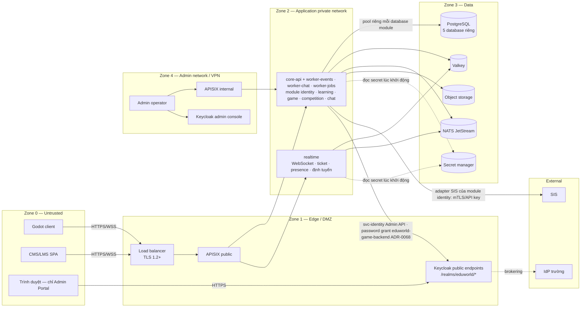
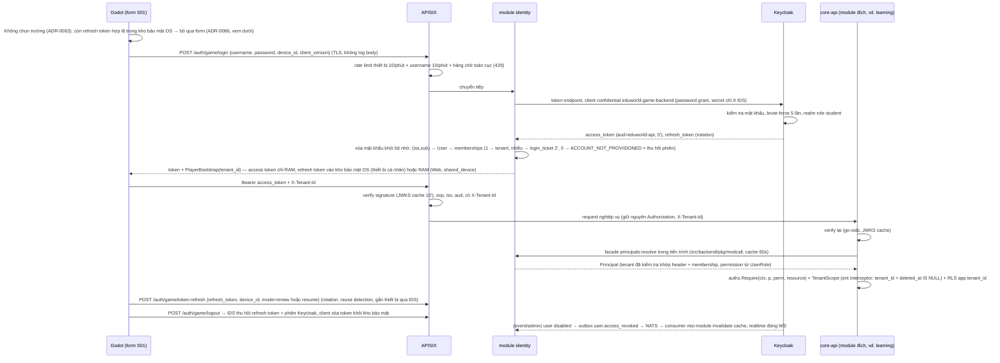

# Security Architecture & Program

> Trạng thái: Draft · Phiên bản: 0.8 · Owner: Identity & Security Engineer · Cập nhật: 2026-11-21 (ADR-0094: bỏ MFA/TOTP cho đăng nhập Admin Portal, rủi ro được chấp nhận — §3.3) · 2026-11-17 (ADR-0091: đăng nhập portal qua backend — §3.3, cookie + CSRF, `portal_login_rate`; ADR-0090: `featuregate` không phải lớp authz; ADR-0074: gọi giữa module trong tiến trình thay token service-to-service, phân vùng mạng và NATS user theo binary/Swarm service; ADR-0076 Rejected: bỏ đăng nhập QR/PIN/mật khẩu hình; Windows mặc định máy dùng chung, màn "Tiếp tục là…"; PII/grooming luôn chạy và giờ giới nghiêm — ADR-0078; object storage theo ADR-0075) · 2026-11-16 (ADR-0086)
> Liên quan: [ADR-0074](../adr/ADR-0074-modular-monolith-co-ranh-gioi-cuong-che.md) · [ADR-0005..0009, 0016, 0020, 0040](../adr/README.md) · [MULTITENANCY](../06-architecture/MULTITENANCY.md) · [REALTIME_ARCHITECTURE](../06-architecture/REALTIME_ARCHITECTURE.md) · [KEYCLOAK_SSO](../09-identity/KEYCLOAK_SSO.md) · [ADR-0091](../adr/ADR-0091-dang-nhap-portal-bang-form-rieng-qua-backend.md) · [DATA_PRIVACY](DATA_PRIVACY.md) · [CHILD_SAFETY](CHILD_SAFETY.md) · [ANTI_CHEAT](ANTI_CHEAT.md) · [MODERATION](../03-social-multiplayer/MODERATION.md)

> **Thay đổi v0.7 (ADR-0074, thay ADR-0036):** backend là modular monolith gồm 3 binary (`core-api`, `realtime`, `worker` chạy 3 profile). Gọi giữa module diễn ra **trong tiến trình** qua facade (`src/backend/pkg/modcall`), nên bỏ token service-to-service, allowlist `azp` nội bộ và mTLS giữa service; ranh giới giữa module được cưỡng chế bằng compiler + linter (`x-allowed-callers`) và role DB theo module (§5.5). Phân vùng mạng, NATS user và secret tính theo binary/Swarm service (§8, §8.1); database riêng mỗi module trên một cụm (ADR-0037, ADR-0074 mục 4).
>
> **Thay đổi v0.3:** backend là 6 microservice (ADR-0036, nay thay bằng ADR-0074) — thêm ranh giới tin cậy giữa service, xác thực service-to-service, NATS user theo service, database riêng mỗi service.

**Mục đích.** Nguồn duy nhất về bảo mật của EduWorld (hợp nhất từ SECURITY.md cũ, 2026-11-15).
**Phạm vi.** Phần A (§1–§10): kiến trúc — ranh giới tin cậy, luồng token/phiên, ủy quyền, secret, mã hóa, mạng, threat model, logging. Phần B (§11–§18): chương trình bảo mật — secure SDLC, OWASP, lập trình an toàn, rate limit, scanning, kiểm thử/pentest, incident response, checklist phát hành.
**Không thuộc phạm vi (tài liệu sở hữu riêng):** an toàn trẻ em → [CHILD_SAFETY](CHILD_SAFETY.md); pipeline kiểm duyệt chat → [MODERATION](../03-social-multiplayer/MODERATION.md); dữ liệu cá nhân/retention → [DATA_PRIVACY](DATA_PRIVACY.md); gian lận game/thi đấu → [ANTI_CHEAT](ANTI_CHEAT.md); cấu hình Keycloak → [KEYCLOAK_SSO](../09-identity/KEYCLOAK_SSO.md).

## Phần A — Kiến trúc bảo mật

## 1. Nguyên tắc

1. **Zero trust với client:** Godot và SPA là môi trường không tin cậy; mọi kết quả có giá trị do server quyết định (ADR-0016).
2. **Defense in depth:** APISIX → authn/authz trong `core-api` (ent interceptor) → RLS PostgreSQL → audit; giữa module: facade có `x-allowed-callers` được linter và `src/backend/pkg/modcall` kiểm, ngữ cảnh tenant/Principal truyền trong tiến trình (ADR-0074).
3. **Least privilege:** role DB theo database của module (mỗi pool chỉ dùng role của module đó), Valkey ACL theo module, NATS user theo Swarm service, network segment tối thiểu theo binary; chỉ module identity có Keycloak client `svc-identity` (Keycloak Admin API). Không module nào dùng credential database của module khác.
4. **Privacy by default:** dữ liệu tối thiểu, nickname thay tên thật, mọi tin nhắn qua kiểm duyệt theo chính sách (ADR-0020, ADR-0030); bước PII và phát hiện grooming luôn chạy, không có công tắc tắt (ADR-0078, [MODERATION §12](../03-social-multiplayer/MODERATION.md#12-công-tắc-kiểm-duyệt-moderation-switches--adr-0030)).
5. **Secure by configuration:** không secret trong code/Git; cấu hình qua env + secret manager.
6. **Auditability:** thao tác nhạy cảm đều có audit log bất biến.

## 2. Trust boundaries



| Ranh giới | Kiểm soát |
|---|---|
| Zone 0 → 1 | TLS, WAF rule cơ bản (APISIX), rate limit, body size limit, CORS whitelist; kiểm tra có mặt/định dạng `X-Tenant-Id` ở route tenant-scoped (`400 TENANT_HEADER_REQUIRED`, ADR-0065); route đăng nhập game `/auth/game/*` không ghi body vào log/trace (ADR-0068) |
| Zone 1 → 2 | Chỉ APISIX/LB gọi được cổng public của `core-api` và `realtime`; JWT đã kiểm tra nhưng app **kiểm tra lại**; header `X-Request-Id` chuẩn hóa; header nội bộ (`X-User-*`) bị APISIX **xóa** khỏi request vào |
| Zone 2 ↔ 2 (module ↔ module, binary ↔ binary) | Module gọi nhau trong tiến trình qua facade, không có cổng HTTP nội bộ (§5.5). Giữa binary chỉ có NATS: `realtime` → `core-api` qua request/reply `ew.cmd.*`, phản ứng phụ qua JetStream; quyền subject theo NATS user (§8.1) |
| Zone 2 → 3 | Overlay network `data` của Docker Swarm (chỉ binary cần dữ liệu mới gắn vào) + credential riêng: mỗi pool chỉ tới **database của module mình** bằng role của module đó, Valkey ACL theo module, NATS user theo Swarm service; `realtime` không có credential PostgreSQL; TLS nội bộ [Confirmed] |
| Zone 4 | Chỉ qua VPN/bastion (đăng nhập Admin Portal không có MFA — ADR-0094); route `/api/v1/admin/*`, `/api/v1/sis/*` (API quản trị cho người), `/internal/*` (machine-to-machine: SIS webhook, Keycloak backchannel logout), Keycloak admin **không** có trên APISIX public |
| External | SIS credential chỉ ở Swarm service chạy adapter SIS của module identity, lưu secret manager; IdP qua Keycloak brokering, backend không nói chuyện trực tiếp với IdP |

## 3. Luồng token và phiên



| Token / credential | TTL | Lưu ở | Nhãn |
|---|---|---|---|
| Mật khẩu học sinh (đăng nhập game, ADR-0068) | Chỉ trong thời gian xử lý `POST /auth/game/login` | RAM của Godot (xóa ô nhập sau khi gửi) và RAM của module identity (xóa sau khi gọi Keycloak, best effort); **không** log, trace, audit, lưu DB/Valkey | [Confirmed] |
| `login_ticket` (chọn tenant khi thuộc nhiều tenant) | 2 phút, một lần, gắn `device_id` | Valkey (hash) `ew:id:login_ticket:<hash>`; giữ token chờ chọn tenant, không giữ mật khẩu | [Confirmed] tham số |
| Access token | 5 phút | Memory client | [Confirmed] |
| Refresh token (game) | Client session idle **7 ngày**, max **30 ngày** (`game_session_sso`), rotation mỗi lần dùng + reuse detection, gắn `device_id`; không Remember me, không offline token (ADR-0086); thuộc client confidential `eduworld-game-backend` nên chỉ làm mới qua `POST /auth/game/token:refresh` (ADR-0068) | **Thiết bị cá nhân:** kho bảo mật OS — Windows DPAPI (theo user), Android Keystore, iOS Keychain (`ThisDeviceOnly`, không đồng bộ iCloud); không bao giờ ở file thường, `user://` dạng rõ, log. **Web và máy `shared_device = true`:** chỉ RAM. Server chỉ lưu SHA-256 của token (`identity.game_auth_sessions`), không lưu token thô | [Confirmed — Technical Architect 2026-11-16] (ADR-0086) |
| ~~Mã QR lớp (đăng nhập nhanh)~~ — không làm (ADR-0076 Rejected 2026-11-17) | — | — | — |
| ~~PIN / thẻ QR cá nhân / mật khẩu hình ảnh~~ — không làm (ADR-0076 Rejected 2026-11-17) | — | — | — |
| Signed URL media riêng tenant (CDN) | 5–15 phút | Tham số URL ký bởi khóa CDN | [Confirmed] ADR-0044 |
| Mật khẩu nhân sự (đăng nhập portal, ADR-0091; không còn mã OTP — ADR-0094) | Chỉ trong thời gian xử lý `POST /auth/portal/login` (và `setup:password`, `password:reset` cho mật khẩu mới) | RAM của SPA (xóa ô nhập sau khi gửi) và RAM của module identity (xóa sau khi gọi Keycloak, best effort); **không** log, trace, audit, lưu DB/Valkey | [Confirmed] (ADR-0091) |
| Refresh token (portal) | idle 30 phút, max 10 h (`portal_session_sso`), rotation | Cookie `__Secure-ew_portal_rt` (`HttpOnly; Secure; SameSite=Strict; Path=/api/v1/auth/portal`) do module identity đặt, JavaScript không đọc được; tải lại trang → `POST /auth/portal/token:refresh` (§3.3). Access token portal chỉ trong bộ nhớ SPA; không `localStorage`/`sessionStorage` cho token | [Confirmed] cơ chế (ADR-0091) / [Confirmed] thời hạn |
| CSRF token portal | Theo vòng đời refresh token, xoay khi đăng nhập/refresh | Cookie `__Host-ew_portal_csrf` (không `HttpOnly`, `Secure; SameSite=Strict; Path=/`) + header `X-EW-CSRF` (double-submit) | [Confirmed] (ADR-0091) |
| `setup_ticket` (đổi mật khẩu tạm lần đầu) | `portal_setup_ticket_ttl` (10 phút), một lần, gắn `user_id` | Valkey (hash) `ew:portal:setup:{sha256}`; không chứa mật khẩu | [Confirmed] (ADR-0091) |
| Token đặt lại mật khẩu portal | `portal_password_reset_ttl`, một lần | Chỉ trong email gửi nhân sự; DB chỉ lưu SHA-256 (`identity.portal_password_reset_tokens`) | [Confirmed] |
| Realtime ticket | 60 s, 1 lần | Valkey (hash) | [Confirmed] ADR-0008 |
| Idempotency key | 24 h | PG/Valkey | [Confirmed] ADR-0010 |
| Service account `svc-identity` / `eduworld-sis-sync` (module identity → Keycloak Admin API) | client_credentials, token 5', cache đến 30 s trước hết hạn | Memory của binary chạy module identity; secret client trong secret manager | [Confirmed] |
| ~~Token service-to-service `svc-*` giữa module~~ — bỏ (ADR-0074): module gọi nhau trong tiến trình, không có token | — | — | — |

Admin Portal dùng luồng tương tự qua backend nhưng riêng (§3.3, ADR-0091): form `/login` của portal gửi username/email + mật khẩu (không OTP, ADR-0094) tới `POST /auth/portal/login`, module identity gọi Keycloak bằng client confidential `eduworld-portal`; không chọn tenant trước đăng nhập; sau đăng nhập gọi `GET /me/tenants` để vào thẳng/chọn tenant, tenant đi bằng `X-Tenant-Id` + membership (ADR-0065, ADR-0067). Chi tiết cấu hình Keycloak: [KEYCLOAK_SSO](../09-identity/KEYCLOAK_SSO.md). Kiểm tra tenant khi đăng nhập và ở mỗi request: [MULTITENANCY §8](../06-architecture/MULTITENANCY.md).

### 3.1. Phiên game giữ bằng refresh token và thu hồi (ADR-0086)

ADR-0086 thay một phần ADR-0064: trên **thiết bị cá nhân**, sau khi đăng nhập bằng form trong game (ADR-0068), refresh token được lưu trong kho bảo mật OS; mở lại game khi phiên còn hạn → `POST /auth/game/token:refresh` (`mode=resume`, kèm `device_id`) → màn "Tiếp tục là <nickname>?" (nút "Không phải tôi" đăng xuất và xóa token, mọi nền tảng) → vào game không nhập mật khẩu [Confirmed — Technical Architect 2026-11-17]. Thất bại (`401 REFRESH_TOKEN_INVALID` / `REFRESH_TOKEN_REUSED` / `REFRESH_TOKEN_DEVICE_MISMATCH`, hoặc `403` tài khoản/tenant) → client xóa token, hiện form. Access token chỉ ở RAM; mật khẩu không bao giờ lưu. **Web** và máy **`shared_device = true`** giữ hành vi cũ: token chỉ trong RAM, thoát game = đăng xuất, mở lại phải nhập mật khẩu. **Windows mặc định `shared_device = true`** (phòng máy, máy gia đình nhiều người) trừ khi bộ cài được chọn "máy cá nhân" (`shared_device_default`, [Confirmed — Technical Architect 2026-11-17]). Luồng và cấu hình chi tiết: [KEYCLOAK_SSO](../09-identity/KEYCLOAK_SSO.md) (sở hữu `game_session_sso`).

| Biện pháp bảo vệ refresh token | Chi tiết |
|---|---|
| Token at rest trên thiết bị | Kho bảo mật OS theo nền tảng (DPAPI/Keystore/Keychain); không lưu access token, mật khẩu; Android loại khỏi Auto Backup, iOS `ThisDeviceOnly`; nền tảng không có kho → chỉ RAM |
| Rotation + phát hiện dùng lại | Mỗi lần refresh cấp token mới (`revokeRefreshToken=true`, reuse 0); module identity giữ SHA-256 token hiện hành và các token đã xoay; token cũ bị dùng lại → `401 REFRESH_TOKEN_REUSED`, thu hồi **cả** phiên (`sid`), audit + security event. Client refresh đơn luồng (single-flight) |
| Gắn thiết bị | Phiên gắn `device_id` lúc đăng nhập; refresh từ `device_id` khác → `401 REFRESH_TOKEN_DEVICE_MISMATCH`, không phát token, audit + metric (phiên gốc giữ nguyên) |
| Thời hạn | Access 5 phút; idle 7 ngày, tối đa 30 ngày; không offline token — hết hạn phải đăng nhập lại |
| Người khác dùng thiết bị cá nhân | Rủi ro chấp nhận có giảm thiểu: màn "Tiếp tục là <nickname>?" mỗi lần tự vào lại (nút "Không phải tôi" thu hồi phiên và xóa token), Windows mặc định máy dùng chung, thời hạn giới hạn, nút **Đăng xuất** trong game (`:end` game session → `gameLogout` → xóa token), quy tắc một thiết bị (ADR-0031) và thông báo takeover cho chủ tài khoản, nhà trường đặt lại mật khẩu → thu hồi mọi phiên; máy dùng chung phải cấu hình `shared_device` |

Thu hồi (module identity đánh dấu `identity.game_auth_sessions.revoked_at` + Keycloak Admin API thu hồi phiên theo `sid`):

| Sự kiện | Thu hồi | Độ trễ tối đa |
|---|---|---|
| Đăng nhập thiết bị khác (takeover, ADR-0031) | Đóng game session cũ, close 4409, Admin API thu hồi Keycloak session theo `sid` | Ngay lập tức (WS), refresh tiếp theo bị từ chối |
| Khóa / vô hiệu hóa / dọn tài khoản | Khóa/vô hiệu hóa: Keycloak `enabled=false` + logout all sessions, event `user.access_revoked`. Dọn học sinh không đăng nhập: gỡ Organization membership + logout all sessions, user Keycloak vẫn enabled ([ACCOUNT_PROVISIONING §6b](../09-identity/ACCOUNT_PROVISIONING.md#6b-dọn-học-sinh-không-đăng-nhập-game-adr-0032)) | ≤ 60 s cho REST (cache `user.status`), ngay lập tức cho WS |
| Refresh token bị dùng lại | module identity phát hiện qua hash token đã xoay → thu hồi toàn bộ phiên (`refresh_reuse`), `401 REFRESH_TOKEN_REUSED` | Ngay lập tức |
| Đổi / đặt lại mật khẩu | Thu hồi mọi phiên game của user (`password_changed`); lần mở game sau phải đăng nhập | Ngay lập tức |
| Xử phạt cấm vào game / thu hồi quyền truy cập | Event `user.access_revoked` → thu hồi phiên game (`sanction`/`access_revoked`) | Ngay sau khi event được xử lý |
| Chuyển sang tenant khác | Gỡ membership org cũ + thu hồi phiên | Ngay sau SIS sync |
| Đăng xuất chủ động (mọi thiết bị) và thoát game trên Web/`shared_device` | `:end` game session → `POST /auth/game/logout`: module identity thu hồi refresh token + phiên Keycloak; game xóa token khỏi kho bảo mật và RAM. Thoát game trên thiết bị cá nhân **không** đăng xuất (chỉ `:end` game session, giữ refresh token) | Ngay lập tức |
| `ACCOUNT_NOT_PROVISIONED` (ADR-0063) | Backend thu hồi phiên Keycloak vừa tạo theo `sid`, audit | Ngay lập tức |
| Thiết bị dùng chung (`shared_device`) | Token chỉ RAM; không nhớ username; thoát game hoặc 30 phút không hoạt động → đăng xuất | — |

### 3.1b. Mật khẩu học sinh đi qua backend (ADR-0068)

Game không mở trình duyệt; mật khẩu học sinh đi qua Godot → APISIX → module identity → Keycloak. Đây là thay đổi trust boundary: EduWorld chịu trách nhiệm bảo vệ mật khẩu khi truyền qua (vẫn **không lưu** mật khẩu, Keycloak giữ hash).

| Mối đe dọa | Biện pháp bắt buộc |
|---|---|
| Lộ mật khẩu/refresh token qua log/trace/APM | APISIX route `/auth/game/*` tắt ghi body (logger, `opentelemetry` không thu `request_body`); module identity: handler không log request, middleware redaction che field `password`, `refresh_token`, `login_ticket` trong mọi log/trace/panic dump; span không gắn body; error reporter lọc field. Test tự động kiểm log không chứa mật khẩu mẫu (TEST_STRATEGY) |
| Lộ mật khẩu trên đường truyền | TLS 1.2+ bắt buộc, HSTS; certificate pinning trong Godot cho tên miền API [Confirmed]; chặn client quá cũ bằng `min_client_version` (`426 CLIENT_VERSION_UNSUPPORTED`) |
| Dò mật khẩu / credential stuffing | Rate limit 10 lần/phút theo thiết bị và 10 lần/phút theo username, ngưỡng toàn cục theo năng lực Keycloak (§14); Keycloak brute-force khóa tạm sau 5 lần sai (1–15 phút); thông điệp lỗi chung `INVALID_CREDENTIALS` (không lộ tài khoản tồn tại/bị khóa) |
| Lộ client secret `eduworld-game-backend` | Secret chỉ ở module identity (secret manager, xoay 90 ngày), không có trong game; client chỉ bật Direct Access Grants, tắt Standard Flow; chỉ cho realm role `student` |
| Nhân sự dùng form game | Keycloak flow + module identity từ chối user không có realm role `student` → `403 GAME_ACCESS_STUDENT_ONLY`, audit |
| Bot/app giả mạo gọi API đăng nhập | Rate limit + hàng chờ, `X-Device-Id` bắt buộc, theo dõi `eduworld_game_login_failed_total{reason}` và cảnh báo đột biến; không có MFA cho học sinh (chấp nhận, ADR mới nếu cần) |
| `login_ticket` bị đánh cắp | TTL 2 phút, một lần (`GETDEL`), gắn `device_id`, chỉ chọn được tenant trong `choices[]` |

### 3.2. Đăng nhập nhanh không mật khẩu (ADR-0045)

> **Không làm QR/PIN/mật khẩu hình (ADR-0076 Rejected 2026-11-17).** Học sinh chỉ đăng nhập username + password và giữ phiên bằng refresh token (§3.1). Không có bảng `login_credentials`, không có authenticator tùy biến hay client `svc-keycloak-authn`. Cơ chế còn lại dưới đây là thiết kế mở rộng (ADR-0063), chỉ bật bằng ADR mới sau khi qua review bảo mật.

| Cơ chế | Kiểm soát bảo mật |
|---|---|
| Device Authorization Grant | `user_code` 8 ký tự, hết hạn 10 phút, polling 5 s; thiết bị chế độ dùng chung không lưu refresh token |
| Authenticator tùy biến Keycloak (chỉ nếu có ADR mới) | Code review + SAST + pen-test trước khi bật; kiểm thử lại mỗi lần nâng cấp Keycloak |

**Tenant là một trust boundary riêng** (ADR-0026, ADR-0065): mọi request tenant-scoped mang header `X-Tenant-Id`, nhưng header **không bao giờ được tin một mình** — nó phải khớp tenant của phiên (Release 1.0 token game và token portal đều không có claim `organization` — ADR-0068, ADR-0091) **và** membership trong DB (dữ liệu SIS/UserRole); không khớp → `403 TENANT_MISMATCH`. Không có claim → backend xác định theo membership; không thuộc tenant chung và không thuộc tenant SIS nào → `403 ACCOUNT_NOT_PROVISIONED`, audit, thu hồi phiên Keycloak — **không** tự đưa vào tenant chung (ADR-0063). Mỗi request có đúng một tenant; game: một tenant cho mỗi phiên đăng nhập; portal: đổi tenant chỉ đổi header `X-Tenant-Id` (backend kiểm tra membership, không token mới — ADR-0091); WebSocket giữ tenant cố định từ lúc cấp ticket. Chỉ `system_admin` có chế độ liên tenant (dropdown, `CrossTenantScope`, audit — ADR-0027 §6). Username/email không bao giờ được dùng để suy ra tenant. Mọi `TENANT_MISMATCH` là security event (audit + metric `eduworld_auth_tenant_mismatch_total`, cảnh báo khi tăng đột biến).

### 3.3. Đăng nhập Admin Portal qua backend (ADR-0091)

Admin Portal không còn chuyển hướng OIDC (Authorization Code + PKCE của ADR-0066 mục 1 bị thay): form `/login` của portal gửi **username/email và mật khẩu trong một request** tới `POST /api/v1/auth/portal/login` (không có mã OTP với bất kỳ tài khoản nào — [ADR-0094](../adr/ADR-0094-bo-mfa-totp-cho-dang-nhap-admin-portal.md)); module identity gọi token endpoint Keycloak (Direct Access Grant) bằng client **confidential** `eduworld-portal`. Đây là thay đổi trust boundary giống game (§3.1b) nhưng với tài khoản có quyền cao hơn (nhân sự trường, đội platform). Cấu hình Keycloak, flow `eduworld-portal-direct-grant`, setup ticket và quên mật khẩu: [KEYCLOAK_SSO §3.3](../09-identity/KEYCLOAK_SSO.md). Endpoint và mã lỗi: [API_DESIGN §9.1](../07-backend/API_DESIGN.md).

**Rủi ro được chấp nhận (ADR-0091 Hệ quả, ADR-0094):** Direct Access Grant bị OAuth 2.0 Security BCP khuyến cáo tránh; mật khẩu đi qua backend EduWorld. **Không có MFA với bất kỳ tài khoản portal nào, kể cả role platform** (owner quyết định 2026-11-21 sau khi được cảnh báo, [ADR-0094](../adr/ADR-0094-bo-mfa-totp-cho-dang-nhap-admin-portal.md)): một mật khẩu platform bị lộ (phishing, dùng lại mật khẩu, mã độc) là đủ để chiếm tài khoản; với `system_admin` là đọc được dữ liệu học sinh của mọi trường (kể cả qua các route tenant trên gateway public nhận `tenant_ids`), với `safety_moderator` là đọc tin nhắn liên quan case của mọi tenant. Password policy hiện tại của realm (`length(6)`, áp cho cả học sinh) **không** phải kiểm soát bù trừ; chưa có cảnh báo đăng nhập bất thường. Kiểm soát bù trừ đang có (gateway nội bộ cho route platform, authz trong Go, phiên `platform_staff` tối đa 8 giờ, brute-force + rate limit, audit đăng nhập và đọc liên tenant) được liệt kê ở ADR-0094 mục 3. Mọi biện pháp dưới đây là **bắt buộc** để chấp nhận rủi ro này.

| Mối đe dọa | Biện pháp bắt buộc |
|---|---|
| Lộ mật khẩu/token qua log, trace, APM | Như §3.1b, áp cho `/auth/portal/*`: APISIX tắt ghi body và `request_body` của OpenTelemetry; module identity không log request, redaction che `password`, `new_password`, `otp`, `setup_ticket`, `token`, cookie refresh/CSRF; xóa mật khẩu khỏi bộ nhớ sau khi gọi Keycloak (best effort); test tự động quét log/trace không chứa mật khẩu mẫu |
| Lộ trên đường truyền | TLS 1.2+ bắt buộc, HSTS (gồm subdomain) cho `portal.<domain>`; không có endpoint HTTP |
| Dò mật khẩu / credential stuffing | `portal_login_rate` theo **username**, theo **`device_id`** và **toàn cục** (§14) — **không** giới hạn theo một IP vì nhiều nhân sự trường đi qua chung NAT (R30); brute-force Keycloak theo tài khoản (khóa tạm sau 5 lần sai, chờ tăng dần tới tối đa 15 phút). Không còn lớp OTP nên đây là lớp chặn chính trước khi mật khẩu bị đoán (ADR-0094) |
| Dò tài khoản tồn tại / tài khoản nào là nhân sự platform | Một lỗi chung `401 INVALID_CREDENTIALS` ("Tên đăng nhập hoặc mật khẩu chưa đúng") cho sai username, sai mật khẩu, tài khoản Keycloak tắt hoặc đang khóa tạm; thời gian phản hồi tương đương (gọi Keycloak cả khi username không tồn tại). `password:forgot` **luôn** trả `202`. `ACCOUNT_SETUP_REQUIRED`, `PORTAL_ACCESS_STAFF_ONLY`, `ACCOUNT_DEACTIVATED` chỉ trả **sau** khi mật khẩu đúng |
| Học sinh vào portal | Hai lớp: flow Keycloak chỉ cho `tenant_staff`/`platform_staff` (→ `403 PORTAL_ACCESS_STAFF_ONLY`) và backend `azp = eduworld-portal` + `user_type = staff` ở mọi route portal (§5.3c) |
| XSS đánh cắp token | Access token chỉ trong bộ nhớ SPA (không `localStorage`/`sessionStorage`); refresh token trong cookie `HttpOnly` nên JavaScript không đọc được; CSP chặt (`script-src 'self'`, không inline) cho portal [Confirmed] |
| CSRF tới `token:refresh`/`logout` (cookie tự gửi kèm) | Cookie refresh `__Secure-ew_portal_rt`: `HttpOnly; Secure; SameSite=Strict; Path=/api/v1/auth/portal`. **Double-submit:** cookie `__Host-ew_portal_csrf` (không `HttpOnly`, `Secure; SameSite=Strict; Path=/`, 32 byte ngẫu nhiên, xoay khi đăng nhập/refresh); `token:refresh` và `logout` bắt buộc header `X-EW-CSRF` trùng giá trị cookie (so sánh thời gian hằng), thiếu/sai → `403 CSRF_TOKEN_INVALID` + audit. Kiểm thêm `Origin` thuộc origin portal [Confirmed] |
| Cookie không first-party | APISIX public phục vụ `/api/v1/*` dưới **cùng origin** với portal (`https://portal.<domain>/api/v1/...`) để cookie là first-party và `SameSite=Strict` có hiệu lực [Confirmed]; CORS không mở cho origin khác ở `/auth/portal/*`. Workspace platform gọi gateway nội bộ bằng Bearer token trong bộ nhớ (không cookie) |
| Refresh token bị đánh cắp | Rotation mỗi lần refresh (`revokeRefreshToken=true`, reuse 0); token đã xoay bị dùng lại, hết hạn hoặc bị thu hồi → `401 REFRESH_TOKEN_INVALID`; idle 30 phút / tối đa 10 giờ (`portal_session_sso`); đặt lại mật khẩu, khóa tài khoản, thu hồi role platform thu hồi phiên portal |
| Lộ client secret `eduworld-portal` | Secret chỉ module identity giữ (secret manager, xoay 90 ngày); client tắt Standard Flow/Implicit/Service Account; không có trong bundle portal |
| `setup_ticket` bị đánh cắp | Ngẫu nhiên, một lần (`GETDEL`), gắn `user_id`, TTL `portal_setup_ticket_ttl`, lưu dạng hash trong Valkey, không chứa mật khẩu; chỉ dùng được cho `setup:password` của chính user đó |
| Token đặt lại mật khẩu bị lộ/đoán | Token ngẫu nhiên ≥ 32 byte (base64url), DB chỉ lưu SHA-256 (`identity.portal_password_reset_tokens`), một lần (UPDATE nguyên tử `used_at`), hết hạn theo `portal_password_reset_ttl`, cấp mới vô hiệu token cũ; chỉ gửi cho tài khoản **nhân sự** có email; đặt lại thành công thu hồi mọi phiên của user; không ghi link vào log |
| Phiên platform kéo dài | Không còn step-up MFA (ADR-0094). Module identity từ chối `token:refresh` của phiên có realm role `platform_staff` khi đã quá 8 giờ từ lúc nhập mật khẩu (`EW_OIDC_PLATFORM_MAX_AUTH_AGE`) hoặc mất bản ghi phiên → `401 REFRESH_TOKEN_INVALID`, nhập lại mật khẩu |
| Lạm dụng tắt menu/action để chặn vận hành | Chỉ System Admin (gateway nội bộ) tắt được; mục bảo vệ (người dùng & phân quyền, tenant, bật/tắt menu, nhật ký toàn hệ thống, thùng rác, case kiểm duyệt, sanction, thông báo an toàn của trường) không tắt được (`422 FEATURE_NOT_DISABLEABLE`); mọi thay đổi có lý do + audit (ADR-0090) |

## 4. Defense in depth

| Lớp | Kiểm soát | Không làm |
|---|---|---|
| **APISIX** | TLS termination, JWT validation (`openid-connect` bearer-only / `jwt-auth`), có mặt/định dạng `X-Tenant-Id` (ADR-0065), `limit-req`/`limit-count` (theo IP + `sub`, tenant, thiết bị/username ở route đăng nhập game), `client-control` max body (1 MB mặc định, 20 MB cho upload media qua presigned URL thì không đi qua gateway), CORS, strip header nội bộ, `ip-restriction` cho route nhạy cảm, WebSocket proxy | Quyết định tenant, quyền trên tài nguyên |
| **Authn (public, `core-api`)** | Verify chữ ký, `iss` ∈ allowlist, `aud` chứa `eduworld-api`, `exp/nbf` (skew 30s), `azp` ∈ client cho phép theo route (vd. route Admin Portal chỉ chấp nhận `eduworld-portal`) | Tin claim `organization`/roles làm phạm vi |
| **Tenant middleware** | module identity xác định tenant lúc tạo phiên; middleware `core-api` so header `X-Tenant-Id` với `memberships:check`/Principal từ facade module identity (cache) — header ↔ claim `organization` (nếu có) ↔ membership, lệch → `403 TENANT_MISMATCH` + audit (ADR-0065); không có claim → chọn theo membership (0 → `ACCOUNT_NOT_PROVISIONED`); `Principal.TenantID` cố định cho phiên (ADR-0026); mọi query `tenant_id` + `deleted_at IS NULL` (ADR-0005, ADR-0028) | Tin `X-Tenant-Id` một mình; suy ra tenant từ username, query string |
| **Authz** | Permission (catalog trong code) gom thành Role (DB) và gán qua UserRole có scope (platform/tenant/school/class/subject) và thời hạn (ADR-0066) + ownership + policy (chat, party). Route portal yêu cầu `azp = eduworld-portal` và `user_type = staff` (`403 PORTAL_ACCESS_STAFF_ONLY`); nhân sự platform và nhân sự trường đều là `staff`, phân biệt bằng role (role platform `tenant_id = NULL`) và tenant gốc, không bằng `user_type` (ADR-0081). Route `/api/v1/game-admin/*`, `/api/v1/admin/*` yêu cầu thêm `azp = eduworld-portal` + role platform (ADR-0027; không MFA — ADR-0094) | — |
| **Validation** | Request validation sinh từ OpenAPI; giới hạn độ dài chuỗi; chuẩn hóa Unicode NFC; whitelist enum | — |
| **Data access** | ent (query tham số hóa, interceptor tenant + soft-delete), SQL tường minh tham số hóa cho read model, RLS (ADR-0005/0039); mỗi module chỉ dùng pool database của mình | SQL ghép chuỗi; truy cập database module khác |
| **Module ↔ module** | Facade sinh từ spec internal; linter chặn import ngoài `x-allowed-callers`, `src/backend/pkg/modcall` kiểm lại lúc chạy (`403 CALLER_NOT_ALLOWED`); `TenantScope` và Principal gốc truyền trong context, bên nhận vẫn kiểm tenant tồn tại/hoạt động (§5.5) | Import `internal/` của module khác; gọi facade không khai báo |
| **Featuregate (chỉ portal)** | Middleware `featuregate` (`src/backend/pkg/httpx`) sau xác thực/tenant và trước `authz.Require`: action/menu đang tắt (ADR-0090) → `403 FEATURE_DISABLED`. Đây là công tắc vận hành, **không** phải lớp authorization: bật lại một action không cấp thêm quyền, mọi kiểm tra permission/tenant vẫn chạy ([API_DESIGN §11](../07-backend/API_DESIGN.md)) | Thay authz; dùng để phân quyền theo người |
| **Audit** | Mỗi module phát `audit.recorded` qua outbox; module identity ghi `audit.audit_logs` (append-only, partition tháng, không UPDATE/DELETE) | Ghi nội dung nhạy cảm (mật khẩu, token, nội dung chat đầy đủ) |

## 5. Mô hình ủy quyền

Nguồn chuẩn: [ADR-0027](../adr/ADR-0027-cms-tach-vung-tenant-chi-thao-tac-learning-management-cau-hi.md). Chi tiết permission catalog và ma trận role × permission ở [ADMIN_PORTAL §2](../04-admin-portal/ADMIN_PORTAL.md#2-permission-model).

### 5.1. Permission, Role, UserRole và `role_scope_kind` (ADR-0066)

- **Permission** — quyền nguyên tử, **định nghĩa trong code** (catalog cố định, `scope_kind` `tenant` | `platform`); DB không tạo được permission mới.
- **Role** — tập permission lưu trong `identity.roles` + `identity.role_permissions`: `code`, tên song ngữ, `role_scope_kind`, `is_system` (role seed, không sửa/xóa), `tenant_id` (NULL = dùng chung; có giá trị = role tùy biến của tenant [Confirmed]).
- **UserRole** — `identity.user_roles`: gán role cho người dùng trong `tenant_id` + `scope_type` (`platform` | `tenant` | `school` | `subject`; không có scope `class` theo phân công giảng dạy — ADR-0072) + `scope_id`, `valid_from`/`valid_to`, `granted_by`, `source` (`sis` | `manual`), soft-delete. Thay tên `role_assignments` cũ.
- **Đánh giá quyền:** Principal = hợp permission của mọi UserRole còn hiệu lực (`deleted_at IS NULL`, `valid_from ≤ now < valid_to`) trong tenant đã kiểm tra qua `X-Tenant-Id` (+ UserRole platform), giao với scope tài nguyên; cache 60 s, làm mới khi có `role.updated`/`user_role.changed`.
- **Bất biến:** role `tenant` không chứa permission `platform.*`/`game.*`/`competition.config.*` (kiểm tra khi lưu role, khi khởi động và bằng trigger DB); UserRole của role `platform` chỉ có `scope_type = platform`; học sinh không được gán role portal; người gán chỉ cấp được role có permission là tập con quyền của chính mình trong cùng scope [Confirmed: chống leo thang]; mọi thay đổi ghi audit `role.*`/`user_role.*`.

Role hệ thống seed sẵn (`is_system = true`):

| Role | `role_scope_kind` | Phạm vi gán | Ví dụ quyền |
|---|---|---|---|
| `student` | tenant | tenant (ngầm định qua Student; trường qua enrollment) | Làm bài, xem kết quả của mình, chat theo ChatPolicy |
| `tenant_admin` | tenant | tenant | Quản trị tenant (tenant `unit`: mọi trường trong đơn vị): cài đặt tenant, phân quyền trong tenant, SIS, nội dung của tenant, thùng rác tenant [Confirmed]; gửi yêu cầu từ nhạy cảm bổ sung cho Safety Team |
| `school_admin` | tenant | school (một trường trong tenant) | Lớp (từ SIS), cài đặt trường, chat policy và khung giờ truy cập cấp trường, giao bài/đề, thử thách lớp và giải trường từ template, study group, School Learning Dashboard, nhận và xác nhận thông báo vụ việc an toàn (ADR-0072) |
| `academic_manager` (tổ chuyên môn) | tenant | tenant / school / subject | Curriculum riêng của tenant, giao bài/đề, study group, nội dung và báo cáo trong scope |
| `tenant_content_editor`, `tenant_content_reviewer` | tenant | tenant / school | Soạn/duyệt nội dung học tập của tenant |
| `system_admin` | platform | platform | **Người duy nhất xem dữ liệu liên tenant** (dropdown tenant, audit); quản lý tenant, gán/clone dữ liệu (ADR-0029), thùng rác (ADR-0028), danh mục từ nhạy cảm platform, công tắc kiểm duyệt, break-glass moderation |
| `safety_moderator` (Platform Safety Team) | platform | platform | `moderation.case.*`, `moderation.sanction.*`, `chat.sensitive_terms.read`, `chat.tenant_terms.write`; đọc liên tenant **chỉ trong module moderation** qua `tenancy.Bypass(ctx, "moderation_case")` có audit và metric `eduworld_tenant_filter_bypass_total`; không đọc dữ liệu tenant ngoài module này (ADR-0072) |
| `content_admin`, `content_reviewer` | platform | platform | Nội dung học tập platform (`tenant_id = NULL`); reviewer duyệt cả game content. Không đọc dữ liệu tenant |
| `game_designer`, `liveops`, `competition_admin` | platform | platform | Game Studio và cấu hình thi đấu. Không đọc dữ liệu tenant |

### 5.2. Permission catalog và bất biến

```go
// src/backend/pkg/authz/catalog.go + roles.go (F002) — mọi binary gọi authz.MustValidateAtStartup() (AGENTS R20)
type Permission string // 121 hằng PermXxx khớp ADMIN_PORTAL §2.2 (test đối chiếu tài liệu)

type RoleScopeKind string // "tenant" | "platform"

type RoleDef struct {
    Name        string
    ScopeKind   RoleScopeKind
    Permissions []Permission
}

// Permission platform-only (ADR-0027, ADR-0072): tiền tố + mã tường minh.
var platformOnlyPrefixes = []string{"game.", "competition.config.", "platform.", "moderation.case.", "moderation.sanction."}
var platformOnlyCodes = map[Permission]bool{
    "moderation.school_notification.send": true, "chat.sensitive_terms.write": true, "chat.policy.toggle": true,
    "chat.tenant_terms.write": true, "chat.tenant_category.toggle": true,
}

// ValidateCatalog: tên role duy nhất, role_scope_kind hợp lệ, permission thuộc catalog, role tenant không giữ
// permission platform-only. Trả *CatalogError liệt kê mọi vi phạm (tên role + permission, không giá trị khác).
// MustValidateAtStartup: vi phạm → log JSON từng role/permission và thoát mã 1 (F002-AC-14, F002-AC-15).
func ValidateCatalog(roles []RoleDef) error
```

- Chỉ `system_admin` có `platform.cross_tenant.read`. Repository nhận `tenancy.TenantScope` (`authz.ScopeFor`, đúng một tenant) cho người dùng tenant và `tenancy.CrossTenantScope` (`authz.CrossTenantScope`: danh sách tenant tường minh + lý do, cần permission này và client portal; không còn điều kiện MFA — ADR-0094) chỉ cho System Admin; phiên đó dùng role DB `<module>_platform` của database tương ứng và luôn kèm điều kiện `tenant_id` tường minh + audit `cross_tenant.accessed` (ADR-0005, ADR-0027 §6).
- Catalog **permission nằm trong code**, version cùng release, review qua merge request. Role (gồm role hệ thống seed và role tùy biến) và UserRole nằm trong DB `identity.roles`, `identity.role_permissions`, `identity.user_roles`; bảng `identity.permissions` là bản sao đọc-chỉ của catalog (đồng bộ lúc migrate/khởi động) để khóa ngoại và trigger kiểm tra ([DATABASE_DESIGN](../07-backend/DATABASE_DESIGN.md)). `ValidateCatalog` chạy với role seed lúc khởi động; use case `CreateRole`/`UpdateRole` chạy cùng kiểm tra cho role tùy biến (`422 VALIDATION_FAILED`, `PERMISSION_NOT_ALLOWED_FOR_SCOPE`).
- Gán role platform ở scope tenant, hoặc gán role portal cho học sinh, bị chặn ở 2 lớp: use case `GrantUserRole` và trigger DB. Mọi lần bị chặn ghi audit.
- Permission bổ sung (2026-11-15, catalog đầy đủ ở [ADMIN_PORTAL §2.2](../04-admin-portal/ADMIN_PORTAL.md#22-permission-catalog)):
  - **Platform-only** (thuộc tiền tố `game.`, bị `ValidateCatalog` chặn với role tenant): `game.challenge.write`, `game.boss.write`, `game.achievement.write`, `game.economy.write`, `game.economy.adjust`, `game.liveops.read`. `game.economy.adjust` chỉ `system_admin` và bắt buộc người duyệt thứ hai khác người tạo (`/admin/economy/adjustments`, ADR-0049). Quyền xem Game Live Operations dùng tên chuẩn `game.liveops.read` (không dùng `liveops.read` không tiền tố) để giữ bất biến.
  - **Tenant được phép**: `learning_content.activity.write`, `learning_content.activity.review` (ADR-0048). Không có permission chấm tay (ngoài version này, ADR-0082).
- Permission kiểm duyệt và chat platform (ADR-0072, F002 Clarifications 2026-11-17): `moderation.case.*`, `moderation.sanction.*`, `moderation.school_notification.send`, `chat.sensitive_terms.write`, `chat.policy.toggle`, `chat.tenant_terms.write`, `chat.tenant_category.toggle` là **platform-only** (`platformOnlyPrefixes` + `platformOnlyCodes` ở trên, `ValidateCatalog` chặn role tenant), chỉ gán cho `safety_moderator`/`system_admin`; `moderation.school_notification.read`/`acknowledge` và `chat.sensitive_terms.read` là tenant được phép.
- Permission bổ sung cho sự kiện/mùa, Game Analytics và song ngữ (2026-11-15; [EVENT_SEASON_SYSTEM](../01-game-design/EVENT_SEASON_SYSTEM.md), [GAME_ANALYTICS](../11-operations/GAME_ANALYTICS.md), ADR-0056, ADR-0058):

  | Permission | Nhóm | Role điển hình | Endpoint |
  |---|---|---|---|
  | `game.event.write` | Platform-only | `game_designer`, `liveops` | `/game-admin/{config_type}` với `events`, `event-templates` |
  | `game.event.operate` | Platform-only | `liveops`, `system_admin` | `/game-admin/events/{event_id}/runs/{run_id}:suspend\|:resume\|:cancel` |
  | `game.season_track.write` | Platform-only | `game_designer`, `liveops` | `/game-admin/season-tracks` |
  | `game.analytics.read` | Platform-only | `system_admin`, `liveops`, `game_designer` | `/admin/analytics/game/*` |
  | `game.content.translate` | Platform-only | `game_designer`, người dịch platform | `/game-admin/translations:export\|:import` |
  | `lms.school_event.write` | Tenant được phép | `tenant_admin`, `school_admin` | `/lms/event-templates`, `/lms/school-events*` (route ngoại lệ tới module game; chỉ tạo từ template với `allowed_params`, không sửa cấu hình game) |
  | `learning_content.translate` | Tenant được phép | `tenant_content_editor`, `content_admin` | `/cms/learning/translations:export\|:import` |

  Báo cáo game tổng hợp của tenant dùng `analytics.tenant.read`/`analytics.school.read` (không phải `game.analytics.read`). `ValidateCatalog` vẫn là chốt chặn: role tenant không được chứa bất kỳ permission `game.*` nào, kể cả khi endpoint do module game phục vụ (sự kiện trường dùng `lms.school_event.write`).
- Permission bổ sung cho phân quyền, danh mục và dashboard (2026-11-15; ADR-0060, ADR-0062, ADR-0066, ADR-0069; endpoint trong [API_DESIGN §9](../07-backend/API_DESIGN.md#9-endpoint-catalog)):

  | Permission | Nhóm | Role điển hình | Endpoint |
  |---|---|---|---|
  | `tenant.user.read` / `tenant.user.write` | Tenant được phép | `tenant_admin` (đọc: `school_admin` trong trường) | `/tenant/users*` (một người một tài khoản SSO — ADR-0069) |
  | `tenant.role.read` / `tenant.role.write` | Tenant được phép | `tenant_admin` | `/tenant/permissions`, `/tenant/roles*` |
  | `tenant.user_role.write` | Tenant được phép | `tenant_admin`; `school_admin` ở scope trường | `/tenant/user-roles*`, `/schools/{school_id}/user-roles` |
  | `tenant.school.read` / `tenant.school.write` | Tenant được phép | `tenant_admin`, `school_admin` (trường mình) | `/tenant/schools*`, `:approve` |
  | `tenant.student.read` (thay `tenant.class.read` — ADR-0095) | Tenant được phép | `tenant_admin` (`school_admin`, `academic_manager` dùng `lms.student.read`) | `/tenant/schools/{school_id}/grades/{grade_level}/students` |
  | `analytics.tenant.read` / `analytics.school.read` | Tenant được phép | `tenant_admin` / `school_admin`, `academic_manager` | `/tenant/analytics/*`, `/lms/schools/{school_id}/analytics/*` |
  | `report.export` | Tenant được phép (dữ liệu trong quyền) và platform | `tenant_admin`, `school_admin`, `system_admin` | `/tenant/reports`, `/admin/reports` |
  | `platform.catalog.write` | Platform-only | `system_admin` | `/admin/catalog/*`, `/admin/schools:import` |
  | `platform.role.read` / `platform.role.write` | Platform-only | `system_admin` | `/admin/roles*`, `/admin/permissions` |
  | `platform.user_role.write` | Platform-only | `system_admin` | `/admin/user-roles*` |

- Catalog do **module identity** sở hữu; module khác nhận permission hiệu lực của Principal qua facade `principals:resolve` (trong tiến trình) và kiểm tra bằng `src/backend/pkg/authz` (không tự định nghĩa role).
- Màn quản trị Role/UserRole trong Admin Portal: Tenant Admin (`tenant.role.write`, `tenant.user_role.write`) trong tenant mình; System Admin (`platform.role.write`, `platform.user_role.write`) cho role platform và mọi tenant ([ADMIN_PORTAL](../04-admin-portal/ADMIN_PORTAL.md), [API_DESIGN §9.16](../07-backend/API_DESIGN.md#916-admin-internal--apiv1admin)).
- `GET /api/v1/me/permissions` (tenant theo header `X-Tenant-Id`, ADR-0065; System Admin bỏ header = phạm vi platform) trả danh sách permission hiệu lực của Principal trong tenant đó, dùng để dựng menu SPA. Không phải nguồn quyết định quyền.

### 5.3. Policy check

```go
// src/backend/pkg/authz
type Resource struct {
    Type      string     // "attempt", "class", "channel", "quest", ...
    ID        uuid.UUID
    TenantID  *uuid.UUID // luôn nạp từ DB; nil với tài nguyên platform (game config, nội dung dùng chung)
    SchoolID  *uuid.UUID // chiều phân loại bên trong tenant
    ClassID   *uuid.UUID
    SubjectID *uuid.UUID
    OwnerID   *uuid.UUID // student/creator
}

// Require trả ErrPermissionDenied (→ 403 PERMISSION_DENIED) hoặc ErrNotFound khi tài nguyên thuộc tenant khác.
func Require(ctx context.Context, p Principal, perm Permission, r Resource) error
```

- `Require` kiểm tra: (0) `r.TenantID` = tenant của phiên, trừ khi Principal có `platform.cross_tenant.read`; tài nguyên platform (`TenantID = nil`) chỉ đọc được bởi tenant khi có assignment active (ADR-0029, nếu không → `403 RESOURCE_NOT_ASSIGNED`); (1) Principal có permission qua UserRole còn hiệu lực ở scope bao phủ `r`; (2) với permission platform-only, Principal phải có role platform **và** token có `azp = eduworld-portal` (không còn điều kiện MFA — ADR-0094); (3) ownership/TeachingAssignment khi resource yêu cầu.
- Bảng quyền có unit test dạng bảng cho mọi permission × role × scope. Không dùng OPA trong Release 1.0 [Confirmed]; có thể chuyển khi policy phức tạp (ADR mới).
- Deny mặc định khi không có rule. Từ chối trả `403 PERMISSION_DENIED`, hoặc `404` nếu tài nguyên thuộc tenant khác (không lộ sự tồn tại).
- Quyết định từ chối được log (`authz_denied_total{permission,azp}`); tăng đột biến = cảnh báo dò quét.
- Policy nghiệp vụ động (ChatPolicy, Party group rules) là dữ liệu cấu hình, đánh giá trong module tương ứng nhưng gọi qua `authorization` cho phần role/scope.

### 5.3b. Game chỉ dành cho học sinh, một thiết bị (ADR-0031)

| Lớp | Cơ chế |
|---|---|
| Keycloak | Client confidential `eduworld-game-backend` (chỉ Direct Access Grants) có điều kiện realm role `student` trong direct grant flow (cần kiểm chứng trên bản triển khai) |
| module identity | `POST /auth/game/login` kiểm tra `user_type = student` sau khi nhận token; nhân sự → thu hồi phiên vừa tạo, `403 GAME_ACCESS_STUDENT_ONLY` (ADR-0068) |
| Backend | Middleware `game_player`: `azp = eduworld-game-backend` và `user_type = student`, nếu không `403 GAME_ACCESS_STUDENT_ONLY`; áp ở mọi route người chơi: `/game/*` (gồm `/game/sessions`, trừ `client-config`), `/multiplayer/*`, `/competition/*` phía người chơi, `/social/*` (bạn bè, chặn, tắt tiếng, club), realtime ticket (AGENTS R23) |
| Phiên | Unique index 1 game session active/học sinh; takeover có xác nhận người dùng, kết thúc session cũ, đóng WS (4409), thu hồi Keycloak session theo `sid` |
| Audit | `game_access_denied_non_student`, `game_session_takeover`, `game_login` (không IP thô, chỉ `ip_hash`) |

### 5.3c. Portal chỉ dành cho nhân sự (ADR-0066, ADR-0067, ADR-0091)

Đối xứng 5.3b:

| Lớp | Cơ chế |
|---|---|
| Keycloak | Direct grant flow `eduworld-portal-direct-grant` của client `eduworld-portal` chỉ cho realm role `tenant_staff` hoặc `platform_staff` (bước sau mật khẩu); học sinh nhập đúng mật khẩu ở form portal nhận `403 PORTAL_ACCESS_STAFF_ONLY` (ADR-0091) |
| Backend | Mọi route portal (`/cms/*`, `/lms/*`, `/tenant/*`, `/schools/*`, `/game-admin/*`, `/admin/*`): `azp = eduworld-portal` và `user_type = staff`; vi phạm → `403 PORTAL_ACCESS_STAFF_ONLY` + audit `portal_access_denied`. Hai lớp độc lập vì Keycloak có thể cấu hình sai |
| Phiên | Không chọn tenant trước đăng nhập; `GET /me/tenants`: role platform → phạm vi platform, 1 tenant → vào thẳng, nhiều → chọn sau đăng nhập (đổi bằng `X-Tenant-Id`, ADR-0091), không có UserRole portal hiệu lực → `403 PORTAL_ACCESS_STAFF_ONLY` |
| Định danh | Username/email duy nhất trên SSO (không phân biệt hoa thường), do đó không trùng trong cùng tenant; đăng nhập portal bằng username hoặc email; nhân sự bắt buộc có email; một người một tài khoản, nhiều membership; Keycloak xác thực trước, module identity kiểm tra tenant sau (ADR-0067, [ADR-0069](../adr/ADR-0069-username-email-duy-nhat-theo-tenant-va-dang-nhap-khong-chon-tenant.md)) |

### 5.4. Bốn lớp chặn cấu hình game với vận hành tenant (ADR-0027)

| Lớp | Cơ chế |
|---|---|
| Gateway | `/api/v1/game-admin/*` và `/api/v1/admin/*` chỉ có route trên APISIX nội bộ (VPN), không có trên gateway public |
| Token | Backend chỉ chấp nhận `azp = eduworld-portal`, `user_type = staff` và Principal có role platform cho các route này (thiếu role platform → `403 PERMISSION_DENIED`); không MFA (ADR-0094) |
| Permission | Role tenant không bao giờ chứa `game.*`/`competition.config.*`/`platform.*` (catalog + trigger) |
| Client | Một Admin Portal; mã workspace platform là chunk lazy-load, chỉ tải khi có permission. **Không** phải lớp bảo mật (ADR-0027 mục 3d sửa) |

### 5.5. Ủy quyền gọi giữa module (ADR-0074, thay token service-to-service của ADR-0040)

Module gọi nhau **trong tiến trình** qua facade sinh từ `specs/openapi/modules/<module>.internal.v1.yaml`; không có HTTP nội bộ, token `svc-*`, allowlist `azp` hay mTLS giữa module. Ma trận gọi cho phép (khai báo bằng `x-allowed-callers` của từng operation):

| Module gọi | Được gọi facade |
|---|---|
| `game` | learning: `attempts` (tạo, đọc); identity: `principals:resolve`, `tenants`, `memberships:check`; competition: vị trí hub (operation khai báo ở F071, dữ liệu từ F091) [Confirmed — owner 2026-11-20] |
| `competition` | learning: `question-plans`, `question-plans/{plan_id}/answers:score`; game: `minigame-configs/{id}` (co-op); identity: như trên |
| `learning`, `chat` | identity: `principals:resolve`, `tenants`, `memberships:check` |
| `identity` | mọi module: nhóm `platform/*` (saga clone, Thùng rác, cleanup/restore học sinh, merge, anonymize) |
| `realtime` | Không gọi facade; chỉ NATS (`ew.cmd.>`, `ew.in.>`) tới `core-api` |

- **Cưỡng chế lúc build:** quy tắc `internal/` của Go chặn import vào bên trong module; `depguard`/`go-arch-lint` và analyzer `x-allowed-callers` (`make arch-check`) chỉ cho import `src/backend/modules/<khác>/api` và gọi operation khi module gọi có tên trong `x-allowed-callers`; vi phạm chặn merge.
- **Cưỡng chế lúc chạy:** `src/backend/pkg/modcall` kiểm lại module gọi theo `x-allowed-callers` và trả `403 CALLER_NOT_ALLOWED` + audit `module_call_denied` (lớp phòng thủ cuối, không thay linter).
- Không có access token nào đi giữa module. Principal gốc (on-behalf) và `TenantScope` truyền qua `context.Context`; quyền nghiệp vụ của người dùng được kiểm ở use case nhận request đầu tiên, module nhận vẫn kiểm tenant tồn tại/hoạt động và tài nguyên thuộc scope.
- Operation nhóm `platform/*` chỉ cho `identity` gọi và luôn kèm `job_id`/`Idempotency-Key` + lý do để audit.
- Ranh giới dữ liệu vẫn ở mức database: pool của mỗi module dùng role chỉ `CONNECT` được database của module đó, nên lỗi hoặc chiếm quyền trong một module không đọc được database module khác bằng SQL.
- Tích hợp **bên ngoài** (Keycloak Admin, SIS, object storage) có xác thực riêng (`svc-identity`, credential SIS, key S3) trong adapter của module sở hữu.

## 6. Secret management

| Secret | Nơi lưu | Ai đọc | Rotation |
|---|---|---|---|
| DB password theo role (mỗi database một bộ) | Nguồn gốc: SOPS (age) mã hóa trong Git `deploy/secrets/<env>/`, khóa age trong secret của GitHub Environment [Confirmed — owner 2026-11-20, OQ-10; theo F130]; phân phối bằng Docker secrets ([DEPLOYMENT §13](../11-operations/DEPLOYMENT.md#13-secret-management)); local: `.env` không commit | chỉ module sở hữu database | 90 ngày |
| Keycloak client secret `svc-identity` (chỉ Keycloak Admin API, ADR-0074 mục 5) | Secret manager | Swarm service chạy module identity | 90 ngày |
| NATS credentials (user theo Swarm service: `core-api`, `realtime`, `worker-events`, `worker-chat`, `worker-jobs`) | Secret manager | Swarm service tương ứng | 90 ngày |
| Valkey ACL password (user theo module) | Secret manager | Swarm service nạp module đó | 90 ngày |
| Keycloak service account secret (`eduworld-sis-sync`) | Secret manager | Swarm service chạy job SIS của module identity | 90 ngày |
| SIS credentials theo `sis_connections` | Secret manager, DB chỉ lưu `secret_ref` | adapter SIS của module identity | Theo SIS |
| Object storage keys | Secret manager / IAM role | adapter S3 của module learning, game, chat (bucket/prefix riêng) | 90 ngày |
| Khóa mã hóa trường nhạy cảm (`date_of_birth`) | KMS (envelope encryption) | module identity | Hàng năm, re-encrypt nền |
| TLS certificates | ACME/cert-manager hoặc CA nội bộ | LB/APISIX | Tự động |

Quy tắc:
- Không commit secret: `gitleaks` ở pre-commit và CI; `.env.example` chỉ chứa placeholder; local dùng `.env` (gitignored) + Docker secrets.
- Container đọc secret qua file mount (`*_FILE` env / Docker secrets), không log, không in ra.
- Rotation theo bảng trên (mặc định **90 ngày** cho mọi credential máy — thống nhất, thay mốc 180 ngày cho client secret ở bản cũ); xoay **ngay lập tức** khi nghi lộ hoặc nhân sự có quyền rời đi. Runbook rotation: [DEPLOYMENT](../11-operations/DEPLOYMENT.md).

## 7. Mã hóa

| Phạm vi | Biện pháp | Nhãn |
|---|---|---|
| Client ↔ edge | TLS 1.2+ (ưu tiên 1.3), HSTS, chỉ `wss://` | [Confirmed §17] |
| Nội bộ app ↔ DB/Valkey | TLS trong staging/prod | [Confirmed] |
| At-rest DB | Mã hóa volume/disk (LUKS hoặc managed) + backup mã hóa | [Confirmed] |
| Trường nhạy cảm | Mã hóa cấp ứng dụng (AES-256-GCM, envelope key) cho `date_of_birth`, ghi chú moderation chứa PII | [Confirmed] |
| Object storage | SSE; bucket `ew-media-quarantine`/`ew-media-private`/`ew-exports` private; học sinh không upload file trong version này (ADR-0082); media riêng tenant qua **CDN signed URL** 5–15 phút; media dùng chung và snapshot nội dung game qua URL bất biến có hash (ADR-0044, ADR-0043); **câu hỏi đề kiểm tra và answer key không bao giờ lên CDN** | [Confirmed] |
| Mật khẩu | **EduWorld không lưu mật khẩu** — Keycloak/IdP quản lý | [Confirmed §10.1] |

## 8. Phân vùng mạng

| Mạng | Thành phần | Inbound |
|---|---|---|
| Public | LB, APISIX public, Keycloak public endpoints, CDN | Internet: 443 |
| Private app | `core-api` và `realtime` (cổng public chỉ từ APISIX, cổng quản trị `:9090` chỉ từ ops); `worker-events`, `worker-chat`, `worker-jobs` (không inbound trừ `:9090`); không có cổng internal giữa binary — chỉ NATS ([DEPLOYMENT §4.3](../11-operations/DEPLOYMENT.md#43-phân-vùng-mạng-overlay-network--firewall)) | Chỉ từ APISIX / ops |
| Private data | PostgreSQL, Valkey, **NATS JetStream**, etcd, object storage endpoint nội bộ | Chỉ từ private app (và backup host); `realtime` chỉ tới Valkey và NATS |
| Admin | APISIX internal, Keycloak admin, Grafana, pgAdmin (nếu có) | VPN (MFA của VPN do hạ tầng quyết định; khác đăng nhập Admin Portal, ADR-0094) |
| Egress | Adapter SIS của module identity (`worker-jobs`, `worker-events`, lookup on-demand trong `core-api`) → SIS, Keycloak → IdP | Allowlist domain |

### 8.1. NATS (ADR-0035)

- Chỉ trong vùng private data; **không** publish qua APISIX; game client/CMS không bao giờ kết nối NATS.
- TLS cho client và route giữa node cluster; xác thực bằng NKey/JWT theo **account** `EDUWORLD` với user riêng cho từng Swarm service (ADR-0074) và quyền tối thiểu. Các module chạy chung một binary dùng chung user của binary đó; ranh giới subject giữa module trong cùng binary được giữ bằng mã (publisher/consumer của từng module chỉ dùng subject của module mình) và review.

| User NATS | Publish | Subscribe |
|---|---|---|
| `realtime` | `ew.cmd.>`, `ew.in.>` | `_INBOX.>` (reply) |
| `core-api` | `ew.chat.>` (module chat publish tin vào `CHAT_MESSAGES`), reply `_INBOX.>` | `ew.cmd.>` (handler của 5 module, queue group theo module; `ew.cmd.competition.room.<room_id>.>` theo queue group của room), `ew.in.room.>` (room host của module competition, chỉ replica giữ lease subscribe subject của room) |
| `worker-events` | `ew.evt.>` (outbox relay của 5 module), `ew.dlq.>` | `ew.evt.>` (consumer domain, projection, audit sink, analytics) |
| `worker-chat` | `ew.chat.*.evt.>`, `ew.dlq.chat.>` | Consumer `CHAT_MESSAGES` (`ew.chat.>`), `ew.evt.identity.>`, `ew.evt.competition.>`, `ew.evt.game.>` (đóng channel, chặn người dùng) |
| `worker-jobs` | — (job ghi outbox, relay do `worker-events` làm) | — |
| `ops` (vận hành) | `$JS.API.>` (quản trị stream) | — |

Ngoài publish/subscribe ở trên, mỗi user có quyền `$JS.API.CONSUMER.*`/`$JS.ACK.>` chỉ trên stream/consumer của mình. Chỉ user `realtime` được publish `ew.cmd.>`/`ew.in.>`, nên header danh tính (`Ew-User-Id`, `Ew-Tenant-Id`) trong lệnh realtime là đáng tin.

- Consumer luôn kiểm tra `tenant_id` trong envelope khớp `tenant_id` của channel trước khi ghi (chống dữ liệu chéo tenant do lỗi publish). Credential NATS lưu secret manager.

## 8b. Công thức LaTeX là dữ liệu không tin cậy (ADR-0055)

LaTeX do người biên tập nhập trên Admin Portal và **SVG do trình duyệt của người soạn render** (MathJax 4) đều được coi là **đầu vào không tin cậy**: SVG có thể bị sửa trước khi gửi lên, nên server không bao giờ tin SVG từ client. Game chỉ hiển thị, học sinh không nhập công thức.

| Biện pháp | Chi tiết |
|---|---|
| Allowlist extension | Chỉ `ams`, `mhchem`, `color` (giới hạn bảng màu) trong cấu hình MathJax 4 của portal; tắt autoload extension khác. module learning **tự parse LaTeX** (tokenizer allowlist lệnh/môi trường) khi lưu, không chỉ dựa vào kiểm tra phía trình duyệt |
| Lệnh bị cấm | `\href`, `\url`, `\html*` (`\htmlClass`, `\htmlId`, `\htmlStyle`, `\htmlData`), `\class`, `\cssId`, `\style`, `\require`, `\unicode` tùy ý, `\def`/`\newcommand` đệ quy; bị chặn khi validate (server trả `422 MATH_RENDER_FAILED`) và tắt trong cấu hình MathJax/MathLive phía client |
| Giới hạn | Độ dài LaTeX ≤ 2.000 ký tự (ADR-0041), **độ sâu lồng ≤ 20** (`EW_MATH_MAX_DEPTH`), số macro mở rộng tối đa; **kích thước SVG ≤ 256 KB/công thức** (`EW_MATH_MAX_SVG_BYTES=262144`) và số phần tử tối đa [Confirmed]; vượt giới hạn → `422 MATH_RENDER_FAILED` |
| **Sanitize SVG phía server (bắt buộc)** | module learning parse SVG bằng parser XML không nạp entity ngoài (chống XXE), áp sanitizer allowlist (chỉ phần tử/thuộc tính vẽ: `svg`, `g`, `path`, `use`, `defs`, `rect`, `line`, `title`, `desc`…; loại `script`, `foreignObject`, `image`, `on*`, `href`/`xlink:href` ngoài `#…`, `style` chứa `url(`/`@import`), chuẩn hóa màu về `currentColor`, rồi mới lưu `math/<sha256>.svg` (hash tính sau sanitize). SVG không hợp lệ → `422 MATH_RENDER_FAILED` |
| Ràng buộc LaTeX ↔ SVG | SVG phải đi kèm đúng LaTeX của công thức (gửi theo cặp, server lưu hash LaTeX); sửa LaTeX mà không gửi SVG mới → từ chối |
| Import hàng loạt | Màn Import của portal render trên trình duyệt và gửi qua cùng API kiểm tra trên; CLI render trong CI/vận hành [Confirmed] cũng đi qua API này |
| Portal | MathJax/MathLive không bật chế độ cho phép HTML trong công thức; nội dung rich text quanh công thức vẫn qua sanitizer HTML chung; CSP không cho script inline |

## 9. Threat model (STRIDE tóm tắt)

| Thành phần | S — Spoofing | T — Tampering | R — Repudiation | I — Info disclosure | D — DoS | E — Elevation |
|---|---|---|---|---|---|---|
| **Admin Portal (SPA)** | Phishing trang đăng nhập giả lấy mật khẩu (không MFA — ADR-0094: mật khẩu bị lộ là đủ chiếm tài khoản) → chỉ một origin `portal.<domain>`, HSTS, đào tạo nhân sự; cảnh báo đăng nhập bất thường **chưa có** (§3.3) | CSRF tới `token:refresh`/`logout` → cookie `SameSite=Strict` + double-submit `X-EW-CSRF` | Audit đăng nhập portal thành công/thất bại | XSS đọc token → access token chỉ trong bộ nhớ, refresh token `HttpOnly`, CSP chặt | Dò mật khẩu → `portal_login_rate` + brute-force Keycloak | Gọi API của menu/action đang tắt → `featuregate` `403 FEATURE_DISABLED` (không thay authz) |
| **Godot client** | Giả mạo client/bot đăng nhập → rate limit `/auth/game/login` theo thiết bị/username + hàng chờ toàn cục, brute force theo tài khoản, `min_client_version`, certificate pinning [Confirmed]; access token chỉ trong RAM, refresh token trong kho bảo mật OS (chỉ RAM trên Web/`shared_device`), xoay vòng + gắn `device_id` (ADR-0086, ADR-0068) | Sửa điểm/thời gian/vị trí → server-authoritative, server time, validate tốc độ | — | Đọc answer key trong client → không gửi key (ADR-0016) | Spam request/WS → rate limit APISIX + per-connection | Gọi API admin → `azp` check + role |
| **APISIX** | Token giả → JWKS verify | Header injection `X-User-*` → strip; `X-Tenant-Id` giả → `core-api` so với token + membership (ADR-0065) | Access log tập trung (không body route đăng nhập) | Lộ route nội bộ → không publish | Flood → `limit-req`, `limit-conn`, LB protection | Cấu hình sai → config-as-code + review |
| **`core-api` (REST public)** | Token của client khác (`azp`) | Mass assignment → DTO tách model, OpenAPI validation | Audit log thao tác nhạy cảm | IDOR cross-tenant → TenantScope + RLS + 404 | Query nặng → pagination bắt buộc, timeout ctx | Lỗi authz → bảng policy test, deny mặc định |
| **realtime** | Dùng lại ticket → GETDEL 1 lần | Forge lệnh/header → chỉ user NATS `realtime` publish `ew.cmd.>`; module sở hữu validate | Tin chat vào JetStream trước fan-out | Subscribe channel trường khác → kiểm tra quyền | Kết nối treo/flood → heartbeat, queue bounded, 4429 | — |
| **Facade (module ↔ module, trong tiến trình)** | Module gọi facade không được phép → linter `x-allowed-callers` chặn merge, `src/backend/pkg/modcall` trả `403 CALLER_NOT_ALLOWED` | Ngữ cảnh sai → bên nhận kiểm tenant/quyền với `TenantScope` trong context | Principal gốc trong context, audit theo use case | Module đọc database module khác → role DB chỉ `CONNECT` database của mình | Một module chậm/panic kéo cả `core-api` → recover middleware, deadline theo thao tác, nhiều replica, giới hạn tài nguyên (ADR-0074 hệ quả) | Module bị lỗi gọi platform ops → chỉ `identity` trong `x-allowed-callers`, kèm job_id + audit |
| **NATS** | Publish giả lệnh/event → user + quyền subject theo Swarm service | Event sửa → chỉ relay `worker-events` publish `ew.evt.>`, mỗi module chỉ ghi outbox của mình | Stream lưu + audit | Đọc stream ngoài phạm vi → quyền subscribe tối thiểu | Flood → giới hạn account, max payload | — |
| **Worker / SIS (module identity)** | SIS webhook giả → HMAC signature + IP allowlist | Dữ liệu SIS bẩn → staging + reconciliation | Sync run log | Rò SIS credential → secret manager, chỉ Swarm service chạy adapter SIS | SIS chậm → timeout, retry backoff, circuit breaker | Service account Keycloak quá quyền → chỉ `manage-users` realm `eduworld` |
| **PostgreSQL** | Kết nối trái phép → overlay network `data` + pg_hba theo user/database + password/TLS | SQLi → ent/SQL tham số hóa | WAL + audit | Backup rò → mã hóa backup | Bảng lớn → partition, statement_timeout | `BYPASSRLS` lạm dụng → chỉ `<module>_platform`, audit; lộ credential một DB không ảnh hưởng DB khác |
| **Valkey** | Truy cập trái phép → ACL + TLS | Ghi đè state → ACL theo key pattern | — | PII trong key → chỉ ID | Memory đầy → maxmemory + eviction có chủ đích, TTL bắt buộc | — |
| **Keycloak** | Credential stuffing → brute force detection theo tài khoản; không MFA cho bất kỳ tài khoản nào (ADR-0094, rủi ro owner chấp nhận); client `eduworld-game-backend` và `eduworld-portal` confidential, secret chỉ ở module identity (ADR-0068, ADR-0091) | — | Event log Keycloak lưu 90 ngày | Admin console public → chỉ admin network | Bão đăng nhập/login flood → cluster ≥ 3 replica (tăng tới 5 theo lịch học trên Docker Swarm), băm mật khẩu benchmark ≤ 80 ms, rate limit tenant/thiết bị + hàng chờ `429` (ADR-0045) | Lạm dụng role mapping → review định kỳ |
| **Object storage / CDN** | URL đoán được → khóa content-addressed + signed URL cho media riêng | Upload file độc → quarantine + ClamAV + kiểm magic bytes | Audit upload | Lộ đề/answer key → không đưa lên CDN | Hotlink/tải hàng loạt → CDN rate limit, signed URL | Upload trực tiếp vào bucket public → chỉ media worker ghi `ew-media-public` |
| **Chat** | Mạo danh nhà trường/EduWorld → tin hệ thống chỉ do server phát (`kind = system`), badge server-side | — | Message bất biến, moderation audit | PII học sinh → PII detector (ADR-0020) | Spam → rate limit theo policy | — |

Chi tiết biện pháp gian lận: [ANTI_CHEAT](ANTI_CHEAT.md). Biện pháp an toàn trẻ em: [CHILD_SAFETY](CHILD_SAFETY.md).

## 10. Logging bảo mật và xử lý lỗi

- Sự kiện bắt buộc audit: đăng nhập thành công/thất bại (từ Keycloak events; đăng nhập portal qua `/auth/portal/login` do module identity audit thêm — ADR-0091), đặt mật khẩu lần đầu/đặt lại mật khẩu portal, `CSRF_TOKEN_INVALID`, bật/tắt menu/action portal (`feature_flag.updated`, ADR-0090), JIT provisioning, thay đổi Role/UserRole (`role.updated`, `user_role.changed`), `TENANT_MISMATCH`, `PORTAL_ACCESS_STAFF_ONLY`, đăng nhập game thất bại (lý do, `device_id` rút gọn, không mật khẩu), cross-tenant access, publish/rollback nội dung, sửa chính sách chat, sanction, export dữ liệu, truy cập nội dung chat bởi `safety_moderator` (kèm tenant đích, lý do `tenancy.Bypass`), gửi/xác nhận thông báo vụ việc cho nhà trường, thay đổi cấu hình SIS.
- Log không chứa: access/refresh token, ticket, nội dung chat đầy đủ (chỉ `message_id`), ngày sinh, câu trả lời học sinh trong log ứng dụng (đã có trong DB).
- `trace_id` xuyên suốt APISIX → `core-api`/`realtime` → facade module/NATS → DB (NFR-OBS-001).
- Lỗi trả Problem Details không chứa stack trace, SQL, đường dẫn nội bộ.
- Log có cấu trúc, **không** log: token, refresh token, mật khẩu, nội dung chat đầy đủ (chỉ `message_id`), answer key, PII (tên, ngày sinh). Middleware redaction cho header `Authorization`, `Cookie`, query `ticket` và field body `password`, `new_password`, `otp`, `refresh_token`, `login_ticket`, `setup_ticket`, `token` (route `/auth/game/*` và `/auth/portal/*` không bao giờ log body, ADR-0068, ADR-0091; cookie `__Secure-ew_portal_rt`/`__Host-ew_portal_csrf` bị che).

## Phần B — Chương trình bảo mật

## 11. Secure SDLC

| Giai đoạn | Hoạt động bắt buộc | Công cụ / Bằng chứng |
|---|---|---|
| Thiết kế | Threat model (STRIDE) cho mỗi module/operation facade mới hoặc thay đổi luồng auth/realtime/chat; review an toàn trẻ em cho tính năng social | `docs/10-security/threat-models/<module>.md` [Confirmed] |
| Contract | OpenAPI có `security` cho mọi operation; lint quy tắc bảo mật (Spectral ruleset: không operation thiếu security, không trả field `answer_key`) | CI `spec-lint` |
| Code | Review 2 người cho thay đổi `identity`, `authorization`, `assessment` scoring, `chat` moderation | MR approval rule |
| Build | SAST (`gosec`, `golangci-lint`), secret scanning (`gitleaks`), dependency scan (`govulncheck`, `npm audit`/OSV-Scanner) | CI fail khi severity ≥ High |
| Package | Container scan (Trivy/Grype), SBOM (Syft, CycloneDX), image ký (cosign) [Confirmed] | Artifact registry |
| Test | Authorization test matrix (§13.4), tenant isolation test, DAST (OWASP ZAP baseline) trên staging hằng tuần | CI nightly |
| Release | Checklist phát hành (§18), không có lỗ hổng High/Critical mở | Release ticket |
| Vận hành | Patch hệ điều hành/base image hằng tháng; patch Critical ≤ 72h | Ops runbook |

## 12. OWASP áp dụng

### 12.1. OWASP API Security Top 10 (2023)

| Rủi ro | Biện pháp EduWorld |
|---|---|
| API1 Broken Object Level Authorization | Mọi repository nhận `TenantScope`; use case kiểm tra ownership (`attempt.student_id == principal.UserID` hoặc nhân sự có scope trường/môn chứa học sinh); RLS defense-in-depth; ID không đoán được (UUIDv7) nhưng **không** dựa vào đó; test ma trận BOLA tự động |
| API2 Broken Authentication | Portal: form portal → module identity → Keycloak password grant (không OTP, ADR-0094) trên **client confidential** `eduworld-portal` (ADR-0091, §3.3: cookie `HttpOnly` + CSRF double-submit, lỗi chung, rate limit username/thiết bị/toàn cục). Game: form trong game → module identity → Keycloak password grant trên **client confidential** `eduworld-game-backend` (ngoại lệ có kiểm soát với khuyến nghị bỏ ROPC, ADR-0068: secret chỉ ở backend, rate limit, brute-force, không log). Kiểm tra token 2 lớp (APISIX + Go), token 5 phút, refresh rotation |
| API3 Broken Object Property Level Authorization | DTO tách khỏi model DB; response schema whitelist; không mass-assignment (oapi-codegen strict types); field nhạy cảm (`answer_key`, `date_of_birth`) chỉ trong DTO nội bộ |
| API4 Unrestricted Resource Consumption | Rate limit APISIX + Valkey (§14), giới hạn body, `limit ≤ 100` khi phân trang, timeout context, giới hạn số kết nối WS/user |
| API5 Broken Function Level Authorization | Permission-based authz (`authz.Require`) cho từng operation; route admin tách gateway nội bộ; test học sinh gọi API portal/CMS → 403; role tenant gọi API moderation → 403 |
| API6 Unrestricted Access to Sensitive Business Flows | Idempotency-Key, rate limit cho submit/invitation/friend request/report; anti-cheat ([ANTI_CHEAT](ANTI_CHEAT.md)) |
| API7 SSRF | Backend không fetch URL do người dùng cung cấp; media upload qua presigned URL; SIS URL chỉ cấu hình bởi platform admin, egress allowlist |
| API8 Security Misconfiguration | Cấu hình declarative trong Git, security headers, CORS allowlist, tắt debug endpoint ở prod, Keycloak admin chỉ mạng nội bộ |
| API9 Improper Inventory Management | OpenAPI là inventory; APISIX chỉ route path có trong spec; deprecate theo ADR-0010 |
| API10 Unsafe Consumption of APIs | SIS response validate schema, giới hạn kích thước, timeout; không tin dữ liệu SIS làm HTML |

### 12.2. OWASP ASVS 4.0 — mục tiêu Level 2 [Confirmed]

Các chương trọng tâm: V2 Authentication (do Keycloak, cấu hình theo KEYCLOAK_SSO), V3 Session, V4 Access Control, V5 Validation/Encoding, V7 Error Handling & Logging, V8 Data Protection, V9 Communications, V13 API, V14 Configuration. Checklist chi tiết duy trì trong `docs/10-security/asvs-checklist.md` (tạo trong Phase 1) với cột: requirement, áp dụng?, bằng chứng, owner.

## 13. Lập trình an toàn

### 13.1. Input validation

- Lớp 1 (gateway): kích thước body (REST 256 KB mặc định; upload media qua presigned URL; CSV import 10 MB (thống nhất với API_DESIGN/SIS_INTEGRATION)), content-type.
- Lớp 2 (contract): validate theo OpenAPI (kiểu, độ dài, enum, pattern, `maxItems`). **Mọi trường chuỗi có `maxLength`** (ADR-0041); thiếu thì CI chặn merge. Áp dụng cả spec internal (facade) giữa các module.
- Lớp 2b (database): mọi cột chuỗi là `varchar(n)` khai báo bằng ent `MaxLen(n)` (ADR-0039/0041), là lớp chặn cuối nếu validation bị bỏ sót.
- Lớp 3 (domain): bất biến nghiệp vụ (attempt chưa submit, deadline, grade hợp lệ).
- Chuỗi tự do (chat, tên party, nickname tùy chọn): Unicode NFC, loại control chars, giới hạn độ dài theo ADR-0041 và ChatPolicy ([CHAT_SYSTEM §3.1](../03-social-multiplayer/CHAT_SYSTEM.md) sở hữu giá trị), qua pipeline lọc (ADR-0020).
- Nội dung rich text trong CMS: lưu dạng cấu trúc (JSON blocks/Markdown hạn chế), sanitize phía server (allowlist tag), render trong Godot dưới dạng BBCode đã escape.
- Godot: không `eval`/`Expression` với dữ liệu server; không load script từ mạng; resource pack (PCK) tải về phải kiểm tra chữ ký/checksum.

### 13.2. SQL injection

- Truy cập DB qua **ent** (query builder type-safe, tham số hóa, ADR-0039); SQL tường minh ở Query side (báo cáo, full-text, partition) chỉ dùng tham số `$n` qua `entsql`/`pgx`. Cấm ghép chuỗi SQL; query động (filter CMS) dùng predicate ent với allowlist cột/sort; linter cấm `fmt.Sprintf` có SQL keyword trong `internal/infrastructure`.
- Global filter của ent luôn thêm `tenant_id` và `deleted_at IS NULL`; chỉ API liên tenant/Thùng rác được bỏ filter, qua hàm riêng có audit (ADR-0039).
- DB role của ứng dụng không phải owner schema; không có quyền DDL ở runtime (migration chạy bằng role riêng).

### 13.3. HTTP security headers (APISIX/web)

`Strict-Transport-Security: max-age=31536000; includeSubDomains`, `X-Content-Type-Options: nosniff`, `Referrer-Policy: no-referrer`, `Content-Security-Policy` chặt cho Admin Portal (`default-src 'self'`; `connect-src` API + Keycloak), `frame-ancestors 'none'` (trừ trang preview Godot nhúng nội bộ), `Permissions-Policy` tắt camera/mic/geolocation.

### 13.4. Authorization test matrix

Tự sinh test từ bảng `permissions × roles × scope relation` (cùng lớp / khác lớp cùng trường / khác trường / khác tenant) cho mọi operation **của mọi module**; kỳ vọng 2xx hoặc 403/404. Bổ sung ma trận facade: mỗi operation spec internal × mọi module gọi → chỉ module trong `x-allowed-callers` biên dịch được (`make arch-check`) và gọi được lúc chạy, module khác nhận `403 CALLER_NOT_ALLOWED` từ `src/backend/pkg/modcall`. Bắt buộc pass trong CI (Master Prompt §22 Multi-tenancy).

Route người chơi: test tự sinh mỗi route × {school_admin, tenant_admin, safety_moderator, system_admin} → `403 GAME_ACCESS_STUDENT_ONLY` (cơ chế ở §5.3b). Endpoint internal: cơ chế ở §5.5.

## 14. Rate limiting [Confirmed]

Rate limit tại APISIX (`limit-count` lưu Valkey, key theo `consumer`/`sub` sau JWT, fallback IP) + kiểm tra nghiệp vụ trong Go cho các flow nhạy cảm. Lưu ý: nhiều học sinh cùng trường đi ra qua **một IP NAT** → **không giới hạn đăng nhập theo IP đơn lẻ**; giới hạn chính theo user, **tenant** và **thiết bị** (`X-Device-Id`), cộng ngưỡng toàn cục bảo vệ Keycloak (ADR-0045).

| Route / hành động | Key | Giới hạn | Khi vượt |
|---|---|---|---|
| Đăng nhập game `POST /api/v1/auth/game/login` (ADR-0068) | toàn cục (chưa biết tenant trước khi đăng nhập — ADR-0063) | Ngưỡng **toàn cục** 120 đăng nhập mật khẩu/giây (đỉnh thiết kế 100/s, ADR-0064 mục 6) [Confirmed] | `429 LOGIN_QUEUE_BUSY` + `Retry-After` có jitter → game hiển thị "Đang vào lớp…" |
| Đăng nhập game | thiết bị (`X-Device-Id`) | 10/phút | `429 RATE_LIMITED` |
| Đăng nhập game | username đã chuẩn hóa | 10/phút | `429 RATE_LIMITED` |
| `POST /api/v1/auth/game/tenant:select` | thiết bị | 10/phút; ticket một lần | 429 / `401 LOGIN_TICKET_INVALID` |
| Đăng nhập portal `POST /api/v1/auth/portal/login` (ADR-0091) — tham số `portal_login_rate` | username đã chuẩn hóa | 10/phút | `429 RATE_LIMITED` |
| Đăng nhập portal | `device_id` (body/`X-Device-Id`) | 10/phút | `429 RATE_LIMITED` |
| Đăng nhập portal | toàn cục | 20/giây | `429 RATE_LIMITED` + `Retry-After` |
| `POST /api/v1/auth/portal/password:forgot` | identifier đã chuẩn hóa / `device_id` | 3/giờ / 10/giờ (vẫn trả `202` cho mọi yêu cầu không bị chặn — không lộ tài khoản) | `429 RATE_LIMITED` |
| `POST /api/v1/auth/portal/setup:password`, `password:reset` | `device_id` | 10/phút; ticket/token một lần | `429` / `401 SETUP_TICKET_INVALID` / `401 PASSWORD_RESET_TOKEN_INVALID` |
| `POST /api/v1/auth/portal/token:refresh` | `device_id` | 30/phút | `429 RATE_LIMITED` |
| Trang action-token Keycloak (`/login-actions/*`, chỉ đặt mật khẩu `UPDATE_PASSWORD` từ email tạo tài khoản platform; đăng ký OTP bỏ theo ADR-0094) | toàn cục | chung ngưỡng toàn cục của Keycloak; **không** giới hạn theo một IP (R30) | 429 |
| Đăng nhập Keycloak | tài khoản | Keycloak brute-force theo tài khoản (5 lần → chờ tăng dần 1–15 phút); áp dụng cho mật khẩu | Thông điệp chung, không lộ tài khoản tồn tại |
| Refresh token (`/auth/game/token:refresh` cả `renew` và `resume`) | user / thiết bị | 30/phút | 429 |
| `POST /api/v1/lms/classes/{class_id}/login-codes` (ngoài Release 1.0) | school_admin | 30/giờ | 429 |
| `POST /internal/v1/login-credentials:verify` (ngoài Release 1.0) | `svc-keycloak-authn` | 100/giây toàn cục | 429 |
| `/api/v1/auth/session` | user | 10/phút | 429 |
| `/api/v1/*` GET mặc định | user | 300/phút | 429 |
| `/api/v1/*` POST/PUT/PATCH/DELETE mặc định | user | 60/phút | 429 |
| `POST /api/v1/learning/activity-attempts/{id}/responses` | user | 60/phút; tối thiểu 1 giây/câu (Go) | 429 / flag anti-cheat |
| `POST .../attempts/{id}:submit`, `/exams/.../submit` | user | 10/phút + Idempotency-Key | 409/429 |
| `POST /api/v1/multiplayer/parties/{id}/invitations` | user | `party_invite_rate` (giá trị do [PARTY_SYSTEM](../03-social-multiplayer/PARTY_SYSTEM.md) sở hữu) | 429 + flag spam |
| `POST /api/v1/social/friend-requests` | user | `friend_limits` (giá trị do [SOCIAL_SYSTEM §4.1](../03-social-multiplayer/SOCIAL_SYSTEM.md#41-quy-tắc) sở hữu) | 429 |
| `POST /api/v1/chat/reports` | user | 20/giờ | 429 |
| Chat message (WS) | user × channel | theo ChatPolicy (như nhau mọi lớp, [CHAT_SYSTEM §3.1](../03-social-multiplayer/CHAT_SYSTEM.md)); tổng ≤ 30 tin/phút/người | `rate_limited` event + mute tạm 60s nếu lặp |
| WS connect / realtime ticket | user | `ws_ticket_rate` 10 ticket/phút; `ws_connections_per_user` = 1 kết nối đồng thời (ADR-0031) | 429; kết nối mới đóng kết nối cũ bằng `4409 replaced` |
| `/api/v1/game/telemetry` | user | 30/phút, body ≤ 16 KB | 429 |
| `/api/v1/cms/*` | user | 120/phút | 429 |
| `/api/v1/sis/imports` | user | 5/giờ | 429 |
| Toàn cục | — | `limit-conn` theo upstream để bảo vệ backend | 503 |

Header trả về: `RateLimit-Limit`, `RateLimit-Remaining`, `Retry-After`. Metric `eduworld_ratelimit_rejected_total{route,key_type}`.

Đăng nhập nhanh không mật khẩu: kiểm soát ở §3.2.

## 15. Dependency, container và secret scanning

| Đối tượng | Công cụ | Ngưỡng chặn |
|---|---|---|
| Go modules | `govulncheck`, OSV-Scanner | Vulnerable symbol được gọi (govulncheck) hoặc CVSS ≥ 7 |
| Web (npm) | OSV-Scanner / `npm audit --omit=dev` | High/Critical |
| Godot addons | Review thủ công + pin version/commit | Addon mới cần review |
| Container image | Trivy (OS + lib) | Critical/High có bản fix |
| IaC / compose / APISIX config | Trivy config / Checkov | High |
| Secrets | gitleaks | Bất kỳ |

Renovate/Dependabot mở MR cập nhật hằng tuần; base image distroless/`alpine` pin digest.

## 16. Kiểm thử bảo mật bắt buộc và pentest

| Hạng mục | Công cụ / phương pháp | Khi nào |
|---|---|---|
| SAST | `gosec`, `golangci-lint`, Semgrep | Mỗi MR |
| Dependency scan | `govulncheck`, Trivy (image), npm audit (web) | Mỗi MR + hàng ngày |
| Secret scan | `gitleaks` | Mỗi MR |
| DAST | OWASP ZAP baseline với API staging | Hàng tuần |
| Authz matrix test | Test tự động mọi endpoint × role × tenant | Mỗi MR |
| Module-to-module | `make arch-check` chặn import/gọi facade ngoài `x-allowed-callers`; test `src/backend/pkg/modcall` trả `403 CALLER_NOT_ALLOWED` khi gọi sai; role DB của module A không `CONNECT` được database module B; NATS user không publish được subject ngoài quyền | Mỗi MR (lint + integration) |
| Pentest | Bên thứ ba | Trước production (Phase 6) |
| WebSocket fuzz (envelope sai, message type lạ, flood) | Fuzzer nội bộ | Nightly |
| Anti-cheat (sửa client, replay, speed hack vị trí, thời gian trả lời) | Kịch bản [ANTI_CHEAT](ANTI_CHEAT.md) | Mỗi phase từ P2 |
| Privacy review (luồng dữ liệu, retention, PII trong log) | [DATA_PRIVACY](DATA_PRIVACY.md) | Mỗi phase |
| DAST có đăng nhập (authenticated) cho API và Admin Portal | OWASP ZAP | Hằng tuần trên staging |

**Kế hoạch pentest**

| Đợt | Thời điểm | Phạm vi | Thực hiện |
|---|---|---|---|
| P1 | Cuối Phase 3 | Auth/SSO, BOLA/tenant isolation, CMS, exam submission | Nội bộ + ZAP/Burp |
| P2 | Cuối Phase 5 | Realtime/WS, chat & moderation bypass, lạm dụng quyền đọc liên tenant của `safety_moderator` ngoài module moderation, party, matchmaking abuse, Godot client tampering (memory edit, packet replay), **lateral movement giữa module/binary** (NATS subject ngoài quyền, truy cập database module khác bằng credential của một module, lạm dụng facade platform) | Bên thứ ba độc lập [Confirmed] |
| P3 | Trước Production (Phase 6) | Toàn bộ + hạ tầng, Keycloak, APISIX, cấu hình cloud | Bên thứ ba |

Tiêu chí: không còn lỗ hổng Critical/High; Medium có kế hoạch xử lý. Báo cáo lưu nội bộ (không commit vào repo).

## 17. Incident response

| Mức | Ví dụ | Phản hồi đầu tiên | Thông báo |
|---|---|---|---|
| SEV1 | Lộ dữ liệu học sinh, chiếm quyền admin, nội dung gây hại trẻ em lan rộng | ≤ 15 phút | Ban lãnh đạo, nhà trường liên quan (thông báo cơ quan có thẩm quyền và thời hạn theo luật: ngoài version này, [LEGAL_COMPLIANCE](../99-deferred/LEGAL_COMPLIANCE.md)) |
| SEV2 | Lỗ hổng khai thác được chưa có bằng chứng lộ, gian lận thi đấu diện rộng | ≤ 1 giờ | Nội bộ, trường nếu ảnh hưởng |
| SEV3 | Lỗi cấu hình không bị khai thác | ≤ 1 ngày làm việc | Nội bộ |

Quy trình: Phát hiện → Phân loại → Ngăn chặn (khóa token/tài khoản, tắt feature flag: `chat.enabled`, `competition.enabled`, chặn route tại APISIX) → Điều tra (audit log, trace) → Khắc phục → Thông báo → Postmortem không đổ lỗi trong 5 ngày.

Kill switch bắt buộc (feature flags quản lý tập trung, hiệu lực < 1 phút): chat toàn hệ thống / theo trường, DM, friend request, matchmaking, tournament, upload media, JIT provisioning.

## 18. Checklist bảo mật khi phát hành

- [ ] Không lỗ hổng High/Critical mở (SAST, deps, container).
- [ ] OpenAPI diff đã review; endpoint mới có security + test authz.
- [ ] Migration không tắt RLS / không cấp quyền rộng.
- [ ] Secrets mới đã vào secret manager, không trong repo.
- [ ] Keycloak realm diff đã review (client redirect, scope mappers).
- [ ] APISIX route diff: không route nội bộ ra public.
- [ ] Log không chứa PII/token (kiểm tra mẫu staging).
- [ ] Runbook/kill switch cho tính năng mới.
