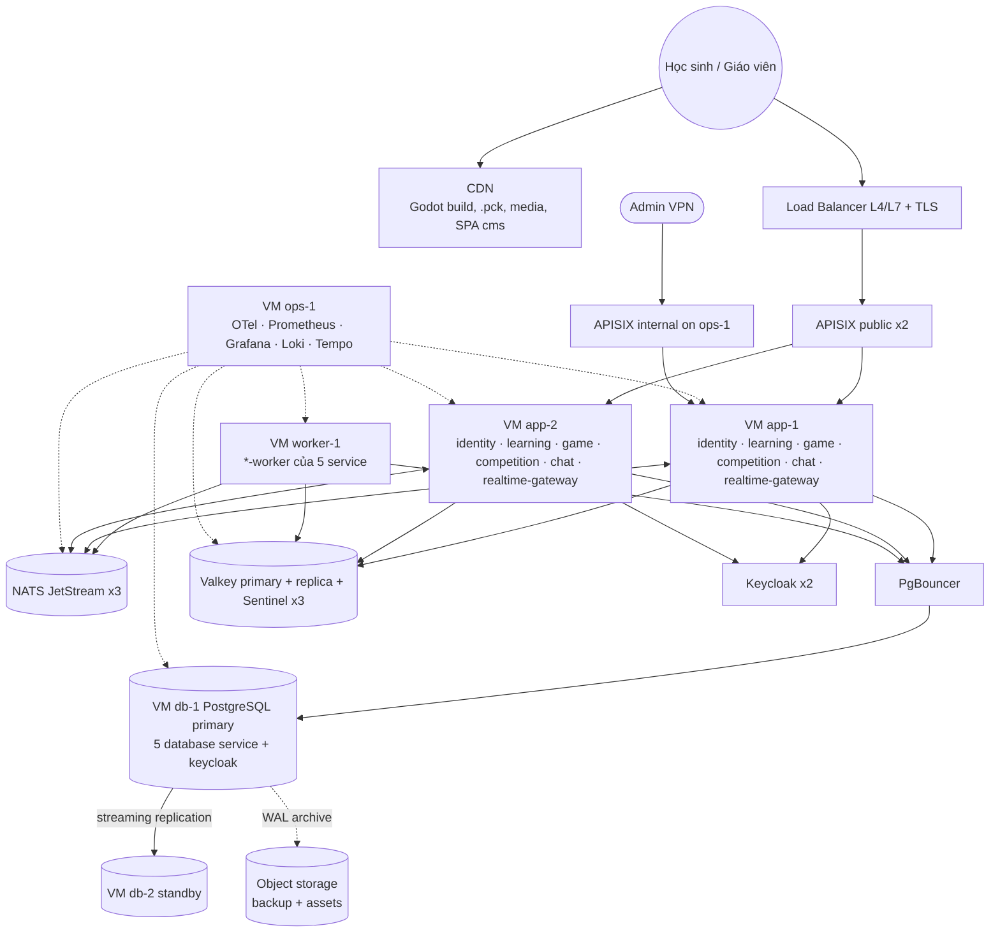
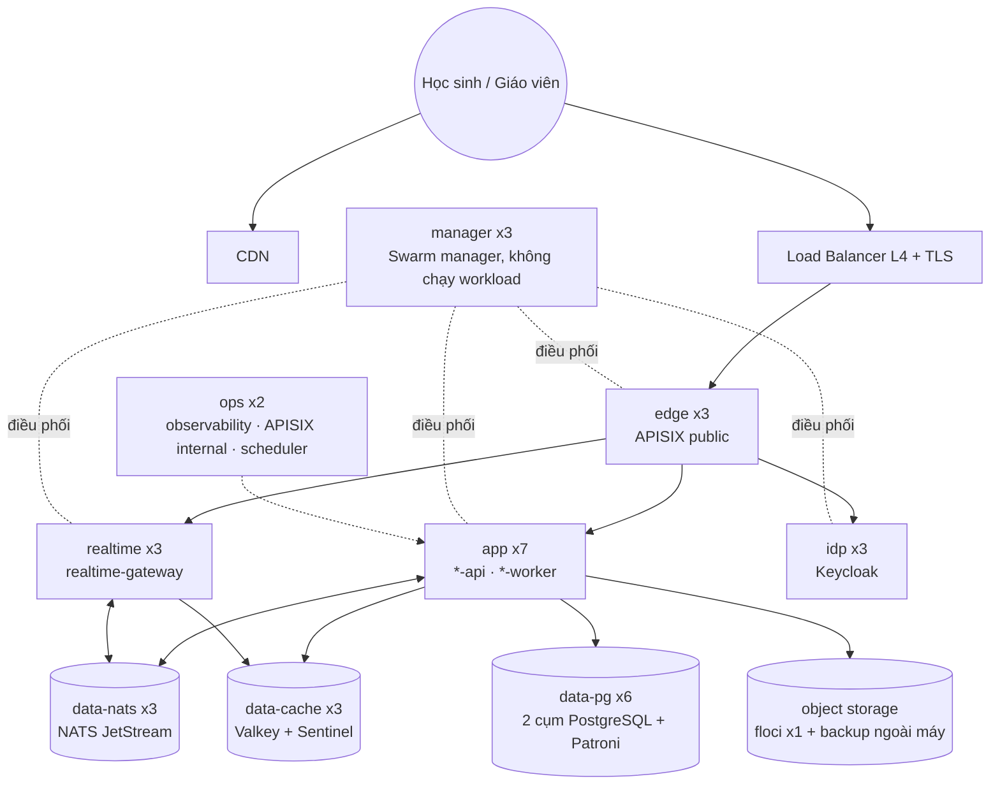
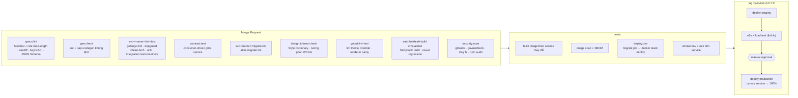

# Deployment

> Trạng thái: Draft · Phiên bản: 0.3 · Owner: DevOps Engineer · Cập nhật: 2026-11-15
> Liên quan: [SYSTEM_ARCHITECTURE](../06-architecture/SYSTEM_ARCHITECTURE.md) · [ADR-0009, ADR-0023, ADR-0024, ADR-0036…0042](../adr/README.md) · [LOCAL_DEVELOPMENT](LOCAL_DEVELOPMENT.md) · [MONITORING](MONITORING.md) · [BACKUP_RECOVERY](BACKUP_RECOVERY.md) · [SECURITY_ARCHITECTURE](../10-security/SECURITY_ARCHITECTURE.md)

**Mục đích & phạm vi.** Nguồn duy nhất về môi trường, topology, **sizing**, mạng, CI/CD, release/rollback, migration khi deploy, phân phối secret, health check. Không thuộc phạm vi: compose/Makefile local → [LOCAL_DEVELOPMENT](LOCAL_DEVELOPMENT.md); metric/alert/SLO → [MONITORING](MONITORING.md); backup/khôi phục → [BACKUP_RECOVERY](BACKUP_RECOVERY.md); chính sách secret → [SECURITY_ARCHITECTURE §6](../10-security/SECURITY_ARCHITECTURE.md).

## 1. Phạm vi

Tài liệu này mô tả cách đóng gói, triển khai, phát hành và vận hành EduWorld trên 4 môi trường. Backend gồm **6 microservice Go** (ADR-0036), mỗi service có database PostgreSQL riêng (ADR-0037). Service giao tiếp đồng bộ bằng typed REST client (ADR-0040) và bất đồng bộ qua NATS JetStream (ADR-0042).

Nền tảng chạy container là **Docker** (ADR-0024, Accepted): Docker Compose cho local/dev, **Docker Engine chế độ Swarm** cho staging/production. **Chưa dùng Kubernetes.** Hạ tầng đặt ở cloud hay on-prem phụ thuộc **OQ-10**, yêu cầu lưu trữ dữ liệu tại Việt Nam phụ thuộc **OQ-12**. Các con số dưới đây là mặc định **[Proposed]**, đủ để dựng staging từ Phase 1.

## 2. Môi trường

| Môi trường | Mục đích | Hạ tầng | Dữ liệu | Ai truy cập | Nhãn |
|---|---|---|---|---|---|
| **local** | Phát triển trên máy dev | Docker Compose ([LOCAL_DEVELOPMENT](LOCAL_DEVELOPMENT.md)) | Seed giả | Dev | [Confirmed] (Docker Compose, Master Prompt §18) |
| **dev** | Tích hợp liên tục, deploy tự động từ `main` | 1–2 VM, Docker Compose | Seed giả, reset được | Team | [Proposed] |
| **staging** | UAT, load test, kiểm thử tích hợp SIS/IdP sandbox | Docker Swarm, cùng topology production, ít node hơn | Dữ liệu giả hoặc đã ẩn danh; **không** dùng dữ liệu học sinh thật | Team, QA, đại diện trường (UAT) | [Proposed] |
| **production** | Học sinh và giáo viên thật | Docker Swarm (ADR-0024) trên VM cloud/on-prem theo OQ-10; HA cho mọi thành phần stateful | Thật, chịu DATA_PRIVACY | Vận hành (least privilege, có audit) | [Confirmed] Docker Swarm · [TBD] OQ-10 nơi đặt hạ tầng |

Quy tắc:
- Mỗi môi trường có Keycloak, PostgreSQL, Valkey, NATS, APISIX **riêng**; không chia sẻ database giữa môi trường.
- Mỗi service promote cùng một image dev → staging → production (build một lần, cấu hình qua env).
- Production chỉ deploy từ tag đã ký đã qua staging. Tag theo service: `<service>/vX.Y.Z` (ví dụ `chat-service/v1.4.0`).

## 3. Thành phần và container image

### 3.1. Service backend (ADR-0036)

Mỗi service là một Go module trong `services/<service>/` với binary `api` (HTTP/consumer) và, nếu cần, `worker` (job nền, consumer nặng). Thư viện dùng chung nằm trong `pkg/` (platform kit).

| Service | Image `api` | Image `worker` | Database | Keycloak client (service-to-service) | Vai trò worker |
|---|---|---|---|---|---|
| `identity-service` | `eduworld/identity-api` | `eduworld/identity-worker` | `eduworld_identity` | `svc-identity` | SIS sync, membership Keycloak, `student-inactive-cleanup` (saga), audit sink, điều phối clone/Thùng rác |
| `learning-service` | `eduworld/learning-api` | `eduworld/learning-worker` | `eduworld_learning` | `svc-learning` | Mastery, rollup analytics, read model Teacher Dashboard, auto-submit đề hết giờ |
| `game-service` | `eduworld/game-api` | `eduworld/game-worker` | `eduworld_game` | `svc-game` | `game-session-timeout`, quest progress (consumer), reward/XP, content manifest |
| `competition-service` | `eduworld/competition-api` | `eduworld/competition-worker` | `eduworld_competition` | `svc-competition` | Matchmaker loop, battle room state machine, rating, leaderboard snapshot, tournament scheduler |
| `chat-service` | `eduworld/chat-api` | `eduworld/chat-worker` | `eduworld_chat` | `svc-chat` | `chat-persister`, `chat-notifier`, `chat-moderation-async`, `chat-stats`, `chat-channel-closer`, `gameplay-chat-purge` |
| `realtime-gateway` | `eduworld/realtime-gateway` | — | — (chỉ Valkey) | `svc-realtime` | Không có |

Mỗi service còn có image `eduworld/<service>-migrate` (Atlas, ADR-0039), chạy như job trước khi rollout.

**Công thức (ADR-0055):** không có math worker hay image riêng. Admin Portal render công thức thành SVG + speech text bằng MathJax 4 trên trình duyệt khi lưu/publish; learning-service chỉ kiểm tra allowlist LaTeX (≤ 2.000 ký tự, độ sâu lồng ≤ 20), sanitize SVG (≤ 256 KB) và lưu `math/<sha256>.svg` lên object storage (§9b). Env: `EW_MATH_MAX_LATEX_LENGTH=2000`, `EW_MATH_MAX_SVG_BYTES=262144`, `EW_MATH_MAX_DEPTH=20`. CLI render dùng cùng MathJax 4 cho import hàng loạt trong CI/vận hành là [Proposed] (job một lần, không chạy thường trực).

### 3.2. Thành phần khác

| Thành phần | Image / artifact | Nguồn | Ghi chú |
|---|---|---|---|
| Admin Portal (5 workspace) | `eduworld/web-portal` | `web/apps/portal` (`vite build`) | Static trên CDN public `portal.<domain>`; mã mỗi workspace là chunk lazy-load (không phải lớp bảo mật). API workspace platform (`/api/v1/game-admin/*`, `/api/v1/admin/*`) chỉ trên APISIX nội bộ/VPN, yêu cầu MFA (ADR-0027 mục 3, 7) |
| Godot client | Artifact | `godot/` | Release 1.0 gồm 4 nền tảng (ADR-0013) |
| Godot content packs | `.pck` / asset bundle | `godot/` + CMS | Object storage + CDN, manifest phiên bản |
| Keycloak | `quay.io/keycloak/keycloak:26.x` + theme/provider | `deploy/keycloak/` | Build optimized image |
| APISIX | `apache/apisix:3.x` | `deploy/apisix/` | Config declarative trong Git |
| PostgreSQL | `postgres:17` (hoặc managed) | `deploy/postgres/` (init script tạo database/role theo service) | Extension: `pgcrypto`, `pg_stat_statements`, `unaccent` |
| Valkey | `valkey/valkey:8` | — | |
| Object storage | **floci** (`floci/floci`, ghim digest) ở mọi môi trường ([ADR-0071](../adr/ADR-0071-object-storage-production-dung-floci.md)) | `deploy/object-storage/` (bucket, policy, lifecycle) | 6 bucket theo ADR-0044 (§9b) |
| Media pipeline | Thư viện `pkg/media` chạy trong `learning-worker`, `game-worker`, `chat-worker` (consumer `media-processor`, `content-snapshot-builder`); image phụ `eduworld/media-tools` (ffmpeg, libvips, gltf-transform) | `services/*/` + `deploy/media/` | Tách thành deployment riêng khi tải lớn [Proposed] |
| ClamAV | `clamav/clamav:stable` (clamd + freshclam) | — | Media worker quét file trong quarantine qua TCP clamd |
| NATS | `nats:2.10-alpine` (JetStream) | `deploy/nats/` (server config, account/user JWT, không chứa secret) | Cluster 3 node; `prometheus-nats-exporter` |
| Observability | otel-collector, prometheus, grafana, loki, tempo | `deploy/observability/` | ADR-0023 |

Yêu cầu chung cho image do dự án build:
- Multi-stage build, `CGO_ENABLED=0`, `-trimpath`, ldflags gắn `service`, `version`, `commit`, `build_time`.
- Chạy user non-root (UID ≥ 10001), không shell trong image runtime, read-only rootfs.
- Quét lỗ hổng (Trivy/Grype) trong CI, **chặn release** nếu có CVE Critical đã có bản vá.
- SBOM (Syft, SPDX/CycloneDX) đính kèm mỗi release của mỗi service.
- Tag image bằng `git sha` và semver của service; không dùng `latest` ngoài local.

## 4. Topology

### 4.1. Pilot (NFR-SCAL-001: 5 trường · 5.000 HS · 1.000 CCU) — [Proposed]

Mục tiêu: vận hành đơn giản, HA tối thiểu cho dữ liệu. Chạy **Docker Swarm** nhỏ trên VM (3 manager có thể đặt chung trên app-1, app-2, ops-1 ở pilot); mỗi service có ≥ 2 replica trải trên 2 VM app (`placement.preferences: spread node.labels.zone`).



| Node | vCPU | RAM | Disk | Thành phần |
|---|---|---|---|---|
| app-1, app-2 | 8 | 16 GB | 100 GB SSD | Mỗi node: 1 replica `*-api` của 5 service + 1 `realtime-gateway`; Swarm manager |
| worker-1 | 8 | 16 GB | 100 GB | `*-worker` của 5 service (singleton job dùng khóa Valkey nên chạy được nhiều replica khi mở rộng) |
| idp-1, idp-2 | 4 | 8 GB | 50 GB | Keycloak cluster; database `keycloak` trên db-1 |
| db-1, db-2 | 8 | 32 GB | 500 GB NVMe | PostgreSQL 17 primary/standby (Patroni), chứa 5 database service + `keycloak`, mỗi database user riêng |
| cache-1 (+ Sentinel trên app-1/app-2) | 4 | 8 GB | 50 GB | Valkey primary + replica; NATS node 1 |
| NATS node 2, 3 | (đặt chung db-2, ops-1) | +2 GB | +50 GB SSD | 3 node trên 3 VM khác nhau |
| ops-1 | 8 | 16 GB | 500 GB | Observability, APISIX internal; log giữ 14 ngày; Swarm manager thứ 3 |

> Sizing là ước lượng ban đầu, **phải hiệu chỉnh bằng load test** ([TEST_STRATEGY](../12-project/TEST_STRATEGY.md) §8). Không tuyên bố năng lực khi chưa benchmark.

### 4.2. Release 1.0: 10.000 CCU trên Docker Swarm (NFR-SCAL-002 [Confirmed], ADR-0024, ADR-0045) — sizing [Proposed]

Release 1.0 chạy **Docker Swarm** (ADR-0024), không dùng Kubernetes. Mỗi node VM được gắn nhãn vai trò; service đặt bằng `placement.constraints` theo nhãn. Năng lực VM được cấp **đủ cho giờ cao điểm**; số replica tăng/giảm theo lịch học (§4.4), không có autoscale theo tải thực.



**Node theo vai trò** (nhãn `role=<...>`):

| Vai trò (`node.labels.role`) | Số node | Mỗi node | Chạy |
|---|---|---|---|
| `manager` | 3 | 2 vCPU / 4 GB | Swarm manager (Raft quorum), `availability=drain` (không chạy workload) |
| `edge` | 3 | 4 vCPU / 8 GB | APISIX public (3 → 5 replica), etcd của APISIX |
| `realtime` | 3 | 8 vCPU / 16 GB | `realtime-gateway` (4 → 6 replica, ≤ 4.000 WS/replica) |
| `idp` | 4 | 8 vCPU / 16 GB | Keycloak (4 → 6 replica, 4 vCPU / 8 GB mỗi replica; ADR-0064) |
| `app` | 7 | 16 vCPU / 32 GB | `*-api` + `*-worker` của 5 service, `media-processor` |
| `data-pg` | 6 | 16 vCPU / 64 GB / NVMe | 2 cụm PostgreSQL (identity, game, competition, keycloak) và (learning, chat), mỗi cụm primary + 2 replica (Patroni) + PgBouncer |
| `data-cache` | 3 | 8 vCPU / 32 GB | Valkey `cache`, `realtime`, `ratelimit` (primary/replica đặt chéo node) + Sentinel |
| `data-nats` | 3 | 4 vCPU / 8 GB / 200 GB SSD | NATS JetStream cluster |
| `storage` | 1 (+ 1 node dự phòng để khôi phục, RB-05) | 4 vCPU / 16 GB / theo dung lượng, ổ RAID | floci (ADR-0071) |
| `ops` | 2 | 8 vCPU / 16 GB / 500 GB | OTel, Prometheus, Grafana, Loki, Tempo, APISIX internal, scheduler scale theo lịch, bastion |

**Replica ở đỉnh** (giới hạn bằng `deploy.resources.limits`; tổng phải nằm trong năng lực node vai trò tương ứng):

| Service | Replica thường → đỉnh | Mỗi replica | Căn cứ |
|---|---|---|---|
| Keycloak | 4 → 6 | 4 vCPU / 8 GB | ADR-0064: mọi lượt mở game đều nhập mật khẩu → đỉnh **100 đăng nhập mật khẩu/s** × ≤ 80 ms băm ≈ 8 vCPU + 500 refresh/s (~1–2 vCPU) + overhead; 6 replica × 4 vCPU = 24 vCPU giữ dư địa ~2× ở đỉnh; bão 5.000 lượt/10 phút (KEYCLOAK_SSO §12, kiểm chứng TC-PERF-002/016) |
| APISIX public | 3 → 5 | 2 vCPU / 2 GB | ~3.000 req/s REST đỉnh + 10.000 WS proxy |
| `realtime-gateway` | 4 → 6 | 2 vCPU / 2 GB | ≤ 4.000 WS/replica (REALTIME_ARCHITECTURE §11) |
| `identity-service` api | 3 → 6 | 1 vCPU / 1 GB | `/auth/game/login` đỉnh ~100/s (mỗi lượt một lời gọi token endpoint Keycloak, ADR-0068) + `principals:resolve` (cache hit ≥ 95%); scale cùng lịch warm-up với Keycloak |
| `learning-service` api | 4 → 16 | 2 vCPU / 2 GB | Làm bài, chấm điểm, phát câu hỏi cho trận |
| `game-service` api | 3 → 10 | 1 vCPU / 1 GB | Game session, manifest, quest |
| `competition-service` api | 4 → 10 | 2 vCPU / 2 GB | Room host hub (~175 instance) + trận |
| `chat-service` api | 3 → 10 | 1 vCPU / 1 GB | 1.000–2.000 tin/s đỉnh |
| `*-worker` | 1 → 4 mỗi service | 1 vCPU / 1 GB | Theo consumer pending (alert + scale theo runbook) |
| PgBouncer | 2 mỗi cụm | 1 vCPU | Pool transaction mode |
| Valkey | 3 instance tách vai trò (`cache`, `realtime` cluster mode cho sharded Pub/Sub, `ratelimit`) | 4 vCPU / 16 GB | ~100k–150k msg/s Pub/Sub ở đỉnh |
| NATS JetStream | 3 | 4 vCPU / 8 GB | `CHAT_MESSAGES` + `EVT_*` |

> Tổng `*-api` + `*-worker` ở đỉnh ≈ 100 vCPU → 7 node `app` 16 vCPU (dư ~10%). VM chạy cả ngày nên chi phí tính theo mức đỉnh; giảm replica ngoài giờ chỉ giải phóng tài nguyên cho job nền (rollup, snapshot, media). Phải hiệu chỉnh bằng load test (TC-PERF-014), không phải cam kết.

**Thành phần có trạng thái** (ADR-0024 mục 3): ghim node bằng `placement.constraints: [node.labels.role == data-pg, node.hostname == pg-1]`, volume local NVMe (bind mount hoặc local volume driver), HA ở tầng ứng dụng: PostgreSQL + Patroni (etcd riêng của Patroni hoặc DCS Consul), Valkey replica + Sentinel 3, NATS cluster 3 route, Keycloak 3 replica (Infinispan JDBC_PING). Có thể thay bằng dịch vụ managed của nhà cung cấp cloud tại VN (PostgreSQL, Valkey/Redis-compatible, object storage) khi OQ-10 chọn cloud [Proposed].

**Service discovery:** DNS nội bộ của Swarm. Service gọi nhau qua tên service trong stack (`http://learning-service:8080`, VIP của Swarm cân bằng tải giữa replica). URL cấu hình bằng env `EW_SVC_<NAME>_URL`, không hardcode. APISIX dùng `tasks.<service>` (DNS round-robin từng task) để health check và cân bằng tải từng replica [Proposed]. Không dùng service mesh; mTLS giữa service là tùy chọn khi mở rộng [Proposed].

### 4.3. Phân vùng mạng (overlay network + firewall)

Swarm overlay network tách lớp; một service chỉ được gắn vào network cần thiết. Network `app`, `data`, `admin` tạo với `--opt encrypted` (mã hóa IPsec giữa node).

| Overlay network | Thành phần gắn vào | Ghi chú |
|---|---|---|
| `edge` | APISIX public, `*-api`, `realtime-gateway`, Keycloak (public endpoint) | APISIX chỉ tới cổng public `:8080` của service |
| `app` | `*-api`, `*-worker`, `realtime-gateway`, NATS | Gọi service-to-service `/internal/v1/*`; NATS request/reply |
| `data` | `*-api`, `*-worker`, PgBouncer, PostgreSQL, Valkey, object storage | Mỗi service chỉ có credential **database của mình** (pg_hba theo user/database, Valkey ACL, NATS user) |
| `admin` | APISIX internal, Keycloak admin, observability, bastion | Chỉ từ VPN quản trị |

| Zone | Thành phần | Inbound cho phép |
|---|---|---|
| Public | LB, CDN | 443 từ Internet |
| Edge | APISIX public | Từ LB |
| App | `*-api`, `realtime-gateway` | Từ APISIX; **service-to-service** chỉ tới `/internal/v1/*` theo ma trận gọi dưới đây |
| Worker | `*-worker` | Không inbound (trừ `:9090` từ Ops) |
| Identity | Keycloak | Public endpoints qua LB; admin console **chỉ** qua APISIX internal/VPN |
| Data | PostgreSQL, Valkey, NATS, etcd | Chỉ từ App/Worker/Identity |
| Ops | Observability, bastion, APISIX internal | Từ VPN quản trị |

Overlay network của Swarm không lọc theo đường dẫn HTTP, nên **ma trận gọi đồng bộ** được thực thi ở tầng ứng dụng: token service-to-service với allowlist `azp`/`x-allowed-callers` (ADR-0040), quyền NATS theo user, credential DB theo service. Tầng mạng chỉ chặn ở mức network (service không gắn `data` thì không tới được database). Firewall host (nftables/security group) chỉ mở cổng Swarm giữa các node (2377/tcp tới manager, 7946/tcp+udp, 4789/udp, ESP cho overlay mã hóa) và cổng publish của LB/APISIX.

Ma trận gọi đồng bộ cho phép — [Proposed]:

| Bên gọi → bên nhận | identity | learning | game | competition | chat |
|---|---|---|---|---|---|
| identity | — | platform ops (clone/trash/cleanup) | platform ops | platform ops | platform ops |
| learning | principal/tenant | — | — | — | — |
| game | principal/tenant | attempt, question delivery | — | — | — |
| competition | principal/tenant | question plan, chấm điểm | — | — | — |
| chat | principal/tenant | — | — | — | — |
| realtime-gateway | — (đi qua NATS request/reply) | | | | |

Outbound Internet: chỉ `identity-worker` gọi SIS (allowlist) và Keycloak Admin API; các thành phần khác không có Internet egress ngoại trừ cập nhật OS qua proxy.

### 4.4. Scale theo lịch học (thay autoscale, ADR-0024 mục 4, ADR-0045)

- Lịch scale khai báo trong Git: `deploy/swarm/<env>/scale-schedule.yaml` (mỗi service: `baseline`, `peak`, các khung giờ). Mặc định khung cao điểm 06:45–08:00, 13:15–14:30, 19:00–21:00 ICT [Proposed]; có thể sinh thêm từ lịch học/lịch kiểm tra trong learning-service.
- Container `ops-scheduler` (chạy trên node `ops`, có quyền Docker API của manager qua socket proxy chỉ cho phép `service update`) chạy `docker service scale <stack>_<service>=<n>` **15 phút trước** khung cao điểm và thu nhỏ sau đó; ghi log + metric `eduworld_ops_scale_actions_total`.
- Ngoài lịch: alert `NodeCapacityHigh`, `EventConsumerLag`, `ScheduledScaleFailed` và alert số WS/replica (định nghĩa và ngưỡng: [MONITORING §5](MONITORING.md)) báo người trực scale thủ công theo runbook; không có scale tự động theo tải.
- Không scale vượt năng lực node vai trò; scheduler từ chối nếu tổng `resources.reservations` vượt dung lượng còn lại.

### 4.5. Stack file mẫu

Mỗi môi trường có `deploy/swarm/<env>/` gồm `infra.stack.yml` (APISIX, Keycloak, NATS, Valkey, observability), `data.stack.yml` (PostgreSQL/Patroni, PgBouncer, floci) và `<service>.stack.yml` cho từng service để deploy độc lập.

```yaml
# deploy/swarm/production/learning-service.stack.yml (trích)
version: "3.9"
services:
  learning-service:
    image: registry.internal/eduworld/learning-api:${LEARNING_VERSION}   # tag bất biến
    env_file: [learning.env]                                             # không chứa secret
    secrets: [learning_db_dsn, learning_kc_client_secret, learning_nats_creds, learning_valkey_password]
    networks: [edge, app, data]
    healthcheck:
      test: ["CMD", "/app/api", "healthcheck", "--endpoint=/livez"]      # binary tự kiểm tra, image không có curl
      interval: 10s
      timeout: 2s
      retries: 3
      start_period: 20s
    stop_grace_period: 40s
    deploy:
      replicas: 4
      placement:
        constraints: [node.labels.role == app]
        preferences: [{ spread: node.labels.zone }]
      resources:
        limits: { cpus: "2", memory: 2G }
        reservations: { cpus: "1", memory: 1G }
      update_config: { parallelism: 1, delay: 10s, order: start-first, failure_action: rollback, monitor: 60s }
      rollback_config: { parallelism: 2, order: start-first }
      restart_policy: { condition: any, delay: 5s, max_attempts: 5, window: 120s }
networks:
  edge: { external: true }
  app: { external: true }
  data: { external: true }
secrets:
  learning_db_dsn: { external: true }
  learning_kc_client_secret: { external: true }
  learning_nats_creds: { external: true }
  learning_valkey_password: { external: true }
```

```yaml
# deploy/swarm/production/infra.stack.yml (trích APISIX)
  apisix:
    image: apache/apisix:3.x-debian        # pin phiên bản cụ thể khi triển khai
    configs:
      - { source: apisix_config_v12, target: /usr/local/apisix/conf/config.yaml }
    ports:
      - { target: 9443, published: 443, protocol: tcp, mode: host }   # mode host: LB L4 trỏ thẳng node edge
    networks: [edge, admin]
    deploy:
      replicas: 3
      placement: { constraints: [node.labels.role == edge], max_replicas_per_node: 2 }
      update_config: { parallelism: 1, order: start-first, failure_action: rollback }
```

Docker configs/secrets là bất biến: đổi nội dung = tạo config/secret mới có hậu tố version (`apisix_config_v13`) rồi cập nhật stack.

## 5. APISIX

| Môi trường | Mode | Nguồn cấu hình |
|---|---|---|
| local | **Standalone**, `conf/apisix.yaml` mount từ `deploy/apisix/standalone/` | Git |
| dev/staging/prod | **Traditional (etcd)**, etcd 3 node | Declarative bằng ADC (`deploy/apisix/routes/*.yaml`), áp dụng qua CI job `apisix:sync` |

**Upstream theo service (ADR-0036):**

| Prefix | Upstream | Gateway |
|---|---|---|
| `/api/v1/auth`, `/me`, `/tenant`, `/schools`, `/students` | `identity-service` | public |
| `/api/v1/admin`, `/api/v1/sis` | `identity-service` | **internal** |
| `/api/v1/learning`, `/exams`, `/cms`, `/lms` | `learning-service` | public |
| `/api/v1/game` | `game-service` | public |
| `/api/v1/game-admin/{quests,minigame-configs,npc-dialogues,world-areas,story-chapters,events,event-templates,season-tracks,items,reward-rules,levels}` | `game-service` | **internal** |
| `/api/v1/game-admin/{matchmaking-configs,ranking-rules,seasons,tournament-templates,leaderboard-definitions}` | `competition-service` | **internal** |
| `/api/v1/game-admin/{sticker-packs,gifs}` | `chat-service` | **internal** |
| `/api/v1/multiplayer`, `/competition`, `/leaderboards` | `competition-service` | public |
| `/api/v1/chat`, `/social`, `/notifications` | `chat-service` | public |
| `/realtime/v1` (WebSocket, `enable_websocket: true`, read timeout 75 s) | `realtime-gateway` | public |
| `/internal/v1/*` | **Không khai báo trên APISIX.** Service gọi trực tiếp nhau trong zone App | — |

- **Route đăng nhập game (ADR-0068):** `/api/v1/auth/game/login`, `/api/v1/auth/game/tenant:select`, `/api/v1/auth/game/token:refresh`, `/api/v1/auth/game/logout` → `identity-service`, **không** `openid-connect`, chỉ HTTPS (HSTS), `client-control` `max_body_size` 4 KB. **Không ghi body**: logger (`http-logger`/`file-logger`/`kafka-logger`) không bật `include_req_body`, `opentelemetry` không thu body/header nhạy cảm, access log chỉ ghi method, path, status, `X-Device-Id` rút gọn, latency; mọi thay đổi route này cần review bảo mật (CI kiểm tra cấu hình không có `include_req_body: true` trên `/auth/game/*`).
- **Kiểm tra header tenant (ADR-0065):** plugin `tenant-header` [Proposed: Lua plugin riêng trong `deploy/apisix/plugins/` hoặc `serverless-pre-function`] trên mọi route tenant-scoped: thiếu `X-Tenant-Id` → `400 TENANT_HEADER_REQUIRED` (Problem Details), sai UUID → `400 BAD_REQUEST`; dùng làm khóa `limit-count` theo tenant và gắn `tenant.id` vào log/trace. Ngoại lệ: `/auth/game/login`, `/auth/game/tenant:select`, `/auth/session`, `/me/tenants`, `/game/client-config`, `/realtime/v1`, health; `/api/v1/admin/*` chế độ tùy chọn. Bảng route đầy đủ: [API_DESIGN §10](../07-backend/API_DESIGN.md#10-apisix-route-mapping).
- **Rate limit đăng nhập (ADR-0045, ADR-0068):** `/api/v1/auth/game/login` giới hạn **theo thiết bị** (`X-Device-Id`, 10/phút), **theo username** (10/phút, plugin đọc field `username` đã chuẩn hóa, không log) và **toàn cục**; route Keycloak public của portal (`/realms/eduworld/protocol/openid-connect/*`, `/login-actions/*`) và `/api/v1/auth/session` giới hạn theo IP (ngưỡng rộng cho nhân sự) + toàn cục. Đăng nhập game không giới hạn theo IP đơn lẻ vì nhiều trường dùng chung NAT, và trước khi đăng nhập chưa biết tenant (ADR-0063); ngưỡng toàn cục bảo vệ Keycloak 120 đăng nhập mật khẩu/s (đỉnh thiết kế 100/s, ADR-0064). Vượt ngưỡng toàn cục → `429 LOGIN_QUEUE_BUSY` + `Retry-After` (giây, có jitter) để client hiển thị hàng chờ "Đang vào lớp…"; vượt ngưỡng thiết bị/username → `429 RATE_LIMITED`. Ngưỡng cụ thể ở [SECURITY_ARCHITECTURE §14](../10-security/SECURITY_ARCHITECTURE.md).
- Plugin bắt buộc trên route public: `openid-connect`/`jwt-auth` (bearer-only, JWKS Keycloak), `limit-req` + `limit-count` (policy `redis` trỏ Valkey `ratelimit`), `client-control` (`max_body_size` 1 MB mặc định, 20 MB cho upload media CMS), `cors` (origin allowlist), `prometheus`, `opentelemetry`, `request-id`.
- Route **không** auth: `/healthz` của gateway, `/api/v1/game/client-config`, `/api/v1/auth/game/login`, `/api/v1/auth/game/tenant:select` (rate limit + không log body).
- Route nội bộ (`/api/v1/admin/*`, `/api/v1/sis/*`, `/api/v1/game-admin/*`, Admin API APISIX, Keycloak admin, SIS webhook `/internal/sis/webhooks/*`) chỉ có trên **APISIX internal** (ADR-0009). CI kiểm tra gateway public không khai báo các prefix này.
- Thay đổi route đi qua merge request; CI chạy `adc diff` và hiển thị diff trước khi apply.

## 6. Keycloak

- Keycloak 26.x, build image optimized với provider/theme: theme `eduworld-ops` cho Admin Portal (ADR-0066); học sinh không dùng trang Keycloak (đăng nhập form trong game qua `eduworld-game-backend`, ADR-0068).
- Cluster ≥ 2 node (pilot), **≥ 3 node 4 vCPU / 8 GB cho Release 1.0** (ADR-0045); tăng replica theo lịch học (§4.4); cache phân tán (Infinispan, jgroups qua DNS_PING/JDBC_PING); **persistent user sessions** (phiên lưu DB, scale/restart không làm học sinh bị đăng xuất).
- Băm mật khẩu: argon2id/pbkdf2 với tham số benchmark ≤ 80 ms/lần trên node thật; rehash on login. JVM heap ~70% RAM; DB pool ≥ 100 kết nối/node.
- Provider JAR authenticator tùy biến (`ew-class-qr`, `ew-card-qr`, `ew-picture-password`) build cùng image; client `svc-keycloak-authn` gọi identity-service.
- Theme đăng nhập tĩnh phục vụ qua CDN; tắt event listener không cần thiết trên đường đăng nhập.
- Database riêng (`keycloak`), user riêng.
- Realm config quản lý dạng code: `deploy/keycloak/realm-eduworld.json` **không chứa secret/user thật**; áp dụng bằng `keycloak-config-cli` trong CI.
- **Client `eduworld-game-backend`** (ADR-0068): confidential, chỉ Direct Access Grants, secret sinh trong từng môi trường, lưu secret manager → Docker secret `kc_game_backend` chỉ mount vào `identity-service`; xoay 90 ngày (hai secret song song khi xoay). Realm: `duplicateEmailsAllowed=false`, `loginWithEmailAllowed=true` (ADR-0067).
- **Client service-to-service** (ADR-0040): `svc-identity`, `svc-learning`, `svc-game`, `svc-competition`, `svc-chat`, `svc-realtime`, loại confidential, chỉ bật `client_credentials`. Client secret sinh trong từng môi trường, lưu secret manager, mỗi service chỉ nhận secret của chính mình. Chi tiết: [KEYCLOAK_SSO](../09-identity/KEYCLOAK_SSO.md).
- Hostname cố định (`KC_HOSTNAME`), `KC_PROXY_HEADERS=xforwarded`, chỉ HTTPS phía public. Admin console tách hostname, chỉ qua VPN, bắt buộc MFA.

## 7. PostgreSQL (ADR-0037)

| Hạng mục | Pilot | Mở rộng |
|---|---|---|
| Topology | 1 cluster (primary + standby, Patroni) chứa 5 database service + `keycloak` | Tách cluster cho service tải lớn (`learning`, `chat`); còn lại dùng chung |
| Kết nối | PgBouncer (transaction pooling); pool riêng theo database/user | Như pilot + read replica cho Query side (CQRS, ADR-0038) và reporting |
| Failover | Tự động (Patroni), VIP/DNS cập nhật | Patroni (tự vận hành trên Swarm, node `data-pg`) hoặc managed PostgreSQL |
| Backup | pgBackRest/WAL-G theo cluster, restore được từng database ([BACKUP_RECOVERY](BACKUP_RECOVERY.md)) | Như pilot |
| Tham số | `max_connections` 300, `shared_buffers` 25% RAM, `wal_level=replica`, `pg_stat_statements` | Tuning theo load test |

**Database và role theo service** (tạo bằng `deploy/postgres/init/*.sql`, Atlas không tạo role):

| Database | Role ứng dụng (RLS, không DELETE) | Role platform (BYPASSRLS, có audit) | Role migrate (owner) | Role đặc biệt |
|---|---|---|---|---|
| `eduworld_identity` | `identity_app` | `identity_platform` | `identity_migrator` | — |
| `eduworld_learning` | `learning_app` | `learning_platform` | `learning_migrator` | `learning_dashboard` (chỉ trên read replica, chỉ bảng rollup/read model, `statement_timeout` 5 s — ADR-0062) |
| `eduworld_game` | `game_app` | `game_platform` | `game_migrator` | `game_dashboard` (như trên) |
| `eduworld_competition` | `competition_app` | `competition_platform` | `competition_migrator` | — |
| `eduworld_chat` | `chat_app` | `chat_platform` | `chat_migrator` | `chat_purger` (chỉ `DELETE` bảng chat gameplay, ADR-0033) |

- Mỗi role chỉ có `CONNECT` trên database của service mình; `pg_hba.conf` giới hạn theo `database/user`. Không role nào được truy cập database của service khác (ADR-0037).
- Mọi role ứng dụng bị `REVOKE DELETE, TRUNCATE` (ADR-0028); ngoại lệ duy nhất là `chat_purger`.
- Role platform dùng cho phiên System Admin xem liên tenant và job platform, có audit.
- **Dashboard (ADR-0062, [DASHBOARD_DATA](../07-backend/DASHBOARD_DATA.md)):** API dashboard và export worker của learning-service, game-service chỉ kết nối **read replica** của `eduworld_learning`/`eduworld_game` qua pool PgBouncer riêng (≤ 10 kết nối/replica API) bằng role `<svc>_dashboard`. Release 1.0: mỗi cụm có 2 replica Patroni, dành một replica (async, `hot_standby_feedback=on`, `max_standby_streaming_delay` 30 s) ưu tiên cho dashboard/export; pilot dùng replica standby duy nhất. Cảnh báo khi replica lag > 60 s [Proposed].

**Job nền theo service:**

| Service | Job | Lịch | Khóa singleton | Role DB | Quyết định |
|---|---|---|---|---|---|
| game | `game-session-timeout` | mỗi 15 s | `ew:lock:job:game:session-timeout` | `game_app` | ADR-0031 |
| identity | `student-inactive-cleanup` (saga) | hằng ngày 02:00 ICT, theo tenant, lô 500 | `ew:lock:job:identity:student-cleanup:<tenant_id>` | `identity_platform` | ADR-0032; gọi `/internal/v1/platform/students/{id}:cleanup` của các service |
| identity | `sis-sync` | theo lịch connection | `ew:lock:job:identity:sis:<connection_id>` | `identity_platform` | ADR-0021 |
| identity | `partition-maintainer` (mỗi service có job riêng tương tự) | hằng ngày | `ew:lock:job:<svc>:partitions` | `<svc>_migrator` | Tạo partition trước 3 tháng |
| competition | `matchmaker` | liên tục | `ew:lock:job:competition:mm:<queue_key>` | — (Valkey) | |
| chat | `chat-persister` (JetStream consumer) | liên tục | — | `chat_app` | ADR-0035 |
| chat | `chat-notifier`, `chat-moderation-async`, `chat-stats` | liên tục | — | `chat_app` | ADR-0035 |
| chat | `chat-channel-closer` (consumer `chat.channel_closed`) | theo event | — | `chat_app` | ADR-0033 |
| chat | `gameplay-chat-purge` | hằng giờ | `ew:lock:job:chat:gameplay-purge` | `chat_purger` | ADR-0033 |
| learning | `rollup-dashboard` (JetStream consumer) + `dashboard-day-close` | liên tục + hằng ngày 02:30 ICT, theo tenant | `ew:lock:job:learning:day-close:<tenant_id>` | `learning_app` | ADR-0062 |
| game | `analytics` (consumer) + `dashboard-day-close` | liên tục + hằng giờ (hôm nay) + hằng ngày 02:30 ICT | `ew:lock:job:game:day-close:<tenant_id>` | `game_app` | ADR-0058, ADR-0062 |
| learning, game | `dashboard-export` (work-queue) | theo yêu cầu, ≤ 2 export/người | — | `<svc>_dashboard` (đọc replica) + ghi `ew-exports` | ADR-0062 |
| mọi service | `outbox-relay` | liên tục | khóa theo service | `<svc>_app` | ADR-0042 |

## 8. Valkey HA

- Valkey 8, primary + replica + Sentinel 3 node (pilot). Client `valkey-go` cấu hình Sentinel.
- Persistence AOF `everysec`, **không** phải nguồn sự thật (ADR-0004). Không còn dùng Valkey Streams cho domain event (ADR-0042).
- Key của từng service có prefix riêng (`ew:<svc>:...`) và Valkey ACL user theo service (`identity`, `learning`, `game`, `competition`, `chat`, `realtime`) chỉ được truy cập prefix của mình + channel Pub/Sub được phép.
- Mất Valkey → realtime suy giảm (presence, queue, fan-out chat mất); client tự reconnect, re-queue, bù tin qua lịch sử (seq gap). REST vẫn hoạt động ở chế độ không cache.

## 8b. NATS JetStream (ADR-0035, ADR-0042)

- Cluster 3 node, TLS cho client và route; xác thực NKey/JWT theo account `EDUWORLD`; **mỗi service một user** với quyền publish/subscribe tối thiểu trên subject của mình ([SECURITY_ARCHITECTURE §8.1](../10-security/SECURITY_ARCHITECTURE.md)).
- Stream:

| Stream | Subjects | Lưu | Owner (publish) |
|---|---|---|---|
| `EVT_IDENTITY`, `EVT_LEARNING`, `EVT_GAME`, `EVT_COMPETITION`, `EVT_CHAT` | `ew.evt.<service>.>` | 7 ngày, R3, `duplicate_window` 2' | outbox relay của service tương ứng |
| `CHAT_MESSAGES` | `ew.chat.*.msg.*`, `ew.chat.*.evt.*`, `ew.chat.*.cursor.*` | 72 h, R3 | `chat-service` |
| `DLQ_<SERVICE>` | `ew.dlq.<service>.>` | 14 ngày | consumer của service |

- Request/reply cho lệnh realtime (`ew.cmd.<service>.>`) dùng NATS core (không lưu), queue group theo service.
- Stream và consumer được service tạo idempotent khi khởi động từ cấu hình trong repo; thay đổi cấu hình qua merge request.
- Dung lượng ước tính [Proposed]: chat ~26 GB/replica (72 h), event ~5 GB/replica (7 ngày) → cấp 80 GB SSD mỗi node.
- Không backup NATS: PostgreSQL là nguồn sự thật; outbox giữ 30 ngày để replay ([BACKUP_RECOVERY](BACKUP_RECOVERY.md)).
- Nâng cấp rolling từng node; kiểm tra `nats server check jetstream` trước/sau.

## 9. CDN và phân phối Godot client

| Artifact | Kênh phân phối | Ghi chú |
|---|---|---|
| Windows build | CDN tải trực tiếp + (tùy chọn) phần mềm quản lý phòng máy của trường | Ký code (Authenticode) [Proposed] |
| Android | Google Play (internal → closed → production) và/hoặc APK cho MDM của trường | `.aab` ký bằng upload key trong secret manager |
| iOS | App Store (TestFlight → production) và/hoặc Apple Business Manager/MDM | Build trên runner macOS |
| Web | CDN static (`play.<domain>`), `.wasm`/`.pck` nén Brotli, cache theo hash | Renderer Compatibility, preset tối đa Trung bình, tải đầu theo [PERFORMANCE_BUDGET](../08-game-client/PERFORMANCE_BUDGET.md) §11, §14 |
| Content pack `.pck` / media | Object storage + CDN, URL theo hash nội dung | Manifest có chữ ký; client kiểm tra hash; mỗi vùng một gói tải theo nhu cầu |

**Dung lượng build và gói nội dung (ADR-0057):** giới hạn bản cài Windows/Android/iOS, tải đầu Web và kích thước gói mỗi vùng do [PERFORMANCE_BUDGET](../08-game-client/PERFORMANCE_BUDGET.md) §11 sở hữu. Pipeline build Godot (job `godot:export:*`) đo kích thước artifact và **thất bại khi vượt giới hạn**; báo cáo kích thước đính kèm mỗi release. Nội dung ngoài lõi (vùng, cosmetic, media) không đóng vào bản cài mà phát qua `ew-game-bundles`/`ew-media-public` trên CDN để bản cài nhỏ và cập nhật nội dung không cần phát hành lại app.
| Media học tập, sticker, GIF | Object storage + CDN; signed URL cho media riêng tenant (`ew-media-private`) | ADR-0044 |
| Snapshot nội dung đã publish + content manifest theo tenant | `ew-media-public` + CDN, đường dẫn có version/hash, `Cache-Control: public, max-age=31536000, immutable`; con trỏ manifest hiện hành qua API (`ETag`) | ADR-0043; **không** chứa câu hỏi đề kiểm tra/answer key |

- `GET /api/v1/game/client-config` (game-service) trả `min_client_version`, `latest_client_version`, `content_manifest_url`, `maintenance`.
- Backend hỗ trợ tối thiểu **N-1** phiên bản client trong 1 học kỳ.

## 9b. Object storage và media pipeline (ADR-0044, ADR-0043)

| Bucket | Ghi bởi | Đọc bởi | Chính sách |
|---|---|---|---|
| `ew-media-quarantine` | CMS qua presigned PUT (≤ 15 phút) | media worker | Private; lifecycle xóa object sau 7 ngày (file tạm, chưa phải dữ liệu nghiệp vụ) |
| `ew-media-public` | media worker, content-snapshot-builder | CDN | Versioning bật; không ghi đè (khóa theo hash) |
| `ew-media-private` | media worker | CDN signed URL (5–15 phút) | Versioning bật; SSE |
| `ew-game-bundles` | CI (build Godot, PCK) | CDN | Versioning bật |
| `ew-exports` | worker xuất báo cáo, import SIS | presigned GET | Lifecycle theo DATA_PRIVACY |
| `ew-student-submissions` | Game client học sinh qua presigned PUT (ghi âm `recordings/`, sản phẩm dự án/ảnh bài làm `submissions/`) — ngoại lệ ADR-0044 mục 3 | learning-service (ClamAV, kiểm tra định dạng/thời lượng); người chấm được phân công qua signed URL 15 phút | Private, SSE, **không qua CDN công khai**; lifecycle: ghi âm 90 ngày sau khi chấm, sản phẩm 1 năm học [Proposed] |

- **Luồng media:** CMS → presigned PUT vào quarantine → event `media.uploaded` → `media-processor` (ClamAV, magic bytes, xóa EXIF, chuyển đổi ảnh WebP/PNG, âm thanh Ogg Vorbis/MP3, video Ogg Theora + HLS/MP4, 3D glTF) → ghi biến thể theo khóa `media/<sha256>/<variant>.<ext>` → `media.processed`. File bị nhiễm/sai loại → `rejected`, không bao giờ vào bucket public.
- **Luồng publish (ADR-0043):** `content-snapshot-builder` dựng snapshot bất biến của version, ghi Valkey + `ew-media-public` **trước** khi đổi con trỏ; sau `content.published`/`content.rolled_back`, consumer cập nhật con trỏ cache và content manifest của các tenant liên quan. Mục tiêu publish → học sinh nhận ở lượt chơi kế tiếp ≤ 30 s (NFR-PERF-015).
- **Công thức (ADR-0055):** SVG công thức do portal render (MathJax 4 trên trình duyệt) gửi kèm nội dung; learning-service sanitize và lưu `ew-media-public` theo khóa `math/<sha256>.svg` (không ghi đè, cache CDN immutable). `content-snapshot-builder` chỉ kiểm tra mọi công thức của version đã có SVG hợp lệ **trước** khi đổi con trỏ; thiếu/không hợp lệ → publish bị chặn (`422 MATH_RENDER_FAILED`) với danh sách vị trí.
- Media worker (`media-processor`) chạy replica riêng trên node `app`; tăng replica theo alert số job pending (runbook, §4.4); ffmpeg chạy với giới hạn CPU/RAM/thời gian mỗi job (video ≤ 300 MB, timeout 15 phút).
- **[floci](https://github.com/floci-io/floci) là object storage ở mọi môi trường** (ADR-0044, [ADR-0071](../adr/ADR-0071-object-storage-production-dung-floci.md)) + ClamAV tùy chọn ([LOCAL_DEVELOPMENT](LOCAL_DEVELOPMENT.md)). CI: service `floci` (`FLOCI_STORAGE_MODE=memory` cho tốc độ, `FLOCI_SERVICES_S3_ENFORCE_AUTH=true`) và job `s3-init` tạo 6 bucket.
- **Staging/production (ADR-0071):** service `floci` trong `data.stack.yml`, 1 replica ghim node `node.labels.storage == true`; `FLOCI_STORAGE_MODE=persistent` trên volume local của node (ổ RAID); `FLOCI_SERVICES_S3_ENFORCE_AUTH=true`, credential riêng mỗi service qua Docker secret; chỉ nằm trên overlay network `data`, không publish cổng, không ra Internet; người dùng tải media qua CDN/APISIX + signed URL; image ghim theo digest, nâng cấp thử trên staging trước. Backup ngoài máy và diễn tập khôi phục theo [BACKUP_RECOVERY §6](BACKUP_RECOVERY.md#6-object-storage), RB-05. floci là một điểm lỗi đơn cho media (RISKS RISK-41).
- Lifecycle rule (quarantine 7 ngày), bucket policy, versioning, SSE và signed URL qua CDN được kiểm chứng trên staging với floci; tính năng floci không hỗ trợ thì thay bằng job ứng dụng tương đương hoặc ghi nhận rủi ro [TBD].

## 10. CI/CD (GitLab CI — [Proposed])

Tổ chức đang dùng GitLab nên đề xuất GitLab CI với runner tự host. Mỗi service có pipeline **độc lập** (child pipeline) kích hoạt theo path.

### 10.1. Pipeline



### 10.2. Path-based rules

| Job group | Chạy khi thay đổi |
|---|---|
| `specs:*` | `specs/**` |
| `svc-<name>:*` | `services/<name>/**`, `pkg/**` (mọi service), `specs/openapi/services/<name>*.yaml`, spec internal của service mà nó gọi, `specs/events/**`, `specs/asyncapi/**` (realtime-gateway, chat) |
| `contract:test` | `services/**`, `specs/openapi/services/*internal*` |
| `design:*` | `design/**` → chạy `make design-tokens-check` rồi kích hoạt `godot:*` và `web:*` (ADR-0047) |
| `godot:*` | `godot/**`, `specs/**`, `design/game-tokens/**`, `design/shared-tokens/**`. Export 4 target; iOS trên runner macOS |
| `web:*` | `web/**`, `specs/openapi/**`, `design/admin-tokens/**`, `design/shared-tokens/**`. Gồm build Storybook (`web/packages/ops-ui`) và visual regression Playwright cho màn CMS chính |
| `render:thumbnails` | Asset 3D mới/đổi trong `godot/assets/models/**` hoặc job publish từ game-service: Godot headless render thumbnail/turntable → object storage (WORLD_RENDERING §8.3) |
| `deploy-config:*` | `deploy/**` (APISIX diff, Keycloak config diff, NATS config, compose validate) |
| `docs:check` | `docs/**`, `README.md`, `scripts/docs/**`, `specs/openapi/eduworld-api.v1.yaml`: `npm ci --prefix scripts` → `node scripts/docs/check-mermaid.mjs` (parse mọi sơ đồ Mermaid bằng mermaid 11.4.1) → `node scripts/docs/check-links.mjs` (link tương đối + anchor kiểu GitHub) → `node scripts/docs/build-rtm.mjs --check` ([TRACEABILITY_MATRIX](../12-project/TRACEABILITY_MATRIX.md) khớp PRD, tài liệu, TC và OpenAPI); chặn merge khi lỗi. Tương đương `make docs-check` |
| `security:secrets` | **Luôn chạy** |

Ví dụ khung `.gitlab-ci.yml` (trích):

```yaml
stages: [lint, test, build, scan, deploy]

.svc_template: &svc_template
  variables: { SVC: "" }
  rules:
    - changes: ["services/${SVC}/**/*", "pkg/**/*", "specs/openapi/services/${SVC}*.yaml", "specs/events/**/*"]

svc-chat:test:
  <<: *svc_template
  stage: test
  variables: { SVC: "chat-service" }
  services: [docker:dind]                 # testcontainers-go (PostgreSQL, NATS, Valkey)
  script:
    - make gen-check SVC=$SVC             # ent + oapi-codegen không lệch
    - make lint SVC=$SVC                  # gofmt, golangci-lint, depguard theo tầng Clean Architecture
    - make test SVC=$SVC                  # unit + integration
    - make migrate-lint SVC=$SVC          # atlas migrate lint

docs:check:
  stage: lint
  image: node:22-alpine
  rules:
    - changes: ["docs/**/*", "README.md", "scripts/docs/**/*", "specs/openapi/eduworld-api.v1.yaml"]
  script:
    - npm ci --prefix scripts
    - node scripts/docs/check-mermaid.mjs   # 0 sơ đồ lỗi
    - node scripts/docs/check-links.mjs     # 0 link/anchor hỏng
    - node scripts/docs/build-rtm.mjs --check  # RTM sinh lại không lệch

security:secrets:
  stage: lint
  image: zricethezav/gitleaks:<pinned>
  script: [gitleaks detect --redact --no-banner]
```

### 10.3. Quy tắc

- Pipeline MR phải xanh mới merge; `main` được bảo vệ, cần ≥ 1 approval (≥ 2 cho thay đổi `deploy/`, `migrations/`, `pkg/`, spec internal, `identity-service`).
- Đổi spec internal của service X phải chạy contract test của mọi service gọi X; breaking change bị chặn (oasdiff).
- Biến CI chứa secret đánh dấu **Masked + Protected**.
- Deploy production cần approval của Release Manager, ngoài giờ học cao điểm (22:00–06:00 hoặc cuối tuần) trừ hotfix.
- Job deploy chạy trên runner có quyền tới Docker API của manager qua TLS (`DOCKER_HOST=tcp://swarm-manager:2376` với client cert riêng của CI), lệnh: `docker stack deploy --with-registry-auth -c deploy/swarm/<env>/<service>.stack.yml eduworld`. Không ai deploy tay lên production ngoài runbook sự cố.

## 11. Release và rollback

### 11.1. Versioning
- Mỗi service SemVer riêng (`<service>/vX.Y.Z`). Web và Godot client có version riêng; Godot có `protocol_version` khớp `v` của envelope WebSocket.
- Tương thích giữa service: spec internal theo version path (`/internal/v1`); breaking change → `/internal/v2` chạy song song tới khi mọi bên gọi chuyển xong. Event có `schema_version`; consumer đọc được N và N-1.

### 11.2. Chiến lược rollout

| Thành phần | Chiến lược |
|---|---|
| `*-api` | Rolling update của Swarm (`update_config`: `parallelism 1`, `order start-first`, `failure_action rollback`, `monitor 60s`). Production qua **canary**: deploy service phụ `<svc>-canary` (image mới, 1–2 replica) cùng network; APISIX `traffic-split` 10% sang canary trong 30 phút, theo dõi error rate/p95, rồi cập nhật service chính và gỡ canary |
| `*-worker` | Rolling; consumer JetStream durable nên không mất việc khi restart |
| `realtime-gateway` | Rolling (`order start-first`, `stop_grace_period: 150s`) có **drain**: SIGTERM → readiness false (APISIX ngừng gửi kết nối mới) → gửi `system.server.draining` → chờ tối đa 120 s → đóng. Client reconnect và resume |
| `competition-service` (battle room) | Drain: không nhận room mới, chờ room đang chạy kết thúc hoặc checkpoint rồi chuyển owner |
| web | Upload bản mới lên CDN theo thư mục versioned, chuyển `index.html` cuối cùng |
| Godot client | Theo store/track; nâng `min_client_version` khi backend không còn hỗ trợ bản cũ |
| Content | Publish qua CMS, không cần deploy |

Thứ tự khi một tính năng cần nhiều service: (1) service bên nhận (thêm endpoint/event mới, tương thích ngược) → (2) service bên gọi → (3) bật feature flag.

### 11.3. Rollback
- Ứng dụng: `docker service rollback <stack>_<service>` (về spec trước đó) hoặc `docker stack deploy` lại với image tag trước **của service bị lỗi**, không ảnh hưởng service khác. `failure_action: rollback` tự lùi khi task mới không healthy trong thời gian `monitor`. Mục tiêu < 15 phút.
- **Migration không rollback tự động** (expand → migrate → contract):
  1. *Expand*: thêm cột/bảng mới, nullable, tương thích code cũ.
  2. Deploy code dùng cả hai.
  3. Backfill bằng job.
  4. *Contract* ở release **sau**, khi chắc chắn không rollback.
- Rollback cấu hình APISIX/Keycloak/NATS: revert commit + chạy lại job sync; Docker config/secret bản trước (hậu tố version) vẫn còn nên trỏ stack về bản cũ được ngay.

## 12. Migration trong deploy (ADR-0039)

1. Mỗi service có thư mục `services/<svc>/migrations/` do **Atlas** sinh từ ent schema (versioned migrations), review SQL trong merge request; CI chạy `atlas migrate lint` (chặn thao tác phá hủy, cột string thiếu giới hạn độ dài theo ADR-0041, thiếu `tenant_id`/`deleted_at`).
2. Job `<svc>-migrate` chạy **trước** rollout của service đó dưới dạng **one-off Swarm service** (`docker service create --mode replicated-job --restart-condition none --network data --secret <svc>_migrator_dsn eduworld/<svc>-migrate:<tag>`), CI chờ task `Complete` rồi mới `docker stack deploy`; credential `<svc>_migrator`, timeout 10 phút, `lock_timeout` 5 s.
3. Migration nặng dùng `CREATE INDEX CONCURRENTLY` trong file không-transaction riêng.
4. Partition theo tháng/ngày được tạo trước bởi job `partition-maintainer` của từng service.
5. Thất bại migration → dừng pipeline của service đó, không rollout code mới.
6. Không auto-migrate khi service khởi động. Cấm xóa migration đã chạy trên staging/production.

## 13. Secret management

| Secret | Lưu ở | Ai nhận |
|---|---|---|
| DB credential theo service (`<svc>_app`, `<svc>_platform`, `<svc>_migrator`, `chat_purger`) | **Docker secrets** của Swarm (mã hóa trong Raft log, chỉ mount vào service được gán); nguồn gốc lưu ở secret manager (Vault/OpenBao hoặc dịch vụ cloud, [TBD] OQ-10) hoặc SOPS trong Git; CI tạo secret có hậu tố version | Chỉ service/job tương ứng |
| Keycloak client secret `svc-<name>` | như trên | Chỉ service `<name>` |
| Keycloak client secret `eduworld-game-backend` (`kc_game_backend`, ADR-0068) | như trên | Chỉ `identity-service` (api) — không bao giờ có trong build game |
| Valkey ACL user theo service | như trên | Chỉ service tương ứng |
| NATS user creds theo service (`.creds`), operator/account key | như trên; operator key lưu offline | Chỉ service tương ứng |
| Keycloak admin (provisioning), SIS connection credentials | như trên, tham chiếu `sis_connections.secret_ref` | Chỉ `identity-worker` |
| TLS private keys | LB/cert manager | |
| Android/Windows/Apple signing | Secret manager + CI protected variables | Chỉ job release |
| APISIX admin key | Secret manager | Chỉ job `apisix:sync` |

Bảng trên mô tả **cách phân phối** secret khi triển khai. Chính sách (phân loại, chu kỳ xoay vòng, quy tắc không commit, audit truy cập): nguồn duy nhất ở [SECURITY_ARCHITECTURE §6](../10-security/SECURITY_ARCHITECTURE.md).

## 14. Health, readiness, liveness

Mỗi binary mở cổng **quản trị riêng** (mặc định `:9090`, không route qua APISIX):

| Endpoint | Ý nghĩa | Kiểm tra |
|---|---|---|
| `GET /livez` | Tiến trình còn sống | Không gọi phụ thuộc ngoài |
| `GET /readyz` | Sẵn sàng nhận traffic | `*-api`: ping database của service + Valkey + NATS + JWKS đã nạp; `realtime-gateway`: Valkey Pub/Sub + NATS, không draining; `*-worker`: database + NATS |
| `GET /metrics` | Prometheus | |
| `GET /version` | `service`, `version`, `commit`, `build_time` | |

- Readiness **không** fail khi service phụ thuộc khác (ví dụ learning-service với game-service) tạm lỗi; lỗi đó xử lý bằng circuit breaker (ADR-0040) để tránh cascade.
- Readiness không fail khi Keycloak tạm không truy cập được nếu JWKS và token service còn trong cache.
- Graceful shutdown: SIGTERM → readiness false → chờ LB rút (5 s) → đóng HTTP server (30 s), drain consumer NATS, drain WS (120 s) → đóng pool.
- Swarm `healthcheck` dùng `/livez` (binary tự kiểm tra bằng lệnh con `healthcheck`, interval 10 s, retries 3) để Swarm khởi động lại task chết và quyết định rolling update. `/readyz` dùng cho health check chủ động của APISIX tới từng task (`tasks.<service>`, 5 s), không dùng làm Swarm healthcheck để tránh restart dây chuyền khi phụ thuộc tạm lỗi. `stop_grace_period` ≥ thời gian drain (API 40 s, `realtime-gateway` 150 s).

## 15. Checklist trước khi lên production (Phase 6)

- [ ] Load test đạt NFR trên staging với số liệu OQ-03 đã xác nhận, gồm kịch bản một service lỗi.
- [ ] Restore test thành công trong tháng cho từng database ([BACKUP_RECOVERY](BACKUP_RECOVERY.md)).
- [ ] Contract test giữa mọi cặp service xanh; không còn endpoint internal không có spec.
- [ ] Alert chính đã kích hoạt thử và đến đúng người trực.
- [ ] Pen-test/security review không còn lỗi High/Critical (gồm kiểm tra service không truy cập được database/endpoint ngoài ma trận cho phép).
- [ ] Đánh giá pháp lý dữ liệu (OQ-12) đã có kết luận.
- [ ] Runbook sự cố, rollback từng service đã diễn tập.
- [ ] Tài liệu này cập nhật theo topology thực tế; stack file `deploy/swarm/production/` khớp sizing đã hiệu chỉnh bằng load test.
