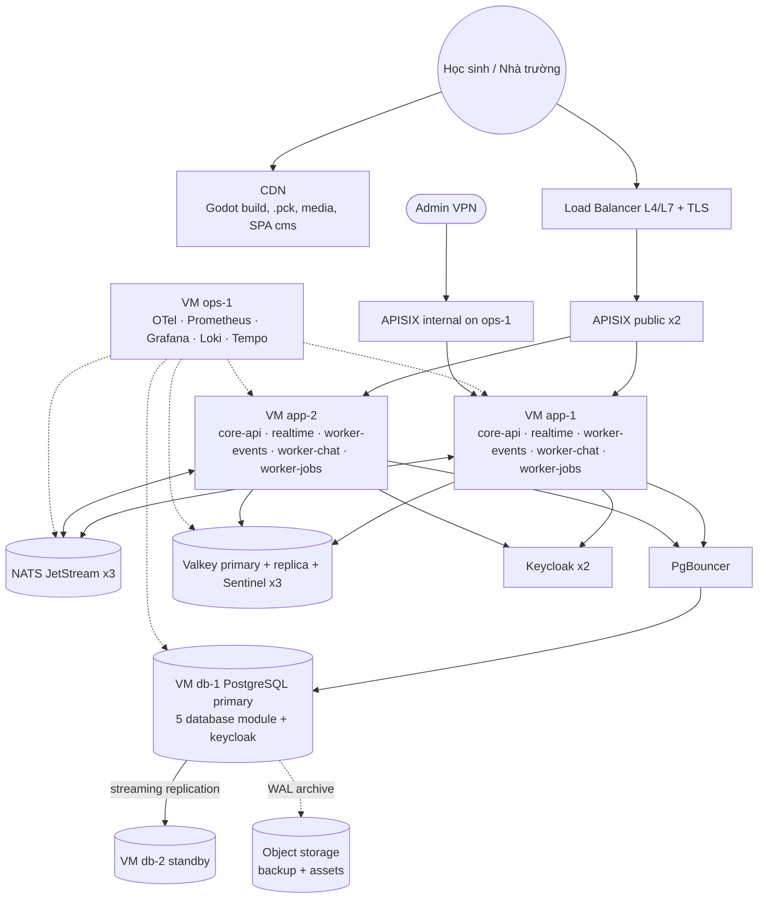
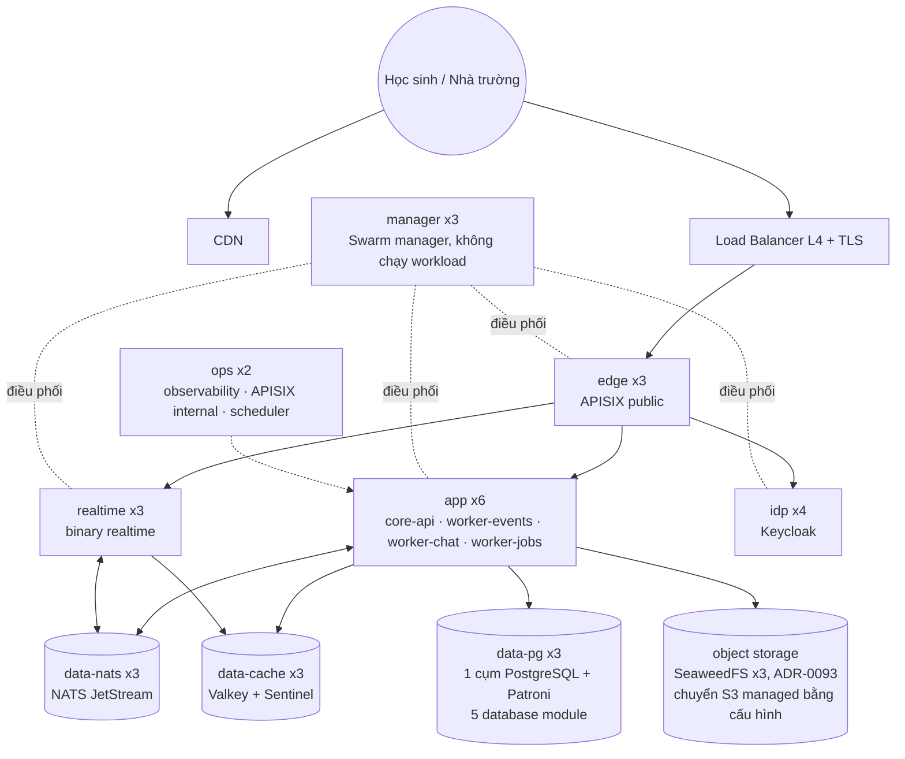
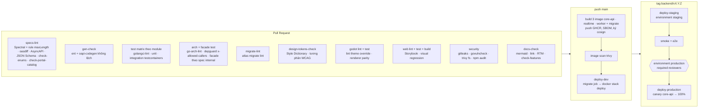

# Deployment

> Trạng thái: Draft · Phiên bản: 0.5 · Owner: DevOps Engineer · Cập nhật: 2026-11-17 (modular monolith theo ADR-0074: 3 binary `core-api`/`realtime`/`worker` + profile worker, một cụm PostgreSQL, sizing tính lại, CI ma trận theo module theo ADR-0088; object storage staging/production theo ADR-0075 thay ADR-0071; CI/CD GitHub Actions; 4 nền tảng client từ pilot; cổng quản trị `EW_ADMIN_ADDR`, secret đọc replica, SMTP, thư mục vận hành)
> Liên quan: [SYSTEM_ARCHITECTURE](../06-architecture/SYSTEM_ARCHITECTURE.md) · [ADR-0074](../adr/ADR-0074-modular-monolith-co-ranh-gioi-cuong-che.md) · [ADR-0088](../adr/ADR-0088-ci-cd-bang-github-actions.md) · [ADR-0009, ADR-0023, ADR-0024, ADR-0037…0042, ADR-0089](../adr/README.md) · [LOCAL_DEVELOPMENT](LOCAL_DEVELOPMENT.md) · [MONITORING](MONITORING.md) · [BACKUP_RECOVERY](BACKUP_RECOVERY.md) · [SECURITY_ARCHITECTURE](../10-security/SECURITY_ARCHITECTURE.md)

**Mục đích & phạm vi.** Nguồn duy nhất về môi trường, topology, **sizing**, mạng, CI/CD, release/rollback, migration khi deploy, phân phối secret, health check. Không thuộc phạm vi: compose/Makefile local → [LOCAL_DEVELOPMENT](LOCAL_DEVELOPMENT.md); metric/alert/SLO → [MONITORING](MONITORING.md); backup/khôi phục → [BACKUP_RECOVERY](BACKUP_RECOVERY.md); chính sách secret → [SECURITY_ARCHITECTURE §6](../10-security/SECURITY_ARCHITECTURE.md).

## 1. Phạm vi

Tài liệu này mô tả cách đóng gói, triển khai, phát hành và vận hành EduWorld trên 4 môi trường. Backend là **modular monolith** ([ADR-0074](../adr/ADR-0074-modular-monolith-co-ranh-gioi-cuong-che.md), thay ADR-0036): một Go module, 5 module domain (`identity`, `learning`, `game`, `competition`, `chat`) + module `realtime`, đóng gói thành **3 binary** (`core-api`, `realtime`, `worker`) và triển khai thành 5 Swarm service theo hồ sơ chạy (§3.1). Mỗi module domain có database riêng (ADR-0037) trên **một cụm PostgreSQL** chung. Module gọi nhau trong tiến trình qua facade sinh từ spec internal (`src/backend/pkg/modcall`), không có HTTP nội bộ; phản ứng phụ đi qua outbox → NATS JetStream (ADR-0042); `realtime` gửi lệnh tới `core-api` qua NATS request/reply.

Nền tảng chạy container là **Docker** (ADR-0024, Accepted): Docker Compose cho local/dev, **Docker Engine chế độ Swarm** cho staging/production. **Chưa dùng Kubernetes.** Topology ứng dụng đã chốt bằng ADR-0074 (trả lời OQ-10). Nơi đặt hạ tầng [Confirmed — owner 2026-11-20, OQ-10]: staging/production chạy trên **VM của nhà cung cấp cloud có trung tâm dữ liệu tại Việt Nam** (không on-prem); thành phần có trạng thái (PostgreSQL/Patroni, Valkey, NATS, Keycloak, etcd của APISIX) **tự vận hành** trên Swarm theo §4; dịch vụ managed chỉ dùng cho object storage (§9b, OQ-21); nguồn gốc secret là SOPS (age) mã hóa trong Git (§13, F130). Tên nhà cung cấp chọn khi ký hợp đồng theo tiêu chí: dữ liệu lưu tại Việt Nam (NFR-PRIV-001), VM đáp ứng sizing §4, mạng riêng giữa các VM, S3-compatible managed pass spike §9b, SLA hạ tầng đủ cho NFR-AVAIL-001. Rà soát pháp lý về lưu trữ dữ liệu hoãn theo ADR-0082 (OQ-12). Các con số dưới đây là mặc định **[Confirmed]**, đủ để dựng staging từ Phase 1.

## 2. Môi trường

| Môi trường | Mục đích | Hạ tầng | Dữ liệu | Ai truy cập | Nhãn |
|---|---|---|---|---|---|
| **local** | Phát triển trên máy dev | Docker Compose ([LOCAL_DEVELOPMENT](LOCAL_DEVELOPMENT.md)) | Seed giả | Dev | [Confirmed] (Docker Compose, Master Prompt §18) |
| **dev** | Tích hợp liên tục, deploy tự động từ `main` | 1–2 VM, Docker Compose | Seed giả, reset được | Team | [Confirmed] |
| **staging** | UAT, load test, kiểm thử tích hợp SIS/IdP sandbox | Docker Swarm, cùng topology production, ít node hơn | Dữ liệu giả hoặc đã ẩn danh; **không** dùng dữ liệu học sinh thật | Team, QA, đại diện trường (UAT) | [Confirmed] |
| **production** | Học sinh và nhân sự nhà trường thật | Docker Swarm (ADR-0024) trên VM cloud tại Việt Nam (OQ-10); HA cho mọi thành phần stateful | Thật, chịu DATA_PRIVACY | Vận hành (least privilege, có audit) | [Confirmed] Docker Swarm · [Confirmed — owner 2026-11-20] VM cloud tại VN (OQ-10) |

Quy tắc:
- Mỗi môi trường có Keycloak, PostgreSQL, Valkey, NATS, APISIX **riêng**; không chia sẻ database giữa môi trường.
- Mỗi image (`core-api`, `realtime`, `worker`, `migrate`) promote nguyên vẹn dev → staging → production (build một lần, cấu hình qua env).
- Production chỉ deploy từ tag đã ký đã qua staging. Ba binary backend build từ cùng commit và dùng chung một version: tag `backend/vX.Y.Z` (ví dụ `backend/v1.4.0`); web và Godot có tag riêng (§11.1).

## 3. Thành phần và container image

### 3.1. Binary và Swarm service backend (ADR-0074)

Mã nguồn backend là một Go module ở `src/backend/` (`src/backend/go.mod` duy nhất, module path `github.com/tanguyen2020/eduworld-platform/src/backend`; [ADR-0092](../adr/ADR-0092-to-chuc-ma-nguon-trong-src.md)): `src/backend/modules/<module>/` (facade `api/`, `internal/`, `module.go`), `src/backend/pkg/` (platform kit), `src/backend/cmd/` (composition root của từng binary). Docker build context là gốc repository, Dockerfile chép mã từ `src/backend/` (ADR-0092). Image đẩy lên GitHub Container Registry (`ghcr.io/<org>/eduworld/<image>`, ADR-0088).

| Swarm service | Image (binary) | Module nạp | Database kết nối | Nội dung | Replica |
|---|---|---|---|---|---|
| `core-api` | `eduworld/core-api` (`src/backend/cmd/core-api`) | `identity`, `learning`, `game`, `competition`, `chat` | 5 database module (mỗi module một pool, role của module đó) | REST public `/api/v1/*`, route `game-admin`/`admin`/`sis` cho gateway nội bộ, handler NATS request/reply `ew.cmd.<module>.>` cho lệnh từ realtime; room host của module competition (hub instance, battle/co-op state machine, lease theo room trong Valkey, input `ew.in.room.<room_id>`) | ≥ 2 |
| `realtime` | `eduworld/realtime` (`src/backend/cmd/realtime`) | `realtime` | Không (chỉ Valkey, NATS) | Kết thúc WebSocket `/realtime/v1`, xác thực ticket, presence, định tuyến lệnh/sự kiện qua NATS và Valkey Pub/Sub; không nạp module domain, không có database | ≥ 2, drain khi deploy (§11.2) |
| `worker-events` | `eduworld/worker` (`src/backend/cmd/worker --profile=events`) | 5 module domain | 5 database module | Outbox relay (role `<module>_relay`), consumer event domain (projection `ref_*`, quest progress, reward/XP, mastery, rollup dashboard, analytics, membership Keycloak, audit sink), `media-processor`, `content-snapshot-builder`, `dashboard-export` | ≥ 1 (thường 2) |
| `worker-chat` | `eduworld/worker` (`src/backend/cmd/worker --profile=chat`) | `chat` | `eduworld_chat` | `chat-persister`, `chat-notifier`, `chat-moderation-async`, `chat-stats`, `chat-channel-closer`, `gameplay-chat-purge` (role `chat_purger`, ADR-0033) | ≥ 1 (thường 2) |
| `worker-jobs` | `eduworld/worker` (`src/backend/cmd/worker --profile=jobs`) | 5 module domain | 5 database module | Job định kỳ có khóa leader (§7): `game-session-timeout`, `student-inactive-cleanup` (saga), `sis-sync`, matchmaker loop, tournament scheduler, leaderboard snapshot, `dashboard-day-close`, auto-submit đề hết giờ, `partition-maintainer`/`infra-partition-maintenance` (ADR-0089) | 2 (một giữ khóa leader, một dự phòng) |

Image `eduworld/migrate` (Atlas, ADR-0039) chứa thư mục migration của mọi module, chạy như job `migrate --module=<module>` trước khi rollout (§12). Một profile worker hỏng hoặc quá tải không chặn profile khác; chat tăng đột biến chỉ cần tăng replica `worker-chat` (ADR-0074 mục 2).

**Công thức (ADR-0055):** không có math worker hay image riêng. Admin Portal render công thức thành SVG + speech text bằng MathJax 4 trên trình duyệt khi lưu/publish; module learning chỉ kiểm tra allowlist LaTeX (≤ 2.000 ký tự, độ sâu lồng ≤ 20), sanitize SVG (≤ 256 KB) và lưu `math/<sha256>.svg` lên object storage (§9b). Env: `EW_MATH_MAX_LATEX_LENGTH=2000`, `EW_MATH_MAX_SVG_BYTES=262144`, `EW_MATH_MAX_DEPTH=20`. CLI render dùng cùng MathJax 4 cho import hàng loạt trong CI/vận hành là [Confirmed] (job một lần, không chạy thường trực).

### 3.2. Thành phần khác

| Thành phần | Image / artifact | Nguồn | Ghi chú |
|---|---|---|---|
| Admin Portal (5 workspace) | `eduworld/web-portal` | `src/cms/frontend/apps/portal` (`vite build`) | Static trên CDN public `portal.<domain>`; mã mỗi workspace là chunk lazy-load (không phải lớp bảo mật). API workspace platform (`/api/v1/game-admin/*`, `/api/v1/admin/*`) chỉ trên APISIX nội bộ/VPN, yêu cầu MFA (ADR-0027 mục 3, 7) |
| Godot client | Artifact | `src/game/` | 4 nền tảng Windows, Android, iOS, Web, phát hành từ pilot (ADR-0013, ADR-0073) |
| Godot content packs | `.pck` / asset bundle | `src/game/` + CMS | Object storage + CDN, manifest phiên bản |
| Keycloak | `quay.io/keycloak/keycloak:26.x` + theme/provider | `deploy/keycloak/` | Build optimized image |
| APISIX | `apache/apisix:3.x` | `deploy/apisix/` | Config declarative trong Git |
| PostgreSQL | `postgres:17` (hoặc managed) | `deploy/postgres/` (init script tạo database/role theo module) | Extension: `pgcrypto`, `pg_stat_statements`, `unaccent` |
| Valkey | `valkey/valkey:8` | — | |
| Object storage | local/CI: **floci** (ADR-0044); staging/production: **S3-compatible managed tại Việt Nam** ([ADR-0075](../adr/ADR-0075-object-storage-production-khong-dung-floci.md), [Confirmed — Technical Architect 2026-11-17]; phương án [Confirmed — owner 2026-11-20, OQ-21]; thay ADR-0071) | `deploy/object-storage/` (bucket, policy, lifecycle) | 6 bucket theo ADR-0044 (§9b) |
| Media pipeline | Thư viện `src/backend/pkg/media` chạy trong profile `worker-events` (consumer `media-processor`, `content-snapshot-builder`); image phụ `eduworld/media-tools` (ffmpeg, libvips, gltf-transform) | `src/backend/modules/*/` + `deploy/media/` | Tách thành profile/Swarm service riêng (`--profile=media`) khi tải lớn [Confirmed] |
| ClamAV | `clamav/clamav:stable` (clamd + freshclam) | — | Media worker quét file trong quarantine qua TCP clamd |
| NATS | `nats:2.10-alpine` (JetStream) | `deploy/nats/` (server config, account/user JWT, không chứa secret) | Cluster 3 node; `prometheus-nats-exporter` |
| Observability | otel-collector, prometheus, grafana, loki, tempo | `deploy/observability/` | ADR-0023 |

Yêu cầu chung cho image do dự án build:
- Multi-stage build, `CGO_ENABLED=0`, `-trimpath`, ldflags gắn `binary`, `version`, `commit`, `build_time`.
- Chạy user non-root (UID ≥ 10001), không shell trong image runtime, read-only rootfs.
- Quét lỗ hổng (Trivy/Grype) trong CI, **chặn release** nếu có CVE Critical đã có bản vá.
- SBOM (Syft, SPDX/CycloneDX) đính kèm mỗi release của mỗi image.
- Tag image bằng `git sha` và semver của backend (`backend/vX.Y.Z`); không dùng `latest` ngoài local.

## 4. Topology

### 4.1. Pilot (NFR-SCAL-001: 5 trường · 5.000 HS · 1.000 CCU) — [Confirmed]

Mục tiêu: vận hành đơn giản, HA tối thiểu cho dữ liệu. Chạy **Docker Swarm** nhỏ trên VM (3 manager có thể đặt chung trên app-1, app-2, ops-1 ở pilot); `core-api` và `realtime` mỗi Swarm service 2 replica trải trên 2 VM app (`placement.preferences: spread node.labels.zone`); ba profile worker chạy chung trên 2 VM app, không cần VM worker riêng.



| Node | vCPU | RAM | Disk | Thành phần |
|---|---|---|---|---|
| app-1, app-2 | 8 | 16 GB | 100 GB SSD | Mỗi node: 1 replica `core-api`, 1 `realtime`, 1 `worker-events`, 1 `worker-chat`, 1 `worker-jobs` (job định kỳ giữ khóa leader nên chỉ một replica chạy job); Swarm manager |
| idp-1, idp-2 | 4 | 8 GB | 50 GB | Keycloak cluster; database `keycloak` trên db-1 |
| db-1, db-2 | 8 | 32 GB | 500 GB NVMe | PostgreSQL 17 primary/standby (Patroni), **một cụm** chứa 5 database module + `keycloak`, mỗi database role riêng (ADR-0074 mục 4) |
| cache-1 (+ Sentinel trên app-1/app-2) | 4 | 8 GB | 50 GB | Valkey primary + replica; NATS node 1 |
| NATS node 2, 3 | (đặt chung db-2, ops-1) | +2 GB | +50 GB SSD | 3 node trên 3 VM khác nhau |
| ops-1 | 8 | 16 GB | 500 GB | Observability, APISIX internal; log giữ 14 ngày; Swarm manager thứ 3 |

> Pilot dùng 8 VM (trước đây 9 VM khi còn VM worker riêng cho 5 service). Sizing là ước lượng ban đầu, **phải hiệu chỉnh bằng load test** ([TEST_STRATEGY](../12-project/TEST_STRATEGY.md) §8). Không tuyên bố năng lực khi chưa benchmark.

### 4.2. Release 1.0: 10.000 CCU trên Docker Swarm (NFR-SCAL-002 [Confirmed], ADR-0024, ADR-0045) — sizing [Confirmed]

Release 1.0 chạy **Docker Swarm** (ADR-0024), không dùng Kubernetes. Mỗi node VM được gắn nhãn vai trò; service đặt bằng `placement.constraints` theo nhãn. Năng lực VM được cấp **đủ cho giờ cao điểm**; số replica tăng/giảm theo lịch học (§4.4), không có autoscale theo tải thực.



**Node theo vai trò** (nhãn `role=<...>`):

| Vai trò (`node.labels.role`) | Số node | Mỗi node | Chạy |
|---|---|---|---|
| `manager` | 3 | 2 vCPU / 4 GB | Swarm manager (Raft quorum), `availability=drain` (không chạy workload) |
| `edge` | 3 | 4 vCPU / 8 GB | APISIX public (3 → 5 replica), etcd của APISIX |
| `realtime` | 3 | 8 vCPU / 16 GB | `realtime` (4 → 6 replica, ≤ 4.000 WS/replica) |
| `idp` | 4 | 8 vCPU / 16 GB | Keycloak (4 → 6 replica, 4 vCPU / 8 GB mỗi replica; ADR-0064 mục 6, ADR-0086) |
| `app` | 6 | 16 vCPU / 32 GB | `core-api`, `worker-events` (gồm `media-processor`), `worker-chat`, `worker-jobs` |
| `data-pg` | 3 | 32 vCPU / 128 GB / NVMe | **Một cụm** PostgreSQL (ADR-0074 mục 4): primary + 2 replica (Patroni) + PgBouncer, chứa 5 database module + `keycloak`. Tách `eduworld_learning` hoặc `eduworld_chat` sang cụm riêng chỉ khi số đo load test/vận hành cho thấy cần (chuyển database, không đổi mã) |
| `data-cache` | 3 | 8 vCPU / 32 GB | Valkey `cache`, `realtime`, `ratelimit` (primary/replica đặt chéo node) + Sentinel |
| `data-nats` | 3 | 4 vCPU / 8 GB / 200 GB SSD | NATS JetStream cluster |
| `storage` | 3 (staging: 1) | 4 vCPU / 8 GB / ổ dữ liệu = dung lượng media đo được × 3 bản + 50% dư | SeaweedFS (master ×3 quorum, volume server, filer, S3 gateway) theo [ADR-0093](../adr/ADR-0093-object-storage-tu-host-seaweedfs-truoc-chuyen-s3-managed-bang-cau-hinh.md); gỡ khi chuyển sang S3 managed |
| `ops` | 2 | 8 vCPU / 16 GB / 500 GB | OTel, Prometheus, Grafana, Loki, Tempo, APISIX internal, scheduler scale theo lịch, bastion |

**Replica ở đỉnh** (giới hạn bằng `deploy.resources.limits`; tổng phải nằm trong năng lực node vai trò tương ứng):

| Swarm service | Replica thường → đỉnh | Mỗi replica | Căn cứ |
|---|---|---|---|
| Keycloak | 4 → 6 | 4 vCPU / 8 GB | ADR-0064 mục 6 (giữ hiệu lực dù ADR-0086 cho thiết bị cá nhân vào lại bằng refresh token — sizing thận trọng cho máy dùng chung và phiên hết hạn): đỉnh **100 đăng nhập mật khẩu/s** × ≤ 80 ms băm ≈ 8 vCPU + 500 refresh/s gồm `resume` khi mở game (~1–2 vCPU, không băm mật khẩu) + overhead; 6 replica × 4 vCPU = 24 vCPU giữ dư địa ~2× ở đỉnh; bão 5.000 lượt/10 phút (KEYCLOAK_SSO §12, kiểm chứng TC-PERF-002/016) |
| APISIX public | 3 → 5 | 2 vCPU / 2 GB | ~3.000 req/s REST đỉnh + 10.000 WS proxy |
| `realtime` | 4 → 6 | 2 vCPU / 2 GB | ≤ 4.000 WS/replica (REALTIME_ARCHITECTURE §11) |
| `core-api` | 6 → 16 | 4 vCPU / 4 GB | Tổng tải REST của 5 module ở đỉnh: đăng nhập game ~100/s (mỗi lượt một lời gọi token endpoint Keycloak, ADR-0068), làm bài/chấm điểm/phát câu hỏi cho trận (phần lớn CPU), game session/manifest/quest, trận và leaderboard, chat 1.000–2.000 tin/s, room host của module competition (~175 hub instance + trận, tick ≤ 5 ms ≈ 9 vCPU ở đỉnh). `principals:resolve`, bắt đầu attempt, lấy/chấm câu hỏi thi đấu là gọi facade trong tiến trình nên không còn chi phí HTTP/JSON nội bộ; scale cùng lịch warm-up với Keycloak |
| `worker-events` | 2 → 4 | 2 vCPU / 2 GB | Outbox relay + consumer domain + `media-processor`; theo consumer pending (alert + scale theo runbook) |
| `worker-chat` | 2 → 4 | 2 vCPU / 2 GB | `chat-persister` theo lô, notifier, moderation async; tăng replica khi chat tăng đột biến |
| `worker-jobs` | 2 | 1 vCPU / 1 GB | Một replica giữ khóa leader, một dự phòng |
| PgBouncer | 2 | 1 vCPU | Pool transaction mode, một pool cho mỗi cặp database/role |
| Valkey | 3 instance tách vai trò (`cache`, `realtime` cluster mode cho sharded Pub/Sub, `ratelimit`) | 4 vCPU / 16 GB | ~100k–150k msg/s Pub/Sub ở đỉnh |
| NATS JetStream | 3 | 4 vCPU / 8 GB | `CHAT_MESSAGES` + `EVT_*` |

> Tổng giới hạn ở đỉnh: `core-api` 16 × 4 = 64 vCPU, `worker-events` 8, `worker-chat` 8, `worker-jobs` 2 → ≈ 82 vCPU trên 6 node `app` 16 vCPU (96 vCPU, dư ~15%). Bản 6 microservice cần ≈ 100 vCPU trên 7 node; phần giảm đến từ bỏ HTTP/JSON và token nội bộ trên đường nóng và bớt overhead tiến trình. Tổng số node Release 1.0 giảm từ 34 xuống 30 (`app` 7 → 6, `data-pg` 6 → 3, chưa tính node `storage` tự host). VM chạy cả ngày nên chi phí tính theo mức đỉnh; giảm replica ngoài giờ chỉ giải phóng tài nguyên cho job nền (rollup, snapshot, media). Phải hiệu chỉnh bằng load test (TC-PERF-014), không phải cam kết.

**Thành phần có trạng thái** (ADR-0024 mục 3): ghim node bằng `placement.constraints: [node.labels.role == data-pg, node.hostname == pg-1]`, volume local NVMe (bind mount hoặc local volume driver), HA ở tầng ứng dụng: PostgreSQL + Patroni (etcd riêng của Patroni hoặc DCS Consul), Valkey replica + Sentinel 3, NATS cluster 3 route, Keycloak 3 replica (Infinispan JDBC_PING). Có thể thay bằng dịch vụ managed của nhà cung cấp cloud tại VN (PostgreSQL, Valkey/Redis-compatible, object storage) khi OQ-10 chọn cloud [Confirmed].

**Service discovery:** DNS nội bộ của Swarm. Không có lời gọi HTTP giữa module (ADR-0074 mục 3): module gọi nhau trong tiến trình `core-api`/`worker`; `realtime` gửi lệnh tới `core-api` qua NATS request/reply; mọi phản ứng phụ qua NATS JetStream. APISIX dùng `tasks.core-api` và `tasks.realtime` (DNS round-robin từng task) để health check và cân bằng tải từng replica [Confirmed]. Không dùng service mesh.

### 4.3. Phân vùng mạng (overlay network + firewall)

Swarm overlay network tách lớp; một service chỉ được gắn vào network cần thiết. Network `app`, `data`, `admin` tạo với `--opt encrypted` (mã hóa IPsec giữa node).

| Overlay network | Thành phần gắn vào | Ghi chú |
|---|---|---|
| `edge` | APISIX public, `core-api`, `realtime`, Keycloak (public endpoint) | APISIX chỉ tới cổng public `:8080` của `core-api`/`realtime` |
| `app` | `core-api`, `worker-*`, `realtime`, NATS | NATS request/reply (lệnh realtime) và JetStream; không có HTTP nội bộ giữa binary |
| `data` | `core-api`, `worker-*`, `realtime` (chỉ Valkey), PgBouncer, PostgreSQL, Valkey, object storage | Mỗi binary chỉ có credential cần cho module nó nạp: role `<module>_*` của từng database (pg_hba theo user/database), Valkey ACL, NATS user theo binary; `realtime` không có credential PostgreSQL |
| `admin` | APISIX internal, Keycloak admin, observability, bastion | Chỉ từ VPN quản trị |

| Zone | Thành phần | Inbound cho phép |
|---|---|---|
| Public | LB, CDN | 443 từ Internet |
| Edge | APISIX public | Từ LB |
| App | `core-api`, `realtime` | Chỉ từ APISIX (và `:9090` từ Ops); không có inbound giữa binary |
| Worker | `worker-events`, `worker-chat`, `worker-jobs` | Không inbound (trừ `:9090` từ Ops) |
| Identity | Keycloak | Public endpoints qua LB; admin console **chỉ** qua APISIX internal/VPN |
| Data | PostgreSQL, Valkey, NATS, etcd | Chỉ từ App/Worker/Identity |
| Ops | Observability, bastion, APISIX internal | Từ VPN quản trị |

Gọi đồng bộ giữa module diễn ra trong tiến trình nên tầng mạng không thấy và không cần chặn. **Ma trận gọi facade** được cưỡng chế lúc build: quy tắc `internal/` của Go chặn import vào bên trong module, `depguard`/`go-arch-lint` chỉ cho module import `src/backend/modules/<khác>/api` khi có trong `x-allowed-callers` của operation (ADR-0074 mục 1). Ở runtime, ranh giới dữ liệu do role DB theo module (mỗi pool chỉ `CONNECT` database của module đó) và quyền NATS theo binary bảo đảm. Tầng mạng chỉ chặn ở mức network (binary không gắn `data` thì không tới được database). Firewall host (nftables/security group) chỉ mở cổng Swarm giữa các node (2377/tcp tới manager, 7946/tcp+udp, 4789/udp, ESP cho overlay mã hóa) và cổng publish của LB/APISIX.

Ma trận gọi facade cho phép (cưỡng chế bằng linter, không phải tầng mạng) — [Confirmed]:

| Module gọi → module nhận | identity | learning | game | competition | chat |
|---|---|---|---|---|---|
| identity | — | platform ops (clone/trash/cleanup) | platform ops | platform ops | platform ops |
| learning | principal/tenant | — | — | — | — |
| game | principal/tenant | attempt, question delivery | — | — | — |
| competition | principal/tenant | question plan, chấm điểm | — | — | — |
| chat | principal/tenant | — | — | — | — |
| realtime | — (đi qua NATS request/reply) | | | | |

Outbound Internet: chỉ Swarm service chạy adapter SIS của module `identity` (`worker-jobs` cho `sis-sync`, `worker-events` cho consumer SIS, `core-api` cho lookup on-demand theo ADR-0046) có egress tới SIS qua proxy allowlist; Keycloak Admin API nằm trong mạng nội bộ. Các thành phần khác không có Internet egress ngoại trừ cập nhật OS qua proxy.

### 4.4. Scale theo lịch học (thay autoscale, ADR-0024 mục 4, ADR-0045)

- Lịch scale khai báo trong Git: `deploy/swarm/<env>/scale-schedule.yaml` (mỗi Swarm service `core-api`, `realtime`, `worker-*`, Keycloak: `baseline`, `peak`, các khung giờ). Mặc định khung cao điểm 06:45–08:00, 13:15–14:30, 19:00–21:00 ICT [Confirmed]; có thể sinh thêm từ lịch học/lịch kiểm tra trong module learning.
- Container `ops-scheduler` (chạy trên node `ops`, có quyền Docker API của manager qua socket proxy chỉ cho phép `service update`) chạy `docker service scale <stack>_<service>=<n>` **15 phút trước** khung cao điểm và thu nhỏ sau đó; ghi log + metric `eduworld_ops_scale_actions_total`.
- Ngoài lịch: alert `NodeCapacityHigh`, `EventConsumerLag`, `ScheduledScaleFailed` và alert số WS/replica (định nghĩa và ngưỡng: [MONITORING §5](MONITORING.md)) báo người trực scale thủ công theo runbook; không có scale tự động theo tải.
- Không scale vượt năng lực node vai trò; scheduler từ chối nếu tổng `resources.reservations` vượt dung lượng còn lại.

### 4.5. Stack file mẫu

Mỗi môi trường có `deploy/swarm/<env>/` gồm `infra.stack.yml` (APISIX, Keycloak, NATS, Valkey, observability), `data.stack.yml` (PostgreSQL/Patroni, PgBouncer; object storage tự host nếu chọn — ADR-0075) và `app.stack.yml` chứa 5 Swarm service backend (`core-api`, `realtime`, `worker-events`, `worker-chat`, `worker-jobs`); `docker stack deploy` chỉ cập nhật service có spec đổi.

```yaml
# deploy/swarm/production/app.stack.yml (trích core-api)
version: "3.9"
services:
  core-api:
    image: ghcr.io/${GHCR_ORG}/eduworld/core-api:${BACKEND_VERSION}      # tag bất biến (ADR-0088)
    env_file: [core-api.env]                                             # không chứa secret
    secrets: [identity_db_url, learning_db_url, learning_db_read_url, game_db_url, game_db_read_url, competition_db_url, chat_db_url, identity_valkey_password, learning_valkey_password, game_valkey_password, competition_valkey_password, chat_valkey_password, kc_game_backend, kc_portal, kc_svc_identity, core_nats_creds]   # mỗi module một DSN/ACL user của module đó; đọc qua biến `*_FILE` (LOCAL_DEVELOPMENT §4)
    networks: [edge, app, data]
    healthcheck:
      test: ["CMD", "/app/core-api", "healthcheck", "--endpoint=/livez"] # binary tự kiểm tra, image không có curl
      interval: 10s
      timeout: 2s
      retries: 3
      start_period: 20s
    stop_grace_period: 40s
    deploy:
      replicas: 6
      placement:
        constraints: [node.labels.role == app]
        preferences: [{ spread: node.labels.zone }]
      resources:
        limits: { cpus: "4", memory: 4G }
        reservations: { cpus: "2", memory: 2G }
      update_config: { parallelism: 1, delay: 10s, order: start-first, failure_action: rollback, monitor: 60s }
      rollback_config: { parallelism: 2, order: start-first }
      restart_policy: { condition: any, delay: 5s, max_attempts: 5, window: 120s }
  worker-chat:
    image: ghcr.io/${GHCR_ORG}/eduworld/worker:${BACKEND_VERSION}
    command: ["--profile=chat"]                   # chat-persister, notifier, moderation async, stats, purge
    secrets: [chat_db_url, chat_db_purger_url, chat_valkey_password, worker_nats_creds]
    networks: [app, data]                         # không gắn edge: không inbound
    deploy:
      replicas: 2
      placement: { constraints: [node.labels.role == app] }
      resources: { limits: { cpus: "2", memory: 2G } }
networks:
  edge: { external: true }
  app: { external: true }
  data: { external: true }
secrets:
  learning_db_url: { external: true }             # role learning_app
  learning_db_read_url: { external: true }        # read context (ADR-0087), trỏ replica
  kc_svc_identity: { external: true }             # chỉ cho Keycloak Admin API (ADR-0074 mục 5)
  core_nats_creds: { external: true }             # NATS user của binary core-api
  # … các secret còn lại khai báo tương tự
```

```yaml
# deploy/swarm/production/infra.stack.yml (trích APISIX)
  apisix:
    image: apache/apisix:3.x-debian        # pin phiên bản cụ thể khi triển khai
    configs:
      - { source: apisix_config_v12, target: /usr/local/apisix/conf/config.yaml }
    ports:
      - { target: 9443, published: 443, protocol: tcp, mode: host }   # mode host: LB L4 trỏ thẳng node edge
    networks: [edge, admin]
    deploy:
      replicas: 3
      placement: { constraints: [node.labels.role == edge], max_replicas_per_node: 2 }
      update_config: { parallelism: 1, order: start-first, failure_action: rollback }
```

Docker configs/secrets là bất biến: đổi nội dung = tạo config/secret mới có hậu tố version (`apisix_config_v13`) rồi cập nhật stack.

## 5. APISIX

| Môi trường | Mode | Nguồn cấu hình |
|---|---|---|
| local | **Standalone**, hai container `apisix` (public) và `apisix-internal`, `conf/apisix.yaml` mount từ `deploy/apisix/standalone/{public,internal}/apisix.yaml` | Git: nguồn duy nhất `deploy/apisix/routes/routes.yaml` + `routes/env/<env>.env`, render bằng `deploy/apisix/scripts/render.mjs` (`make apisix-render`), CI kiểm file render khớp nguồn (F004) |
| dev/staging/prod | **Traditional (etcd)**, etcd 3 node | Declarative bằng ADC sinh từ cùng `routes.yaml`, áp dụng qua CI job `apisix:sync` — đầu ra ADC và job sync làm ở F130 [Confirmed — owner 2026-11-20]; F004 chỉ có đầu ra standalone và diff render staging trong job summary của PR |

**Upstream (ADR-0074 mục 5):** APISIX chỉ có hai upstream backend, `core-api` và `realtime`. Module sở hữu prefix (cột cuối) dùng cho định tuyến trong `core-api`, plugin theo route và phân quyền review; không phải upstream riêng.

| Prefix | Upstream | Gateway | Module sở hữu |
|---|---|---|---|
| `/api/v1/auth`, `/me`, `/tenant`, `/schools`, `/students` | `core-api` | public | `identity` |
| `/api/v1/admin`, `/api/v1/sis` | `core-api` | **internal** | `identity` |
| `/api/v1/learning`, `/exams`, `/cms`, `/lms` | `core-api` | public | `learning` |
| `/api/v1/game` | `core-api` | public | `game` |
| `/api/v1/game-admin/{quests,minigame-configs,npc-dialogues,world-areas,story-chapters,events,event-templates,season-tracks,items,reward-rules,levels}` | `core-api` | **internal** | `game` |
| `/api/v1/game-admin/{matchmaking-configs,ranking-rules,seasons,tournament-templates,leaderboard-definitions}` | `core-api` | **internal** | `competition` |
| `/api/v1/game-admin/{sticker-packs,gifs}` | `core-api` | **internal** | `chat` |
| `/api/v1/multiplayer`, `/competition`, `/leaderboards` | `core-api` | public | `competition` |
| `/api/v1/chat`, `/social`, `/notifications` | `core-api` | public | `chat` |
| `/realtime/v1` (WebSocket, `enable_websocket: true`, read timeout 75 s) | `realtime` | public | `realtime` |

Không có prefix `/internal/v1/*`: module gọi nhau trong tiến trình (ADR-0074 mục 3). Gateway nội bộ chỉ định tuyến `/api/v1/game-admin/*`, `/api/v1/admin/*`, `/api/v1/sis/*` tới `core-api` (R20).

- **Route đăng nhập game (ADR-0068):** `/api/v1/auth/game/login`, `/api/v1/auth/game/tenant:select`, `/api/v1/auth/game/token:refresh` → `core-api` (module `identity`), **không** `openid-connect` (`/api/v1/auth/game/logout` dùng bearer token theo contract nên có `openid-connect`, cùng quy tắc không ghi body), chỉ HTTPS (HSTS), `client-control` `max_body_size` 4 KB. **Không ghi body**: logger (`http-logger`/`file-logger`/`kafka-logger`) không bật `include_req_body`, `opentelemetry` không thu body/header nhạy cảm, access log chỉ ghi method, path, status, `X-Device-Id` rút gọn, latency; mọi thay đổi route này cần review bảo mật (CI `check-no-body-logging.mjs`: không logger nào trên `/auth/game/*`, `/auth/portal/*`; không `include_*_body`; access log và thuộc tính OTel không đọc body, `Authorization`, cookie, `X-EW-CSRF`, query string).
- **Kiểm tra header tenant (ADR-0065):** plugin Lua `ew-tenant-header` (`deploy/apisix/plugins/ew-tenant-header.lua`, chốt ở F004; `mode` `required`/`optional`) trên mọi route tenant-scoped: thiếu `X-Tenant-Id` → `400 TENANT_HEADER_REQUIRED` (Problem Details), sai UUID → `400 BAD_REQUEST`; plugin đặt `ctx.var.ew_tenant_id` để gắn vào trace (`opentelemetry.additional_attributes`) và có thể làm khóa giới hạn theo tenant khi cần. `api_rate_default` (theo user `sub`, đọc/ghi đếm riêng, Valkey dùng chung các node) do plugin Lua `ew-api-rate` áp trên mọi route `openid-connect` (F004; CI `check-routes.mjs` bắt route OIDC thiếu profile `rate`). Ngoại lệ: `/auth/game/login`, `/auth/game/tenant:select`, `/auth/session`, `/me/tenants`, `/game/client-config`, `/realtime/v1`, health; `/api/v1/admin/*` chế độ tùy chọn. Bảng route đầy đủ: [API_DESIGN §10](../07-backend/API_DESIGN.md#10-apisix-route-mapping).
- **Rate limit đăng nhập (ADR-0045, ADR-0068):** `/api/v1/auth/game/login` giới hạn **theo thiết bị** (`X-Device-Id`, 10/phút), **theo username** (10/phút, plugin đọc field `username` đã chuẩn hóa, không log) và **toàn cục**; route Keycloak public của portal (`/realms/eduworld/protocol/openid-connect/*`, `/login-actions/*`) và `/api/v1/auth/session` giới hạn theo IP (ngưỡng rộng cho nhân sự) + toàn cục. Đăng nhập game không giới hạn theo IP đơn lẻ vì nhiều trường dùng chung NAT, và trước khi đăng nhập chưa biết tenant (ADR-0063); ngưỡng toàn cục bảo vệ Keycloak 120 đăng nhập mật khẩu/s (đỉnh thiết kế 100/s, ADR-0064 mục 6). `/auth/game/token:refresh` (cả `resume` khi mở game, ADR-0086) giới hạn theo thiết bị, không qua hàng chờ đăng nhập mật khẩu. Vượt ngưỡng toàn cục → `429 LOGIN_QUEUE_BUSY` + `Retry-After` (giây, có jitter) để client hiển thị hàng chờ "Đang vào lớp…"; vượt ngưỡng thiết bị/username → `429 RATE_LIMITED`. Ngưỡng cụ thể ở [SECURITY_ARCHITECTURE §14](../10-security/SECURITY_ARCHITECTURE.md). Hiện thực (F004): plugin Lua `ew-login-key` băm HMAC-SHA256 username chuẩn hóa (khóa `EW_APISIX_LOGIN_KEY_SECRET`) và đếm theo thiết bị/username/toàn cục trong shared dict `ew-login-limit` **của từng node gateway** (ngưỡng chia theo số node); `429` là Problem Details kèm `Retry-After` và `RateLimit-*`. Route `/api/v1/auth/portal/*` cùng plugin, đọc `username`/`identifier`, chỉ host `EW_PORTAL_HOST`.
- Plugin bắt buộc trên route public: `openid-connect`/`jwt-auth` (bearer-only, JWKS Keycloak), `limit-req` + `limit-count` (policy `redis` trỏ Valkey `ratelimit`), `client-control` (`max_body_size` 1 MB mặc định, 20 MB cho upload media CMS), `cors` (origin allowlist), `prometheus`, `opentelemetry`, `request-id`.
- Route **không** auth: `/healthz` của gateway, `/api/v1/game/client-config`, `/api/v1/auth/game/login`, `/api/v1/auth/game/tenant:select`, `/api/v1/auth/game/token:refresh`, `/api/v1/auth/portal/*` (rate limit + không log body); `/realtime/v1` xác thực bằng ticket. CI `check-routes.mjs` đối chiếu từng operation của spec gộp với route (gateway, upstream, xác thực, chế độ header tenant, module).
- Route nội bộ (`/api/v1/admin/*`, `/api/v1/sis/*`, `/api/v1/game-admin/*`, `/api/v1/game-media*`, Admin API APISIX, Keycloak admin, SIS webhook `/internal/sis/webhooks/*`) chỉ có trên **APISIX internal** (ADR-0009). CI kiểm tra gateway public không khai báo các prefix này.
- Thay đổi route đi qua merge request; CI chạy `adc diff` và hiển thị diff trước khi apply.

## 6. Keycloak

- Keycloak 26.x, build image optimized với provider/theme: theme `eduworld-ops` chỉ cho trang action-token đăng ký OTP và email Keycloak của nhân sự (Admin Portal đăng nhập bằng form riêng qua module identity, ADR-0091); học sinh không dùng trang Keycloak (đăng nhập form trong game qua `eduworld-game-backend`, ADR-0068).
- Cluster ≥ 2 node (pilot), **≥ 3 node 4 vCPU / 8 GB cho Release 1.0** (ADR-0045); tăng replica theo lịch học (§4.4); cache phân tán (Infinispan, jgroups qua DNS_PING/JDBC_PING); **persistent user sessions** (phiên lưu DB, scale/restart không làm học sinh bị đăng xuất).
- Băm mật khẩu: argon2id/pbkdf2 với tham số benchmark ≤ 80 ms/lần trên node thật; rehash on login. JVM heap ~70% RAM; DB pool ≥ 100 kết nối/node.
- Không build provider authenticator tùy biến cho học sinh (QR lớp, thẻ QR, mật khẩu hình — ADR-0076 Rejected) và không tạo client `svc-keycloak-authn` ([KEYCLOAK_SSO §3.2](../09-identity/KEYCLOAK_SSO.md)); image chỉ gồm theme.
- Theme đăng nhập tĩnh phục vụ qua CDN; tắt event listener không cần thiết trên đường đăng nhập.
- Database riêng (`keycloak`), user riêng.
- Realm config quản lý dạng code: `deploy/keycloak/realm-eduworld.json` **không chứa secret/user thật**; áp dụng bằng `keycloak-config-cli` trong CI.
- **Client `eduworld-game-backend`** (ADR-0068): confidential, chỉ Direct Access Grants, secret sinh trong từng môi trường, lưu secret manager → Docker secret `kc_game_backend` chỉ mount vào `core-api` (module `identity` dùng); xoay 90 ngày (hai secret song song khi xoay).
- **Client `eduworld-portal`** (ADR-0091): confidential, chỉ Direct Access Grants (flow `eduworld-portal-direct-grant`), cùng cách quản lý secret → Docker secret `kc_portal` chỉ mount vào `core-api` (module `identity`); không bao giờ có trong bundle portal. Realm: `duplicateEmailsAllowed=false`, `loginWithEmailAllowed=true` (ADR-0067).
- **Không có client service-to-service** giữa module (ADR-0074 mục 5): đã bỏ `svc-learning`, `svc-game`, `svc-competition`, `svc-chat`, `svc-realtime`. Chỉ giữ `svc-identity` (confidential, chỉ `client_credentials`) để module identity gọi Keycloak Admin API; secret sinh trong từng môi trường, lưu secret manager, Docker secret `kc_svc_identity` chỉ mount vào Swarm service chạy module identity. Chi tiết: [KEYCLOAK_SSO](../09-identity/KEYCLOAK_SSO.md).
- Hostname cố định (`KC_HOSTNAME`), `KC_PROXY_HEADERS=xforwarded`, chỉ HTTPS phía public. Admin console tách hostname, chỉ qua VPN, bắt buộc MFA.

## 7. PostgreSQL (ADR-0037)

| Hạng mục | Pilot | Mở rộng |
|---|---|---|
| Topology | **1 cụm** (primary + standby, Patroni) chứa 5 database module + `keycloak` (ADR-0074 mục 4) | Vẫn 1 cụm (primary + 2 replica); chỉ chuyển database tải lớn (`eduworld_learning`, `eduworld_chat`) sang cụm riêng khi có số đo, không đổi mã |
| Kết nối | PgBouncer (transaction pooling); pool riêng theo database/user | Như pilot + read replica cho Query side (CQRS, ADR-0038) và reporting |
| Failover | Tự động (Patroni), VIP/DNS cập nhật | Patroni (tự vận hành trên Swarm, node `data-pg`) hoặc managed PostgreSQL |
| Backup | pgBackRest cho cả cụm, restore được từng database ([BACKUP_RECOVERY](BACKUP_RECOVERY.md)) | Như pilot |
| Tham số | `max_connections` 300, `shared_buffers` 25% RAM, `wal_level=replica`, `pg_stat_statements` | Tuning theo load test |

**Database và role theo module** (tạo bằng `deploy/postgres/init/*.sql`, Atlas không tạo role; mỗi module còn có `<module>_readonly`, `<module>_relay`, `<module>_partition_admin` theo ADR-0089 — danh sách đầy đủ ở [DATABASE_DESIGN](../07-backend/DATABASE_DESIGN.md)):

| Database | Role ứng dụng (RLS, không DELETE) | Role platform (BYPASSRLS, có audit) | Role migrate (owner) | Role đặc biệt |
|---|---|---|---|---|
| `eduworld_identity` | `identity_app` | `identity_platform` | `identity_migrator` | — |
| `eduworld_learning` | `learning_app` | `learning_platform` | `learning_migrator` | `learning_dashboard` (chỉ trên read replica, chỉ bảng rollup/read model, `statement_timeout` 5 s — ADR-0062) |
| `eduworld_game` | `game_app` | `game_platform` | `game_migrator` | `game_dashboard` (như trên) |
| `eduworld_competition` | `competition_app` | `competition_platform` | `competition_migrator` | — |
| `eduworld_chat` | `chat_app` | `chat_platform` | `chat_migrator` | `chat_purger` (chỉ `DELETE` bảng chat gameplay, ADR-0033) |

- Mỗi role chỉ có `CONNECT` trên database của module mình; `pg_hba.conf` giới hạn theo `database/user`. Không role nào được truy cập database của module khác (ADR-0037, ADR-0074 mục 4). `core-api` và `worker` mở một pool riêng cho mỗi database của module mình nạp, mỗi pool dùng role của module đó; không join, không transaction chéo database.
- Mọi role ứng dụng bị `REVOKE DELETE, TRUNCATE` (ADR-0028); ngoại lệ duy nhất là `chat_purger`.
- Role platform dùng cho phiên System Admin xem liên tenant và job platform, có audit.
- **Dashboard (ADR-0062, [DASHBOARD_DATA](../07-backend/DASHBOARD_DATA.md)):** API dashboard và export worker của module learning và module game chỉ kết nối **read replica** của `eduworld_learning`/`eduworld_game` qua pool PgBouncer riêng (≤ 10 kết nối mỗi replica `core-api`) bằng role `<module>_dashboard`. Release 1.0: cụm có 2 replica Patroni, dành một replica (async, `hot_standby_feedback=on`, `max_standby_streaming_delay` 30 s) ưu tiên cho dashboard/export; pilot dùng replica standby duy nhất. Cảnh báo khi replica lag > 60 s [Confirmed].

**Job nền theo module** (chạy trong binary `worker`, cột Profile là Swarm service):

| Module | Job | Profile | Lịch | Khóa singleton | Role DB | Quyết định |
|---|---|---|---|---|---|---|
| game | `game-session-timeout` | `worker-jobs` | mỗi 15 s | `ew:lock:job:game:session-timeout` | `game_app` | ADR-0031 |
| identity | `student-inactive-cleanup` (saga) | `worker-jobs` | hằng ngày 02:00 ICT, theo tenant, lô 500 | `ew:lock:job:identity:student-cleanup:<tenant_id>` | `identity_platform` | ADR-0032; các bước dọn của module khác gọi facade `platform students:cleanup` trong tiến trình |
| identity | `sis-sync` | `worker-jobs` | theo lịch connection | `ew:lock:job:identity:sis:<connection_id>` | `identity_platform` | ADR-0021 |
| mọi module | `partition-maintainer` (partition nghiệp vụ) và `infra-partition-maintenance` (bảng `infra.*`) | `worker-jobs` | hằng ngày | `ew:lock:job:<module>:partitions` | `<module>_migrator` (nghiệp vụ), `<module>_partition_admin` (`infra`, ADR-0089) | Tạo partition trước 3 tháng; `infra` tạo trước ≥ 7 ngày |
| competition | `matchmaker` | `worker-jobs` | liên tục | `ew:lock:job:competition:mm:<queue_key>` | — (Valkey) | |
| chat | `chat-persister` (JetStream consumer) | `worker-chat` | liên tục | — | `chat_app` | ADR-0035 |
| chat | `chat-notifier`, `chat-moderation-async`, `chat-stats` | `worker-chat` | liên tục | — | `chat_app` | ADR-0035 |
| chat | `chat-channel-closer` (consumer `chat.channel_closed`) | `worker-chat` | theo event | — | `chat_app` | ADR-0033 |
| chat | `gameplay-chat-purge` | `worker-chat` | hằng giờ | `ew:lock:job:chat:gameplay-purge` | `chat_purger` | ADR-0033 |
| learning | `rollup-dashboard` (JetStream consumer) + `dashboard-day-close` | `worker-events` + `worker-jobs` | liên tục + hằng ngày 02:30 ICT, theo tenant | `ew:lock:job:learning:day-close:<tenant_id>` | `learning_app` | ADR-0062 |
| game | `analytics` (consumer) + `dashboard-day-close` | `worker-events` + `worker-jobs` | liên tục + hằng giờ (hôm nay) + hằng ngày 02:30 ICT | `ew:lock:job:game:day-close:<tenant_id>` | `game_app` | ADR-0058, ADR-0062 |
| learning, game | `dashboard-export` (work-queue) | `worker-events` | theo yêu cầu, ≤ 2 export/người | — | `<module>_dashboard` (đọc replica) + ghi `ew-exports` | ADR-0062 |
| mọi module | `outbox-relay` | `worker-events` | liên tục | khóa theo module | `<module>_relay` | ADR-0042, ADR-0089 |

## 8. Valkey HA

- Valkey 8, primary + replica + Sentinel 3 node (pilot). Client `valkey-go` cấu hình Sentinel.
- Persistence AOF `everysec`, **không** phải nguồn sự thật (ADR-0004). Không còn dùng Valkey Streams cho domain event (ADR-0042).
- Key của từng module có prefix riêng (`ew:<module>:...`) và Valkey ACL user theo module (`identity`, `learning`, `game`, `competition`, `chat`, `realtime`) chỉ được truy cập prefix của mình + channel Pub/Sub được phép ([VALKEY_DESIGN](../07-backend/VALKEY_DESIGN.md)). `core-api` và `worker` mở một client Valkey cho mỗi module nạp, mỗi client dùng ACL user của module đó (giống pool database), nên key nhạy cảm như answer key chỉ module `learning` đọc được.
- Mất Valkey → realtime suy giảm (presence, queue, fan-out chat mất); client tự reconnect, re-queue, bù tin qua lịch sử (seq gap). REST vẫn hoạt động ở chế độ không cache.

## 8b. NATS JetStream (ADR-0035, ADR-0042)

- Cluster 3 node, TLS cho client và route; xác thực NKey/JWT theo account `EDUWORLD`; **mỗi binary một user** (`core-api`, `worker`, `realtime`) với quyền publish/subscribe tối thiểu ([SECURITY_ARCHITECTURE §8.1](../10-security/SECURITY_ARCHITECTURE.md)).
- Stream:

| Stream | Subjects | Lưu | Owner (publish) |
|---|---|---|---|
| `EVT_IDENTITY`, `EVT_LEARNING`, `EVT_GAME`, `EVT_COMPETITION`, `EVT_CHAT` | `ew.evt.<module>.>` | 7 ngày, R3, `duplicate_window` 2' | outbox relay của module tương ứng (profile `worker-events`) |
| `CHAT_MESSAGES` | `ew.chat.*.msg.*`, `ew.chat.*.evt.*`, `ew.chat.*.cursor.*` | 72 h, R3 | module `chat` |
| `DLQ_<MODULE>` | `ew.dlq.<module>.>` | 14 ngày | consumer của module |

- Request/reply cho lệnh realtime (`ew.cmd.<module>.>`) dùng NATS core (không lưu); handler chạy trong `core-api`, queue group theo module.
- Stream và consumer được binary tạo idempotent khi khởi động từ cấu hình trong repo; thay đổi cấu hình qua merge request.
- Dung lượng ước tính [Confirmed]: chat ~26 GB/replica (72 h), event ~5 GB/replica (7 ngày) → cấp 80 GB SSD mỗi node.
- Không backup NATS: PostgreSQL là nguồn sự thật; outbox giữ 30 ngày để replay ([BACKUP_RECOVERY](BACKUP_RECOVERY.md)).
- Nâng cấp rolling từng node; kiểm tra `nats server check jetstream` trước/sau.

## 9. CDN và phân phối Godot client

| Artifact | Kênh phân phối | Ghi chú |
|---|---|---|
| Windows build | CDN tải trực tiếp + (tùy chọn) phần mềm quản lý phòng máy của trường | Ký code (Authenticode) [Confirmed] |
| Android | Google Play (internal → closed → production) và/hoặc APK cho MDM của trường | `.aab` ký bằng upload key trong secret manager |
| iOS | App Store (TestFlight → production) và/hoặc Apple Business Manager/MDM | Build trên GitHub-hosted macOS runner |
| Web | CDN static (`play.<domain>`), `.wasm`/`.pck` nén Brotli, cache theo hash | Renderer Compatibility, preset tối đa Trung bình, tải đầu theo [PERFORMANCE_BUDGET](../08-game-client/PERFORMANCE_BUDGET.md) §11, §14 |
| Content pack `.pck` / media | Object storage + CDN, URL theo hash nội dung | Manifest có chữ ký; client kiểm tra hash; mỗi vùng một gói tải theo nhu cầu |
| Bộ cài cho trường kèm gói nội dung cài sẵn [Confirmed] | Tải từ portal (School Admin) hoặc phát qua MDM/phần mềm quản lý phòng máy; gồm PCK các vùng theo khối của trường | Cập nhật delta theo hash; ngân sách và quy tắc ở [PERFORMANCE_BUDGET §10.1](../08-game-client/PERFORMANCE_BUDGET.md#101-ngân-sách-phòng-máy-classroom-budget-confirmed) |
| Cache LAN tùy chọn của trường [Confirmed] | Reverse proxy HTTP trong LAN trường trỏ về CDN nội dung công khai; client đọc `lan_cache_url` trong `device.cfg` | Chỉ PCK/media công khai theo khóa hash; không cache API, câu hỏi đề, answer key, media private; client luôn kiểm tra SHA-256 |

**Dung lượng build và gói nội dung (ADR-0057):** giới hạn bản cài Windows/Android/iOS, tải đầu Web và kích thước gói mỗi vùng do [PERFORMANCE_BUDGET](../08-game-client/PERFORMANCE_BUDGET.md) §11 sở hữu. Pipeline build Godot (job `godot:export:*`) đo kích thước artifact và **thất bại khi vượt giới hạn**; báo cáo kích thước đính kèm mỗi release. Nội dung ngoài lõi (vùng, cosmetic, media) không đóng vào bản cài mà phát qua `ew-game-bundles`/`ew-media-public` trên CDN để bản cài nhỏ và cập nhật nội dung không cần phát hành lại app.
| Media học tập, sticker, GIF | Object storage + CDN; signed URL cho media riêng tenant (`ew-media-private`) | ADR-0044 |
| Snapshot nội dung đã publish + content manifest theo tenant | `ew-media-public` + CDN, đường dẫn có version/hash, `Cache-Control: public, max-age=31536000, immutable`; con trỏ manifest hiện hành qua API (`ETag`) | ADR-0043; **không** chứa câu hỏi đề kiểm tra/answer key |

- `GET /api/v1/game/client-config` (module game) trả `min_client_version`, `latest_client_version`, `world_manifest_url`, `maintenance` (schema `ClientConfig`); `min_client_version` lấy từ cùng cấu hình triển khai `EW_GAME_MIN_CLIENT_VERSION` với module identity ([CONFIG_DEFAULTS](../00-overview/CONFIG_DEFAULTS.md)).
- Backend hỗ trợ tối thiểu **N-1** phiên bản client trong 1 học kỳ.

## 9b. Object storage và media pipeline (ADR-0044, ADR-0043)

| Bucket | Ghi bởi | Đọc bởi | Chính sách |
|---|---|---|---|
| `ew-media-quarantine` | CMS qua presigned PUT (≤ 15 phút) | media worker | Private; lifecycle xóa object sau 7 ngày (file tạm, chưa phải dữ liệu nghiệp vụ) |
| `ew-media-public` | media worker, content-snapshot-builder | CDN | Versioning bật; không ghi đè (khóa theo hash) |
| `ew-media-private` | media worker | CDN signed URL (5–15 phút) | Versioning bật; SSE |
| `ew-game-bundles` | CI (build Godot, PCK) | CDN | Versioning bật |
| `ew-exports` | worker xuất báo cáo, import SIS | presigned GET | Lifecycle theo DATA_PRIVACY |

- **Luồng media:** CMS → presigned PUT vào quarantine → event `media.uploaded` → `media-processor` (ClamAV, magic bytes, xóa EXIF, chuyển đổi ảnh WebP/PNG, âm thanh Ogg Vorbis/MP3, video Ogg Theora + HLS/MP4, 3D glTF) → ghi biến thể theo khóa `media/<sha256>/<variant>.<ext>` → `media.processed`. File bị nhiễm/sai loại → `rejected`, không bao giờ vào bucket public.
- **Luồng publish (ADR-0043):** `content-snapshot-builder` dựng snapshot bất biến của version, ghi Valkey + `ew-media-public` **trước** khi đổi con trỏ; sau `content.published`/`content.rolled_back`, consumer cập nhật con trỏ cache và content manifest của các tenant liên quan. Mục tiêu publish → học sinh nhận ở lượt chơi kế tiếp ≤ 30 s (NFR-PERF-015).
- **Công thức (ADR-0055):** SVG công thức do portal render (MathJax 4 trên trình duyệt) gửi kèm nội dung; module learning sanitize và lưu `ew-media-public` theo khóa `math/<sha256>.svg` (không ghi đè, cache CDN immutable). `content-snapshot-builder` chỉ kiểm tra mọi công thức của version đã có SVG hợp lệ **trước** khi đổi con trỏ; thiếu/không hợp lệ → publish bị chặn (`422 MATH_RENDER_FAILED`) với danh sách vị trí.
- Media worker (`media-processor`) chạy trong profile `worker-events` trên node `app`; tăng replica `worker-events` (hoặc tách profile `media` khi tải lớn) theo alert số job pending (runbook, §4.4); ffmpeg chạy với giới hạn CPU/RAM/thời gian mỗi job (video ≤ 300 MB, timeout 15 phút).
- **Local và CI dùng [floci](https://github.com/floci-io/floci)** (ADR-0044) + ClamAV tùy chọn ([LOCAL_DEVELOPMENT](LOCAL_DEVELOPMENT.md)). CI: service `floci` (`FLOCI_STORAGE_MODE=memory` cho tốc độ, `FLOCI_SERVICES_S3_ENFORCE_AUTH=true`) và job `s3-init` tạo 6 bucket. floci **không** dùng cho staging/production.
- **Staging/production ([ADR-0093](../adr/ADR-0093-object-storage-tu-host-seaweedfs-truoc-chuyen-s3-managed-bang-cau-hinh.md), [Confirmed — owner 2026-11-20, OQ-21]; thay mục 2, 4 của [ADR-0075](../adr/ADR-0075-object-storage-production-khong-dung-floci.md)):** **SeaweedFS tự host** — production 3 node `storage` (replication 3 bản trên 3 node, master 3 instance), staging 1 node; replication bất đồng bộ bucket riêng tư sang site thứ hai trong Việt Nam; bản sao ngoài cụm hằng ngày (BACKUP_RECOVERY §6). Lý do: chưa có ngân sách cho S3 managed.
  - **Chuyển sang S3 managed tại Việt Nam** khi có ngân sách: chỉ đổi `EW_S3_ENDPOINT`, `EW_S3_REGION`, `EW_S3_ACCESS_KEY`, `EW_S3_SECRET_KEY` và origin CDN + di chuyển dữ liệu bằng `rclone sync` theo runbook RB-05b ([BACKUP_RECOVERY](BACKUP_RECOVERY.md)); code chỉ dùng API S3 chuẩn (SigV4, path-style), không dùng API riêng của SeaweedFS.
  - Chung: credential riêng mỗi binary qua Docker secret (R3, R4); người dùng tải media qua CDN/APISIX + signed URL; code chỉ dùng AWS SDK S3 chuẩn với `EW_S3_ENDPOINT`, `EW_S3_FORCE_PATH_STYLE` (đổi backend chỉ là đổi cấu hình + di chuyển dữ liệu).
- **Spike trước pilot** (ADR-0093 mục 4): nghiệm thu SeaweedFS — presigned URL (PUT/GET, SigV4 ký `Content-Length`/`Content-Type`), multipart, versioning, lifecycle (quarantine 7 ngày), bucket policy, signed URL qua CDN, replication sang site thứ hai; đo hiệu năng upload/tải; diễn tập khôi phục theo [BACKUP_RECOVERY §6](BACKUP_RECOVERY.md#6-object-storage), RB-05. Tính năng không đạt ghi biện pháp bù ở BACKUP_RECOVERY.
- Bucket chứa dữ liệu riêng tư (`ew-media-private`; `ew-student-submissions` nếu sau này có — version này học sinh không upload, ADR-0082) có RPO như dữ liệu học tập ([BACKUP_RECOVERY](BACKUP_RECOVERY.md)).

## 10. CI/CD (GitHub Actions)

Repository nằm trên **GitHub**, nên CI/CD dùng **GitHub Actions** ([ADR-0088](../adr/ADR-0088-ci-cd-bang-github-actions.md), [Confirmed — Technical Architect 2026-11-17]; thay đề xuất GitLab CI trước đây). Mỗi lane là **một workflow riêng** kích hoạt theo path filter (`on.pull_request.paths`, `on.push.paths`); trong `go.yml`, job matrix theo **module** thay đổi (phát hiện bằng `dorny/paths-filter` ghim theo SHA commit), cộng một job kiểm tra kiến trúc toàn repository. Runner: GitHub-hosted `ubuntu-latest` cho lint/test/build; **macOS runner** cho export iOS; **self-hosted runner** trong mạng quản trị cho job deploy (có quyền tới Docker API của Swarm manager, không chạy job của PR từ fork).

### 10.1. Pipeline



### 10.2. Workflow và path filter

| Workflow (`.github/workflows/`) | Kích hoạt khi thay đổi | Job chính |
|---|---|---|
| `specs.yml` | `specs/**`, `scripts/specs/**`, `scripts/openapi/**`, `scripts/ci/**`, `scripts/package*.json`, `.github/**` | `make specs-lint`, `make specs-breaking` (oasdiff public + internal), `check-features`, `check-cross-features`, `check-portal-catalog` (ADR-0090) (trong `specs-lint`); quy tắc workflow (`check-workflows.mjs` + test), path filter (`test-path-filters.sh`), cổng quản trị (`check-admin-ports.sh`) |
| `go.yml` | `src/backend/**`, `tools/**`, `Makefile`, `specs/openapi/modules/**`, `specs/events/**`, `specs/asyncapi/**`, `deploy/postgres/**` | `changes` (paths-filter + `.github/module-filters.yml` → danh sách module; nhóm `shared` — `src/backend/pkg/**`, `cmd/**`, `go.mod`, `tools/**`, `test/**`, `Makefile`, `deploy/postgres/**`, spec event/AsyncAPI — bật mọi module) → matrix `test (<module>)` (`make gen-check`, `make lint`, `make test`, `make test-integration`, `make migrate-lint` với `MOD=<module>`) → `arch` (`go -C src/backend build ./cmd/...`, `make arch-check`, `test-arch-fixtures.sh`, `make test-contract`, integration test của `cmd/`, `pkg/`) → `db-privileges` (test cô lập database + `make migrate` + `make db-privileges`) |
| `release.yml` | `push` lên `main` có thay đổi `src/backend/**`, `deploy/docker/**`; tag `backend/vX.Y.Z` | `build-image` (matrix 4 image `core-api`, `realtime`, `worker`, `migrate`: build → Trivy image chặn Critical/High có bản vá → `check-image.sh` → push GHCR tag `git sha` + version, không `latest` → SBOM (Syft) → ký cosign keyless) → `deploy-staging` (khung, chỉ khi `vars.DEPLOY_ENABLED == 'true'`, runner `[self-hosted, deploy]`, environment `staging`, chặn fork); bước deploy thật và `deploy-production` do F130 |
| `design.yml` | `design/**` | `make design-tokens-check` rồi gọi lại `godot.yml` và `web.yml` (`workflow_call`) (ADR-0047) |
| `godot.yml` | `src/game/**`, `specs/**`, `design/game-tokens/**`, `design/shared-tokens/**` | lint, GdUnit4 headless, benchmark TC-PERF-018, export 4 target (Windows, Android, Web trên Linux; iOS trên macOS runner) |
| `web.yml` | `src/cms/frontend/**`, `specs/openapi/**`, `design/admin-tokens/**`, `design/shared-tokens/**` | ESLint + stylelint, test, build portal, Storybook (`src/cms/frontend/packages/ops-ui`), visual regression Playwright |
| `render-thumbnails.yml` | Asset 3D mới/đổi trong `src/game/assets/models/**` hoặc `workflow_dispatch` từ job publish | Godot headless render thumbnail/turntable → object storage (WORLD_RENDERING §8.3) |
| `deploy-config.yml` | `deploy/**` | APISIX diff, Keycloak config diff, NATS config, compose validate |
| `docs.yml` | `docs/**`, `*.md`, `specs/**/*.md`, `scripts/docs/**`, `specs/openapi/eduworld-api.v1.yaml` | `make docs-check`: `check-mermaid.mjs` → `check-links.mjs` → `build-rtm.mjs --check` ([TRACEABILITY_MATRIX](../12-project/TRACEABILITY_MATRIX.md)) |
| `security.yml` | **Luôn chạy** (mọi PR và push) | `gitleaks` (`.gitleaks.toml`), `govulncheck` (`src/backend`), `osv-scanner` (đệ quy, gồm npm lockfile), `trivy-fs` (vuln + misconfig, Critical/High có bản vá) |

Mọi workflow: `permissions: contents: read` mặc định, action bên thứ ba ghim SHA đầy đủ, Go `stable` mới nhất (`check-latest`, vì CVE của thư viện chuẩn được vá ở bản patch); kiểm bằng `node scripts/ci/check-workflows.mjs`. Nguồn chuẩn là file trong `.github/workflows/`; khung dưới đây chỉ minh họa.

Ví dụ khung workflow (trích):

```yaml
# .github/workflows/go.yml
name: go
on:
  pull_request:
    paths: ["src/backend/**", "tools/**", "Makefile", "specs/openapi/modules/**", "specs/events/**", "specs/asyncapi/**", "deploy/postgres/**"]
  push:
    branches: [main]
    paths: ["src/backend/**", "tools/**", "Makefile", "specs/openapi/modules/**", "specs/events/**", "specs/asyncapi/**", "deploy/postgres/**"]
permissions: { contents: read }
jobs:
  changes:
    runs-on: ubuntu-latest
    outputs: { modules: ${{ steps.filter.outputs.changes }} }
    steps:
      - uses: actions/checkout@<sha>
      - id: filter
        uses: dorny/paths-filter@<sha>          # ghim SHA; mỗi module một filter, thay đổi src/backend/pkg/** hoặc src/backend/go.mod bật mọi module
        with: { filters: .github/module-filters.yml }
  test:
    needs: changes
    if: needs.changes.outputs.modules != '[]'
    runs-on: ubuntu-latest
    strategy: { matrix: { mod: ${{ fromJSON(needs.changes.outputs.modules) }} } }
    steps:
      - uses: actions/checkout@<sha>
      - uses: actions/setup-go@<sha>
        with: { go-version: stable, check-latest: true }
      - run: make gen-check MOD=${{ matrix.mod }}        # ent + oapi-codegen (facade api/) không lệch
      - run: make lint MOD=${{ matrix.mod }}             # gofmt, golangci-lint, go-arch-lint tầng Clean Architecture
      - run: make test MOD=${{ matrix.mod }}             # unit
      - run: make test-integration MOD=${{ matrix.mod }} # testcontainers (PostgreSQL, NATS, Valkey)
      - run: make migrate-lint MOD=${{ matrix.mod }}     # atlas migrate lint
  arch:
    needs: changes
    runs-on: ubuntu-latest
    steps:
      - uses: actions/checkout@<sha>
      - uses: actions/setup-go@<sha>
        with: { go-version: stable, check-latest: true }
      - run: make arch-check                              # ranh giới module: chỉ import src/backend/modules/<khác>/api có trong x-allowed-callers
      - run: make test-contract                          # facade test theo spec internal
      - run: go -C src/backend build ./cmd/...           # 3 binary nối đủ module

# .github/workflows/release.yml (trích job deploy staging)
  deploy-staging:
    needs: [build-image, scan]
    if: startsWith(github.ref, 'refs/tags/backend/v')
    runs-on: [self-hosted, deploy]
    environment: staging                     # secret của environment, có thể yêu cầu reviewer
    steps:
      # job migrate --module=<module> (one-off Swarm service, §12) chạy trước rollout; thất bại thì dừng
      - run: docker stack deploy --with-registry-auth -c deploy/swarm/staging/app.stack.yml eduworld
```

### 10.3. Quy tắc

- Pull request phải xanh mới merge; `main` được bảo vệ, cần ≥ 1 approval (≥ 2 cho thay đổi `deploy/`, `migrations/`, `src/backend/pkg/`, `src/backend/cmd/`, spec internal, module `identity`), có review CODEOWNERS theo module.
- Đổi spec internal của module X phải chạy facade test của X và mọi module trong `x-allowed-callers` của X; compiler bắt lệch chữ ký ngay trong PR. Spec public vẫn chặn breaking change bằng oasdiff.
- Secret CI là **GitHub encrypted secrets** theo **environment** (`dev`, `staging`, `production`); environment `production` bật required reviewers (Release Manager) và chỉ cho tag `*/v*`; workflow mặc định `permissions: contents: read`, chỉ job cần mới cấp thêm (`packages: write` cho GHCR, `id-token: write` cho ký cosign); action bên thứ ba ghim theo SHA commit.
- Deploy production cần approval của Release Manager, ngoài giờ học cao điểm (22:00–06:00 hoặc cuối tuần) trừ hotfix. Đây cũng là cửa sổ bảo trì chính thức `maintenance_window` [Confirmed — owner 2026-11-20, OQ-11].
- Job deploy chạy trên **self-hosted runner** (nhãn `deploy`, trong mạng quản trị, không nhận job từ PR của fork) có quyền tới Docker API của manager qua TLS (`DOCKER_HOST=tcp://swarm-manager:2376` với client cert riêng của CI), lệnh: `docker stack deploy --with-registry-auth -c deploy/swarm/<env>/app.stack.yml eduworld`. Không ai deploy tay lên production ngoài runbook sự cố.

## 11. Release và rollback

### 11.1. Versioning
- Backend một SemVer chung cho 3 binary (`backend/vX.Y.Z`, build từ cùng commit). Web (`web/vX.Y.Z`) và Godot client có version riêng; Godot có `protocol_version` khớp `v` của envelope WebSocket.
- Tương thích giữa module trong cùng binary: facade sinh từ spec internal được biên dịch cùng nhau, nên đổi chữ ký sửa bên gọi trong cùng PR, không cần version path. Tương thích **giữa binary** vẫn cần vì rolling update chạy song song bản cũ và mới: payload lệnh NATS `ew.cmd.*` (realtime ↔ `core-api`) và event có `schema_version`; bên nhận đọc được N và N-1.

### 11.2. Chiến lược rollout

| Thành phần | Chiến lược |
|---|---|
| `core-api` | Rolling update của Swarm (`update_config`: `parallelism 1`, `order start-first`, `failure_action rollback`, `monitor 60s`). Production qua **canary**: deploy service phụ `core-api-canary` (image mới, 1–2 replica) cùng network; APISIX `traffic-split` 10% sang canary trong 30 phút, theo dõi error rate/p95 theo từng module, rồi cập nhật service chính và gỡ canary |
| `worker-events`, `worker-chat`, `worker-jobs` | Rolling; consumer JetStream durable nên không mất việc khi restart; `worker-jobs` nhả khóa leader khi SIGTERM để replica còn lại nhận job |
| `realtime` | Rolling (`order start-first`, `stop_grace_period: 150s`) có **drain**: SIGTERM → readiness false (APISIX ngừng gửi kết nối mới) → gửi `system.server.draining` → chờ tối đa 120 s → đóng. Client reconnect và resume |
| Room host (module competition, trong `core-api`) | Mỗi replica bị thay khi rolling update: không nhận room mới, chờ room đang chạy kết thúc hoặc checkpoint rồi chuyển lease sang replica khác (≤ 30 s, nằm trong `stop_grace_period`) |
| web | Upload bản mới lên CDN theo thư mục versioned, chuyển `index.html` cuối cùng |
| Godot client | Theo store/track; nâng `min_client_version` khi backend không còn hỗ trợ bản cũ |
| Content | Publish qua CMS, không cần deploy |

Một tính năng chạm nhiều module domain được phát hành trong cùng image `core-api`/`worker`, không cần thứ tự giữa module. Thứ tự chỉ cần khi đổi hợp đồng **giữa binary** (lệnh NATS realtime ↔ `core-api`, event outbox ↔ consumer): (1) bên nhận (tương thích ngược) → (2) bên gửi → (3) bật feature flag.

### 11.3. Rollback
- Ứng dụng: `docker service rollback eduworld_<swarm-service>` (về spec trước đó) hoặc `docker stack deploy` lại với image tag trước của Swarm service bị lỗi. Rollback `core-api` lùi cả 5 module domain cùng lúc; muốn tắt riêng một tính năng lỗi thì dùng feature flag thay vì rollback. `failure_action: rollback` tự lùi khi task mới không healthy trong thời gian `monitor`. Mục tiêu < 15 phút.
- **Migration không rollback tự động** (expand → migrate → contract):
  1. *Expand*: thêm cột/bảng mới, nullable, tương thích code cũ.
  2. Deploy code dùng cả hai.
  3. Backfill bằng job.
  4. *Contract* ở release **sau**, khi chắc chắn không rollback.
- Rollback cấu hình APISIX/Keycloak/NATS: revert commit + chạy lại job sync; Docker config/secret bản trước (hậu tố version) vẫn còn nên trỏ stack về bản cũ được ngay.

## 12. Migration trong deploy (ADR-0039)

1. Mỗi module có thư mục `src/backend/modules/<module>/migrations/` do **Atlas** sinh từ ent schema (versioned migrations), review SQL trong merge request; CI chạy `atlas migrate lint` (chặn thao tác phá hủy, cột string thiếu giới hạn độ dài theo ADR-0041, thiếu `tenant_id`/`deleted_at`).
2. Job migrate chạy **trước** rollout `core-api`/`worker`, mỗi database module một **one-off Swarm service** (`docker service create --mode replicated-job --restart-condition none --network data --secret <module>_migrator_dsn ghcr.io/<org>/eduworld/migrate:<tag> --module=<module>`), lần lượt 5 module; CI chờ mọi task `Complete` rồi mới `docker stack deploy`; credential `<module>_migrator`, timeout 10 phút, `lock_timeout` 5 s.
3. Migration nặng dùng `CREATE INDEX CONCURRENTLY` trong file không-transaction riêng.
4. Partition theo tháng/ngày được tạo trước bởi job `partition-maintainer` của từng module (profile `worker-jobs`).
5. Thất bại migration của bất kỳ module nào → dừng pipeline, không rollout code mới (cả 5 module nằm chung image).
6. Không auto-migrate khi binary khởi động. Cấm xóa migration đã chạy trên staging/production.

## 13. Secret management

| Secret | Lưu ở | Ai nhận |
|---|---|---|
| DB credential theo module (`<module>_app`, `<module>_platform`, `<module>_relay`, `<module>_migrator`, `<module>_partition_admin`, `chat_purger`; chuỗi kết nối replica cho read context `<module>_db_read_url`, ADR-0087) | **Docker secrets** của Swarm (mã hóa trong Raft log, chỉ mount vào Swarm service được gán); nguồn gốc là **SOPS (age)** mã hóa trong Git `deploy/secrets/<env>/` [Confirmed — owner 2026-11-20, OQ-10; theo F130], khóa age giữ trong secret của GitHub Environment (ADR-0088); workflow deploy giải mã và tạo secret có hậu tố version; đổi sang Vault/OpenBao sau này chỉ thay script đồng bộ | Chỉ Swarm service nạp module đó và cần role đó (vd. `chat_purger` chỉ `worker-chat`, `<module>_migrator` chỉ job migrate); `realtime` không nhận DB credential |
| Keycloak client secret `svc-identity` (`kc_svc_identity`, chỉ Keycloak Admin API — ADR-0074 mục 5) | như trên | Swarm service chạy module identity (`core-api`, `worker-events`, `worker-jobs`) |
| Keycloak client secret `eduworld-game-backend` (`kc_game_backend`, ADR-0068) | như trên | Chỉ `core-api` (module `identity`) — không bao giờ có trong build game |
| Keycloak client secret `eduworld-portal` (`kc_portal`, ADR-0091) | như trên | Chỉ `core-api` (module `identity`) — không bao giờ có trong bundle portal |
| Valkey ACL user theo module | như trên | Swarm service nạp module tương ứng |
| NATS user creds theo binary (`.creds`), operator/account key | như trên; operator key lưu offline | Chỉ binary tương ứng |
| Keycloak admin (provisioning), SIS connection credentials | như trên, tham chiếu `sis_connections.secret_ref` | Chỉ Swarm service chạy adapter SIS/provisioning của module identity (`worker-jobs`, `worker-events`; `core-api` cho lookup on-demand) |
| TLS private keys | LB/cert manager | |
| Android/Windows/Apple signing | Secret manager + CI protected variables | Chỉ job release |
| APISIX admin key | Secret manager | Chỉ job `apisix:sync` |
| SMTP credential (`smtp_password`, biến `EW_SMTP_PASSWORD_FILE`) | Docker secret như DB credential | Swarm service gửi email nghiệp vụ của module identity (`core-api`, `worker-events`) |
| Khóa giả danh bộ dữ liệu nghiên cứu hiệu quả (`efficacy_pseudonym_key`, biến `EW_EFFICACY_PSEUDONYM_KEY_FILE`, F035) | Docker secret như DB credential; mỗi môi trường một khóa, không xoay giữa chừng một nghiên cứu (mã giả danh phải ổn định trong study) | Chỉ Swarm service chạy report worker của module learning (`worker-jobs`) |

Bảng trên mô tả **cách phân phối** secret khi triển khai. Chính sách (phân loại, chu kỳ xoay vòng, quy tắc không commit, audit truy cập): nguồn duy nhất ở [SECURITY_ARCHITECTURE §6](../10-security/SECURITY_ARCHITECTURE.md).

## 14. Health, readiness, liveness

Mỗi binary mở **một cổng quản trị** `EW_ADMIN_ADDR`, cố định `:9090` trong container (mỗi task một network namespace nên không trùng), không publish ra host, không route qua APISIX; Prometheus scrape qua DNS `tasks.<swarm-service>:9090` (`core-api`, `realtime`, `worker-events`, `worker-chat`, `worker-jobs`). Bảng cổng local (host 91xx/92xx) và tên biến: [LOCAL_DEVELOPMENT §3.2, §4](LOCAL_DEVELOPMENT.md).

| Endpoint | Ý nghĩa | Kiểm tra |
|---|---|---|
| `GET /livez` | Tiến trình còn sống | Không gọi phụ thuộc ngoài |
| `GET /readyz` | Sẵn sàng nhận traffic | `core-api`: Valkey + NATS + JWKS đã nạp + pool database của các module (trả trạng thái từng module trong body); `realtime`: Valkey Pub/Sub + NATS, không draining; `worker`: database của module trong profile + NATS |
| `GET /metrics` | Prometheus | |
| `GET /version` | `binary`, `version`, `commit`, `build_time` | |

- `core-api` **không** fail readiness khi chỉ một database module tạm lỗi: module đó trả `503` cho route của nó, các module khác vẫn phục vụ (tránh một database kéo cả binary ra khỏi APISIX) [Confirmed]. Tích hợp bên ngoài (Keycloak Admin, SIS, object storage) có timeout, retry cho thao tác idempotent và circuit breaker trong adapter riêng (ADR-0074 mục 5), không ảnh hưởng readiness.
- Readiness không fail khi Keycloak tạm không truy cập được nếu JWKS còn trong cache.
- Graceful shutdown: SIGTERM → readiness false → chờ LB rút (5 s) → đóng HTTP server (30 s), drain consumer NATS, drain WS (120 s) → đóng pool.
- Swarm `healthcheck` dùng `/livez` (binary tự kiểm tra bằng lệnh con `healthcheck`, interval 10 s, retries 3) để Swarm khởi động lại task chết và quyết định rolling update. `/readyz` dùng cho health check chủ động của APISIX tới từng task (`tasks.core-api`, `tasks.realtime`, 5 s), không dùng làm Swarm healthcheck để tránh restart dây chuyền khi phụ thuộc tạm lỗi. `stop_grace_period` ≥ thời gian drain (`core-api`/`worker` 40 s, `realtime` 150 s). Recover middleware bắt panic trong handler HTTP, consumer và job để một lỗi không làm sập cả binary (ADR-0074 hệ quả).

## 15. Checklist trước khi lên production (Phase 6)

- [ ] Load test đạt NFR trên staging với số liệu OQ-03 đã xác nhận, gồm kịch bản một database module lỗi, một profile worker dừng và một replica `core-api` panic.
- [ ] Restore test thành công trong tháng cho từng database ([BACKUP_RECOVERY](BACKUP_RECOVERY.md)).
- [ ] Facade test và kiểm tra kiến trúc (`make arch-check`, `make test-contract`) xanh; không còn facade không có spec internal.
- [ ] Alert chính đã kích hoạt thử và đến đúng người trực.
- [ ] Pen-test/security review không còn lỗi High/Critical (gồm kiểm tra role DB của mỗi module không `CONNECT` được database module khác, `realtime` không có credential PostgreSQL).
- Đánh giá pháp lý dữ liệu: **Deferred (ADR-0082)**, không phải điều kiện go-live của version này.
- [ ] Runbook sự cố, rollback từng Swarm service (`core-api`, `realtime`, `worker-*`) đã diễn tập.
- [ ] SMTP relay cho email nghiệp vụ của module identity đã cấu hình (`EW_SMTP_HOST`, `EW_SMTP_PORT`, `EW_SMTP_FROM`, secret `smtp_password`; TLS bắt buộc ở staging/production) và gửi thử thành công.

**Nơi lưu bằng chứng vận hành** (tạo thư mục khi feature tương ứng triển khai, F130–F132): runbook sự cố `docs/11-operations/runbooks/`, biên bản diễn tập alert `docs/11-operations/alert-drills/`, biên bản restore test `docs/11-operations/restore-tests/`, báo cáo chaos test `docs/12-project/chaos-reports/`, báo cáo pentest `docs/10-security/pentest/` (chỉ bản đã loại thông tin khai thác được).
- [ ] Tài liệu này cập nhật theo topology thực tế; stack file `deploy/swarm/production/` khớp sizing đã hiệu chỉnh bằng load test.
