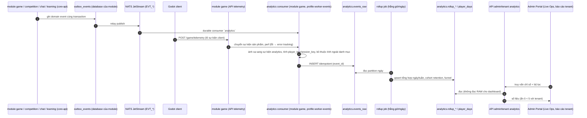

# Game Analytics

> Trạng thái: Draft · Phiên bản: 0.1 · Owner: Product Manager + Game Director + Backend Architect · Cập nhật: 2026-11-17 (telemetry `break_reminder_shown` thay domain event `wellbeing.break_reminder_shown` [TBD]; loại tenant QA, rollup theo `dims_hash`, quyền Academic Manager)
> Liên quan: [ADR-0058](../adr/ADR-0058-game-analytics-tong-hop-trong-postgresql-qua-su-kien-nats.md) · [ADR-0057](../adr/ADR-0057-chay-tren-may-tam-trung-hang-thiet-bi-va-ngan-sach-hieu-nang.md) · [ADR-0056](../adr/ADR-0056-game-song-ngu-viet-anh.md) · [LEARNING_ANALYTICS](../02-learning/LEARNING_ANALYTICS.md) · [MONITORING](MONITORING.md) · [EVENT_DESIGN](../07-backend/EVENT_DESIGN.md) · [DATA_PRIVACY](../10-security/DATA_PRIVACY.md) · [CHILD_SAFETY](../10-security/CHILD_SAFETY.md) · [ADMIN_PORTAL](../04-admin-portal/ADMIN_PORTAL.md) · [CONFIG_DEFAULTS](../00-overview/CONFIG_DEFAULTS.md)

**Mục lục:** 1. Mục đích và phạm vi · 2. Nguyên tắc · 3. Danh mục sự kiện tracking · 4. Định nghĩa chỉ số · 5. Pipeline · 6. Mô hình dữ liệu · 7. Dashboard và báo cáo · 8. Quyền truy cập · 9. Retention và quyền riêng tư · 10. Ngưỡng chuyển kho phân tích riêng · 11. API · 12. Tiêu chí nghiệm thu

## 1. Mục đích và phạm vi

Tài liệu là **nguồn duy nhất định nghĩa chỉ số hành vi chơi game** (engagement, retention, funnel, tiến trình, kinh tế, xã hội, chơi lành mạnh, hiệu năng thực tế theo thiết bị). Tài liệu khác (PRODUCT_VISION, GAME_DESIGN, ADMIN_PORTAL) chỉ nêu tên chỉ số và link về đây.

| Loại phân tích | Câu hỏi trả lời | Nguồn sự thật | Ai xem |
|---|---|---|---|
| **Game Analytics** (tài liệu này) | Học sinh có quay lại không? Khu nào bị bỏ? Quest nào quá khó? Sự kiện có hiệu quả? Game chạy mượt trên máy tầm trung không? | module game, schema `analytics` (ADR-0058) | Platform (product, game design, live-ops); Tenant Admin xem tổng hợp tenant |
| **Learning Analytics** | Học sinh tiến bộ thế nào theo LO? Lớp yếu ở đâu? | [LEARNING_ANALYTICS](../02-learning/LEARNING_ANALYTICS.md), module learning | Học sinh, nhà trường (School Learning Dashboard) |
| **Monitoring kỹ thuật** | Hệ thống có khỏe không? Độ trễ, lỗi, CCU, hàng đợi? | [MONITORING](MONITORING.md), Prometheus/Loki/Tempo | DevOps, live-ops |

Ranh giới: số đếm **người chơi / hành vi** → Game Analytics; **thành thạo kiến thức** → Learning Analytics; **sức khỏe hạ tầng theo thời gian thực** (CCU hiện tại, p95 API, lỗi 5xx) → Monitoring. Game Analytics chỉ dùng đếm số hoạt động học tập (ví dụ "phiên có hoạt động học tập"), không tính mastery hay điểm.

**Yêu cầu (mã PRD):** [PRODUCT_REQUIREMENTS](../00-overview/PRODUCT_REQUIREMENTS.md) FR-ANL-006 (Game Analytics tách khỏi Learning Analytics/Monitoring), FR-ANL-007 (nguồn event NATS + telemetry tối thiểu, schema `analytics`), FR-ANL-008 (định danh giả `player_key`), FR-ANL-009 (dashboard Game Analytics, ẩn ô < 5), FR-ANL-010 (chỉ số chơi lành mạnh), FR-ANL-011 (tenant tắt telemetry sản phẩm), FR-ANL-012 (trang dashboard Game Analytics). Cơ chế rollup, giới hạn truy vấn, export (FR-ANL-013, FR-ANL-014): [DASHBOARD_DATA](../07-backend/DASHBOARD_DATA.md).

## 2. Nguyên tắc

| # | Nguyên tắc | Nhãn |
|---|---|---|
| A-1 | Chỉ báo cáo số liệu **tổng hợp**; không lập hồ sơ hành vi từng học sinh; không dùng dữ liệu analytics để chấm điểm, xếp loại hay quảng cáo | [Confirmed — FR-ANL-004, ADR-0058] |
| A-2 | **Không** dùng thời gian chơi làm thước đo thành công; không đặt mục tiêu tăng thời lượng phiên. Chỉ số thời lượng chỉ dùng để phát hiện chơi quá mức | [Confirmed — PRODUCT_VISION §7] |
| A-3 | Tối thiểu hóa dữ liệu: chỉ thu thuộc tính cần cho chỉ số đã định nghĩa; không thu nội dung chat, vị trí GPS, danh bạ, định danh phần cứng | [Confirmed] |
| A-4 | Định danh người chơi trong analytics là **khóa giả danh** `player_key` = HMAC-SHA256(`student_id`, khóa bí mật analytics), xoay khóa mỗi 24 tháng; không lưu `student_id`, tên, nickname | [Confirmed] |
| A-5 | Báo cáo cho tenant ẩn ô có **< 5 học sinh** (k-anonymity, cùng ngưỡng LEARNING_ANALYTICS) | [Confirmed] |
| A-6 | Sự kiện phía server là nguồn chính; telemetry client chỉ bổ sung cái server không thấy (màn hình, tutorial, hiệu năng, lỗi client) | [Confirmed] |
| A-7 | Mỗi chỉ số định nghĩa **một lần** ở §4; đổi định nghĩa = tăng `metric_version`, không viết lại dữ liệu cũ | [Confirmed] |
| A-8 | **Tenant QA** (`tenants.is_qa = true`, chỉ System Admin đặt; tenant `common` không được đánh dấu) không được tính vào analytics: consumer và `POST /game/telemetry` bỏ sự kiện của tenant QA (không ghi `events_raw`/`player_days`, metric `eduworld_analytics_events_dropped_total{reason="qa_tenant"}`); mọi rollup, API chỉ số và export loại tenant QA kể cả dữ liệu ghi trước khi đánh dấu, khi `tenant_ids` chỉ định tenant QA thì trả rỗng kèm `excluded_tenant_ids`; Tenant Admin của tenant QA nhận số liệu rỗng. Bỏ cờ → sự kiện mới được tính, không backfill thời gian đã đánh dấu | [Confirmed — Technical Architect 2026-11-16] |

## 3. Danh mục sự kiện tracking

Mọi sự kiện mang **chiều chuẩn**: `occurred_at`, `tenant_id`, `school_id`, `player_key`, `session_key` (HMAC của `game_session_id`), `grade_level`, `platform` (`windows`/`android`/`ios`/`web`), `locale` (`vi`/`en`, ADR-0056), `device_tier` (`low`/`mid`/`high`, ADR-0057), `client_version`. **PII: không** cho mọi dòng dưới đây.

### 3.1. Nguồn server (domain event NATS, ADR-0042)

| Sự kiện analytics | Domain event gốc ([EVENT_DESIGN](../07-backend/EVENT_DESIGN.md)) | Thuộc tính lấy | Ghi chú |
|---|---|---|---|
| `session_start` / `session_end` | `game_session.started` / `game_session.ended` | `end_reason`, `active_seconds` | `active_seconds` tính từ heartbeat, không tính thời gian treo máy |
| `area_enter` | `world.area_entered` (mới, module game) | `area_id`, `from_area_id` | Gộp tối đa 1 bản ghi/area/phút/người chơi |
| `area_unlock`, `discovery`, `area_complete` | `world.area_unlocked`, `world.discovery_found`, `world.area_completed` | `area_id`, `kind`, `completion_pct` | |
| `story_chapter_complete` | `story.chapter_completed` | `chapter_code`, `region_code` | |
| `avatar_create` | `avatar.created` | `preset_code` | Bước funnel onboarding |
| `quest_accept` / `quest_step` / `quest_complete` / `quest_abandon` | `quest.accepted` / `quest.step_completed` / `quest.completed` / `quest.abandoned` | `quest_version_id`, `quest_type`, `step_id`, `party` (có/không) | |
| `challenge_start` / `challenge_result` | `challenge.started` / `challenge.completed` | `challenge_version_id`, `difficulty`, `status` | |
| `boss_start` / `boss_result` | `boss.encounter_started` / `boss.encounter_completed` | `boss_version_id`, `party_size`, `result` | |
| `xp_award`, `level_up` | `xp.awarded`, `level.reached` | `source_code`, `amount`, `to_level` | Kèm cờ `capped` khi chạm trần ngày ([PROGRESSION_SYSTEM](../01-game-design/PROGRESSION_SYSTEM.md)) |
| `currency_credit` / `currency_debit` | `currency.credited` / `currency.debited` | `reason_code`, `delta` | Không ghi số dư từng người vào báo cáo |
| `shop_purchase` | `shop.item_purchased` | `item_id`, `price` | |
| `achievement_unlock`, `collection_complete` | `achievement.unlocked`, `collection.completed` | `achievement_id`, `collection_id` | |
| `party_start` | `party.created`, `party.activity_started` | `party_size`, `activity_kind` | |
| `match_result` | `match.completed` | `mode`, `outcome` (`win`/`lose`/`draw`/`abandoned`) | Không lấy rating |
| `duel` | `duel.sent` / `duel.accepted` | — | |
| `event_join` / `event_goal_complete` | Sự kiện tham gia/hoàn thành mục tiêu của hệ thống Event & Season | `event_id`, `goal_code` | Tên domain event chốt trong tài liệu Event & Season |
| `learning_activity_done` | `activity.submitted` (`context` quest/challenge/minigame) | `activity_type`, `context` | Chỉ đếm; không lấy điểm |
| `chat_daily_volume` | `chat.daily_stats` (mới, module chat, tổng hợp theo ngày) | số tin theo `channel_type`, số tin bị chặn/che | **Không có nội dung, không theo người** |

### 3.2. Nguồn client (telemetry `POST /api/v1/game/telemetry`)

Gửi theo lô, nén, tần suất và kích thước theo [MONITORING §10](MONITORING.md) và rate limit ở [API_DESIGN §8](../07-backend/API_DESIGN.md). module game tách: lỗi kỹ thuật → error tracking (MONITORING); sự kiện sản phẩm và mẫu hiệu năng → analytics.

| `type` | Thuộc tính | Tần suất | Dùng cho |
|---|---|---|---|
| `screen_view` | `screen_code` (danh mục màn [DESIGN_SYSTEM §5.7](../05-ux/DESIGN_SYSTEM.md)), `duration_ms` | Mỗi lần mở màn (UI chính, không gồm popup nhỏ) | Funnel, màn ít dùng |
| `tutorial_step` | `step_code`, `result` (`done`/`skipped`) | Mỗi bước | Funnel onboarding |
| `perf_sample` | `preset` (`low`/`medium`/`high`), `renderer` (`mobile`/`compatibility`/`forward_plus`), `scene_code`, `fps_p50`, `fps_p10`, `frame_ms_p95`, `render_scale`, `mem_mb` | 1 mẫu/60 giây/phiên (đã tính percentile trên client) | Hiệu năng thực tế theo hạng thiết bị |
| `load_time` | `kind` (`cold_start`/`area_transition`/`activity_open`), `ms` | Mỗi lần | So với ngân sách ADR-0057 |
| `client_error` / `crash` | `error_code`, `scene_code`, `fatal` | Khi xảy ra | Crash-free sessions; chi tiết stack trace đi error tracking |
| `break_reminder_shown` | `reminder_no` (1–20, lần nhắc thứ mấy trong phiên), `minutes_played` (0–1.440, số phút chơi liên tục client đếm lúc nhắc) | Mỗi lần game client hiện hộp nhắc nghỉ (F062-AC-21; lời nhắc bị hoãn chỉ gửi khi thật sự hiện), gửi trong lô kế tiếp | Chỉ số chơi lành mạnh §4.6 (F080). Không PII; server gắn `session_key` từ game session của token (không nhận từ client), khử trùng `client_event_id`; giá trị client chỉ dùng cho thống kê, không dùng để chặn chơi hay tính thưởng (ADR-0016). Ngưỡng nhắc do [CHILD_SAFETY](../10-security/CHILD_SAFETY.md) sở hữu (`break_reminder`) |

Trường hoặc platform tắt telemetry sản phẩm (không thiết yếu) thì client không gửi `screen_view`/`tutorial_step`; `perf_sample`, `load_time`, `crash` vẫn gửi vì phục vụ ổn định, `break_reminder_shown` vẫn gửi vì phục vụ giám sát chơi lành mạnh (FR-ANL-010) [Confirmed].

## 4. Định nghĩa chỉ số

**Chiều cắt chuẩn** (áp dụng mọi chỉ số trừ khi ghi khác): ngày/tuần/tháng, tenant, trường, khối (hoặc grade band), nền tảng, ngôn ngữ, hạng thiết bị. Người chơi "hoạt động" = có ≥ 1 `session_start` với `active_seconds ≥ 60` trong kỳ. Ngày tính theo giờ Việt Nam (ICT).

### 4.1. Engagement và retention

| Chỉ số (`metric_code`) | Công thức | Độ hạt |
|---|---|---|
| `dau` / `wau` / `mau` | Số `player_key` khác nhau hoạt động trong ngày / 7 ngày gần nhất / 30 ngày gần nhất | Ngày |
| `stickiness` | `dau` trung bình 30 ngày ÷ `mau` | Ngày |
| `active_days_per_week` | Phân phối số ngày hoạt động trong tuần ISO; KPI "quay lại ≥ 3 ngày/tuần" = % người chơi hoạt động trong tuần có ≥ 3 ngày | Tuần |
| `retention_d1` / `d7` / `d30` | Cohort = người chơi có lần hoạt động đầu tiên vào ngày D0; `retention_dN` = % cohort hoạt động **đúng ngày** D0+N | Cohort theo ngày |
| `rolling_retention_d7` | % cohort hoạt động **bất kỳ ngày nào** từ D7 trở đi | Cohort theo ngày |
| `session_duration_p50` | Trung vị `active_seconds` của phiên đã kết thúc | Ngày |
| `sessions_per_player_day` | Số phiên ÷ số người chơi hoạt động trong ngày | Ngày |

### 4.2. Funnel và độ khó

| Chỉ số | Công thức | Độ hạt |
|---|---|---|
| `onboarding_funnel` | Các bước: lần đăng nhập đầu → `avatar_create` → `tutorial_step` hoàn tất → nhận quest đầu → hoàn thành quest đầu → `story_chapter_complete` chương 0. Tỷ lệ = số người qua bước ÷ số người ở bước đầu, trong 7 ngày kể từ lần đăng nhập đầu | Cohort theo ngày |
| `chapter0_completion` | % người chơi mới hoàn thành chương 0 trong 7 ngày (KPI PRODUCT_VISION) | Cohort theo ngày |
| `quest_funnel` | Theo `quest_version_id`: nhận → từng bước → hoàn thành; kèm `quest_abandon_rate` = bỏ ÷ nhận | Quest version · tuần |
| `quest_completion_time_p50` | Trung vị thời gian thực từ nhận đến hoàn thành (ngày-giờ), tách quest ngắn/nhiều ngày | Quest version · tuần |
| `challenge_success_rate` | `status = succeeded` ÷ challenge đã kết thúc, theo `difficulty` và khối | Challenge version · tuần |
| `boss_defeat_rate` | `result = defeated` ÷ encounter, theo `party_size`, khối | Boss version · tuần |
| `abandon_rate` | Gộp: quest bỏ, challenge `abandoned`, trận `abandoned` ÷ số bắt đầu tương ứng | Ngày |

Ngưỡng cân bằng độ khó tham khảo cho game designer [Confirmed]: `challenge_success_rate` mục tiêu 60–85% ở mức Normal; quest có `quest_abandon_rate` > 40% vào danh sách cần xem lại.

### 4.3. Tiến trình và khám phá

| Chỉ số | Công thức |
|---|---|
| `level_distribution` | Phân phối level hiện tại của người chơi hoạt động trong kỳ, theo khối |
| `days_to_level_p50` | Trung vị số **ngày hoạt động** (không phải giờ) để đạt mốc level 5/10/20 |
| `region_unlock_rate` | % người chơi hoạt động đã mở từng vùng ([WORLD_DESIGN](../01-game-design/WORLD_DESIGN.md)) |
| `map_completion_p50` | Trung vị `completion_pct` theo area |
| `chapter_completion_rate` | % người chơi đã mở chương và hoàn thành chương, theo chương |
| `xp_cap_hit_rate` | % người chơi-ngày chạm trần XP ngày (dấu hiệu farm hoặc trần quá thấp) |

### 4.4. Xã hội, thi đấu, sự kiện

| Chỉ số | Công thức |
|---|---|
| `social_play_rate` | % người chơi hoạt động trong tuần có ≥ 1 hoạt động chung (party hoạt động, trận đội, boss nhóm, duel) — KPI "tham gia co-op/party ≥ 1 lần/tuần" |
| `party_size_avg` | Trung bình `party_size` khi bắt đầu hoạt động |
| `match_participation_rate` | % người chơi hoạt động trong tuần có ≥ 1 trận hoàn thành |
| `match_completion_rate` | Trận `outcome ≠ abandoned` ÷ trận bắt đầu (thời gian chờ ghép trận lấy từ MONITORING) |
| `event_participation_rate` | % người chơi đủ điều kiện có `event_join`, và % có ≥ 1 `event_goal_complete`, theo sự kiện |
| `chat_activity` | Số tin/người chơi hoạt động/ngày theo `channel_type`; tỷ lệ tin bị chặn/che (từ `chat_daily_volume`) |

### 4.5. Kinh tế Xu

| Chỉ số | Công thức |
|---|---|
| `currency_sources` / `currency_sinks` | Tổng Xu cộng/trừ theo `reason_code` mỗi ngày |
| `currency_net_flow` | Nguồn − tiêu mỗi ngày (theo dõi lạm phát) |
| `currency_cap_hit_rate` | % người chơi-ngày chạm trần Xu ngày ([INVENTORY_ECONOMY](../01-game-design/INVENTORY_ECONOMY.md)) |
| `shop_conversion` | % người chơi hoạt động có ≥ 1 `shop_purchase` trong tuần; top vật phẩm |

### 4.6. Chơi lành mạnh

| Chỉ số | Công thức |
|---|---|
| `sessions_over_reminder` | % phiên (`session_key`) có ≥ 1 telemetry `break_reminder_shown` (§3.2; ngưỡng nhắc theo [CHILD_SAFETY](../10-security/CHILD_SAFETY.md)) |
| `sessions_over_second_reminder` | % phiên có `break_reminder_shown` với `reminder_no` ≥ 2 — KPI PRODUCT_VISION "% phiên > 90 phút < 5%" dùng chỉ số này |
| `late_night_play_rate` | % người chơi hoạt động có phiên **giao với khung 22:00–06:00 ICT** (`late_night_window`, chỉ dùng cho chỉ số, không phải khung giờ truy cập của trường) |
| `daily_playtime_p90` | Phân vị 90 tổng `active_seconds`/người chơi/ngày, theo khối — dùng phát hiện chơi quá mức, **không** làm mục tiêu tăng |

### 4.7. Hiệu năng thực tế theo thiết bị (ADR-0057)

| Chỉ số | Công thức | Chiều bổ sung |
|---|---|---|
| `fps_p50` / `fps_p10` | Trung vị theo ngày của `fps_p50` / `fps_p10` trong `perf_sample` | `preset`, `renderer`, `scene_code` |
| `fps_budget_pass_rate` | % mẫu đạt FPS mục tiêu của nền tảng (30 mobile/web, 60 PC; preset Thấp 30) | `preset` |
| `load_time_p50` / `p90` | Theo `kind` (cold start, chuyển vùng, mở activity), so với ngân sách 20 s / 5 s | |
| `crash_free_sessions` | Phiên không có `crash` ÷ tổng phiên (KPI PRODUCT_VISION ≥ 99%) | `client_version` |
| `preset_distribution` | % phiên theo preset tự phát hiện/người chơi chọn | |

## 5. Pipeline

- Consumer idempotent theo `event_id` (bảng `processed_events`, ADR-0042); lỗi lặp lại → DLQ như mọi consumer.
- Cơ chế rollup gia tăng, job chốt ngày 02:30 ICT, xử lý dữ liệu đến muộn ≤ 48 giờ, backfill, read replica, giới hạn truy vấn và cache theo [DASHBOARD_DATA](../07-backend/DASHBOARD_DATA.md) (ADR-0062). Riêng Game Analytics: số liệu "hôm nay" cập nhật hằng giờ, DAU hôm nay tạm tính bằng HyperLogLog trong Valkey.

## 6. Mô hình dữ liệu

Schema `analytics` trong database `eduworld_game` (chi tiết cột, index ở [DATABASE_DESIGN](../07-backend/DATABASE_DESIGN.md)). Chuỗi theo ADR-0041.

| Bảng | Nội dung | Partition | Retention |
|---|---|---|---|
| `analytics.events_raw` | 1 dòng/sự kiện: chiều chuẩn §3 + `event_name` varchar(64), `source` (`server`/`client`), `props` jsonb (≤ 2 KB, chỉ khóa trong danh mục) | Ngày theo `occurred_on` | 90 ngày |
| `analytics.player_days` | 1 dòng/`player_key`/ngày: số phiên, `active_seconds`, ngày hoạt động đầu tiên (cho retention), chiều chuẩn | Tháng | 400 ngày |
| `analytics.rollup_daily` | Chỉ số §4 đã tổng hợp theo ngày × **tập chiều cố định** (`metric_date`, `metric_code`, `metric_version`, `dims` jsonb chỉ chứa khóa của một tập chiều, `dims_hash` = băm của `dims` đã chuẩn hóa thứ tự khóa, `numerator`, `denominator`, `hist` cho percentile, `is_final`, `computed_at`; khóa duy nhất `(metric_date, metric_code, metric_version, tenant_id, dims_hash)` theo [DATABASE_DESIGN §2.8b](../07-backend/DATABASE_DESIGN.md)). Tập chiều: `(tenant)`, `(tenant, school)`, `(tenant, grade_band)`, `(tenant, platform)`, `(tenant, locale)`, `(tenant, device_tier)` — không lưu tích các chiều ([DASHBOARD_DATA §3](../07-backend/DASHBOARD_DATA.md#3-mô-hình-rollup-chung)) | Tháng | 2 năm |
| `analytics.rollup_weekly` | Như trên theo tuần ISO | Năm | 3 năm |
| `analytics.rollup_monthly` | Như trên theo tháng (dashboard khoảng > 1 năm) | Không partition | 5 năm |
| `analytics.cohort_retention` | `cohort_date`, `dims`/`dims_hash`, `day_n`, `cohort_size`, `retained` | Năm | 2 năm |
| `analytics.funnel_daily` | `funnel_code`, `step_no`, `dims`/`dims_hash`, `count` | Tháng | 2 năm |
| `analytics.content_stats_weekly` | Theo `quest_version_id`/`challenge_version_id`/`boss_version_id`: nhận, hoàn thành, bỏ, thời gian p50 | Năm | 2 năm |
| `analytics.perf_daily` | Theo nền tảng × `device_tier` × `preset` × `renderer` × `client_version`: FPS, load time, crash-free, số mẫu | Tháng | 2 năm |

Mọi bảng có `tenant_id` (RLS theo ADR-0005); truy vấn liên tenant chỉ qua role platform có audit. Dashboard chỉ đọc bảng tổng hợp trên read replica bằng role `game_dashboard`, không đọc `events_raw`/`player_days` (DASHBOARD_DATA §7). DAU/WAU/MAU, retention và percentile là chỉ số không cộng dồn được: tính chính xác trong job chốt ngày từ `player_days`, không cộng từ bảng ngày (DASHBOARD_DATA §3.2).

## 7. Dashboard và báo cáo

### 7.1. Workspace E — Game Live Operations (platform)

| Panel | Chỉ số chính | Ghi chú |
|---|---|---|
| Tổng quan | `dau`, `wau`, `mau`, `stickiness`, `session_duration_p50`, `active_days_per_week`; CCU hiện tại lấy từ MONITORING | So sánh kỳ trước |
| Retention | Heatmap `retention_d1/d7/d30` theo cohort | |
| Onboarding | `onboarding_funnel`, `chapter0_completion` | Cắt theo nền tảng, ngôn ngữ |
| Quest & cốt truyện | `quest_funnel`, top quest bị bỏ, `chapter_completion_rate` | Link mở quest trong Game Operations Console |
| Challenge & boss | `challenge_success_rate`, `boss_defeat_rate` theo độ khó/khối | Gợi ý cân bằng |
| Tiến trình & khám phá | `level_distribution`, `days_to_level_p50`, `region_unlock_rate`, `xp_cap_hit_rate` | |
| Kinh tế | `currency_sources/sinks`, `currency_net_flow`, `currency_cap_hit_rate`, `shop_conversion` | |
| Xã hội & thi đấu | `social_play_rate`, `match_participation_rate`, `match_completion_rate`, `chat_activity` | |
| Sự kiện | `event_participation_rate` theo sự kiện đang/đã chạy | |
| Chơi lành mạnh | `sessions_over_reminder`, `sessions_over_second_reminder`, `late_night_play_rate`, `daily_playtime_p90` | Cảnh báo khi vượt ngưỡng KPI |
| Hiệu năng thiết bị | `fps_p50/p10`, `fps_budget_pass_rate`, `load_time_p90`, `crash_free_sessions`, `preset_distribution` | Theo `device_tier`, `client_version` |

Bộ lọc chung: khoảng ngày, tenant (dropdown nhiều tenant, ADR-0027), trường, khối/grade band, nền tảng, ngôn ngữ, hạng thiết bị, phiên bản client; so sánh hai kỳ; xuất CSV. Dữ liệu "hôm nay" là tạm tính (rollup hằng giờ), có nhãn.

### 7.2. Báo cáo tenant (workspace School & Learning Management)

Tenant Admin/School Admin (và Academic Manager có `analytics.school.read` scope trường, §8) xem **tổng hợp của tenant mình**: học sinh hoạt động (ngày/tuần), `active_days_per_week`, `session_duration_p50`, `chapter0_completion`, tỷ lệ hoàn thành quest, `social_play_rate`, chỉ số chơi lành mạnh, phân bố nền tảng/hạng thiết bị. Lọc theo trường, khối, khoảng ngày; ô < 5 học sinh bị ẩn; không có số liệu kinh tế chi tiết, không có danh sách từng học sinh (hoạt động đăng nhập của từng học sinh thuộc [SCHOOL_LMS](../04-admin-portal/SCHOOL_LMS.md), không thuộc analytics).

## 8. Quyền truy cập

| Vai trò | Phạm vi | Permission |
|---|---|---|
| System Admin, Live-ops, Game Designer, Product | Mọi tenant, mọi panel §7.1 | `game.analytics.read` (platform-only, nhóm `game.*` không bao giờ cấp cho role tenant) |
| Tenant Admin | Tenant của phiên, báo cáo §7.2 | `analytics.tenant.read` |
| School Admin, Academic Manager | Trường của mình trong tenant, báo cáo §7.2; quyết định theo permission, không theo tên vai trò. UserRole scope `subject` (Academic Manager theo môn) không đủ cho báo cáo game cấp trường → `403 PERMISSION_DENIED` | `analytics.school.read` (scope `school`) |
| Safety Moderator, học sinh | Không có quyền Game Analytics | — |

Tra ngược `player_key` → học sinh chỉ dùng cho hỗ trợ/an toàn, do System Admin thực hiện qua công cụ riêng, bắt buộc lý do và audit [Confirmed].

## 9. Retention và quyền riêng tư

- Raw 90 ngày; `player_days` 400 ngày; bảng tổng hợp ngày 2 năm, tuần 3 năm, tháng 5 năm (ADR-0058, ADR-0062; không chứa định danh). Hết hạn: job **ẩn danh hóa** (`player_key`, `session_key` = NULL); partition **giữ lại**, không gỡ và không có ngoại lệ purge ([ADR-0070](../adr/ADR-0070-release-1-khong-voice-chat-khong-xoa-vat-ly-khong-purge-analytics.md)). Theo dõi kích thước schema `analytics` và số dòng `events_raw` ([MONITORING](MONITORING.md), alert `AnalyticsRawRowsHigh`); chạm ngưỡng §10 thì quyết định bằng ADR mới.
- Inventory, cơ sở xử lý, quyền chủ thể dữ liệu: [DATA_PRIVACY](../10-security/DATA_PRIVACY.md).
- Yêu cầu xóa/ẩn danh của học sinh: tính `player_key` từ `student_id` để ẩn danh các dòng còn trong raw và `player_days`; bảng tổng hợp không chứa định danh.

## 10. Ngưỡng chuyển kho phân tích riêng

Chuyển sang kho cột (ví dụ ClickHouse) bằng ADR mới khi một trong các điều kiện sau kéo dài ≥ 2 tuần (ADR-0058, thống nhất với ADR-0062 và [DASHBOARD_DATA §12](../07-backend/DASHBOARD_DATA.md#12-ngưỡng-nâng-cấp)): `analytics.events_raw` > 500 triệu dòng; truy vấn dashboard p95 > 2 giây; job rollup ngày > 2 giờ; ghi analytics làm tăng p95 ghi của `eduworld_game` > 20%. Metric theo dõi: `eduworld_analytics_raw_rows`, `eduworld_analytics_rollup_duration_seconds`, `eduworld_analytics_query_duration_seconds` (định nghĩa alert ở [MONITORING](MONITORING.md)).

## 11. API

Do module `game` phục vụ; đọc từ bảng tổng hợp, có phân trang/bộ lọc theo quy ước [API_DESIGN](../07-backend/API_DESIGN.md).

| Method | Path | Mô tả | Quyền |
|---|---|---|---|
| GET | `/api/v1/admin/analytics/game/metrics?metric_codes=&from=&to=&granularity=day\|week&tenant_ids=&school_ids=&grade_bands=&platforms=&locales=&device_tiers=&client_versions=` | Chuỗi thời gian các chỉ số §4 | `game.analytics.read` |
| GET | `/api/v1/admin/analytics/game/retention?cohort_from=&cohort_to=&…` | Ma trận cohort retention | `game.analytics.read` |
| GET | `/api/v1/admin/analytics/game/funnels/{funnel_code}?…` | Funnel onboarding/quest | `game.analytics.read` |
| GET | `/api/v1/admin/analytics/game/content-stats?kind=quest\|challenge\|boss&sort=&…` | Thống kê theo nội dung (top bỏ, tỷ lệ thành công) | `game.analytics.read` |
| GET | `/api/v1/admin/analytics/game/performance?…` | Hiệu năng theo thiết bị/preset/phiên bản | `game.analytics.read` |
| POST | `/api/v1/admin/analytics/game/exports` | Xuất CSV bất đồng bộ (`202`, link tải ngắn hạn) | `game.analytics.read` |
| GET | `/api/v1/tenant/analytics/game/summary?from=&to=&school_ids=&grade_bands=` | Báo cáo tổng hợp tenant (ẩn ô < 5) | `analytics.tenant.read` / `analytics.school.read` |
| POST | `/api/v1/game/telemetry` | Hiện có; mở rộng payload `events[]` với `type` §3.2 | Học sinh (game client) |

## 12. Tiêu chí nghiệm thu

| ID | Tiêu chí |
|---|---|
| AC-ANL-101 | Một học sinh chơi 2 phiên trong ngày được đếm 1 lần trong `dau`; phiên `active_seconds` < 60 không được tính hoạt động |
| AC-ANL-102 | Cohort D0 có 100 người, 40 người hoạt động đúng D7 → `retention_d7` = 40% cho cohort đó |
| AC-ANL-103 | Không bảng analytics nào chứa `student_id`, tên, nickname, nội dung chat; kiểm tra schema tự động |
| AC-ANL-104 | Báo cáo tenant ẩn mọi ô có < 5 học sinh; Tenant Admin không xem được tenant khác (403/404) |
| AC-ANL-105 | Role tenant không có `game.analytics.read`; gọi `/admin/analytics/*` từ gateway public bị chặn |
| AC-ANL-106 | Event trùng `event_id` chỉ ghi một lần; event trễ ≤ 48 giờ được rollup lại đúng ngày |
| AC-ANL-107 | Trường tắt telemetry sản phẩm: không còn `screen_view`/`tutorial_step` từ học sinh của trường; `perf_sample`, `crash` vẫn có |
| AC-ANL-108 | Panel hiệu năng hiển thị `fps_budget_pass_rate` theo `device_tier` và `preset`, đối chiếu ngân sách ADR-0057 |
| AC-ANL-109 | Dashboard không có chỉ số "tổng thời gian chơi" làm mục tiêu tăng; chỉ số thời lượng chỉ xuất hiện ở panel Chơi lành mạnh và Tổng quan dạng trung vị |

Test case: [TEST_STRATEGY §6.9](../12-project/TEST_STRATEGY.md).
