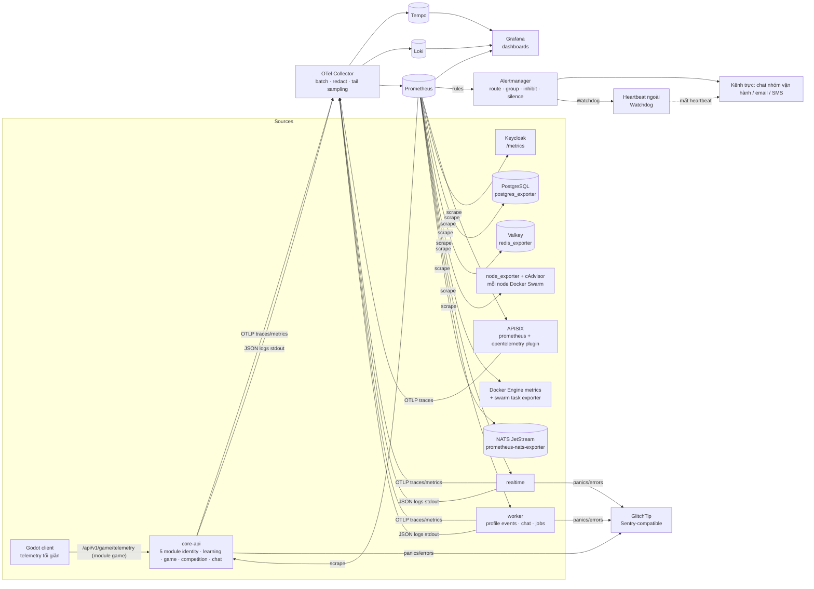

# Monitoring & Observability

> Trạng thái: Draft · Phiên bản: 0.4 · Owner: DevOps Engineer · Cập nhật: 2026-11-27 (F131: Alertmanager trong §1, alert meta + `SyntheticProbeFailing` + alert đã có của module vào bảng §5, rule ở `deploy/observability/prometheus/rules/` có unit test `promtool`, runbook mỗi alert ở `runbooks/`, SLI recording rule §6, quy ước nhãn khi scrape trên Swarm §2, GlitchTip §9) · 2026-11-17 (Áp ADR-0074: nhãn `service` = binary + nhãn `module`, metric gọi facade `eduworld_internal_client_*` theo `caller_module`/`callee_module`, circuit/retry/bulkhead đổi thành `eduworld_external_client_*` chỉ cho tích hợp ngoài, resilience chỉ cho tích hợp ngoài, alert theo binary/module; áp ADR-0089: metric bypass nhãn `module` + 10 lý do; tên metric typed client, rate limit, bypass tenant, DLQ theo service; loại tenant QA)
> Liên quan: [ADR-0023](../adr/ADR-0023-observability-bang-opentelemetry-prometheus-grafana-loki-tem.md) · [SYSTEM_ARCHITECTURE §7](../06-architecture/SYSTEM_ARCHITECTURE.md#7-non-functional-baseline) · [DEPLOYMENT](DEPLOYMENT.md) · [ADR-0074](../adr/ADR-0074-modular-monolith-co-ranh-gioi-cuong-che.md) · [ADR-0037…0042](../adr/README.md) · [DATA_PRIVACY](../10-security/DATA_PRIVACY.md)

**Mục đích & phạm vi.** Nguồn duy nhất về **metric, dashboard, alert, SLO**, tracing, logging vận hành, error tracking. Tài liệu khác chỉ nêu tên metric/alert và link về đây. Logging bảo mật (cái gì không được log) → [SECURITY_ARCHITECTURE §10](../10-security/SECURITY_ARCHITECTURE.md). Chỉ số **hành vi chơi game** và **hiệu năng thực tế theo hạng thiết bị** tổng hợp từ telemetry (DAU, retention, funnel, `crash_free_sessions`, `fps_budget_pass_rate`…) do [GAME_ANALYTICS](GAME_ANALYTICS.md) định nghĩa; tài liệu này giữ metric kỹ thuật thời gian thực (CCU, độ trễ, lỗi, hàng đợi) và alert.

## 1. Kiến trúc

Nguyên tắc:
- Metric qua Prometheus (pull `/metrics` trên cổng admin `:909x`); trace qua OTLP; log JSON ra stdout, collector đẩy Loki.
- Prometheus đánh giá rule (`deploy/observability/prometheus/rules/*.yaml`); **Alertmanager** định tuyến, gom nhóm, inhibit, silence (`deploy/observability/alertmanager/alertmanager.yml`); Grafana chỉ hiển thị (F131, không dùng Grafana Alerting). Alert `Watchdog` luôn bắn tới dịch vụ heartbeat ngoài; mất heartbeat 10 phút thì dịch vụ đó báo người trực (Prometheus/Alertmanager chết).
- Stack staging/production: `deploy/swarm/<env>/obs.stack.yml` trên node `ops` (OTel Collector, Prometheus, Alertmanager, Loki, Tempo, Grafana, GlitchTip, blackbox_exporter, probe synthetic) + exporter `mode: global` (node_exporter, cAdvisor); `swarm-exporter` nằm trong `ops.stack.yml` (dùng chung `docker-api-proxy` chỉ `GET`). Truy cập công cụ chỉ qua network `admin` (VPN) — [DEPLOYMENT §4.3](DEPLOYMENT.md).
- Mỗi request có `trace_id` từ APISIX (W3C `traceparent`) xuyên **mọi binary và module** tham gia (NFR-OBS-001): lời gọi facade trong tiến trình (span con do `src/backend/pkg/modcall` mở, ADR-0074 mục 3), NATS request/reply và JetStream (header `traceparent` trong message), rồi tới PostgreSQL (comment SQL `/* trace_id=... */` qua pgx tracer).
- Mọi metric, log, span có thuộc tính `service` (= `OTEL_SERVICE_NAME` = binary: `core-api`, `realtime`, `worker`), `module` (`identity`, `learning`, `game`, `competition`, `chat`, `realtime`; gắn theo route, handler, consumer, job) và với `worker` thêm `profile` (`events`, `chat`, `jobs`). Dashboard và alert tách theo module bằng nhãn `module`, theo tiến trình bằng `service`/`profile`.
- `trace_id` được trả cho client trong Problem Details (ADR-0010) để hỗ trợ tra cứu.
- **Hạ tầng Docker Swarm (ADR-0024):** `node_exporter` và `cAdvisor` chạy dạng service `mode: global` (một task mỗi node) để lấy CPU/RAM/disk/network của node và từng container; Docker Engine bật endpoint metrics (`metrics-addr`) để lấy trạng thái engine; một exporter nhỏ đọc Docker API của manager (chỉ đọc, qua socket proxy) xuất `swarm_service_replicas_desired`, `swarm_service_replicas_running`, `swarm_task_restarts_total`, `swarm_node_ready`. Prometheus tìm target bằng `dockerswarm_sd_configs` (role `tasks`, lọc theo label `prometheus.scrape=true`). Không dùng Kubernetes metrics/KEDA.

## 2. Quy ước metric

- Prefix `eduworld_`; đơn vị trong tên (`_seconds`, `_bytes`, `_total`).
- Label **không** chứa ID người dùng, tên, IP, nội dung tin nhắn. Label cho phép: `service`, `module`, `profile`, `route` (template, không phải path thực), `method`, `status_class`, `mode`, `grade_band`, `subject`, `channel_type`, `queue`, `result`.
- `school_id` **không** làm label mặc định (cardinality + privacy); số liệu theo trường lấy từ analytics/reporting, không từ Prometheus.
- **Nhãn gắn khi scrape trên Swarm (F131):** binary không tự phát nhãn `service`; Prometheus suy ra từ tên Swarm service (`dockerswarm_sd_configs`, role `tasks`): `core-api` → `service="core-api"`, `realtime` → `service="realtime"`, `worker-
` → `service="worker"` + `profile="
"`, canary `core-api-canary` → `service="core-api-canary"`; nhãn `module` do binary phát. Nhãn `job` của metric job định kỳ (`eduworld_job_runs_total`) được giữ (relabel `exported_job` → `job`). Exporter ngoài đổi tên về tên tài liệu này: `jetstream_*` của prometheus-nats-exporter → `nats_*` (nhãn `stream`, `consumer`); cAdvisor thêm `swarm_service`; node_exporter thêm `node`, `role`.
- Nhãn **cấm** (job `obs-label-policy` chặn trong rule, dashboard và metric scrape được): `user_id`, `student_id`, `school_id`, `ip`, `email`, `username`, `message`, `content`, `text`, `body`, `token`; nhãn `route` phải là template (không chứa giá trị thật như UUID hay số). `tenant` chỉ dùng ở metric đã liệt kê ở §3. Mỗi target có `sample_limit` (Prometheus cắt scrape vượt ngưỡng và bắn `PrometheusTargetSampleLimit`).

## 3. Metric bắt buộc (Master Prompt §18)

| Nhóm | Metric Prometheus | Loại | Label chính | Nguồn |
|---|---|---|---|---|
| Online Players | `eduworld_players_online` | Gauge | `platform`, `grade_band` | realtime (cập nhật từ presence) |
| Active Sessions | `eduworld_game_sessions_active` | Gauge | `platform` | module game |
| | `eduworld_ws_connections` | Gauge | `node` | realtime |
| | `eduworld_ws_connect_total` | Counter | `result` (ok/ticket_invalid/ticket_expired/rejected) | realtime |
| Matchmaking Queue | `eduworld_mm_queue_size` | Gauge | `queue` (mode×grade_band×subject rút gọn) | module competition, matchmaker (profile `worker-jobs`) |
| | `eduworld_mm_wait_seconds` | Histogram | `mode`, `result` (matched/timeout/cancelled) | module competition (`worker-jobs`) |
| | `eduworld_mm_proposals_total` | Counter | `mode`, `result` (accepted/declined/expired) | module competition (`worker-jobs`) |
| Match Duration | `eduworld_match_duration_seconds` | Histogram | `mode`, `end_reason` | module competition |
| | `eduworld_match_results_total` | Counter | `mode`, `result` (recorded/duplicate_rejected) | module competition |
| API Latency | `apisix_http_latency_bucket` (gateway) | Histogram | `route`, `type` | APISIX |
| | `eduworld_http_server_duration_seconds` | Histogram | `service`, `module`, `route`, `method`, `status_class` | `core-api`, `realtime` (OTel semconv `http.server.request.duration`) |
| Error Rate | `eduworld_http_server_requests_total` | Counter | `service`, `module`, `route`, `status_class`, `code` (mã lỗi ổn định) | `core-api`, `realtime` |
| | `apisix_http_status` | Counter | `route`, `code` | APISIX |
| Chat Message Rate | `eduworld_chat_messages_total` | Counter | `channel_type`, `kind`, `decision` (allowed/masked/blocked/held) | module chat |
| | `eduworld_chat_filter_duration_seconds` | Histogram | `stage` | module chat |
| | `eduworld_chat_send_latency_seconds` | Histogram | `channel_type` | module chat — nhận lệnh → `chat.message.acked` (gồm kiểm duyệt + JetStream ack, ADR-0035) |
| | `eduworld_chat_persist_lag_seconds` | Histogram | — | `chat-persister` (profile `worker-chat`) — publish JetStream → commit PostgreSQL |
| | `eduworld_chat_jetstream_publish_errors_total` | Counter | `reason` (timeout/no_responders/other) | module chat |
| | `eduworld_chat_events_total` | Counter | `event` (edit/recall/forward/reaction/pin) | module chat |
| | `eduworld_chat_seq_gaps_total` | Counter | `channel_type` | client telemetry → module game |
| | `nats_consumer_num_pending`, `nats_consumer_num_redelivered`, `nats_stream_total_bytes` (từ `prometheus-nats-exporter`) | Gauge | `stream`, `consumer` | NATS |
| | `eduworld_moderation_queue_size` | Gauge | `priority` | module chat (`worker-chat`) |
| | `eduworld_tenant_filter_bypass_total` | Counter | `module`, `reason` (danh sách đóng ADR-0089 §3: `system_admin_cross_tenant`, `moderation_case`, `break_glass`, `trash`, `auth_login`, `tenant_clone`, `inactive_cleanup`, `re_evaluation`, `efficacy_study`, `platform_job`, `platform_analytics`) | mọi module qua `src/backend/pkg/tenancy.Bypass` (ADR-0039, ADR-0072, ADR-0089) |
| | `eduworld_usecase_duration_seconds` | Histogram | `module`, `kind` (`command`/`query`/`consumer`), `usecase`, `result` (`ok`/`client_error`/`server_error`) | `src/backend/pkg/observability.UseCase` (F003, ADR-0087) |
| | `eduworld_idempotency_replays_total` | Counter | `route` | `src/backend/pkg/httpx.Idempotency` (F003) |
| | `eduworld_identity_org_sync_total` | Counter | `op` (thao tác Keycloak Admin: `create_organization`, `add_member`, `logout_user`…), `result` (`ok`/`not_found`/`conflict`/`rejected`/`circuit_open`/`transient`) | adapter Keycloak Admin của module identity (F010) |
| | `eduworld_auth_common_tenant_total` | Counter | `result` (`created`/`failed`) | `createCommonTenantStudents` — tài khoản tenant chung do System Admin tạo (F010, ACCOUNT_PROVISIONING §3.4) |
| | `eduworld_events_consumed_total` | Counter | `module`, `consumer`, `event_type`, `result` (`ok`/`duplicate`/`retry`/`dlq`) | `src/backend/pkg/outbox.Consumer` (F003) |
| | `eduworld_outbox_unpublished_count`, `eduworld_outbox_lag_seconds` | Gauge | `module` | `src/backend/pkg/outbox.Relay` (F003) |
| | `eduworld_learning_events_partition_months_ahead` | Gauge | `table` | job `learning-events-partitions` (F031) |
| | `eduworld_mastery_updates_total` / `eduworld_mastery_update_lag_seconds` | Counter / Histogram | `result` / — | consumer `learning.mastery_on_graded` (F031, SC-002) |
| | `eduworld_infra_partition_days_ahead` | Gauge | `module`, `table` | job `infra-partition-maintenance` (F003, ADR-0089 §5) |
| | `eduworld_infra_partition_dropped_total`, `eduworld_infra_partition_refused_total` | Counter | `module`, `table` | job `infra-partition-maintenance` — refused = partition hết hạn còn outbox chưa publish / dead letter chưa xử lý |
| | `eduworld_principal_cache_hits_total` | Counter | `layer` (`l1`/`valkey`), `result` (`hit`/`miss`/`error`) | `src/backend/pkg/authz.CachedResolver` (F002) |
| | `eduworld_jwks_refresh_total`, `eduworld_auth_tenant_mismatch_total` | Counter | `result` / — | `src/backend/pkg/httpx` (F002) |
| | `eduworld_moderation_school_notifications_total` | Counter | `status` (sent/acknowledged/overdue) | module chat (`worker-chat`) [Confirmed] |
| | `eduworld_reports_total` | Counter | `target_type`, `reason` | module chat |
| Learning Completion | `eduworld_learning_activities_completed_total` | Counter | `activity_type`, `context` (practice/assignment/quest/competition), `subject`, `grade_band` | module learning |
| | `eduworld_attempts_submitted_total` | Counter | `mode`, `result` (ok/duplicate/late/rejected) | module learning |
| | `eduworld_hint_requests_total`, `eduworld_rapid_guess_responses_total` | Counter | `subject`, `grade_band` | module learning [Confirmed] |
| | `eduworld_client_content_download_bytes_total` | Counter | `source` (preinstalled/lan_cache/cdn) | client telemetry → module game [Confirmed] ([PERFORMANCE_BUDGET §10.1](../08-game-client/PERFORMANCE_BUDGET.md#101-ngân-sách-phòng-máy-classroom-budget-confirmed)) |
| Exam Submission | `eduworld_exam_submissions_total` | Counter | `exam_type`, `result` | module learning |
| | `eduworld_exam_submit_duration_seconds` | Histogram | `exam_type` | module learning |
| Database Performance | `pg_stat_database_*`, `pg_stat_statements_*`, `pg_replication_lag_seconds` | — | | postgres_exporter |
| | `eduworld_db_pool_acquire_duration_seconds`, `eduworld_db_pool_connections` | Histogram/Gauge | `service`, `module`, `database`, `pool`, `state` | `core-api`, `worker` (một pool cho mỗi database module) |
| | `eduworld_db_query_duration_seconds` | Histogram | `service`, `module`, `query` (tên query ent/SQL đặt tên) | `core-api`, `worker` |

Metric bổ sung:

| Metric | Mục đích |
|---|---|
| `eduworld_outbox_pending`, `eduworld_outbox_relay_lag_seconds` | Độ trễ outbox → NATS theo `module` (relay chạy trong profile `worker-events`, ADR-0042) |
| `eduworld_event_consume_lag_seconds` (`module`, `stream`, `consumer`), `nats_consumer_num_pending` | Consumer event NATS chậm (thay Valkey Streams, ADR-0042) |
| `eduworld_internal_client_requests_total` (`caller_module`, `callee_module`, `operation`, `outcome`), `eduworld_internal_client_duration_seconds` (`caller_module`, `callee_module`, `operation`) — tên theo [API_DESIGN §12.3](../07-backend/API_DESIGN.md) | Lời gọi facade trong tiến trình qua `src/backend/pkg/modcall` (ADR-0074 mục 3): RED theo cặp module; không có retry/circuit breaker giữa module |
| `eduworld_external_client_requests_total` (`module`, `integration`: keycloak_admin/keycloak_token/sis/s3/smtp, `outcome`), `eduworld_external_client_circuit_state` (`module`, `integration`) gauge 0=closed/1=half-open/2=open, `eduworld_external_client_retries_total`, `eduworld_external_client_bulkhead_rejected_total` (`module`, `integration`) | Resilience của adapter tích hợp bên ngoài (ADR-0074 mục 5): timeout, retry cho thao tác idempotent, circuit breaker |
| `eduworld_nats_request_duration_seconds` (`module`, `subject_group`), `eduworld_nats_request_errors_total` (`module`, `reason`: timeout/no_responders) | Lệnh từ `realtime` tới handler trong `core-api` qua NATS request/reply (ADR-0074) |
| `eduworld_projection_lag_seconds` (`module`, `projection`) | Độ trễ projection `ref_*` so với event gốc (ADR-0037) |
| `eduworld_panics_recovered_total` (`service`, `module`, `entrypoint`: http/nats/consumer/job/facade — `facade` = panic trong lời gọi facade qua `src/backend/pkg/modcall`, đếm theo module được gọi) | Panic đã được recover middleware bắt; một panic không bắt làm sập cả binary và mọi module trong đó (ADR-0074 hệ quả) |
| `eduworld_saga_runs_total` (`saga`: tenant_clone/student_cleanup/trash_restore, `result`), `eduworld_saga_step_duration_seconds`, `eduworld_saga_stuck` (gauge) | Saga điều phối từ module identity |
| `eduworld_cqrs_handler_duration_seconds` (`module`, `kind`: command/query, `handler`), `eduworld_cqrs_handler_errors_total` | Thời gian/ lỗi theo command/query handler (ADR-0038) |
| `eduworld_sis_sync_runs_total` (`connection`, `mode`, `status`), `eduworld_sis_last_success_timestamp` (`connection`), `eduworld_sis_contract_unknown_fields_total` (`connection`, `entity`), `eduworld_sis_sync_records_total` (`entity`, `action`), `eduworld_sis_reconciliation_issues` | SIS ([SIS_INTEGRATION §8](../09-identity/SIS_INTEGRATION.md)); F011 phát hai metric đầu, F017 phát `eduworld_sis_contract_unknown_fields_total` |
| `eduworld_sis_sync_duration_seconds` (`connection`, `mode`), `eduworld_sis_http_requests_total` (`connection`, `operation`, `status`: 2xx/4xx/429/5xx/error), `eduworld_sis_webhook_total` (`result`: accepted/replay/unauthorized/not_found/invalid/unavailable), `eduworld_sis_sync_runs_skipped_total` (`connection`, `reason`: locked/not_active/circuit_open) | SIS `contract_v1` (F017, [SIS_INTEGRATION §8](../09-identity/SIS_INTEGRATION.md)); dashboard SIS: run theo trạng thái, thời lượng, tỷ lệ 429/5xx theo connection, webhook theo kết quả |
| `eduworld_sis_login_sync_total` (`branch`: fresh/blocking/background, `result`: ok/timeout/error/missing_placement/throttled — `missing_class` cũ đổi tên theo ADR-0095), `eduworld_sis_login_sync_duration_seconds` (`branch`) | Login sync ([SIS_INTEGRATION §4.5](../09-identity/SIS_INTEGRATION.md), F011) |
| `eduworld_auth_logins_total` (`result`: ok/no_sis_record/locked/jit_denied/not_student, `method`: password/refresh — Release 1.0; idp/class_qr/card_qr/picture/device_grant chỉ khi bật mở rộng sau, ADR-0063; `result` thêm `not_provisioned` cho `ACCOUNT_NOT_PROVISIONED`) | Đăng nhập |
| `eduworld_auth_login_duration_seconds` (histogram, `method`, `tenant_type`) — từ lúc client bấm đăng nhập đến khi vào hub (telemetry client) và `eduworld_auth_session_duration_seconds` (server: `auth/session` + `game/sessions`) | SLO đăng nhập (NFR-PERF-013/014, ADR-0045) |
| Keycloak (endpoint `/metrics`, `KC_METRICS_ENABLED=true`): `keycloak_user_events_total` (`event`: login/login_error/refresh_token), thời gian xử lý request, `jvm_*`, Infinispan cache, DB pool | Năng lực Keycloak |
| `eduworld_auth_waiting_room_queued` (gauge), `eduworld_auth_ratelimit_rejected_total` (`scope`: tenant/device/username/global — `global` = `429 LOGIN_QUEUE_BUSY`) | Hàng chờ đăng nhập |
| `eduworld_auth_game_login_total` (`result`: success/invalid_credentials/account_not_provisioned/game_access_student_only/account_locked/account_deactivated/no_active_enrollment/tenant_not_selected/tenant_mismatch/rate_limited/queue_busy/client_version_unsupported/curfew_active/unavailable/login_ticket_invalid), `eduworld_auth_game_login_duration_seconds` (histogram, gồm Keycloak), `eduworld_keycloak_token_call_duration_seconds` (`op`: game_/portal_ password_grant/refresh/logout) | Đăng nhập game qua backend (F013, ADR-0068); SLO `login_slo` phía server |
| `eduworld_audit_records_total` (`service`: module nguồn, `result`: recorded/duplicate/invalid/tenant_mismatch), `eduworld_audit_sanitized_fields_total`, `eduworld_partition_missing_total` (`table`: audit.audit_logs/identity.login_events) | Audit sink tập trung và partition tháng (F015) |
| `eduworld_auth_game_refresh_total` (`mode`: renew/resume, `result`: ok/invalid/reused/device_mismatch/forbidden), `eduworld_auth_game_sessions_revoked_total` (`reason`: logout/takeover/password_changed/account_locked/sanction/access_revoked/cleanup/refresh_reuse/admin) | Phiên game giữ bằng refresh token, phát hiện dùng lại/sai thiết bị (ADR-0086) |
| `eduworld_sis_lookup_total` (`connection`, `result`: hit/miss/timeout/error), `eduworld_auth_identity_conflicts_total` | Nhận biết SIS nguồn (ADR-0046) |
| `eduworld_content_cache_requests_total` (`service`, `layer`: valkey/cdn, `result`: hit/miss) → cache hit ratio | Cache nội dung đã publish (ADR-0043) |
| `eduworld_content_publish_to_visible_seconds` (histogram) — từ lúc bấm Publish/Rollback đến khi manifest tenant cập nhật | NFR-PERF-015 |
| `eduworld_content_snapshot_build_seconds`, `eduworld_content_snapshot_failures_total` | Worker dựng snapshot/manifest |
| `eduworld_media_jobs_total` (`kind`: image/audio/video/model, `result`: ready/rejected/failed), `eduworld_media_job_duration_seconds`, `eduworld_media_infected_total`, `eduworld_media_queue_pending` | Media pipeline (ADR-0044) |
| CDN (từ nhà cung cấp): hit ratio, băng thông, 4xx/5xx; object storage (ADR-0075: S3 managed tại Việt Nam hoặc Garage/SeaweedFS ≥ 3 node): health check/metric của backend (số node khỏe với cụm tự host), dung lượng theo bucket, độ trễ replication của bucket riêng tư, tỷ lệ lỗi và độ trễ S3 đo từ adapter S3 của module (`eduworld_s3_requests_total`, `eduworld_s3_request_duration_seconds`), thời điểm bản sao ngoài cụm gần nhất; analytics (ADR-0070): kích thước schema `analytics`, số dòng `analytics.events_raw` | Phân phối nội dung |
| `eduworld_game_logins_total` (`tenant`, `platform`), `eduworld_game_sessions_active` (gauge) | Lượt vào game, phiên đang hoạt động (ADR-0031) |
| `eduworld_game_session_takeovers_total` (`platform`), `eduworld_game_session_ended_total` (`end_reason`) | Đăng nhập thiết bị khác, lý do kết thúc phiên |
| `eduworld_game_access_denied_total` (`reason`: not_student) | Tài khoản không phải học sinh cố vào game |
| `eduworld_game_session_start_total` (`result`: created/takeover/conflict/denied/curfew/client_version_unsupported/maintenance/not_projected/error), `eduworld_game_session_start_duration_seconds` (histogram) | Kết quả và thời gian `createGameSession` (SLO `login_slo` phía module game, F014) |
| `eduworld_game_projection_lag_seconds` (`table`), `eduworld_game_consumer_rejected_total` (`consumer`, `reason`) | Projection `ref.*` và consumer của module game (F014; tên riêng module vì `eduworld_projection_lag_seconds` đã được module learning đăng ký với label khác — OQ F014-6) |
| `eduworld_student_cleanup_total` (`tenant`, `result`: cleaned/excluded/skipped_active/restored), `eduworld_student_cleanup_candidates` (gauge, `tenant`), `eduworld_student_cleanup_large_batch_total` (`tenant`; lần chạy vượt ngưỡng chờ duyệt — F016) | Worker dọn học sinh (ADR-0032) |
| `eduworld_chat_purge_total` (`tenant`, `kind`: gameplay/ephemeral), `eduworld_chat_purge_backlog_oldest_seconds` (gauge — tuổi tin chưa purge cũ nhất), `eduworld_chat_purge_failures_total` | Purge chat gameplay (ADR-0033) |
| `eduworld_ratelimit_rejected_total` (`policy`) | Lạm dụng |
| `eduworld_anticheat_flags_total` (`rule`) | Anti-cheat ([ANTI_CHEAT](../10-security/ANTI_CHEAT.md)) |
| `eduworld_xp_granted_total` (`source_type`), `eduworld_reward_cap_hits_total` | Kiểm soát farm XP |
| `eduworld_party_active`, `eduworld_party_invitations_total` (`result`) | Party |
| `eduworld_hub_instances`, `eduworld_hub_tick_duration_seconds` | Realtime hub |
| `eduworld_client_fps` (histogram từ telemetry, `platform`, `device_tier`) | Hiệu năng client (NFR-PERF-004) |
| `eduworld_client_crashes_total` (`platform`, `client_version`) | Ổn định client |
| `eduworld_chat_policy_disabled` (`tenant`, `step`) — gauge 1 khi bước kiểm duyệt đang tắt | Theo dõi tenant đang tắt kiểm duyệt |
| `eduworld_moderation_cases_open` (`severity`, `assigned`), `eduworld_moderation_case_unclaimed_age_seconds` (`severity`), `eduworld_moderation_case_first_response_seconds` (`severity`), `eduworld_chat_reports_total` (`reason`), `eduworld_moderation_school_notifications_overdue` — F121, không nhãn người dùng/case | Hàng đợi Safety Team, alert `ModerationP1Unclaimed` ("chưa nhận" = case còn `open`, kể cả case đã gán `rotation` — F124) |
| `eduworld_moderation_oncall_pages_total` (`level`), `eduworld_moderation_oncall_coverage` (`oncall_role`: 1 = có ca hiện hành), `eduworld_break_glass_grants_total` (`status`) — F124, module chat, không nhãn người dùng/case/tenant | Vòng trực p1 (alert `ModerationOncallGap`), hậu kiểm break-glass; lượt đọc break-glass đếm ở `eduworld_tenant_filter_bypass_total{reason="break_glass"}` |
| `eduworld_account_locks_total` (`source`, `action`), `eduworld_email_deliveries_total` (`template`, `status`: `sent`/`failed`/`skipped`/`retry`), `eduworld_school_safety_notification_no_recipient_total` (`template`) — F124, module identity, không địa chỉ email | Khóa theo sanction, email nhân sự (alert `EmailDeliveryFailing`, `SchoolSafetyNotificationNoRecipient`) |
| `eduworld_chat_unchecked_messages_total` (`tenant`) | Số tin gửi khi kiểm duyệt tắt |
| `eduworld_notifications_created_total` (`kind`), `eduworld_notifications_read_total`, `eduworld_notification_delivery_latency_seconds` — F123, module chat, không nhãn người dùng/thông báo | Thông báo trong game: số tạo theo loại, số đã đọc, độ trễ từ event nguồn tới `notification.item.created` (SC-001 p95 ≤ 2 s) |
| `eduworld_chat_sensitive_matches_total` (`category`, `action`), `eduworld_chat_sensitive_catalog_version` (`scope`), `eduworld_chat_sensitive_reload_seconds` | Danh mục từ nhạy cảm: khớp theo nhóm (không nội dung), version đang chạy trên node, thời gian reload |
| `eduworld_dashboard_query_duration_seconds` (histogram, `module`, `query_id`, `grain`, `cache`), `eduworld_dashboard_cache_requests_total` (`result`), `eduworld_dashboard_rejected_total` (`reason`: range/busy/timeout) | Dashboard ([DASHBOARD_DATA §13](../07-backend/DASHBOARD_DATA.md#13-quan-sát-và-cảnh-báo), ADR-0062) |
| `eduworld_synthetic_probe_success` (gauge 0/1, `probe`: client_config/student_login, `result`: ok/error/rate_limited), `eduworld_synthetic_probe_duration_seconds` (`probe`) — F131, remote write từ service `synthetic-probe` | Probe synthetic bằng tenant QA (alert `SyntheticProbeFailing`, [TEST_STRATEGY §4](../12-project/TEST_STRATEGY.md)) |
| `swarm_service_replicas_desired`, `swarm_service_replicas_running`, `swarm_task_restarts_total` (`swarm_service`, `service`, `profile`), `swarm_node_ready` (`node`, `role`, `manager`), `swarm_node_manager_reachable` (`node`), `swarm_exporter_scrape_errors_total`, `swarm_exporter_last_success_timestamp_seconds` — F131 `swarm-exporter` | Trạng thái Swarm (`ServiceDown`, `SwarmReplicasBelowDesired`, `SwarmTaskRestartLoop`, `SwarmNodeDown`); restart = task mới thấy ở trạng thái `failed`/`rejected` |
| `eduworld_client_sessions_total` (`platform`, `client_version`) — telemetry phiên client → module game (F080) [Proposed] | Mẫu số của `ClientCrashRateHigh` |
| `eduworld_glitchtip_bridge_tickets_total` (`result`: created/duplicate/ignored_env/error) — F131 | Ticket GitHub Issues từ issue GlitchTip (§9) |
| `eduworld_backup_*` (`target`, `type`), `eduworld_object_storage_replication_lag_seconds` (`bucket`) — F130, textfile của node_exporter trên node `ops` ([BACKUP_RECOVERY §3.4](BACKUP_RECOVERY.md)) | `BackupFailed`, `BackupMissing`, `ObjectStorage*` |
| `eduworld_rollup_lag_seconds` (`module`, `rollup`), `eduworld_rollup_day_close_duration_seconds`, `eduworld_rollup_day_close_last_success_timestamp`, `eduworld_rollup_late_events_total` (`bucket`), `eduworld_export_jobs_total` (`status`) | Pipeline rollup dashboard và export |

## 4. Dashboard Grafana

| Dashboard | Panel chính | Người dùng |
|---|---|---|
| **EduWorld Overview** | CCU, phiên hoạt động, RPS, error rate, p95 latency, availability SLO burn, trạng thái 5 Swarm service (`core-api`, `realtime`, `worker-events`, `worker-chat`, `worker-jobs`) và lỗi theo 5 module domain | Trực vận hành, PO |
| **Module Map** | Đồ thị phụ thuộc giữa module (span `modcall`, producer/consumer qua Tempo service graph), RED theo cạnh `caller → callee`, circuit breaker tích hợp ngoài đang mở | Backend, DevOps |
| **Module: `<name>`** (một dashboard mẫu, biến `module`) | RED theo route và theo command/query handler, DB pool + slow query của database module, outbox lag, consumer lag, projection lag, lỗi tích hợp ngoài, panic đã recover | Đội sở hữu module |
| **Binary: `<name>`** (biến `service`, `profile`) | CPU/RAM, replica, restart, GC, goroutine, pool tổng, panic đã recover | DevOps |
| **API** | RED theo route (lọc `module`), top route chậm, mã lỗi theo `code`, rate-limit rejections | Backend |
| **Realtime** | WS connections theo node, connect errors, message rate theo type, hub tick duration, room count, drain status | Multiplayer |
| **Matchmaking & Competition** | Queue size theo queue, wait time p50/p95, proposal accept rate, match duration, duplicate result rejections | Multiplayer |
| **Learning** | Activities completed, attempts submitted, exam submissions, submit latency, duplicate/late submissions | EdTech, Backend |
| **Dashboards** | p95 truy vấn dashboard theo `query_id`, cache hit, truy vấn bị từ chối, rollup lag, thời gian/thời điểm chốt ngày, replica lag của `eduworld_learning`/`eduworld_game`, export đang chạy | Backend, Data |
| **Chat Safety** | Message rate, tỷ lệ blocked/masked/held, PII detections, report rate, moderation queue size & tuổi case lâu nhất, độ trễ trường xác nhận thông báo vụ việc nghiêm trọng (ADR-0072) | Trưởng Platform Safety Team |
| **Data stores** | PG: TPS, connections, replication lag, slow queries, bloat, disk; Valkey: memory, ops/s, evictions, latency; pool acquire time | DevOps |
| **Async & Integration** | Outbox lag theo module, NATS stream/consumer pending theo stream `EVT_*`/`CHAT_MESSAGES`, DLQ, projection lag, saga đang chạy/kẹt, SIS sync runs/lỗi, reconciliation issues | Backend |
| **Identity** | Login rate theo result, Keycloak metrics (login failures, sessions), JWKS fetch errors | Security |
| **Client** | FPS theo device tier, crash rate theo version, load time hub | Godot |

Dashboard lưu dạng JSON trong `deploy/observability/grafana/dashboards/` (provisioning as code), sinh từ `scripts/obs/build-dashboards.mjs` (`--check` trong CI); job `obs-dashboards` (`scripts/obs/check-dashboards.mjs`) chặn datasource UID không tồn tại, metric không có trong §3 (hoặc recording rule `eduworld:*`, metric exporter đã khai báo), nhãn cấm, và với Chat Safety mọi truy vấn không phải số đếm/tỷ lệ theo nhóm (F131-AC-14, AC-16).

## 5. Alert rules — [Confirmed]

Ngưỡng được hiệu chỉnh sau load test và 2 tuần pilot. "Giờ học" = 06:30–22:00 ICT.

| Alert | Điều kiện | Mức | Hành động |
|---|---|---|---|
| `APIHighErrorRate` | 5xx > 2% trong 5 phút (route public) | Critical | Trực ngay; xem trace mẫu |
| `APILatencyP95High` | p95 đọc > 400 ms hoặc ghi > 800 ms trong 10 phút | Warning | Kiểm tra DB/pool |
| `SLOBurnRateFast` | Burn rate availability > 14.4× trong 1h (multiwindow) | Critical | |
| `SLOBurnRateSlow` | Burn rate > 6× trong 6h | Warning | |
| `RealtimeConnectFailures` | `ws_connect_total{result!="ok"}` > 10% trong 5 phút | Critical | |
| `RealtimeNodeDown` | Replica `realtime` không scrape được 2 phút | Critical | |
| `LoginLatencyHigh` | p95 `eduworld_auth_login_duration_seconds{method="password"}` > 3 s trong 5 phút (giờ học) | Critical | Kiểm tra CPU Keycloak, DB Keycloak, rate limit |
| `KeycloakCpuHigh` | CPU Keycloak > 75% trong 5 phút | Warning | Scale thêm node; kiểm tra warm-up theo lịch |
| `LoginRateNearCapacity` | `rate(keycloak_user_events_total{event="login"}[1m])` > 80/s trong 2 phút (80% đỉnh thiết kế 100/s, ADR-0064 mục 6) | Warning | Scale Keycloak lên 6 replica; xác nhận hàng chờ `429` hoạt động |
| `LoginRateOverCapacity` | > 110/s trong 2 phút hoặc `rate(eduworld_auth_logins_total{result="ok",method="password"}[1m])` giảm > 50% trong khi login_error tăng | Critical | Kiểm tra CPU/DB Keycloak, ngưỡng rate limit toàn cục 120/s |
| `AccountNotProvisionedSpike` | `eduworld_auth_logins_total{result="not_provisioned"}` > 50/giờ ở một trường | Warning | SIS sync lỗi hoặc tài khoản chưa cấp; báo School Admin (ADR-0063) |
| `GameRefreshReuseSpike` | `rate(eduworld_auth_game_refresh_total{result=~"reused|device_mismatch"}[15m])` > 5× baseline hoặc > 20/giờ ở một tenant | Warning | Dấu hiệu token bị đánh cắp hoặc client refresh song song; xem audit theo `device_id`, kiểm tra bản client mới (single-flight) |
| `LoginWaitingRoomActive` | `eduworld_auth_waiting_room_queued` > 0 liên tục 10 phút | Warning | Xem có cần nâng ngưỡng/scale |
| `LoginErrorSpike` | `keycloak_user_events_total{event="login_error"}` tăng > 5× baseline 15 phút (baseline = tốc độ 1 ngày trước; sàn 1 lỗi/phút [Proposed]) | Warning | Có thể credential stuffing; xem brute-force |
| `SisSyncStale` | `time() - eduworld_sis_last_success_timestamp` > 26 giờ theo connection ([SIS_INTEGRATION §8](../09-identity/SIS_INTEGRATION.md)) | Warning | Xem run lỗi (`listSisSyncRuns`), báo trường |
| `SisLoginSyncTimeouts` | `eduworld_sis_login_sync_total{branch="blocking",result="timeout"}` > 5% nhánh B trong 10 phút ([SIS_INTEGRATION §4.5](../09-identity/SIS_INTEGRATION.md)) | Warning | Kiểm tra SIS của trường; breaker theo connection |
| `SisLookupTimeouts` | `eduworld_sis_lookup_total{result="timeout"}` > 20% trong 15 phút theo connection | Warning | Báo trường; kiểm tra facade SIS |
| `ContentPublishSlow` | p95 publish → visible > 30 s trong 15 phút | Warning | Xem snapshot builder, consumer lag |
| `ContentCacheHitLow` | Hit ratio Valkey nội dung < 90% trong 30 phút (giờ học) | Warning | Kiểm tra TTL, eviction |
| `MediaPipelineBacklog` | `eduworld_media_queue_pending` > 200 trong 15 phút | Warning | Tăng replica `worker-events` (hoặc tách profile `media`) |
| `MediaInfectedFile` | `eduworld_media_infected_total` tăng | Warning | Xem tài khoản upload, audit |
| `CdnErrorRate` | CDN 5xx > 1% trong 10 phút — **tạm thời** đo bằng tỷ lệ lỗi probe blackbox một object CDN công khai (job `blackbox-cdn`) cho tới khi tích hợp metric của nhà cung cấp CDN (stand-in, AGENTS R17) | Critical | Kiểm tra origin object storage |
| `ObjectStorageDown` | Health check backend lỗi hoặc tỷ lệ lỗi S3 từ adapter S3 của các module > 5% trong 2 phút | Critical | RB-05 (BACKUP_RECOVERY); kiểm tra nhà cung cấp hoặc node `storage` |
| `ObjectStorageNodeDown` | Cụm tự host (ADR-0075): < 3 node `storage` khỏe trong 5 phút | Warning | Thay node, theo dõi rebalance (RB-05 bước 1) |
| `ObjectStorageReplicationLag` | Độ trễ replication bucket riêng tư > 5 phút trong 10 phút | Critical | Kiểm tra replication; vi phạm RPO bucket riêng tư (BACKUP_RECOVERY §1) |
| `ObjectStorageVolumeHigh` | Dung lượng cụm/hạn mức bucket > 80% | Warning | Mở rộng dung lượng, rà soát object mồ côi |
| `ObjectStorageBackupMissing` | Không có bản sao object storage ngoài cụm/ngoài nhà cung cấp thành công trong 26 giờ | Critical | Chạy lại job sao chép, kiểm tra đích lưu trữ |
| `AnalyticsRawRowsHigh` | `analytics.events_raw` > 400 triệu dòng (80% ngưỡng ADR-0058) trong 1 giờ | Warning | Chuẩn bị ADR chuyển kho/lưu trữ lạnh (ADR-0070) |
| `AnalyticsRollupSlow` | p95 rollup một ngày-tenant của Game Analytics > 2 giờ trong 1 giờ (§10, [GAME_ANALYTICS §10](GAME_ANALYTICS.md)) | Warning | Xem job `analytics-rollup-hourly`/`dashboard-day-close-game`, kích thước `events_raw` |
| `ExperimentGuardrailBreached` | Một thí nghiệm A/B bị guardrail dừng (`increase(eduworld_experiment_guardrail_breaches_total[1d]) > 0`, F035) | Warning | Xem kết quả `getLearningExperimentResults` |
| `ServiceDown` | Mọi replica của một Swarm service (`core-api`, `realtime`, `worker-*`) không ready > 2 phút (label `service`, `profile`) | Critical | `core-api` down = mọi REST của 5 module down; xem log/trace và panic gần nhất, rollback nếu sau deploy; các binary khác chạy chế độ suy giảm |
| `ModuleDatabaseUnavailable` | Pool database của một module trong `core-api` không kết nối được > 2 phút (label `module`) | Critical | Route của module đó trả `503`, module khác vẫn chạy (DEPLOYMENT §14); kiểm tra PgBouncer/role của module |
| `PanicRecoveredSpike` | `increase(eduworld_panics_recovered_total[5m]) > 10` cho một `module` | Warning (Critical nếu kèm `SwarmTaskRestartLoop` của `core-api`) | Lỗi lập trình trong module; xem trace, tắt tính năng bằng feature flag hoặc rollback `core-api` |
| `SwarmReplicasBelowDesired` | `swarm_service_replicas_running < swarm_service_replicas_desired` > 5 phút | Warning (Critical nếu < 50%) | Xem task lỗi (`docker service ps`), tài nguyên node, placement constraint |
| `SwarmTaskRestartLoop` | `increase(swarm_task_restarts_total[15m]) > 5` cho một Swarm service | Warning | Container crash lặp; xem log, rollback nếu sau deploy |
| `SwarmNodeDown` | `swarm_node_ready == 0` > 2 phút | Critical (manager: Critical ngay khi mất quorum) | Swarm tự dời task stateless; kiểm tra thành phần có trạng thái ghim trên node đó |
| `NodeCapacityHigh` | CPU node vai trò `app`/`realtime`/`idp` > 75% trong 10 phút giờ học | Warning | Scale thủ công theo runbook (không có autoscale, ADR-0024); xem lại `scale-schedule.yaml` |
| `ScheduledScaleFailed` | `eduworld_ops_scale_actions_total{result="error"}` tăng hoặc replica chưa đạt mức đỉnh lúc bắt đầu khung cao điểm | Critical | Chạy `docker service scale` thủ công; kiểm tra `ops-scheduler` và năng lực node |
| `ModuleHighErrorRate` | 5xx của một module (label `module`) > 2% trong 5 phút | Critical | Tắt tính năng lỗi bằng feature flag; rollback `core-api` (lùi cả 5 module) nếu do bản deploy mới |
| `CircuitBreakerOpen` | `eduworld_external_client_circuit_state == 2` > 2 phút cho một cặp `module→integration` | Warning (Critical nếu integration là `keycloak_token` hoặc `keycloak_admin`) | Kiểm tra hệ thống ngoài (Keycloak, SIS, object storage); tính năng phụ thuộc đang suy giảm |
| `NatsRequestTimeouts` | `eduworld_nats_request_errors_total{reason="timeout"}` > 2% lệnh WS trong 5 phút | Warning | `core-api` quá tải hoặc không có handler subscribe `ew.cmd.<module>.>` |
| `EventConsumerLag` | `nats_consumer_num_pending` của consumer `EVT_*` > 10.000 hoặc tăng liên tục 10 phút | Warning | Thay `StreamConsumerLag` (ADR-0042) |
| `ProjectionLagHigh` | `eduworld_projection_lag_seconds` > 60 s trong 10 phút | Warning | Dữ liệu tham chiếu (tenant/học sinh) ở module nhận bị cũ |
| `SagaStuck` | `eduworld_saga_stuck > 0` quá 30 phút | Warning | Xem bước saga lỗi, chạy lại hoặc bù trừ |
| `EventDLQNotEmpty` | `nats_stream_total_messages{stream=~"DLQ_.*"} > 0` | Warning | Sửa nguyên nhân, replay |
| `TenantFilterBypassSpike` | `eduworld_tenant_filter_bypass_total` tăng > 5× baseline 1 h | Warning | Nghi lạm dụng quyền liên tenant; xem audit |
| `AuditPartitionMissing` | `increase(eduworld_partition_missing_total[1d])` > 0 (tháng kế tiếp chưa có partition, kiểm trước ≥ 7 ngày) | Critical | Chạy job `partition-maintainer`; audit không có partition DEFAULT nên ghi sẽ lỗi |
| `AuditTenantMismatch` | `increase(eduworld_audit_records_total{result="tenant_mismatch"}[1h])` > 0 | Warning | Event audit nêu trường của tenant khác: xem DLQ_IDENTITY và module nguồn |
| `InfraPartitionsMissing` | `eduworld_infra_partition_days_ahead < 7` | P2 / Warning | Job `infra-partition-maintenance` không chạy hoặc lỗi; ghi vẫn chạy nhờ partition `DEFAULT`, sửa trước khi dòng dồn vào `*_default` (ADR-0089 §5) |
| `LearningPartitionsMissing` | `eduworld_learning_events_partition_months_ahead < 2` (bảng `learning_events`, `attempt_answers`, `mastery_history`, `progress_daily`) | Critical | Job `learning-events-partitions` (worker `jobs`, mỗi ngày) không chạy hoặc lỗi; các bảng này không có partition `DEFAULT` nên ghi sẽ lỗi khi hết tháng (F031-AC-04) |
| `InfraPartitionRefused` | `increase(eduworld_infra_partition_refused_total[1d]) > 0` | Warning | Partition hết hạn còn outbox chưa publish hoặc dead letter chưa xử lý: kiểm tra relay/DLQ |
| `MatchmakingStalled` | `mm_queue_size` > 0 và không có proposal mới trong 3 phút (giờ học) | Warning | Kiểm tra lock matchmaker |
| `MatchmakingWaitHigh` | p95 `mm_wait_seconds{result="matched"}` > 60 s trong 15 phút (thống nhất [MATCHMAKING §10](../03-social-multiplayer/MATCHMAKING.md), F104) | Warning | Xem mở rộng rating window |
| `MatchmakerLoopSlow` | p95 một lượt matchmaker > 1 s trong 10 phút ([MATCHMAKING §10](../03-social-multiplayer/MATCHMAKING.md)) | Warning | Kiểm tra độ trễ Valkey, số hàng đợi mỗi worker |
| `CompetitionRoomTickSlow` | p99 tick phòng > 20 ms trong 10 phút ([REALTIME_ARCHITECTURE §8](../06-architecture/REALTIME_ARCHITECTURE.md)) | Warning | Xem số phòng mỗi replica `core-api` |
| `DuplicateMatchResults` | `match_results_total{result="duplicate_rejected"}` tăng đột biến > 20/5 phút | Warning | Nghi lỗi client/anti-cheat |
| `OutboxLagHigh` | `eduworld_outbox_lag_seconds{module}` > 60s trong 5 phút | Critical | XP/quest/mastery/projection bị trễ; kiểm tra `worker-events` (relay của module) và NATS |
| `PostgresReplicationLag` | > 30s | Critical | Nguy cơ RPO |
| `PostgresConnectionsHigh` | > 85% `max_connections` | Warning | |
| `PostgresDiskHigh` | > 80% | Warning; > 90% Critical | |
| `ValkeyMemoryHigh` | > 85% maxmemory | Warning | |
| `ValkeyDown` | không phản hồi 1 phút | Critical | Realtime degraded |
| `KeycloakLoginFailuresSpike` | Login game thất bại (`eduworld_auth_game_login_total{result=~"invalid_credentials|account_locked"}`) > 5× baseline trong 10 phút (sàn 1/phút [Proposed]) | Warning | Nghi brute-force/IdP lỗi |
| `JWKSFetchFailing` | Lỗi tải JWKS > 5 phút | Critical | |
| `SISSyncFailed` | 2 lần sync liên tiếp thất bại cho một connection | Warning | Báo School Admin |
| `ChatModerationBacklog` | Case `high` chờ > 30 phút | Critical | Báo ca trực Platform Safety Team (ADR-0072); case p1 (grooming, tự hại) theo on-call 24/7 [Confirmed] |
| `ModerationP1Unclaimed` | `max(eduworld_moderation_case_unclaimed_age_seconds{severity="p1"}) > 900` (case p1 chưa gán quá `p1_unclaimed_alert_minutes`, F121) | Critical | Ca trực Safety Team nhận case p1 cũ nhất ngay; xem [Runbook case p1](#runbook-moderation-p1-unclaimed) |
| `ModerationSlaBreached` | Case p1 chưa gán quá 1 giờ (`report_sla`, job `moderation-sla-escalator` đã leo thang) | Critical | Trưởng ca nhận case; ghi biên bản |
| `ModerationOncallGap` | `min by (oncall_role) (eduworld_moderation_oncall_coverage) == 0` trong 5 phút (không có ca trực hiện hành của vai trò, F124) | Critical | Trưởng ca tạo ca thiếu; xem [Runbook vòng trực](#runbook-moderation-oncall-gap) |
| `EmailDeliveryFailing` | `increase(eduworld_email_deliveries_total{status="failed"}[15m]) > 0` (email nhân sự hết `email_delivery_max_attempts`, F124) | Critical | Kiểm SMTP; xem [Runbook email](#runbook-email-delivery-failing) |
| `SchoolSafetyNotificationNoRecipient` | `increase(eduworld_school_safety_notification_no_recipient_total[1h]) > 0` (trường không có School Admin/Tenant Admin nhận email, F124) | Warning | Gán School Admin; Safety Team liên hệ trường trực tiếp |
| `ModerationSchoolNotificationsOverdue` | `eduworld_moderation_school_notifications_overdue > 0` trong 1 giờ | Warning | Theo dõi trường chưa xác nhận ([MODERATION §6.4](../03-social-multiplayer/MODERATION.md)) |
| `ChatPIISpike` | Tỷ lệ PII blocked (`eduworld_chat_sensitive_matches_total{category="pii"}`) > 5× baseline 15 phút (sàn 1/phút [Proposed]) | Warning | Kiểm tra sự cố/chiến dịch spam |
| `NotificationConsumerBacklog` | `eduworld_consumer_pending{consumer=~"chat.notify_.*"} > 1000` trong 10 phút (F123) | Warning | Kiểm tra module learning (`listAssignmentRecipients`) và `DLQ_CHAT` |
| `NotificationDeliverySlow` | p95 `eduworld_notification_delivery_latency_seconds` > 2 s trong 15 phút (SC-001 của F123) | Warning | Kiểm tra độ trễ consumer `chat.notify_*` và publish Valkey `ew:rt:user:<id>` |
| `ChatModerationDisabled` | `eduworld_chat_policy_disabled == 1` cho bất kỳ tenant/bước nào | Warning (ngay khi tắt) | Xác nhận với System Admin đã tắt, kiểm tra lý do và `expires_at` (ADR-0030) |
| `ChatModerationDisabledLong` | `eduworld_chat_policy_disabled == 1` liên tục > 24 h, hoặc bước `pii` tắt > 4 h | Critical | Báo quản lý vận hành và Tenant Admin; đề xuất bật lại |
| `SensitiveCatalogVersionSkew` | Các node chạy `catalog_version` khác nhau > 5 phút | Warning | Kiểm tra pub/sub `ew:chat:sensitive:version`, reload lỗi |
| `StudentCleanupLargeBatch` | Một lần chạy dọn > 10% học sinh của tenant (`status = awaiting_approval`) — `increase(eduworld_student_cleanup_large_batch_total[1h]) > 0` | Warning | System Admin xem và xác nhận/hủy (ADR-0032) |
| `StudentCleanupJobFailed` | Job lỗi hoặc không chạy thành công > 48 h | Warning | Kiểm tra `worker-jobs` |
| `ChatJetStreamUnavailable` | `rate(eduworld_chat_jetstream_publish_errors_total[5m]) > 0.05 * rate(eduworld_chat_messages_total[5m])` trong 5' hoặc NATS cluster mất quorum | Critical | Chat không gửi được (`CHAT_TEMPORARILY_UNAVAILABLE`); kiểm tra NATS cluster |
| `ChatPersistLagHigh` | `histogram_quantile(0.95, eduworld_chat_persist_lag_seconds) > 5` trong 10' hoặc `nats_consumer_num_pending{consumer="persister"} > 10000` | Warning | Kiểm tra `chat-persister`, PostgreSQL; JetStream giữ 72 h nên còn thời gian xử lý |
| `ChatDLQNotEmpty` | `nats_stream_total_messages{stream="DLQ_CHAT"} > 0` | Warning | Xem message lỗi, sửa và replay |
| `ChatSendLatencyHigh` | p95 `eduworld_chat_send_latency_seconds` > 0,3 s trong 10' | Warning | NFR-PERF-003 |
| `ChatPurgeBacklog` | `eduworld_chat_purge_backlog_oldest_seconds` > 2 ngày hoặc `eduworld_chat_purge_failures_total` tăng | Warning | Kiểm tra job `gameplay-chat-purge`, case mở đang hoãn purge (ADR-0033) |
| `GameTakeoverSpike` | `eduworld_game_session_takeovers_total` tăng > 5× baseline 1 h (sàn 10 lượt/giờ [Proposed]) | Warning | Có thể dùng chung tài khoản / lộ mật khẩu hàng loạt |
| `BackupFailed` / `BackupMissing` | Job backup thất bại hoặc không có backup thành công trong 26h | Critical | [BACKUP_RECOVERY](BACKUP_RECOVERY.md) |
| `CertificateExpiring` | TLS cert hết hạn < 14 ngày | Warning | |
| `ClientCrashRateHigh` | Crash rate theo `client_version` > 2% phiên trong 1 giờ (`eduworld_client_crashes_total` / `eduworld_client_sessions_total`) | Warning | Cân nhắc dừng rollout store |
| `DashboardSlow` | p95 `eduworld_dashboard_query_duration_seconds` > 2 s trong 15 phút (giờ học) | Warning | Xem query_id chậm, EXPLAIN, cache hit; cân nhắc ngưỡng nâng cấp ([DASHBOARD_DATA §12](../07-backend/DASHBOARD_DATA.md#12-ngưỡng-nâng-cấp)) |
| `DashboardTimeoutsSpike` | `eduworld_dashboard_rejected_total{reason="timeout"}` > 1% truy vấn trong 15 phút | Warning | Truy vấn vượt `statement_timeout` 5 s; kiểm tra index/partition pruning |
| `RollupLagHigh` | `eduworld_rollup_lag_seconds` > 900 s (learning) hoặc > 3.600 s (game) trong 15 phút | Warning | Kiểm tra consumer rollup, NATS pending |
| `DayCloseNotDone` | Job `dashboard-day-close` chưa thành công cho ngày hôm qua lúc 05:00 ICT | Warning | Chạy lại job; dashboard hiển thị "Đang tính" |
| `DashboardReplicaLag` | Replica dành cho dashboard lag > 60 s trong 10 phút | Warning | Số liệu dashboard bị trễ; không chuyển truy vấn về primary |
| `LateEventsHigh` | `eduworld_rollup_late_events_total{bucket=">48h"}` > 0,5% event trong ngày | Warning | Kiểm tra client offline/consumer chậm; cân nhắc backfill |
| `SyntheticProbeFailing` | Probe synthetic (`eduworld_synthetic_probe_success`, chu kỳ 5 phút) không thành công 2 chu kỳ liên tiếp (không mẫu thành công trong 11 phút; lượt `rate_limited` không tính) | Critical | Luồng chính của học sinh hỏng: xem `client-config`/đăng nhập, APISIX, Keycloak |
| `Watchdog` | Luôn bắn (`vector(1)`) — gửi tới heartbeat ngoài mỗi phút | Warning (không trang) | Mất heartbeat 10 phút: Prometheus hoặc Alertmanager chết |
| `PrometheusTargetDown` | `up == 0` > 5 phút | Warning | Target không scrape được; xem task/network |
| `PrometheusTargetSampleLimit` | `prometheus_target_scrapes_exceeded_sample_limit_total` tăng | Warning | Nhãn cardinality cao bất thường; xem metric mới của binary/module |
| `PrometheusRuleFailures` | `prometheus_rule_evaluation_failures_total` tăng | Critical | Rule lỗi đánh giá: alert có thể mù |
| `AlertmanagerNotificationsFailing` | `alertmanager_notifications_failed_total` tăng liên tục 10 phút | Critical | Kênh trực không nhận được thông báo; kiểm tra secret `ops_alert_*` và nhà cung cấp |

Alert có nhãn `team: safety` (`ModerationP1Unclaimed`, `ModerationSlaBreached`, `ModerationSchoolNotificationsOverdue`, `ModerationOncallGap`, `EmailDeliveryFailing`, `SchoolSafetyNotificationNoRecipient`) định tuyến tới receiver `safety-oncall` của Alertmanager (`deploy/observability/alertmanager/alertmanager.yml`: gửi ngay, nhắc lại mỗi 15 phút; URL webhook là secret `ops_alert_safety_*`) — F124; định tuyến chung và kênh SMS: F131.

### Runbook moderation-p1-unclaimed

Chuyển sang [runbooks/ModerationP1Unclaimed.md](runbooks/ModerationP1Unclaimed.md) (F131: mỗi alert một runbook).

### Runbook moderation-oncall-gap

Chuyển sang [runbooks/ModerationOncallGap.md](runbooks/ModerationOncallGap.md).

### Runbook email-delivery-failing

Chuyển sang [runbooks/EmailDeliveryFailing.md](runbooks/EmailDeliveryFailing.md).

Alert định nghĩa trong `deploy/observability/prometheus/rules/*.yaml` (mỗi rule có nhãn `severity` `critical`/`warning`, `service`/`module`/`profile` khi theo binary/module, annotation `summary`, `runbook_url` = `docs/11-operations/runbooks/<AlertName>.md`, `source` = mục tài liệu này); unit test `promtool test rules` ở `deploy/observability/prometheus/tests/` (mỗi alert ít nhất một ca bắn và một ca không bắn, trừ `Watchdog` luôn bắn); `scripts/obs/check-alerts.mjs` (job `obs-rules`, `obs-runbooks`) đối chiếu song ánh bảng này ↔ rule ↔ runbook ↔ test. Bảng này là nguồn ngưỡng duy nhất (`alert_thresholds`); ngưỡng "giờ học" dùng recording rule `eduworld:school_hours`; biên bản diễn tập alert lưu ở `docs/11-operations/alert-drills/` ([DEPLOYMENT §15](DEPLOYMENT.md)). Prometheus scrape mỗi task qua cổng quản trị `EW_ADMIN_ADDR` (`tasks.<swarm-service>:9090`, [DEPLOYMENT §14](DEPLOYMENT.md)). Probe synthetic chạy bằng tài khoản `hs.qa.probe` trong tenant QA (`is_qa = true`); số liệu của tenant QA bị loại khỏi analytics và dashboard ([GAME_ANALYTICS](GAME_ANALYTICS.md), [DASHBOARD_DATA](../07-backend/DASHBOARD_DATA.md)).

## 6. SLO — [Confirmed] (OQ-11)

| SLO | SLI | Mục tiêu | Cửa sổ |
|---|---|---|---|
| Availability REST | Tỷ lệ request non-5xx tại APISIX (trừ 429) trong giờ học | 99.5% (NFR-AVAIL-001) | 30 ngày |
| Latency REST đọc | Tỷ lệ request GET < 200 ms tại gateway | 95% (NFR-PERF-001) | 30 ngày |
| Latency submit | Tỷ lệ submit attempt/exam < 400 ms | 95% (NFR-PERF-002) | 30 ngày |
| Realtime delivery | p95 thời gian chat/lobby từ nhận → phát < 250 ms (đo server-side) | 95% (NFR-PERF-003) | 30 ngày |
| Realtime connect | Tỷ lệ kết nối WS thành công (ticket hợp lệ) | 99% | 30 ngày |
| Đăng nhập | Tỷ lệ đăng nhập mật khẩu vào hub < 3 s (đo ở đỉnh 100 lượt/s, ADR-0064 mục 6); refresh (`renew`/`resume`, ADR-0086) < 200 ms (ADR-0045) | 95% / 95% (NFR-PERF-013/014) | 30 ngày |
| Publish nội dung | Tỷ lệ publish/rollback hiển thị cho lượt chơi mới trong 30 s | 95% (NFR-PERF-015) | 30 ngày |
| Dashboard | Tỷ lệ truy vấn dashboard < 2 s (đo tại API) | 95% (NFR-PERF dashboard, ADR-0062) | 30 ngày |
| Learning durability | Attempt đã trả 2xx submit không bị mất | 100% (đo bằng đối soát hằng ngày) | — |

Error budget hết → đóng băng tính năng mới, ưu tiên ổn định.

SLI là recording rule trong `deploy/observability/prometheus/rules/slo.yaml` (F131): `eduworld:sli_availability_errors:ratio_rate{5m,30m,1h,6h}` (APISIX công khai, loại `429`), `eduworld:sli_latency_read:ratio_rate5m` (APISIX, nhãn phụ `method`), `eduworld:sli_latency_submit:ratio_rate5m`, `eduworld:sli_realtime_delivery:p95_5m`, `eduworld:sli_ws_connect:ratio_rate5m`, `eduworld:sli_login:ratio_rate5m`, `eduworld:sli_publish:ratio_rate1h`, `eduworld:sli_dashboard:ratio_rate5m`; mục tiêu availability ghi một lần ở `eduworld:slo_availability_target` (= `availability`). Histogram dùng cho SLI phải có bucket đúng ngưỡng SLO (200 ms gateway, 0,4 s submit, 3 s đăng nhập, 30 s publish, 2 s dashboard). Learning durability đo bằng đối soát hằng ngày, không qua Prometheus. Burn rate: `SLOBurnRateFast` (14,4× trên 1 h và 5 phút), `SLOBurnRateSlow` (6× trên 6 h và 30 phút), chỉ trong giờ học.

## 7. Tracing

- OTel SDK Go (qua `src/backend/pkg/otel`): span cho HTTP handler, command/query handler (`<module>.command.<Name>`, `<module>.query.<Name>`, ADR-0038), truy vấn DB (pgx tracer dưới ent), Valkey, lời gọi facade sang module khác (span `<caller>→<callee>.<operationId>` do `src/backend/pkg/modcall` mở, cùng trace, ADR-0074), NATS request/reply và publish/consume JetStream (`traceparent` trong header message; consumer tạo span con hoặc link tới span publish), lời gọi SIS/Keycloak.
- Tempo bật **service graph** (từ span client/server, span `modcall` và producer/consumer) để vẽ dashboard Module Map.
- Saga liên module có một trace gốc; mỗi bước gắn thuộc tính `saga.id`, `saga.step`.
- Sampling: 100% ở local/dev; staging/prod: head sampling 10% + tail sampling ở collector giữ 100% trace lỗi và trace > 1s [Confirmed].
- Realtime: span cho `ws.connect`, mỗi message type quan trọng (`battle.answer.submit`, `party.start`), **không** span cho từng gói position sync (chỉ metric).
- Thuộc tính span không chứa PII: dùng `enduser.pseudo_id` (hash có salt của user_id) thay vì user_id khi cần tương quan; nội dung tin nhắn/câu trả lời không bao giờ vào span.

## 8. Logging

| Quy tắc | Chi tiết |
|---|---|
| Định dạng | `log/slog` JSON: `ts`, `level`, `msg`, `service` (binary), `module`, `profile` (worker), `version`, `trace_id`, `span_id`, `layer` (domain/application/infrastructure/presentation), `handler`, `event`, fields |
| Mức | `debug` chỉ local/dev; prod `info`; lỗi kèm `error.kind` và chuỗi wrap |
| **Cấm log** | Access/refresh/id token, ticket realtime, `Authorization` header, cookie, mật khẩu, client secret, SIS credential, nội dung tin nhắn chat, câu trả lời bài làm, họ tên, ngày sinh, email, SĐT, IP đầy đủ của học sinh |
| Redaction | Middleware loại bỏ header nhạy cảm; collector có processor `redaction` chặn pattern token/JWT/email/SĐT như lớp phòng thủ thứ hai |
| Định danh | Dùng `user_id` (UUID nội bộ) trong log ứng dụng khi cần điều tra; Loki giới hạn quyền truy cập theo vai trò vận hành, truy vấn production được audit |
| Retention | App log 14 ngày (pilot) / 30 ngày; audit log nghiệp vụ nằm trong PostgreSQL (`audit.audit_logs`), không phụ thuộc Loki |
| APISIX access log | Bỏ query string của `/realtime/v1` (chứa ticket), IP lưu dạng rút gọn /24 sau 7 ngày [Confirmed] |

## 9. Error tracking

- Self-host GlitchTip hoặc Sentry (ADR-0023, [Confirmed]) — dữ liệu ở cùng vùng lưu trữ với production (DATA_PRIVACY §5).
- Backend gửi panic đã recover và lỗi 5xx không mong đợi kèm `trace_id`; tắt gửi request body, `send_default_pii=false`.
- Godot: crash report + log ngắn (không PII) qua endpoint telemetry; ghép theo `client_version`, `platform`, `device_tier`.
- Mỗi issue mới ở production tạo ticket tự động cho đội sở hữu module (theo thẻ `module`).
- Triển khai (F131): GlitchTip tự host trên node `ops` (PostgreSQL + Valkey riêng, không dùng cụm nghiệp vụ); backend dùng `sentry-go` trong `src/backend/pkg/observability` (DSN qua `EW_ERROR_TRACKING_DSN_FILE`, không đặt = tắt; thu thập dữ liệu người dùng/cookie/header/body/query tắt hết, `BeforeSend` xóa request, user, breadcrumb data); thẻ `service`, `module`, `version`, `trace_id`, `entrypoint` (+ `profile` với worker). `glitchtip-bridge` (`src/backend/tools/glitchtip-bridge`) nhận webhook alert của GlitchTip (`POST /hook/<token>`), đọc thẻ issue qua API GlitchTip và tạo GitHub Issue nhãn `module:<name>` (hoặc `service:<binary>`) + `source:glitchtip`, khử trùng theo dấu `glitchtip-issue:<id>`; chỉ môi trường `production`.

## 10. Telemetry client Godot

- Endpoint `POST /api/v1/game/telemetry` (batch, gzip, rate limit 1 req/30s/session).
- Nội dung: FPS percentile, frame time, thời gian load scene, RAM, device tier (low/mid/high theo phân loại nội bộ), lỗi script. **Không** gửi vị trí GPS, danh sách app, định danh thiết bị phần cứng.
- Học sinh/trường có thể tắt telemetry không thiết yếu theo policy [Confirmed].
- module game tách payload: lỗi script/crash (stack trace đã scrub) → error tracking (§9); sự kiện sản phẩm (`screen_view`, `tutorial_step`) và mẫu hiệu năng (`perf_sample`, `load_time`) → analytics consumer. Danh mục `type` và thuộc tính: [GAME_ANALYTICS §3.2](GAME_ANALYTICS.md#32-nguồn-client-telemetry-post-apiv1gametelemetry).
- Metric pipeline analytics (theo dõi ngưỡng chuyển kho phân tích riêng, ADR-0058): `eduworld_analytics_raw_rows`, `eduworld_analytics_rollup_duration_seconds`, `eduworld_analytics_query_duration_seconds`, `eduworld_analytics_consumer_lag`. Alert [Confirmed]: rollup ngày > 2 giờ; consumer lag > 10.000 event (dùng chung ngưỡng `EventConsumerLag`).
