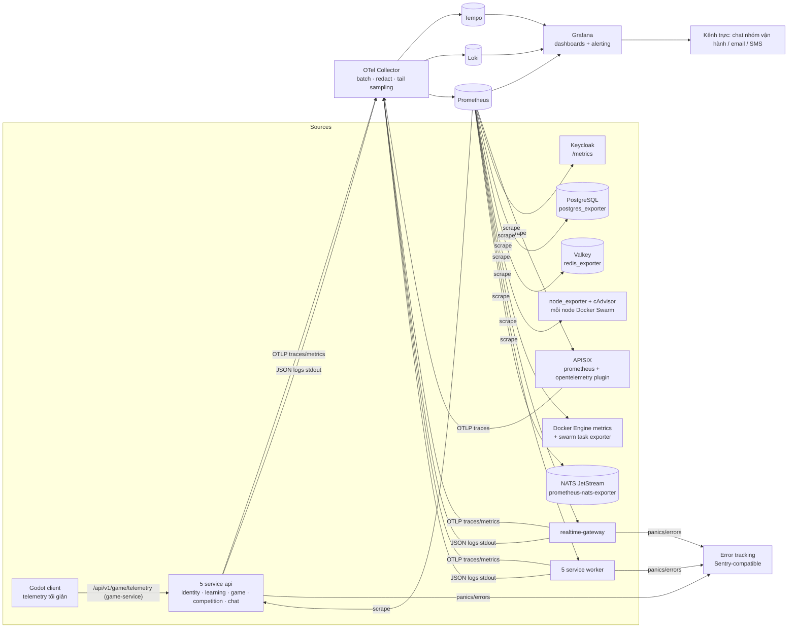

# Monitoring & Observability

> Trạng thái: Draft · Phiên bản: 0.2 · Owner: DevOps Engineer · Cập nhật: 2026-11-15
> Liên quan: [ADR-0023](../adr/ADR-0023-observability-bang-opentelemetry-prometheus-grafana-loki-tem.md) · [SYSTEM_ARCHITECTURE §7](../06-architecture/SYSTEM_ARCHITECTURE.md#7-non-functional-baseline) · [DEPLOYMENT](DEPLOYMENT.md) · [ADR-0036…0042](../adr/README.md) · [DATA_PRIVACY](../10-security/DATA_PRIVACY.md)

**Mục đích & phạm vi.** Nguồn duy nhất về **metric, dashboard, alert, SLO**, tracing, logging vận hành, error tracking. Tài liệu khác chỉ nêu tên metric/alert và link về đây. Logging bảo mật (cái gì không được log) → [SECURITY_ARCHITECTURE §10](../10-security/SECURITY_ARCHITECTURE.md). Chỉ số **hành vi chơi game** và **hiệu năng thực tế theo hạng thiết bị** tổng hợp từ telemetry (DAU, retention, funnel, `crash_free_sessions`, `fps_budget_pass_rate`…) do [GAME_ANALYTICS](GAME_ANALYTICS.md) định nghĩa; tài liệu này giữ metric kỹ thuật thời gian thực (CCU, độ trễ, lỗi, hàng đợi) và alert.

## 1. Kiến trúc

Nguyên tắc:
- Metric qua Prometheus (pull `/metrics` trên cổng admin `:909x`); trace qua OTLP; log JSON ra stdout, collector đẩy Loki.
- Mỗi request có `trace_id` từ APISIX (W3C `traceparent`) xuyên **mọi service** tham gia (NFR-OBS-001): HTTP service-to-service qua typed client (header `traceparent`, ADR-0040), NATS request/reply và JetStream (header `traceparent` trong message), rồi tới PostgreSQL (comment SQL `/* trace_id=... */` qua pgx tracer).
- Mọi metric, log, span có thuộc tính `service` (= `OTEL_SERVICE_NAME`: `identity-service`, `learning-service`, `game-service`, `competition-service`, `chat-service`, `realtime-gateway`) để tách dashboard và alert theo service.
- `trace_id` được trả cho client trong Problem Details (ADR-0010) để hỗ trợ tra cứu.
- **Hạ tầng Docker Swarm (ADR-0024):** `node_exporter` và `cAdvisor` chạy dạng service `mode: global` (một task mỗi node) để lấy CPU/RAM/disk/network của node và từng container; Docker Engine bật endpoint metrics (`metrics-addr`) để lấy trạng thái engine; một exporter nhỏ đọc Docker API của manager (chỉ đọc, qua socket proxy) xuất `swarm_service_replicas_desired`, `swarm_service_replicas_running`, `swarm_task_restarts_total`, `swarm_node_ready`. Prometheus tìm target bằng `dockerswarm_sd_configs` (role `tasks`, lọc theo label `prometheus.scrape=true`). Không dùng Kubernetes metrics/KEDA.

## 2. Quy ước metric

- Prefix `eduworld_`; đơn vị trong tên (`_seconds`, `_bytes`, `_total`).
- Label **không** chứa ID người dùng, tên, IP, nội dung tin nhắn. Label cho phép: `service`, `route` (template, không phải path thực), `method`, `status_class`, `mode`, `grade_band`, `subject`, `channel_type`, `queue`, `result`.
- `school_id` **không** làm label mặc định (cardinality + privacy); số liệu theo trường lấy từ analytics/reporting, không từ Prometheus.

## 3. Metric bắt buộc (Master Prompt §18)

| Nhóm | Metric Prometheus | Loại | Label chính | Nguồn |
|---|---|---|---|---|
| Online Players | `eduworld_players_online` | Gauge | `platform`, `grade_band` | realtime-gateway (cập nhật từ presence) |
| Active Sessions | `eduworld_game_sessions_active` | Gauge | `platform` | game-service |
| | `eduworld_ws_connections` | Gauge | `node` | realtime-gateway |
| | `eduworld_ws_connect_total` | Counter | `result` (ok/ticket_invalid/ticket_expired/rejected) | realtime-gateway |
| Matchmaking Queue | `eduworld_mm_queue_size` | Gauge | `queue` (mode×grade_band×subject rút gọn) | competition-worker (matchmaker) |
| | `eduworld_mm_wait_seconds` | Histogram | `mode`, `result` (matched/timeout/cancelled) | competition-worker |
| | `eduworld_mm_proposals_total` | Counter | `mode`, `result` (accepted/declined/expired) | competition-worker |
| Match Duration | `eduworld_match_duration_seconds` | Histogram | `mode`, `end_reason` | competition-service |
| | `eduworld_match_results_total` | Counter | `mode`, `result` (recorded/duplicate_rejected) | competition-service |
| API Latency | `apisix_http_latency_bucket` (gateway) | Histogram | `route`, `type` | APISIX |
| | `eduworld_http_server_duration_seconds` | Histogram | `service`, `route`, `method`, `status_class` | mọi service (OTel semconv `http.server.request.duration`) |
| Error Rate | `eduworld_http_server_requests_total` | Counter | `service`, `route`, `status_class`, `code` (mã lỗi ổn định) | mọi service |
| | `apisix_http_status` | Counter | `route`, `code` | APISIX |
| Chat Message Rate | `eduworld_chat_messages_total` | Counter | `channel_type`, `kind`, `decision` (allowed/masked/blocked/held) | chat-service |
| | `eduworld_chat_filter_duration_seconds` | Histogram | `stage` | chat-service |
| | `eduworld_chat_send_latency_seconds` | Histogram | `channel_type` | chat-service — nhận lệnh → `chat.message.acked` (gồm kiểm duyệt + JetStream ack, ADR-0035) |
| | `eduworld_chat_persist_lag_seconds` | Histogram | — | chat-worker `chat-persister` — publish JetStream → commit PostgreSQL |
| | `eduworld_chat_jetstream_publish_errors_total` | Counter | `reason` (timeout/no_responders/other) | chat-service |
| | `eduworld_chat_events_total` | Counter | `event` (edit/recall/forward/reaction/pin) | chat-service |
| | `eduworld_chat_seq_gaps_total` | Counter | `channel_type` | client telemetry → game-service |
| | `nats_consumer_num_pending`, `nats_consumer_num_redelivered`, `nats_stream_total_bytes` (từ `prometheus-nats-exporter`) | Gauge | `stream`, `consumer` | NATS |
| | `eduworld_moderation_queue_size` | Gauge | `priority` | chat-worker |
| | `eduworld_reports_total` | Counter | `target_type`, `reason` | chat-service |
| Learning Completion | `eduworld_learning_activities_completed_total` | Counter | `activity_type`, `context` (practice/assignment/quest/competition), `subject`, `grade_band` | learning-service |
| | `eduworld_attempts_submitted_total` | Counter | `mode`, `result` (ok/duplicate/late/rejected) | learning-service |
| Exam Submission | `eduworld_exam_submissions_total` | Counter | `exam_type`, `result` | learning-service |
| | `eduworld_exam_submit_duration_seconds` | Histogram | `exam_type` | learning-service |
| Database Performance | `pg_stat_database_*`, `pg_stat_statements_*`, `pg_replication_lag_seconds` | — | | postgres_exporter |
| | `eduworld_db_pool_acquire_duration_seconds`, `eduworld_db_pool_connections` | Histogram/Gauge | `service`, `database`, `pool`, `state` | mọi service |
| | `eduworld_db_query_duration_seconds` | Histogram | `service`, `query` (tên query ent/SQL đặt tên) | mọi service |

Metric bổ sung:

| Metric | Mục đích |
|---|---|
| `eduworld_outbox_pending`, `eduworld_outbox_relay_lag_seconds` | Độ trễ outbox → NATS theo `service` (ADR-0042) |
| `eduworld_event_consume_lag_seconds` (`service`, `stream`, `consumer`), `nats_consumer_num_pending` | Consumer event NATS chậm (thay Valkey Streams, ADR-0042) |
| `eduworld_svc_client_requests_total` (`caller`, `callee`, `operation`, `result`), `eduworld_svc_client_duration_seconds` (`caller`, `callee`, `operation`) | Lời gọi typed client service-to-service (ADR-0040): RED theo cặp service |
| `eduworld_svc_client_circuit_state` (`caller`, `callee`) gauge 0=closed/1=half-open/2=open, `eduworld_svc_client_retries_total`, `eduworld_svc_client_bulkhead_rejected_total` | Resilience: circuit breaker, retry, bulkhead |
| `eduworld_nats_request_duration_seconds` (`service`, `subject_group`), `eduworld_nats_request_errors_total` (`service`, `reason`: timeout/no_responders) | Lệnh realtime gateway → service qua NATS request/reply (ADR-0036) |
| `eduworld_projection_lag_seconds` (`service`, `projection`) | Độ trễ projection `ref_*` so với event gốc (ADR-0037) |
| `eduworld_saga_runs_total` (`saga`: tenant_clone/student_cleanup/trash_restore, `result`), `eduworld_saga_step_duration_seconds`, `eduworld_saga_stuck` (gauge) | Saga điều phối từ identity-service |
| `eduworld_cqrs_handler_duration_seconds` (`service`, `kind`: command/query, `handler`), `eduworld_cqrs_handler_errors_total` | Thời gian/ lỗi theo command/query handler (ADR-0038) |
| `eduworld_tenant_filter_bypass_total` (`service`, `reason`: cross_tenant/trash/platform_job) | Số truy vấn bỏ global filter tenant/soft-delete có kiểm soát (ADR-0039) |
| `eduworld_sis_sync_runs_total` (`provider`, `result`), `eduworld_sis_sync_records_total` (`entity`, `action`), `eduworld_sis_reconciliation_issues` | SIS ([SIS_INTEGRATION](../09-identity/SIS_INTEGRATION.md)) |
| `eduworld_auth_logins_total` (`result`: ok/no_sis_record/locked/jit_denied/not_student, `method`: password/refresh — Release 1.0; idp/class_qr/card_qr/picture/device_grant chỉ khi bật mở rộng sau, ADR-0063; `result` thêm `not_provisioned` cho `ACCOUNT_NOT_PROVISIONED`) | Đăng nhập |
| `eduworld_auth_login_duration_seconds` (histogram, `method`, `tenant_type`) — từ lúc client bấm đăng nhập đến khi vào hub (telemetry client) và `eduworld_auth_session_duration_seconds` (server: `auth/session` + `game/sessions`) | SLO đăng nhập (NFR-PERF-013/014, ADR-0045) |
| Keycloak (endpoint `/metrics`, `KC_METRICS_ENABLED=true`): `keycloak_user_events_total` (`event`: login/login_error/refresh_token), thời gian xử lý request, `jvm_*`, Infinispan cache, DB pool | Năng lực Keycloak |
| `eduworld_auth_waiting_room_queued` (gauge), `eduworld_auth_ratelimit_rejections_total` (`scope`: tenant/device/global) | Hàng chờ đăng nhập |
| `eduworld_sis_lookup_total` (`connection`, `result`: hit/miss/timeout/error), `eduworld_auth_identity_conflicts_total` | Nhận biết SIS nguồn (ADR-0046) |
| `eduworld_content_cache_requests_total` (`service`, `layer`: valkey/cdn, `result`: hit/miss) → cache hit ratio | Cache nội dung đã publish (ADR-0043) |
| `eduworld_content_publish_to_visible_seconds` (histogram) — từ lúc bấm Publish/Rollback đến khi manifest tenant cập nhật | NFR-PERF-015 |
| `eduworld_content_snapshot_build_seconds`, `eduworld_content_snapshot_failures_total` | Worker dựng snapshot/manifest |
| `eduworld_media_jobs_total` (`kind`: image/audio/video/model, `result`: ready/rejected/failed), `eduworld_media_job_duration_seconds`, `eduworld_media_infected_total`, `eduworld_media_queue_pending` | Media pipeline (ADR-0044) |
| CDN (từ nhà cung cấp): hit ratio, băng thông, 4xx/5xx; object storage floci (ADR-0071): health check, dung lượng volume và theo bucket, tỷ lệ lỗi và độ trễ S3 đo từ adapter S3 của service (`eduworld_s3_requests_total`, `eduworld_s3_request_duration_seconds`), thời điểm backup ngoài máy gần nhất; analytics (ADR-0070): kích thước schema `analytics`, số dòng `analytics.events_raw` | Phân phối nội dung |
| `eduworld_game_logins_total` (`tenant`, `platform`), `eduworld_game_sessions_active` (gauge) | Lượt vào game, phiên đang hoạt động (ADR-0031) |
| `eduworld_game_session_takeovers_total` (`platform`), `eduworld_game_session_ended_total` (`end_reason`) | Đăng nhập thiết bị khác, lý do kết thúc phiên |
| `eduworld_game_access_denied_total` (`reason`: not_student) | Tài khoản không phải học sinh cố vào game |
| `eduworld_student_cleanup_total` (`tenant`, `result`: cleaned/excluded/skipped_active/restored), `eduworld_student_cleanup_candidates` (gauge, `tenant`) | Worker dọn học sinh (ADR-0032) |
| `eduworld_chat_purge_total` (`tenant`, `kind`: gameplay/ephemeral), `eduworld_chat_purge_backlog_days` (gauge), `eduworld_chat_purge_last_success_timestamp` | Purge chat gameplay (ADR-0033) |
| `eduworld_ratelimit_rejections_total` (`policy`) | Lạm dụng |
| `eduworld_anticheat_flags_total` (`rule`) | Anti-cheat ([ANTI_CHEAT](../10-security/ANTI_CHEAT.md)) |
| `eduworld_xp_granted_total` (`source_type`), `eduworld_reward_cap_hits_total` | Kiểm soát farm XP |
| `eduworld_party_active`, `eduworld_party_invitations_total` (`result`) | Party |
| `eduworld_hub_instances`, `eduworld_hub_tick_duration_seconds` | Realtime hub |
| `eduworld_client_fps` (histogram từ telemetry, `platform`, `device_tier`) | Hiệu năng client (NFR-PERF-004) |
| `eduworld_client_crashes_total` (`platform`, `client_version`) | Ổn định client |
| `eduworld_chat_policy_disabled` (`tenant`, `step`) — gauge 1 khi bước kiểm duyệt đang tắt | Theo dõi tenant đang tắt kiểm duyệt |
| `eduworld_chat_unchecked_messages_total` (`tenant`) | Số tin gửi khi kiểm duyệt tắt |
| `eduworld_chat_sensitive_matches_total` (`category`, `action`), `eduworld_chat_sensitive_catalog_version` (`scope`), `eduworld_chat_sensitive_reload_seconds` | Danh mục từ nhạy cảm: khớp theo nhóm (không nội dung), version đang chạy trên node, thời gian reload |
| `eduworld_dashboard_query_duration_seconds` (histogram, `service`, `query_id`, `grain`, `cache`), `eduworld_dashboard_cache_requests_total` (`result`), `eduworld_dashboard_rejected_total` (`reason`: range/busy/timeout) | Dashboard ([DASHBOARD_DATA §13](../07-backend/DASHBOARD_DATA.md#13-quan-sát-và-cảnh-báo), ADR-0062) |
| `eduworld_rollup_lag_seconds` (`service`, `rollup`), `eduworld_rollup_day_close_duration_seconds`, `eduworld_rollup_day_close_last_success_timestamp`, `eduworld_rollup_late_events_total` (`bucket`), `eduworld_export_jobs_total` (`status`) | Pipeline rollup dashboard và export |

## 4. Dashboard Grafana

| Dashboard | Panel chính | Người dùng |
|---|---|---|
| **EduWorld Overview** | CCU, phiên hoạt động, RPS, error rate, p95 latency, availability SLO burn, trạng thái 6 service | Trực vận hành, PO |
| **Service Map** | Đồ thị phụ thuộc giữa service (Tempo service graph), RED theo cạnh `caller → callee`, circuit breaker đang mở | Backend, DevOps |
| **Service: `<name>`** (một dashboard mẫu, biến `service`) | RED theo route và theo command/query handler, DB pool + slow query của database service, outbox lag, consumer lag, projection lag, lỗi typed client ra ngoài, pod/replica | Đội sở hữu service |
| **API** | RED theo route (lọc `service`), top route chậm, mã lỗi theo `code`, rate-limit rejections | Backend |
| **Realtime** | WS connections theo node, connect errors, message rate theo type, hub tick duration, room count, drain status | Multiplayer |
| **Matchmaking & Competition** | Queue size theo queue, wait time p50/p95, proposal accept rate, match duration, duplicate result rejections | Multiplayer |
| **Learning** | Activities completed, attempts submitted, exam submissions, submit latency, duplicate/late submissions | EdTech, Backend |
| **Dashboards** | p95 truy vấn dashboard theo `query_id`, cache hit, truy vấn bị từ chối, rollup lag, thời gian/thời điểm chốt ngày, replica lag của `eduworld_learning`/`eduworld_game`, export đang chạy | Backend, Data |
| **Chat Safety** | Message rate, tỷ lệ blocked/masked/held, PII detections, report rate, moderation queue size & tuổi case lâu nhất | Moderation lead |
| **Data stores** | PG: TPS, connections, replication lag, slow queries, bloat, disk; Valkey: memory, ops/s, evictions, latency; pool acquire time | DevOps |
| **Async & Integration** | Outbox lag theo service, NATS stream/consumer pending theo stream `EVT_*`/`CHAT_MESSAGES`, DLQ, projection lag, saga đang chạy/kẹt, SIS sync runs/lỗi, reconciliation issues | Backend |
| **Identity** | Login rate theo result, Keycloak metrics (login failures, sessions), JWKS fetch errors | Security |
| **Client** | FPS theo device tier, crash rate theo version, load time hub | Godot |

Dashboard lưu dạng JSON trong `deploy/observability/grafana/dashboards/` (provisioning as code).

## 5. Alert rules — [Proposed]

Ngưỡng được hiệu chỉnh sau load test và 2 tuần pilot. "Giờ học" = 06:30–22:00 ICT.

| Alert | Điều kiện | Mức | Hành động |
|---|---|---|---|
| `APIHighErrorRate` | 5xx > 2% trong 5 phút (route public) | Critical | Trực ngay; xem trace mẫu |
| `APILatencyP95High` | p95 đọc > 400 ms hoặc ghi > 800 ms trong 10 phút | Warning | Kiểm tra DB/pool |
| `SLOBurnRateFast` | Burn rate availability > 14.4× trong 1h (multiwindow) | Critical | |
| `SLOBurnRateSlow` | Burn rate > 6× trong 6h | Warning | |
| `RealtimeConnectFailures` | `ws_connect_total{result!="ok"}` > 10% trong 5 phút | Critical | |
| `RealtimeNodeDown` | Replica `realtime-gateway` không scrape được 2 phút | Critical | |
| `LoginLatencyHigh` | p95 `eduworld_auth_login_duration_seconds{method="password"}` > 3 s trong 5 phút (giờ học) | Critical | Kiểm tra CPU Keycloak, DB Keycloak, rate limit |
| `KeycloakCpuHigh` | CPU Keycloak > 75% trong 5 phút | Warning | Scale thêm node; kiểm tra warm-up theo lịch |
| `LoginRateNearCapacity` | `rate(keycloak_user_events_total{event="login"}[1m])` > 80/s trong 2 phút (80% đỉnh thiết kế 100/s, ADR-0064) | Warning | Scale Keycloak lên 6 replica; xác nhận hàng chờ `429` hoạt động |
| `LoginRateOverCapacity` | > 110/s trong 2 phút hoặc `rate(eduworld_auth_logins_total{result="ok",method="password"}[1m])` giảm > 50% trong khi login_error tăng | Critical | Kiểm tra CPU/DB Keycloak, ngưỡng rate limit toàn cục 120/s |
| `AccountNotProvisionedSpike` | `eduworld_auth_logins_total{result="not_provisioned"}` > 50/giờ ở một trường | Warning | SIS sync lỗi hoặc tài khoản chưa cấp; báo School Admin (ADR-0063) |
| `LoginWaitingRoomActive` | `eduworld_auth_waiting_room_queued` > 0 liên tục 10 phút | Warning | Xem có cần nâng ngưỡng/scale |
| `LoginErrorSpike` | `keycloak_user_events_total{event="login_error"}` tăng > 5× baseline 15 phút | Warning | Có thể credential stuffing; xem brute-force |
| `SisLookupTimeouts` | `eduworld_sis_lookup_total{result="timeout"}` > 20% trong 15 phút theo connection | Warning | Báo trường; kiểm tra facade SIS |
| `ContentPublishSlow` | p95 publish → visible > 30 s trong 15 phút | Warning | Xem snapshot builder, consumer lag |
| `ContentCacheHitLow` | Hit ratio Valkey nội dung < 90% trong 30 phút (giờ học) | Warning | Kiểm tra TTL, eviction |
| `MediaPipelineBacklog` | `eduworld_media_queue_pending` > 200 trong 15 phút | Warning | Scale media worker |
| `MediaInfectedFile` | `eduworld_media_infected_total` tăng | Warning | Xem tài khoản upload, audit |
| `CdnErrorRate` | CDN 5xx > 1% trong 10 phút | Critical | Kiểm tra origin object storage |
| `ObjectStorageDown` | Health check floci lỗi hoặc tỷ lệ lỗi S3 từ service > 5% trong 2 phút | Critical | RB-05 (BACKUP_RECOVERY); kiểm tra node `storage`, volume |
| `ObjectStorageVolumeHigh` | Volume floci > 80% dung lượng | Warning | Mở rộng ổ, rà soát object mồ côi |
| `ObjectStorageBackupMissing` | Không có backup floci ngoài máy thành công trong 26 giờ | Critical | Chạy lại job backup, kiểm tra đích lưu trữ |
| `AnalyticsRawRowsHigh` | `analytics.events_raw` > 400 triệu dòng (80% ngưỡng ADR-0058) | Warning | Chuẩn bị ADR chuyển kho/lưu trữ lạnh (ADR-0070) |
| `ServiceDown` | Mọi replica của một service không ready > 2 phút (label `service`) | Critical | Xem log/trace service đó; các service khác chạy chế độ suy giảm |
| `SwarmReplicasBelowDesired` | `swarm_service_replicas_running < swarm_service_replicas_desired` > 5 phút | Warning (Critical nếu < 50%) | Xem task lỗi (`docker service ps`), tài nguyên node, placement constraint |
| `SwarmTaskRestartLoop` | `increase(swarm_task_restarts_total[15m]) > 5` cho một service | Warning | Container crash lặp; xem log, rollback nếu sau deploy |
| `SwarmNodeDown` | `swarm_node_ready == 0` > 2 phút | Critical (manager: Critical ngay khi mất quorum) | Swarm tự dời task stateless; kiểm tra thành phần có trạng thái ghim trên node đó |
| `NodeCapacityHigh` | CPU node vai trò `app`/`realtime`/`idp` > 75% trong 10 phút giờ học | Warning | Scale thủ công theo runbook (không có autoscale, ADR-0024); xem lại `scale-schedule.yaml` |
| `ScheduledScaleFailed` | `eduworld_ops_scale_actions_total{result="error"}` tăng hoặc replica chưa đạt mức đỉnh lúc bắt đầu khung cao điểm | Critical | Chạy `docker service scale` thủ công; kiểm tra `ops-scheduler` và năng lực node |
| `ServiceHighErrorRate` | 5xx của một service > 2% trong 5 phút | Critical | Cân nhắc rollback riêng service đó |
| `CircuitBreakerOpen` | `eduworld_svc_client_circuit_state == 2` > 2 phút cho một cặp `caller→callee` | Warning (Critical nếu callee là `learning-service` hoặc `identity-service`) | Kiểm tra service đích; tính năng phụ thuộc đang suy giảm |
| `NatsRequestTimeouts` | `eduworld_nats_request_errors_total{reason="timeout"}` > 2% lệnh WS trong 5 phút | Warning | Service đích quá tải hoặc không subscribe `ew.cmd.<svc>.>` |
| `EventConsumerLag` | `nats_consumer_num_pending` của consumer `EVT_*` > 10.000 hoặc tăng liên tục 10 phút | Warning | Thay `StreamConsumerLag` (ADR-0042) |
| `ProjectionLagHigh` | `eduworld_projection_lag_seconds` > 60 s trong 10 phút | Warning | Dữ liệu tham chiếu (tenant/học sinh) ở service nhận bị cũ |
| `SagaStuck` | `eduworld_saga_stuck > 0` quá 30 phút | Warning | Xem bước saga lỗi, chạy lại hoặc bù trừ |
| `EventDLQNotEmpty` | `nats_stream_total_messages{stream=~"DLQ_.*"} > 0` | Warning | Sửa nguyên nhân, replay |
| `TenantFilterBypassSpike` | `eduworld_tenant_filter_bypass_total` tăng > 5× baseline 1 h | Warning | Nghi lạm dụng quyền liên tenant; xem audit |
| `MatchmakingStalled` | `mm_queue_size` > 0 và không có proposal mới trong 3 phút (giờ học) | Warning | Kiểm tra lock matchmaker |
| `MatchmakingWaitHigh` | p95 `mm_wait_seconds` > 90s trong 15 phút | Warning | Xem mở rộng rating window |
| `DuplicateMatchResults` | `match_results_total{result="duplicate_rejected"}` tăng đột biến > 20/5 phút | Warning | Nghi lỗi client/anti-cheat |
| `OutboxLagHigh` | `outbox_relay_lag_seconds{service}` > 60s trong 5 phút | Critical | XP/quest/mastery/projection bị trễ; kiểm tra relay của service và NATS |
| `PostgresReplicationLag` | > 30s | Critical | Nguy cơ RPO |
| `PostgresConnectionsHigh` | > 85% `max_connections` | Warning | |
| `PostgresDiskHigh` | > 80% | Warning; > 90% Critical | |
| `ValkeyMemoryHigh` | > 85% maxmemory | Warning | |
| `ValkeyDown` | không phản hồi 1 phút | Critical | Realtime degraded |
| `KeycloakLoginFailuresSpike` | Login thất bại > 5× baseline trong 10 phút | Warning | Nghi brute-force/IdP lỗi |
| `JWKSFetchFailing` | Lỗi tải JWKS > 5 phút | Critical | |
| `SISSyncFailed` | 2 lần sync liên tiếp thất bại cho một connection | Warning | Báo School Admin |
| `ChatModerationBacklog` | Case `high` chờ > 30 phút trong giờ học | Critical | Báo moderator theo trường |
| `ChatPIISpike` | Tỷ lệ PII blocked > 5× baseline 15 phút | Warning | Kiểm tra sự cố/chiến dịch spam |
| `ChatModerationDisabled` | `eduworld_chat_policy_disabled == 1` cho bất kỳ tenant/bước nào | Warning (ngay khi tắt) | Xác nhận với System Admin đã tắt, kiểm tra lý do và `expires_at` (ADR-0030) |
| `ChatModerationDisabledLong` | `eduworld_chat_policy_disabled == 1` liên tục > 24 h, hoặc bước `pii` tắt > 4 h | Critical | Báo quản lý vận hành và Tenant Admin; đề xuất bật lại |
| `SensitiveCatalogVersionSkew` | Các node chạy `catalog_version` khác nhau > 5 phút | Warning | Kiểm tra pub/sub `ew:chat:sensitive:version`, reload lỗi |
| `StudentCleanupLargeBatch` | Một lần chạy dọn > 10% học sinh của tenant (`status = awaiting_approval`) | Warning | System Admin xem và xác nhận/hủy (ADR-0032) |
| `StudentCleanupJobFailed` | Job lỗi hoặc không chạy thành công > 48 h | Warning | Kiểm tra worker |
| `ChatJetStreamUnavailable` | `rate(eduworld_chat_jetstream_publish_errors_total[5m]) > 0.05 * rate(eduworld_chat_messages_total[5m])` trong 5' hoặc NATS cluster mất quorum | Critical | Chat không gửi được (`CHAT_TEMPORARILY_UNAVAILABLE`); kiểm tra NATS cluster |
| `ChatPersistLagHigh` | `histogram_quantile(0.95, eduworld_chat_persist_lag_seconds) > 5` trong 10' hoặc `nats_consumer_num_pending{consumer="persister"} > 10000` | Warning | Kiểm tra `chat-persister`, PostgreSQL; JetStream giữ 72 h nên còn thời gian xử lý |
| `ChatDLQNotEmpty` | `nats_stream_total_messages{stream="CHAT_DLQ"} > 0` | Warning | Xem message lỗi, sửa và replay |
| `ChatSendLatencyHigh` | p95 `eduworld_chat_send_latency_seconds` > 0,3 s trong 10' | Warning | NFR-PERF-003 |
| `ChatPurgeBacklog` | `eduworld_chat_purge_backlog_days > 2` hoặc job lỗi | Warning | Kiểm tra job `gameplay-chat-purge`, case mở đang hoãn purge (ADR-0033) |
| `GameTakeoverSpike` | `eduworld_game_session_takeovers_total` tăng > 5× baseline 1 h | Warning | Có thể dùng chung tài khoản / lộ mật khẩu hàng loạt |
| `BackupFailed` / `BackupMissing` | Job backup thất bại hoặc không có backup thành công trong 26h | Critical | [BACKUP_RECOVERY](BACKUP_RECOVERY.md) |
| `CertificateExpiring` | TLS cert hết hạn < 14 ngày | Warning | |
| `ClientCrashRateHigh` | Crash rate phiên bản mới > 2% phiên | Warning | Cân nhắc dừng rollout store |
| `DashboardSlow` | p95 `eduworld_dashboard_query_duration_seconds` > 2 s trong 15 phút (giờ học) | Warning | Xem query_id chậm, EXPLAIN, cache hit; cân nhắc ngưỡng nâng cấp ([DASHBOARD_DATA §12](../07-backend/DASHBOARD_DATA.md#12-ngưỡng-nâng-cấp)) |
| `DashboardTimeoutsSpike` | `eduworld_dashboard_rejected_total{reason="timeout"}` > 1% truy vấn trong 15 phút | Warning | Truy vấn vượt `statement_timeout` 5 s; kiểm tra index/partition pruning |
| `RollupLagHigh` | `eduworld_rollup_lag_seconds` > 900 s (learning) hoặc > 3.600 s (game) trong 15 phút | Warning | Kiểm tra consumer rollup, NATS pending |
| `DayCloseNotDone` | Job `dashboard-day-close` chưa thành công cho ngày hôm qua lúc 05:00 ICT | Warning | Chạy lại job; dashboard hiển thị "Đang tính" |
| `DashboardReplicaLag` | Replica dành cho dashboard lag > 60 s trong 10 phút | Warning | Số liệu dashboard bị trễ; không chuyển truy vấn về primary |
| `LateEventsHigh` | `eduworld_rollup_late_events_total{bucket=">48h"}` > 0,5% event trong ngày | Warning | Kiểm tra client offline/consumer chậm; cân nhắc backfill |

Alert định nghĩa trong `deploy/observability/prometheus/rules/*.yaml`, mỗi alert có `runbook_url` trỏ tới mục runbook trong repo.

## 6. SLO — [Proposed], phụ thuộc OQ-11

| SLO | SLI | Mục tiêu | Cửa sổ |
|---|---|---|---|
| Availability REST | Tỷ lệ request non-5xx tại APISIX (trừ 429) trong giờ học | 99.5% (NFR-AVAIL-001) | 30 ngày |
| Latency REST đọc | Tỷ lệ request GET < 200 ms tại gateway | 95% (NFR-PERF-001) | 30 ngày |
| Latency submit | Tỷ lệ submit attempt/exam < 400 ms | 95% (NFR-PERF-002) | 30 ngày |
| Realtime delivery | p95 thời gian chat/lobby từ nhận → phát < 250 ms (đo server-side) | 95% (NFR-PERF-003) | 30 ngày |
| Realtime connect | Tỷ lệ kết nối WS thành công (ticket hợp lệ) | 99% | 30 ngày |
| Đăng nhập | Tỷ lệ đăng nhập mật khẩu vào hub < 3 s (đo ở đỉnh 100 lượt/s, ADR-0064); refresh < 200 ms (ADR-0045) | 95% / 95% (NFR-PERF-013/014) | 30 ngày |
| Publish nội dung | Tỷ lệ publish/rollback hiển thị cho lượt chơi mới trong 30 s | 95% (NFR-PERF-015) | 30 ngày |
| Dashboard | Tỷ lệ truy vấn dashboard < 2 s (đo tại API) | 95% (NFR-PERF dashboard, ADR-0062) | 30 ngày |
| Learning durability | Attempt đã trả 2xx submit không bị mất | 100% (đo bằng đối soát hằng ngày) | — |

Error budget hết → đóng băng tính năng mới, ưu tiên ổn định.

## 7. Tracing

- OTel SDK Go (qua `pkg/otel`): span cho HTTP handler, command/query handler (`<service>.command.<Name>`, `<service>.query.<Name>`, ADR-0038), truy vấn DB (pgx tracer dưới ent), Valkey, lời gọi typed client sang service khác (span client + `traceparent`, ADR-0040), NATS request/reply và publish/consume JetStream (`traceparent` trong header message; consumer tạo span con hoặc link tới span publish), lời gọi SIS/Keycloak.
- Tempo bật **service graph** (từ span client/server và producer/consumer) để vẽ dashboard Service Map.
- Saga liên service có một trace gốc; mỗi bước gắn thuộc tính `saga.id`, `saga.step`.
- Sampling: 100% ở local/dev; staging/prod: head sampling 10% + tail sampling ở collector giữ 100% trace lỗi và trace > 1s [Proposed].
- Realtime: span cho `ws.connect`, mỗi message type quan trọng (`battle.answer.submit`, `party.start`), **không** span cho từng gói position sync (chỉ metric).
- Thuộc tính span không chứa PII: dùng `enduser.pseudo_id` (hash có salt của user_id) thay vì user_id khi cần tương quan; nội dung tin nhắn/câu trả lời không bao giờ vào span.

## 8. Logging

| Quy tắc | Chi tiết |
|---|---|
| Định dạng | `log/slog` JSON: `ts`, `level`, `msg`, `service`, `version`, `trace_id`, `span_id`, `layer` (domain/application/infrastructure/presentation), `handler`, `event`, fields |
| Mức | `debug` chỉ local/dev; prod `info`; lỗi kèm `error.kind` và chuỗi wrap |
| **Cấm log** | Access/refresh/id token, ticket realtime, `Authorization` header, cookie, mật khẩu, client secret, SIS credential, nội dung tin nhắn chat, câu trả lời bài làm, họ tên, ngày sinh, email, SĐT, IP đầy đủ của học sinh |
| Redaction | Middleware loại bỏ header nhạy cảm; collector có processor `redaction` chặn pattern token/JWT/email/SĐT như lớp phòng thủ thứ hai |
| Định danh | Dùng `user_id` (UUID nội bộ) trong log ứng dụng khi cần điều tra; Loki giới hạn quyền truy cập theo vai trò vận hành, truy vấn production được audit |
| Retention | App log 14 ngày (pilot) / 30 ngày; audit log nghiệp vụ nằm trong PostgreSQL (`audit.audit_logs`), không phụ thuộc Loki |
| APISIX access log | Bỏ query string của `/realtime/v1` (chứa ticket), IP lưu dạng rút gọn /24 sau 7 ngày [Proposed] |

## 9. Error tracking

- Self-host GlitchTip hoặc Sentry (ADR-0023, [Proposed]) — dữ liệu ở cùng vùng lưu trữ với production (OQ-12).
- Backend gửi panic đã recover và lỗi 5xx không mong đợi kèm `trace_id`; tắt gửi request body, `send_default_pii=false`.
- Godot: crash report + log ngắn (không PII) qua endpoint telemetry; ghép theo `client_version`, `platform`, `device_tier`.
- Mỗi issue mới ở production tạo ticket tự động cho đội sở hữu service (theo thẻ `service`).

## 10. Telemetry client Godot

- Endpoint `POST /api/v1/game/telemetry` (batch, gzip, rate limit 1 req/30s/session).
- Nội dung: FPS percentile, frame time, thời gian load scene, RAM, device tier (low/mid/high theo phân loại nội bộ), lỗi script. **Không** gửi vị trí GPS, danh sách app, định danh thiết bị phần cứng.
- Học sinh/trường có thể tắt telemetry không thiết yếu theo policy [Proposed].
- game-service tách payload: lỗi script/crash (stack trace đã scrub) → error tracking (§9); sự kiện sản phẩm (`screen_view`, `tutorial_step`) và mẫu hiệu năng (`perf_sample`, `load_time`) → analytics consumer. Danh mục `type` và thuộc tính: [GAME_ANALYTICS §3.2](GAME_ANALYTICS.md#32-nguồn-client-telemetry-post-apiv1gametelemetry).
- Metric pipeline analytics (theo dõi ngưỡng chuyển kho phân tích riêng, ADR-0058): `eduworld_analytics_raw_rows`, `eduworld_analytics_rollup_duration_seconds`, `eduworld_analytics_query_duration_seconds`, `eduworld_analytics_consumer_lag`. Alert [Proposed]: rollup ngày > 2 giờ; consumer lag > 10.000 event (dùng chung ngưỡng `EventConsumerLag`).
