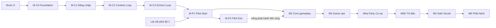

# Code Plan — Lộ trình SDD, CMS/LMS trước

> Trạng thái: Draft · Phiên bản: 0.4 · Owner: Solution Architect + Tech Lead · Cập nhật: 2026-11-21 (ADR-0095 bỏ khái niệm lớp: F040 Removed, ghi chú tác động từng feature, §4.2 work package) · 2026-11-17 (§4.1 đã chốt và áp vào spec: thứ tự F041 → F042, tách báo cáo game của F081 sang F080, F013/F014 kiểm consumer bằng fixture, AC mặc định an toàn ADR-0078; modular monolith ADR-0074: cột Module, ghi chú cấu trúc backend; CI GitHub Actions ADR-0088; mốc M-P1/M-P2 theo ADR-0073, ADR-0080, RB-811; phụ thuộc ẩn §4.1) · 2026-11-16
> Liên quan: [Constitution](../../.specify/memory/constitution.md) · [ADR-0082](../adr/ADR-0082-spec-driven-development-va-noi-dung-deferred.md) · [ADR-0072](../adr/ADR-0072-bo-vai-tro-giao-vien-hoc-sinh-tu-hoc-kiem-duyet-tap-trung.md) · [ADR-0074](../adr/ADR-0074-modular-monolith-co-ranh-gioi-cuong-che.md) · [ADR-0088](../adr/ADR-0088-ci-cd-bang-github-actions.md) · [ROADMAP](ROADMAP.md) · [PRODUCT_REQUIREMENTS](../00-overview/PRODUCT_REQUIREMENTS.md) · [TEST_STRATEGY](TEST_STRATEGY.md) · [AGENTS.md](../../AGENTS.md)

## 1. Mục đích và phạm vi

Kế hoạch code của EduWorld theo **Spec-Driven Development** (chuẩn GitHub Spec Kit + EARS, [ADR-0082](../adr/ADR-0082-spec-driven-development-va-noi-dung-deferred.md)), **làm CMS/LMS trước**. Tài liệu này **sở hữu danh mục feature, thứ tự triển khai và trạng thái** (§4–§6). Nội dung từng feature (yêu cầu EARS, thiết kế, task) nằm trong `specs/<NNN>-<slug>/`; không lặp lại ở đây.

Ba làn chạy song song trong mỗi mốc: **Backend** (`src/backend/pkg/`, `src/backend/modules/`, `src/backend/cmd/`, `deploy/`), **Frontend** (`src/cms/frontend/` Admin Portal), **Game client** (`src/game/`).

Thứ tự này đổi so với [ROADMAP](ROADMAP.md) và **đã được owner duyệt 2026-11-20** [Confirmed] (liên quan [ADR-0073](../adr/ADR-0073-phat-hanh-theo-pilot-uu-tien-giao-duc.md), Accepted); ROADMAP cập nhật theo.

### 1.1. Lý do đổi thứ tự

- Learning Engine là lõi (ROADMAP §1): mọi gameplay Phase 2+ phải dùng nội dung thật từ backend. Có CMS trước thì content team bắt đầu nhập liệu sớm (dòng sản xuất nội dung chạy song song từ Phase 2).
- Vòng lặp **School Loop** (M3) có giá trị demo cho trường sớm hơn vòng lặp gameplay.
- Game client có contract ổn định (attempt API, render payload) để build activity player trước khi làm thế giới 3D đầy đủ.

### 1.2. Rủi ro của việc đổi thứ tự

| Rủi ro | Giảm thiểu |
|---|---|
| Đội web chỉ 1 người (ROADMAP §1 giả định) không đủ cho CMS-first | Tăng lên 2–3 web dev trong giai đoạn này, hoặc chuyển 1 Godot dev sang web ở giai đoạn F/M-C1 [Confirmed] |
| Godot dev ít việc lúc đầu | Luồng C build trên **Prism mock** sinh từ `specs/openapi` (gắn nhãn MOCK, R17) cho tới khi backend thật sẵn sàng |
| Cổng hiệu năng M1 (Main Hub 40 avatar) bị lùi | Giữ benchmark headless + `QualityManager` trong luồng C từ đầu; hub đông người làm khi có realtime |
| CMS cần module game cho một số màn (GamePreviewFrame, catalog game activity, thumbnail 3D) | Ẩn các màn này sau permission/feature flag tới khi module game có `/game-admin/*` |

## 2. Cách làm việc theo SDD

| Thành phần | Vị trí | Vai trò |
|---|---|---|
| Constitution | [`.specify/memory/constitution.md`](../../.specify/memory/constitution.md) | 9 điều khoản + câu hỏi gate; chi tiết ở AGENTS.md §2 |
| Template | [`.specify/templates/`](../../.specify/templates/spec-template.md) | spec, plan, tasks, checklist, data-model, contracts, quickstart |
| Feature spec | `specs/<NNN>-<slug>/` | `spec.md` · `plan.md` · `research.md` (tùy chọn) · `data-model.md` · `contracts/README.md` · `quickstart.md` · `checklists/requirements.md` · `tasks.md` |
| Lệnh cho AI agent | `.claude/commands/speckit.*.md` | `/speckit.specify` → `/speckit.clarify` → `/speckit.plan` → `/speckit.tasks` → `/speckit.analyze` → `/speckit.implement` |
| Kiểm tra | `node scripts/specs/check-features.mjs` | Cấu trúc, mã FR/TC/ADR, EARS, định dạng task, độ phủ FR, danh mục |

**Trạng thái feature (cột Trạng thái ở §4):** `Chưa viết` → `Draft` (đang viết spec, còn câu hỏi) → `Ready` (đủ bộ file, `check-features` 0 lỗi, checklist đạt) → `In progress` → `Done` (Definition of Done đạt, quickstart có bằng chứng).

**Cấu trúc backend (modular monolith, [ADR-0074](../adr/ADR-0074-modular-monolith-co-ranh-gioi-cuong-che.md); mã nguồn trong `src/` theo [ADR-0092](../adr/ADR-0092-to-chuc-ma-nguon-trong-src.md): `src/backend/` (Go), `src/cms/frontend/` (Admin Portal), `src/game/` (Godot)):** một Go module duy nhất `src/backend/go.mod`; sáu module `identity`, `learning`, `game`, `competition`, `chat`, `realtime` trong `src/backend/modules/<module>/` (`api/` = facade công khai sinh từ `specs/openapi/modules/<module>.internal.v1.yaml`, `internal/{domain,application,infrastructure,presentation}`, `ent/`, `migrations/`, `module.go` với `Register`/`Wire`); ba binary `src/backend/cmd/core-api` (REST `/api/v1/*`, route gateway nội bộ, handler NATS cho lệnh từ realtime), `src/backend/cmd/realtime` (WebSocket, không DB) và `src/backend/cmd/worker --profile=events|chat|jobs` (Swarm service `worker-events`, `worker-chat`, `worker-jobs`). Mỗi module một database trên một cụm PostgreSQL. Gọi module khác chỉ qua facade trong tiến trình (`src/backend/pkg/modcall`, không HTTP/token), phản ứng phụ qua outbox → NATS; ranh giới do Go `internal/` + `make arch-check` (`x-allowed-callers`) cưỡng chế. Cột "Module / phạm vi" ở §4 ghi module sở hữu; mọi module domain chạy trong `core-api` và `worker`, nên "module X" trong feature spec không còn nghĩa là một service hay image riêng.

**CI/CD:** GitHub Actions ([ADR-0088](../adr/ADR-0088-ci-cd-bang-github-actions.md)) — mỗi lane một workflow trong `.github/workflows/` chạy theo path filter (`go.yml` matrix theo module, `specs.yml`, `docs.yml`, `web.yml`, `design.yml`, `godot.yml` có runner macOS cho iOS, `security.yml`, `release.yml`, `deploy-config.yml`), image trên `ghcr.io`, GitHub Environments `staging`/`production`, runner self-hosted chỉ cho bước triển khai. F001 dựng khung CI này (không còn GitLab CI).

**Cấu trúc code trong module:** theo [ADR-0087](../adr/ADR-0087-cqrs-tach-read-write-khong-mediator.md) — `application/command` + `port/write` + `persistence/write` (write context) và `application/query` + `port/read` + `persistence/read` (read context), không mediator. Cây thư mục trong `plan.md` của feature là gợi ý; khi `port/` hoặc `persistence/` ghi chung thì đặt file vào nhánh `write`/`read` tương ứng.

**Quy tắc chọn việc:** chỉ code feature `Ready` có mọi phụ thuộc `Done`. Ngoại lệ: game client được bắt đầu trên Prism mock sinh từ `specs/` khi backend chưa Done; mock gắn nhãn rõ (R17) và feature chỉ `Done` khi chạy với backend thật.

## 3. Bước 0 — Chốt mâu thuẫn tài liệu/spec trước khi code (1 sprint)

> **Đã chốt (Technical Architect, 2026-11-16):** mọi cột "Đề xuất" trong bảng D1–D18 là quyết định; việc còn lại là sửa tài liệu/spec cho khớp (theo dõi ở [SPEC_RECONCILIATION_BACKLOG](SPEC_RECONCILIATION_BACKLOG.md)).

Rà soát cho thấy một số điểm docs và specs chưa khớp. Phải chốt trước khi sinh code, vì đổi sau sẽ phải migrate. Mỗi dòng: sửa tài liệu sở hữu + spec, ghi CHANGELOG; điểm nào là quyết định kiến trúc thì viết ADR.

| # | Mâu thuẫn | Nơi xung đột | Đề xuất [Confirmed] |
|---|---|---|---|
| D1 | Tên thư mục service: `services/learning/` vs `src/backend/modules/learning/` | BACKEND_DESIGN §3, SYSTEM_ARCHITECTURE §8 vs LOCAL_DEVELOPMENT §3.2 | `src/backend/modules/<name>/` (khớp tên image, compose) — **Thay bởi ADR-0074 (2026-11-17):** `src/backend/modules/<module>/` trong một `go.mod`, ba binary `src/backend/cmd/core-api`, `src/backend/cmd/realtime`, `src/backend/cmd/worker` |
| D2 | Tên biến môi trường (`EW_DB_URL_FILE`/`EW_DB_DSN`, `EW_CLIENT_*`/`EW_SVC_*`, `EW_OBJECT_STORAGE_*`/`EW_S3_*`, `EW_ADMIN_ADDR`…) | BACKEND_DESIGN §12 vs LOCAL_DEVELOPMENT §4 | Một bảng duy nhất ở LOCAL_DEVELOPMENT §4, BACKEND_DESIGN chỉ link; giữ `EW_S3_*`, `OTEL_*` chuẩn — **ADR-0074:** bỏ `EW_SVC_*` (không gọi HTTP giữa module); kết nối DB theo module `EW_DB_<MODULE>_*`, Keycloak Admin `EW_KC_ADMIN_CLIENT_*` |
| D3 | Cổng internal API (`:8080` vs 81xx) | API_DESIGN §12.1 vs LOCAL_DEVELOPMENT §3.2 | Thêm cột cổng internal (ví dụ 82xx) vào LOCAL_DEVELOPMENT — **ADR-0074:** không còn cổng internal API; chỉ cổng public `core-api`/`realtime` và cổng quản trị theo binary (LOCAL_DEVELOPMENT §3.2) |
| D4 | Vị trí permission catalog (`internal/authorization` vs `src/backend/pkg/authz`) | DATABASE_DESIGN §2.1 vs BACKEND_DESIGN §2 | `src/backend/pkg/authz/catalog.go` (khớp AGENTS R20) |
| D5 | Soft-delete hook/interceptor ở `src/backend/pkg/tenancy` hay `src/backend/pkg/entx` | MULTITENANCY §4.1 vs BACKEND_DESIGN §2 | Hook/interceptor ở `src/backend/pkg/entx`, `Bypass`/`TenantScope` ở `src/backend/pkg/tenancy` |
| D6 | Schema bảng `idempotency_records`, `tenant_resource_assignments` (`platform.` vs `infra.`) | API_DESIGN §6, CONTENT_MODEL §4 vs DATABASE_DESIGN §3.10 | Theo DATABASE_DESIGN (`infra.`) |
| D7 | Principal endpoint/cache key | MULTITENANCY §1, §4.3 vs BACKEND_DESIGN §6 | `POST /internal/v1/principals:resolve`, key `ew:identity:principal:` — **ADR-0074:** operation facade `resolvePrincipal` của module identity (path chỉ là định danh operation), gọi trong tiến trình qua `src/backend/pkg/modcall` |
| D8 | `owner_scope`: platform/organization/school vs platform/tenant | API_DESIGN §9.13, CURRICULUM_MODEL §3.1 vs DATABASE_DESIGN, CONTENT_MODEL §4 | platform/tenant (ADR-0005: tenant là đơn vị) |
| D9 | Danh sách `content_type`/`item_type` | API_DESIGN §9.13 vs spec `LearningContentType` vs DATABASE_DESIGN §3.13 | Một enum ở spec, các tài liệu link về spec |
| D10 | Tên loại câu hỏi `fill_blank`/`fill_in_blank`, `numeric`/`numeric_answer`, `drag_drop`/`drag_and_drop` | `question.schema.json`, QUESTION_BANK, MINIGAME_ENGINE §2 vs OpenAPI `QuestionType`, DATABASE_DESIGN §3.3 | Theo OpenAPI `QuestionType` |
| D11 | Tên event nội dung `content.review_requested` vs `content.version_submitted` | CONTENT_MODEL §6 vs EVENT_DESIGN §4.2 | Theo EVENT_DESIGN; thêm payload schema vào `specs/events/payloads/learning/` |
| D12 | `feedback_policy`: `on_submit/after_close` vs `after_submit/after_review` | spec `Attempt` vs ACTIVITY_ENGINE §4 | Theo spec |
| D13 | Body start attempt: `assignment_id` vs `context_type/context_id` | ACTIVITY_ENGINE §9 vs `learning.v1.yaml` | Theo spec |
| D14 | Endpoint bài được giao: `/lms/my-assignments` vs `/learning/my-assignments` | STUDENT_GAME_UX vs spec | Theo spec (`/learning/*` là route người chơi) |
| D15 | Đăng nhập game tạo session luôn hay gọi `POST /game/sessions` riêng; token ở `tokens.access_token` | `GameLoginResponse` (identity.v1.yaml) vs GODOT_ARCHITECTURE §5, §13.2 | Theo spec: login trả `game_session_id`; sửa GODOT_ARCHITECTURE | **Đã chốt — [ADR-0083](../adr/ADR-0083-dang-nhap-game-va-tao-game-session-tach-biet.md): gọi riêng `POST /game/sessions`** |
| D16 | Dấu vết đăng nhập OIDC cũ của game (`oidc_issuer`, intent filter `oauth2/callback`, `/auth/session` trong ADR-0065) | GODOT_ARCHITECTURE §4, §11; ADR-0065 | Gỡ theo ADR-0068, ghi Lịch sử thay đổi ADR-0065 | **Đã chốt — gỡ `oidc_*`, intent filter OAuth, redirect Web OIDC khỏi GODOT_ARCHITECTURE; ADR-0065 ghi Lịch sử thay đổi (game lấy tenant từ `/auth/game/*`, ADR-0068, ADR-0083)** |
| D17 | Đường dẫn presign media (`/cms/learning/media:presign` vs `/cms/media:presign-upload`), `license` varchar(255) vs (64) | API_DESIGN §8, ADR-0044 vs spec, DATABASE_DESIGN | Theo spec; `license` 255 |
| D18 | Dấu vết vai trò giáo viên trong spec: role `teacher`, `user_type = teacher`, `teaching_assignment`, `/lms/reviews*`, `pending_review`/`returned`, `actor.type = teacher` | identity/learning OpenAPI, SIS contract, `learning-event.schema.json` vs ADR-0072 | Gỡ theo ADR-0072; thêm role `safety_moderator`; `actor.type` = `student, system, staff` |

**Mục SPC từ [EDU_FIT_REVIEW](EDU_FIT_REVIEW.md) §4.4 phải chốt trong Bước 0** [Confirmed]:

| # | Việc | Nguồn | TC |
|---|---|---|---|
| S1 | Response schema theo loại câu: `$defs.<type>.response` trong `question.schema.json` cho đủ 11 `QuestionType`; OpenAPI và AsyncAPI `$ref` tới đó | SPC-01 | TC-LRN-016 |
| S2 | Enum chung trong `specs/schemas/common` (`QuestionType`, `ActivityType`, `FeedbackTiming`, `ResultRelease`, `AttemptMode`, `AttemptStatus`, `LearningContentType`, `actor.type`, assignment `target_type`/`status`); mọi spec `$ref`; script kiểm tra enum trong `make specs-lint` (bổ sung cho D9, D10, D12) | SPC-02, SPC-03, SPC-06 | TC-LRN-017 |
| S3 | Hints API `POST /learning/activity-attempts/{attempt_id}/items/{position}/hints:next`; `hints_used` trong learning event; `options[].feedback` chỉ trong `ActivityResponseResult.feedback` | PED-04 | TC-LRN-011, TC-LRN-012 |
| S4 | Đóng chặt `render_payload` bằng `$ref` tới phần render của `question.schema.json` | SPC-04 | TC-LRN-007 |
| S5 | `AssignmentCreate` theo SCHOOL_LMS (`course_id`, `late_policy`, `follow_latest`, `content_type = activity`, `result_release`); event `activity.graded`, `exam.graded`, `attempt.re_evaluated`; `context.mode` đủ `AttemptMode` | SPC-05, SPC-06 | TC-LMS-001, TC-LRN-015 |
| S6 | Endpoint quản trị CMS/LMS/Exam còn thiếu (danh sách bên dưới) | SPC-07 | — |

**Bổ sung spec còn thiếu** (contract-first, R4 của §3 AGENTS):

- `learning.v1.yaml`: CMS curricula/subjects/topics/objectives, question-sets, assessment-blueprints, lessons, `POST questions/{id}/versions`, `GET questions/{id}`, preview sessions, imports, review-tasks; LMS courses, learning-paths, schedules, `assignments/{id}` + sub-actions (`:publish`, `:cancel`, `:release-results`, `:extend`, `:excuse`, `/submissions`), gradebook, reports, `GET /lms/dashboards/school`; `hints:next`; `GET /exams/sessions/{id}`.
- `identity.v1.yaml`: `POST/PATCH /admin/tenants`, `/admin/tenants/{id}/schools`, `/admin/users:unlock|:deactivate`, `/admin/audit-logs`, `/admin/feature-flags`, `/sis/connections`, `/sis/imports`, `/sis/reconciliation-issues`, `/schools` list/detail/students.
- JSON Schema cho activity `quiz`, `interactive_exercise`, `minigame` trong `specs/schemas/activities/`.
- Event payload schema cho content/LMS/assessment.
- `specs/postman/` (đang được tham chiếu nhưng chưa có).

**Exit Bước 0:** `make specs-lint` sạch (gồm rule `maxLength` và kiểm tra enum chung), `make docs-check` sạch, bảng D1–D18 và S1–S6 đã đóng.

## 4. Danh mục feature

| Mã | Feature | Module / phạm vi | Mốc | Phụ thuộc | FR chính | Trạng thái |
|---|---|---|---|---|---|---|
| [F001](../../specs/001-monorepo-compose-ci-skeleton/spec.md) | Monorepo, Docker Compose local, CI GitHub Actions theo path, khung modular monolith | Hạ tầng (`src/backend/go.mod`, `src/backend/cmd/`, `src/backend/modules/`, `Makefile`, `deploy/compose`, `.github/workflows`) | M-C0 | — | FR-OPS-001, FR-OPS-002, FR-OPS-004, FR-OPS-005, NFR-DEPL-001, NFR-DEPL-002, NFR-SEC-005 | In Progress (code 2026-11-17; còn AC-02 `.env.example` bị chặn quyền ghi, AC-13/15/16/26 cần chạy trên GitHub) |
| [F002](../../specs/002-platform-kit-core/spec.md) | Platform kit lõi: config, observability, problem, httpx, authz, tenancy | `src/backend/pkg/` | M-C0 | F001 | FR-AUTH-004, FR-ORG-006, FR-CMS-012, FR-OPS-003, NFR-OBS-002, NFR-SEC-006, NFR-MAINT-001 | Done (2026-11-18, bằng chứng local; chờ CI xanh cho target `make`; nối resolver identity vào core-api ở F003 T048; chưa kiểm trên Tempo thật) |
| [F003](../../specs/003-platform-kit-data/spec.md) | Platform kit dữ liệu: entx + UnitOfWork, khung CQRS read/write (không mediator), idempotency, outbox, modcall, testkit | `src/backend/pkg/` | M-C0 | F002 | FR-ORG-011, NFR-MAINT-002, NFR-MAINT-004…006, NFR-SEC-004, NFR-AVAIL-004, NFR-AVAIL-005 | Done (2026-11-18, bằng chứng local; chờ CI xanh cho target `make`; `Principal.grants` chờ F012 cài đặt) |
| [F004](../../specs/004-keycloak-realm-apisix-gateway/spec.md) | Keycloak realm as code và APISIX gateway (route, `tenant-header`, gateway nội bộ) | Hạ tầng (`deploy/keycloak`, `deploy/apisix`) | M-C0 | F001 | FR-AUTH-003, FR-AUTH-012, FR-AUTH-013, FR-AUTH-018, FR-SIS-007, NFR-SEC-002, NFR-SEC-003 | Done (2026-11-18, bằng chứng local; chờ CI xanh job `deploy-config`; ADC/`adc diff` và dry-run realm staging chuyển F130; phần `Set-Cookie` portal của T044 chờ F012) |
| [F005](../../specs/005-design-tokens/spec.md) | Design tokens game/admin/shared và pipeline sinh theme | `design/` | M-C0 | F001 | NFR-MAINT-007, NFR-A11Y-001, NFR-A11Y-003 | Done (2026-11-19, bằng chứng local; GdUnit4 nạp `.tres` chạy khi F060 có project Godot; preset `ShaderMaterial` toon chờ shader F071) |
| [F010](../../specs/010-tenant-org-structure/spec.md) | Tenant, danh mục quốc gia/tỉnh/trường, tổ chức trường–khối (lớp/enrollment bỏ theo ADR-0095) | module `identity` | M-C1 | F003, F004 | FR-ORG-001…003, FR-ORG-005, FR-ORG-009, FR-ORG-010, FR-ORG-015…017, FR-AUTH-001, FR-AUTH-021 | Done (2026-11-19, bằng chứng local; AC-03 phần resolve + AC-21 realm role chuyển F012; nối binary xong 2026-11-20 (OQ F010-2); OQ chốt 2026-11-20: F010-1 `importSchools` bất đồng bộ → F011, F010-3 audit bypass job → F003, audit đọc hồ sơ học sinh + `--once` — việc bổ sung trong tasks.md) · **ADR-0095:** bỏ Class/Enrollment/lớp ảo; học sinh thuộc trường với khối, membership từ học sinh hiệu lực, event `student.placement_changed` (WP-I1) |
| [F011](../../specs/011-sis-sync-provisioning/spec.md) | Đồng bộ SIS bằng CSV và provisioning tài khoản | module `identity` | M-C1 | F010 | FR-SIS-002, FR-SIS-003 (phần `csv_import`), FR-SIS-005…008, FR-ORG-018, FR-AUTH-005, FR-AUTH-014, FR-AUTH-031 | Done (2026-11-18, bằng chứng local; nối binary xong 2026-11-20; OQ chốt 2026-11-20: F011-1 không gộp liên tenant (chuyển trường qua `same_person`), F011-2 khóa hash có `kid`, F011-3 sửa `routematrix` → F002; việc bổ sung: `importSchools`, `class.synced.source_version`, đề nghị gộp `merge_requested` — tasks.md) · **ADR-0095:** bỏ `classes.csv`/`enrollments.csv`, issue lớp, login sync `missing_placement` (WP-I1) |
| [F012](../../specs/012-authz-portal-session/spec.md) | Phân quyền Permission/Role/UserRole và phiên portal (`/me/*`, `principals:resolve`) | module `identity` | M-C1 | F010 | FR-AUTH-016, FR-AUTH-019, FR-AUTH-029, FR-AUTH-030, FR-AUTH-032, FR-CMS-001, FR-CMS-012, FR-LMS-005, FR-ORG-008 | Done (2026-11-19, bằng chứng local; nối binary xong 2026-11-20; OQ chốt 2026-11-20: F012-1 đổi email (username không đổi), `getMe` header tùy chọn (F051-3), `route_groups` (F059-12) — xong 2026-11-20 (T055–T057); F012-2 → F013/F014) · **ADR-0095:** `tenant.class.read`→`tenant.student.read`, `lms.class.read`→`lms.student.read`, gộp `analytics.class.read`; `scope_type` bỏ `class` (WP-I1); bỏ 4 quyền LMS (WP-L1) |
| [F013](../../specs/013-game-login-backend/spec.md) | Đăng nhập game qua backend: login, chọn tenant, refresh, logout, bảo vệ đăng nhập, hàng chờ | module `identity` | M-C1 | F011, F012 | FR-AUTH-002, FR-AUTH-003, FR-AUTH-007…009, FR-AUTH-017, FR-AUTH-018, FR-AUTH-022, FR-AUTH-027, FR-AUTH-028 | Done (2026-11-19, bằng chứng local; OQ chốt 2026-11-20: F013-1…3 giữ như hiện thực, F013-4 xong ở F015, F013-5 IP sau proxy → F002; OQ-17 giới hạn chơi/ngày F013-AC-33 (`DAILY_PLAY_LIMIT_REACHED`) — xong 2026-11-20 (T048); k6 hàng chờ chạy khi có staging; nối binary xong 2026-11-20) · **ADR-0095:** bootstrap không `class`, grade từ học sinh; `NO_ACTIVE_ENROLLMENT` nghĩa "không có trường/khối hiệu lực" (WP-I1) |
| [F014](../../specs/014-game-session-thin/spec.md) | Game session lát mỏng: một thiết bị, login events, client-config, manifest tối thiểu | module `game` | M-C1 | F013 | FR-AUTH-023, FR-GAME-007, FR-GAME-008, FR-GAME-013, FR-GAME-014 | Done (2026-11-19, bằng chứng local; OQ chốt 2026-11-20: F014-1 `sis_connection_id` từ projection, OQ-17 giới hạn chơi/ngày F014-AC-27 — xong 2026-11-20 (T044, T045); F014-2 xong, F014-3 theo API_DESIGN §6, F014-4/F014-5 chấp nhận, F014-6 metric chung → F003; E2E + `login_slo` chạy khi có môi trường compose) |
| [F015](../../specs/015-audit-settings/spec.md) | Audit log tập trung và cài đặt platform/tenant/trường | module `identity` | M-C1 | F012 | FR-AUD-001, FR-AUD-002, FR-ORG-007, NFR-SCAL-004 | Done (2026-11-19, bằng chứng local; OQ F015-1…7 owner chốt 2026-11-20 (`getTenant` khi có bên gọi, partition `sis.*` theo đo tải F132); OQ-17 `daily_play_limit_minutes` F015-AC-30 — xong 2026-11-20 (T043); nối binary xong 2026-11-20) |
| [F016](../../specs/016-account-lifecycle/spec.md) | Vòng đời tài khoản: khóa, thu hồi truy cập, dọn học sinh không đăng nhập, ẩn danh hóa | module `identity` | M-C3 | F011, F014, F015 | FR-AUTH-010, FR-AUTH-024, FR-SIS-008, FR-ORG-014, NFR-PRIV-002, NFR-PRIV-003 | Done (2026-11-19, bằng chứng local: 27/27 AC có test; OQ F016-1…13 owner chốt 2026-11-20 (F016-2 facade vòng đời → F030/F070/F074/F100/F115, F016-10 giữ `editUsernameAllowed=false`); e2e qua binary chạy khi có môi trường compose) · **ADR-0095:** cleanup bỏ `class_name` (WP-I1) · **ADR-0097 (2026-11-22):** tiếp nhận yêu cầu dữ liệu qua Portal (`/admin/data-requests*`, AC-22) gỡ khỏi Release 1; ẩn danh hóa theo retention giữ |
| [F017](../../specs/017-sis-contract-v1/spec.md) | SIS `contract_v1`: provider API theo EduWorld SIS Contract, webhook, conformance kit, `sis-mock` (tách từ F011) | module `identity` | M2 | F011 | FR-SIS-001, FR-SIS-003 (phần `contract_v1`), FR-SIS-004, FR-SIS-009 | Done (2026-11-19, bằng chứng local + conformance Postman vào sis-mock; OQ F017-1…11 [Confirmed]: ánh xạ `config.schools[]`, client viết tay thay oapi-codegen, định dạng secret, lịch mặc định tới khi đọc tenant settings; nối binary xong 2026-11-20) · **ADR-0095:** SIS contract 1.3.0 bỏ Class/Enrollment, conformance, `sis-mock` (WP-I1) |
| [F020](../../specs/020-learning-foundation/spec.md) | Nền module learning: projection, mô hình nội dung, gán platform→tenant, thùng rác tenant | module `learning` | M-C2 | F003, F010 | FR-CNT-001, FR-CNT-002, FR-CNT-005, FR-CMS-014, FR-CMS-015 | Done (2026-11-19, bằng chứng local: 32/32 AC có test; nối binary xong 2026-11-20 (OQ F020-3); OQ chốt 2026-11-20: F020-1 `source_version` (F011 + việc bổ sung), F020-2 `arch-check` theo operation → F001, F020-4 lint `UpdateOne*` → F003) · **ADR-0095:** projection bỏ `ref.classes`/`ref.enrollments`, bỏ loại nội dung `learning_path` (WP-L1) |
| [F021](../../specs/021-curriculum/spec.md) | Curriculum: cấu trúc, LO, DAG tiên quyết, version, mapping, import/export, seed GDPT | module `learning` | M-C2 | F020 | FR-CUR-001…012, FR-CMS-002 | Done (2026-11-19, bằng chứng local: 29/29 AC có test, 43 operation; nối binary xong 2026-11-20; OQ chốt 2026-11-20: cache cây curriculum theo đo tải F132 (OQ F021-10), lọc năm học → F040 (OQ F021-5); import qua portal cần media F027 — OQ F021-4) · **ADR-0095:** nhận FR-CUR-008 và `school_curriculum_settings` từ F040 — xong ở WP-L1 2026-11-21 (F021-AC-30, `TestSchoolCurriculumSettings`); nguồn năm học thay `ref.classes` để WP-I1/WP-R (T044) |
| [F022](../../specs/022-question-bank-core/spec.md) | Question Bank 8 loại cơ bản: validator, scorer server-side, render payload không đáp án | module `learning` | M-C2 | F021 | FR-QB-001…004, FR-QB-006, FR-QB-007, FR-QB-013, FR-QB-015 | Done (2026-11-19, bằng chứng local: 28/28 AC có test, 7 operation CMS + port `Delivery`; nối binary xong 2026-11-20; cache answer key theo đo tải F132 — OQ F022-12 (OQ chốt 2026-11-20); publish thật ở F025/F026) |
| [F023](../../specs/023-question-bank-advanced/spec.md) | Question Bank nâng cao: short_answer, image_based, interactive, câu tham số hóa | module `learning` | M-C2 | F022 | FR-QB-001, FR-QB-006, FR-QB-008, FR-QB-009 | Done (2026-11-19, bằng chứng local: 20/20 AC có test; registry 11 loại `question.Full()` — OQ F023-2; widget `balance_scale@1.0`, evaluator an toàn big.Rat; benchmark T031 chạy cùng đợt đo F132 — OQ F023-7 (OQ chốt 2026-11-20); nối binary xong 2026-11-20) |
| [F024](../../specs/024-question-set-lesson-blueprint/spec.md) | Question set, lesson, assessment blueprint, worked example, import hàng loạt, tìm kiếm | module `learning` | M-C2 | F022 | FR-CNT-001, FR-CNT-007, FR-CNT-020, FR-CNT-021, FR-QB-004, FR-QB-005, FR-QB-011, FR-CMS-003 | Done (2026-11-19, bằng chứng local: 23/23 AC có test; 4 loại chung bảng/cột + `body` jsonb — OQ F024-1; tìm kiếm `search_tsv` sinh + unaccent — OQ F024-2; import theo dòng — OQ F024-7; benchmark 100.000 version chạy cùng đợt đo F132 — OQ F024-11; nối binary xong 2026-11-20; OQ chốt 2026-11-20: lọc `content_language`/`translation_status` (OQ F054-2) — việc bổ sung trong tasks.md) |
| [F025](../../specs/025-content-review-workflow/spec.md) | Workflow duyệt nội dung, song ngữ, lồng tiếng `g1_3` | module `learning` | M-C2 | F022, F027 | FR-CNT-003, FR-CNT-018, FR-CNT-019, FR-CMS-006…008, NFR-I18N-002 | Done (2026-11-19, bằng chứng local: 24/24 AC có test; nối binary xong 2026-11-20; AC-20 header nối ở F030; OQ chốt 2026-11-20: `field_comments[]` (OQ F054-1) — việc bổ sung trong tasks.md; không TTS phía server (OQ-23)) · **ADR-0097 (2026-11-22):** US5 xuất/nhập file dịch (AC-22/23/24, job `translation-jobs`) gỡ khỏi Release 1 |
| [F026](../../specs/026-content-release/spec.md) | Phát hành nội dung: publish/rollback/unpublish, snapshot, manifest, ghim version, nơi sử dụng | module `learning` | M-C2 | F025, F014 | FR-CNT-004, FR-CNT-008…012, FR-EXR-015 | Done (2026-11-20, bằng chứng local: 28/28 AC có test; nối binary xong 2026-11-20; nơi sử dụng activity/bài giao/exam và `active_pinned_sessions` chờ F030/F041/F042; nơi dùng từ game/competition → F078/F108 (OQ F054-3, OQ chốt 2026-11-20)) |
| [F027](../../specs/027-media-math-preview/spec.md) | Media pipeline, công thức SVG, preview session | module `learning` | M-C2 | F020, F022 | FR-CNT-006, FR-CNT-010, FR-CNT-017, FR-CMS-003, FR-CMS-006 | Done (2026-11-19, bằng chứng local: 19/19 AC có test; ảnh xử lý Go thuần thay libvips — OQ F027-1; `media.upload` cho mọi role có `learning_content.write` → F002 (OQ F027-2, OQ chốt 2026-11-20); LaTeX không gửi xuống client — OQ F027-3; ClamAV thật/ffmpeg/CDN nginx kiểm ở quickstart — OQ F027-9, F027-12; nối binary xong 2026-11-20) |
| F028 | Import Word/MathType (`lessons_docx`) qua Pandoc (`eduworld/media-tools`): tách câu theo mẫu `.docx`, công thức OMML → LaTeX qua allowlist, chỉ tạo Draft kèm báo cáo từng câu | module `learning` + `src/cms/frontend/apps/portal` | M-C3 | F024, F027, F054 | FR-QB-011 (phần Word/MathType) | Draft (chưa có spec; owner chốt 2026-11-20 công cụ Pandoc theo CONTENT_PRODUCTION_PLAN, spike trước khi mở cho người soạn) |
| [F030](../../specs/030-activity-attempt-api/spec.md) | Activity Registry và Attempt API (`quiz`, `interactive_exercise`) | module `learning` | M-C2 | F026 | FR-CNT-013, FR-EXR-002, FR-EXR-004…007, FR-EXR-016, FR-QB-003 | Done (2026-11-20, bằng chứng local: 27/27 AC có test; facade test phía game → F072; OQ chốt 2026-11-20: `answer_rate`, `suspicious_speed_flag` (T049), `createCmsActivityVersion`, `mergeUserData`, `activity` trong platform-ops — việc bổ sung trong tasks.md) · **ADR-0095:** context `learning_path` bỏ (WP-L1) |
| [F031](../../specs/031-learning-events-mastery/spec.md) | Learning events, mastery v1, evaluation và re-evaluate | module `learning` | M-C2 | F030 | FR-ANL-001, FR-ANL-002, FR-ANL-004, FR-PRG-001…003, FR-PRG-009, FR-EXR-008, NFR-AVAIL-003 | Done (2026-11-20, bằng chứng local testcontainers; chạy tay trên stack compose chưa làm — đăng nhập game bị chặn ở phiên agent) · **ADR-0095:** `grade_level` tại thời điểm sự kiện thay `class_id` trên learning event/`progress_daily` (WP-L1) |
| [F032](../../specs/032-self-study-practice/spec.md) | Chế độ luyện tập, hỗ trợ tự học (gợi ý, chẩn đoán, `rapid_guess`), gợi ý ôn tập tự động | module `learning` | M-C3 | F031 | FR-EXR-001, FR-EXR-003, FR-EXR-012…014, FR-PRG-004…008, NFR-A11Y-002 | Done (2026-11-20, bằng chứng local testcontainers: 34/34 AC có test, OQ F030 question set theo luật; quyết định [Confirmed] chờ owner; chạy tay trên stack compose chưa làm) · **ADR-0095:** gợi ý R6 đọc lịch → bài giao sắp hạn (WP-L1) |
| [F035](../../specs/035-learning-efficacy-study/spec.md) | Nghiên cứu hiệu quả học tập: bài kiểm tra độc lập trước/sau, cụm (trường, khối) so sánh (ADR-0095), A/B cấu hình mastery, xuất dữ liệu định danh giả (ADR-0080) | module `learning` + `src/cms/frontend/apps/portal` | M-C3 | F031, F032, F042 | FR-ANL-017…023, FR-ANL-001, FR-ANL-016, NFR-PRIV-002 | Done (2026-11-21, 37/37 AC có test: backend unit + integration testcontainers `TestEfficacy*` 8/8, portal Vitest với MOCK backend hợp đồng; E2E Playwright `@F035` với backend thật viết sẵn, chạy khi có môi trường compose — OQ F051-9) · **ADR-0095:** đơn vị nghiên cứu cụm (trường, khối), OQ-25 (WP-L2) |
| F040 (thư mục spec đã xóa) | Course, learning path, lịch, nhóm học tập | module `learning` (LMS) | M-C3 | F031 | FR-LMS-001, FR-LMS-004, FR-SOC-004, FR-CUR-008 | **Removed (ADR-0095, 2026-11-21)** — WP-L1 đã gỡ code (domain/command/query/repository/HTTP 18 operation, consumer `learning.lms_courses`/`learning.lms_schedule`, rule R6), event `study_group.*`/`schedule_item.deleted`, 4 quyền LMS, menu portal course/lịch/nhóm học tập và thư mục spec; bảng `lms.courses`… còn tới WP-R; `school_curriculum_settings` và FR-CUR-008 chuyển sang F021 (F021-AC-30); trước đó: Done (2026-11-20) |
| [F041](../../specs/041-school-assignments/spec.md) | Giao bài của nhà trường: assignment, `ResultRelease`, gia hạn/miễn, `my-assignments` | module `learning` (LMS) | M-C3 | F032 | FR-LMS-002, FR-LMS-006, FR-LMS-007, FR-LMS-012, FR-EXR-001 | Done (2026-11-20, bằng chứng local: 31/31 AC có test — 11 integration + unit domain/command/R1; `ExamSessionCreator` "chưa khả dụng" tới F042; Câu hỏi mở F041-1 (event hủy bài), F041-2 (event danh mục game của F071/F078)) · **ADR-0095:** đối tượng (trường, khối) ± học sinh, bỏ course, bài cũ theo lớp → danh sách học sinh đóng băng, `assignment.created.v2`, consumer `student.placement_changed` — xong ở WP-L1 2026-11-21 (F041-AC-32…AC-34, T053–T058) |
| [F042](../../specs/042-exam-engine/spec.md) | Exam Engine: 7 hình thức đề, random theo blueprint, thi có giờ, chấm lại đề | module `learning` | M-C3 | F024, F041 | FR-EXM-001…006, FR-EXM-008, FR-EXM-009, FR-QB-005 | Done (2026-11-20, bằng chứng local: 31/31 AC có test — 6 integration `TestExam*` + unit domain `exam`/`paper`, `TestCheckMatrix`; adapter `ExamSessionCreator` thay bản "chưa khả dụng" của F041; `mastery_level` trong phân tích trả `null` [Confirmed]; cân bằng biến thể/báo cáo đề → F044) · **ADR-0095:** ExamSession theo khối, `school_id` thay course — xong ở WP-L1 2026-11-21 (T053, T054) |
| [F043](../../specs/043-school-learning-dashboard/spec.md) | Rollup analytics và School Learning Dashboard API | module `learning` | M-C3 | F031, F041 | FR-ANL-003, FR-ANL-005, FR-ANL-012, FR-ANL-013, FR-ANL-016, FR-LMS-003, FR-LMS-011, FR-PRG-001, NFR-PERF-017, NFR-PERF-018 | In progress (2026-11-21: 26/27 AC có test pass local — 11 integration `TestDashboard*`/`TestSchoolDashboardWidgets`/`TestClassDashboardAndSeries`/`TestStudentLearningProfile`/`TestTenantAndPlatformSummary` + unit domain `analytics`; còn F043-AC-22: kiểm thử tải p95 trên dữ liệu 2 năm × 50.000 HS (TC-PERF-025, staging) — EXPLAIN query catalog đã kiểm; quyết định [Confirmed] ở spec Session 2026-11-21; số thông báo an toàn `null` tới F122) · **ADR-0095:** dashboard trường → khối → học sinh, heatmap LO theo khối, bỏ dashboard lớp (WP-L2) |
| [F044](../../specs/044-reports-item-analysis/spec.md) | Báo cáo, xuất dữ liệu bất đồng bộ, item analysis, chất lượng đề | module `learning` | M-C3 | F042, F043 | FR-ANL-014, FR-ANL-015, FR-LMS-013, FR-QB-010, FR-QB-014, FR-EXM-010 | Done (2026-11-21, bằng chứng local: 25/25 AC có test pass — 7 integration `TestReportExportJob`/`TestReportExportScopeAndLimits`/`TestPlatformReport`/`TestCourseResults`/`TestItemAnalysisAndCalibration`/`TestExamQualityReport`/`TestReferenceLevels` + `TestNoCircularLevelForStudents` + unit domain `reporting`/`regulation`/`itemanalysis`/`examquality`, writer export; SC-001 (export 500.000 dòng, 20 export đồng thời) chờ kiểm thử tải staging; lịch kỳ/phạm vi LO theo lịch LMS và trọng số `exam_type` THCS là [Confirmed] ở spec Session 2026-11-21) · **ADR-0095:** báo cáo theo khối, bỏ `course_results`/`class_progress` (WP-L2) |
| [F045](../../specs/045-platform-administration/spec.md) | Platform Administration backend: saga gán/clone, thùng rác mọi tenant, đọc liên tenant | module `identity` | M-C3 | F015, F020 | FR-ORG-008, FR-ORG-012, FR-ORG-013, FR-CMS-013…015 | Done (OQ chốt 2026-11-20: `previewTenantClone`, `activity` trong `ResourceType`, clone cài đặt tenant/trường, gộp enrollment/membership, `remove_default` — T059–T062 xong 2026-11-20; T058 `previewTenantClone` còn mở) · **ADR-0095:** bỏ `class_template` (WP-I1) |
| [F050](../../specs/050-web-foundation-ops-ui/spec.md) | Khung web: pnpm workspace, `ops-ui`, theme từ token, `apiClient`, Storybook | `src/cms/frontend/` (`packages/ops-ui`) | M-C0 | F005 | FR-CMS-009, NFR-MAINT-007, NFR-A11Y-003 | Done (2026-11-19, bằng chứng local; baseline visual Linux tạo ở CI lần đầu cần duyệt; gọi API thật chờ F051) |
| [F051](../../specs/051-portal-shell/spec.md) | Portal shell: đăng nhập, chọn tenant sau đăng nhập, menu theo quyền, bộ lọc tenant | `src/cms/frontend/apps/portal` | M-C1 | F012, F050 | FR-AUTH-029, FR-AUTH-030, FR-CMS-009…012, FR-ORG-008 | Done (2026-11-19, test unit/integration với MOCK backend hợp đồng; E2E Playwright với backend thật và kiểm realm chạy khi có môi trường compose — OQ F051-9; OQ chốt 2026-11-20: F051-3 `getMe` → F012, F051-4 token breakpoint → F005, F051-10 đo phía server) |
| [F052](../../specs/052-school-admin-workspace/spec.md) | Workspace C — quản trị trường: trường/học sinh theo khối, SIS, người dùng và phân quyền, cài đặt, audit | `src/cms/frontend/apps/portal` | M-C3 | F011, F015, F016, F051 | FR-AUTH-024, FR-AUTH-032, FR-ORG-007, FR-ORG-016, FR-SIS-005, FR-AUD-001, FR-GAME-013 | Done (2026-11-20, test integration toàn portal với backend MOCK theo contract; backend ba operation theo trường xong 2026-11-20 (OQ F052-1); OQ chốt 2026-11-20: F052-2 dùng `action_prefix`, nút đề nghị gộp (OQ F045-7), giới hạn chơi/ngày F052-AC-32 và đổi email nhân sự (OQ F012-1) — xong 2026-11-20 (T062, T063), F052-2 xong 2026-11-20 (T060), nút đề nghị gộp (T061) chờ F011 T041 thêm `merge_requested` vào contract; E2E backend thật chạy khi có môi trường compose — OQ F051-9) · **ADR-0095:** màn "Học sinh theo khối" thay "Lớp & học sinh", bỏ "học sinh chưa có lớp" (WP-P1) |
| [F053](../../specs/053-content-studio-editor/spec.md) | Workspace B — cây curriculum, editor nội dung, công thức, song ngữ, trình soạn câu hỏi | `src/cms/frontend/apps/portal` | M-C2 | F021, F022, F027, F051 | FR-CMS-002, FR-CMS-003, FR-CNT-017, FR-CNT-018, FR-CNT-020, FR-QB-001, FR-QB-013 | Done (2026-11-19, bằng chứng local: 33/33 AC có test unit/integration với MOCK backend hợp đồng; E2E Playwright backend thật + baseline visual story mới chạy khi có môi trường compose (OQ F051-9, OQ chốt 2026-11-20); delta backend `row_version` (F021), `outdated_fields`/`audio_exempt_reason` (F025), `LessonAuthoringInput.math_assets` (F024) đã áp 2026-11-20) · **ADR-0095:** bỏ màn Learning Path (WP-P1) · **ADR-0097 (2026-11-22):** bỏ nút xuất/nhập file dịch (AC-25 Removed) |
| [F054](../../specs/054-content-studio-publishing/spec.md) | Workspace B — media, bộ câu hỏi/lesson/blueprint, version và rollback, hàng đợi duyệt, preview, import, thùng rác | `src/cms/frontend/apps/portal` | M-C3 | F024, F025, F026, F053 | FR-CMS-006, FR-CMS-007, FR-CMS-014, FR-CNT-008…010, FR-CNT-021, FR-QB-011 | Done (2026-11-20, bằng chứng local: 31/31 AC có test unit/integration toàn portal với MOCK backend hợp đồng; E2E Playwright backend thật, axe và baseline visual chạy khi có môi trường compose (OQ F051-9); OQ chốt 2026-11-20: F054-1 `field_comments` (F025 + portal), F054-2 lọc `content_language`/`translation_status` (F024 + portal) — portal xong 2026-11-20 (T069, T070), F054-3 nơi dùng từ game/competition → F078/F108) · **ADR-0095:** bỏ `menu.content_studio.learning_paths` (WP-P1) |
| [F055](../../specs/055-portal-lms-assignments/spec.md) | Workspace C — LMS: wizard giao bài/đề theo khối, theo dõi nộp bài (course, learning path, lịch, nhóm học tập bỏ theo ADR-0095) | `src/cms/frontend/apps/portal` | M-C3 | F041, F042, F052, F058 | FR-LMS-001, FR-LMS-002, FR-LMS-004, FR-LMS-012, FR-EXM-009 | In progress (mọi F055-AC có test Vitest với MOCK + integration learning cho delta D1/D2; còn Playwright E2E T015, T039, T040, T043 và quickstart T046 cần backend compose) · **ADR-0095:** bỏ US course/learning path/lịch/nhóm học tập; wizard giao bài theo khối + thêm/bớt học sinh; bỏ phụ thuộc F040 (WP-P1) |
| [F056](../../specs/056-portal-school-dashboard/spec.md) | Workspace C — School Learning Dashboard và báo cáo | `src/cms/frontend/apps/portal` | M-C3 | F043, F044, F052 | FR-LMS-003, FR-LMS-011, FR-LMS-013, FR-ANL-012…015 | In progress (mọi F056-AC có test Vitest với MOCK; còn Playwright E2E T021, T042, T043, visual/perf T046, T047 và quickstart T049 cần backend compose; câu hỏi mở F056-1…3) · **ADR-0095:** drill trường → khối → học sinh, bỏ dashboard lớp (WP-P1) |
| [F057](../../specs/057-portal-platform-admin/spec.md) | Workspace D — Platform Administration: tenant, gán/clone, thùng rác, danh mục, cấu hình hệ thống | `src/cms/frontend/apps/portal` | M-C3 | F045, F051 | FR-AUTH-024, FR-CMS-013, FR-CMS-015, FR-ORG-012, FR-ORG-013, FR-ORG-015 | Done (2026-11-19, test integration với backend MOCK theo contract; OQ F057-2…4 đã áp backend + portal 2026-11-20; OQ chốt 2026-11-20: F057-1 `previewTenantClone` (F045 + portal), `remove_default` (OQ F045-9) — `remove_default` xong 2026-11-20 (T054), `previewTenantClone` chờ F045 T058; E2E backend thật chạy khi có môi trường compose — OQ F057-10) · **ADR-0095:** nghiên cứu theo cụm (WP-P1) |
| [F058](../../specs/058-portal-activity-builder/spec.md) | Workspace B — Learning Activity Builder (quiz, interactive_exercise, video_lesson), UI re-evaluate | `src/cms/frontend/apps/portal` | M-C3 | F030, F031, F053, F065 | FR-CNT-013, FR-EXR-008 (+ FR soạn activity liên quan, ghi khi viết spec) | In progress (2026-11-20, bằng chứng local: US1 quiz/interactive_exercise, US3 Video Manager, US4 chấm lại hệ thống, US5 quyền/giới hạn — vitest toàn portal + integration testcontainers cho delta contract; còn mở: E2E Playwright với backend thật (T031, T040, T047, T051, T057, T059, T060), preview HLS T039; T019 công thức, T020 audio hướng dẫn lớp 1–3, T026–T028, T030 xong 2026-11-21) · **ADR-0095:** bỏ màn Learning Path (WP-P1) |
| [F059](../../specs/059-portal-platform-users-audit/spec.md) | Workspace D — người dùng/role platform, catalog permission, audit toàn hệ thống, login events liên tenant, feature flags, màn tích hợp | `src/cms/frontend/apps/portal` | M-C3 | F012, F015, F057 | FR-AUD-001, FR-AUTH-032 (+ FR quản trị platform liên quan, ghi khi viết spec) | Done (2026-11-20, test integration với backend MOCK theo contract; OQ F059-1…5, F059-11 đã áp backend + portal 2026-11-20; OQ chốt 2026-11-20: F059-12 `route_groups` sinh từ route-as-code (F012 + portal) — xong 2026-11-20 (T059); E2E backend thật chạy khi có môi trường compose — OQ F059-9) · **ADR-0095:** catalog quyền mới (WP-P1) |
| [F060](../../specs/060-godot-project-foundation/spec.md) | Khung project Godot: autoload, theme sinh từ token, i18n vi/en, CI, Prism mock | `src/game/` | M-C0 | F005 | NFR-I18N-001, NFR-I18N-003, NFR-A11Y-001, NFR-MAINT-007 | Done (2026-11-20, bằng chứng local Godot 4.7.2: 111 test GdUnit4; gdlint, plugin native DPAPI/Keystore, export đầy đủ và baseline ảnh Linux chạy ở CI `godot.yml` lần đầu; emulator Android chờ F133) |
| [F061](../../specs/061-godot-api-client-login/spec.md) | `ApiClient`, đăng nhập game trong form, chọn tenant, takeover, buộc cập nhật, đăng xuất | `src/game/` | M-C1 | F013, F014, F060 | FR-AUTH-002, FR-AUTH-003, FR-AUTH-008, FR-AUTH-009, FR-AUTH-017, FR-AUTH-023, FR-AUTH-027, FR-GAME-008, FR-GAME-014 | Done (2026-11-20, bằng chứng local Godot 4.7.2: 232 test GdUnit4 với FakeHttp/FakeSecureStorage, HttpRequestPool chạy với Prism MOCK; integration backend thật T035/T044/T053/T047 chạy khi có môi trường compose (binary đã nối 2026-11-20); OQ chốt 2026-11-20: certificate pinning CA bundle — việc bổ sung trong tasks.md, Android chờ F133; màn tạm WorldPlaceholder tới F062/F070; gdlint ở CI) · **ADR-0095:** chuỗi lỗi `NO_ACTIVE_ENROLLMENT` mới, fixture bootstrap (WP-I1) |
| [F062](../../specs/062-main-hub-greybox/spec.md) | Main Hub greybox, character controller, `QualityManager`, tab "Nhà trường giao" | `src/game/` | M-C2 | F041, F061 | FR-GAME-003, FR-GAME-009, FR-GAME-010, FR-GAME-012, FR-LMS-006, NFR-COMP-001, NFR-PERF-005 | In progress (2026-11-20, bằng chứng local Godot 4.7.2: 313 test GdUnit4, 24/24 AC có test với FakeHttp + Prism MOCK có nhãn cho `listMyAssignments`; chờ F041 Done để chạy T018/T033 với backend thật — §5 (*); đo thiết bị lab AC-20/SC-002 chờ F133; OQ chốt 2026-11-20: F062-1 `MyAssignment.subject_name` (F041), F062-2 bài `question_set` mở bằng `activity_host` (F041 + F063) — việc bổ sung trong tasks.md) · **ADR-0095:** fixture bootstrap không `class` (WP-I1) |
| [F063](../../specs/063-activity-player/spec.md) | Activity player: renderer registry, renderer 11 loại câu hỏi, gợi ý, kết quả, công thức SVG | `src/game/` | M-C2 | F030, F032, F062 | FR-EXR-003, FR-EXR-004, FR-EXR-012, FR-EXR-015, FR-CNT-017, FR-QB-007, FR-GAME-018 | In progress (2026-11-20, bằng chứng local Godot 4.7.2: 26/26 AC có test với FakeHttp + fixture sinh từ example OpenAPI — 122 test GdUnit4 mới, tổng 435; delta contract `hint_count`, `activity_min_client_versions`, `recommendation_id` đã merge; chờ backend compose với F030/F032 thật + seed F041 cho T016/T036, thiết bị DEV-AND-MID1 cho T034 (F133), ảnh baseline vi/en/xx-PS T035; backend chưa điền `hint_count` — client dùng fallback) |
| [F064](../../specs/064-exam-zone/spec.md) | Exam Zone: thi có giờ theo server, tự nộp, resume, thông báo bài mới | `src/game/` | M-C3 | F042, F063 | FR-EXM-003, FR-EXM-005, FR-NTF-001 | In progress (2026-11-21, bằng chứng local Godot 4.7.2: 23/23 AC có test GdUnit4 với FakeHttp/FakeClock + fixture sinh từ example OpenAPI (US1–US4); delta `ExamSession.navigation` ở module learning (unit + integration testcontainers xanh); design tokens@0.5.0; còn mở: T011/T019/T026/T032 cần backend compose + seed đề mở cho 3A (và toxiproxy), T028 đo trên DEV-AND-MID1 (F133), T029 ảnh vi/en/xx-PS cần renderer) |
| [F065](../../specs/065-video-lesson/spec.md) | Bài học video: plugin `video_lesson` và renderer Godot | module `learning` + `src/game/` | M-C3 | F063 | FR-CNT-014 | In progress (2026-11-20, bằng chứng local: 25/25 AC có test — Go unit/contract + 4 integration testcontainers (gói integration learning 102 test xanh), Godot 20 test mới (tổng 455, 7 skip integration); chờ backend compose + video seed đã transcode cho T030/T041, đo 720p@30 trên DEV-AND-MID1 cho T038 (F133)) |
| [F066](../../specs/066-audio-simulation-lessons/spec.md) | Bài nghe và mô phỏng: plugin `audio_lesson`, `simulation` + checker Go, template Godot | module `learning` + `src/game/` | M4a | F063 | FR-CNT-015, FR-CNT-016 | In progress (2026-11-20, bằng chứng local: US1 `audio_lesson`, US2 `simulation` + checker Go, US3 renderer Godot, US5 cô lập/giới hạn — Go unit/contract + integration testcontainers (gói integration learning xanh), Godot 13 test mới; US4 editor portal `audio_lesson`/`simulation` trên registry F058 + màn template (2026-11-21, vitest MOCK); còn mở: T052 Playwright bật/tắt menu, T040/T051 cần backend compose + seed, T048 đo trên Web/DEV-AND-MID1, AC-15 `not_verifiable` chưa có template quan sát để test) |
| [F069](../../specs/069-godot-progression-economy-challenge/spec.md) | Godot — tiến trình, kho đồ, shop, bộ sưu tập, thành tựu, challenge solo | `src/game/` | M3 | F062, F074, F075, F076 | FR-GAM-001, FR-GAM-006…008, FR-ECO-001…005, FR-RWD-001…003, FR-CHL-001, FR-CHL-003, FR-GAME-004 | Ready |
| [F070](../../specs/070-player-profile-avatar/spec.md) | Hồ sơ người chơi, nickname, tạo avatar lần đầu, trang phục, emote | module `game` (+ Godot) | M2 | F014, F062 | FR-GAME-004, FR-GAME-005, FR-GAME-015 | Done (2026-11-21, bằng chứng local: 22/22 AC có test — Go integration 13 test F070 + unit/contract, GdUnit4 530/530; facade vòng đời game (cleanup/restore/anonymize/merge, T039) nối vào saga identity; quyết định [Confirmed] và Câu hỏi mở F070-1, F070-2 ở Clarifications 2026-11-21; ảnh S02 trên thiết bị lab và asset 3D thật (OQ-16) chưa có — visual placeholder có nhãn) |
| [F071](../../specs/071-world-areas-npc-story/spec.md) | Thế giới: 8 vùng đất, zone, world map, cổng, mở khóa, mạch truyện, NPC và hội thoại | module `game` (+ Godot) | M2 | F026, F070, F091 | FR-GAME-001…003, FR-GAME-006, FR-GAME-016…018, FR-GAM-009 | In progress (2026-11-21: backend + client xong, bằng chứng local — 27/27 AC có test tự động: Go integration 15 test F071 + toàn bộ module game 58/58, unit domain/facade, GdUnit4 719 (1 test timing F070 flaky dưới tải, pass khi chạy lại); facade `getHubPosition` (T049) xong; còn: đo chuyển vùng trên thiết bị lab Tầm trung (AC-12, T047) cần asset 3D thật OQ-16, quickstart tay với stack compose riêng (T048), camera 2-shot hội thoại; F071-1 đã đóng (F015 T054, 2026-11-22); Câu hỏi mở F071-2 (`quest_id` trong `quest.completed` F072)) |
| [F072](../../specs/072-quest-engine/spec.md) | Quest Engine: 12 loại quest, bước, tiến độ qua event, lọc theo khối | module `game` (+ Godot) | M2 | F030, F071 | FR-QST-001…006, FR-QST-008 | Done (2026-11-22, bằng chứng local: 28/28 AC có test — Go integration 13 test quest + toàn bộ module game, learning `TestLearningEventOnQuestCompleted`, facade test `createAttempt`, GdUnit4 727; quyết định triển khai ở Clarifications 2026-11-22; còn: T048 quickstart tay, T047 chạy tải staging, rollback con trỏ quest (F078); `quest_id` trong `quest.completed` — Câu hỏi mở F071-2 đã đóng) |
| [F073](../../specs/073-minigame-engine/spec.md) | Mini-game Engine: `MiniGameConfig`, plugin `minigame`, scene Godot 11 loại | module `game` + module `learning` + Godot | M2 | F022, F072 | FR-MG-001…004, FR-CNT-013 | Ready |
| [F074](../../specs/074-xp-level-reward-engine/spec.md) | XP ledger, level, đường cong XP, danh hiệu, Reward Engine có cap | module `game` | M2 | F072 | FR-GAM-001…008, FR-GAM-010, FR-GAM-011, FR-RWD-003, NFR-SAFE-003 | Done (2026-11-23, bằng chứng local: 27/27 AC có test pass — Go integration 15 test F074 trên PostgreSQL + NATS thật (Reward Engine 6 trigger, replay, một transaction, giảm dần, cap ngày + race 20 event, câu đúng lần đầu, miễn giảm khối, LO một lần, `lesson.completed`, DLQ khác tenant, RLS/append-only, lên nhiều cấp + thưởng một lần, `max_level`, API + phân quyền + 422, `curve-rollout`, version rule, chuyển năm học, gộp ledger T041, đối soát) + unit domain `reward`/`progression` + contract (không trường XP từ client, không chạm learning) + competition `TestF074FriendsXPWeekly` (T042); quyết định ở [Clarifications 2026-11-23](../../specs/074-xp-level-reward-engine/spec.md); còn mở: Câu hỏi mở F074-1 (`minigame.completed` chờ payload F073), F074-2 (learning chưa điền `content_grade_levels` cho `activity.graded`), T038 quickstart tay với stack compose riêng; HUD/“Hành trình của tôi” thuộc F069) |
| [F075](../../specs/075-economy-shop-collection-achievement/spec.md) | Kinh tế Xu, Shop cosmetic, inventory, collection, achievement, badge | module `game` (+ Godot) | M2 | F074 | FR-ECO-001…005, FR-RWD-001, FR-RWD-002 | Done (2026-11-23, bằng chứng local: 27/27 AC có test pass — 15 integration test F075 trên PostgreSQL thật (applier Xu cùng transaction RewardGrant + replay, cap 300/ngày ICT + giảm dần, đối soát ví + append-only, API ví; shop: lọc tenant/khối/cửa sổ/sự kiện, mua idempotent + 428/409, race 50 cặp đồng thời 0 số dư âm; vật phẩm/huy hiệu + quy đổi trùng + grant đồng thời; inventory + `updateAvatar`; knowledge card + collection hoàn thành một lần; achievement một lần mỗi bậc, ẩn không lộ, version mới không giảm, publish từ chối thời gian chơi/đăng nhập/tin nhắn/điểm; bút toán bù four-eyes Xu/vật phẩm/XP + authz), toàn bộ suite integration game 112 test pass (1445 s), 17 unit/contract test F075 (domain economy/achievement/collection, economyschema, `no_real_money_test`); gate Go/spec/docs xanh. Chưa làm: T040 tài khoản platform thứ hai trong realm local (Câu hỏi mở F075-1); thử tải SC-001 1.000 cặp, SC-004 p95; màn Godot thuộc nhóm F) |
| [F076](../../specs/076-challenge-engine-solo/spec.md) | Challenge Engine solo, 5 mức khó, room host dùng chung | module `game` | M3 | F072, F074 | FR-CHL-001, FR-CHL-003 | Ready |
| [F077](../../specs/077-event-season-liveops/spec.md) | Event & Season live-ops: vòng đời sự kiện, community goal, season track, sự kiện trường | module `game` | M3 | F075 | FR-EVT-001…008 | Ready · **ADR-0095:** `audience.grade_levels`, `by_grade` thay lớp (WP-S — spec viết lại 2026-11-21) |
| [F078](../../specs/078-game-ops-console-backend/spec.md) | Game Operations Console backend: workflow nội dung game, thumbnail 3D, catalog cho nhà trường | module `game` | M3 | F071, F072, F073, F074, F075 | FR-CMS-004, FR-CMS-006, FR-CMS-017, FR-LMS-007 | Ready |
| [F079](../../specs/079-game-ops-console-ui/spec.md) | Workspace A — Game Operations Console UI (world, NPC, quest builder, reward, item, event, season) | `src/cms/frontend/apps/portal` | M3 | F051, F077, F078 | FR-CMS-004, FR-CMS-017, FR-EVT-002, FR-GAM-007 | Ready |
| [F080](../../specs/080-game-analytics-liveops/spec.md) | Game Analytics và Live Ops dashboard (workspace E); báo cáo game cho nhà trường (workspace C, tách từ F081) | module `game` + `src/cms/frontend/apps/portal` | M4b | F078, F079, F052, F056 | FR-ANL-006…013, FR-CMS-016, FR-GAME-011, FR-OPS-003, NFR-OBS-003 | Ready |
| [F081](../../specs/081-school-events-game-report/spec.md) | Workspace C — sự kiện trường từ template và tiến độ sự kiện (báo cáo game cho nhà trường đã tách sang F080) | `src/cms/frontend/apps/portal` + module `game` | M3 | F052, F077 | FR-EVT-004, FR-EVT-006, FR-LMS-007, FR-CMS-010, FR-CMS-013 | Ready · **ADR-0095:** sự kiện trường theo khối (WP-S — spec viết lại 2026-11-21) |
| [F082](../../specs/082-game-studio-chat-assets-translations/spec.md) | Game Studio — quản lý sticker/GIF và dịch nội dung game (`/game-admin/translations*`) | `src/cms/frontend/apps/portal` + module `game` | M4b | F079, F118 | FR-CHAT-014, FR-CNT-018, NFR-I18N-002, FR-CMS-006, FR-CMS-011 | Ready |
| [F090](../../specs/090-realtime-gateway/spec.md) | realtime: ticket, WebSocket, heartbeat/reconnect, định tuyến lệnh, cắt kết nối khi thu hồi | `realtime` | M2 | F003, F013 | FR-AUTH-010, FR-AUTH-011, FR-AUTH-019, FR-MP-005, NFR-AVAIL-004, NFR-SCAL-003 | Done (2026-11-20, bằng chứng local: 32/32 AC có test pass — 17 integration gateway Valkey+NATS, 4 integration module game, unit + fuzz; còn mở ngoài AC: ACL Valkey/NATS theo user (OQ F090-2), E2E `make test-e2e` chưa có harness, dashboard Grafana; OQ F090-1 `chat.sync` cho F115) |
| [F091](../../specs/091-hub-instance-presence/spec.md) | Hub instance, presence, đồng bộ vị trí | `realtime` + module `competition` | M2 | F070, F090 | FR-MP-001…004, FR-MP-006, NFR-PERF-008 | Done (2026-11-21, bằng chứng local: 25/25 AC có test pass — 10 integration competition (PostgreSQL + Valkey + NATS, 2 room host cho failover), 2 integration gateway (presence, bundle), unit domain, contract consumer, load room host Hub40 600 s: tick p95 1,5 ms, 5,6 KB/s/người; còn mở ngoài AC: consumer `world_area`/`world.area_unlocked` chờ payload F071, quyền NATS theo account (OQ F090-2), load WebSocket đầu-cuối qua gateway (A-8), quickstart tay T034) |
| [F092](../../specs/092-realtime-client-hub-multiplayer/spec.md) | `RealtimeClient` Godot và Main Hub nhiều người chơi | `src/game/` | M2 | F091 | FR-MP-004, FR-MP-005, FR-GAME-004, NFR-PERF-008 | In progress (2026-11-21: client xong — RealtimeClient, HubSync, PresenceService, RemotePlayer/LOD, banner mạng; GdUnit4 toàn bộ xanh, 19/23 AC có test tự động; còn integration 2 client với backend compose + tenant khác (T020, AC-19), đo lab FPS/băng thông xuống/soak 60 phút (T025, AC-20/22/23) và test từ chối chứng chỉ ngoài CA bundle F133 (T030)) |
| [F095](../../specs/095-friends-block-mute/spec.md) | Bạn bè, block, mute (module social) | module `chat` | M4a | F090 | FR-SOC-001…003 | Done (2026-11-21, bằng chứng local: 23/23 AC có test pass — 19 integration chat (PostgreSQL; Valkey + NATS cho presence), 6 unit domain, 2 contract chat (route ↔ OpenAPI, không API tìm người chơi), consumer `competition.projection_social` (contract + integration), bootstrap `social.friends_enabled` (identity), tín hiệu `refresh` của gateway; còn mở ngoài AC: identity chưa phát `settings_subset` trong `tenant.updated` (F015) nên `cross_school_social_enabled`/`common_social_enabled` chưa bật được đầu-cuối, cờ bật lại tenant `common` chờ F120 T059, quickstart tay T027, UI bạn bè Godot ngoài phạm vi) · **ADR-0095:** bỏ gợi ý "Bạn cùng lớp" ở contract nếu có (WP-C1 — xong 2026-11-21: không có gợi ý lớp trong contract; F095 Clarifications) |
| [F100](../../specs/100-party-management/spec.md) | Party: tạo/tham gia/mời/kick/chuyển leader/giải tán, một party active, giới hạn | module `competition` | M4a | F095 | FR-PTY-001…005, FR-PTY-009…011, FR-PTY-014 | Done (2026-11-21, bằng chứng local: 25/25 AC có test pass — 24 integration competition (PostgreSQL, Valkey + NATS cho realtime/presence; 102 học sinh đồng thời, 0 membership trùng), unit domain/policy, contract route/consumer, facade vòng đời/gộp T042 với identity (contract bên gọi); còn mở ngoài AC: kiểm duyệt tên chờ `moderateDisplayText` của F116 (tới lúc đó dùng tên mặc định), payload `sanction.*` chờ schema F121, quickstart tay T041 cần stack compose, gauge `eduworld_party_active`) · **ADR-0095:** lớp 1–3 cùng khối, khác trường được trong cùng tenant; bỏ `visibility = class`, `cross_class`, cấp policy `class`; `study_group` → `study_party` (WP-C1 — xong 2026-11-21: `TestGrades13SameGrade*`, `TestPlacementChangedFeedsGradeRule`, `TestJoinParty` pass) |
| [F101](../../specs/101-party-lobby-session/spec.md) | Party Lobby, Start Session, leader/thành viên mất kết nối | module `competition` | M4a | F014, F100 | FR-PTY-006…008, FR-PTY-012, FR-PTY-013 | Done (2026-11-21, bằng chứng local: 20/20 AC có test pass — 16 integration competition (PostgreSQL + Valkey + NATS/room host; Ready p95 14 ms tới `ew:rt:user`), unit domain (lobby, start, sweep, explore), contract route + facade game bên gọi (fake MOCK); quest/boss chạy với facade game giả lập tới khi F103 hiện thực `listPartyActivityCandidates`/`checkPartyActivityEligibility`/`startPartyActivity` (tới lúc đó `503`), room host `private_instance` tối thiểu; còn mở ngoài AC: E2E 2–4 client qua gateway (T015, T032 — chưa có harness), quickstart tay T039 cần compose + F103; quyết định [Confirmed] ở Clarifications 2026-11-21) · **ADR-0095:** kiểm tra điều kiện khối thay lớp (WP-C1 — xong 2026-11-21: `study_party`, không điều kiện lớp) |
| [F102](../../specs/102-godot-party-ui/spec.md) | Giao diện party trong Godot: panel, lời mời, lobby, ready | `src/game/` | M4a | F092, F101 | FR-PTY-001, FR-PTY-006, FR-PTY-008, FR-PTY-012 | Ready · **ADR-0095:** picker không theo lớp (WP-S — spec viết lại 2026-11-21) |
| [F103](../../specs/103-boss-coop-quest/spec.md) | Boss battle nhiều phase và quest co-op (shared progress, bước `interdependent`) | module `game` | M4a | F076, F101 | FR-CHL-002, FR-CHL-003, FR-QST-002, FR-QST-007, FR-QST-009, FR-PTY-013 | Ready · **ADR-0095:** chỉ sửa chữ lớp → khối (WP-S — spec viết lại 2026-11-21) |
| [F104](../../specs/104-matchmaking/spec.md) | Matchmaking 8 chế độ: queue, ticket, proposal, ready check, ràng buộc khối | module `competition` | M4b | F090, F100 | FR-MM-001…006, NFR-PERF-007 | Done (2026-11-21, bằng chứng local: 27/27 AC có test pass — 24 integration competition (PostgreSQL + Valkey thật: H1–H7, 2 matchmaker song song × 200 ticket không trùng trận, FLUSHALL không trận ma, party/snake draft, duel, proposal trực tiếp, staff 403, cô lập tenant, RLS, idempotency) + 19 unit domain (10.000 cặp 0 vi phạm H1), tải local 400 học sinh: wait p90 1 s, lượt matchmaker ≤ 54 ms; rating mặc định tới khi F106 có `RatingReader`, room trận do F105 mở theo `match.created` (`room_id = match_id`); còn mở ngoài AC: k6 TC-PERF-004 trên staging, quickstart tay T044 cần compose, message realtime cho duel chưa có trong AsyncAPI; quyết định [Confirmed] ở Clarifications 2026-11-21) · **ADR-0095:** bỏ trọng số `same_class` (WP-C1 — xong 2026-11-21: cấu hình version 2, ticket không `classes`) |
| [F105](../../specs/105-battle-engine/spec.md) | Battle engine server-authoritative và 8 chế độ thi đấu | module `competition` | M4b | F030, F104 | FR-CMP-001…006, FR-MP-001, FR-LMS-004 | Done (2026-11-21, bằng chứng local: 27/27 AC có test pass — 13 unit domain `battle` (điểm theo khối, câu cuối ×2, từ chối trễ/trùng/chưa phát/đã đóng, grace 1v1/đội/Timed Quiz/giải, checkpoint, đội xoay vòng, bot, Timed Quiz top 5/`grade_goal`, co-op, fast-answer), 8 integration competition (room host thật + PostgreSQL + Valkey + NATS, fake learning có nhãn TEST DOUBLE: luồng 1v1, ghi kết quả một lần ×4 đồng thời, reconnect/takeover, failover có/không checkpoint, abandon penalty, authz/tenant, validation, co-op + bot), 2 integration learning (plan/chấm/reveal thật), facade test hai phía; còn mở ngoài AC: k6 TC-PERF-013 trên staging (T042), quickstart tay T044; quyết định [Confirmed] ở Clarifications 2026-11-21) · **ADR-0095:** thi đấu khối thay thi đấu lớp (WP-S — spec viết lại 2026-11-21); quyền xem trận của nhân sự dùng `lms.class.read` tới khi catalog đổi tên `lms.student.read` |
| [F106](../../specs/106-ranking-leaderboard/spec.md) | Ranking Glicko-2, tier, season và 12 bảng xếp hạng | module `competition` | M4b | F105 | FR-RNK-001…004, FR-LDB-001…005 | Done (2026-11-22, bằng chứng local: 24/24 AC có test pass — 14 integration competition (PostgreSQL + Valkey thật: rating một lần/trận + replay, trận không rated, đối thủ ảo team, RatingReader cho F104, RD hằng tuần, tier/getMyRatings không số rating, Competition Points + trần ngày, rebuild/FLUSHALL/đối chiếu, đóng kỳ ICT + snapshot, mục tiêu của khối ô < 5 ẩn, hiển thị lớp 1–3/4–5/6–9, policy trường, cô lập tenant + phân quyền, bảng rating, vòng đời mùa) + 19 unit domain (vector Glickman sai số < 0,01) + 3 contract quét số rating; bảng `global`/`team`/`tournament` chưa phục vụ, consumer `xp.awarded` (bảng `friends_xp_weekly`) có từ F074 T042, `quest.completed` chưa có bảng dùng, learning chưa điền `rapid_guess_flagged`; còn mở ngoài AC: bài đo 50.000 học sinh SC-005 (T036), quickstart tay T038; quyết định ở [Clarifications 2026-11-22](../../specs/106-ranking-leaderboard/spec.md#session-2026-11-22-triển-khai--confirmed-owner-chốt-2026-11-20)) · **ADR-0095:** mục tiêu tập thể khối `grade_goal` thay bảng lớp |
| [F107](../../specs/107-tournament-challenges/spec.md) | Tournament: 6 format, bracket, lịch, thử thách khối/giải trường từ template | module `competition` | M4b | F105, F106 | FR-TRN-001…003, FR-LMS-004 | Ready · **ADR-0095:** thử thách/giải khối thay cấp lớp (WP-S — spec viết lại 2026-11-21) |
| [F108](../../specs/108-competition-config-portal/spec.md) | Cấu hình thi đấu `/game-admin/*` và UI workspace A | module `competition` + `src/cms/frontend/apps/portal` | M4b | F079, F107 | FR-CMS-005, FR-LMS-004 | Ready · **ADR-0095:** template thử thách khối (WP-S — spec viết lại 2026-11-21) |
| [F109](../../specs/109-godot-arena-competition-ui/spec.md) | Giao diện Arena, trận đấu, bảng xếp hạng, giải đấu trong Godot | `src/game/` | M4b | F102, F105, F106, F107 | FR-CMP-001, FR-CMP-006, FR-RNK-003, FR-LDB-003, FR-LDB-004 | Ready · **ADR-0095:** GradeGoalBar thay ClassGoalBar (WP-S — spec viết lại 2026-11-21) |
| [F110](../../specs/110-godot-boss-coop-friends/spec.md) | Godot — màn boss co-op, thẻ dữ kiện bước `interdependent`, danh sách bạn bè | `src/game/` | M4a | F095, F102, F103 | FR-CHL-002, FR-CHL-003, FR-QST-002, FR-QST-007, FR-QST-009, FR-PTY-013, FR-SOC-001…003, FR-MP-003 | Ready · **ADR-0095:** bỏ nhóm bạn theo lớp (WP-S — spec viết lại 2026-11-21) |
| [F111](../../specs/111-godot-clubs-events-social/spec.md) | Godot — club trong game, Event center, nhóm "Vừa chơi cùng", nút "Tham gia bạn" | `src/game/` | M5 | F077, F110, F120 | FR-SOC-001…004, FR-MP-002, FR-MP-003, FR-EVT-001, FR-EVT-003…008, FR-GAM-001, FR-GAME-010 | Ready · **ADR-0095:** bỏ nhóm "Bạn cùng lớp" (WP-S — spec viết lại 2026-11-21) |
| F112 | Godot — channel chat bền vững (khu vực, DM) và công cụ chủ club (sửa club, phó nhóm, mục tiêu/sự kiện club) | `src/game/` | M5 | F111, F119, F120 | (FR CHAT/SOC phía client — ghi khi viết spec) | Chưa viết |
| [F115](../../specs/115-chat-core/spec.md) | module chat lõi: channel, policy deny-by-default, JetStream, `chat-persister`, gửi/nhận | module `chat` | M4a | F090, F095 | FR-CHAT-002, FR-CHAT-008, FR-CHAT-017, NFR-SAFE-001 | In progress (2026-11-21: 23/23 F115-AC có test pass — 11 integration PostgreSQL+Valkey+NATS, 5 unit, 2 static, 2 wiring; còn T036 load test TC-PERF-010/011, T042 facade vòng đời/gộp với identity, T038 quickstart trên compose; ContentValidator thật của F116 đã nối từ 2026-11-21 — `core-api`/`worker-chat` khởi động với `EW_ENV=local`) · **ADR-0095:** bỏ channel type `class`/`study_group`, policy 3 cấp (WP-C1 — xong 2026-11-21: `TestChannelTypesWithoutClass`, `TestPolicyIntersect`, `TestSeedPlatformPolicy`) |
| [F116](../../specs/116-chat-moderation-pipeline/spec.md) | Pipeline kiểm tra tin nhắn, danh mục từ nhạy cảm, công tắc kiểm duyệt | module `chat` | M4a | F115 | FR-CHAT-005, FR-MOD-001, FR-MOD-009…015, NFR-SAFE-002, NFR-I18N-004 | Done (2026-11-21, bằng chứng local: 32/32 F116-AC có test pass — 18 integration PG+Valkey+NATS (US1 4, US2 3, US3 5, US4 1, cmd wiring), unit engine/PII/switch/regression/display text, static (không từ thật, không cờ tắt, không khối), benchmark p95 ≈ 5–6 ms < 20 ms; facade `moderateDisplayText` cho F100. Còn: chạy tay quickstart trên compose (T037), four-eyes trước publish danh mục platform và operation từ chối yêu cầu công tắc (F122), `safety_moderator` vào tenant đích qua X-Tenant-Id cần identity resolve (ADR-0072), Telex/VNI và NER tên trường) · **ADR-0095:** policy 3 cấp (WP-C1 — xong 2026-11-21) |
| [F117](../../specs/117-gameplay-chat-purge/spec.md) | Chat gameplay luôn có (`match`/`team`/`party`) và purge chat gameplay | module `chat` | M4b | F101, F105, F116 | FR-CHAT-001, FR-CHAT-003, FR-CHAT-009, FR-CHAT-011, FR-PTY-001 | Done (2026-11-22, bằng chứng local: 24/24 F117-AC có test pass — 10 integration PG+Valkey+NATS (`TestGameplay*`: party/match/team từ event competition với giao lại + lệch thứ tự + tenant lệch → DLQ, đóng read-only + `purge_after` theo retention chiếu từ identity, mute/block/tắt tiếng, preset + CHECK always-on, `chat.receipt.read` + unread, purge bằng role `chat_purger` thật: hoãn/bằng chứng/rollback/blocked/partition/ephemeral/404; `TestPurgerPrivileges`), unit always-on + purge fail-closed + retention, static (không cờ tắt, DELETE chỉ trong purge). Còn: competition điền `chat_channel_id`/`chat_channel_ids` bằng `pkg/chatid` (F101/F105); realtime tự đăng ký theo `chat.channel_opened` (F090); purge bảng revision/reaction/pin khi F118 tạo; trận liên tenant `tenant_ids` (F107); quickstart compose (T037)) · **ADR-0095:** bỏ tham chiếu channel lớp (WP-S — spec viết lại 2026-11-21) |
| [F118](../../specs/118-chat-messaging-features/spec.md) | Bộ tính năng nhắn tin đầy đủ (sửa/thu hồi, reply/forward, mention, receipts) và sticker/GIF | module `chat` | M4b | F117 | FR-CHAT-012…016 | Done (2026-11-22, bằng chứng local: 27/27 F118-AC có test pass — 17 integration PG+Valkey+NATS (`TestEditMessage`, `TestRecallMessage`, `TestPersisterChangeOrder`, `TestReplyQuote`, `TestForwardMessage`, `TestStickerGif`, `TestReactions`, `TestChatAssetsAdmin`, `TestMentions`, `TestPins`, `TestPartyLeaderRole`, `TestTyping`, `TestReceipts`, `TestUnreadMentions`, `TestFeaturesAuthz`, purge F117 mở rộng `TestGameplayPurge`/`TestPurgerPrivileges`), mỗi test chạy đỏ trước; storage S3 của Game Studio là TEST DOUBLE trong test (testkit chưa có S3). Còn: facade gán sticker pack cho tenant (`applyTenantAssignments` chat, F045), consumer mở khóa sticker (chờ `item.granted` F075), `diff/rollback/unpublish/releases` của sticker/GIF (F082), định tuyến `/game-admin/{config_type}` dùng chung khi module game/competition phục vụ (F078/F108), quickstart compose (T036); quyết định [Confirmed] ở Clarifications 2026-11-22) · **ADR-0095:** receipts bỏ class/study_group (WP-S — spec viết lại 2026-11-21) |
| [F119](../../specs/119-godot-chat-ui/spec.md) | Giao diện chat trong Godot: panel, quick message, tab, tắt tiếng, báo cáo | `src/game/` | M4b | F092, F117 | FR-CHAT-003, FR-CHAT-010, FR-CHAT-014 | Ready · **ADR-0095:** chỉ sửa chữ lớp → khối (WP-S — spec viết lại 2026-11-21) |
| [F120](../../specs/120-persistent-channels-clubs/spec.md) | Channel bền vững (world, area, team, DM), club, chính sách theo cấp, tìm kiếm, retention | module `chat` | M5 | F118 | FR-CHAT-001, FR-CHAT-004, FR-CHAT-006, FR-CHAT-007, FR-CHAT-016, FR-MOD-004, FR-SOC-004 | Done (2026-11-23, bằng chứng local: 25/25 F120-AC còn hiệu lực có test pass — AC-01…03 Removed giữ kiểm âm static; 15 integration mới PostgreSQL+Valkey+NATS (`TestChatPolicyPutLevels`, `TestChatPolicyValidation`, `TestChatPolicyAuthz`, `TestWorldChannel`, `TestAreaChannel`, `TestDirectChannel`, `TestCommonTenantDefaults`, `TestClubCreate`, `TestClubApprove`, `TestClubLimits`, `TestClubChannelMembership`, `TestClubGoals`, `TestClubAuthz`, `TestSearchMessages`, `TestPersistentRetention`), unit domain policy/club, static no-class/no-voice; cả gói integration chat 98 test + `cmd/worker` xanh. Còn mở ngoài AC: alert Prometheus (T052, repo chưa có thư mục rules), chạy tay quickstart trên compose (T054), club do nhân sự tạo chưa có operation portal và các quyết định [Proposed] ở Clarifications 2026-11-23) · **ADR-0095:** bỏ channel `class`/`study_group` và consumer lớp/nhóm học tập; policy platform → tenant → school (WP-S — spec viết lại 2026-11-21) |
| [F121](../../specs/121-moderation-safety-team/spec.md) | Moderation: báo cáo, sanction, hàng đợi Safety Team liên tenant, thông báo vụ việc cho trường | module `chat` | M5 | F116 | FR-MOD-002, FR-MOD-003, FR-MOD-005, FR-MOD-006, FR-MOD-008, FR-MOD-016…018 | Done (2026-11-21, bằng chứng local: 26/26 F121-AC có test pass — 13 integration PG+Valkey+NATS (`TestSafety*`: báo cáo/case/hold, consumer `chat.message_held`, hàng đợi liên tenant qua Bypass + audit + metric, đọc/gán case, ma trận authz + MFA, xử lý case, sanction + thực thi + gỡ/hết hạn, thông báo trường + nhắc lại, tenant `common`, SLA + gauge, bằng chứng sau purge), unit domain `safety`, static (Bypass chỉ trong moderation, alert, quyền `safety_moderator`), contract (route ↔ spec, không duyệt chat tự do). Còn: AC-16 phát `report.resolved` — lưu/hiển thị thông báo trong game chờ F123; `safety_moderator` + `X-Tenant-Id` cần identity phân giải (F012 T058) và role cấp `moderation.case.lead` cho `sm.truongca` (T047); chặn lời mời party khi hold (competition); worker `chat-moderation-async`; purge thật F117; quickstart compose (T049)) · **ADR-0095:** thông báo trường bỏ `class_name` (WP-C1 — xong 2026-11-21: `class_name` → `grade_level` tùy chọn) |
| [F122](../../specs/122-portal-chat-safety/spec.md) | Portal an toàn chat: kiểm duyệt (E), danh mục và công tắc (D), chính sách chat trường (C) | `src/cms/frontend/apps/portal` | M5 | F051, F120, F121 | FR-MOD-003, FR-MOD-004, FR-MOD-009, FR-MOD-011, FR-MOD-017 | In progress (2026-11-23: màn E/D/C + banner + `getTenantModerationStatus` (module `chat`) đã làm, test vitest whole-portal với backend MOCK + integration `TestTenantModerationStatus`; bảng AC → test ở tasks.md. Chưa Done: F122-AC-23 thiếu gỡ thành viên club (`removeClubMember` là route `game_player`), F122-AC-27 thiếu nút Từ chối (không có operation), T003/T047/T050 Playwright/axe/quickstart với backend thật chưa chạy — câu hỏi mở ở spec Clarifications 2026-11-23) · **ADR-0095:** chính sách chat trường không có cấp lớp (WP-S — spec viết lại 2026-11-21) |
| [F123](../../specs/123-in-game-notifications/spec.md) | Thông báo trong game: realtime, lưu bền vững, không push | module `chat` + `src/game/` | M5 | F090, F115 | FR-NTF-001…003 | Ready · **ADR-0095:** chỉ sửa chữ lớp → khối (WP-S — spec viết lại 2026-11-21) |
| [F124](../../specs/124-safety-enforcement-oncall/spec.md) | Thực thi xử phạt và vận hành Safety Team: consumer `sanction.applied` (khóa tài khoản), email thông báo vụ việc cho trường, vòng trực, break-glass | module `identity` + module `chat` | M5 | F015, F016, F121 | FR-MOD-005, FR-MOD-006, FR-MOD-017, FR-MOD-018, FR-AUTH-010, FR-AUD-001 | Ready |
| [F130](../../specs/130-swarm-secrets-backup-dr/spec.md) | Staging/production Docker Swarm, secret, backup PITR và DR drill | Hạ tầng (`deploy/swarm`) | M6 | F001 | FR-OPS-002, FR-OPS-004, NFR-DEPL-001 | Ready |
| [F131](../../specs/131-observability-alerting-runbooks/spec.md) | Monitoring, alerting, dashboard vận hành, runbook | Hạ tầng (observability) | M6 | F002, F130 | FR-OPS-003, NFR-OBS-002 | Ready |
| [F132](../../specs/132-load-chaos-pentest-anticheat/spec.md) | Load test 10.000 CCU, chaos test liên module, pentest và anti-cheat | Hạ tầng + toàn hệ thống | M6 | F130, F131 | FR-AUTH-027, NFR-SCAL-003, NFR-AVAIL-003, NFR-AVAIL-005, NFR-SEC-005, NFR-SEC-006 | Ready |
| [F133](../../specs/133-client-build-release/spec.md) | Build và phát hành client Windows, Android, iOS, Web | `src/game/` + hạ tầng CI (`godot.yml`, runner macOS cho iOS) | M6 (lát cắt M-P1, §5.1) | F062, F130 | FR-GAME-009, NFR-COMP-001…004, NFR-PERF-006, NFR-PERF-019 | Ready |
| [F134](../../specs/134-ops-reconcile-qa-installer/spec.md) | Công cụ vận hành bổ sung: lệnh `reconcile-<module>`, loại tenant QA khỏi analytics, trang tải bộ cài cho trường | Hạ tầng + module `identity` + module `learning` + module `game` + `src/cms/frontend/apps/portal` | M6 | F010, F043, F044, F057, F080, F131, F133 | FR-OPS-002, FR-OPS-003, FR-ANL-009, FR-ANL-012, FR-GAME-009, NFR-DEPL-002, NFR-PERF-019 | Ready |

**FR không thuộc danh mục** (ngoài phạm vi Release theo PRD, không viết feature): Removed/Deferred — FR-ORG-004, FR-EXR-009, FR-EXR-010, FR-EXR-011, FR-MOD-007; mở rộng sau hoặc đã được thay thế/gộp (ADR-0063, ADR-0086) — FR-AUTH-006, FR-AUTH-015, FR-AUTH-020, FR-AUTH-025, FR-AUTH-026 (gộp vào FR-AUTH-008, làm ở F013/F061); chỉ làm khi có quyết định (OQ-18) — FR-EXM-007. FR-CHAT-007 (không có voice chat) là ràng buộc, gắn vào F120. FR-CNT-015 chỉ gồm phần bài nghe (bài nói Deferred).

Mốc `M-C0`…`M-C3` theo §5 (M-C3 trùng mốc School Loop của ROADMAP); `M-P1`, `M-P2` (pilot) theo §5.1 và [ROADMAP §3.4–§3.5](ROADMAP.md#34-pilot-slice--m-p1-pilot-start); `M2`…`M6` theo [ROADMAP §2](ROADMAP.md), làm sau M-C3. Cột Mốc ghi mốc hoàn thành **đầy đủ** feature; feature có lát cắt pilot được liệt kê thêm ở §5.1. Mã FR viết dạng dải (`A…B`) gồm mọi mã trong dải.

### 4.1. Phụ thuộc ẩn và đề xuất xử lý

Rà soát feature spec (2026-11-17) tìm thấy phụ thuộc chưa phản ánh đúng trong cột Phụ thuộc/Mốc ở trên. **Đã chốt (Technical Architect, 2026-11-17)** và đã áp vào feature spec; cột "Đề xuất xử lý" ghi quyết định và nơi đã sửa:

| Feature | Phụ thuộc ẩn | Vấn đề | Đề xuất xử lý |
|---|---|---|---|
| F013, F014 (M-C1) | F016 (M-C3) | F013-AC-29 và F014 (Edge Cases, kết thúc session `account_locked`/`cleanup`) tiêu thụ `user.access_revoked`, `user.status_changed`, `student.cleaned_up` do F016 phát; F016 lại phụ thuộc F014 (`last_login_at`). Thêm F016 vào cột Phụ thuộc của F013/F014 sẽ tạo vòng | Consumer-first bằng fixture: F013 T045 tạo event fixture theo payload của EVENT_DESIGN §4.1, không tạo schema của producer (owner F011 cho `user.*`, F016 cho `student.cleaned_up`; một feature sở hữu mỗi schema, kiểm bằng `scripts/specs/check-cross-features.mjs`). F013/F014 hiện thực consumer và test bằng fixture → `Done` ở M-C1. Kiểm thử end-to-end (khóa/dọn thật → thu hồi phiên game, kết thúc session) chuyển vào quickstart/AC của F016 (M-C3). Không thêm F016 vào cột Phụ thuộc. **Đã áp:** fixture ở F013 T045 (schema `student.cleaned_up` ở F016 T004, `user.*` ở F011 T005 — 2026-11-17); F013-AC-29 + T037 (fixture); F014-AC-24 + T038/T039 (consumer kết thúc session chuyển từ F016 T013); F016-AC-03 sửa, F016-AC-24 + T036 (end-to-end) |
| F081 (M3) | F080 (M4b) | Cột Phụ thuộc đã ghi F080 nhưng Mốc F081 (M3) sớm hơn F080 (M4b); F081 dùng `getTenantGameSummary`, rollup, `suppression.go` của F080 | **Đã chốt: tách.** F081 giữ sự kiện trường từ template + tiến độ (M3, phụ thuộc F052, F077). Phần “báo cáo game cho nhà trường” (US4 cũ, tiêu chí 13–18 của F081, mở rộng `TenantGameSummary`, màn "Hoạt động game") chuyển vào F080 US5 thành F080-AC-27…32, task F080 T055–T061 (M4b; F080 phụ thuộc thêm F052, F056; FR-ANL-012, FR-ANL-013 thêm vào F080). Không tạo feature mới (thay đổi nhỏ nhất, F080 đã sở hữu `getTenantGameSummary`) |
| F041 ↔ F042 (M-C3) | vòng | F042 ghi phụ thuộc F041 (assignment `graded` gọi `CreateExamSession`/`CancelExamSession`), còn F041-AC-09 (publish bài `graded` + `assessment_blueprint` tạo ExamSession) và task T014 cần command `CreateExamSession` của F042 | **F041 làm trước.** F041 sở hữu port `ExamSessionCreator` (application, cùng module learning) và giữ hành vi chờ: trước khi F042 `Done`, bài `graded` + `assessment_blueprint` bị từ chối `422 VALIDATION_FAILED` (Assumptions của F041). **Chuyển sang F042:** phần sau của F041-AC-09 (tạo ExamSession ghim blueprint version, lưu `exam_session_id`), adapter `ExamSessionCreator` → `CreateExamSession`/`CancelExamSession`, và integration test “publish graded + blueprint → ExamSession” (F041 T012 nửa sau). F041 giữ AC về 422 và mọi phần assignment khác. Kết quả: thứ tự F040 → F041 → F042, không vòng; F055 vẫn chờ cả hai. **Đã chốt và áp:** F041-AC-09 viết lại (tạo/sửa bài `graded` + blueprint → `422 VALIDATION_FAILED`, `errors[].field = content_ref`, mã có sẵn), F041 T012/T014; F042-AC-31 + T051 (integration test) + T052 (adapter) |
| Lát cắt pilot (M-P1) | ADR-0078 | Mặc định an toàn cho trẻ nhỏ (giờ giới nghiêm platform cho đăng nhập/game session/chat, preset `quick_message_emote_only`, công tắc kiểm duyệt có `expires_at` ≤ 24 giờ + hai người duyệt, tenant `common` tắt kết bạn/DM/World chat) chưa có tiêu chí `F<NNN>-AC-*` ở feature nào (chỉ F116, F119 nhắc preset) | **Đã bổ sung (2026-11-17):** giờ giới nghiêm → F015-AC-21/22 (tham số `platform_curfew`, khung trường), F013-AC-32 (đăng nhập, resume), F014-AC-25/26 (tạo session, kết thúc phiên đúng giờ), F090-AC-31 (realtime ticket), F115-AC-22 (gửi tin), F120-AC-27 (`allowed_hours`), F061-AC-36 (client); preset → F115-AC-23, F117-AC-24, F120-AC-26, F122-AC-28 (UI); công tắc có thời hạn + hai người duyệt, PII/grooming luôn chạy → F116-AC-30…32, F122-AC-27 (UI); tenant `common` → F095-AC-23, F120-AC-28; Windows máy dùng chung + "Tiếp tục là…" → F060-AC-27, F133-AC-27, F061-AC-35. Mã lỗi mới: `CURFEW_ACTIVE`, `MODERATION_SWITCH_STEP_NOT_ALLOWED`, `MODERATION_SWITCH_EXPIRY_REQUIRED`, `MODERATION_SWITCH_SELF_APPROVAL` (API_DESIGN §4.1). Còn lại: UI cài đặt giờ giới nghiêm ở F052/F057 (RB-803) |

### 4.2. Kế hoạch bỏ khái niệm lớp (ADR-0095)

Owner chốt 2026-11-21 ([ADR-0095](../adr/ADR-0095-bo-khai-niem-lop-hoc-sinh-theo-khoi.md)): bỏ lớp, enrollment, course, learning path, lịch, nhóm học tập; học sinh thuộc một trường với một khối; giao bài/đề theo (trường, khối) ± học sinh; DROP bảng/cột ngay (ngoại lệ một lần ADR-0070 mục 2, kèm backup R12). Ghi chú **ADR-0095** ở cột Trạng thái của từng feature trong bảng §4 cho biết phần phải sửa và work package (WP) phụ trách; trạng thái `Done` của feature không đổi cho tới khi WP sửa xong spec + code + test (một feature chỉ `Done` lại khi mọi `F<NNN>-AC-*` sửa đổi có test pass, R34).

Quy tắc chung mọi WP: theo AGENTS §3 (contract trước → `make gen MOD=` → migration expand → domain → application → infrastructure → presentation → test), consumer trước producer; mã FR/US/AC/TC bị bỏ giữ trong PRD/TEST_STRATEGY với nhãn Removed; `make specs-breaking` ghi ngoại lệ có chủ đích tham chiếu ADR-0095, không tắt; một module chỉ một WP sửa tại một thời điểm (chuỗi `atlas.sum`); integration test (testcontainers) chạy tuần tự giữa các agent; rebase và đẩy `main` ngay sau gate. File dùng chung dễ xung đột (một WP giữ tại một thời điểm, WP khác rebase rồi sinh lại, không merge tay): bundle OpenAPI, `schema.gen.d.ts`, `operation-meta.gen.ts`, `menu-catalog.ts`/`menu-catalog.yaml`, `src/backend/pkg/authz/catalog.go` + `roles.go`, ADMIN_PORTAL §2.2, EVENT_DESIGN, `specs/events/README.md`, PRD, CODE_PLAN, CHANGELOG, `src/backend/pkg/problem/codes_gen.go`, AsyncAPI + `validate_gen.go`.

| Đợt | WP | Phạm vi | Phụ thuộc | Gate chính |
|---|---|---|---|---|
| 0 | **WP0** — tài liệu điều hành (xong 2026-11-21) | ADR-0095, banner ADR bị thay, chỉ mục ADR, AGENTS/constitution, PRD, CONFIG_DEFAULTS, GLOSSARY, OPEN_QUESTIONS (OQ-25), TEST_STRATEGY, CODE_PLAN, banner tài liệu domain sở hữu quy tắc lớp | — | `check-features`, `check-cross-features`, `build-rtm --check`, `check-links`, `check-mermaid` |
| 1 | **WP-S** — spec-only + event mới (xong 2026-11-21; phần op learning thử thách — `listChallenges`/`createChallenge`/`ChallengeTemplate` — ghi delta ở F107 contracts §6, áp sau WP-L1) | Bước đầu (merge trước khi WP-L1/WP-C1 merge consumer): schema `student.placement_changed.v1` + dòng EVENT_DESIGN + data-model/contracts F010 (chỉ contract). Sau đó: spec F077, F081, F102, F103, F105–F111, F117–F120, F122–F124 và contract spec-only (`game.v1.yaml` `by_class`/`audience.class_ids`, `specs/schemas/event.schema.json`, `competition.v1.yaml` `LeaderboardPage.scope_type`/`TournamentCreate.scope_type`); tài liệu game/xã hội (GAME_DESIGN, WORLD_DESIGN, COMPETITION_SYSTEM, EVENT_SEASON_SYSTEM, QUEST_SYSTEM, CHALLENGE_BOSS_SYSTEM, PROGRESSION_SYSTEM, CHARACTER_SYSTEM, SOCIAL_SYSTEM, STUDENT_GAME_UX_SOCIAL) | WP0 | `check-features`, `check-cross-features`, `make specs-lint`, `make docs-check` |
| 1 | **WP-L1** — learning: gỡ F040, giao bài/đề theo khối | Xóa code + thư mục spec F040 (giữ `school_curriculum_settings` → F021); F041/F042 target `grade`/`students` + include/exclude, bỏ course; F031 `grade_level` trên event/progress; F032 bỏ R6 lịch; F020 projection bỏ `ref.classes`/`ref.enrollments` (grade/school từ `ref.students`, `student.synced`, `student.placement_changed`); loại nội dung `learning_path`; event `assignment.*` v2, xóa `study_group.*`, `schedule_item.deleted`; xóa 4 quyền LMS (catalog + roles + ADMIN_PORTAL §2.2 + migration role_permissions); migration expand learning | WP0, bước đầu WP-S | `make gen-check\|lint\|test\|test-integration\|migrate-lint MOD=learning`, `make arch-check`, `make specs-lint` |
| 1 | **WP-C1** — competition + chat (xong 2026-11-21; còn ở WP-R: DROP `ref.enrollments`, gỡ giá trị CHECK cũ) | Party (D2: lớp 1–3 cùng khối, khác trường trong cùng tenant theo ADR-0054; bỏ `visibility = class`, `cross_class`, policy cấp `class`; `study_group` → `study_party`), matchmaking bỏ `same_class` (version cấu hình mới), consumer bỏ `enrollment.changed`/`ref.enrollments`; chat bỏ channel `class`/`study_group`, policy 3 cấp, seed policy mới; AsyncAPI + `validate_gen.go`; tài liệu PARTY_SYSTEM, MATCHMAKING, CHAT_SYSTEM, CHILD_SAFETY, MODERATION (cùng MR theo R15); spec F095, F100, F101, F104, F115, F116, F121; migration expand competition/chat | WP0, bước đầu WP-S | `make … MOD=competition`, `MOD=chat`, `MOD=realtime`, `make test-contract`, `make arch-check` |
| 2 | **WP-I1** — identity + SIS + pkg/authz (lớn hơn kế hoạch ban đầu vì bỏ hẳn enrollment, D1; xong 2026-11-21 — còn ở WP-R: DROP `org.classes`, `org.enrollments`, ent `Class`/`Enrollment`, giá trị CHECK lớp của `sis.*`, `scripts/db/gen-identity-seed.mjs`) | Bỏ Class/Enrollment: `tenant_memberships_v` dựng lại từ `org.students` hiệu lực ∪ `user_roles`; `Principal.school_ids`, `checkMemberships` không `class_id`; game login/bootstrap/`NO_ACTIVE_ENROLLMENT` theo học sinh hiệu lực; chuyển trường/lên khối; tenant chung không lớp ảo; saga merge, cleanup, platform admin `class_template`; SIS contract 1.3.0, CSV, conformance, fakesis, seed CSV demo; producer `student.placement_changed`, ngừng `class.*`/`enrollment.changed` (xóa schema); đổi tên quyền + migration role_permissions; `menu.school_lms.classes` → `menu.school_lms.students` + op `listTenantGradeStudents`; school settings bỏ `class_leaderboard_enabled`; fixture + chuỗi lỗi Godot (F061–F063); migration expand identity (view membership mới, nới FK) | WP-L1, WP-C1 merge (consumer đã nhận event mới) | `make … MOD=identity`, `make test-contract`, `check-portal-catalog`, `check-problem-codes`, `make godot-test`, SIS conformance |
| 2 | **WP-L2** — learning: dashboard, báo cáo, nghiên cứu (xong 2026-11-22; còn ở WP-R: DROP `rollup_class_*`, `rm_class_*`, `efficacy_study_classes`, `efficacy_wave_sessions`, cột `class_id`) | F043 drill khối + rollup heatmap LO theo khối, F044 báo cáo theo khối, F035 cụm (trường, khối) (OQ-25), gộp `analytics.class.read`; tài liệu LEARNING_ANALYTICS, DASHBOARD_DATA, LEARNING_EFFICACY_PLAN, CONFIG_DEFAULTS `efficacy_recommended_cohorts_per_arm`; migration expand | WP-L1 merge (cùng module) | như WP-L1 |
| 2 | **WP-P1** — portal (a: LMS/học sinh theo khối, b: dashboard/báo cáo/nghiên cứu) | Xóa màn lớp, course, lịch, nhóm học tập, dashboard lớp, Learning Path; màn "Học sinh theo khối"; wizard giao bài theo khối + thêm/bớt học sinh; drill trường → khối → học sinh; i18n, mock có nhãn, sinh lại type; spec F052–F059 | Agent portal hiện tại đã merge; a sau contract WP-L1 + WP-I1, b sau contract WP-L2 | `make web-lint`, `make web-test`, `make storybook`, visual regression, `check-portal-catalog` |
| 3 | **WP-R** — DROP + dọn cuối (xong 2026-11-22: migration contract identity `20261201000001`, learning `20261230000001`, competition `20261231000004`, chat `20261231000003`; backup `scripts/db/adr-0095-backup.sh` + rollback `scripts/db/rollback/adr-0095-<module>.sql`, quy trình LOCAL_DEVELOPMENT §5.1 — chạy trên stack local dùng chung do lead thực hiện; ngoại lệ breaking `specs/breaking-allowlist.yaml`) | Chỉ khi F130 **chưa** triển khai staging/production (ADR-0095 mục 8; nếu đã triển khai → đổi sang retire schema `retired`). Mỗi module một MR, tuần tự identity → learning → competition → chat: backup `pg_dump -Fc` + SHA-256, thử khôi phục, đếm dòng trước/sau, script `scripts/db/rollback/adr-0095-<module>.sql`, migration contract `-- atlas:nolint destructive` DROP bảng/cột (danh sách dưới); xóa durable JetStream cũ; DATABASE_DESIGN; grep toàn repo chỉ còn trong migration cũ, ADR lịch sử, guard R16; cập nhật trạng thái feature + CHANGELOG | Đợt 1–2 merge và chạy ổn trên stack local | `make check`, `make test-e2e`, `make specs-breaking` (ngoại lệ có chủ đích), `make docs-check`, `make godot-test` |

Đối tượng DROP ở WP-R (danh sách đóng; thêm đối tượng phải sửa ADR-0095): `eduworld_identity` — `org.classes`, `org.enrollments` (+ `_live`, RLS, FK, GRANT), 9 lớp ảo seed; `eduworld_learning` — `ref.classes`, `ref.enrollments`, `lms.courses`, `lms.learning_paths`, `lms.path_nodes`, `lms.path_node_unlocks`, `lms.schedule_items`, `lms.study_groups`, `lms.study_group_members`, `learning.rollup_class_daily|weekly|monthly` (+ partition), `rollup_class_objective_weekly`, `rm_class_objective_stats`, `rm_class_subject_summary`, `efficacy_study_classes`, `efficacy_wave_sessions`; cột `learning_events.class_id`, `progress_daily.class_id` (+ index), `lesson_sessions.learning_path_id`, `assignment_submissions.class_id`, `assignment_target_students.class_id_at_assign`, `assignment_targets.target_ref_id`, `rm_student_attention.class_id`, `rm_student_subject_reference_levels.class_id`, `efficacy_participants.class_id`, `efficacy_withdrawals.class_id`, `assignments.course_id`, `exam_sessions.course_id`, `active_classes` của rollup trường/tenant; `eduworld_competition` — `ref.enrollments`; `eduworld_chat` — không có bảng (chỉ soft-delete dòng policy/channel cấp lớp). Dòng của bảng còn sống mang giá trị cũ: soft-delete/cập nhật theo R21.

Lịch gợi ý (≤ 3 agent song song): đợt 0 WP0 → đợt 1 WP-S (bước đầu trước), WP-L1, WP-C1 → đợt 2 WP-L2, WP-I1, WP-P1a (→ P1b) → đợt 3 WP-R. Ước lượng ~12–14 agent-ngày (WP-I1 tăng ~0,5–1 ngày vì bỏ enrollment). Chi tiết inventory theo file nằm trong báo cáo kế hoạch của owner (không lưu trong repo).

### 4.3. Nợ phân trang còn lại (quy tắc owner 2026-11-22)

Quy tắc ở [API_DESIGN §5](../07-backend/API_DESIGN.md#5-pagination-filtering-sorting) và [ADMIN_PORTAL §1.6](../04-admin-portal/ADMIN_PORTAL.md#16-danh-sách-bảng-và-dropdown-quy-tắc-phân-trang). Đã sửa 2026-11-22: `listRegradeRequests`, `getContentUsages`, `listSisConnectionSchools` (thêm cursor + `page`), `listStudentCleanupRuns` (cursor thật), `previewTenantStudentCleanup` (keyset SQL), portal (bảng "Tải thêm", dropdown `fetchAllPages` + `SearchSelect`). Còn lại — contract đúng nhưng DB đọc hết rồi phân trang trong bộ nhớ, giao cho feature sở hữu khi chạm lại:

| Operation | Feature sở hữu | Việc |
|---|---|---|
| `searchQuestions` | F022/F024 | Keyset + full-text trong SQL |
| `listQuests` | F072 | Keyset trên quest được giao + tiến độ |
| fallback DB `getLeaderboard`/`getMyLeaderboardPosition` | F106 | `LIMIT` + vị trí theo window function |
| `listContentVersions`, `listContentReleases` (bảng phụ version) | F026 | Keyset theo `version_no` |
| `listCms*` curriculum, textbook | F021 | Keyset (hiện chặn theo giới hạn import) |
| `listResearchAgreements`, `listEfficacyStudies`, `listEfficacyStudyCohorts`, `listLearningExperiments` | F035/F036 | Keyset |
| `listMyWrongQuestions` (chặn 1000) | F034 | Keyset |
| `listModerationSwitches` (mọi tenant) | F121 | Cursor theo tenant |
| Điều khiển header/đăng nhập của shell (Select ngôn ngữ, tenant) | F051 (portal shell) | Chuyển sang `SearchSelect`, bỏ ngoại lệ ESLint |

## 5. Lộ trình theo mốc (CMS/LMS trước)

| Mốc | Kết quả | Backend | Frontend | Game client |
|---|---|---|---|---|
| Bước 0 | Contract và mâu thuẫn đã chốt (§3) | — | — | — |
| **M-C0 Foundation** | Monorepo, platform kit, gateway, token chạy được | F001, F002, F003, F004 | F005, F050 | F060 |
| **M-C1 Đăng nhập** | Nhân sự đăng nhập portal, học sinh đăng nhập game | F010, F011, F012, F013, F014, F015 | F051 | F061 |
| **M-C2 Content Loop** | Soạn → duyệt → publish → học sinh làm trong game → server chấm | F020, F021, F022, F023, F024, F025, F026, F027, F030, F031 | F053 | F062 (\*), F063 (\*) |
| **M-C3 School Loop** | Nhà trường giao bài/đề → học sinh làm → nhà trường xem kết quả, LO yếu | F016, F032, F041, F042, F043, F044, F045 (F040 Removed — ADR-0095) | F052, F054, F055, F056, F057, F058, F059 | F064, F065 |
| M2 Core gameplay | Avatar, thế giới, quest, mini-game, XP, kinh tế, hub nhiều người | F017, F070, F071, F072, F073, F074, F075, F090, F091 | — | F092 |
| M3 Game ops | Challenge, sự kiện, Game Operations Console | F076, F077, F078 | F079, F081 | F069 |
| M4a Party Co-op | Bạn bè, party, boss co-op, chat core + pipeline, bài nghe/mô phỏng | F066, F095, F100, F101, F103, F115, F116 | — | F102, F110 |
| M4b Thi đấu | Matchmaking, battle, ranking, tournament, chat gameplay | F104, F105, F106, F107, F117, F118 | F080, F082, F108 | F109, F119 |
| M5 Safe Social | Channel bền vững, moderation, thông báo | F120, F121, F123, F124 | F122 | F111, F112 |
| **M-P1 Pilot Start** | Lát cắt gameplay pilot + mặc định an toàn + 4 nền tảng + production quy mô pilot + công cụ nghiên cứu (ROADMAP §3.4) | Lát cắt §5.1 | Lát cắt §5.1 | Lát cắt §5.1 |
| **M-P2 Pilot Exit** | Báo cáo hiệu quả học tập ≥ 8 tuần đạt cổng ADR-0080 (ROADMAP §3.5) | F035 (vận hành nghiên cứu), sửa lỗi pilot | — | — |
| M6 Phát hành | Swarm production, giám sát, load/chaos test, build các nền tảng | F130, F131, F132, F134 | — | F133 |

(\*) F062, F063 bắt đầu ở M-C2 với mock có nhãn cho phần phụ thuộc F041/F032; chỉ chuyển `Done` khi F041, F032 `Done` (M-C3).

M-P1 không chờ M2…M4a xong: lát cắt pilot chạy song song từ giữa Phase 1 ở làn Godot/module game ([ROADMAP §2](ROADMAP.md)); chức năng Mở rộng (M2…M4b) được phát triển song song từ sau M-P1 nhưng chỉ phát hành tới trường sau M-P2.

### 5.1. Lát cắt pilot (M-P1) theo feature

Nguồn phạm vi: [ROADMAP §3.4](ROADMAP.md#34-pilot-slice--m-p1-pilot-start), ADR-0073 mục 1, RB-811 của [SPEC_RECONCILIATION_BACKLOG](SPEC_RECONCILIATION_BACKLOG.md). "Toàn bộ" = mọi tiêu chí của feature phải `Done` trước M-P1; "Lát cắt" = chỉ phần ghi trong cột, phần còn lại giữ ở mốc của §4. Feature có lát cắt được đánh dấu trạng thái `Pilot slice done` trong báo cáo M-P1 (không đổi trạng thái `Done` của §2 cho tới khi xong toàn bộ) [Confirmed].

| Nhóm | Feature | Phạm vi pilot |
|---|---|---|
| Nền (M-C0…M-C3) | F001–F005, F010–F016, F020–F027, F030–F032, F035, F041–F045 (F040 Removed), F050–F059, F060–F065 | Toàn bộ (mọi exit criterion M-C2, M-C3 là điều kiện M-P1); F035 phải `Done` và chạy bài kiểm tra trước ở lớp pilot + lớp so sánh |
| Nhân vật, thế giới | F070 | Toàn bộ (tạo avatar preset, emote mặc định) |
| | F071 | Lát cắt: chương mở đầu, Main Hub, vùng Toán và Tiếng Việt, NPC + hội thoại data-driven |
| Quest, mini-game | F072 | Lát cắt: quest `main`, `learning`, `daily`, `weekly` (12 loại ở M2) |
| | F073 | Lát cắt: 4–5 mini-game, ≥ 2 cơ chế "kỹ năng là cách chơi" ([LEARNING_MECHANICS](../01-game-design/LEARNING_MECHANICS.md)) |
| | F078 | Lát cắt: workflow nội dung game đủ để publish quest/mini-game/NPC mẫu qua backend (thumbnail 3D, catalog cho nhà trường ở M3) |
| Tiến trình, kinh tế | F074 | Toàn bộ (XP ledger có cap và giảm dần, level) |
| | F075 | Lát cắt: Xu, Shop cosmetic, inventory, sổ cái (collection, achievement, badge ở M2) |
| Boss, co-op | F076 | Lát cắt: `src/backend/pkg/roomhost` dùng cho boss/co-op (challenge solo 7 loại ở M3) |
| | F103 | Lát cắt: boss solo và quest co-op có bước `interdependent`, kết quả học tập riêng từng người (boss party nhiều phase ở M4a) |
| Realtime, party | F090 | Toàn bộ |
| | F091 | Lát cắt: presence (hub nhiều người, đồng bộ vị trí ở M2) |
| | F095 | Lát cắt: block/mute; tenant `common` tắt kết bạn (ADR-0078) |
| | F100, F101 | Lát cắt: party nhỏ (tạo, mời bạn cùng lớp, rời), lobby + Start Session cho quest co-op (đầy đủ Addendum ở M4a) |
| Chat, an toàn | F115 | Toàn bộ cho channel `party` |
| | F116 | Toàn bộ (PII/grooming luôn chạy, công tắc kiểm duyệt có thời hạn) |
| | F117 | Lát cắt: channel `party` luôn có với preset quick message + emote, purge chat gameplay (`match`/`team` ở M4b) |
| | F121, F122 | Lát cắt: báo cáo → case ≤ 5 s, hàng đợi Safety Team tối thiểu (workspace E) |
| | F124 | Lát cắt: vòng trực Safety Team cho `p1` |
| Game client | F069 | Lát cắt: tiến trình, kho đồ, shop cosmetic (challenge solo ở M3) |
| | F092, F102, F110, F119 | Lát cắt: `RealtimeClient`; panel party, lời mời, lobby; màn boss + thẻ dữ kiện `interdependent`; chat quick message + emote, báo cáo |
| Vận hành, phát hành | F130 | Lát cắt: production quy mô pilot ([DEPLOYMENT §4.1](../11-operations/DEPLOYMENT.md#41-pilot-nfr-scal-001-5-trường--5000-hs--1000-ccu--confirmed)), PITR + diễn tập khôi phục, object storage theo ADR-0075 |
| | F131 | Lát cắt: alert chính, dashboard vận hành, runbook sự cố pilot |
| | F132 | Lát cắt: load test ở NFR-SCAL-001, pen-test đăng nhập game và refresh token (10.000 CCU, chaos đầy đủ ở M6) |
| | F133 | Toàn bộ cho 4 nền tảng Windows, Android, iOS (ký + TestFlight/MDM, runner macOS), Web (RB-811) |
| | F134 | Lát cắt: trang tải bộ cài cho trường, loại tenant QA khỏi analytics |
| Bổ sung trước M-P1 | ADR-0078 | Các AC mặc định an toàn đã bổ sung (§4.1, dòng ADR-0078) thuộc lát cắt pilot của feature tương ứng: F013, F014, F015, F060, F061, F090, F095, F115, F116, F117, F120 (preset + tenant `common`), F122, F133 |

M-P2 không thêm feature mới: vận hành pilot ≥ 8 tuần, F035 xuất dữ liệu nghiên cứu, hiệu chỉnh tham số mastery (ADR-0017) qua cấu hình có version, sửa lỗi pilot.

## 6. Exit criteria của mốc

Một mốc đạt khi **mọi feature của mốc ở trạng thái `Done`** (mọi tiêu chí `F<NNN>-AC-*` có test pass, quickstart có bằng chứng) và kịch bản demo dưới đây chạy trên backend thật.

| Mốc | Kịch bản demo |
|---|---|
| M-C0 | `docker compose up` + `make seed` dựng local; trace xuyên APISIX → `core-api` → PostgreSQL và NATS xem được; PR mẫu chạy đúng lane GitHub Actions theo path; import chéo module bị `make arch-check` chặn; theme Godot/web sinh từ `design/` |
| M-C1 | `ad.truong.a` đăng nhập portal thấy đúng workspace; học sinh đăng nhập game Windows/Android bằng form; nhân sự bị chặn vào game; takeover giữa hai thiết bị; nhập CSV trường demo |
| M-C2 | Biên tập viên soạn câu hỏi có công thức + ảnh → reviewer duyệt → publish → học sinh làm trong Godot → server chấm; sửa câu đã publish tạo version mới, attempt cũ giữ version cũ; render payload không có đáp án |
| M-C3 | `qlcm.truong.a` tạo đề "Phép nhân" 15 phút từ blueprint → giao cho 3A → 3 học sinh làm trong Godot (1 nộp muộn, 1 rớt mạng và resume) → nhà trường xem kết quả, câu sai phổ biến, LO yếu; học sinh nhận gợi ý ôn tập tự động |
| M-P1 | Theo exit criteria và demo script của [ROADMAP §3.4](ROADMAP.md#34-pilot-slice--m-p1-pilot-start); mọi lát cắt §5.1 có test pass trên production pilot |
| M-P2 | Theo exit criteria của [ROADMAP §3.5](ROADMAP.md#35-vận-hành-pilot-và-cổng-hiệu-quả--m-p2-pilot-exit) (cổng hiệu quả ADR-0080) |
| M2–M6 | Theo exit criteria của [ROADMAP](ROADMAP.md) §3 cho mốc tương ứng |

## 7. Ước lượng và năng lực

Ước lượng (sprint 2 tuần) của từng feature ghi trong `plan.md` của feature; tổng hợp lại ở đây khi các feature chuyển `Ready`. Giả định đội và rủi ro năng lực: §1.2.

## 8. Phân nhóm viết feature spec

Mỗi nhóm do một agent viết bộ file Spec Kit cho các feature trong nhóm; nhóm gom theo domain và tài liệu nguồn.

| Nhóm | Feature | Tài liệu nguồn chính |
|---|---|---|
| A | F001, F002, F003, F004, F005, F130, F131, F132, F133, F134 | [BACKEND_DESIGN](../../docs/07-backend/BACKEND_DESIGN.md), [LOCAL_DEVELOPMENT](../../docs/11-operations/LOCAL_DEVELOPMENT.md), [DEPLOYMENT](../../docs/11-operations/DEPLOYMENT.md), [MONITORING](../../docs/11-operations/MONITORING.md), [BACKUP_RECOVERY](../../docs/11-operations/BACKUP_RECOVERY.md), [DESIGN_SYSTEM](../../docs/05-ux/DESIGN_SYSTEM.md), [PERFORMANCE_BUDGET](../../docs/08-game-client/PERFORMANCE_BUDGET.md), [SECURITY_ARCHITECTURE](../../docs/10-security/SECURITY_ARCHITECTURE.md) |
| B | F010, F011, F012, F013, F014, F015, F016, F017, F045 | [KEYCLOAK_SSO](../../docs/09-identity/KEYCLOAK_SSO.md), [IDENTITY_MAPPING](../../docs/09-identity/IDENTITY_MAPPING.md), [ACCOUNT_PROVISIONING](../../docs/09-identity/ACCOUNT_PROVISIONING.md), [SIS_INTEGRATION](../../docs/09-identity/SIS_INTEGRATION.md), [MULTITENANCY](../../docs/06-architecture/MULTITENANCY.md), [ADMIN_PORTAL](../../docs/04-admin-portal/ADMIN_PORTAL.md) §2, §3.7–§3.10, §3.16–§3.17 |
| C | F020, F021, F022, F023, F024, F025, F026, F027 | [CURRICULUM_MODEL](../../docs/02-learning/CURRICULUM_MODEL.md), [CONTENT_MODEL](../../docs/02-learning/CONTENT_MODEL.md), [QUESTION_BANK](../../docs/02-learning/QUESTION_BANK.md), [ADMIN_PORTAL](../../docs/04-admin-portal/ADMIN_PORTAL.md) §3–§6 |
| D | F030, F031, F032, F040, F041, F042, F043, F044, F065 | [ACTIVITY_ENGINE](../../docs/02-learning/ACTIVITY_ENGINE.md), [LEARNING_EXPERIENCE](../../docs/02-learning/LEARNING_EXPERIENCE.md), [EXAM_ENGINE](../../docs/02-learning/EXAM_ENGINE.md), [SCHOOL_LMS](../../docs/04-admin-portal/SCHOOL_LMS.md), [LEARNING_ANALYTICS](../../docs/02-learning/LEARNING_ANALYTICS.md), [DASHBOARD_DATA](../../docs/07-backend/DASHBOARD_DATA.md), [VIDEO_LEARNING](../../docs/02-learning/VIDEO_LEARNING.md) |
| E | F050, F051, F052, F053, F054, F055, F056, F057, F058, F059, F079, F080, F081, F082 | [ADMIN_PORTAL](../../docs/04-admin-portal/ADMIN_PORTAL.md), [DESIGN_SYSTEM](../../docs/05-ux/DESIGN_SYSTEM.md), [SCHOOL_LMS](../../docs/04-admin-portal/SCHOOL_LMS.md), [GAME_ANALYTICS](../../docs/11-operations/GAME_ANALYTICS.md), [DASHBOARD_DATA](../../docs/07-backend/DASHBOARD_DATA.md) |
| F | F060, F061, F062, F063, F064, F066, F092, F102, F109, F119, F069, F110, F111, F112 | [GODOT_ARCHITECTURE](../../docs/08-game-client/GODOT_ARCHITECTURE.md), [GAME_NETWORKING](../../docs/08-game-client/GAME_NETWORKING.md), [STUDENT_GAME_UX](../../docs/05-ux/STUDENT_GAME_UX.md), [PERFORMANCE_BUDGET](../../docs/08-game-client/PERFORMANCE_BUDGET.md), [AUDIO_LANGUAGE_LEARNING](../../docs/02-learning/AUDIO_LANGUAGE_LEARNING.md), [SIMULATION_ENGINE](../../docs/02-learning/SIMULATION_ENGINE.md) |
| G | F070, F071, F072, F073, F074, F075, F076, F077, F078, F103 | [GAME_DESIGN](../../docs/01-game-design/GAME_DESIGN.md), [WORLD_DESIGN](../../docs/01-game-design/WORLD_DESIGN.md), [CHARACTER_SYSTEM](../../docs/01-game-design/CHARACTER_SYSTEM.md), [QUEST_SYSTEM](../../docs/01-game-design/QUEST_SYSTEM.md), [MINIGAME_ENGINE](../../docs/08-game-client/MINIGAME_ENGINE.md), [PROGRESSION_SYSTEM](../../docs/01-game-design/PROGRESSION_SYSTEM.md), [INVENTORY_ECONOMY](../../docs/01-game-design/INVENTORY_ECONOMY.md), [CHALLENGE_BOSS_SYSTEM](../../docs/01-game-design/CHALLENGE_BOSS_SYSTEM.md), [EVENT_SEASON_SYSTEM](../../docs/01-game-design/EVENT_SEASON_SYSTEM.md) |
| H | F090, F091, F100, F101, F104, F105, F106, F107, F108 | [REALTIME_ARCHITECTURE](../../docs/06-architecture/REALTIME_ARCHITECTURE.md), [MULTIPLAYER_GAMEPLAY](../../docs/03-social-multiplayer/MULTIPLAYER_GAMEPLAY.md), [PARTY_SYSTEM](../../docs/03-social-multiplayer/PARTY_SYSTEM.md), [MATCHMAKING](../../docs/03-social-multiplayer/MATCHMAKING.md), [COMPETITION_SYSTEM](../../docs/01-game-design/COMPETITION_SYSTEM.md) |
| I | F095, F115, F116, F117, F118, F120, F121, F122, F123, F124 | [SOCIAL_SYSTEM](../../docs/03-social-multiplayer/SOCIAL_SYSTEM.md), [CHAT_SYSTEM](../../docs/03-social-multiplayer/CHAT_SYSTEM.md), [MODERATION](../../docs/03-social-multiplayer/MODERATION.md), [CHILD_SAFETY](../../docs/10-security/CHILD_SAFETY.md) |

Nhóm F (Godot) viết sau khi nhóm sở hữu backend tương ứng (B, D, G, H, I) chốt contract. Feature có hai phạm vi (F065, F066, F073, F080, F108, F123) do nhóm ghi trong bảng viết cả hai phần.

## 9. Câu hỏi mở liên quan

- **OQ-07** (mô hình quản trị CMS): đã trả lời bởi ADR-0072, role theo A1.
- **OQ-08** (chương trình, bộ sách): Answered (owner 2026-11-20) — GDPT 2018, seed Toán lớp 1–5; nội dung pilot Toán + Tiếng Việt lớp 1–5 theo CONTENT_PRODUCTION_PLAN §3.4 [Confirmed].
- **OQ-18** (thi chính thức): chỉ luyện/thi thử + kiểm tra nhà trường giao [Confirmed].
- **OQ-23** (nhu cầu đặc biệt, dân tộc thiểu số): Answered (owner 2026-11-20) — lồng tiếng giọng người `g1_3` + phụ đề, không TTS phía server [Confirmed].
- **OQ-01** (SIS API): Answered (owner 2026-11-20) — giai đoạn này chỉ `csv_import`; `contract_v1` + `sis-mock` làm sau M-C3; không đồng bộ ngược SIS.
- **OQ-17** (giới hạn cứng/ngày): Answered (owner 2026-11-20) — trường tự bật `daily_play_limit_minutes`, mặc định tắt; cài đặt cùng khung giờ truy cập của trường (F015, UI F052), thực thi ở đăng nhập game/tạo game session (F013, F014) — các spec này cần bổ sung tiêu chí.
- Quyết định đổi thứ tự roadmap (tài liệu này): owner đã duyệt 2026-11-20.
