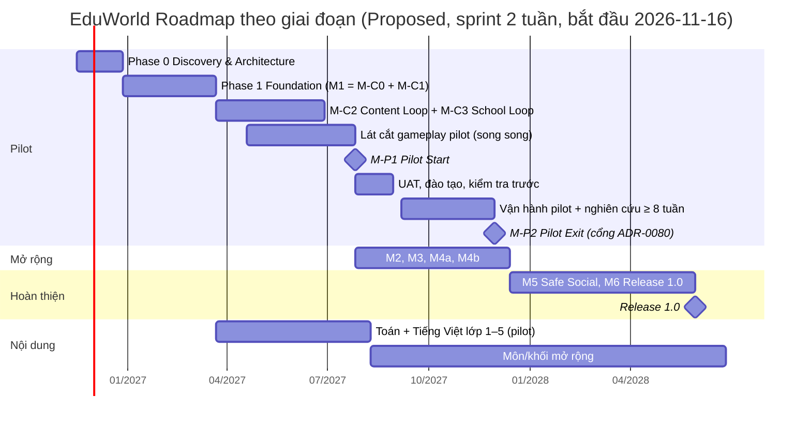

# Roadmap & Milestones

> Trạng thái: Draft · Phiên bản: 0.7 · Owner: Product Manager + QA Engineer · Cập nhật: 2026-11-17 (ADR-0074: backend modular monolith 3 binary, bỏ phần việc và giả định nhân sự riêng của 6 microservice; viết lại §1–§3 theo ADR-0073 phát hành theo pilot ưu tiên giáo dục và ADR-0080 cổng hiệu quả học tập; 4 nền tảng theo ADR-0013; mặc định an toàn ADR-0078; object storage ADR-0075; CI GitHub Actions)
> Liên quan: [ADR-0073](../adr/ADR-0073-phat-hanh-theo-pilot-uu-tien-giao-duc.md) · [ADR-0080](../adr/ADR-0080-do-hieu-qua-hoc-tap-la-exit-criterion-pilot.md) · [LEARNING_EFFICACY_PLAN](../02-learning/LEARNING_EFFICACY_PLAN.md) · [CODE_PLAN](CODE_PLAN_CMS_LMS_FIRST.md) · [OPEN_QUESTIONS](OPEN_QUESTIONS.md) · [RISKS](RISKS.md) · [TEST_STRATEGY](TEST_STRATEGY.md) · [adr/README](../adr/README.md) · [GAME_DESIGN](../01-game-design/GAME_DESIGN.md) · [PRODUCT_REQUIREMENTS](../00-overview/PRODUCT_REQUIREMENTS.md)

**Mục đích.** Nguồn duy nhất về lộ trình phát triển EduWorld: giai đoạn phát hành, phase, milestone, exit criteria, demo script và báo cáo milestone (hợp nhất ROADMAP + MILESTONES, 2026-11-15).
**Phạm vi.** Thứ tự phát triển và tiêu chí nghiệm thu từ pilot tới phạm vi đầy đủ Release 1.0. Mỗi mốc nêu **trải nghiệm người chơi** có được khi xong. Danh mục feature và thứ tự feature spec: [CODE_PLAN](CODE_PLAN_CMS_LMS_FIRST.md). Chi tiết test case: [TEST_STRATEGY](TEST_STRATEGY.md).

## 1. Nguyên tắc

- **Phát hành theo pilot ưu tiên giáo dục** [Confirmed — Technical Architect 2026-11-17, [ADR-0073](../adr/ADR-0073-phat-hanh-theo-pilot-uu-tien-giao-duc.md)]: thay quyết định "Release 1.0 đủ mọi thứ" trước đây bằng ba giai đoạn **Pilot → Mở rộng → Hoàn thiện** (§2). Không bỏ yêu cầu nào của Master Prompt + Party Addendum, chỉ đổi thứ tự và điểm phát hành; **Release 1.0** = phạm vi đầy đủ, đạt ở cuối giai đoạn Hoàn thiện (M6). Pilot là bản phát hành thật tại trường, có phạm vi rút gọn và exit criteria riêng.
- **Cổng hiệu quả học tập** [Confirmed — Technical Architect 2026-11-17, [ADR-0080](../adr/ADR-0080-do-hieu-qua-hoc-tap-la-exit-criterion-pilot.md)]: pilot chỉ đạt (M-P2) khi có báo cáo nghiên cứu hiệu quả theo [LEARNING_EFFICACY_PLAN](../02-learning/LEARNING_EFFICACY_PLAN.md) (bài kiểm tra độc lập trước/sau, lớp so sánh, tối thiểu 8 tuần). Chưa qua cổng thì không phát hành chức năng Mở rộng cho trường (vẫn được phát triển song song). Hạ tầng nghiên cứu là feature F035 (viết spec riêng, [CODE_PLAN](CODE_PLAN_CMS_LMS_FIRST.md)).
- **Bốn nền tảng, làm đầy đủ từ pilot** [Confirmed — Technical Architect 2026-11-17, [ADR-0013](../adr/ADR-0013-nen-tang-client-release-1-0-gom-windows-android-ios-web.md); ADR-0079 Rejected]: Windows, Android, iOS, Web. Windows + Android từ Phase 1; build Web trong CI từ M-C2; pipeline ký iOS + TestFlight trước M-P1; pilot phát hành cả 4.
- **Học sinh tự học, nhà trường quản trị** [Confirmed — ADR-0072]: không có vai trò giáo viên; nhà trường (`school_admin`, `academic_manager`) giao bài và xem kết quả; chỉ hoạt động server tự chấm; kiểm duyệt chat do Platform Safety Team (`safety_moderator`).
- **Mặc định an toàn cho trẻ nhỏ từ pilot** [Confirmed — Technical Architect 2026-11-17, ADR-0078]: bước PII/grooming luôn chạy, giờ giới nghiêm cấp platform cho game và chat, tenant `common` tắt kết bạn/DM/World chat, preset "chỉ quick message + emote" ([CHILD_SAFETY §3.5–§4.1](../10-security/CHILD_SAFETY.md#35-preset-chỉ-quick-message--emote-adr-0078)); trên Windows game mặc định coi là máy dùng chung, mọi nền tảng có màn "Tiếp tục là <nickname>?" khi tự vào lại (ADR-0086).
- Không triển khai tất cả chức năng cùng lúc; mỗi mốc có deliverable chạy được và tiêu chí nghiệm thu (§3) [Confirmed — Master Prompt §20]. Không đánh dấu hoàn thành nếu chỉ có giao diện giả lập.
- **Cổng hiệu năng máy tầm trung** [Confirmed — ADR-0057]: từ M1, mỗi mốc có client phải đạt ngân sách của [PERFORMANCE_BUDGET](../08-game-client/PERFORMANCE_BUDGET.md) cho các cảnh có trong mốc, đo trên thiết bị lab hạng Tầm trung; benchmark CI (TC-PERF-018) chặn merge khi vượt.
- Learning Engine là lõi: mọi gameplay phải dùng Learning Engine thật, không hardcode câu hỏi. CMS/LMS làm trước theo [CODE_PLAN](CODE_PLAN_CMS_LMS_FIRST.md).
- Thứ tự an toàn chat: chat gameplay (`match`/`team`/`party`) luôn có khi có chế độ chơi cùng nhau (ADR-0020 mục 6). Ở pilot, kiểu co-op duy nhất dùng channel `party` chỉ cho quick message + emote (preset ADR-0078), pipeline kiểm tra với PII/grooming luôn chạy và report tối thiểu phải sẵn sàng. Text tự do trong `party`/`match`/`team` mở ở giai đoạn Mở rộng khi gate CS-01b/CS-01d/CS-02/CS-04/CS-08 đạt; channel bền vững (World, Area, Class, Study Group, DM) và club ở giai đoạn Hoàn thiện.
- Ước lượng theo **sprint 2 tuần**, giả định đội: 3 Go, 3 Godot (gồm 1 tech artist), 2–3 web trong giai đoạn CMS-first ([CODE_PLAN §1.2](CODE_PLAN_CMS_LMS_FIRST.md#12-rủi-ro-của-việc-đổi-thứ-tự)), 1 QA, 0,5 DevOps (tăng khi dựng production pilot nếu cần), 1 EdTech, 1 Game Designer, 1 UX/UI, PM/Architect [Proposed]. Backend là **modular monolith** ([ADR-0074](../adr/ADR-0074-modular-monolith-co-ranh-gioi-cuong-che.md), thay ADR-0036): 3 binary, một cụm PostgreSQL, một pipeline Go theo ma trận module, nên không còn giả định thêm Go dev hay DevOps toàn thời gian để vận hành 6 service và 6 bộ image/pipeline/dashboard. Thay đổi đội → ước lượng lại.

**Quy tắc nghiệm thu milestone**

1. **Không đánh dấu hoàn thành nếu chỉ có giao diện giả lập** [Confirmed — Master Prompt §20]. Mọi exit criterion phải chạy trên backend thật, dữ liệu lưu PostgreSQL, xác thực qua Keycloak, đi qua APISIX — trên môi trường **staging** (từ M-P1: cả **production** pilot).
2. Mỗi exit criterion có **bằng chứng**: ID test case trong [TEST_STRATEGY](TEST_STRATEGY.md) §6 đã pass trong CI (GitHub Actions) hoặc biên bản test thủ công có video/screenshot + trace_id; feature thuộc mốc ở trạng thái `Done` theo [CODE_PLAN §6](CODE_PLAN_CMS_LMS_FIRST.md#6-exit-criteria-của-mốc).
3. Không còn lỗi Critical/High mở thuộc phạm vi milestone.
4. Tài liệu và specs liên quan đã cập nhật; ADR liên quan chuyển `Accepted`.
5. Demo script được trình diễn cho PM, Architect, Game Director, EdTech Specialist (và đại diện trường từ M-C3).
6. Báo cáo milestone theo mẫu §6.

## 2. Tổng quan giai đoạn, phase và milestone

**Giai đoạn phát hành** (ADR-0073) — điểm đưa sản phẩm tới trường:

| Giai đoạn | Mục tiêu (tuần từ 2026-11-16) | Phạm vi chính | Cổng ra |
|---|---|---|---|
| **Pilot ưu tiên giáo dục** | Sẵn sàng khoảng tuần 30–36 (M-P1); vận hành theo năm học [Proposed] | Learning Engine 6–8 loại câu hỏi; LMS nhà trường (giao bài, School Learning Dashboard, heatmap LO); Toán + Tiếng Việt lớp 1–5; quest `main`/`learning`/`daily`/`weekly` + boss solo; 4–5 mini-game trong đó ≥ 2 cơ chế "kỹ năng là cách chơi" ([LEARNING_MECHANICS](../01-game-design/LEARNING_MECHANICS.md)); XP, level, shop cosmetic; một kiểu co-op phụ thuộc lẫn nhau; chat chỉ quick message + emote; 4 nền tảng; mặc định an toàn ADR-0078; hạ tầng nghiên cứu hiệu quả (F035) | M-P2: báo cáo hiệu quả đạt ngưỡng ([ADR-0080](../adr/ADR-0080-do-hieu-qua-hoc-tap-la-exit-criterion-pilot.md)) |
| **Mở rộng** | Phát triển song song từ sau M-P1; phát hành cho trường sau M-P2 | Knowledge Battle 1v1 + bot, Team Battle, Glicko-2, leaderboard cấp trường; chat `party`/`match`/`team` có text tự do với kiểm duyệt đầy đủ; party đầy đủ (Addendum); thêm môn/khối; đủ 11 loại câu hỏi, 11 mini-game, 12 loại quest, 8 vùng; challenge engine, Game Operations Console | Exit criteria M2, M3, M4a, M4b |
| **Hoàn thiện** = Release 1.0 | Sau Mở rộng | Leaderboard Global và đủ 13 bảng, các định dạng giải còn lại, đủ 8 chế độ matchmaking/thi đấu, đủ 8 channel + DM, bạn bè đầy đủ, club, season/event, moderation nâng cao, chứng minh 10.000 CCU, phát hành store đầy đủ | Exit criteria M5, M6 |

**Phase** — gói công việc theo domain (giữ mã `P1`…`P6` dùng trong [PRODUCT_REQUIREMENTS](../00-overview/PRODUCT_REQUIREMENTS.md)); một phase có thể trải qua nhiều giai đoạn:

| Phase | Tên | Pilot | Mở rộng | Hoàn thiện |
|---|---|---|---|---|
| 0 | Discovery & Architecture | Toàn bộ | — | — |
| 1 | Foundation | Toàn bộ | — | — |
| 2 | Core Educational Gameplay | Lát cắt pilot (Learning Engine 6–8 loại câu hỏi, quest 4 loại, 4–5 mini-game, XP/level/shop, avatar, Main Hub + vùng Toán/Tiếng Việt) | Phần còn lại (đủ loại câu hỏi/mini-game/quest/vùng) | — |
| 3 | Exam & Learning Management | Toàn bộ CMS, LMS, Exam, School Learning Dashboard (M-C2, M-C3) | Game Operations Console, challenge engine (M3) | — |
| 4 | Multiplayer, Party & Competition | Một kiểu co-op `interdependent`, party tối thiểu, chat `party` quick message + emote | Party đầy đủ, boss co-op, 1v1 + bot, Team Battle, Glicko-2, leaderboard trường, chat gameplay text | 8 chế độ, 13 bảng, đủ format giải |
| 5 | Social & Chat | — | Bạn bè cơ bản (mời party) | Channel bền vững, DM, club, moderation nâng cao |
| 6 | Production Readiness | Production quy mô pilot (DEPLOYMENT §4.1), object storage theo ADR-0075, backup/khôi phục, giám sát | Mở rộng hạ tầng theo tải | 10.000 CCU, chaos/pen-test đầy đủ, phát hành store |

**Milestone** (khớp mốc `M-C*` và `M2`…`M6` của [CODE_PLAN §5](CODE_PLAN_CMS_LMS_FIRST.md#5-lộ-trình-theo-mốc-cmslms-trước)):

| Milestone | Giai đoạn | Kết quả nghiệm thu một câu |
|---|---|---|
| M0 Architecture Baseline | Pilot | Tài liệu + specs đủ để developer khác triển khai |
| M1 First Login to World (= M-C0 + M-C1) | Pilot | Backend 3 binary (`core-api`, `realtime`, `worker`) chạy end-to-end; nhân sự đăng nhập portal, học sinh đăng nhập game và vào Main Hub 3D |
| M-C2 Content Loop | Pilot | Soạn → duyệt → publish → học sinh làm trong game → server chấm |
| M-C3 School Loop | Pilot | Nhà trường giao bài/đề, học sinh làm trong game, nhà trường thấy kết quả & LO yếu, học sinh nhận gợi ý ôn tập tự động |
| **M-P1 Pilot Start** | Pilot | Lát cắt gameplay pilot + mặc định an toàn + 4 nền tảng + production quy mô pilot + công cụ nghiên cứu sẵn sàng; trường pilot bắt đầu dùng |
| **M-P2 Pilot Exit** | Pilot | Báo cáo nghiên cứu hiệu quả ≥ 8 tuần đạt cổng ADR-0080; quyết định phát hành Mở rộng |
| M2 Core Gameplay đầy đủ | Mở rộng | Đủ 8 vùng, 12 loại quest, 11 mini-game, 11 loại câu hỏi, kinh tế và hub nhiều người |
| M3 Game Ops | Mở rộng | Challenge engine, Game Operations Console; sự kiện cơ bản |
| M4a Party Co-op | Mở rộng | Party 4 người cùng làm quest co-op/đánh boss, kết quả học tập riêng, chat party có text |
| M4b Knowledge Battle | Mở rộng | 1v1 (kể cả với bot) và Team Battle, Glicko-2, leaderboard trường, kết quả & ranking cập nhật đúng một lần, chat trận có ngay |
| M5 Safe Social | Hoàn thiện | Đủ 8 loại channel + DM, club, season/event, vi phạm được Safety Team xử lý, nhà trường đặt chat policy trong giới hạn platform |
| M6 **Release 1.0** | Hoàn thiện | Phạm vi đầy đủ trên Windows, Android, iOS, Web ở 10.000 CCU với bằng chứng |
| M7 Post-release Review | sau M6 | Đánh giá 1 học kỳ vận hành, kế hoạch 1.x |

M-C3 thay mốc "M3 School Loop" của bản trước; "M3" nay là Game Ops theo CODE_PLAN.

Ước lượng [Proposed]: pilot sẵn sàng ~tuần 36 (Phase 0: 3 sprint, Phase 1: 6 sprint, M-C2 + M-C3: 7 sprint; lát cắt gameplay pilot chạy song song từ giữa Phase 1 ở làn Godot/module game); vận hành pilot ≥ 8 tuần học + kiểm tra trước/sau (~12 tuần); Mở rộng ~10 sprint; Hoàn thiện ~12 sprint. Tổng tới M6 xấp xỉ bản trước (~80+ tuần) nhưng có sản phẩm tại trường sớm khoảng 1 năm. **Lịch pilot phải khớp năm học** (khai giảng đầu tháng 9): nếu M-P1 rơi vào hè, dùng thời gian còn lại cho UAT, đào tạo nhà trường và kiểm tra trước, pilot chạy học kỳ I [Proposed — RISK-05].

Song song từ M-C2: **dòng sản xuất nội dung** (EdTech + content team). Pilot: Toán + Tiếng Việt lớp 1–5, khối lượng do PO + EdTech chốt [TBD — OQ-08]. Mở rộng/Hoàn thiện: Tiếng Anh, Khoa học (Tự nhiên & Xã hội / Khoa học / KHTN theo khối) và lớp 6–9. Engine không giới hạn số môn.



> Ngày trong Gantt chỉ minh họa thứ tự và độ dài tương đối; mốc ngày chính thức chốt sau Phase 0 và theo lịch năm học của trường pilot.

## 3. Chi tiết từng mốc

### 3.1. Phase 0 — Discovery & Architecture — M0 Architecture Baseline

**Trải nghiệm người chơi khi xong:** Chưa có trải nghiệm người chơi; chỉ có spike kỹ thuật (form đăng nhập trong Godot qua `/auth/game/login`, hub 40 client giả lập).

**Phạm vi**
- Phân tích yêu cầu, PRD, personas, user stories, glossary.
- Kiến trúc hệ thống, domain model, ADR.
- Thiết kế database, API (OpenAPI/AsyncAPI khung), Keycloak, APISIX, SIS integration.
- Game design: thế giới, gameplay loop, quest, mini-game, party, competition.
- Child safety, data privacy (bản đầu), test strategy, risks, kế hoạch đo hiệu quả học tập ([LEARNING_EFFICACY_PLAN](../02-learning/LEARNING_EFFICACY_PLAN.md)).
- Prototype kỹ thuật (spike) giới hạn thời gian: (a) form đăng nhập Godot → module identity → Keycloak password grant (`eduworld-game-backend`) trên Windows/Android, kiểm chứng phân biệt lỗi role/mật khẩu và log không lộ mật khẩu (ADR-0068); (b) WebSocket hub sync 40 client giả lập; (c) RLS + `SET LOCAL` với pgx.

**Deliverable:** thư mục `docs/` và `specs/` hoàn chỉnh; feature spec theo [CODE_PLAN](CODE_PLAN_CMS_LMS_FIRST.md); 3 spike có báo cáo; ADR quan trọng được review.

**Phụ thuộc:** phỏng vấn nhà trường (ban giám hiệu, quản lý chuyên môn); chọn trường pilot và lớp so sánh; OQ-02, OQ-04, OQ-08 có câu trả lời sơ bộ.

#### Exit criteria và demo (M0)

- [ ] Toàn bộ tài liệu trong cấu trúc `docs/` (Master Prompt §19) tồn tại và có nội dung thực chất — kiểm tra bằng `make docs-check` + review.
- [ ] `specs/openapi` lint sạch (Spectral), `specs/asyncapi` validate, JSON Schema compile được; `node scripts/specs/check-features.mjs` 0 lỗi.
- [ ] ADR đã review (ADR-0001 superseded bởi ADR-0036, ADR-0036 superseded bởi ADR-0074); các ADR cho Phase 1 chuyển Accepted.
- [ ] OQ-02, OQ-04 có câu trả lời hoặc quyết định dùng mặc định được ký nhận.
- [ ] 3 spike (đăng nhập form Godot qua backend, WS 40 client, RLS + pgx) có báo cáo kết quả và số liệu.
- [ ] Rủi ro top 5 có owner và kế hoạch giảm thiểu.

**Demo script:** walkthrough kiến trúc (C4), luồng đăng nhập, luồng quest, ma trận test; chạy spike đăng nhập form Godot trên Windows và Android.

### 3.2. Phase 1 — Foundation — M1 First Login to World (M-C0 + M-C1)

**Trải nghiệm người chơi khi xong:** Học sinh mở game, đăng nhập bằng username/mật khẩu trường cấp trong form của game (ADR-0068; trên thiết bị cá nhân mở lại khi phiên còn hạn thì hiện "Tiếp tục là <nickname>?" rồi vào game; Windows mặc định là máy dùng chung nên luôn hỏi mật khẩu — ADR-0086, ADR-0078), vào **Main Hub 3D**, đi lại, thấy nickname của mình. Nhân sự nhà trường đăng nhập Admin Portal thấy đúng workspace.

**Phạm vi**
- Monorepo một `go.mod` (`src/backend/modules/`, `src/backend/pkg/`, `src/backend/cmd/`; ADR-0074), **CI GitHub Actions** theo path filter cho `src/backend/modules/`, `src/backend/pkg/`, `src/backend/cmd/`, `src/cms/frontend/`, `src/game/`, `specs/` (specs-lint, lint/test/scan theo ma trận module, `make arch-check` + facade test, build 3 image, deploy dev/staging — ADR-0088, [DEPLOYMENT §10](../11-operations/DEPLOYMENT.md#10-cicd-github-actions)), Docker Compose local ([LOCAL_DEVELOPMENT](../11-operations/LOCAL_DEVELOPMENT.md)), **staging trên Docker Swarm** (stack file `deploy/swarm/staging/`, overlay network, Docker secrets, deploy `docker stack deploy` từ CI; ADR-0024).
- **Platform kit `src/backend/pkg/`** (ADR-0037…0042, ADR-0074): config, slog, OTel (HTTP + NATS propagation), health/readiness, Problem Details, CQRS tách read/write context không mediator (ADR-0087: command handler + `UnitOfWork` `src/backend/pkg/entx`, query handler đọc replica/cache, authz tường minh `authz.Require`, middleware `src/backend/pkg/httpx` cho xác thực/tenant/idempotency/log/tracing, span qua `src/backend/pkg/observability`), ent mixin (UUIDv7, `tenant_id`, audit, soft-delete, `version`) + interceptor global filter, outbox + relay NATS, consumer idempotent (`processed_events`), `src/backend/pkg/modcall` (gọi facade trong tiến trình: tenant, Principal gốc, trace, kiểm `x-allowed-callers`), adapter tích hợp ngoài có resilience, testkit (testcontainers PostgreSQL/NATS/Valkey).
- **Khung modular monolith**: 5 module domain + module `realtime` theo Clean Architecture (`src/backend/modules/<module>/{api,internal,module.go}`), mỗi module domain có database riêng trên một cụm, Atlas migration, spec public + internal (facade sinh bằng `make gen`); 3 binary `core-api`, `realtime`, `worker` (profile `events`/`chat`/`jobs`) với health, metrics, recover middleware; spike saga mẫu (identity → game cleanup qua facade) và projection `ref_tenants`/`ref_students` từ `EVT_IDENTITY`.
- Migration Atlas cho `eduworld_identity` (identity, org, sis, platform, audit) và `eduworld_game` (profile, session, login events).
- Valkey: realtime ticket, rate limit. NATS JetStream: stream `EVT_*` theo module, `CHAT_MESSAGES` (tạo idempotent bởi module chat), user/creds theo Swarm service (ADR-0035, ADR-0042, ADR-0074).
- Keycloak realm as code, clients người dùng (`eduworld-game-backend` confidential chỉ Direct Access Grants — ADR-0068, `eduworld-portal` confidential chỉ Direct Access Grants + flow `eduworld-portal-direct-grant` (OTP có điều kiện, mapper AMR/LoA) — ADR-0091, `eduworld-api`), `duplicateEmailsAllowed=false`, `loginWithEmailAllowed=true` (ADR-0067), client `svc-identity` chỉ cho Keycloak Admin API (ADR-0074 mục 5), roles, Organizations. Không có authenticator QR/PIN (ADR-0076 Rejected).
- APISIX hai upstream: `/api/v1/*` → `core-api` (route `/auth/game/*` của module identity tắt ghi body, rate limit thiết bị/username); plugin `tenant-header` kiểm tra `X-Tenant-Id` (ADR-0065); `/realtime/v1` → `realtime`; gateway nội bộ `/api/v1/game-admin/*` → `core-api`.
- SIS: EduWorld SIS Contract v1 (`specs/sis/`) + conformance test kit + mock server; giai đoạn này chỉ `csv_import` (CODE_PLAN §9), `contract_v1` làm sau M-C3; contract validator, sync + reconciliation cơ bản (ADR-0021).
- Godot: bootstrap, form đăng nhập S01 gọi `/auth/game/login` (ADR-0068), API client gắn `X-Tenant-Id` (ADR-0065), realtime client, Main Hub greybox, character controller cơ bản, camera.
- Game session (ADR-0031): chỉ học sinh vào game (`GAME_ACCESS_STUDENT_ONLY`), `game.login_events` + `last_login_at`, một thiết bị/tài khoản (409 + hộp thoại takeover), job `game-session-timeout`.
- Đăng nhập nền tảng cho 10.000 CCU (ADR-0045): giữ phiên game bằng refresh token (ADR-0086: kho bảo mật OS trên thiết bị cá nhân, chỉ RAM trên Web/máy dùng chung; **Windows mặc định `shared_device = true`** trừ khi bộ cài chọn "máy cá nhân"; màn "Tiếp tục là <nickname>?" khi tự vào lại; rotation + phát hiện dùng lại, gắn `device_id`; `game_session_sso`), Keycloak persistent sessions, JWKS/Principal/tenant cache, rate limit theo tenant/thiết bị + `429 Retry-After`; benchmark băm mật khẩu (TC-PERF-015).
- Object storage: local/CI dùng floci + job tạo bucket + CDN giả lập (ADR-0044); staging dùng backend theo [ADR-0075](../adr/ADR-0075-object-storage-production-khong-dung-floci.md) sau spike (S3 managed tại Việt Nam hoặc Garage/SeaweedFS ≥ 3 node).
- **Design system (ADR-0047):** `design/{game-tokens,admin-tokens,shared-tokens,icons,fonts}`, pipeline Style Dictionary (`make design-tokens`), Theme Godot + `UiTokens.gd`, theme Ant Design EduWorld + khung `src/cms/frontend/packages/ops-ui` + Storybook, lint hardcode và kiểm tra tương phản trong CI.

**Deliverable:** học sinh demo đăng nhập qua Keycloak, backend ánh xạ trường/lớp từ dữ liệu SIS (CSV), vào Main Hub 3D, thấy nhân vật của mình; nhân sự vào portal shell đúng quyền.

#### Exit criteria và demo (M1)

- [ ] Đăng nhập nền tảng ADR-0045/0068/0086: thiết bị cá nhân mở lại khi phiên còn hạn → màn "Tiếp tục là <nickname>?" rồi vào game (TC-AUTH-082, TC-AUTH-091), "Không phải tôi" đăng xuất và xóa token (TC-AUTH-091); Windows cài mặc định là máy dùng chung, không lưu token (TC-AUTH-090); hết hạn/bị thu hồi hoặc máy dùng chung/Web → nhập mật khẩu (TC-AUTH-083, 084, 087); dùng lại refresh token cũ → thu hồi cả phiên, sai thiết bị → từ chối (TC-AUTH-085, 086); Đăng xuất xóa token (TC-AUTH-088); không access token/mật khẩu trên đĩa (TC-AUTH-046); `/auth/game/login` p95 ≤ 400 ms + `game/sessions` p95 ≤ 150 ms ở tải thử; `429 LOGIN_QUEUE_BUSY` + `Retry-After`; log không chứa mật khẩu; thiếu `X-Tenant-Id` → `400`; benchmark băm mật khẩu ≤ 80 ms (TC-PERF-015). Nhận biết SIS nguồn đúng khi hai SIS trùng mã (TC-AUTH-030).
- [ ] `docker compose up` + `make seed` dựng local trong ≤ 30 phút trên máy mới (đo bởi 1 developer chưa tham gia).
- [ ] GitHub Actions chạy theo path filter (ADR-0088): specs-lint (gồm rule `maxLength`), lint/test/scan/migrate-lint theo ma trận module, `make arch-check` + facade test, godot, web; 3 image `core-api`, `realtime`, `worker` được build và deploy tự động lên dev và staging.
- [ ] Platform kit `src/backend/pkg/` có test: CQRS tách read/write context (linter chặn `query` import `port/write`/`UnitOfWork`/publisher), middleware `src/backend/pkg/httpx`, `authz.Require` tường minh, ent global filter tenant/soft-delete (TC-TEN-021…023), outbox → NATS + consumer idempotent, adapter tích hợp ngoài + circuit breaker, ranh giới module (`arch-check`, `src/backend/pkg/modcall`) (TC-SVC-001…006).
- [ ] 3 binary chạy trên staging (`core-api`, `realtime`, `worker-events`/`worker-chat`/`worker-jobs`), 5 database module trên một cụm; role của module không kết nối được database của module khác (TC-SVC-007); panic trong một module không làm sập `core-api` (TC-SVC-016).
- [ ] Projection `ref_tenants`/`ref_students` ở module game bắt kịp `EVT_IDENTITY` trong ≤ 5 s (p95) (TC-SVC-008); saga mẫu cleanup hội tụ khi database của một module tạm lỗi (TC-SVC-009).
- [ ] TC-AUTH-001…008 pass trên staging; TC-AUTH-011…012 pass (dữ liệu vi phạm EduWorld SIS Contract bị từ chối, conformance test kit chạy với `sis-mock`).
- [ ] TC-TEN-001 (học sinh trường A không truy cập dữ liệu trường B) pass ở cả tầng ứng dụng và RLS.
- [ ] Design system (ADR-0047): TC-UI-001…003, TC-UI-005 pass trong CI; Main Hub và màn đăng nhập game chỉ dùng Theme sinh ra.
- [ ] Godot client Windows + Android: đăng nhập bằng form trong game qua `/auth/game/login`, không có client secret/endpoint Keycloak trong build; log không chứa mật khẩu (TC-AUTH-060).
- [ ] Cổng hiệu năng M1: `QualityManager` hoạt động; benchmark headless CI (TC-PERF-018) chạy cho Main Hub; Main Hub đạt AC-PERF-001/002 trên DEV-AND-MID1 và DEV-PC-MID với 40 avatar giả lập; AC-PERF-008 pass.
- [ ] Học sinh vào Main Hub, di chuyển nhân vật, thấy nickname; kết nối realtime với ticket, reconnect sau khi rút mạng 10 s.
- [ ] Health/readiness/liveness cho mọi binary; trace xuyên APISIX → `core-api` (module identity → facade → module game) → PostgreSQL và qua NATS xem được trong Grafana/Tempo.
- [ ] TC-AUTH-013…019 pass: nhân sự không vào được game; takeover giữa 2 thiết bị có hộp thoại xác nhận; `game.login_events` + `last_login_at` ghi đúng (ADR-0031).

**Demo script**
1. Import CSV cùng cấu trúc DTO cho 1 trường demo → xem kết quả sync + reconciliation.
2. Đăng nhập `hs.an.3a` trên Windows (bộ cài mặc định: máy dùng chung) → vào Main Hub; thoát, mở lại → form đăng nhập.
3. Đăng nhập `hs.an.3a` trên Android → thoát, mở lại → "Tiếp tục là <nickname>?" → Tiếp tục vào hub; lần sau bấm "Không phải tôi" → về form.
4. Đăng nhập `hs.locked` → bị từ chối với thông báo thân thiện.
5. Dùng token của học sinh trường A gọi API tài nguyên trường B → 404/403, có audit log; không có route HTTP nội bộ nào trên APISIX; PR thử gọi facade ngoài `x-allowed-callers` bị `make arch-check` chặn.
6. Chặn kết nối tới database `eduworld_learning` → route learning trả `503`, module game suy giảm có kiểm soát, Main Hub vẫn chạy; mở lại → tự phục hồi.
7. Đăng nhập `ad.truong.a` (School Admin) vào game → "tài khoản không dùng để vào game"; vào portal → đúng workspace.
8. `hs.an.3a` đang ở hub trên Windows, đăng nhập lại trên Android → hộp thoại xác nhận → Windows hiện thông báo đã bị đăng xuất.

### 3.3. Content Loop và School Loop — M-C2, M-C3

Thứ tự CMS/LMS trước theo [CODE_PLAN §5](CODE_PLAN_CMS_LMS_FIRST.md#5-lộ-trình-theo-mốc-cmslms-trước); gồm toàn bộ Phase 3 và phần Learning Engine của Phase 2.

**Trải nghiệm người chơi khi xong:** Học sinh làm hoạt động học tập Toán/Tiếng Việt được chấm server-side ngay trong Godot; nhận bài nhà trường giao ở tab "Nhà trường giao", luyện đề trong Exam Zone, học video có câu hỏi chèn, dùng gợi ý từng bước và đọc phản hồi theo lỗi sai sau khi chấm, nhận gợi ý ôn tập tự động theo mastery.

**Phạm vi**
- Learning Engine: curriculum, content versioning (ADR-0015), question bank **8 loại cơ bản** (single/multiple choice, true/false, fill blank, numeric, matching, ordering, drag&drop — đủ yêu cầu pilot 6–8 loại; short answer, image-based, interactive ở Mở rộng), render payload & server scoring (ADR-0016); activity/attempt submit idempotent, resume, retry wrong.
- **Activity Engine** ([ACTIVITY_ENGINE](../02-learning/ACTIVITY_ENGINE.md), ADR-0048): registry + plugin `quiz`, `interactive_exercise`, `video_lesson`; thực thể Evaluation; renderer registry Godot. **Công thức** (ADR-0055): LaTeX + SVG MathJax 4 trên portal, SVG trong game.
- Learning events + mastery model v1 (ADR-0017); hỗ trợ tự học: gợi ý từng bước (`hints:next`), phản hồi theo phương án nhiễu chỉ sau khi chấm, cờ `rapid_guess`, bài chẩn đoán, gợi ý ôn tập tự động theo đồ thị LO tiên quyết ([LEARNING_ANALYTICS](../02-learning/LEARNING_ANALYTICS.md)).
- **Một Admin Portal** `src/cms/frontend/apps/portal` (ADR-0022, ADR-0027 mục 7): workspace **School & Learning Management** + **Learning Content Studio** cho vận hành tenant (curriculum, question bank, question set, blueprint, lesson; workflow Draft → Review → Approved → Published → Archived; preview, rollback, audit, Thùng rác tenant) và **Platform Administration** (chỉ System Admin, gateway nội bộ + MFA: liên tenant, gán/clone ADR-0029, Thùng rác ADR-0028, quản lý tenant). Dựng trên Admin/Ops UI (Ant Design 5 + Pro, ADR-0047).
- LMS ([SCHOOL_LMS](../04-admin-portal/SCHOOL_LMS.md)): course, learning path có điều kiện mở khóa, enrollment, assignment cho lớp/nhóm học tập/danh sách học sinh, schedule, study group (ADR-0084), khung giờ truy cập cấp trường (chỉ siết thêm so với giờ giới nghiêm platform, ADR-0078) và chính sách chat cấp trường (gồm preset "chỉ quick message + emote").
- Exam Engine: practice test, mock exam, chapter/semester/subject test, custom assessment, timed exam, random đề theo blueprint, chống nộp trùng, phân tích câu sai, đề xuất ôn tập; Exam Zone và Practice Zone trong game.
- School Learning Dashboard (`school_admin`/`academic_manager`, trường → lớp → học sinh, heatmap LO, rollup theo ADR-0062) + báo cáo, xuất dữ liệu.
- Media pipeline (ADR-0044): presigned upload, ClamAV, chuyển đổi, CDN; snapshot nội dung + content manifest khi publish (ADR-0043). Web export build thử trong CI, đo tải/FPS (ADR-0057).
- Worker `student-inactive-cleanup` (ADR-0032) và màn hình liên quan (F016).
- Nội dung đợt 1: Toán và Tiếng Việt lớp 1–5 (OQ-08).

**Deliverable:** biên tập viên soạn → duyệt → publish; nhà trường tạo/giao bài và đề; học sinh làm trong game; nhà trường xem kết quả và LO yếu; học sinh nhận gợi ý ôn tập tự động.

#### Exit criteria và demo (M-C2, M-C3)

- [ ] Câu hỏi, activity, nội dung được tải từ backend (không hardcode trong scene) — publish version mới và thấy thay đổi mà **không build lại** client.
- [ ] Render payload không chứa đáp án (TC-LRN-007 trên mọi loại câu hỏi); TC-LRN-001…008 pass; 8 loại câu hỏi cơ bản có test chấm server-side.
- [ ] Mastery cập nhật từ learning events theo ADR-0017; Learning Score ≠ Mastery hiển thị riêng.
- [ ] Workflow nội dung có audit trail; sửa nội dung đã publish tạo version mới, attempt cũ vẫn trỏ version cũ (TC-CMS-001…004).
- [ ] Academic Manager chỉ trong trường và môn được gán (TC-TEN-002); School Admin chỉ trong trường (TC-TEN-003); vận hành tenant không thấy workspace platform; TC-CMS-AUTHZ-01…10 pass (ADR-0027).
- [ ] Exam: random đề theo blueprint, timed exam theo giờ server, chống nộp trùng, chấm và phân tích câu sai (TC-EXM-001…006).
- [ ] School Learning Dashboard hiển thị tiến độ, độ chính xác, LO yếu cho trường, lớp, học sinh, khớp truy vấn đối soát (TC-LMS-003); học sinh nhận bài ở tab "Nhà trường giao" (TC-LMS-001…002).
- [ ] Activity Registry chạy với `quiz`, `interactive_exercise`, `video_lesson`; TC-ACT-001…005, TC-VID-001…005, TC-MATH-001…003, TC-LRN-015 pass.
- [ ] Hỗ trợ tự học: TC-LRN-011…014; response schema và enum thống nhất giữa specs (TC-LRN-016…017).
- [ ] System Admin xem liên tenant bằng dropdown tenant; gán/clone giữa tenant; xóa là soft-delete, Thùng rác khôi phục được (ADR-0028, ADR-0029).
- [ ] Cổng hiệu năng: activity player và vùng môn học Toán/Tiếng Việt đạt ngân sách [PERFORMANCE_BUDGET](../08-game-client/PERFORMANCE_BUDGET.md) §7 trên thiết bị lab hạng Tầm trung (TC-PERF-009, 018, 020).

**Demo script:** biên tập viên soạn câu hỏi có công thức + ảnh → reviewer duyệt → publish → học sinh làm trong Godot → server chấm. Sau đó Academic Manager `qlcm.truong.a` tạo đề "Phép nhân" 15 phút từ blueprint → giao cho 3A với công bố `after_close` → 3 học sinh làm trong game (1 dùng gợi ý từng bước, 1 nộp muộn, 1 rớt mạng và resume) → School Admin xem kết quả lớp 3A, câu sai phổ biến, LO yếu → học sinh làm sai thấy gợi ý ôn tập tự động kèm lý do; thử gửi request sửa điểm bằng Postman → bị từ chối.

### 3.4. Pilot slice — M-P1 Pilot Start

Phạm vi theo [ADR-0073](../adr/ADR-0073-phat-hanh-theo-pilot-uu-tien-giao-duc.md) mục 1; nền tảng theo ADR-0013. Làn Godot/module game chạy song song với M-C2/M-C3; feature cụ thể chọn từ các mốc M2/M3/M4a của [CODE_PLAN §5](CODE_PLAN_CMS_LMS_FIRST.md#5-lộ-trình-theo-mốc-cmslms-trước) theo lát cắt dưới đây.

**Trải nghiệm người chơi khi xong:** Học sinh **tạo avatar**, chơi chương mở đầu, khám phá Main Hub và vùng Toán/Tiếng Việt, nhận quest `main`/`learning`/`daily`/`weekly` từ NPC, giải câu đố bằng mini-game "kỹ năng là cách chơi", đánh **boss solo**, nhận XP, **lên cấp**, mua đồ trang trí; rủ bạn làm một nhiệm vụ co-op mà mỗi người giữ một mảnh dữ kiện; giao tiếp bằng quick message + emote. Học sinh chơi trên Windows, Android, iOS hoặc Web.

**Phạm vi**
- Gameplay tối thiểu: tạo avatar (preset, emote mặc định), Main Hub + vùng môn Toán và Tiếng Việt, NPC + dialogue data-driven; quest `main`, `learning`, `daily`, `weekly` ([QUEST_SYSTEM](../01-game-design/QUEST_SYSTEM.md)); **boss solo** ([CHALLENGE_BOSS_SYSTEM](../01-game-design/CHALLENGE_BOSS_SYSTEM.md)); **4–5 mini-game**, trong đó ≥ 2 cơ chế "kỹ năng là cách chơi" ([LEARNING_MECHANICS](../01-game-design/LEARNING_MECHANICS.md), [MINIGAME_ENGINE](../08-game-client/MINIGAME_ENGINE.md)); XP ledger có cap và giảm dần, level, Xu + Shop cosmetic + sổ cái ([PROGRESSION_SYSTEM](../01-game-design/PROGRESSION_SYSTEM.md), [INVENTORY_ECONOMY](../01-game-design/INVENTORY_ECONOMY.md)).
- **Một kiểu co-op phụ thuộc lẫn nhau**: party nhỏ (tạo/mời bạn cùng lớp/rời), quest co-op với bước `interdependent` (mỗi người một phần dữ kiện), kết quả học tập ghi riêng từng người ([PARTY_SYSTEM](../03-social-multiplayer/PARTY_SYSTEM.md), [MULTIPLAYER_GAMEPLAY](../03-social-multiplayer/MULTIPLAYER_GAMEPLAY.md)).
- **Chat chỉ quick message + emote**: channel `party` luôn có (ADR-0020 mục 6) với preset `quick_message_emote_only` áp mặc định cho mọi trường pilot; pipeline kiểm tra (PII/grooming luôn chạy) cho tham số quick message; báo cáo người chơi và hàng đợi Safety Team tối thiểu.
- **Mặc định an toàn ADR-0078**: giờ giới nghiêm platform 21:30–06:30 cho game và chat, trường chỉ siết thêm; tenant `common` tắt kết bạn/DM/World chat; công tắc kiểm duyệt có `expires_at` ≤ 24 giờ + hai người duyệt ([CHILD_SAFETY](../10-security/CHILD_SAFETY.md)).
- **Bốn nền tảng** (ADR-0013): Windows (bộ cài ký số, mặc định máy dùng chung, tùy chọn "máy cá nhân"), Android, iOS (ký + TestFlight/App Store hoặc MDM trường), Web qua CDN; đăng nhập bằng form trong game và màn "Tiếp tục là <nickname>?" trên mọi nền tảng.
- **Production quy mô pilot** (NFR-SCAL-001, [DEPLOYMENT §4.1](../11-operations/DEPLOYMENT.md#41-pilot-nfr-scal-001-5-trường--5000-hs--1000-ccu--proposed)): Docker Swarm production, PostgreSQL HA + PITR, object storage theo [ADR-0075](../adr/ADR-0075-object-storage-production-khong-dung-floci.md) (spike xong, đã chọn backend), backup/khôi phục diễn tập, giám sát/alert, runbook; pen-test đăng nhập game và refresh token.
- **Hạ tầng nghiên cứu hiệu quả (F035, ADR-0080)**: bài kiểm tra độc lập trước/sau (đề riêng, không dùng câu luyện tập), gắn lớp so sánh, xuất dữ liệu định danh giả, A/B cấu hình mastery theo [LEARNING_EFFICACY_PLAN](../02-learning/LEARNING_EFFICACY_PLAN.md); consent và định danh giả theo ADR-0077.
- Vận hành: UAT với trường pilot, đào tạo `school_admin`/`academic_manager`, tài liệu người dùng; Safety Team có lịch trực cho `p1`.

**Deliverable:** bản pilot trên 4 nền tảng chạy production tại trường pilot, vòng lặp học tập + game tối thiểu hoàn chỉnh, nhà trường giao bài và theo dõi, nghiên cứu hiệu quả sẵn sàng bắt đầu.

#### Exit criteria và demo (M-P1)

- [ ] Mọi exit criterion M-C2, M-C3 đạt.
- [ ] Gameplay pilot chạy end-to-end với dữ liệu server, nội dung từ backend: tạo avatar, level up, quest 4 loại có quest mẫu publish qua backend (TC-GAM-001…011); XP cap và giảm dần (TC-GAM-001…003); Shop cosmetic, ví không âm, mua idempotent (TC-ECO-001…008); boss solo đúng khối, attempt học tập riêng (TC-CHL theo boss solo); 4–5 mini-game chạy với nội dung Question Bank, ≥ 2 cơ chế "kỹ năng là cách chơi".
- [ ] Co-op `interdependent`: hai đến bốn học sinh cùng làm quest co-op, mỗi người thấy phần dữ kiện của mình, kết quả học tập ghi riêng; rớt mạng một người thì nhóm xử lý theo cấu hình (TC-PTY-001, 006, 008, 010).
- [ ] Chat pilot: channel `party` tự tạo; text tự do bị từ chối, quick message + emote gửi được (TC-CHAT-048); PII/grooming luôn chạy (TC-CHAT-044); report → case trong ≤ 5 s (CS-04).
- [ ] Mặc định an toàn ADR-0078: giờ giới nghiêm chặn đăng nhập, game session và chat, trường không nới được (TC-AUTH-092, TC-CHAT-046); công tắc kiểm duyệt có thời hạn + hai người duyệt (TC-CHAT-045); tenant `common` không kết bạn/DM/World chat (TC-CHAT-047); gate CS-10, CS-11, CS-12 đạt.
- [ ] Client chạy trên **Windows, Android, iOS, Web** đạt AC-PERF của các cảnh pilot trên device matrix ([TEST_STRATEGY](TEST_STRATEGY.md) §4.1); Windows cài mặc định là máy dùng chung (TC-AUTH-090); "Tiếp tục là <nickname>?" hoạt động trên cả 4 nền tảng (TC-AUTH-091); luồng quest mẫu chạy trên thiết bị Tối thiểu (TC-PERF-019).
- [ ] Production pilot: load test ở mức NFR-SCAL-001 có báo cáo; restore PITR từng database và khôi phục object storage (RB-05) diễn tập thành công; spike object storage ADR-0075 có báo cáo và quyết định; alert chính kích hoạt thử; pen-test đăng nhập game không còn High/Critical.
- [ ] F035 `Done`: bài kiểm tra trước đã chạy ở lớp pilot và lớp so sánh; ngưỡng đạt (effect size, tỉ lệ học sinh tiến bộ) đã được PO + EdTech chốt **trước khi** pilot bắt đầu [TBD]; dữ liệu nghiên cứu định danh giả.
- [ ] UAT với trường pilot ký nhận; tài liệu người dùng (học sinh, quản trị trường, quản lý chuyên môn, Safety Team) hoàn thành.

**Demo script:** học sinh lớp 3 cài game trên máy phòng tin (mặc định máy dùng chung) và trên tablet Android → tạo avatar → nhận quest "Giúp bác nông dân đếm trứng" → mini-game phép nhân → sai 1 câu, xem gợi ý → hoàn thành, nhận XP + Xu → mua mũ trong Shop → rủ bạn cùng lớp làm quest co-op ghép dữ kiện, chỉ gửi được quick message + emote → đánh boss solo → nhà trường mở dashboard thấy LO thay đổi; 21:30 game cảnh báo rồi kết thúc phiên.

### 3.5. Vận hành pilot và cổng hiệu quả — M-P2 Pilot Exit

**Trải nghiệm người chơi:** như M-P1; học sinh làm bài kiểm tra độc lập trước và sau (không phải hoạt động luyện tập trong game).

**Phạm vi**
- Vận hành pilot tối thiểu **8 tuần học** [Proposed — ADR-0080] tại trường pilot, có lớp so sánh; theo dõi KPI [PRODUCT_VISION §7](../00-overview/PRODUCT_VISION.md#7-mục-tiêu-đo-lường-kpi-đề-xuất).
- Bài kiểm tra độc lập cuối kỳ; phân tích learning gain, effect size, đối chiếu mastery với kết quả kiểm tra (độ tin cậy dự báo) theo [LEARNING_EFFICACY_PLAN §4–§5](../02-learning/LEARNING_EFFICACY_PLAN.md#4-chỉ-số); hiệu chỉnh tham số mastery (ADR-0017).
- Sửa lỗi, tinh chỉnh nội dung và gợi ý theo dữ liệu thật; không phát hành chức năng Mở rộng tới trường trong thời gian này.

#### Exit criteria (M-P2)

- [ ] **Cổng hiệu quả học tập** ([ADR-0080](../adr/ADR-0080-do-hieu-qua-hoc-tap-la-exit-criterion-pilot.md)): báo cáo nghiên cứu theo [LEARNING_EFFICACY_PLAN §7](../02-learning/LEARNING_EFFICACY_PLAN.md#7-exit-criterion-của-pilot) với dữ liệu ≥ 8 tuần, đạt ngưỡng đã chốt trước pilot; báo cáo gồm đối chiếu mastery với bài kiểm tra độc lập.
- [ ] KPI pilot ở [PRODUCT_VISION §7](../00-overview/PRODUCT_VISION.md#7-mục-tiêu-đo-lường-kpi-đề-xuất) có số liệu thật (không phải điều kiện thay cho cổng hiệu quả).
- [ ] Không có sự cố an toàn nghiêm trọng chưa xử lý; report được xử lý đúng SLA ([MODERATION](../03-social-multiplayer/MODERATION.md)).
- [ ] Phase review (PM, Architect, Game Director, EdTech, QA, đại diện trường) quyết định phát hành Mở rộng; tham số mastery hiệu chỉnh được ghi vào cấu hình có version.

### 3.6. Giai đoạn Mở rộng — M2, M3, M4a, M4b

Phát triển song song từ sau M-P1; chỉ phát hành tới trường sau M-P2.

**Trải nghiệm người chơi khi xong:** Học sinh khám phá đủ 8 vùng đất với đủ loại quest và mini-game, học thêm môn/khối; **lập party** đầy đủ, **đánh boss** theo nhóm; **đấu 1v1** (với bạn hoặc bot) và **Team Battle**, leo bảng xếp hạng cấp trường; **chat bằng chữ trong trận/đội/party** có kiểm duyệt.

**Phạm vi**
- **M2 Core Gameplay đầy đủ:** đủ 8 vùng (7 khu chức năng, [WORLD_DESIGN](../01-game-design/WORLD_DESIGN.md)), đủ 12 loại quest, đủ 11 mini-game, đủ 11 loại câu hỏi (thêm short answer, image-based, interactive), character customization đầy đủ, achievement/badge/collection, hub nhiều người (presence + position sync, ADR-0011/0012); `audio_lesson`, `simulation` 2–3 template ([SIMULATION_ENGINE](../02-learning/SIMULATION_ENGINE.md)); thêm môn/khối theo dòng nội dung.
- **M3 Game Ops:** Challenge Engine (11 loại challenge, 5 mức độ), Game Operations Console + Game Live Operations (platform-only, `/api/v1/game-admin/*`), world event và sự kiện cơ bản; thumbnail/turntable render headless.
- **M4a Party Co-op:** Party theo Addendum đầy đủ (lobby, ready, leader controls, session flow 9 bước, leader disconnect, rate limit + audit, 1 active party/học sinh); boss party nhiều phase; bạn bè cơ bản cho mời party (FR-SOC-001); chat `party` có text với pipeline đầy đủ.
- **M4b Knowledge Battle:** Knowledge Battle 1v1 (bạn bè, ngẫu nhiên theo khối, **bot** cho lúc ít người — trận bot không đổi rating), Team Battle; matchmaking theo khối (hard constraint), skill, friend, team; Glicko-2 (ADR-0018); **leaderboard cấp trường** (School, Class, Grade); match history; anti-cheat cơ bản.
- **Chat gameplay có text** (ADR-0020 mục 6): `match`, `team`, `party` đủ text + emoji + quick + reaction; pipeline đầy đủ + công tắc (ADR-0030, giới hạn ADR-0078), report/mute/block từ màn hình trận, moderation queue + sanction cơ bản, job `gameplay-chat-purge` + giữ bằng chứng (ADR-0033); bộ tính năng chat ADR-0034 trên channel gameplay; truyền tải NATS JetStream cluster 3 node (ADR-0035). Trường đã chọn preset "chỉ quick message + emote" vẫn giữ preset.
- Load test realtime lần 1 theo OQ-03.

#### Exit criteria và demo (M2, M3, M4a, M4b)

- [ ] M2: đủ 11 loại câu hỏi và 11 mini-game chạy với nội dung Question Bank, mỗi loại có test chấm server-side; đủ 12 loại quest có quest mẫu publish qua backend; đủ 8 vùng vào được; customization đủ skin, outfit, hair, accessories, emotes; achievement, badge, collection, daily/weekly challenge hoạt động; curve XP/danh hiệu đổi qua Game Studio không build lại client.
- [ ] M3: Challenge Engine TC-CHL-001…008 pass; Game Operations Console quản lý quest, mini-game, game level, NPC dialogue, reward, world event, game activity; TC-UI-004, TC-UI-006, TC-UI-008…010 pass.
- [ ] M4a: TC-PTY-001…011 pass; một học sinh chỉ có 1 active party dưới truy cập đồng thời (test race); rate limit lời mời + audit.
- [ ] M4b: TC-CMP-001…009 pass; không ghép khác khối ngoài cấu hình (TC-MM-003); trận bot không đổi rating (AC-RNK-003); leaderboard trường/lớp/khối đúng phạm vi hiển thị (EP-08).
- [ ] Chat gameplay có text: channel `match`/`team`/`party` tự tạo, policy trường/lớp không tắt được (TC-CHAT-017…020); pipeline + công tắc chạy trên các channel này, PII/grooming luôn chạy (TC-CHAT-044, 045); mute/chặn/báo cáo từ màn hình trận; purge đúng hạn và giữ bằng chứng (TC-CHAT-021…024); ADR-0034 đạt TC-CHAT-029…039, TC-CHAT-041; truyền tải đạt TC-CHAT-025…028 và TC-PERF-010/011. Gate CS-01b, CS-01d, CS-02, CS-04, CS-08 đạt trước khi bật text.
- [ ] Load test realtime ở mục tiêu giai đoạn — báo cáo k6 + metrics; gateway ≤ 4.000 WS/replica.
- [ ] Cổng hiệu năng: boss co-op 8 người, trận 1v1/đội và private instance đạt ngân sách §7 [PERFORMANCE_BUDGET](../08-game-client/PERFORMANCE_BUDGET.md) trên DEV-AND-MID1/2, DEV-IOS-MID, DEV-PC-MID; băng thông Hub ≤ 30 KB/s (TC-PERF-023).

**Demo script:** 4 học sinh lập party "Nhóm Sao Mai" → lobby ready → boss co-op → rút mạng 1 máy → nhóm tiếp tục → máy reconnect quay lại; sau đó 2 học sinh lớp 3 vào hàng đợi Battle Toán (một trận với bot khi hàng đợi vắng) → trận 5 câu → kết quả, rating thay đổi; chat trận gửi được chữ, tin có số điện thoại bị chặn; gửi lại request kết quả → bị từ chối duplicate.

### 3.7. Giai đoạn Hoàn thiện — M5 Safe Social

**Trải nghiệm người chơi khi xong:** Học sinh kết bạn, nhắn tin bạn bè, chat lớp và nhóm học tập, tham gia club, mùa giải và sự kiện, thi đấu ở mọi chế độ và giải đấu, xem bảng xếp hạng toàn platform bằng nickname; vụ việc do Platform Safety Team xử lý.

**Phạm vi**
- Friend system đầy đủ, block, mute; club/guild ([SOCIAL_SYSTEM](../03-social-multiplayer/SOCIAL_SYSTEM.md)); tenant `common` giữ mặc định tắt kết bạn/DM/World chat (ADR-0078).
- Chat channels còn lại: `world` (cùng trường), `area`, `class`, `study_group`, `team` bền vững, `direct` giữa bạn bè — một bộ quy tắc cho mọi lớp, mọi tin qua kiểm tra hợp lệ (ADR-0020), đủ 8 loại channel; tìm kiếm full-text; thông báo realtime, unread, lịch sử theo retention.
- Moderation nâng cao do Platform Safety Team (`safety_moderator`, ADR-0072): hàng đợi liên tenant trong module moderation, SLA, phân tích bullying/grooming bất đồng bộ nâng cao, thông báo vụ việc cho nhà trường (không chat thô), dashboard chất lượng bộ lọc.
- Thi đấu đầy đủ: đủ 8 chế độ matchmaking và 8 competition mode (Master Prompt §5.2–§5.3), đủ 13 leaderboard gồm **Global**, season, tournament đủ format (single/double elimination, round robin, team, school, class).
- **Season/event** ([EVENT_SEASON_SYSTEM](../01-game-design/EVENT_SEASON_SYSTEM.md)): season track, community goal, sự kiện live-ops.
- Rà soát pháp lý dữ liệu trẻ em: Deferred (ADR-0082), không chặn việc bật.

#### Exit criteria và demo (M5)

- [ ] TC-CHAT-001…010 pass (tạo/tham gia channel, gửi/nhận, block, report, moderation, không truy cập channel trái phép, không đọc tin trường khác, PII bị chặn, cùng quy tắc cho mọi lớp); tenant `common` vẫn không có DM/World chat (TC-CHAT-047).
- [ ] Bộ test lọc tiếng Việt (≥ 2.000 mẫu có/không dấu, teencode) đạt recall ≥ 95% cho danh mục cấm, false positive ≤ 3% [Proposed].
- [ ] `safety_moderator` đọc liên tenant chỉ trong module moderation qua `tenancy.Bypass` có audit; nhà trường nhận thông báo vụ việc không chứa chat thô (TC-CHAT-042…043).
- [ ] Đủ 8 chế độ matchmaking, 8 competition mode, 13 loại leaderboard, 6 format tournament theo Master Prompt §5.2–§5.5; season/event chạy được qua Game Live Operations.
- [ ] Cổng hiệu năng M5: chat panel (danh sách ảo hóa, sticker/GIF) giữ ngân sách UI §9 [PERFORMANCE_BUDGET](../08-game-client/PERFORMANCE_BUDGET.md) khi channel có > 500 tin.
- Đánh giá pháp lý cho chat: **Deferred (ADR-0082)**, không thuộc exit criteria.

### 3.8. Production Readiness đầy đủ — M6 Release 1.0

**Trải nghiệm người chơi khi xong:** Học sinh chơi ổn định trên **Windows, Android, iOS, Web** ở quy mô 10.000 người chơi đồng thời với toàn bộ chức năng.

**Phạm vi**
- Tối ưu theo nền tảng và theo kỹ thuật bắt buộc của [PERFORMANCE_BUDGET](../08-game-client/PERFORMANCE_BUDGET.md) §13; phát hành App Store / Google Play / Windows (Store hoặc installer ký số) / Web qua CDN, kênh MDM của trường.
- Security testing (pen-test, OWASP ASVS L2, lateral movement giữa module/binary, đăng nhập game và refresh token — ADR-0068, ADR-0086), anti-cheat nâng cao, **load test 10.000 CCU** (TC-PERF-002, 014, 016, 017) trên staging tương đương production, scale theo lịch học bằng `ops-scheduler` (ADR-0024).
- **Chaos/resilience test**: kill replica `core-api`/`realtime`, dừng từng profile worker, NATS, Valkey, một database module, failover cụm PostgreSQL, object storage; xác nhận suy giảm có kiểm soát theo module, circuit breaker tích hợp ngoài, saga hội tụ, projection bắt kịp; diễn tập rollback và khôi phục (BACKUP_RECOVERY §3.5).
- Mở rộng production Docker Swarm lên topology Release 1.0 ([DEPLOYMENT §4.2](../11-operations/DEPLOYMENT.md)); HA thành phần có trạng thái, diễn tập failover.

**Deliverable:** **Release 1.0** — phạm vi đầy đủ Master Prompt + Party Addendum trên 4 nền tảng, có bằng chứng kiểm thử.

#### Exit criteria và demo (M6)

- [ ] Mọi FR thuộc Master Prompt + Party Addendum trong [PRODUCT_REQUIREMENTS](../00-overview/PRODUCT_REQUIREMENTS.md) có trạng thái Done với test case pass (ma trận truy vết FR → TC đầy đủ).
- [ ] Client trên **Windows, Android, iOS, Web** đạt toàn bộ AC-PERF-001…011 của [PERFORMANCE_BUDGET](../08-game-client/PERFORMANCE_BUDGET.md) trên device matrix ([TEST_STRATEGY](TEST_STRATEGY.md) §4.1).
- [ ] Nội dung đạt khối lượng đã chốt ở OQ-08 cho các môn/khối.
- [ ] Load test **10.000 CCU** (NFR-SCAL-002 [Confirmed]) và bão đăng nhập theo `login_capacity_target` ([CONFIG_DEFAULTS](../00-overview/CONFIG_DEFAULTS.md), NFR-SCAL-005) đạt NFR-PERF-001…004, 011…016; TC-PERF-002, 014, 015, 016, 017 có báo cáo trong `perf-reports/`.
- [ ] Đăng nhập game qua backend đã qua pen-test: rate limit, khóa tạm theo tài khoản, không ghi body đăng nhập, refresh token xoay vòng và phát hiện dùng lại, thu hồi phiên đúng (TC-AUTH-040, 043, 044, 045).
- [ ] Pen-test không còn High/Critical; OWASP ASVS L2 hoàn thành; báo cáo ở `docs/10-security/pentest/`, báo cáo chaos test ở `docs/12-project/chaos-reports/` ([DEPLOYMENT §15](../11-operations/DEPLOYMENT.md)).
- [ ] Restore test PITR trong 30 ngày gần nhất cho **từng database module**, gồm khôi phục riêng một database và đưa về nhất quán liên module (BACKUP_RECOVERY §3.5); DR drill đạt RTO.
- [ ] Chaos test (TC-SVC-010…014, 016, 017) pass; facade test và `make arch-check` xanh; không còn operation facade thiếu spec internal hoặc thiếu `maxLength`.
- [ ] Alert chính kích hoạt thử thành công; trực vận hành có lịch.
- [ ] Ứng dụng ký số; phát hành App Store, Google Play, Windows, Web qua CDN.

### 3.9. M7 — Post-release Review

Báo cáo 1 học kỳ vận hành Release 1.0 — tần suất sử dụng, tỷ lệ hoàn thành bài, hiệu quả học tập đo độc lập (lặp lại phương pháp [LEARNING_EFFICACY_PLAN](../02-learning/LEARNING_EFFICACY_PLAN.md)), sự cố an toàn, phản hồi nhà trường/học sinh, kế hoạch bản 1.x.

## 4. Hạng mục chỉ làm khi có quyết định

| Hạng mục | Trạng thái | Ghi chú |
|---|---|---|
| Đăng nhập nhanh bằng QR lớp + PIN, thẻ QR cá nhân, mật khẩu hình ảnh | **Không làm** (ADR-0076 Rejected 2026-11-17) | Đăng nhập username/password + giữ phiên bằng refresh token (ADR-0086) |
| Device Authorization Grant, SSO IdP trường | Không làm trong Release 1.0 (ADR-0063) | Chỉ bật bằng ADR mới ([KEYCLOAK_SSO §8.1](../09-identity/KEYCLOAK_SSO.md#81-mở-rộng-sau--ngoài-release-10-adr-0063)) |
| Voice chat | Không làm trong Release 1.0 (ADR-0070) | Master Prompt §6.2 chỉ yêu cầu thiết kế mở rộng |
| Parent portal | [TBD] OQ-13 | Không có trong Master Prompt |
| Thi chính thức có giá trị pháp lý / proctoring | [TBD] OQ-18 | |
| Thanh toán / in-app purchase | [TBD] OQ-14 | Không bao giờ pay-to-learn |
| Full LRS endpoint chuẩn xAPI | [TBD] | Master Prompt §16 không bắt buộc; dữ liệu đã thiết kế tương thích xAPI |
| Mastery BKT/IRT | Cải tiến sau khi có dữ liệu thật (gồm dữ liệu pilot ADR-0080) | ADR-0017: model cắm được |
| Onboard thêm trường kết nối API theo EduWorld SIS Contract | Vận hành liên tục | OQ-01, ADR-0021 |
| Tách một module thành service riêng (chat là ứng viên đầu tiên) khi có số đo theo tiêu chí ADR-0074 mục 7 | Theo số liệu | ADR-0074 (mỗi lần tách cần ADR mới) |

## 5. Quản lý thay đổi roadmap

- Roadmap review cuối mỗi mốc (PM, Architect, Game Director, EdTech, QA); review M-P2 có đại diện trường pilot.
- Thay đổi phạm vi > 1 sprint phải ghi vào CHANGELOG và cập nhật tài liệu này; đổi phạm vi giai đoạn phải cập nhật [CODE_PLAN](CODE_PLAN_CMS_LMS_FIRST.md) cùng lúc.
- Mốc sau chỉ bắt đầu phát hành khi mốc trước không còn lỗi Critical/High mở (Master Prompt §23 Step 7) — ngoại lệ phải được PM + Architect chấp thuận bằng văn bản.

## 6. Mẫu báo cáo milestone (Master Prompt §24)

```markdown
## Báo cáo M<n> — <tên> — <ngày>
- Đã làm gì:
- File/module đã tạo/sửa:
- Kiến trúc/quyết định thay đổi (ADR):
- Test đã chạy (ID, môi trường, link pipeline):
- Kết quả test (pass/fail, coverage, load test số liệu):
- Vấn đề còn tồn tại (mức độ, owner, hạn):
- Công việc tiếp theo:
```
