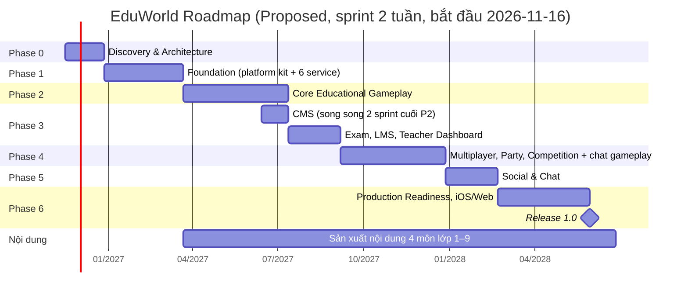

# Roadmap & Milestones

> Trạng thái: Draft · Phiên bản: 0.4 · Owner: Product Manager + QA Engineer · Cập nhật: 2026-11-15
> Liên quan: [OPEN_QUESTIONS](OPEN_QUESTIONS.md) · [RISKS](RISKS.md) · [TEST_STRATEGY](TEST_STRATEGY.md) · [adr/README](../adr/README.md) · [GAME_DESIGN](../01-game-design/GAME_DESIGN.md) · [PRODUCT_REQUIREMENTS](../00-overview/PRODUCT_REQUIREMENTS.md)

**Mục đích.** Nguồn duy nhất về lộ trình phát triển EduWorld: phase, milestone, exit criteria, demo script và báo cáo milestone (hợp nhất ROADMAP + MILESTONES, 2026-11-15).
**Phạm vi.** Thứ tự phát triển và tiêu chí nghiệm thu cho Release 1.0. Mỗi phase nêu **trải nghiệm người chơi** có được khi xong, vì EduWorld là game trước hết. Chi tiết test case: [TEST_STRATEGY](TEST_STRATEGY.md).

## 1. Nguyên tắc

- **Mục tiêu phát hành là Release 1.0 hoàn chỉnh** [Confirmed — stakeholder 2026-11-15]: toàn bộ chức năng trong Master Prompt + Party Addendum, không cắt thành MVP. Release 1.0 = hoàn thành Phase 6 với mọi exit criteria ở §3.7 (M6). Pilot nội bộ/tại trường chạy sớm để lấy phản hồi, **không** phải điểm dừng phạm vi.
- Không triển khai tất cả chức năng cùng lúc; mỗi phase có deliverable chạy được và tiêu chí nghiệm thu (§3) [Confirmed — Master Prompt §20].
- Không đánh dấu hoàn thành nếu chỉ có giao diện giả lập.
- **Cổng hiệu năng máy tầm trung** [Confirmed — ADR-0057]: từ M1, mỗi milestone có client phải đạt ngân sách của [PERFORMANCE_BUDGET](../08-game-client/PERFORMANCE_BUDGET.md) cho các cảnh có trong milestone, đo trên thiết bị lab hạng Tầm trung; benchmark CI (TC-PERF-018) chặn merge khi vượt. Tính năng không đạt phải giảm chất lượng, không loại thiết bị tầm trung.
- Learning Engine là lõi: mọi gameplay ở Phase 2 trở đi phải dùng Learning Engine thật, không hardcode câu hỏi.
- Thứ tự an toàn: chat gameplay (match/team/party) **luôn có** từ khi ra mắt các chế độ chơi cùng nhau ở Phase 4 (ADR-0020 mục 6), nên hạ tầng chat + pipeline kiểm tra (ADR-0030) + report/sanction tối thiểu phải sẵn sàng **trong Phase 4**. Các channel rộng hơn (World, Area, Class, Study Group, DM) và moderation nâng cao mở ở Phase 5.
- Ước lượng thời gian theo **sprint 2 tuần**, giả định đội: 3 Go, 3 Godot (gồm 1 tech artist), 1 web, 1 QA, 1 DevOps (bán thời gian), 1 EdTech, 1 Game Designer, 1 UX/UI, PM/Architect [Proposed]. Thay đổi đội → ước lượng lại.

**Quy tắc nghiệm thu milestone**

1. **Không đánh dấu hoàn thành nếu chỉ có giao diện giả lập** [Confirmed — Master Prompt §20]. Mọi exit criterion phải chạy trên backend thật, dữ liệu lưu PostgreSQL, xác thực qua Keycloak, đi qua APISIX — trên môi trường **staging**.
2. Mỗi exit criterion có **bằng chứng**: ID test case trong [TEST_STRATEGY](TEST_STRATEGY.md) §6 đã pass trong CI hoặc biên bản test thủ công có video/screenshot + trace_id.
3. Không còn lỗi Critical/High mở thuộc phạm vi milestone.
4. Tài liệu và specs liên quan đã cập nhật; ADR liên quan chuyển `Accepted`.
5. Demo script được trình diễn cho PM, Architect, Game Director, EdTech Specialist (và đại diện trường từ M3).
6. Báo cáo milestone theo mẫu §9.

## 2. Tổng quan phase và milestone

| Phase | Tên | Sprint ước tính | Deliverable | Phụ thuộc chính |
|---|---|---|---|---|
| 0 | Discovery & Architecture | 3 | Bộ tài liệu + architecture baseline + ADR được review | Trả lời OQ-02, OQ-04, OQ-08 (một phần) |
| 1 | Foundation | 6 | Platform kit + 6 service skeleton chạy end-to-end; học sinh đăng nhập SSO và vào thế giới 3D | ADR-0002…0010, 0013, 0014, 0021, 0024, 0036…0042; OQ-01 (csv đủ cho P1) |
| 2 | Core Educational Gameplay | 8 | Đủ 7 zone, đủ 11 loại câu hỏi, đủ 11 loại mini-game, đủ 7 loại quest | ADR-0012, 0015, 0016, 0017; OQ-05, OQ-08, OQ-16 |
| 3 | Exam & Learning Management | 6 (song song 2 sprint cuối P2) | Đủ CMS, LMS, Exam Engine, Teacher Dashboard, analytics mọi cấp | ADR-0022; OQ-07, OQ-18 |
| 4 | Multiplayer, Party & Competition | 8 | Đủ chế độ thi đấu, matchmaking, ranking, leaderboard, tournament; **chat gameplay luôn có** (match/team/party) với pipeline kiểm tra và purge | ADR-0011, 0018, 0020, 0030, 0033; OQ-03, OQ-06 |
| 5 | Social & Chat | 4 | Thêm World/Area/Class/Study Group/DM (đủ 8 loại channel), friend/team/study group, moderation nâng cao | ADR-0020; OQ-12 |
| 6 | Production Readiness & Release 1.0 | 7 | Release 1.0 trên Windows, Android, iOS, Web | OQ-04, OQ-10, OQ-11, OQ-12 |

| Milestone | Phase | Kết quả nghiệm thu một câu |
|---|---|---|
| M0 Architecture Baseline | 0 | Tài liệu + specs đủ để developer khác triển khai |
| M1 First Login to World | 1 | 6 microservice chạy end-to-end; học sinh SIS đăng nhập SSO và vào Main Hub 3D |
| M2 First Learning Quest | 2 | Học sinh tạo avatar, hoàn thành quest học tập, được chấm server-side, nhận XP, lên cấp, mở khu mới |
| M3 Teacher Loop | 3 | Giáo viên tạo/giao bài, học sinh làm trong game, giáo viên thấy kết quả & kỹ năng yếu |
| M4a Party Co-op | 4 | Party 4 người cùng làm quest co-op/đánh boss, kết quả học tập riêng |
| M4b Knowledge Battle | 4 | Hai học sinh thi đấu, kết quả & ranking cập nhật đúng một lần, chat trận có ngay |
| M5 Safe Social | 5 | Đủ 8 loại channel, vi phạm bị chặn/xử lý, giáo viên kiểm soát |
| M6 **Release 1.0** | 6 | Game hoàn chỉnh trên Windows, Android, iOS, Web với bằng chứng |
| M7 Post-release Review | sau 6 | Đánh giá 1 học kỳ vận hành, kế hoạch 1.x |

Release 1.0 là **game hoàn chỉnh**, không phải MVP [Confirmed — stakeholder 2026-11-15]. M1–M5 là mốc trung gian; một chức năng của Master Prompt chưa đạt exit criteria thì M6 chưa đạt.

Tổng: **42 sprint công việc** (chat gameplay chuyển từ P5 sang P4: P4 +1, P5 −1; chuyển sang microservices (ADR-0036): P1 +2 cho platform kit, 6 service skeleton, hạ tầng NATS/DB riêng/service auth/contract test; P6 +1 cho load test và chaos test liên service); có chồng lấn Phase 2/3 (2 sprint) nên **~40 sprint lịch (~80 tuần)** [Proposed]. Giả định đội tăng thêm 1 Go engineer và DevOps toàn thời gian từ Phase 1 để vận hành nhiều service. So với bản trước (~30 sprint), tăng do đưa toàn bộ hạng mục từng để "sau MVP" vào Release 1.0: iOS + Web, đủ mini-game và quest type, đủ format tournament, leaderboard Global, chat đủ channel, analytics cấp tổ chức.

Song song suốt Phase 2–6: **dòng sản xuất nội dung** (EdTech + content team) phủ Toán, Tiếng Việt, Tiếng Anh, Khoa học (Tự nhiên & Xã hội / Khoa học / KHTN theo khối) lớp 1–9 theo chương trình chốt ở OQ-08. Khối lượng nội dung cho Release 1.0 do PO + EdTech chốt [TBD — OQ-08]; engine không giới hạn số môn.



> Ngày trong Gantt chỉ để minh họa thứ tự và độ dài tương đối; mốc ngày chính thức chốt sau Phase 0.

## 3. Chi tiết từng phase

### 3.1. Phase 0 — Discovery & Architecture — M0 Architecture Baseline

**Trải nghiệm người chơi khi xong phase:** Chưa có trải nghiệm người chơi; chỉ có spike kỹ thuật (form đăng nhập trong Godot qua `/auth/game/login`, hub 40 client giả lập).

**Phạm vi**
- Phân tích yêu cầu, PRD, personas, user stories, glossary.
- Kiến trúc hệ thống, domain model, ADR-0001…0025.
- Thiết kế database, API (OpenAPI/AsyncAPI khung), Keycloak, APISIX, SIS integration.
- Game design: thế giới, gameplay loop, quest, mini-game, party, competition.
- Child safety, data privacy (bản đầu), test strategy, risks.
- Prototype kỹ thuật (spike) giới hạn thời gian: (a) form đăng nhập Godot → identity-service → Keycloak password grant (`eduworld-game-backend`) trên Windows/Android, kiểm chứng phân biệt lỗi role/mật khẩu và log không lộ mật khẩu (ADR-0068); (b) WebSocket hub sync 40 client giả lập; (c) RLS + `SET LOCAL` với pgx.

**Deliverable:** thư mục `docs/` và `specs/` hoàn chỉnh; 3 spike có báo cáo; ADR quan trọng được review.

**Phụ thuộc**: phỏng vấn trường/giáo viên; OQ-02, OQ-04, OQ-08 có câu trả lời sơ bộ.

#### Exit criteria và demo (M0)

- [ ] Toàn bộ tài liệu trong cấu trúc `docs/` (Master Prompt §19) tồn tại và có nội dung thực chất (không file rỗng/chỉ tiêu đề) — kiểm tra bằng `make docs-check` + review.
- [ ] `specs/openapi` lint sạch (Spectral), `specs/asyncapi` validate, JSON Schema compile được.
- [ ] ADR-0002…0042 đã review (ADR-0001 đã superseded bởi ADR-0036); các ADR cho Phase 1 chuyển Accepted.
- [ ] OQ-02, OQ-04 có câu trả lời hoặc quyết định dùng mặc định được ký nhận.
- [ ] 3 spike (đăng nhập form Godot qua backend, WS 40 client, RLS + pgx) có báo cáo kết quả và số liệu.
- [ ] Rủi ro top 5 có owner và kế hoạch giảm thiểu.

**Demo script**: walkthrough kiến trúc (C4), luồng đăng nhập, luồng quest, ma trận test; chạy spike đăng nhập form Godot trên Windows và Android.

### 3.2. Phase 1 — Foundation — M1 First Login to World

**Trải nghiệm người chơi khi xong phase:** Học sinh mở game, đăng nhập bằng username/mật khẩu trường cấp trong form của game (mỗi lần mở game đều nhập mật khẩu, ADR-0064/0068), vào **Main Hub 3D**, đi lại, thấy nickname của mình.

**Phạm vi**
- Monorepo (`services/`, `pkg/`, `go.work`), CI GitLab theo service (path filter, lint/test/scan/build, contract test), Docker Compose local ([LOCAL_DEVELOPMENT](../11-operations/LOCAL_DEVELOPMENT.md)), **staging trên Docker Swarm** (stack file `deploy/swarm/staging/`, overlay network, Docker secrets, deploy `docker stack deploy` từ CI; ADR-0024, chưa dùng Kubernetes).
- **Platform kit `pkg/`** (ADR-0036…0042): config, slog, OTel (HTTP + NATS propagation), health/readiness, Problem Details, mediator CQRS + pipeline behavior (logging, tracing, validation, authorization, idempotency, transaction), ent mixin (UUIDv7, `tenant_id`, audit, soft-delete, `version`) + interceptor global filter, outbox + relay NATS, consumer idempotent (`processed_events`), typed client wrapper + resilience (timeout/retry/circuit breaker) + token `svc-*`, middleware internal auth (`aud`/`azp` allowlist), testkit (testcontainers PostgreSQL/NATS/Valkey).
- **6 service skeleton** theo Clean Architecture, mỗi service có database riêng, Atlas migration, spec public + internal, health, metrics, chạy được trong compose; spike saga mẫu (identity → game cleanup) và projection `ref_tenants`/`ref_students` từ `EVT_IDENTITY`.
- Migration Atlas cho `eduworld_identity` (identity, org, sis, platform, audit) và `eduworld_game` (profile, session, login events).
- Valkey: realtime ticket, rate limit.
- NATS JetStream 1 node trong Docker Compose local/dev (ADR-0035): stream `EVT_*` cho domain event của mọi service (ADR-0042) và `CHAT_MESSAGES` (tạo idempotent bởi chat-service, sẵn sàng cho chat Phase 4), user/creds theo service, dashboard exporter [Proposed].
- Keycloak realm as code, clients người dùng (`eduworld-game-backend` confidential chỉ Direct Access Grants — ADR-0068, `eduworld-portal` + theme `eduworld-ops` + conditional OTP — ADR-0066, `eduworld-api`), `duplicateEmailsAllowed=false`, `loginWithEmailAllowed=true` (ADR-0067) và client service `svc-*`, roles, Organizations.
- APISIX upstream theo service: `/api/v1/auth/*`, `/api/v1/students/*` → identity-service (route `/auth/game/*` tắt ghi body, rate limit thiết bị/username); plugin `tenant-header` kiểm tra `X-Tenant-Id` (ADR-0065); `/api/v1/game/*` → game-service; `/realtime/v1` → realtime-gateway.
- NATS JetStream: stream `EVT_*` theo service, user/creds theo service; realtime-gateway ↔ service qua NATS request/reply.
- SIS: công bố EduWorld SIS Contract v1 (`specs/sis/`) + conformance test kit + mock server; port `SISProvider` với `contract_v1` và `csv_import`, contract validator, sync + reconciliation cơ bản, JIT provisioning (ADR-0021).
- Godot: bootstrap, form đăng nhập S01 gọi `/auth/game/login` (ADR-0068), API client gắn `X-Tenant-Id` (ADR-0065), realtime client (connect/heartbeat/reconnect), Main Hub greybox, character controller cơ bản, camera.
- Game session (ADR-0031): chỉ học sinh vào game (`GAME_ACCESS_STUDENT_ONLY`), lưu `game.login_events` + `last_login_at`, một thiết bị/tài khoản (409 + hộp thoại takeover, `session.session.replaced`), job `game-session-timeout`.
- Staging environment đầu tiên.
- Đăng nhập nền tảng cho 10.000 CCU (ADR-0045): phiên game chỉ trong RAM (refresh token rotation, idle 30 phút/tối đa 10 giờ — ADR-0064), Keycloak persistent sessions, JWKS/Principal/tenant cache trên đường `/auth/game/login`, rate limit theo tenant/thiết bị + `429 Retry-After`; benchmark băm mật khẩu (TC-PERF-015). S3 giả lập bằng floci + job tạo bucket + CDN giả lập trong compose và CI (ADR-0044); staging/production cũng dùng floci (ADR-0071): dựng node `storage`, backup ngoài máy, diễn tập khôi phục.

- **Design system (ADR-0047):** cấu trúc `design/{game-tokens,admin-tokens,shared-tokens,icons,fonts}`, pipeline Style Dictionary (`make design-tokens`), Theme Godot + `UiTokens.gd` + preset toon/outline cơ bản cho Main Hub, theme Ant Design EduWorld (sáng/tối/compact) + khung `web/packages/ops-ui` + Storybook, lint hardcode và kiểm tra tương phản trong CI.

**Deliverable:** học sinh demo đăng nhập qua Keycloak, backend ánh xạ trường/lớp từ dữ liệu SIS (CSV), vào Main Hub 3D, thấy nhân vật của mình.

#### Exit criteria và demo (M1)

- [ ] Đăng nhập nền tảng ADR-0045/0064/0068: mở lại game luôn nhập mật khẩu (không token trên đĩa); `/auth/game/login` p95 ≤ 400 ms + `game/sessions` p95 ≤ 150 ms ở tải thử; `429 LOGIN_QUEUE_BUSY` + `Retry-After` khi vượt ngưỡng; log không chứa mật khẩu; thiếu `X-Tenant-Id` → `400`; benchmark băm mật khẩu ≤ 80 ms (TC-PERF-015). Nhận biết SIS nguồn đúng khi hai SIS trùng mã (TC-AUTH-030).
- [ ] `docker compose up` + `make seed` dựng local trong ≤ 30 phút trên máy mới (đo bởi 1 developer chưa tham gia).
- [ ] CI chạy theo service (path filter) lint/test/scan/migrate-lint + contract test, godot, specs (gồm rule `maxLength` bắt buộc); image từng service được build và deploy tự động lên dev.
- [ ] Platform kit `pkg/` có test: mediator CQRS + pipeline behavior, ent global filter tenant/soft-delete (TC-TEN-021…023), outbox → NATS + consumer idempotent, typed client + circuit breaker, internal auth (`aud`/`azp` allowlist) (TC-SVC-001…006).
- [ ] 6 service skeleton chạy trên staging, mỗi service database riêng; không service nào kết nối được database của service khác (TC-SVC-007).
- [ ] Projection `ref_tenants`/`ref_students` ở game-service bắt kịp event `EVT_IDENTITY` trong ≤ 5 s (p95) (TC-SVC-008); saga mẫu cleanup hội tụ khi một service tạm lỗi (TC-SVC-009).
- [ ] TC-AUTH-001…008 pass trên staging (đăng nhập, token hết hạn, refresh, logout, không có trong SIS, bị khóa, chuyển lớp, chuyển trường); TC-AUTH-011…012 pass (dữ liệu vi phạm EduWorld SIS Contract bị từ chối, conformance test kit chạy với `sis-mock`).
- [ ] TC-TEN-001 (học sinh trường A không truy cập dữ liệu trường B) pass ở cả tầng ứng dụng và RLS.
- [ ] Design system (ADR-0047): `make design-tokens` sinh Theme Godot + `UiTokens.gd` + theme Ant Design từ `design/`; TC-UI-001…003, TC-UI-005 pass trong CI; Main Hub và màn đăng nhập game chỉ dùng Theme sinh ra.
- [ ] Godot client Windows + Android: đăng nhập bằng form trong game qua `/auth/game/login` (ADR-0068), không có client secret/endpoint Keycloak trong build (kiểm tra bằng grep artifact); log không chứa mật khẩu (TC-AUTH-060).
- [ ] Cổng hiệu năng M1: `QualityManager` (renderer Mobile + tự chuyển Compatibility, preset, tự phát hiện) hoạt động; benchmark headless CI (TC-PERF-018) chạy cho Main Hub; Main Hub đạt AC-PERF-001/002 trên DEV-AND-MID1 và DEV-PC-MID với 40 avatar giả lập; AC-PERF-008 pass.
- [ ] Học sinh vào Main Hub, di chuyển nhân vật, thấy nickname; kết nối realtime với ticket, reconnect sau khi rút mạng 10s.
- [ ] Health/readiness/liveness hoạt động cho mọi service; trace xuyên APISIX → identity-service → game-service (typed client) → PostgreSQL và qua NATS xem được trong Grafana/Tempo (Service Map).
- [ ] TC-AUTH-013…019 pass: giáo viên/vận hành không vào được game; takeover giữa 2 thiết bị có hộp thoại xác nhận và thông báo trên thiết bị cũ; `game.login_events` + `last_login_at` ghi đúng (ADR-0031).

**Demo script**
1. Đồng bộ 1 trường demo qua `sis-mock` (EduWorld SIS Contract v1) và import CSV cùng cấu trúc DTO cho 1 trường demo → xem kết quả sync + reconciliation.
2. Đăng nhập `hs.an.3a` trên Windows → vào Main Hub.
3. Đăng nhập `hs.locked` → bị từ chối với thông báo thân thiện.
4. Chuyển `hs.binh.3a` sang 3B trong CSV → sync → lần đăng nhập sau thấy lớp mới.
5. Dùng token của học sinh trường A gọi API tài nguyên trường B → 404/403, có audit log.
5b. Dùng token người dùng gọi thẳng `/internal/v1/...` của learning-service trong mạng nội bộ → 401; dùng token `svc-chat` gọi endpoint chỉ cho `svc-game` → 403.
5c. Tắt learning-service → game-service báo suy giảm có kiểm soát (circuit breaker mở), Main Hub vẫn chạy; bật lại → tự phục hồi.
6. Đăng nhập `gv.minh` vào game → thông báo "tài khoản không dùng để vào game".
7. `hs.an.3a` đang ở Main Hub trên Windows, đăng nhập lại trên Android → hộp thoại xác nhận → Windows hiện thông báo đã bị đăng xuất; xem lịch sử đăng nhập trong DB/CMS.

### 3.3. Phase 2 — Core Educational Gameplay — M2 First Learning Quest

**Trải nghiệm người chơi khi xong phase:** Học sinh **tạo avatar**, chơi chương mở đầu của mạch truyện, khám phá các vùng đất (8 vùng chứa đủ 7 khu chức năng, [WORLD_DESIGN](../01-game-design/WORLD_DESIGN.md)), gặp NPC, nhận và hoàn thành quest bằng hoạt động học tập ngay trong thế giới 3D, nhận XP/Xu/vật phẩm, **lên cấp**, **mở khóa khu mới**, mua đồ trang trí, thấy người chơi khác trong hub. Đây là vòng lặp game cốt lõi (GAME_DESIGN).

> Bổ sung ADR-0032: worker `student-inactive-cleanup` (cấu hình platform/tenant, báo trước, loại trừ, ngưỡng xác nhận, khôi phục khi đăng nhập lại) và màn hình CMS liên quan — làm cùng nền tảng CMS cuối Phase 2.

**Phạm vi**
- Learning Engine: curriculum, content versioning (ADR-0015), question bank đủ 11 loại câu hỏi (sprint đầu: single/multiple choice, true/false, fill blank, numeric, matching, ordering, drag&drop; sprint sau: short answer, image-based, interactive), render payload & server scoring (ADR-0016).
- Exercise Engine: attempt, answer, submit idempotent, resume, retry wrong.
- **Activity Engine** ([ACTIVITY_ENGINE](../02-learning/ACTIVITY_ENGINE.md), ADR-0048): registry + plugin `quiz`, `interactive_exercise`, `minigame`; thực thể Evaluation; renderer registry Godot. **Công thức** (ADR-0055): LaTeX + SVG MathJax 4 render trên portal, hiển thị SVG trong game.
- Learning events + mastery model v1 (ADR-0017).
- Game: đủ 7 zone (Main Hub, Learning Zone với khu Toán/Tiếng Việt/Tiếng Anh/Khoa học, Practice Zone, Exam Zone shell, Competition Arena shell, Social Zone shell, Quest Zone), NPC + dialogue data-driven, Quest system đủ 12 loại quest (main, side, daily, weekly, learning, exploration, social, seasonal, special event ở Phase 2; party, challenge, boss hoàn thiện ở Phase 3–4), Mini-game engine đủ 11 loại (multiple choice, true/false, fill blank, drag & drop, matching, ordering, calculation, puzzle, word game, science simulation, timed challenge), character customization đầy đủ (luồng tạo avatar lần đầu, preset, equipment slot, 6 emote 3D mặc định, animation) + inventory.
- Gamification: XP ledger, level, reward rules có cap và diminishing returns, achievement, badge, collection, daily/weekly challenge.
- Progression & economy ([PROGRESSION_SYSTEM](../01-game-design/PROGRESSION_SYSTEM.md), [INVENTORY_ECONOMY](../01-game-design/INVENTORY_ECONOMY.md)): progression curve có version, danh hiệu, phần thưởng level, mở khóa khu + khám phá; Xu + sổ cái + Shop cosmetic, collection, achievement builder (Game Studio).
- Nội dung đợt 1: Toán và Tiếng Việt lớp 1–5 [Proposed] theo OQ-08; các môn/khối khác theo dòng sản xuất nội dung song song.
- Hub multi-instance hiển thị người chơi khác (presence + position sync cơ bản, ADR-0011/0012) — chỉ nhìn thấy, chưa chat tự do.
- Web export: build thử trong CI, đo tải/FPS theo [PERFORMANCE_BUDGET](../08-game-client/PERFORMANCE_BUDGET.md) §14 (ADR-0057).
- Đăng nhập nhanh (ADR-0045): authenticator Keycloak tùy biến (mã QR lớp + PIN, thẻ QR cá nhân, mật khẩu hình ảnh lớp 1–3), Device Authorization Grant cho máy phòng tin học, quản lý credential trong CMS; hàng chờ đăng nhập trong Godot.
- Media pipeline (ADR-0044): presigned upload, ClamAV, chuyển đổi ảnh/âm thanh/video/3D, CDN; snapshot nội dung + content manifest khi publish (ADR-0043).

**Deliverable:** học sinh vào game, nhận quest từ NPC, làm bài tập Toán đúng lớp, server chấm điểm, nhận XP/phần thưởng, tiến độ & mastery được ghi nhận.

#### Exit criteria và demo (M2)

- [ ] Câu hỏi, quest, mini-game, NPC dialogue được tải từ backend (không hardcode trong scene) — kiểm chứng bằng cách publish version mới qua API/seed và thấy thay đổi mà **không build lại** client.
- [ ] Render payload không chứa đáp án (TC-LRN-007 kiểm tra tự động trên mọi loại câu hỏi).
- [ ] TC-LRN-001…008 pass (tải bài học, làm bài, chấm, nộp, làm lại, lưu lịch sử, không tự sửa kết quả, nộp trùng).
- [ ] Mastery cập nhật từ learning events theo ADR-0017; Learning Score ≠ Mastery hiển thị riêng.
- [ ] XP có cap ngày và giảm dần khi lặp nội dung (TC-GAM-001…003).
- [ ] Đủ 11 loại câu hỏi và đủ 11 loại mini-game (Master Prompt §3.5) chạy với nội dung từ Question Bank; mỗi loại có test chấm điểm server-side.
- [ ] Đủ 7 zone vào được (Exam Zone, Arena, Social Zone ở mức shell, hoàn thiện ở M3–M5); đủ 12 loại quest có ít nhất một quest mẫu publish qua backend (party/challenge/boss quest hoàn thiện ở M4).
- [ ] Character customization đủ skin, outfit, hair, accessories, emotes; achievement, badge, collection, daily/weekly challenge hoạt động.
- [ ] Tạo avatar lần đầu, level up, mở khóa khu mới chạy end-to-end với dữ liệu server (TC-GAM-004…011); curve XP/danh hiệu đổi qua Game Studio không build lại client.
- [ ] Xu + Shop cosmetic + sổ cái: mua idempotent, ví không âm, đối soát pass (TC-ECO-001…008).
- [ ] Cổng hiệu năng M2: mọi vùng môn học và activity player đạt ngân sách [PERFORMANCE_BUDGET](../08-game-client/PERFORMANCE_BUDGET.md) §7 trên thiết bị lab hạng Tầm trung (TC-PERF-009, 018, 020); luồng quest mẫu chạy được trên thiết bị Tối thiểu (TC-PERF-019); báo cáo hiệu năng milestone.

**Demo script**: học sinh lớp 3 gặp NPC → nhận quest "Giúp bác nông dân đếm trứng" → làm 5 câu phép nhân → sai 1 câu, xem giải thích → hoàn thành → nhận XP + item → mở hồ sơ thấy mastery LO tương ứng thay đổi; thử gửi request sửa điểm bằng Postman → bị từ chối.

### 3.4. Phase 3 — Exam & Learning Management — M3 Teacher Loop

**Trải nghiệm người chơi khi xong phase:** Học sinh nhận bài giáo viên giao như một nhiệm vụ trong game, luyện đề trong Exam Zone, học video có câu hỏi chèn, làm tự luận và nhận phản hồi của giáo viên, làm challenge solo.

**Phạm vi**
- **Một Admin Portal** React `web/apps/portal` (ADR-0022, ADR-0027 mục 7) với 5 workspace:
  - Workspace **School & Learning Management** + **Learning Content Studio** — **cho vận hành tenant** (Tenant Admin, School Admin, Academic Manager, giáo viên): curriculum (xem/curriculum riêng), nội dung học tập của tenant (question bank, question set, assessment blueprint, lesson), nội dung "Từ EduWorld" được gán (chỉ đọc), giao bài/thử thách từ template, workflow Draft → Review → Approved → Published → Archived, preview, rollback, audit trail, Thùng rác tenant [Proposed]. Không có menu/cấu hình game.
  - Workspace **Platform Administration** (chỉ System Admin, API qua gateway nội bộ + MFA): Learning Management liên tenant cho System Admin (dropdown tenant, cột Tenant), gán dữ liệu cho tenant & clone giữa tenant (ADR-0029), Thùng rác mọi tenant (ADR-0028), quản lý tenant.
- **Game Operations Console + Game Live Operations (platform-only, `/api/v1/game-admin/*`)**: quest/mini-game/NPC/reward config (dựng từ Phase 2 cho đội platform), game level, world event, game activity, item; cấu hình thi đấu (matchmaking, ranking rules, season, tournament/challenge template, leaderboard definition, competition reward) hoàn thiện trong Phase 4.
- **Admin/Ops UI (ADR-0047):** portal dựng trên Ant Design 5 + Ant Design Pro (ProLayout, ProTable, ProForm) theo [DESIGN_SYSTEM](../05-ux/DESIGN_SYSTEM.md); dashboard live-ops; component đặc thù trong `ops-ui` (trình soạn câu hỏi, graph editor quest/NPC, bracket); visual regression; thumbnail/turntable render headless từ asset 3D (dựng pipeline cuối Phase 2, dùng đầy đủ ở Phase 3).
- LMS — course, learning path có điều kiện mở khóa, enrollment, assignment, schedule, lesson delivery, study group do giáo viên tạo, thử thách học tập.
- Exam Engine — practice test, mock exam, chapter/semester/subject test, custom assessment, timed exam, random đề theo blueprint, chống nộp trùng, phân tích câu sai, đề xuất ôn tập.
- Exam Zone và Practice Zone hoàn chỉnh trong game.
- **Học tập đa định dạng đợt 1:** plugin `written_response` (trả lời ngắn/dài, tự luận, lời giải toán dạng văn bản + đáp số), rubric, hàng đợi chấm của giáo viên ([WRITTEN_RESPONSE_RUBRIC](../02-learning/WRITTEN_RESPONSE_RUBRIC.md)); plugin `video_lesson` có chapter, phụ đề, câu hỏi chèn ([VIDEO_LEARNING](../02-learning/VIDEO_LEARNING.md)) [Proposed: video có thể lùi sang đầu Phase 4 nếu thiếu năng lực].
- **Học tập đa định dạng đợt 2 (cuối Phase 3 → Phase 4, song song multiplayer):** `audio_lesson`, `speaking` (ghi âm + giáo viên chấm tay; không AI giọng nói trong Release 1.0, ADR-0059), `simulation` với 2–3 template đầu tiên + checker Go ([SIMULATION_ENGINE](../02-learning/SIMULATION_ENGINE.md)), `project`. Gợi ý AI chấm bài (ADR-0053) để sau Release 1.0.
- Teacher Dashboard + learning analytics đủ cấp: học sinh, lớp, trường, tổ chức, môn, chủ đề, LO; xuất báo cáo.

**Deliverable:** giáo viên tạo/giao bài và đề ôn tập; học sinh làm trong game; giáo viên xem kết quả và kỹ năng yếu.

#### Exit criteria và demo (M3)

- [ ] Workflow nội dung Draft → Review → Approved → Published → Archived có audit trail; sửa nội dung đã publish tạo version mới, attempt cũ vẫn trỏ version cũ (TC-CMS-001…004).
- [ ] Giáo viên chỉ thấy lớp được phân công (TC-TEN-002); School Admin chỉ trong trường (TC-TEN-003).
- [ ] Exam: random đề theo blueprint, timed exam theo giờ server, chống nộp trùng, chấm và phân tích câu sai (TC-EXM-001…006).
- [ ] Teacher Dashboard hiển thị tiến độ, độ chính xác, kỹ năng yếu theo LO cho lớp và từng học sinh, số liệu khớp với truy vấn đối soát.
- [ ] Học sinh nhận bài được giao trong game (thông báo + Exam Zone/Quest).
- [ ] Activity Registry chạy với `quiz`, `interactive_exercise`, `minigame`, `written_response`, `video_lesson`; test hợp đồng plugin xanh (TC-ACT-001…005); giáo viên chấm tự luận theo rubric qua hàng đợi chấm, học sinh xem điểm từng tiêu chí (TC-WR-001…008); video có câu hỏi chèn hoạt động trong Godot (TC-VID-001…005); công thức hiển thị SVG trong game và qua visual regression (TC-MATH-001…003).
- [ ] Đủ 7 hình thức đề (practice test, mock exam, chapter, semester, subject, custom assessment, timed exam); learning path có điều kiện mở khóa; analytics xem được ở cấp học sinh, lớp, trường, tổ chức.
- [ ] Game Operations Console (workspace A của Admin Portal, platform-only) quản lý đủ game content (quest, mini-game, game level, NPC dialogue, reward, world event, game activity) và competition config (matchmaking, ranking rules, tournament/challenge template, season, competition reward).
- [ ] CMS/LMS/Admin dựng theo Admin/Ops UI (Ant Design 5 + Pro, theme EduWorld sáng/tối/compact; DESIGN_SYSTEM §4), không dùng phong cách game; dashboard live-ops có đủ KPI DESIGN_SYSTEM §4.3; TC-UI-004, TC-UI-006, TC-UI-008…010 pass; thumbnail render từ asset 3D hiển thị trong Game Studio và màn giao hoạt động game.
- [ ] Vận hành tenant (Tenant Admin, School Admin, giáo viên) dùng Admin Portal (workspace School & Learning Management, Learning Content Studio) trong đúng một tenant; **không** thấy workspace Game Operations Console/Game Live Operations/Platform Administration; TC-CMS-AUTHZ-01…10 pass (ADR-0027).
- [ ] System Admin xem dữ liệu liên tenant bằng dropdown tenant (mặc định "Tất cả", chọn nhiều, cột Tenant); gán dữ liệu platform cho tenant và clone giữa tenant hoạt động; xóa là soft-delete, Thùng rác khôi phục được (ADR-0028, ADR-0029).

**Demo script**: giáo viên `gv.lan` tạo đề kiểm tra chương "Phép nhân" 15 phút từ blueprint → giao cho 3A → 3 học sinh làm trong game (1 nộp muộn, 1 rớt mạng và resume) → giáo viên xem kết quả, câu sai phổ biến, học sinh cần ôn.

### 3.5. Phase 4 — Multiplayer, Party & Competition — M4a Party Co-op, M4b Knowledge Battle

**Trải nghiệm người chơi khi xong phase:** Học sinh **lập party với bạn**, làm quest co-op, **đánh boss** theo nhóm, **đấu 1v1/đội**, leo bảng xếp hạng và tham gia giải; **chat trong trận/đội/party** có ngay khi vào chơi.

**Phạm vi**
- Party (Addendum): create/join/leave/invite/accept/reject/kick/transfer leader/disband, settings, member status, Party Lobby (ready, leader controls, activity & mode selection), party session flow 9 bước, leader disconnect policy, rate limit + audit, 1 active party/học sinh.
- **Chat gameplay luôn có** (ADR-0020 mục 6): channel `match` (1v1, trận đội, trận giải), `team` (mỗi đội trong trận), `party` (suốt vòng đời party) — tự tạo, tự join, đủ text + emoji + quick message + reaction, không tắt được bằng cài đặt trường/lớp. Kéo từ Phase 5 sang: chat domain + realtime delivery, pipeline kiểm tra đầy đủ (normalize, danh mục từ nhạy cảm, PII, spam, bắt nạt) và công tắc kiểm duyệt (ADR-0030), report/mute/block từ màn hình trận, moderation queue + sanction cơ bản, job `gameplay-chat-purge` + giữ bằng chứng (ADR-0033). Gate an toàn CS-01b/CS-01d/CS-02/CS-04 phải đạt trước khi bật.
- **Bộ tính năng chat đầy đủ** (ADR-0034) cho channel gameplay: sửa/thu hồi, reply/quote/forward, emoji/sticker/GIF (thư viện nội bộ + Game Studio quản lý), reactions, mention, pin, copy, typing, receipts, unread/mention count, lịch sử. Tìm kiếm full-text hoàn thiện ở Phase 5 cùng channel bền vững.
- **Truyền tải chat production** (ADR-0035): NATS JetStream cluster 3 node (staging/prod), `chat-persister`/`notifier`/`moderation-async`/`stats`, chaos test mất NATS/Valkey/PostgreSQL (TC-CHAT-026…028), load test TC-PERF-010/011.
- Cooperative gameplay: private instance, shared quest progress theo cấu hình, co-op educational puzzle; learning attempt riêng từng học sinh.
- Challenge Engine + Boss ([CHALLENGE_BOSS_SYSTEM](../01-game-design/CHALLENGE_BOSS_SYSTEM.md)): challenge solo dựng từ cuối Phase 3 (dùng chung room host `pkg/roomhost`); boss party, challenge coop/party hoàn thiện ở Phase 4 cùng Party.
- Matchmaking đủ 8 chế độ: random, skill-based, grade-based, subject-based, topic-based, friend, team, tournament; queue, ticket, proposal, ready check, team assignment, grade-based hard constraint, rating window.
- Đủ 8 competition mode: Knowledge Battle 1v1, Team Battle, Co-op Challenge, Timed Quiz, Subject Tournament, Class Competition, School Competition, Seasonal Competition — server-authoritative state machine; disconnect/reconnect.
- Ranking Glicko-2 (ADR-0018), đủ 13 leaderboard (Global, School, Class, Grade, Subject, Topic, Game Mode, Friends, Team, Daily, Weekly, Monthly, Season), season.
- Tournament đủ format: single elimination, double elimination, round robin, team, school, class tournament.
- iOS: dựng pipeline build + ký trong CI, chạy smoke test trên thiết bị (ADR-0013).
- Match history; anti-cheat cơ bản (thời gian trả lời, duplicate, rate limit).
- Load test realtime lần 1 dựa trên OQ-03.

**Deliverable:** nhóm 4 học sinh lập party, cùng làm quest co-op; học sinh thi đấu 1v1/đội, kết quả và ranking được cập nhật đúng một lần; chat trận/đội/party có ngay khi vào chơi, tin vi phạm bị chặn, báo cáo được từ màn hình trận.

#### Exit criteria và demo (M4a/M4b)

**M4a — Party Co-op** (Party Addendum §8)
- [ ] Challenge Engine và Boss party: TC-CHL-001…008 pass (độ khó đúng khối, attempt học tập riêng, chỉ thưởng người đủ đóng góp, retry phase không phạt, reconnect).
- [ ] TC-PTY-001…011 pass: A tạo party; mời B, C, D; chấp nhận; thấy nhau trong lobby; leader chọn hoạt động; thành viên đủ điều kiện vào cùng game session; cùng làm quest; một thành viên rớt mạng thì nhóm tiếp tục (nếu chế độ cho phép); leader rớt mạng → chuyển leader/khôi phục; kết quả học tập ghi riêng từng người; không thành viên trái phép.
- [ ] Một học sinh chỉ có 1 active party; chống duplicate membership dưới truy cập đồng thời (test race).
- [ ] Rate limit lời mời + audit log.

**M4b — Knowledge Battle**
- [ ] TC-CMP-001…009 pass: tạo match, matchmaking, hai người tham gia, disconnect, reconnect, hoàn thành, tính kết quả, cập nhật ranking, không tính trùng.
- [ ] Không ghép khác khối ngoài cấu hình (TC-MM-003: lớp 1 không gặp lớp 9 dù rating bằng nhau).
- [ ] Đủ 8 chế độ matchmaking, 8 competition mode, 13 loại leaderboard, 6 format tournament (single/double elimination, round robin, team, school, class) theo Master Prompt §5.2–§5.5.
- [ ] Load test realtime ở 1× mục tiêu cho phase (hướng tới 10.000 CCU, ADR-0045) — báo cáo k6 + metrics; gateway ≤ 4.000 WS/replica.
- [ ] Build iOS chạy smoke test đăng nhập + vào hub trên thiết bị thật.
- [ ] Cổng hiệu năng M4: boss co-op 8 người, trận 1v1/đội và private instance đạt ngân sách §7 [PERFORMANCE_BUDGET](../08-game-client/PERFORMANCE_BUDGET.md) trên DEV-AND-MID1/2, DEV-IOS-MID, DEV-PC-MID; băng thông Hub ≤ 30 KB/s (TC-PERF-023).
- [ ] **Chat gameplay luôn có** (ADR-0020 mục 6): channel `match`/`team`/`party` tự tạo khi vào trận/party, gửi/nhận text ngay; policy trường/lớp không tắt được (TC-CHAT-017…020, TC-PTY chat); pipeline kiểm tra + công tắc (ADR-0030) chạy trên các channel này; mute/chặn/báo cáo từ màn hình trận; moderation queue + sanction cơ bản; job purge chat gameplay đúng hạn và giữ bằng chứng (TC-CHAT-021…024, ADR-0033). Bộ tính năng chat ADR-0034 trên channel gameplay đạt TC-CHAT-029…039, TC-CHAT-041; truyền tải NATS JetStream + Valkey Pub/Sub đạt TC-CHAT-025…028 và TC-PERF-010/011 (ADR-0035). Gate CS-01b, CS-01d, CS-02, CS-04 đạt.

**Demo script**: 4 học sinh lập party "Nhóm Sao Mai" → lobby ready → co-op puzzle → rút mạng 1 máy → nhóm tiếp tục → máy reconnect quay lại; sau đó 2 học sinh lớp 3 vào hàng đợi Battle Toán → trận 5 câu → kết quả, rating thay đổi; gửi lại request kết quả → bị từ chối duplicate.

### 3.6. Phase 5 — Social & Chat — M5 Safe Social

**Trải nghiệm người chơi khi xong phase:** Học sinh kết bạn, nhắn tin bạn bè, chat lớp và nhóm học tập trong môi trường an toàn; giáo viên kiểm soát lớp mình.

**Phạm vi**
- Friend system (request/accept, giới hạn theo policy), block, mute, study group/team.
- Chat channels còn lại: world (cùng trường), area, class, study group, team bền vững, DM giữa bạn bè — một bộ quy tắc cho mọi lớp, mọi tin qua kiểm tra hợp lệ (ADR-0020). Channel `match`/`team` theo trận/`party` đã có từ Phase 4.
- Pipeline lọc đã có từ Phase 4; Phase 5 bổ sung phân tích bullying/grooming bất đồng bộ nâng cao, tinh chỉnh danh mục theo dữ liệu thật.
- Moderation nâng cao: escalate liên trường, SLA, teacher/school controls cho channel lớp, dashboard chất lượng bộ lọc (report/queue/sanction cơ bản đã có từ Phase 4).
- Realtime notifications, unread count, message history theo retention.
- Rà soát pháp lý dữ liệu trẻ em (OQ-12) trước khi bật.

**Deliverable:** học sinh giao tiếp trong các channel được phép; vi phạm bị chặn/xử lý; giáo viên kiểm soát lớp mình.

#### Exit criteria và demo (M5)

- [ ] TC-CHAT-001…010 pass (tạo/tham gia channel, gửi/nhận, block, report, moderation, không truy cập channel trái phép, không đọc tin trường khác, PII bị chặn, cùng quy tắc cho mọi lớp).
- [ ] Bộ test lọc tiếng Việt (≥ 2.000 mẫu có/không dấu, teencode) đạt recall ≥ 95% cho danh mục cấm, false positive ≤ 3% [Proposed].
- [ ] Moderator chỉ thấy case của trường mình; mọi hành động có audit.
- [ ] Cổng hiệu năng M5: chat panel (danh sách ảo hóa, sticker/GIF) giữ ngân sách UI §9 [PERFORMANCE_BUDGET](../08-game-client/PERFORMANCE_BUDGET.md) khi channel có > 500 tin.
- [ ] Đánh giá pháp lý (OQ-12) cho chat đã có kết luận bằng văn bản.

### 3.7. Phase 6 — Production Readiness — M6 Release 1.0

**Trải nghiệm người chơi khi xong phase:** Học sinh chơi ổn định trên **Windows, Android, iOS, Web** ở quy mô 10.000 người chơi đồng thời.

**Phạm vi**
- Hoàn thiện iOS và Web export: tối ưu theo nền tảng, preset đồ họa thấp cho Web, đăng nhập bằng form trong game trên iOS và Web (ADR-0068; bàn phím ảo, certificate pinning [Proposed] trên iOS), phát hành App Store / Google Play / Microsoft Store hoặc installer / hosting Web qua CDN.
- Tối ưu hiệu năng client theo kỹ thuật bắt buộc của [PERFORMANCE_BUDGET](../08-game-client/PERFORMANCE_BUDGET.md) §13 và server.
- Security testing (pen-test, OWASP ASVS L2, kiểm tra lateral movement giữa service, authenticator đăng nhập tùy biến), anti-cheat nâng cao, **load test 10.000 CCU** toàn hệ thống (TC-PERF-002, 014, 016, 017) trên staging tương đương production, scale theo lịch học bằng `ops-scheduler` (Docker Swarm, không autoscale theo tải).
- **Chaos/resilience test liên service** (sprint bổ sung do microservices): tắt từng service, NATS, Valkey, một database; xác nhận circuit breaker, suy giảm có kiểm soát, saga hội tụ, projection bắt kịp; diễn tập rollback từng service và khôi phục một database (§3.5 BACKUP_RECOVERY).
- Backup/recovery diễn tập, monitoring/alerting đầy đủ, runbook.
- Triển khai production trên **Docker Swarm** (ADR-0024; nơi đặt hạ tầng theo OQ-10): cụm node theo vai trò, HA thành phần có trạng thái, diễn tập failover; ký ứng dụng; phát hành store.
- UAT với trường pilot, đào tạo giáo viên, tài liệu người dùng.

**Deliverable:** **Release 1.0 hoàn chỉnh** trên Windows, Android, iOS, Web, đủ mọi chức năng của Master Prompt + Party Addendum, có bằng chứng kiểm thử (exit criteria M6 bên dưới).

#### Exit criteria và demo (M6)

- [ ] Mọi FR thuộc Master Prompt + Party Addendum trong [PRODUCT_REQUIREMENTS](../00-overview/PRODUCT_REQUIREMENTS.md) có trạng thái Done với test case pass (ma trận truy vết FR → TC đầy đủ, không còn FR "chưa làm").
- [ ] Client chạy trên **Windows, Android, iOS, Web** đạt toàn bộ AC-PERF-001…011 của [PERFORMANCE_BUDGET](../08-game-client/PERFORMANCE_BUDGET.md) trên device matrix theo hạng của [TEST_STRATEGY](TEST_STRATEGY.md) §4.1 (ADR-0057); đăng nhập PKCE hoạt động trên cả 4 nền tảng.
- [ ] Nội dung Release 1.0 đạt khối lượng đã chốt ở OQ-08 cho các môn/khối.
- [ ] Load test **10.000 CCU** toàn hệ thống (NFR-SCAL-002 [Confirmed]) và bão đăng nhập 3.000 lượt/10 phút (NFR-SCAL-005) đạt: NFR-PERF-001…004, 011…016; TC-PERF-002, 014, 015, 016, 017 có báo cáo số liệu trong `perf-reports/`.
- [ ] Đăng nhập nhanh (QR lớp + PIN, thẻ QR, mật khẩu hình ảnh, Device Grant) đã qua pen-test; phiên dài có thu hồi đúng (TC-AUTH-040…045).
- [ ] Pen-test không còn High/Critical; OWASP ASVS L2 checklist hoàn thành.
- [ ] Restore test PITR thành công trong 30 ngày gần nhất cho **từng database service**, gồm một lần khôi phục riêng một service và đưa về nhất quán liên service (BACKUP_RECOVERY §3.5); DR drill đạt RTO.
- [ ] Chaos test liên service (TC-SVC-010…014) pass: mỗi service, NATS, Valkey lần lượt bị tắt → hệ thống suy giảm có kiểm soát, không mất dữ liệu đã xác nhận, tự phục hồi; contract test mọi cặp service xanh; không còn endpoint internal thiếu spec hoặc thiếu `maxLength`.
- [ ] Alert chính kích hoạt thử thành công; trực vận hành có lịch.
- [ ] UAT với trường pilot ký nhận; tài liệu người dùng (học sinh, giáo viên, quản trị trường) hoàn thành.
- [ ] Ứng dụng ký số; phát hành App Store, Google Play, Windows (Store hoặc installer ký số), Web qua CDN; kênh MDM của trường nếu có.

### 3.8. M7 — Post-release Review

báo cáo 1 học kỳ vận hành Release 1.0 — tần suất sử dụng, tỷ lệ hoàn thành bài, thay đổi mastery, sự cố an toàn, phản hồi giáo viên/học sinh, kế hoạch bản 1.x.

## 4. Hạng mục chỉ làm khi có quyết định

| Hạng mục | Trạng thái | Ghi chú |
|---|---|---|
| Voice chat | Không làm trong Release 1.0 (ADR-0070) | Master Prompt §6.2 chỉ yêu cầu thiết kế mở rộng; extension point chỉ ở mức thiết kế |
| Parent portal | [TBD] OQ-13 | Không có trong Master Prompt |
| Thi chính thức có giá trị pháp lý / proctoring | [TBD] OQ-18 | |
| Thanh toán / in-app purchase | [TBD] OQ-14 | Không bao giờ pay-to-learn |
| Full LRS endpoint chuẩn xAPI | [TBD] | Master Prompt §16 không bắt buộc; dữ liệu đã thiết kế tương thích xAPI |
| Mastery BKT/IRT | Cải tiến sau khi có dữ liệu thật | ADR-0017: model cắm được |
| Onboard thêm trường kết nối API theo EduWorld SIS Contract (chạy conformance test, bật delta/webhook) | Vận hành liên tục | OQ-01, ADR-0021 |
| Tách tiếp service lớn (ví dụ tách analytics khỏi learning-service, tách notification khỏi chat-service) nếu số liệu tải yêu cầu | Theo số liệu | ADR-0036 |

## 5. Quản lý thay đổi roadmap

- Roadmap review cuối mỗi phase (phase review gồm PM, Architect, Game Director, EdTech, QA).
- Thay đổi phạm vi > 1 sprint phải ghi vào CHANGELOG và cập nhật tài liệu này.
- Phase sau chỉ bắt đầu khi phase trước không còn lỗi Critical/High mở (Master Prompt §23 Step 7) — ngoại lệ phải được PM + Architect chấp thuận bằng văn bản.

## 6. Mẫu báo cáo milestone (Master Prompt §24)

```markdown
## Báo cáo M<n> — <tên> — <ngày>
- Đã làm gì:
- File/module đã tạo/sửa:
- Kiến trúc/quyết định thay đổi (ADR):
- Test đã chạy (ID, môi trường, link pipeline):
- Kết quả test (pass/fail, coverage, load test số liệu):
- Vấn đề còn tồn tại (mức độ, owner, hạn):
- Công việc tiếp theo:
```
