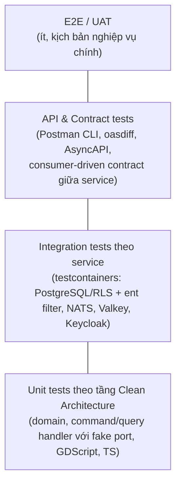

# Test Strategy

> Trạng thái: Draft · Phiên bản: 0.4 · Owner: QA Engineer · Cập nhật: 2026-11-15
> Liên quan: [ROADMAP](ROADMAP.md) · [SYSTEM_ARCHITECTURE §7](../06-architecture/SYSTEM_ARCHITECTURE.md#7-non-functional-baseline) · [ANTI_CHEAT](../10-security/ANTI_CHEAT.md) · [SECURITY_ARCHITECTURE](../10-security/SECURITY_ARCHITECTURE.md) · [LOCAL_DEVELOPMENT](../11-operations/LOCAL_DEVELOPMENT.md)

**Mục đích.** Nguồn duy nhất về chiến lược kiểm thử và ma trận test case của EduWorld.
**Phạm vi.** Pyramid, tooling, môi trường, dữ liệu test, ma trận test case theo domain (§6), hiệu năng/tải (§8), UAT, Definition of Done. Kiểm thử bảo mật: [SECURITY_ARCHITECTURE §16](../10-security/SECURITY_ARCHITECTURE.md); exit criteria theo milestone: [ROADMAP](ROADMAP.md).

## 1. Mục tiêu

- Chứng minh mỗi module đúng chức năng, an toàn (tenant isolation, child safety), server-authoritative và đạt NFR trước khi chuyển phase.
- "Không tuyên bố hoàn thành khi chưa có bằng chứng kiểm thử" và "không tự tuyên bố hỗ trợ hàng chục nghìn người chơi nếu chưa có benchmark" [Confirmed — Master Prompt §22, §24].

## 2. Test pyramid

| Tầng | Tỷ trọng mục tiêu | Chạy khi | Thời gian tối đa |
|---|---|---|---|
| Unit | ~55% | Mọi MR | 5 phút/service |
| Integration (một service + hạ tầng thật) | ~25% | Mọi MR chạm service | 15 phút/service |
| Contract giữa service (consumer-driven) + API | ~12% | Mọi MR chạm service hoặc spec internal/public; nightly đầy đủ trên dev | 10 phút |
| E2E liên service (Godot headless bot + web Playwright) | ~5% | Nightly trên staging, trước release | 45 phút |
| Resilience/chaos liên service | ~3% | Hằng tuần trên staging, trước release | 60 phút |
| Performance/load | — | Theo lịch §8 | — |
| Security | — | MR (SAST/secret/dependency), hằng tuần (DAST), trước production (pen-test) | — |

## 3. Tooling

| Phạm vi | Công cụ | Ghi chú |
|---|---|---|
| Go unit | `testing`, `testify`, table-driven, `-race` | Theo tầng Clean Architecture (ADR-0038): **domain** (entity, aggregate, quy tắc) không phụ thuộc gì; **application** (command/query handler) với fake port (repository, typed client, publisher); pipeline behavior (authorization, validation, idempotency) test riêng trong `pkg/mediator` |
| Go integration | `testcontainers-go` (postgres:17, valkey:8, nats:2.10 JetStream, keycloak:26) | Mỗi service test với **database riêng** của nó; chạy Atlas migration thật; kiểm tra RLS với role `<svc>_app`, **global filter ent** (tenant + soft-delete), outbox → NATS, consumer idempotent, projection `ref_*` |
| Contract giữa service | Consumer-driven: bên gọi ghi kỳ vọng (request/response mẫu) từ typed client sinh bởi oapi-codegen; bên nhận verify kỳ vọng với spec internal và handler thật (Pact Go hoặc công cụ tương đương [Proposed]); event: schema trong `specs/events/` verify ở producer và consumer | Chạy khi đổi spec internal/event hoặc service; breaking change bị chặn |
| Kiểm tra độ dài chuỗi | Spectral rule `string-maxlength-required`, ajv check JSON Schema, `atlas migrate lint` + test schema DB (không có cột `text` không giới hạn) | ADR-0041 |
| Go fuzz | `go test -fuzz` | Parser câu trả lời, normalizer chat, WS envelope decoder |
| Kiến trúc | `golangci-lint` + `depguard`/`go-arch-lint` | Chặn import vi phạm tầng Clean Architecture (domain không import infrastructure…) và import chéo giữa `services/*` (ADR-0036, ADR-0038); chỉ `pkg/` được dùng chung |
| Contract | Spectral (lint), oasdiff (breaking change), AsyncAPI CLI validate, ajv (JSON Schema) | Chặn MR khi breaking không có `/v2` |
| API test | **Postman CLI** (`postman collection run`) với collection `specs/postman/` + environment theo môi trường | Kiểm tra authN/authZ, tenant, idempotency, Problem Details; chạy trong CI |
| Godot unit/scene | GdUnit4 headless | Logic thuần (`RefCounted`), API client với HTTP giả, state machine UI |
| Godot E2E | Bot client headless (GDScript) điều khiển qua hook test, chạy nhiều instance | Kịch bản quest, party, battle |
| Web | Vitest + Testing Library; Playwright cho E2E CMS/LMS | |
| Load | **k6** (HTTP + WebSocket, xk6 nếu cần) [Proposed]; bot Go cho realtime quy mô lớn | |
| Chaos | Toxiproxy (độ trễ/mất gói giữa service) + Pumba (kill/pause/netem container trên Docker Swarm) + `docker node update --availability drain` để mô phỏng mất node [Proposed] | Service, NATS, Valkey, database down/chậm |
| Security | gitleaks, govulncheck, Trivy, npm audit, OWASP ZAP (DAST), Semgrep | |
| Chat filter | Bộ dataset gắn nhãn tiếng Việt + script đánh giá precision/recall | Lưu trong repo nội bộ hạn chế quyền |
| Accessibility | Checklist + axe (web) | UI cho lớp 1–5 |

## 4. Môi trường kiểm thử

| Môi trường | Dùng cho | Dữ liệu |
|---|---|---|
| local | Unit, integration, API test nhanh | Seed giả ([LOCAL_DEVELOPMENT](../11-operations/LOCAL_DEVELOPMENT.md) §4) |
| CI ephemeral | Integration + API test (compose dựng trong job; S3 giả lập bằng **floci**, ADR-0044) | Seed giả, tạo mới mỗi lần |
| dev | Smoke sau deploy, API nightly | Seed giả, reset hằng tuần |
| staging | E2E, UAT, load test, security DAST, SIS/IdP sandbox | Dữ liệu tổng hợp quy mô lớn (generator), **không** dữ liệu học sinh thật |
| production | Smoke đọc-only + synthetic monitoring bằng tài khoản test riêng trong trường "QA" ẩn | Tài khoản test được đánh dấu, loại khỏi analytics |

**Object storage trong kiểm thử (ADR-0044, ADR-0071):** mọi môi trường dùng [floci](https://github.com/floci-io/floci) (`FLOCI_SERVICES_S3_ENFORCE_AUTH=true` để test đúng luồng ký request) cho upload presigned, multipart, versioning, đọc/ghi media và snapshot. Hành vi phụ thuộc cấu hình triển khai — **lifecycle rule (quarantine 7 ngày), bucket policy, SSE, signed URL qua CDN thật, hiệu năng băng thông, dung lượng volume** — được kiểm thử và nghiệm thu trên **staging** (floci chế độ persistent, cấu hình như production); tính năng floci không hỗ trợ phải có job thay thế hoặc được ghi vào RISKS. Test adapter S3 chạy trong CI (floci memory) và nightly trên staging (floci persistent). **Khôi phục backup object storage:** diễn tập hằng quý khôi phục volume/bucket floci từ backup ngoài máy sang node mới, đối chiếu checksum khóa `media/<sha256>/…` với `media_assets` ([BACKUP_RECOVERY §8](../11-operations/BACKUP_RECOVERY.md#8-kiểm-thử-khôi-phục-định-kỳ)).

### 4.1. Device matrix theo hạng thiết bị (ADR-0057) [Proposed — chốt theo khảo sát OQ-04]

Hạng thiết bị, thiết bị lab cụ thể (mã DEV-*) và preset mặc định do [PERFORMANCE_BUDGET](../08-game-client/PERFORMANCE_BUDGET.md) §2 sở hữu. Ma trận kiểm thử:

| Hạng | Thiết bị lab | Kiểm tra chức năng bắt buộc | Kiểm tra hiệu năng |
|---|---|---|---|
| Tối thiểu (preset Thấp) | DEV-PC-MIN, DEV-AND-MIN | Đăng nhập, vào Hub, luồng quest mẫu, activity player, chat | TC-PERF-019 |
| **Tầm trung (mục tiêu chính, preset Trung bình)** | DEV-PC-MID, DEV-PC-AMD, DEV-AND-MID1, DEV-AND-MID2, DEV-TAB-MID, DEV-IOS-MID, DEV-WEB-MID | Toàn bộ E2E smoke + đăng nhập bằng form trong game theo nền tảng (bàn phím vật lý, bàn phím ảo mobile, Web — ADR-0068), mất mạng/khôi phục, battle, boss co-op, chat | TC-PERF-009, 018, 020–024 |
| Cao (preset Cao, Forward+ trên PC) | 1 PC GPU rời, 1 Android cận cao cấp | Smoke + renderer parity | TC-PERF-018 (chỉ kiểm tra không lỗi) |

Mỗi release candidate chạy smoke E2E trên **toàn bộ thiết bị hạng Tầm trung** và ít nhất 1 thiết bị Tối thiểu mỗi nền tảng. Trình duyệt Web: Chrome và Edge bản mới bắt buộc; Firefox/Safari [TBD].

## 5. Dữ liệu kiểm thử

- **Generator** (`tools/datagen`, sinh dữ liệu và đẩy qua API/CSV của identity-service để các service khác nhận qua event): sinh N tổ chức × M trường × lớp 1–9 × học sinh/giáo viên với tên giả tiếng Việt, enrollment, chuyển lớp/trường, trạng thái khóa; xuất CSV cho `csv_import` và JSON theo DTO của EduWorld SIS Contract (dùng cho `sis-mock`).
- Bộ nội dung chuẩn: câu hỏi đủ 11 loại, mỗi loại có trường hợp biên (đáp án số thập phân dấu phẩy/chấm, khoảng trắng, chữ hoa/thường, có/không dấu tiếng Việt).
- Bộ tài khoản persona: học sinh lớp 1, 3, 5, 7, 9; giáo viên chủ nhiệm/bộ môn; school admin hai trường; content admin/reviewer; platform admin.
- Không bao giờ sao chép dữ liệu production xuống môi trường thấp hơn. Nếu cần tái hiện lỗi, dùng dữ liệu đã ẩn danh có phê duyệt.

## 6. Ma trận test bắt buộc (Master Prompt §22, §26 re-architecture + Party Addendum §8)

Loại: U = unit, I = integration, A = API (Postman CLI), E = E2E, S = security, P = performance.

Nhóm theo domain của cây tài liệu (game-first). Mỗi ID chỉ xuất hiện ở một nơi.

### 6.0. Ánh xạ 20 kịch bản nghiệm thu (Master Prompt re-architecture §26)

| # | Kịch bản | Test case |
|---|---|---|
| 1 | Học sinh đăng nhập bằng username/password do EduWorld cấp trong form của game, qua backend (ADR-0063, ADR-0064, ADR-0068), mỗi lần mở game | TC-AUTH-001, TC-AUTH-030…036, TC-AUTH-040, TC-AUTH-046…048, TC-AUTH-060…068 |
| 2 | Học sinh vào thế giới 3D | TC-AUTH-001, TC-AUTH-019 |
| 3 | Học sinh tạo avatar | TC-GAM-011 |
| 4 | Học sinh nhận quest | TC-GAM-012 |
| 5 | Học sinh hoàn thành hoạt động học tập | TC-LRN-002, TC-LRN-004, TC-ACT-001 |
| 6 | Backend ghi attempt học tập cá nhân | TC-LRN-004, TC-LRN-006 |
| 7 | Học sinh nhận XP đã được kiểm chứng | TC-GAM-001…004 |
| 8 | Học sinh lên cấp | TC-GAM-005 |
| 9 | Học sinh mở khóa khu vực mới | TC-GAM-008 |
| 10 | Mời bạn vào party | TC-PTY-002, TC-PTY-003 |
| 11 | Thành viên party vào cùng phiên hoạt động | TC-PTY-006 |
| 12 | Tiến độ quest nhóm được đồng bộ | TC-PTY-007 |
| 13 | Mỗi học sinh có learning record riêng | TC-PTY-010, TC-CHL-004 |
| 14 | Học sinh tham gia thi đấu | TC-CMP-001…003 |
| 15 | Server xác nhận kết quả thi đấu chính thức | TC-CMP-007, TC-CMP-009 |
| 16 | Kiểm duyệt chat xử lý tin không an toàn | TC-CHAT-010, TC-CHAT-011 |
| 17 | Giáo viên giao hoạt động học tập | TC-LMS-001 |
| 18 | Học sinh hoàn thành bài được giao | TC-LMS-002 |
| 19 | Giáo viên xem tiến độ học tập | TC-LMS-003 |
| 20 | CMS publish version mới mà không đổi attempt cũ | TC-CMS-001…004, TC-CNT-001, TC-ACT-005 |

### 6.1. Thiết kế game — [01-game-design](../01-game-design/GAME_DESIGN.md) (Phase 2–4)

**Progression, quest, challenge/boss, kinh tế**

| ID | Kịch bản | Loại | Kết quả mong đợi |
|---|---|---|---|
| TC-GAM-001…003 | XP cap ngày; giảm dần khi lặp; XP không ảnh hưởng điểm/mastery | U, I | Theo reward rule |
| TC-GAM-004 | Hoàn thành quest → `xp.awarded`; replay event cùng `event_id` | I | XP cộng một lần, `xp_total` = tổng ledger |
| TC-GAM-005 | **Level up**: cộng XP vượt ngưỡng (kể cả vượt nhiều cấp một lần) | U, I, E | Phát `level.reached` từng cấp, phần thưởng level cấp một lần, client hiện hiệu ứng |
| TC-GAM-006 | Publish curve version mới (tăng ngưỡng) khi học sinh đang ở level 12 | I | Level giữ 12, XP còn thiếu tính theo curve mới |
| TC-GAM-007 | Báo cáo/dashboard giáo viên | E | Không hiển thị game level như chỉ số học tập |
| TC-GAM-008 | **Mở khóa khu vực mới**: hoàn thành main quest điều kiện → `world.area_unlocked`; thử vào khu chưa mở | A, E | Vào được khu mới; khu chưa mở trả `AREA_LOCKED` kèm điều kiện |
| TC-GAM-009 | Khu học tập theo khối/môn của học sinh với level 1, ví Xu = 0 | A | Luôn vào được |
| TC-GAM-010 | Báo khám phá ở area khác; báo lặp cùng điểm | A | `STEP_PRECONDITION_FAILED`; `DISCOVERY_ALREADY_FOUND`, không cộng thưởng lần 2 |
| TC-GAM-011 | **Tạo avatar** lần đầu: chọn preset, đổi màu tóc, chọn nickname, xác nhận; thử trang bị item không sở hữu | E (client), A | Vào Main Hub với avatar đã lưu; `avatar.created` một lần; item không sở hữu → `ITEM_NOT_OWNED` |
| TC-CHL-001…003 | Challenge `time` theo giờ server; độ khó đúng khối; mỗi câu là attempt học tập riêng | U, I, A | Theo [CHALLENGE_BOSS_SYSTEM §10](../01-game-design/CHALLENGE_BOSS_SYSTEM.md) |
| TC-CHL-004 | Boss party 4 người, 1 người không đạt `min_contribution` | I, E | Người đó không nhận `defeat_rewards`; learning record 4 người riêng |
| TC-CHL-005 | Hết giờ phase boss | I | Retry phase với câu mới, giữ tiến độ phase trước; UI không hiển thị ai sai |
| TC-CHL-006 | Gửi lặp hạ boss/hoàn thành challenge | A | Phần thưởng một lần |
| TC-CHL-007 | Mất kết nối giữa boss, quay lại từ thiết bị khác trong 120 s (ADR-0031) | E | Nhận lại trạng thái từ checkpoint |
| TC-CHL-008 | Vượt `max_attempts_per_day` | A | `CHALLENGE_ATTEMPT_LIMIT`, thông báo thân thiện |
| TC-ECO-001 | Mua Shop 2 lần cùng `Idempotency-Key`; 2 request đồng thời khác key khi chỉ đủ Xu cho 1 | A, I (race) | Trừ một lần; request thứ hai `INSUFFICIENT_BALANCE`; số dư không âm |
| TC-ECO-002 | Job đối soát ví và XP | I | `wallets.balance` = tổng `currency_ledger`; lệch → alert |
| TC-ECO-003 | Quét spec + catalog | CI | Không có endpoint/item mua bằng tiền thật, không loot box, không item tăng sức mạnh (schema `shop-item` từ chối) |
| TC-ECO-004 | Nhận lại vật phẩm đã có | I | Quy đổi Xu đúng bảng độ hiếm |
| TC-ECO-005 | Achievement ẩn; event lặp | A, I | Không lộ điều kiện trước khi mở; mở khóa một lần |
| TC-ECO-006 | LO đạt `proficient` → knowledge card; mastery decay sau đó | I | Card được cấp, không bị thu hồi |
| TC-ECO-007 | Trang bị item sai slot / không sở hữu | A | `EQUIP_SLOT_INVALID` / `ITEM_NOT_OWNED` |
| TC-ECO-008 | Ledger append-only | I | Role ứng dụng không `UPDATE`/`DELETE` được `currency_ledger`, `item_ledger`, `xp_ledger` |
| TC-GAM-012 | **Nhận quest từ NPC**: nói chuyện với NPC, xem điều kiện, nhận quest; thử nhận quest chưa đủ level/khối | A, E | `quest_progress` tạo với `quest_version_id` được ghim (ADR-0043); quest không đủ điều kiện bị từ chối kèm lý do thân thiện |

**Thi đấu** ([COMPETITION_SYSTEM](../01-game-design/COMPETITION_SYSTEM.md))

| ID | Kịch bản | Loại | Kết quả mong đợi |
|---|---|---|---|
| TC-CMP-001 | Tạo match (từ matchmaking hoặc lời thách đấu bạn bè) | I, A | Match `pending` với question plan server |
| TC-CMP-002 | Matchmaking ghép 2 người cùng điều kiện | I | Proposal → ready check → match |
| TC-CMP-003 | Hai người tham gia room, nhận câu hỏi đồng bộ | E | Cùng câu, cùng thời điểm bắt đầu (server time) |
| TC-CMP-004 | Disconnect giữa trận | E | Đối thủ thấy trạng thái; đồng hồ chạy tiếp theo policy |
| TC-CMP-005 | Reconnect trong thời gian ân hạn | E | Khôi phục state hiện tại; câu đã qua tính như không trả lời |
| TC-CMP-006 | Hoàn thành trận | E | Kết quả hiển thị cho hai bên |
| TC-CMP-007 | Tính kết quả server-side (điểm, bonus thời gian) | U, I | Khớp công thức; client gửi điểm bị bỏ qua |
| TC-CMP-008 | Cập nhật ranking Glicko-2 | U, I | Đúng giá trị tham chiếu; leaderboard cập nhật |
| TC-CMP-009 | Không tính trùng kết quả (replay, hai node cùng ghi, retry consumer) | I, S | Unique `match_id`; rating đổi đúng 1 lần |
| TC-CMP-010 | Friend duel: `createDuel` → `acceptDuel` tạo match unranked; quá 60 s → `410 DUEL_EXPIRED`; hai người đã block nhau hoặc khác grade band → `SOCIAL_SCOPE_VIOLATION`; không phát `rating.updated`, không cộng Competition Points | A, I | Theo MATCHMAKING §8 |

**World & cốt truyện** ([WORLD_DESIGN](../01-game-design/WORLD_DESIGN.md))

| ID | Kịch bản | Loại | Kết quả mong đợi |
|---|---|---|---|
| TC-WLD-001 | `listWorldAreas` trả đúng 8 vùng/area_id chuẩn (WORLD_DESIGN §3) với trạng thái mở khóa theo học sinh; tên hiển thị đổi qua `game-admin/world-areas` không cần build client | A, E | |
| TC-WLD-002 | Vào area chưa mở → `403 AREA_LOCKED`; đạt điều kiện `unlock_rule` → `world.area_unlocked` + WS `world.area.unlocked`, bản đồ cập nhật | I, E | |
| TC-WLD-003 | `reportDiscovery` khi không ở đúng area/instance → `422 STEP_PRECONDITION_FAILED`; báo lặp → `409 DISCOVERY_ALREADY_FOUND`; `completion_pct` tăng đúng | A, I | |
| TC-WLD-004 | Hoàn thành chuỗi main quest của chương → `story.chapter_completed` phát đúng 1 lần (replay event không phát lại); `getWorldExploration.chapters` hiển thị `completed` | I | |
| TC-WLD-005 | Các chương môn học mở song song: chưa xong chương Toán vẫn vào được chương Tiếng Việt; không khóa nội dung học tập bắt buộc sau level | E | Theo WORLD_DESIGN §7.1 |
| TC-WLD-006 | Quest tiến triển bất đồng bộ (sau `exercise.submitted`) → client nhận `quest.progress.updated` mà không cần gọi lại REST | E | |

**Sự kiện và season track** — [EVENT_SEASON_SYSTEM](../01-game-design/EVENT_SEASON_SYSTEM.md) (Phase 3–4)

| ID | Kịch bản | Loại | AC |
|---|---|---|---|
| TC-EVT-001 | Học sinh khác khối/trường/tenant so với `audience` gọi `GET /game/events`, `/game/events/{id}`, content manifest → không thấy sự kiện (`404 EVENT_NOT_AVAILABLE`) | A, I | AC-EVT-001 |
| TC-EVT-002 | Scheduler với đồng hồ giả: `Scheduled → Live` và `Live → Ended` trong ±1 phút; chạy 2 instance worker đồng thời không tạo chuyển trạng thái trùng | I | AC-EVT-002 |
| TC-EVT-003 | Dừng khẩn cấp khi có học sinh đang làm quest sự kiện: quest đang dở hoàn thành được theo version ghim; quest mới không nhận được; không phát thưởng mới; audit có lý do; tiếp tục khôi phục đúng | I, E | AC-EVT-003 |
| TC-EVT-004 | Publish version mới đổi phần thưởng mốc khi đang chạy → điểm sự kiện, mốc đã nhận của học sinh không giảm; luật mới áp từ 04:00 ICT hôm sau | I | AC-EVT-004 |
| TC-EVT-005 | Community goal: gửi lại cùng `source_event_id` → không cộng lần 2; học sinh vượt trần ngày → không cộng thêm; attempt bị cờ `suspicious_speed` → không cộng; xóa Valkey → tổng dựng lại khớp PostgreSQL | I | AC-EVT-005 |
| TC-EVT-006 | Đạt mốc 50% → mọi học sinh có ≥ 1 đóng góp nhận thưởng đúng 1 lần; học sinh không đóng góp không nhận; trang trí thế giới đổi cho cả trường | I, E | AC-EVT-006 |
| TC-EVT-007 | Season track: điểm mùa không vượt 100/ngày; claim cấp 2 lần cùng `Idempotency-Key` → 1 grant; hết mùa (`season.ended`) → thưởng chưa nhận tự cấp; schema từ chối `paid_track = true` | I, U | AC-EVT-007 |
| TC-EVT-008 | Tenant tạo sự kiện trường với tham số ngoài `allowed_params` → `422 EVENT_TEMPLATE_PARAM_NOT_ALLOWED`; tên chứa từ nhạy cảm → bị chặn; quá 3 sự kiện đồng thời → bị chặn | A | AC-EVT-008 |
| TC-EVT-009 | Bỏ lỡ 3 ngày giữa sự kiện → không mất điểm/thưởng; không có thông báo push ngoài game; vùng học tập theo khối vẫn vào được khi sự kiện chạy | E | AC-EVT-009 |
| TC-EVT-010 | Publish sự kiện platform thiếu bản `en` → `422 TRANSLATION_INCOMPLETE`; học sinh đổi sang `en` thấy tên/mô tả tiếng Anh | A, E | AC-EVT-010 |
| TC-EVT-011 | Thiết bị tham chiếu tầm trung vào Hub có trang trí lễ hội: FPS, draw call, bộ nhớ trong ngân sách ADR-0057; preset Thấp nạp gói `low_preset_bundle_id` | P | AC-EVT-011 |
| TC-EVT-012 | Sau `end_at`: hoàn thành quest đã nhận và nhận thưởng trong `claim_grace_hours`; quá hạn chưa nhận → tự cấp khi lưu trữ | I | AC-EVT-012 |

### 6.2. Học tập — [02-learning](../02-learning/ACTIVITY_ENGINE.md) (Phase 2–3)

| ID | Kịch bản | Loại | Kết quả mong đợi |
|---|---|---|---|
| TC-LRN-001 | Tải bài học/hoạt động theo lớp của học sinh | A, E | Chỉ nội dung published, đúng grade/curriculum |
| TC-LRN-002 | Làm bài tập (bắt đầu attempt, trả lời từng câu) | I, A, E | Attempt `in_progress`, item lưu `question_version_id` |
| TC-LRN-003 | Chấm điểm 11 loại câu hỏi | U, I | Đúng theo scoring rule, bao gồm trường hợp biên |
| TC-LRN-004 | Nộp bài | A | `submitted`/`graded`, điểm server; event `exercise.submitted` |
| TC-LRN-005 | Làm lại bài / làm lại câu sai | A, E | Attempt mới, mode `retry_wrong`; attempt cũ bất biến |
| TC-LRN-006 | Lưu lịch sử | I | Lịch sử truy xuất được sau khi nội dung có version mới |
| TC-LRN-007 | Không thể tự sửa kết quả: gửi `score`/`is_correct` từ client, sửa payload, replay answer | S, A | Trường lạ bị bỏ qua/400; điểm không đổi; render payload không có answer key |
| TC-LRN-008 | Nộp trùng (cùng Idempotency-Key, khác key, đồng thời) | I, A | Một lần có hiệu lực; lần sau trả kết quả cũ hoặc 409 `ATTEMPT_ALREADY_SUBMITTED` |
| TC-LRN-009 | Resume bài chưa hoàn thành sau mất mạng | E | Tiếp tục đúng câu, thời gian theo server |
| TC-LRN-010 | Mastery cập nhật đúng mô hình (ADR-0017) | U, I | Giá trị khớp tính toán tham chiếu; điểm 1 lần không đẩy thẳng lên `mastered` |
| TC-EXM-001 | Random đề theo blueprint | U, I | Đúng ma trận objective × độ khó; seed lưu để tái hiện |
| TC-EXM-002 | Timed exam hết giờ | I, A | Server tự đóng tại `deadline_at`, câu trả lời sau hạn bị từ chối |
| TC-EXM-003 | Nộp thi trùng / nộp sau khi tự động đóng | A | Chỉ 1 kết quả |
| TC-EXM-004 | Phân tích câu sai, đề xuất ôn tập | I | Theo LO, đúng dữ liệu |
| TC-EXM-005 | Phân biệt practice và official (`is_official`) | A | Chính sách hiển thị đáp án đúng theo loại |
| TC-EXM-006 | Thời gian làm bài bất thường (quá nhanh) | I | Gắn cờ anti-cheat, không tự hủy kết quả |
| TC-CMS-001…004 | Workflow nội dung; version bất biến; rollback đổi con trỏ (không tạo version mới, ADR-0043); audit trail | I, A, E | Theo [ADMIN_PORTAL](../04-admin-portal/ADMIN_PORTAL.md) |
| TC-CNT-001 | Publish trong khi học sinh đang ở màn/quest/attempt | I, E | Lượt đang chạy giữ version ghim; lượt mới nhận version mới |
| TC-CNT-002 | Rollback về version published cũ / version archived / version của item khác | A | Đổi con trỏ / `ROLLBACK_TARGET_INVALID` / `ROLLBACK_TARGET_INVALID` |
| TC-CNT-003 | Publish cùng `Idempotency-Key` hai lần; publish Draft bị sửa đồng thời | A | Một release; `CONTENT_VERSION_CONFLICT` |
| TC-CNT-004 | Hẹn giờ publish | I | Worker đổi con trỏ đúng giờ (±1 phút), event `content.published` |
| TC-CNT-005 | Manifest: `If-None-Match` trùng → 304; sau publish → 200 manifest_version mới ≤ 30 s | A, I | Đúng ETag, độ trễ đạt mục tiêu |
| TC-CNT-006 | Snapshot bất biến trên Valkey/CDN; cache miss đọc DB rồi nạp lại | I | Không đổi nội dung theo version; không có answer key/câu hỏi đề trên CDN |
| TC-CNT-007 | Exam session giữ blueprint/question version khi publish giữa giờ thi; assignment `follow_latest` vs giữ phiên bản | I | Theo ADR-0043 |
| TC-CNT-008 | Media pipeline: virus (EICAR), sai magic bytes, quá dung lượng, EXIF, transcode Ogg Vorbis/Theora, signed URL hết hạn | I | `rejected` đúng lý do; biến thể đúng; URL private hết hạn sau TTL |
| TC-CNT-009 | Godot: vào màn mới tải manifest, preload media theo sha256, cache `(item_id, version)` không lẫn version | E (client) | Nội dung đúng version ghim, cache hit lần sau |

#### 6.2.1. Học tập đa định dạng, Activity Registry, công thức (ADR-0048, ADR-0052, ADR-0053, ADR-0055) — Phase 2–4

| ID | Kịch bản | Loại | Kết quả mong đợi |
|---|---|---|---|
| TC-ACT-001 | Test hợp đồng chung chạy cho mọi plugin đã đăng ký | U | Render payload không chứa answer key/rubric nội bộ/tham số kiểm chứng; `Evaluate` idempotent; evidence đúng schema |
| TC-ACT-002 | Quest tham chiếu activity `speaking`/`simulation` mới thêm | I | Quest chạy đúng, không sửa module quest |
| TC-ACT-003 | Lưu activity có `config` sai schema loại | A | `422 ACTIVITY_CONFIG_INVALID` |
| TC-ACT-004 | Client cũ nhận activity_type chưa có renderer | E | Màn "Cần cập nhật game", có telemetry, không crash |
| TC-ACT-005 | CMS publish activity version mới khi học sinh đang làm version cũ | I, E | Học sinh hoàn thành trên version đã ghim; attempt cũ không đổi (ADR-0043) |
| TC-VID-001 | Video có câu hỏi chèn bắt buộc tại 01:30 | E | Dừng đúng mốc; chưa trả lời không phát tiếp; chấm server, có giải thích |
| TC-VID-002 | Tua tới cuối ngay khi mở; heartbeat báo khống nhanh hơn thời gian thực | A, I | `watched_ratio` không tăng phần bất hợp lý; integrity signal; không hoàn thành |
| TC-VID-003 | Thoát giữa chừng, mở lại trong thời hạn resume (thiết bị khác) | E | Hỏi xem tiếp, đúng vị trí |
| TC-VID-004 | Phụ đề vi/en trong Godot (Theora) và web (HLS) | E, visual | Hiển thị đúng thời điểm, theo Theme |
| TC-VID-005 | Publish video version mới khi đang xem | I | Xem hết version cũ |
| TC-AUD-001 | `max_plays = 2` | A, E | Lần 3 bị chặn |
| TC-AUD-002 | Ghi âm, nghe lại, nộp; truy cập URL bản ghi | A, security | Bucket private; signed URL hết hạn 15 phút; giáo viên lớp khác nhận 404 |
| TC-AUD-003 | Nộp bài `read_aloud` → giáo viên nghe và chấm tay theo rubric | I, E2E | Attempt `pending_review` → vào hàng chờ chấm của giáo viên được phân công → `graded`, học sinh nhận điểm + nhận xét; không có request gửi giọng nói ra ngoài |
| TC-AUD-004 | Không có xử lý giọng nói tự động (ADR-0059) | I, Sec | Không có endpoint phản hồi phát âm; không có request gửi file ghi âm ra ngoài hệ thống (kiểm tra egress); `pronunciation_drill` hoàn thành không sinh điểm tự động |
| TC-AUD-005 | Tenant chưa bật speaking | A | `403 SPEAKING_NOT_ENABLED` |
| TC-WR-001 | Lưu nháp tự luận, mở lại trên thiết bị khác | E | Nháp còn nguyên |
| TC-WR-002 | Giáo viên chấm rubric 4 tiêu chí | I, E | Điểm đúng trọng số; học sinh thấy từng tiêu chí; evidence theo LO của tiêu chí |
| TC-WR-003 | Giáo viên không được phân công mở bài | A | `404` (`REVIEW_NOT_ASSIGNED`) |
| TC-WR-004 | Bài viết chứa số điện thoại / dấu hiệu tự gây hại | I | Nộp thành công; cờ PII cho giáo viên; dấu hiệu nghiêm trọng mở moderation case |
| TC-WR-005 | Project nhóm 4 học sinh | I | Mỗi học sinh có attempt/evaluation/learning record riêng |
| TC-WR-006 | Chấm lại | I | Evaluation cũ `superseded`, event `attempt.re_evaluated`, mastery điều chỉnh bằng evidence bù |
| TC-WR-007 | `math_solution`: đáp số `5,5` | A | Chấm đúng bằng `numeric_tolerance`; không có ô nhập công thức trong game |
| TC-WR-008 | Gợi ý AI tắt mặc định; bật cho tenant | I | Gợi ý không bao giờ `effective` khi chưa có giáo viên xác nhận |
| TC-SIM-001 | Cân bằng đòn bẩy đúng | I | Checker Go xác nhận, evidence ghi cho LO |
| TC-SIM-002 | `client_outcome` "đạt" nhưng action log không đạt | A | Không đạt, integrity signal |
| TC-SIM-003 | Vector kiểm thử chung của template | U (Go + GdUnit4) | Kết quả giống nhau giữa checker Go và scene Godot |
| TC-SIM-004 | CMS nhập tham số ngoài `parameter_schema` / trường `script` | A | `422 ACTIVITY_CONFIG_INVALID` (schema không có trường script) |
| TC-SIM-005 | Template trên Web export | Perf | ≥ 30 FPS thiết bị chuẩn |
| TC-MATH-001 | Visual regression bộ công thức mẫu Toán/Lý/Hóa (phân số, căn, lũy thừa, ma trận nhỏ, `\ce{}`, `\pu{}`) | Visual | Portal (MathJax 4) và Godot (SVG) khớp ảnh chuẩn |
| TC-MATH-002 | Lưu nội dung có `\href`, `\require`, macro tự định nghĩa; SVG có `<script>`/thuộc tính sự kiện/tham chiếu ngoài | A, security | `422 MATH_RENDER_FAILED`; SVG lưu ra đã sanitize |
| TC-MATH-003 | Render payload câu hỏi có công thức | Contract | Chứa `math_ref` SVG + `speech_text`, không cần MathJax ở client game |

### 6.3. Social & multiplayer — [03-social-multiplayer](../03-social-multiplayer/MULTIPLAYER_GAMEPLAY.md) (Phase 4–5)

**Party (Addendum §8)**

| ID | Kịch bản | Loại | Kết quả mong đợi |
|---|---|---|---|
| TC-PTY-001 | Học sinh A tạo Party | A, E | Party `open`, A là leader |
| TC-PTY-002 | A mời B, C, D | A, E | 3 invitation `pending`, B/C/D nhận notification realtime |
| TC-PTY-003 | B, C, D chấp nhận | A, E | 4 thành viên; vượt `max_members` bị từ chối |
| TC-PTY-004 | Thành viên thấy nhau trong Party Lobby (avatar, online, ready) | E | Trạng thái đồng bộ ≤ 1s |
| TC-PTY-005 | Leader chọn hoạt động / game mode | E, A | Chỉ leader được chọn; thành viên khác 403 |
| TC-PTY-006 | Thành viên đủ điều kiện vào cùng Game Session (9 bước party session) | I, E | Thành viên không đủ điều kiện (lớp/quyền) bị loại kèm lý do |
| TC-PTY-007 | Cùng thực hiện quest co-op, shared progress theo cấu hình | E | Tiến độ chung đúng cấu hình |
| TC-PTY-008 | Một thành viên mất kết nối | E | Nhóm tiếp tục nếu chế độ cho phép; người đó reconnect quay lại instance |
| TC-PTY-009 | Leader mất kết nối | E, I | Sau thời gian ân hạn, leader chuyển cho thành viên lâu nhất (hoặc khôi phục nếu quay lại) |
| TC-PTY-010 | Kết quả học tập ghi riêng từng thành viên | I | Mỗi người 1 attempt riêng; không chia sẻ điểm |
| TC-PTY-011 | Thành viên trái phép (không được mời vào party private, khác trường, bị block, đoán ID) | S, A | 403/404; audit log |
| TC-PTY-012 | Một học sinh chỉ 1 active party; join đồng thời 2 party | I | Chỉ 1 thành công (unique partial index) |
| TC-PTY-013 | Spam lời mời | A | Rate limit 429 + audit |
| TC-PTY-014 | Kick, transfer leader, disband, leave | A, E | Đúng quyền, sự kiện realtime gửi đủ |

**Matchmaking**

| ID | Kịch bản | Loại | Kết quả mong đợi |
|---|---|---|---|
| TC-MM-001 | Queue timeout và hủy ticket | I | Ticket xóa, client nhận event |
| TC-MM-002 | Mở rộng rating window theo thời gian chờ | U | Theo cấu hình |
| TC-MM-003 | Không ghép lớp 1 với lớp 9 dù rating tương đương | U, I | Hard constraint grade trước rating |
| TC-MM-004 | Ghép party vào team match | I | Party giữ nguyên đội |

**Social: bạn bè & club** ([SOCIAL_SYSTEM](../03-social-multiplayer/SOCIAL_SYSTEM.md), ADR-0050, ADR-0054)

| ID | Kịch bản | Loại | Kết quả mong đợi |
|---|---|---|---|
| TC-SOC-001 | Mã bạn bè: tạo → bạn ngồi cạnh `redeemFriendCode` trong 10 phút → lời mời kết bạn; quá hạn → `FRIEND_CODE_INVALID`; khác trường khi tenant chưa bật → `SOCIAL_SCOPE_VIOLATION` | A, I | |
| TC-SOC-002 | Giới hạn: > 100 bạn hoặc > 10 lời mời đang chờ → `FRIEND_LIMIT_REACHED` | A | |
| TC-SOC-003 | Mute/unmute: tin và emote của người bị mute bị ẩn với người mute, không ảnh hưởng người khác | E | |
| TC-SOC-004 | HS tạo club → `pending_approval`; mời/tạo mục tiêu trước khi duyệt → `CLUB_NOT_APPROVED`; giáo viên `approveClub` → `active`, channel club được tạo | A, I | |
| TC-SOC-005 | Club đầy → `CLUB_FULL`; HS đã ở 5 club → `CLUB_LIMIT_REACHED`; xin tham gia hai lần → một yêu cầu pending (unique) | A, I | |
| TC-SOC-006 | Mời vào club người khác tenant hoặc đã block → `SOCIAL_SCOPE_VIOLATION`; danh sách thành viên chỉ hiện nickname/avatar, không tên thật với người ngoài lớp | A, Security | |
| TC-SOC-007 | Mục tiêu club: đóng góp đếm từ event học tập; không lộ điểm/mastery cá nhân; đạt mục tiêu → `club.goal_completed` + huy hiệu club | I | |
| TC-SOC-008 | Giáo viên giám sát gỡ thành viên, khóa chat, lưu trữ club; audit ghi đủ | A | |
| TC-SOC-009 | Party tạo từ club chỉ mời được thành viên club; chat party vẫn purge, chat club không bị purge (ADR-0033) | I | |

**Chat**

| ID | Kịch bản | Loại | Kết quả mong đợi |
|---|---|---|---|
| TC-CHAT-001 | Tạo channel (class/party/study group) theo policy | A | Chỉ vai trò được phép |
| TC-CHAT-002 | Tham gia channel | A, E | Chỉ thành viên hợp lệ |
| TC-CHAT-003 | Gửi tin nhắn | E | Qua pipeline lọc, trạng thái `allowed/masked/blocked/held` |
| TC-CHAT-004 | Nhận tin nhắn realtime + history + unread | E, A | Đúng thứ tự `seq` |
| TC-CHAT-005 | Block | A, E | Không nhận tin, lời mời từ người bị block |
| TC-CHAT-006 | Report message/user | A | Tạo report + case trong queue đúng trường |
| TC-CHAT-007 | Moderation (mute, xóa tin, sanction) | A, E | Áp dụng realtime + audit |
| TC-CHAT-008 | Không truy cập channel trái phép (đoán ID, subscribe WS) | S | Từ chối, không lộ tồn tại channel |
| TC-CHAT-009 | Không đọc tin nhắn trường khác (kể cả moderator/giáo viên trường khác) | S, I | Từ chối ở app + RLS |
| TC-CHAT-010 | PII (SĐT, email, link, địa chỉ) bị chặn; cùng tin cho cùng quyết định với học sinh mọi lớp (không phân biệt theo lớp) | U, A | Bị chặn theo ADR-0020 |
| TC-CHAT-011 | Danh mục từ nhạy cảm: term `word` khớp bản có dấu, không dấu, teencode, leetspeak, ký tự chen giữa; cụm trong allowlist không khớp; `pattern` RE2 quá thời gian bị bỏ qua an toàn | U | Đúng category/action; không false positive với allowlist |
| TC-CHAT-012 | Publish danh mục khi đang chạy tải chat (load test) | P, E | Không lỗi, p95 pipeline ≤ 50 ms, mọi node chuyển version ≤ 60 s, tin sau thời điểm hiệu lực dùng version mới |
| TC-CHAT-013 | Tắt từng bước (`sensitive_terms`, `pii`, `spam`, `bullying`, `async_analysis`) cho một tenant | I, E | Chỉ bước đó bị bỏ qua, ghi `steps_skipped`; tenant khác không ảnh hưởng |
| TC-CHAT-014 | Tắt `enabled_all` | I, E | Tin quá dài vẫn bị từ chối, vượt rate vẫn `CHAT_RATE_LIMITED`, người bị mute vẫn không gửi được, report vẫn tạo case; decision `unchecked` |
| TC-CHAT-015 | Phân quyền công tắc và danh mục | A, S | Tenant Admin gọi API công tắc → không route/403; bật category không cho phép → `TENANT_TOGGLE_NOT_ALLOWED`; thiếu lý do → `MODERATION_SWITCH_REASON_REQUIRED`; client game không tải được danh mục |
| TC-CHAT-016 | `expires_at` và audit | I | Tự bật lại đúng hạn; mọi lần bật/tắt/thay đổi danh mục có audit (actor, lý do, version); alert `ChatModerationDisabled` kích hoạt khi tắt |
| TC-CHAT-017 | Chat gameplay luôn có: trận 1v1 bắt đầu → channel `match` có ngay, 2 người gửi/nhận text không cần bật; team battle → `team` mỗi đội (đội kia không đọc được) + `match` chung; tạo party → `party`, người vào sau tự là member (ADR-0020 mục 6) | E, A | Channel tạo cùng transaction với trận/party; membership đúng |
| TC-CHAT-018 | Policy tenant/trường/lớp cố tắt `match`/`team`/`party`, bỏ `text`, đặt `allowed_hours` hoặc slow mode > 10 s | A, U | Bị từ chối `CHAT_POLICY_ALWAYS_ON`; schema chat-policy v4 từ chối |
| TC-CHAT-019 | Trong trận: mute, chặn, báo cáo từ menu tin; người bị sanction mute vẫn chơi nhưng không gửi được | E | ≤ 2 chạm; report có `match_id`/`party_id`; audit |
| TC-CHAT-020 | Đổi thiết bị/reconnect giữa trận (ADR-0031) | E | Vẫn là member channel `match`, nhận tin bỏ lỡ qua resume; trận kết thúc → gửi tin trả `CHAT_CHANNEL_CLOSED` |
| TC-CHAT-021 | Purge đúng hạn (ADR-0033): channel `match`/`team` theo trận/`party` đóng ngày D → còn xem được tới D+N−1, bị purge sau D+N (N = `gameplay_chat_retention_days`, mặc định 7); World/Area sau 24 h | I, E | Đếm dòng trước/sau; API trả 404 sau purge; metric `eduworld_chat_purge_total` tăng |
| TC-CHAT-022 | Giữ bằng chứng: tin bị báo cáo trước hạn → sao sang `chat.moderation_evidence` trước purge | I | Moderator vẫn xem được tin trong case sau purge; nội dung khớp bản gốc |
| TC-CHAT-023 | Hoãn purge khi case mở; case đóng → purge ở lần chạy kế tiếp | I | Job ghi lý do hoãn; không mất bằng chứng |
| TC-CHAT-024 | Purge không đụng channel bền vững (`class`, `study_group`, `team` cố định, `direct`); cấu hình retention < 3 bị từ chối; role `chat_purger` không DELETE được bảng khác | I, S | 0 dòng bị xóa ngoài phạm vi; lỗi quyền DB khi thử bảng khác |
| TC-CHAT-025 | Gửi/nhận qua NATS (ADR-0035): người gửi chỉ nhận `chat.message.acked` sau JetStream ack; người nhận nhận đúng thứ tự `seq` | I (testcontainers NATS + Valkey + PG), E | Không tin nào tới người nhận khi publish thất bại |
| TC-CHAT-026 | Mất NATS: dừng NATS khi đang chat | Chaos | Gửi trả `CHAT_TEMPORARILY_UNAVAILABLE`; đọc lịch sử vẫn chạy; sau khi NATS trở lại gửi bình thường, không trùng tin (`client_msg_id`) |
| TC-CHAT-027 | Mất PostgreSQL 10 phút khi đang chat | Chaos | Gửi/nhận realtime vẫn chạy; sau khi DB trở lại, persister ghi bù đủ, không trùng, đúng `seq`; alert `ChatPersistLagHigh` bật rồi tắt |
| TC-CHAT-028 | Mất Valkey Pub/Sub / seq gap: drop gói fan-out | Chaos, E | Client phát hiện gap, `chat.sync` bù đủ tin; khởi tạo lại `ew:chat:seq` từ PG không tạo trùng `seq` |
| TC-CHAT-029 | Sửa tin: trong 15' OK + nhãn; sau 15' `CHAT_EDIT_WINDOW_EXPIRED`; bản sửa vi phạm bị chặn, bản cũ giữ; revision lưu cho moderator | U, I, A | |
| TC-CHAT-030 | Thu hồi: trong 24 h OK, placeholder cho mọi người, bỏ ghim; nội dung gốc chỉ moderator xem trong case; báo cáo tin đã thu hồi tạo case | I, A | |
| TC-CHAT-031 | Reply/Quote: excerpt cắt từ bản đã che (không lộ phần bị che); tin gốc thu hồi → "Tin nhắn gốc không còn" | U, A | |
| TC-CHAT-032 | Forward: khác tenant / channel không có quyền / tin đã thu hồi → `CHAT_FORWARD_NOT_ALLOWED`; forward hợp lệ chạy lại pipeline channel đích; > 5 đích bị từ chối | A | |
| TC-CHAT-033 | Sticker/GIF: sticker pack chưa mở khóa/chưa gán tenant, `gif_id` lạ → `CHAT_ASSET_NOT_AVAILABLE`; không có endpoint/URL GIF bên thứ ba | A, Security | |
| TC-CHAT-034 | Reaction ≤ 3/người/tin; toggle bật/tắt; số đếm đồng bộ mọi client | A, E | |
| TC-CHAT-035 | Mention: > 5 → `CHAT_MENTION_LIMIT`; mention người không là thành viên/đã block bị loại; `unread_mentions` + `chat.mention.created`; payload không chứa username | A, E | |
| TC-CHAT-036 | Pin ≤ 3; quyền pin theo loại channel; World/Area → `CHAT_FEATURE_DISABLED` | A | |
| TC-CHAT-037 | Typing: throttle 3 s, hết sau 5 s, không ghi DB, không gửi tới người block | I, E | |
| TC-CHAT-038 | Receipts: party 4 người hiển thị đúng sent/delivered/read từng người; class hiển thị số đếm; không lộ trạng thái giữa người đã block | E | |
| TC-CHAT-039 | Unread + mention count đúng sau khi đọc trên thiết bị khác; badge HUD cập nhật qua `chat.unread.updated` | E | |
| TC-CHAT-040 | Tìm kiếm: "nhan vat" khớp "nhân vật"; chỉ channel là thành viên, đúng tenant; không trả tin thu hồi/bị chặn; không khớp nội dung gốc bị che; moderator chỉ tìm trong case | A, Security | |
| TC-CHAT-041 | Copy: clipboard chứa bản đã che / placeholder | E (Godot) | |

### 6.4. Admin Portal và LMS — [04-admin-portal](../04-admin-portal/ADMIN_PORTAL.md) (Phase 2–3)

**LMS và Teacher Dashboard**

| ID | Kịch bản | Loại | Kết quả mong đợi |
|---|---|---|---|
| TC-LMS-001 | Giáo viên giao activity/quest/đề cho lớp mình (chọn version giữ nguyên hoặc `follow_latest`) | A, E | Assignment tạo đúng tenant/lớp; giáo viên không giao được cho lớp không phân công (403/404) |
| TC-LMS-002 | Học sinh nhận bài giao trong game (thông báo + nhiệm vụ) và hoàn thành | E | Attempt gắn `assignment_id`, trạng thái nộp cập nhật; attempt ngoài hạn theo cấu hình |
| TC-LMS-003 | Giáo viên xem tiến độ lớp và từng học sinh trên Teacher Dashboard | A, E | Số liệu khớp truy vấn đối soát; chỉ thấy lớp được phân công; Learning Score, Mastery, XP hiển thị tách biệt |

**Phân quyền portal, Thùng rác, gán/clone (ADR-0027, ADR-0028, ADR-0029)**

| ID | Kịch bản | Loại | Kỳ vọng |
|---|---|---|---|
| TC-CMS-RBAC-01…06 · TC-CMS-LOGIN-01…04 | Role/UserRole (role tenant không chứa permission platform, học sinh không có role portal, thu hồi có hiệu lực ≤ 60 s, role hệ thống chỉ đọc) và đăng nhập portal (chặn học sinh, chọn đơn vị sau đăng nhập, đổi trên topbar, trùng email) — chi tiết [ADMIN_PORTAL §12](../04-admin-portal/ADMIN_PORTAL.md#12-kiểm-thử-phân-quyền-bắt-buộc) | A, E2E | Như ADMIN_PORTAL §12 |
| TC-CMS-AUTHZ-01…08 | Vận hành tenant không chạm được Game Studio (gateway, `azp`, MFA, permission catalog, workspace lazy-load) — chi tiết [ADMIN_PORTAL §12](../04-admin-portal/ADMIN_PORTAL.md#12-kiểm-thử-phân-quyền-bắt-buộc) | U, A, S, E | 404 tại gateway public; 403 `PERMISSION_DENIED` khi gọi thẳng; catalog sai → không start |
| TC-CMS-TEN-01…04 | `tenant_ids` bị bỏ qua với người dùng tenant; System Admin xem mọi tenant có cột Tenant; ghi thiếu tenant đích → 422 | A, E | Theo ADMIN_PORTAL §12 |
| TC-CMS-DEL-01…02 | Soft-delete ẩn khỏi danh sách, hiện trong Thùng rác, khôi phục; xung đột unique khi khôi phục → 409 | I, A | |
| TC-CMS-ASG-01…02 | Tenant tham chiếu dữ liệu platform chưa gán → `RESOURCE_NOT_ASSIGNED`; dữ liệu được gán chỉ đọc | A | |
| TC-CMS-CLN-01 | Clone giữa tenant không mang dữ liệu học sinh, có `cloned_from_*`, audit cả hai tenant | I | |
| TC-CMS-WS-01 | Đăng nhập portal bằng Teacher: network log chỉ tải chunk workspace B, C; không có menu A/D/E; mở URL trực tiếp workspace A → trang 403 của portal | E2E (Playwright) | Đúng như mô tả |
| TC-CMS-WS-02 | Gọi `/api/v1/game-admin/*`, `/api/v1/admin/*` bằng token `eduworld-portal` thiếu MFA / thiếu role platform / client khác | API | `403 MFA_REQUIRED` / `403 PERMISSION_DENIED` + audit `authz.denied` |
| TC-CMS-WS-03 | Gọi route platform qua gateway public | API | 404 tại APISIX, không tới backend |

### 6.5. Giao diện — [05-ux](../05-ux/DESIGN_SYSTEM.md) (Phase 1 trở đi)

| ID | Kịch bản | Loại | Kỳ vọng |
|---|---|---|---|
| TC-UI-001 | `make design-tokens-check`: Theme Godot, `UiTokens.gd`, resource 3D, theme Ant Design, CSS variables khớp nguồn `design/` | CI | Fail nếu file sinh bị sửa tay hoặc lệch |
| TC-UI-002 | Báo cáo tương phản WCAG 2.1 AA cho mọi cặp chữ/nền trong `admin-tokens` (sáng, tối) | CI | 0 cặp dưới ngưỡng |
| TC-UI-003 | Lint hardcode: stylelint + ESLint chặn màu/font/kích thước trong CSS/TSX của `web/`; `lint_theme_overrides.gd` chặn override trong `.tscn` | CI | 0 vi phạm ngoài allowlist |
| TC-UI-004 | Visual regression Playwright cho màn CMS chính (danh sách, chi tiết, form, dashboard live-ops) ở sáng/tối/compact | E2E | Sai khác ảnh vượt ngưỡng → cần duyệt baseline |
| TC-UI-005 | Storybook `ops-ui` build thành công; mọi component có story sáng/tối | CI | |
| TC-UI-006 | axe accessibility trên màn CMS chính (bàn phím, nhãn, landmark) | E2E | 0 lỗi mức serious/critical |
| TC-UI-007 | Renderer parity: ảnh zone/nhân vật mẫu trên Mobile, Forward+, Compatibility | CI (Godot headless) | SSIM ≥ ngưỡng [Proposed]; dưới ngưỡng cảnh báo Art |
| TC-UI-008 | Mã màu nghiệp vụ (môn học, độ hiếm, trạng thái nội dung) trùng giữa game và CMS: so giá trị trong Theme Godot và theme web sinh ra | CI | Bằng nhau theo tên token |
| TC-UI-009 | Render thumbnail/turntable khi publish version asset 3D, lưu object storage, CMS hiển thị đúng version | I | Version cũ giữ ảnh cũ |
| TC-UI-010 | Admin Portal không import component/Theme của game; Godot không chứa thư viện Admin UI | CI | Fail build nếu phát hiện |
| TC-UI-011 | Visual regression công thức trong portal: bộ công thức mẫu Toán (phân số, căn, ma trận, tích phân), Lý (đơn vị `\pu{}`, vectơ), Hóa (`\ce{}` phương trình, ion, cân bằng) render bằng MathJax 4 ở theme sáng/tối, compact, zoom 200% | E2E (Playwright screenshot) | Không lệch so với ảnh chuẩn; chạy lại bắt buộc khi nâng cấp `mathjax`/`mathlive` (ADR-0055) |
| TC-UI-012 | Nhập công thức bằng MathLive `<math-field>` (bàn phím ảo Toán/Hóa) trong Question Builder → lưu (portal render SVG + speech text bằng MathJax 4 trên trình duyệt) → preview portal và Godot hiển thị đúng | E2E | LaTeX lưu đúng; SVG đã sanitize có trên object storage theo hash; preview khớp |
| TC-UI-013 | Lưu nội dung có công thức sai cú pháp hoặc chứa lệnh cấm (`\href`, `\html…`, `\require`, `\style`) | API + E2E | `422 MATH_RENDER_FAILED` kèm vị trí; editor đánh dấu đúng công thức lỗi; không có gì được render/thực thi |
| TC-UI-014 | Gửi API lưu nội dung kèm SVG công thức bị sửa tay (chứa `<script>`, `foreignObject`, `onload`, `xlink:href` ngoài, entity XXE, SVG quá lớn) hoặc SVG không khớp LaTeX | API (security) | Server loại bỏ/từ chối (`422 MATH_RENDER_FAILED`); SVG lưu trên object storage không chứa phần tử/thuộc tính ngoài allowlist |

### 6.5b. Song ngữ (ADR-0056)

| ID | Kịch bản | Loại | Kỳ vọng |
|---|---|---|---|
| TC-I18N-001 | Publish quest/NPC dialogue/item/achievement thiếu `en` (hoặc `vi`) | API + E2E portal | `422 TRANSLATION_INCOMPLETE` liệt kê field thiếu; nút Publish bị khóa trong portal |
| TC-I18N-002 | Publish activity học tập `content_language = vi` không có bản `en` | API | Publish thành công, `translation_status = partial` |
| TC-I18N-003 | Học sinh chọn `en-US`, mở activity chỉ có bản `vi` | E2E Godot | Hiển thị bản `vi` kèm nhãn "Chưa có bản tiếng Anh"; `attempts.display_language = vi` |
| TC-I18N-004 | Đổi ngôn ngữ trong Cài đặt khi đang ở Hub | E2E Godot | HUD, menu, tên vùng/NPC đổi ngay, không khởi động lại; câu hỏi đang làm giữ ngôn ngữ đến câu tiếp theo |
| TC-I18N-005 | `extract_pot`: thiếu khóa trong `vi.po` hoặc `en.po` | CI | Build fail |
| TC-I18N-006 | Pseudo-locale `xx-PS` (+40% độ dài) chụp 17 màn học sinh và màn portal chính | CI visual | Không có chuỗi hardcode, không tràn/cắt chữ ngoài ellipsis có tooltip |
| TC-I18N-007 | Định dạng số/ngày/giờ: `vi-VN` `1.234,5`, `15/11/2026`, `14:30`; `en-US` `1,234.5`, `Nov 15, 2026`, `2:30 PM` | Unit (`LocaleFormat`) | Đúng bảng |
| TC-I18N-008 | Quick message gửi từ học sinh dùng `vi` tới học sinh dùng `en` | I | Người nhận thấy bản tiếng Anh; tin text tự do không bị dịch |
| TC-I18N-009 | Tin chat tiếng Anh chứa từ nhạy cảm, người gửi đang dùng giao diện tiếng Việt | I | Bị chặn/che theo danh mục `en` |
| TC-I18N-010 | Xuất XLIFF nội dung game → sửa bản `en` → nhập lại | E2E portal | Tạo Draft mới, khóa khớp, field lỗi được báo; bản gốc sửa sau khi dịch đánh dấu `outdated` |
| TC-I18N-011 | Snapshot nội dung game và manifest chứa đủ `vi` + `en` | Contract | Đổi ngôn ngữ không gọi lại API nội dung |

### 6.6. Identity, SSO, SIS — [09-identity](../09-identity/IDENTITY_MAPPING.md) (Phase 1)

| ID | Kịch bản | Loại | Kết quả mong đợi |
|---|---|---|---|
| TC-AUTH-001 | Học sinh đăng nhập bằng form trong game (`POST /auth/game/login`, ADR-0068) trên cả 4 nền tảng: Windows, Android, iOS, Web — không mở trình duyệt/WebView | E, I | Nhận token + bootstrap (`tenant_id`), vào hub; mọi request sau có `X-Tenant-Id`; `ExternalIdentity(iss, sub)` được tạo/khớp |
| TC-AUTH-002 | Access token hết hạn khi đang chơi | I, E | API trả 401 `TOKEN_EXPIRED`; client refresh im lặng; WS không bị cắt ngay (ADR-0008) |
| TC-AUTH-003 | Refresh token hợp lệ / bị thu hồi / hết hạn | I, E | Hợp lệ → token mới; thu hồi/hết hạn → quay về màn hình đăng nhập |
| TC-AUTH-004 | Logout (`POST /auth/game/logout`) | E, A | identity-service revoke refresh token + kết thúc phiên Keycloak theo `sid`; refresh cũ bị từ chối; WS đóng |
| TC-AUTH-005 | User đăng nhập Keycloak nhưng không tồn tại trong SIS | I, A | Không JIT; trả `ACCOUNT_NOT_PROVISIONED`; audit log; UI thân thiện |
| TC-AUTH-006 | Student bị khóa (SIS hoặc admin) | I, A, E | Đăng nhập bị từ chối; phiên đang mở bị cắt qua event `user.access_revoked` ≤ 60s |
| TC-AUTH-007 | Student chuyển lớp | I, A | Enrollment cũ `transferred`, mới `active`; quyền xem lớp cũ bị gỡ; lịch sử học tập giữ nguyên |
| TC-AUTH-008 | Student chuyển trường | I, A | Dữ liệu học tập cũ vẫn thuộc trường cũ theo policy; trường mới không đọc được lịch sử trường cũ nếu policy không cho; tài khoản liên kết đúng |
| TC-AUTH-009 | Token sai `aud`/`iss`, chữ ký giả, `alg=none` | S, A | 401 tại APISIX và tại backend (kiểm tra cả khi bypass gateway) |
| TC-AUTH-010 | Build Godot không chứa client secret, không có cấu hình/endpoint token Keycloak (ADR-0068) | S | Quét artifact không thấy secret `eduworld-game-backend` hay URL `/protocol/openid-connect/token` |
| TC-AUTH-011 | SIS gửi bản ghi vi phạm EduWorld SIS Contract (thiếu trường bắt buộc, sai enum, có trường lạ) | U, I | Bản ghi sai bị từ chối với `SIS_CONTRACT_VIOLATION`; trường lạ bị bỏ qua, không lưu; > 10% lỗi → connection `contract_error` (ADR-0021) |
| TC-AUTH-013 | Giáo viên / Tenant Admin / System Admin đăng nhập bằng form game (`/auth/game/login`) | A, E2E | `403 GAME_ACCESS_STUDENT_ONLY` ở `/auth/game/login` (phiên Keycloak vừa tạo bị thu hồi), `/game/sessions`, realtime ticket; không có `game.login_events`; có audit (ADR-0031) |
| TC-AUTH-014 | Mỗi route người chơi × {teacher, tenant_admin, system_admin} (sinh từ OpenAPI) | A | 403 `GAME_ACCESS_STUDENT_ONLY` |
| TC-AUTH-015 | Học sinh chơi trên A, đăng nhập B: B nhận 409 → hộp thoại; xác nhận → A nhận `session.session.replaced` + close 4409, về login; refresh token A `invalid_grant`; hủy → A tiếp tục | E2E (2 client headless) | Đúng như mô tả; chỉ 1 session active trong DB (ADR-0031) |
| TC-AUTH-016 | Hai thiết bị gọi `POST /game/sessions` đồng thời | I | Đúng một thành công, một nhận 409 (tuần tự hóa bằng `FOR UPDATE` + unique index) |
| TC-AUTH-017 | Thiết bị A tắt đột ngột > 45 s, đăng nhập B | I | Không hỏi xác nhận; session A `end_reason = timeout` |
| TC-AUTH-018 | Học sinh đang trong trận 1v1 thì takeover sang B | E2E | B rejoin trận trong grace 30 s; A bị coi là mất kết nối |
| TC-AUTH-019 | Vào game → `game.login_events` có 1 dòng, `users.last_login_at` cập nhật; thoát → `logout_at`, `end_reason = logout` | I | Đúng; không có IP thô |
| TC-AUTH-020 | Worker dọn: tenant 90 ngày, HS `last_login_at` 91 ngày, HS khác chưa từng đăng nhập với `provisioned_at` 95 ngày, HS bị loại trừ, HS đang có session | I | 2 HS đầu bị soft-delete (`delete_reason = inactive_cleanup`), Keycloak disable; HS loại trừ và HS đang chơi không bị dọn; không có câu `DELETE` nào chạy (ADR-0032) |
| TC-AUTH-021 | Lần dọn > 10% học sinh tenant | I | Dừng `awaiting_approval`, alert `StudentCleanupLargeBatch`; chỉ dọn sau khi System Admin xác nhận |
| TC-AUTH-022 | HS bị dọn đăng nhập lại, còn active trong SIS | E2E | Khôi phục đủ dữ liệu cũ, `student.restored`; SIS sync trước đó không tự khôi phục |
| TC-AUTH-012 | Conformance test kit chạy với `sis-mock` (sinh từ `specs/sis`) | A | Toàn bộ endpoint bắt buộc pass; dùng cùng bộ test giao cho trường kiểm tra facade |
| TC-AUTH-030 | Hai SIS (hai connection, hai trường) cùng gửi `student_external_id = HS-0001` cho hai học sinh khác nhau (ADR-0046) | I | Hai bản ghi, hai `sis_identity_links` với khóa nguồn khác nhau; mỗi học sinh đăng nhập vào đúng hồ sơ của mình, không nhầm |
| TC-AUTH-031 | (Ngoài Release 1.0, ADR-0063 — chỉ chạy khi bật mở rộng) Lần đầu đăng nhập qua IdP trường, `(idp_alias, idp_subject)` khớp **đúng 1** bản ghi trong `student_login_keys` | I, E2E | Tạo User + ExternalIdentity + link trong một transaction; vào đúng tenant/trường; `login_events` ghi `sis_connection_id` |
| TC-AUTH-032 | Keycloak user hợp lệ nhưng không thuộc tenant chung và không thuộc tenant SIS nào: (a) không có ExternalIdentity; (b) có User nhưng 0 membership | I, E2E | Cả hai: `403 ACCOUNT_NOT_PROVISIONED`; không tạo user/membership trong `common`; phiên Keycloak (`sid`) bị thu hồi — refresh token vừa cấp trả `invalid_grant`; audit `account_not_provisioned` (ADR-0063) |
| TC-AUTH-033 | (Ngoài Release 1.0, ADR-0063 — chỉ chạy khi bật mở rộng) Lần đầu qua IdP, khóa đăng nhập khớp **2** bản ghi (hai SIS) | I | `409 IDENTITY_CONFLICT`, không tạo link, `reconciliation_issue: ambiguous_login`, audit |
| TC-AUTH-034 | (Ngoài Release 1.0, ADR-0063 — chỉ chạy khi bật mở rộng) On-demand lookup: tenant đơn vị có 2 connection có `student_lookup`, một connection treo | I (fake SIS) | Gọi song song; connection treo timeout 3 s không chặn kết quả của connection còn lại; mọi connection lỗi → `503 UNAVAILABLE`, không tạo user |
| TC-AUTH-035 | Chuyển trường giữa hai SIS trong cùng tenant đơn vị (`national_student_id` hash trùng) | I, E2E | Link cũ `superseded`, link mới active; thuộc tính Keycloak cập nhật; User, XP, lịch sử học tập giữ nguyên; đăng nhập tiếp tục bình thường |
| TC-AUTH-036 | SIS sync báo học sinh `transferred_out` khi đang chơi | I, E2E | Lần tạo game session sau bị chặn; phiên hiện tại bị thu hồi qua `user.access_revoked` (≤ 60 s) |
| TC-AUTH-040 | Thoát game rồi mở lại: ngay lập tức / sau khi game bị kill / sau 3 ngày (ADR-0064) | E2E | Mọi trường hợp: hiện form đăng nhập với ô mật khẩu trống, bắt buộc nhập mật khẩu; ô tên đăng nhập điền sẵn nếu bật nhớ username; không có "Ghi nhớ đăng nhập" |
| TC-AUTH-041 | (Ngoài Release 1.0, ADR-0063 — chỉ chạy khi bật mở rộng) Đăng nhập bằng mã QR lớp + PIN | E2E | Đúng tenant/lớp; mã hết hạn (60 s) hoặc giáo viên đã đóng → từ chối; PIN sai 5 lần → brute-force theo tài khoản |
| TC-AUTH-042 | (Ngoài Release 1.0, ADR-0063 — chỉ chạy khi bật mở rộng) Thẻ QR cá nhân bị cấp lại | I | Thẻ cũ bị từ chối ngay; thẻ mới dùng được; audit |
| TC-AUTH-043 | Mật khẩu sai liên tiếp từ cùng IP NAT của trường | I | Chỉ tài khoản đó bị chờ; học sinh khác cùng IP vẫn đăng nhập được |
| TC-AUTH-044 | Vượt ngưỡng đăng nhập toàn cục ở `/auth/game/login` | I | `429 LOGIN_QUEUE_BUSY` + `Retry-After`; Godot hiển thị hàng chờ "Đang vào lớp…", tự thử lại có jitter và vào được khi đến lượt |
| TC-AUTH-045 | Thiết bị chế độ dùng chung (`shared_device: true`) | E2E | Không hiện/không lưu tùy chọn nhớ username; thoát game → logout + revoke; 30 phút không hoạt động → đăng xuất |
| TC-AUTH-046 | Không có token trên thiết bị (ADR-0064): đăng nhập, chơi 10 phút, thoát; quét `user://`, thư mục ứng dụng, Keychain/Keystore, localStorage/sessionStorage (Web) | E2E, S | Không tìm thấy access token, refresh token, id token hay mật khẩu; chỉ có `last_username` khi bật nhớ username |
| TC-AUTH-047 | Đang chơi, mất mạng 2 phút rồi có lại; access token hết hạn trong lúc mất mạng | E2E | Reconnect REST + WS bằng refresh token trong RAM, không hỏi mật khẩu; mobile ở nền 10 phút → quay lại không hỏi mật khẩu, ở nền 31 phút → phải đăng nhập lại |
| TC-AUTH-048 | Màn đăng nhập S01 (ADR-0063, ADR-0068) | E (Godot UI) | Form trong game chỉ có logo, chọn ngôn ngữ, username, password (hiện/ẩn), "Đăng nhập", "Nhớ tên đăng nhập", "Quên mật khẩu? Nhờ thầy cô đặt lại"; không mở trình duyệt/WebView; không có bước chọn trường, ô mã trường, nút IdP/đăng nhập nhanh, "Ghi nhớ đăng nhập" |
| TC-AUTH-060 | **Không log mật khẩu** (ADR-0068): gửi mật khẩu mẫu duy nhất tới `/auth/game/login` (thành công, sai, lỗi 5xx giả lập, panic giả lập) | S, I | Quét access log + error log APISIX, log identity-service, span OpenTelemetry, error reporter, log client Godot, crash report: không chứa chuỗi mật khẩu mẫu; field `password`/`refresh_token`/`login_ticket` bị che |
| TC-AUTH-061 | Sai mật khẩu 5 lần liên tiếp cho một tài khoản | I, A | Lần 1–5: `401 INVALID_CREDENTIALS`; tài khoản khóa tạm 1–15 phút; trong thời gian khóa, mật khẩu đúng vẫn nhận `401 INVALID_CREDENTIALS` cùng thông điệp; hết thời gian khóa đăng nhập được; học sinh khác cùng IP NAT không bị ảnh hưởng |
| TC-AUTH-062 | Sai mật khẩu / username không tồn tại / tài khoản khóa tạm | S, A | Cùng HTTP status, `code`, thông điệp; chênh lệch thời gian phản hồi p50 < 50 ms (chống dò tài khoản) |
| TC-AUTH-063 | Rate limit `/auth/game/login`: 11 lần/phút từ một `X-Device-Id`; 11 lần/phút cho một username từ nhiều thiết bị | I | Lần thứ 11 → `429 RATE_LIMITED` + `Retry-After`; thiết bị/username khác không bị ảnh hưởng |
| TC-AUTH-064 | **Nhân sự bị chặn ở game**: giáo viên, Tenant Admin, System Admin (có MFA) đăng nhập form game | A, E2E | `403 GAME_ACCESS_STUDENT_ONLY`; không phát token cho game; phiên Keycloak (nếu đã tạo) bị thu hồi; audit `game_access_denied_non_student` |
| TC-AUTH-065 | **`tenant:select` ticket**: dùng lại ticket đã dùng / sau 2 phút / từ `device_id` khác / chọn `tenant_id` ngoài `choices` | A | `401 LOGIN_TICKET_INVALID` ×3 / `403 TENANT_MISMATCH`; không phát token |
| TC-AUTH-066 | `client_version` < `min_client_version` | A | `426 CLIENT_VERSION_UNSUPPORTED`; không gọi Keycloak (kiểm tra event Keycloak) |
| TC-AUTH-067 | Gọi trực tiếp token endpoint Keycloak bằng password grant: không secret / client `eduworld-portal` / client khác | S | `unauthorized_client` hoặc `invalid_client`; chỉ `eduworld-game-backend` có secret mới được |
| TC-AUTH-068 | Refresh qua `/auth/game/token:refresh` với refresh token đã dùng (reuse) / sau idle 30 phút | I | `401 UNAUTHENTICATED`; reuse → toàn bộ phiên bị thu hồi |
| TC-AUTH-070 | **Học sinh bị chặn ở portal (hai lớp, ADR-0066)**: (a) đăng nhập portal bằng username/email học sinh; (b) tắt điều kiện role trong flow Keycloak (môi trường test) rồi gọi `/api/v1/lms/*`, `/cms/*`, `/tenant/*` bằng token học sinh `azp = eduworld-portal` | E2E, S | (a) Keycloak từ chối ở màn đăng nhập portal; (b) `403 PORTAL_ACCESS_STAFF_ONLY` mọi route portal + audit |
| TC-AUTH-071 | Đăng nhập portal bằng email (chữ hoa/thường khác) và bằng username | E2E | Cả hai đăng nhập được cùng một tài khoản |
| TC-AUTH-072 | **Portal nhiều tenant chọn sau đăng nhập** (ADR-0067): nhân sự 1 tenant / 2 tenant / chỉ role platform / không còn UserRole portal | E2E, A | Vào thẳng / màn chọn đơn vị sau đăng nhập, đổi trên topbar không nhập lại mật khẩu, header mới / phạm vi platform + MFA / `403 PORTAL_ACCESS_STAFF_ONLY`; không có URL theo tenant |
| TC-AUTH-073 | **Trùng định danh** (ADR-0067, ADR-0069): tạo nhân sự với username đã có (khác hoa thường) ở tenant khác; với email đã có; tài khoản soft-delete chưa ẩn danh hóa giữ username | A, I | `409 USERNAME_TAKEN` / `409 EMAIL_TAKEN` / `409 USERNAME_TAKEN`; DB unique index `lower(username)`, `lower(email)` chặn khi bỏ qua use case |
| TC-AUTH-074 | SIS/CSV import gửi học sinh có username trùng học sinh **khác** ở tenant khác; nhân sự trùng email (người khác) | I | Không tạo/ghi đè; `reconciliation_issue` `duplicate_identifier`; tài khoản sẵn có không đổi |
| TC-AUTH-075 | Tạo nhân sự không có email | A | `422 VALIDATION_FAILED` (`email` REQUIRED); DB CHECK chặn khi bỏ qua use case |
| TC-AUTH-076 | **Role tenant chứa permission platform bị từ chối** (ADR-0066): tạo/sửa role tùy biến chứa `game.quest.write` / `competition.config.season.write` / `platform.cross_tenant.read`; chèn thẳng `role_permissions` | A, I | `422 VALIDATION_FAILED` (`PERMISSION_NOT_ALLOWED_FOR_SCOPE`); trigger `role_permissions_scope_chk` chặn; audit |
| TC-AUTH-077 | UserRole: gán role platform ở scope tenant; gán role portal cho học sinh; gán role tùy biến của tenant A trong tenant B | A, I | Bị từ chối ở use case và trigger `user_roles_scope_chk` |
| TC-AUTH-078 | Thu hồi UserRole / sửa role đang dùng | I | Principal cache bị xóa qua `user_role.changed`/`role.updated`; quyền mất trong ≤ 60 s |
| TC-AUTH-079 | **Thứ tự đăng nhập SSO trước, tenant sau** (ADR-0069): game `/auth/game/login` và portal với (a) sai mật khẩu; (b) đúng mật khẩu, tài khoản thuộc 1 tenant / 2 tenant / chỉ tenant chung / không tenant nào | A, I | (a) `401 INVALID_CREDENTIALS`, identity-service không truy vấn membership/SIS (kiểm tra trace); (b) theo TC-TEN-014, TC-TEN-014b, TC-TEN-014c, TC-AUTH-072; tenant xác định theo `keycloak_sub`, không theo username |
| TC-AUTH-080 | **Cùng một người ở tenant khác** (ADR-0069): SIS tenant B gửi bản ghi trùng username/email với tài khoản tenant A, có liên kết định danh SIS / Tenant Admin xác nhận; và trường hợp không xác nhận | I, A | Xác nhận → không tạo tài khoản thứ hai, thêm membership tenant B, đăng nhập lần sau hiện chọn tenant; không xác nhận → `reconciliation_issue` `duplicate_identifier`, không tạo, tài khoản A không đổi |
| TC-AUTH-081 | Trùng định danh **trong cùng tenant**: tạo/sửa user có username/email đã có trong tenant (khác hoa thường) | A, I | `409 USERNAME_TAKEN` / `409 EMAIL_TAKEN`; không có hai membership cùng `(tenant_id, user_id)` |

**Danh mục và tổ chức (ADR-0060), login sync (ADR-0061)**

| ID | Kịch bản | Loại | Kỳ vọng |
|---|---|---|---|
| TC-ORG-101 | Seed danh mục từ `specs/reference-data` | CI | `validate-reference-data.mjs` đạt: đúng 34 tỉnh/thành VN `active`, 63 đơn vị cũ `inactive`, mọi đơn vị cũ kế thừa tới đơn vị active, không trùng mã |
| TC-ORG-102 | Tạo/sửa trường với tỉnh/thành `inactive` | A | `422 VALIDATION_FAILED`; chỉ chọn được đơn vị `active` |
| TC-ORG-103 | SIS gửi trường với `province_code` của đơn vị cũ (vd. `vn.old.ha-giang`) | I | Ánh xạ sang `vn.tuyen-quang` qua kế thừa, cảnh báo `province_outdated` |
| TC-ORG-104 | SIS gửi trường thiếu `province_code` | I | Trường `pending_review`, issue `school_province_missing`; học sinh của trường vẫn đăng nhập được |
| TC-ORG-105 | Áp hai enrollment active cho cùng học sinh (đồng thời) | I | Chỉ một thành công (unique partial index); bản còn lại lỗi, không có học sinh hai lớp |
| TC-ORG-106 | Enrollment trỏ lớp thuộc trường khác | I | FK ghép `(class_id, school_id)` từ chối; issue `class_school_mismatch` |
| TC-ORG-107 | Chuyển lớp trong năm học | I | Đóng enrollment cũ và mở mới trong cùng transaction; truy vấn ở mọi thời điểm thấy đúng một lớp |
| TC-ORG-108 | Học sinh tenant chung (do System Admin tạo với khối 4) lần đầu vào game | E2E | Vào thẳng lớp ảo "Khối 4 – chung", không có màn chọn khối (ADR-0063) |
| TC-ORG-109 | Hiển thị trường/lớp/tỉnh trên hồ sơ | E2E | Chính học sinh thấy (song ngữ); người chơi khác lớp/khác trường không thấy (R16) |
| TC-SIS-101 | Login sync nhánh A: dữ liệu đủ, `last_synced_at` < 24 giờ | I | Không gọi SIS (mock SIS ghi 0 request); bootstrap có trường/lớp |
| TC-SIS-102 | Login sync nhánh B: lần đầu đăng nhập, chưa có dữ liệu | I, E2E | Gọi `students/lookup` đúng connection; apply xong mới trả bootstrap; event `student.synced` cập nhật `ref.*` ở game/learning/competition/chat |
| TC-SIS-103 | Nhánh B, SIS trả học sinh không có lớp | I | `403 NO_ACTIVE_ENROLLMENT`, issue `missing_class`; không tạo enrollment giả |
| TC-SIS-104 | Nhánh B, SIS timeout (> 3 s) hoặc lỗi 5xx | I | Dùng dữ liệu đồng bộ gần nhất nếu đủ; không đủ → `NO_ACTIVE_ENROLLMENT` với thông điệp thử lại; không retry đồng bộ |
| TC-SIS-105 | Nhánh C: dữ liệu cũ hơn 24 giờ | I | Đăng nhập ngay; job `login_refresh` vào `IDENTITY_SIS_JOBS`; đăng nhập lặp lại trong 10 phút không tạo job trùng |
| TC-SIS-106 | Quá tải: 200 học sinh cùng nhánh B trên một connection | P | Tối đa 20 lookup đồng thời; phần vượt dùng dữ liệu cũ hoặc thông điệp thử lại; circuit breaker mở khi SIS lỗi; metric `eduworld_sis_login_sync_total{result="throttled"}` tăng |
| TC-SIS-107 | SIS gửi trường ngoài DTO contract (trường lạ) trong lookup | I | Bỏ qua, không lưu; metric trường lạ tăng (ADR-0021) |

### 6.7. Kiến trúc: multi-tenancy và microservices — [06-architecture](../06-architecture/MULTITENANCY.md) (mọi phase)

**Multi-tenancy**

| ID | Kịch bản | Loại | Kết quả mong đợi |
|---|---|---|---|
| TC-TEN-001 | Người dùng tenant A không truy cập dữ liệu tenant B (mọi endpoint có ID) | S, A, I | 404 (không tiết lộ tồn tại); test tự động duyệt toàn bộ route từ OpenAPI |
| TC-TEN-002 | Giáo viên chỉ quản lý lớp được phân công | A | 403 cho lớp khác cùng trường |
| TC-TEN-003 | School Admin chỉ trong trường được phân quyền | A | |
| TC-TEN-004 | System Admin quản trị toàn hệ thống theo policy, có audit; là role duy nhất dùng được `tenant_ids` (dropdown tenant) | A | Truy cập dữ liệu học sinh cần lý do + audit; Content Admin/Game Designer gọi API dữ liệu tenant → `403` |
| TC-TEN-005 | RLS chặn khi code quên điều kiện `tenant_id` (test cố ý gọi repository không scope) | I | 0 dòng trả về |
| TC-TEN-006 | Học sinh tenant A chọn mã tenant B, nhập đúng mật khẩu (ADR-0026) | I, E, S | Không có phiên: Keycloak từ chối hoặc API `403 TENANT_MISMATCH`; audit + metric `eduworld_auth_tenant_mismatch_total` tăng |
| TC-TEN-007 | Token có 2 tenant / alias không tồn tại / tenant bị tắt; token không có claim và user thuộc nhiều tenant | A | `403 TENANT_NOT_SELECTED` / `403 TENANT_ACCESS_DISABLED` / `403 TENANT_ACCESS_DISABLED`; `403 TENANT_NOT_SELECTED` kèm `choices[]` |
| TC-TEN-008 | Giáo viên member 2 tenant đổi tenant | A, E | Token tenant A không đọc được tài nguyên B (404); đổi tenant không nhập lại mật khẩu; không endpoint nào trả dữ liệu hai tenant trong một phiên |
| TC-TEN-009 | Chuyển trường qua SIS sync: sang tenant khác / trong cùng tenant `unit` | I, E | Khác tenant: membership org cũ bị gỡ, org mới được thêm; refresh token cũ bị thu hồi; WS đóng (4403); token còn mang tenant cũ → `TENANT_MISMATCH`, đăng nhập lại → backend tự xác định tenant mới. Cùng tenant: membership và phiên không đổi, chỉ đổi trường |
| TC-TEN-010 | Member bị thêm tay vào Organization tenant khác trong Keycloak | I, S | Backend vẫn chặn `TENANT_MISMATCH`; reconciliation gỡ member + issue `unexpected_org_member` |
| TC-TEN-011 | Người dùng tenant gửi `X-Tenant-Id` của tenant khác (không có membership) hoặc `?tenant_ids=` (ADR-0065) | S | Header khác tenant của phiên → `403 TENANT_MISMATCH` + audit/security event (không bao giờ đổi tenant theo header); `tenant_ids` bị bỏ qua; `Principal.tenant_id` chỉ lấy từ kết quả kiểm tra token + membership |
| TC-TEN-011a | **Thiếu header** `X-Tenant-Id` ở route tenant-scoped (qua APISIX và gọi thẳng service bỏ qua gateway) | A, S | `400 TENANT_HEADER_REQUIRED` ở cả hai lớp; route ngoại lệ (`/auth/game/login`, `/auth/game/tenant:select`, `/auth/session`, `/me/tenants`, `/game/client-config`, health) không yêu cầu |
| TC-TEN-011b | Header sai định dạng UUID | A | `400 BAD_REQUEST` |
| TC-TEN-011c | System Admin: ghi dữ liệu tenant không gửi header / gửi header tenant đích; đọc liên tenant với `tenant_ids` không gửi header | A | `400 TENANT_HEADER_REQUIRED` / thành công, audit / thành công với cột `tenant_id`, audit `cross_tenant.viewed` |
| TC-TEN-011d | Nhân sự 2 tenant đổi tenant (token mới) nhưng gửi header tenant cũ; WebSocket đang mở khi đổi tenant | A, I | `403 TENANT_MISMATCH`; WS giữ tenant của ticket, phải xin ticket mới |
| TC-TEN-012 | Ticket WebSocket của tenant A join room/channel tenant B | I | `PERMISSION_DENIED` |
| TC-TEN-013 | (Ngoài Release 1.0, ADR-0063 — chỉ chạy khi bật mở rộng) `GET /api/v1/auth/tenants:resolve` với mã sai liên tục | S | Rate limit; không liệt kê danh sách tenant; không lộ thông tin ngoài tên/logo |
| TC-TEN-014 | Đăng nhập không chọn tenant: user thuộc 1 tenant SIS / tài khoản tenant chung do platform tạo / không thuộc tenant nào | A, E | Vào đúng tenant SIS / vào `common`, `is_common_tenant = true`, chỉ thấy nội dung được gán cho `common` / `403 ACCOUNT_NOT_PROVISIONED`, phiên Keycloak bị thu hồi, **không** JIT vào `common` (ADR-0063) |
| TC-TEN-014a | Luồng xác thực từ màn đăng nhập game (S01, ADR-0063, ADR-0068) | E (Godot UI) | Không có bước chọn trường trước khi đăng nhập; game gọi `/auth/game/login` (không mở Keycloak, token không có claim `organization`); không gọi `tenants:resolve` |
| TC-TEN-014b | Học sinh thuộc 2 tenant đăng nhập game | A, E | `403 TENANT_NOT_SELECTED` kèm `choices[]` + `login_ticket`; `TenantChoice` xuất hiện **sau** xác thực; chọn xong `POST /auth/game/tenant:select` trả token + bootstrap, không nhập lại mật khẩu |
| TC-TEN-014c | Người không thuộc tenant chung và không thuộc tenant SIS nào nhập đúng username/password (ADR-0063) | A, E | `403 ACCOUNT_NOT_PROVISIONED`; Godot hiện "chưa được kích hoạt", xóa token trong RAM; phiên Keycloak bị thu hồi; audit; không có bản ghi mới trong `common` |
| TC-TEN-015 | Soft-delete (ADR-0028): xóa lớp, câu hỏi, party | A, I | Không xuất hiện ở mọi API đọc; tạo lại cùng mã được (partial unique); Thùng rác (System Admin) thấy và khôi phục được; audit + event `<entity>.deleted`/`restored` |
| TC-TEN-016 | Role `<svc>_app`/`<svc>_platform` thực thi `DELETE`/`TRUNCATE` | I | Lỗi quyền (permission denied) |
| TC-TEN-017 | Job CI `tenancy-guard`: SQL tường minh thiếu `tenant_id`/`deleted_at IS NULL`, có `DELETE FROM`, ent schema thiếu mixin tenant/soft-delete, bảng thiếu RLS | Static | Build fail với vị trí lỗi |
| TC-TEN-018 | System Admin lọc dropdown tenant A, B / "tất cả tenant" | A | Chỉ dữ liệu tenant đã chọn; có cột Tenant; audit `cross_tenant_access` |
| TC-TEN-019 | Gán nội dung platform cho tenant A; gỡ gán (ADR-0029) | I, A | A thấy (chỉ đọc), B không thấy; sau gỡ gán A không thấy, attempt cũ vẫn xem được |
| TC-TEN-020 | Clone question set + câu hỏi + media từ tenant A sang C | I | Bản sao ID mới, `cloned_from_*`, trạng thái `draft`; tham chiếu nội bộ trỏ tới bản sao; không có bản ghi học sinh/attempt/chat nào được sao; audit ở cả A và C |

| TC-TEN-021 | ent global filter (ADR-0039): query qua ent không có `TenantScope` trong context | I | Trả lỗi lập trình / không dòng nào (không bao giờ trả dữ liệu mọi tenant) |
| TC-TEN-022 | ent soft-delete hook: gọi `Delete()` trên entity | I | Chuyển thành update `deleted_at`; bản ghi không xuất hiện ở query thường; vẫn thấy qua API Thùng rác có audit |
| TC-TEN-023 | Bỏ global filter (liên tenant / Thùng rác) ngoài API được phép | Static + I | Linter chặn; metric `eduworld_tenant_filter_bypass_total` chỉ tăng ở API cho phép |
| TC-TEN-024 | String vượt `maxLength` (ADR-0041) ở API public, API internal và DB | A, I | API trả `422 VALIDATION_FAILED` chỉ rõ trường; ghi thẳng DB vượt `varchar(n)` bị lỗi; Spectral/ajv/atlas lint fail khi thiếu giới hạn |

**Service-to-service, event, saga, resilience (ADR-0036…0042)**

| ID | Kịch bản | Loại | Kỳ vọng |
|---|---|---|---|
| TC-SVC-001 | Mediator CQRS: command đi qua aggregate + outbox trong một transaction; query không ghi DB | U, I | Rollback command → không có event trong outbox; query handler chạy với role chỉ đọc vẫn thành công |
| TC-SVC-002 | Outbox → NATS: commit nghiệp vụ rồi giết relay giữa chừng | I | Event vẫn được publish sau khi relay chạy lại; không trùng nhờ `Nats-Msg-Id` |
| TC-SVC-003 | Consumer idempotent: cùng event giao 2 lần | I | Xử lý đúng 1 lần (`processed_events`) |
| TC-SVC-004 | Typed client + resilience: service đích trả 5xx/timeout | I | Retry chỉ với thao tác idempotent; circuit breaker mở sau ngưỡng; metric `eduworld_svc_client_circuit_state` |
| TC-SVC-005 | Internal auth: token người dùng gọi `/internal/v1/*` | A | 401 |
| TC-SVC-006 | Internal auth: `svc-chat` gọi endpoint chỉ cho `svc-game` | A | 403 `PERMISSION_DENIED`; audit |
| TC-SVC-007 | Service dùng credential của mình kết nối database service khác | I (staging) | Bị từ chối (`pg_hba`, không có `CONNECT`) |
| TC-SVC-008 | Projection `ref_students` ở game-service sau khi identity-service sync SIS | I, E | Bắt kịp ≤ 5 s p95; dữ liệu chỉ gồm trường cần thiết |
| TC-SVC-009 | Saga cleanup học sinh khi chat-service tạm down | E | Saga thử lại, hội tụ khi chat-service lên lại; không bước nào chạy 2 lần |
| TC-SVC-010 | Chaos: tắt learning-service khi học sinh đang làm quest | Chaos | game-service báo suy giảm thân thiện, không mất attempt đã nộp; phục hồi tự động |
| TC-SVC-011 | Chaos: tắt identity-service 5 phút | Chaos | Request có Principal trong cache tiếp tục; request mới cần quyền trả 503 có kiểm soát; không cho qua khi không xác định quyền |
| TC-SVC-012 | Chaos: tắt NATS 5 phút | Chaos | Outbox tích lũy, relay bù khi NATS lên; chat báo `CHAT_TEMPORARILY_UNAVAILABLE`; lệnh WS timeout có thông báo |
| TC-SVC-013 | Chaos: một database service (competition) failover | Chaos | Chỉ chức năng thi đấu gián đoạn < 60 s; các service khác bình thường |
| TC-SVC-014 | Khôi phục riêng database learning-service về T (BACKUP_RECOVERY §3.5) | DR | Consumer reset, projection rebuild, `reconcile-learning` báo lệch có giải thích |
| TC-SVC-015 | Rolling deploy một service với spec internal mới tương thích ngược | E | Không lỗi ở bên gọi phiên bản cũ; contract test xanh |

### 6.8. Hiệu năng (mọi phase có client)

Hiệu năng server và tải: §8. Hiệu năng client trên máy tầm trung: TC-PERF-009, 018–024 (§8.2) theo [PERFORMANCE_BUDGET](../08-game-client/PERFORMANCE_BUDGET.md); benchmark CI (TC-PERF-018) chạy mỗi merge request có thay đổi `godot/**` hoặc asset; thiết bị lab chạy mỗi milestone.

### 6.9. Game Analytics — [GAME_ANALYTICS](../11-operations/GAME_ANALYTICS.md) (Phase 4)

| ID | Kịch bản | Loại | Kết quả mong đợi |
|---|---|---|---|
| TC-ANL-001 | Bộ dữ liệu sinh sẵn (golden dataset) chạy qua consumer + rollup | I | `dau`, `retention_d1/d7`, `active_days_per_week`, funnel onboarding khớp giá trị tính tay (AC-ANL-101, 102) |
| TC-ANL-002 | Gửi trùng `event_id` và event trễ 30 giờ | I | Một dòng raw; rollup ngày cũ được tính lại đúng (AC-ANL-106) |
| TC-ANL-003 | Quét schema `analytics` và payload telemetry | U, I | Không có cột/khóa `student_id`, `name`, `nickname`, `message`, `body`; `props` ngoài danh mục bị loại (AC-ANL-103) |
| TC-ANL-004 | Tenant Admin gọi `/tenant/analytics/game/summary` với tenant khác; School Admin xem trường khác | A | 403/404; dữ liệu chỉ của phạm vi mình (AC-ANL-104) |
| TC-ANL-005 | Báo cáo tenant có nhóm < 5 học sinh | A | Ô bị ẩn, tổng không suy ra được ô ẩn (AC-ANL-104) |
| TC-ANL-006 | Role tenant gọi `/admin/analytics/game/*` qua gateway public; token thiếu MFA | A, S | Bị chặn ở gateway hoặc `PERMISSION_DENIED`/`MFA_REQUIRED` (AC-ANL-105) |
| TC-ANL-007 | Trường tắt telemetry sản phẩm | E | Client không gửi `screen_view`/`tutorial_step`; vẫn có `perf_sample`, `crash` (AC-ANL-107) |
| TC-ANL-008 | Client gửi `perf_sample` từ 3 hạng thiết bị × 3 preset | I | `perf_daily` và panel hiệu năng tách đúng chiều, `fps_budget_pass_rate` theo ngân sách ADR-0057 (AC-ANL-108) |
| TC-ANL-009 | Rollup ngày trên dữ liệu 10.000 CCU × 30 ngày (mô phỏng) | P | Job rollup ngày < 2 giờ; truy vấn dashboard p95 ≤ 2 giây (NFR-PERF-017, ADR-0062) |
| TC-ANL-010 | Yêu cầu ẩn danh dữ liệu một học sinh | I | Dòng raw và `player_days` của `player_key` tương ứng bị ẩn danh; bảng tổng hợp không đổi |
| TC-DASH-001 | Quét code/query catalog của API dashboard; EXPLAIN mọi query trong catalog trên dữ liệu 2 năm | U, I | Không đọc `learning_events`/`attempts`/`analytics.events_raw`; không có Seq Scan trên bảng > 10.000 dòng; mọi query có `tenant_id` + khoảng ngày (AC-DASH-001) |
| TC-DASH-002 | Gọi dashboard với khoảng 731 ngày; thiếu `from`/`to`; `page_size` = 500 | A | 422 `DASHBOARD_RANGE_TOO_LARGE`/`VALIDATION_ERROR`; `page_size` bị giới hạn 100 (AC-DASH-002) |
| TC-DASH-003 | Khoảng 7 ngày, 90 ngày, 2 năm | A | `grain` lần lượt `day`/`week`/`month`; ≤ 120 điểm; response có `data_as_of`, `is_partial` (AC-DASH-003, 006) |
| TC-DASH-004 | Golden dataset: so rollup gia tăng trong ngày với kết quả chốt ngày và với tính tay từ dữ liệu gốc | I | Số cộng dồn khớp tuyệt đối; DAU/học sinh hoạt động lệch ≤ 2% trước chốt ngày, khớp tuyệt đối sau chốt ngày (AC-DASH-006) |
| TC-DASH-005 | Event trễ 30 giờ và 50 giờ; gửi trùng `event_id` | I | Trễ 30 giờ: bucket cũ tính lại, cache phiên bản tăng; trễ 50 giờ: chỉ đếm `eduworld_rollup_late_events_total`, không sửa bucket; trùng không đếm hai lần (AC-DASH-007, 008) |
| TC-DASH-006 | 6 widget mở song song từ một user; 40 truy vấn đồng thời một tenant; truy vấn cố ý chạy > 5 s | A, P | Truy vấn thứ 5 của user nhận 429 `DASHBOARD_BUSY`; tenant > 30 bị từ chối; truy vấn chậm bị hủy 504 `DASHBOARD_QUERY_TIMEOUT`, không giữ connection (AC-DASH-004, 005) |
| TC-DASH-007 | Mất Valkey; replica trễ > 60 s; replica dừng | Chaos | Dashboard vẫn trả (chậm hơn, không cache); hiển thị dữ liệu kèm cảnh báo trễ; replica dừng → 503 có thông báo, primary không nhận truy vấn dashboard (AC-DASH-012) |
| TC-DASH-008 | Xuất báo cáo 1 triệu dòng; người dùng mở 3 export cùng lúc; link hết hạn | I, A | Job chạy nền, link 15 phút, file xóa sau 7 ngày, có audit; export thứ 3 nhận 429 `EXPORT_LIMIT_REACHED`; link hết hạn trả 403 (AC-DASH-009) |
| TC-DASH-009 | Tenant A gọi dashboard với `school_id`/`class_id` của tenant B; nhóm < 5 học sinh; khóa cache của tenant khác | A, S | 404; ô nhỏ hiển thị "< 5"; khóa cache có `tenant_id`, không lộ chéo tenant (AC-DASH-011) |
| TC-DASH-010 | Tải dashboard với dữ liệu 2 năm (TC-PERF-025) | P | Xem §8.2 (AC-DASH-010) |

## 7. Security testing

Nguồn duy nhất: [SECURITY_ARCHITECTURE §16](../10-security/SECURITY_ARCHITECTURE.md) (SAST, dependency/secret scan, authorization matrix, DAST, WebSocket fuzz, anti-cheat, privacy review, pentest). Các test case bảo mật nghiệp vụ nằm trong §6 (TC-TEN, TC-SVC, TC-CMS-AUTHZ, TC-AUTH-009/010).

## 8. Performance & load test plan

Mục tiêu tải Release 1.0: **10.000 CCU** [Confirmed] (NFR-SCAL-002, ADR-0045); bão đăng nhập 5.000 lượt/10 phút, đỉnh 100 đăng nhập mật khẩu/giây (mọi lượt mở game đều nhập mật khẩu — ADR-0064), 500 refresh/giây (NFR-SCAL-005) [Proposed]. Pilot dùng NFR-SCAL-001 (1.000 CCU). "1× CCU" trong bảng dưới = 10.000.

### 8.1. Mô hình tải (giả định, hiệu chỉnh theo dữ liệu pilot)

| Hành vi trong 1 phiên 30 phút | Tần suất |
|---|---|
| Đăng nhập + bootstrap | 1 |
| Position sync hub | 10 msg/s khi di chuyển (~40% thời gian) |
| Làm bài: answer | ~1 request/20s trong 50% thời gian |
| Submit attempt | ~3 |
| Battle | 1 trận / 2 phiên, 5–10 câu |
| Chat (Phase 5) | ~1 msg/phút |
| Đọc leaderboard/profile | ~5 |

### 8.2. Kịch bản

| ID | Kịch bản | Công cụ | Tiêu chí đạt |
|---|---|---|---|
| TC-PERF-001 | Baseline API: ramp đến 1× CCU mục tiêu trong 10 phút, giữ 30 phút | k6 | NFR-PERF-001/002, error < 0.5% |
| TC-PERF-002 | Spike đầu giờ học: 5.000 lượt đăng nhập mật khẩu trong 10 phút, đỉnh 100 đăng nhập mật khẩu/giây (ADR-0064: không có lượt vào bằng refresh token) | k6 + keycloak-benchmark | NFR-PERF-013/014: đăng nhập → hub p95 ≤ 3 s, Keycloak p95 ≤ 800 ms, refresh p95 ≤ 200 ms; Keycloak CPU < 70%; 0 lỗi 5xx |
| TC-PERF-003 | Realtime hub: N instance × 40 người position sync | bot Go / k6 WS | Tick duration p95 < 20 ms, delivery p95 < 250 ms |
| TC-PERF-004 | Matchmaking: 20% CCU vào queue | k6 WS | Wait p95 < 30s khi đủ người cùng khối |
| TC-PERF-005 | Đồng loạt nộp đề: 1 khối 500 học sinh nộp trong 60s | k6 | Không mất bài, p95 < 1s, không duplicate |
| TC-PERF-006 | Soak 4 giờ ở 0.7× CCU | k6 | Không rò bộ nhớ, không tăng latency |
| TC-PERF-007 | Stress đến khi hỏng | k6 | Xác định điểm bão hòa, degrade an toàn (429, không 5xx dây chuyền) |
| TC-PERF-008 | Mất Valkey trong khi tải | chaos | REST tiếp tục; realtime phục hồi |
| TC-PERF-013 | Tải liên service: luồng quest (game → learning typed client) và battle (competition → learning) ở 1× CCU | k6 + bot | p95 lời gọi service-to-service < 50 ms; không mở circuit breaker; outbox/consumer lag ổn định |
| TC-PERF-009 | Client FPS Hub 40 avatar trên thiết bị hạng Tầm trung của 4 nền tảng (§4.1, ADR-0057) | Godot profiler + thiết bị lab | AC-PERF-001/002/003 ([PERFORMANCE_BUDGET](../08-game-client/PERFORMANCE_BUDGET.md) §16) |
| TC-PERF-018 | Benchmark headless từng zone trong CI: frame time CPU, draw call, tam giác, bộ nhớ so với ngân sách cảnh | Godot headless + `RenderingServer` | Không vượt [PERFORMANCE_BUDGET](../08-game-client/PERFORMANCE_BUDGET.md) §7 quá 5% (AC-PERF-010); chặn merge |
| TC-PERF-019 | Luồng quest mẫu trên thiết bị Tối thiểu, preset Thấp | Thiết bị lab | AC-PERF-004 |
| TC-PERF-020 | Khởi động lạnh, chuyển vùng, mở activity player | Thiết bị lab | AC-PERF-005 |
| TC-PERF-021 | Soak client 60 phút: RAM tiến trình, rò rỉ | Godot profiler | AC-PERF-006 |
| TC-PERF-022 | Tự phát hiện preset và tự chuyển renderer khi Mobile renderer lỗi | Thiết bị lab | AC-PERF-007/008 |
| TC-PERF-023 | Băng thông đồng bộ Hub 40 người | Bot Go + đo mạng client | AC-PERF-009 |
| TC-PERF-024 | Pin/nhiệt 30 phút trên DEV-AND-MID1 | Thiết bị lab | AC-PERF-011 |
| TC-PERF-010 | Chat load (ADR-0035): 1× CCU, mỗi người 6 tin/phút + typing + receipts trong party/match | bot Go WS + NATS bench | Send latency (`acked`) p95 < 300 ms; delivery p95 < 250 ms; persist lag p95 < 500 ms; consumer pending ổn định |
| TC-PERF-011 | Burst chat: 200 channel nóng × 20 tin/s trong 5 phút | bot Go WS | Không mất tin, không trùng `seq`, NATS/Valkey CPU < 70% |
| TC-PERF-012 | Tìm kiếm chat trên 10 triệu tin | k6 | p95 < 500 ms với filter tenant + membership |
| TC-PERF-014 | **10.000 CCU toàn hệ thống** (70% hub, 20% trận/co-op, 10% học/làm bài) giữ 60 phút | k6 + bot Go WS | NFR-PERF-001..003, 011..014 đạt; error < 0.5%; gateway ≤ 4.000 WS/replica; không mở circuit breaker |
| TC-PERF-015 | Benchmark băm mật khẩu Keycloak trên node thật | keycloak-benchmark | Chọn tham số argon2id/pbkdf2 cho ≤ 80 ms/lần; ghi lại tham số + kết quả |
| TC-PERF-016 | Vượt ngưỡng đăng nhập 2× (200 đăng nhập mật khẩu/giây trong 5 phút) | k6 | Hàng chờ hoạt động: `429 + Retry-After`, không 5xx dây chuyền, mọi client vào được sau khi hết đỉnh |
| TC-PERF-017 | Warm-up theo lịch học: `ops-scheduler` chạy `docker service scale` 15 phút trước khung giờ cao điểm | staging | Replica đạt số tối thiểu và healthy trước giờ cao điểm; không cold start trong TC-PERF-002 |
| TC-PERF-025 | **Tải dashboard trên dữ liệu 2 năm** (ADR-0062): sinh dữ liệu 50.000 học sinh × 730 ngày (rollup + `learning_events` tương ứng), 1.500 giáo viên mở dashboard lớp trong 10 phút + 200 phiên trường/tenant chọn khoảng 1–2 năm; chạy cùng lúc với TC-PERF-014; lặp lại với cache lạnh; chạy job chốt ngày và 20 export song song | k6 + script sinh dữ liệu | NFR-PERF-017/018: API dashboard p95 ≤ 2 s, không truy vấn > 5 s; p95 ghi primary tăng < 20%; replica lag < 60 s; chốt ngày < 30 phút cho 50.000 học sinh; error < 0.5% ([DASHBOARD_DATA](../07-backend/DASHBOARD_DATA.md) §15) |

Kết quả lưu `docs/12-project/perf-reports/<ngày>.md` gồm cấu hình, số liệu, biểu đồ, điểm nghẽn. **Chỉ công bố năng lực đã đo được.**

## 9. UAT

- Thực hiện ở staging với 1–2 trường pilot, mỗi vai trò ≥ 3 người dùng thật (giáo viên, quản trị trường) và nhóm học sinh có sự đồng ý của nhà trường/phụ huynh theo OQ-12.
- Kịch bản UAT lấy từ demo script của [ROADMAP](ROADMAP.md); có phiếu đánh giá dễ dùng (lớp 1–5 dùng biểu tượng mặt cười).
- Lỗi UAT phân loại Critical/High/Medium/Low; Critical/High phải sửa trước ký nhận.
- Quan sát an toàn: giáo viên có mặt khi học sinh thử nghiệm tính năng social.

## 10. Definition of Done (mỗi feature/MR)

- [ ] Requirement/user story liên kết (FR/US ID); acceptance criteria rõ.
- [ ] Specs (OpenAPI/AsyncAPI/JSON Schema) cập nhật **trước** code, lint pass.
- [ ] Code qua `gofmt`/`golangci-lint`/`gdlint`/`eslint`; không vi phạm tầng Clean Architecture hay import chéo service; command/query tách đúng CQRS (ADR-0038).
- [ ] Mọi string mới có giới hạn độ dài ở spec, ent schema và DB (ADR-0041).
- [ ] Gọi service khác chỉ qua typed client sinh từ spec internal, có contract test; event mới có schema trong `specs/events/`.
- [ ] Unit test cho domain và handler; integration test cho repository ent/RLS/global filter; API test cho endpoint mới (Postman collection).
- [ ] AuthN + AuthZ + tenant scope có test (ít nhất 1 test "người ngoài phạm vi bị từ chối").
- [ ] Thao tác quan trọng có idempotency và test nộp trùng.
- [ ] Không tin dữ liệu điểm/kết quả từ client.
- [ ] Logging/metric/trace thêm cho luồng mới; không log PII/token.
- [ ] Error handling theo Problem Details với `code` ổn định.
- [ ] Tài liệu cập nhật (docs + CHANGELOG); ADR nếu đổi kiến trúc.
- [ ] Pipeline xanh; reviewer đã duyệt theo checklist [CONTRIBUTING](../../CONTRIBUTING.md).
- [ ] Không có UI giả lập được tính là hoàn thành.
