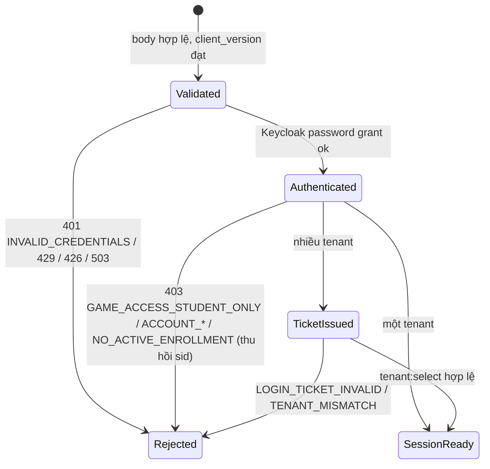
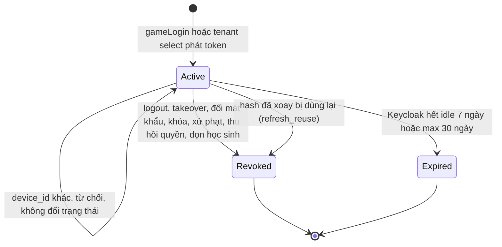

# Data Model: F013 — Đăng nhập game qua backend: login, chọn tenant, refresh, logout, bảo vệ đăng nhập, hàng chờ

**Spec**: [spec.md](spec.md) · **Plan**: [plan.md](plan.md) · Nguồn sự thật bảng: [DATABASE_DESIGN](../../docs/07-backend/DATABASE_DESIGN.md) (§2.1, §3.14)

Database `eduworld_identity`; dữ liệu tạm ở Valkey (ADR-0004).

## 1. Entity

### AuthLoginEvent — `identity.login_events` (Có sẵn, TA, P tháng)

| Trường | Kiểu (ent / SQL) | Ràng buộc | Ghi chú |
|---|---|---|---|
| `login_event_id` | UUIDv7 | PK `(login_event_id, occurred_at)` | Thêm cột tường minh (DATABASE_DESIGN chưa ghi PK) |
| `user_id` | uuid NULL | | NULL khi thất bại trước khi xác định user |
| `tenant_id` | uuid NULL | | NULL khi thất bại trước khi xác định tenant |
| `occurred_at` | timestamptz | NOT NULL | khóa partition |
| `client` | `varchar(64)` | | `azp` (`eduworld-game-backend`/`eduworld-portal`) |
| `ip_hash` | bytea | | HMAC, khóa xoay vòng; không IP thô |
| `sis_connection_id` | uuid NULL | | ADR-0046 |
| `result` | `varchar(64)` | CHECK `success`/`invalid_credentials`/`account_not_provisioned`/`game_access_student_only`/`account_locked`/`account_deactivated`/`no_active_enrollment`/`tenant_not_selected`/`rate_limited`/`queue_busy`/`client_version_unsupported` | |
| `tenant_resolution` | `varchar(64)` | `claim`/`single_membership`/`common`/`selected`/`mismatch` | `selected` — Thêm giá trị (sau `tenant:select`) |

Append-only (`REVOKE UPDATE, DELETE`); mixin `TenantOptionalAppendOnly` (TA\*, ADR-0089 §2): dòng có tenant ghi bằng `identity_app`, dòng `tenant_id` NULL ghi bằng `identity_platform` dưới `PlatformScope`; partition tháng tạo bằng migration viết tay `migrations/partitions/` (ADR-0089 §6); không lưu username, mật khẩu, token. Retention theo DATA_PRIVACY §2 (ẩn danh hóa, partition giữ lại — ADR-0070).

### GameAuthSession — `identity.game_auth_sessions` (Mới, T, soft-delete — ADR-0086)

| Trường | Kiểu (ent / SQL) | Ràng buộc | Ghi chú |
|---|---|---|---|
| `game_auth_session_id` | UUIDv7 | PK | |
| `tenant_id` | uuid | NOT NULL, FK logic | tenant của phiên (= `X-Tenant-Id` khi refresh) |
| `user_id` | uuid | NOT NULL | |
| `keycloak_sid` | `varchar(64)` | NOT NULL, unique partial `WHERE deleted_at IS NULL` | để thu hồi qua Admin API |
| `device_id` | uuid | NOT NULL | gắn thiết bị |
| `platform` | `varchar(16)` | CHECK `windows`/`macos`/`linux`/`android`/`ios`/`web` | |
| `refresh_token_hash` | `char(64)` | NOT NULL, unique partial (phiên chưa thu hồi) | SHA-256 hex của refresh token hiện hành |
| `previous_token_hashes` | jsonb (mảng ≤ 20 chuỗi `char(64)`) | | hash đã xoay gần nhất — phát hiện dùng lại; index GIN |
| `created_at`, `last_refreshed_at` | timestamptz | NOT NULL | |
| `revoked_at` | timestamptz NULL | | |
| `revoke_reason` | `varchar(32)` NULL | CHECK `logout`/`takeover`/`password_changed`/`account_locked`/`sanction`/`access_revoked`/`cleanup`/`refresh_reuse`/`admin` | |
| `deleted_at`, `deleted_by` | mixin `entx.Base` | | soft-delete (R21); phiên thu hồi không bị xóa |

**Không** lưu token thô. Index `(tenant_id, user_id) WHERE revoked_at IS NULL`, `(device_id) WHERE revoked_at IS NULL`. Retention: phiên đã thu hồi/hết hạn ẩn danh hóa theo DATA_PRIVACY (`device_id` coi là định danh thiết bị) [Confirmed].

### User — `identity.users` (Có sẵn) · ExternalIdentity — `identity.external_identities` (Có sẵn)

Feature chỉ cập nhật: `users.status` `pending → active`; `external_identities.last_login_at`. Không cập nhật `users.last_login_at` (do F014 qua `student.game_logged_in`).

### LoginTicket — Valkey `ew:identity:login_ticket:<sha256(ticket)>` (Mới, tạm)

| Trường | Ghi chú |
|---|---|
| `user_id`, `device_id` | ticket gắn thiết bị |
| `choices[]` | `tenant_id`, alias, tên, loại |
| `token_set_enc` | token set mã hóa AES-GCM |
| TTL | `game_login_ticket_ttl`; đọc bằng `GETDEL` (một lần) |

### Rate limit — Valkey (Mới, tạm)

`ew:identity:rl:login:device:<device_id>`, `ew:identity:rl:login:user:<sha256(normalized_username)>`, `ew:identity:rl:login:global` (token bucket theo `login_rate`).

## 2. Vòng đời / trạng thái

Vòng đời `GameAuthSession` (ADR-0086):

## 3. Quy tắc kiểm tra dữ liệu

- Chuẩn hóa username: trim, NFC, chữ thường; từ chối `@` ở game ([KEYCLOAK_SSO §3.3](../../docs/09-identity/KEYCLOAK_SSO.md)).
- Thứ tự mã lỗi: [IDENTITY_MAPPING §4.1](../../docs/09-identity/IDENTITY_MAPPING.md).
- Tenant chỉ từ membership DB; username/email không suy ra tenant. Trước khi có tenant, membership đọc qua hàm `identity.memberships_for_user(user_id)` (`SECURITY DEFINER`, `EXECUTE` cho `identity_app`, DDL ở DATABASE_DESIGN §4) bên trong `tenancy.Bypass(ctx, "auth_login")` (ADR-0089 §3, F013-AC-30).
- Refresh: `device_id` bắt buộc (UUID); `refresh_token` 1–8192 ký tự; `mode` ∈ `renew`/`resume`; `client_version` theo pattern semver (`GameTokenRefreshRequest`).
- Hash so khớp bằng so sánh thời gian hằng; `previous_token_hashes` cắt về 20 phần tử mới nhất mỗi lần xoay (`game_session_sso`).

## 4. Event / outbox

| Event | Khi nào | Payload schema |
|---|---|---|
| `user.activated` | Lần đầu đăng nhập thành công (`pending → active`) | `specs/events/payloads/identity/user.activated.v1.schema.json` — Có sẵn (áp 2026-11-17) |
| `audit.recorded` | `account_not_provisioned`, `game_access_denied_non_student`, `tenant_mismatch`, logout, `auth.game_session_revoked`, `auth.refresh_token_reused`, `auth.refresh_device_mismatch` | Schema chung `specs/events/payloads/common/audit.recorded.v1.schema.json` (owner F003) |

Tiêu thụ (thu hồi phiên game): `user.access_revoked`, `user.status_changed`, `student.cleaned_up`; consumer idempotent theo `event_id` (inbox). Takeover: consumer `game_session.replaced` của F014 (payload có `old_device_id`/`old_keycloak_sid`) gọi `GameAuthSessionRevoker`.
