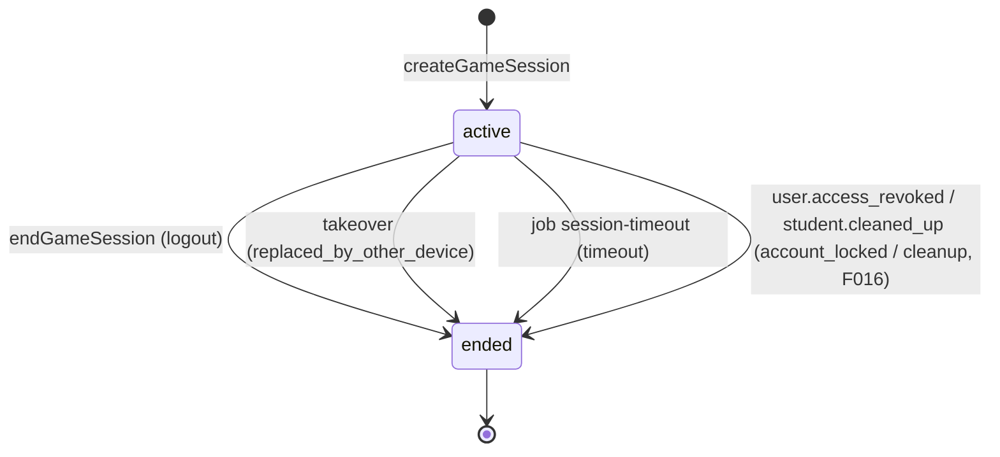

# Data Model: F014 — Game session lát mỏng: một thiết bị, login events, client-config, manifest tối thiểu

**Spec**: [spec.md](spec.md) · **Plan**: [plan.md](plan.md) · Nguồn sự thật bảng: [DATABASE_DESIGN](../../docs/07-backend/DATABASE_DESIGN.md) (§2.8, §2.16, §2.17, §3.12)

Database `eduworld_game`.

## 1. Entity

### GameSession — `game.game_sessions` (Có sẵn, T)

| Trường | Kiểu (ent / SQL) | Ràng buộc | Ghi chú |
|---|---|---|---|
| `game_session_id` | UUIDv7 | PK | |
| `tenant_id` | uuid | NOT NULL, FK `ref.tenants`, RLS | |
| `student_id` | uuid | NOT NULL | tham chiếu `ref.students`, không FK chéo DB |
| `school_id` | uuid | | |
| `device_id` | uuid | NOT NULL | từ `X-Device-Id`; không trả ra API |
| `device_model` | `varchar(128)` | | nhãn rút gọn |
| `client_platform` | `varchar(64)` | NOT NULL | `windows`/`android`/`ios`/`web`/`macos`/`linux` |
| `client_version` | `varchar(64)` | NOT NULL | |
| `keycloak_sid` | `varchar(64)` | | `sid` của token game |
| `started_at`, `last_heartbeat_at` | timestamptz | NOT NULL | giờ server |
| `ended_at` | timestamptz | CHECK `(ended_at IS NULL) = (end_reason IS NULL)` | |
| `end_reason` | `varchar(64)` | CHECK `logout`/`replaced_by_other_device`/`timeout`/`account_locked`/`access_revoked`/`cleanup`/`client_crash`/`curfew` | |
| `replaced_by_session_id` | uuid | FK `game_sessions` | |
| `deleted_at`, `deleted_by` | | | R21 |

**Index**: `game_sessions_one_active_uq (student_id) WHERE ended_at IS NULL AND deleted_at IS NULL`; `game_sessions_heartbeat_idx (last_heartbeat_at) WHERE ended_at IS NULL`.

### GameLoginEvent — `game.login_events` (Có sẵn, TA, P tháng theo `login_at`)

| Trường | Kiểu | Ghi chú |
|---|---|---|
| `login_event_id` | UUIDv7 | PK `(login_event_id, login_at)` |
| `tenant_id`, `student_id`, `game_session_id`, `device_id` | uuid | NOT NULL |
| `platform` | `varchar(64)` | |
| `device_model` | `varchar(128)` | |
| `client_version` | `varchar(64)` | |
| `ip_hash` | bytea | HMAC-SHA256(IP, khóa xoay vòng) |
| `login_at` | timestamptz | giờ server |
| `logout_at`, `end_reason` | | UPDATE một lần khi kết thúc |
| `sis_connection_id` | uuid NULL | từ Principal; NULL với tenant chung |

**Index**: `(tenant_id, student_id, login_at DESC)`; `REVOKE DELETE, TRUNCATE`.

### ContentManifest — `game.content_manifests` (Có sẵn §2.16, T)

`tenant_id`, `manifest_version bigint`, `etag varchar(64)`, `entries jsonb` (CHECK `octet_length <= 4194304`, theo DATABASE_DESIGN §3.13 — OQ F014-8), `generated_at`, `cause_release_id uuid`; PK `(tenant_id, manifest_version)`. F014 chỉ đọc; không có dòng → trả manifest rỗng `manifest_version = 0`.

### Projection — `ref.tenants`, `ref.students` (Có sẵn §2.17)

- `ref.tenants`: `tenant_id`, `code varchar(64)`, `tenant_type varchar(64)`, `status varchar(64)`, `settings_subset jsonb`, `source_version bigint`.
- `ref.students`: `student_id`, `tenant_id`, `school_id`, `grade_level`, `status varchar(64)`, `deleted_at`, `source_version bigint`.

Chỉ consumer ghi; chỉ áp bản có `source_version` mới hơn.

## 2. Vòng đời / trạng thái

## 3. Quy tắc kiểm tra dữ liệu

- Tuần tự hóa tạo session bằng advisory lock theo `student_id` + unique partial index ([DATABASE_DESIGN §3.12](../../docs/07-backend/DATABASE_DESIGN.md)).
- Session cũ còn heartbeat trong ngưỡng + thiết bị khác → `409`; quá ngưỡng → `timeout`; cùng thiết bị → `logout`.
- Response không bao giờ chứa `device_id`, `ip_hash`, IP.

## 4. Event / outbox

| Event | Khi nào | Payload schema |
|---|---|---|
| `game_session.started` / `game_session.ended` | Tạo / kết thúc session | `specs/events/payloads/game/` — Có sẵn (áp 2026-11-17) |
| `student.game_logged_in` | Tạo session | Có sẵn (áp 2026-11-17) (`student_id`, `tenant_id`, `game_session_id`, `login_event_id`, `platform`, `login_at`) |
| `student.game_logged_out` | Kết thúc session | Có sẵn (áp 2026-11-17) |
| `game_session.replaced` | Takeover | Có sẵn (áp 2026-11-17) (thêm `old_keycloak_sid`, `old_device_id` để identity thu hồi phiên Keycloak và phiên game đã lưu — ADR-0086) |
