# Data Model: F016 — Vòng đời tài khoản: khóa, thu hồi truy cập, dọn học sinh không đăng nhập, ẩn danh hóa

**Spec**: [spec.md](spec.md) · **Plan**: [plan.md](plan.md) · Nguồn sự thật bảng: [DATABASE_DESIGN](../../docs/07-backend/DATABASE_DESIGN.md) (§2.0, §2.1, §2.2, §2.16, §3.1)

Database `eduworld_identity` (phần game/learning chỉ soft-delete/ẩn danh hóa bảng của chính module đó).

## 1. Entity

### User — `identity.users` (Có sẵn) · Student — `org.students` (Có sẵn)

Cột dùng: `status` (`pending`/`active`/`locked`/`deactivated`/`anonymized`), `deactivated_at`, `anonymized_at`, `deleted_at`, `deleted_by`, `delete_reason varchar(64)` (`inactive_cleanup`/`manual`), `last_login_at`, `provisioned_at`. Thêm cột `status_reason varchar(1000)` và `status_changed_by uuid` trên `identity.users` (Thêm cột) để lưu lý do khóa (chỉ nhân sự trong scope xem). Index `users_cleanup_idx` có sẵn.

### CleanupExclusion — `platform.cleanup_exclusions` (Có sẵn, T)

| Trường | Kiểu | Ràng buộc |
|---|---|---|
| `exclusion_id` | UUIDv7 | PK |
| `tenant_id`, `student_id` | uuid | UNIQUE `(tenant_id, student_id) WHERE deleted_at IS NULL` |
| `until` | timestamptz NULL | NULL = vô thời hạn |
| `reason` | `varchar(1000)` | NOT NULL |
| `created_by`, `created_at`, `deleted_at`, `deleted_by` | | gỡ loại trừ = soft-delete |

### StudentCleanupRun — `platform.student_cleanup_runs` (Có sẵn, G append-only)

`run_id`, `tenant_id`, `mode varchar(64)` (`dry_run`/`apply`), `status varchar(64)` (`running`/`completed`/`awaiting_approval`/`approved`/`failed`), `cutoff_days int`, `candidates int`, `cleaned int`, `excluded int`, `skipped_active int`, `approved_by`, `started_at`, `finished_at`; idx `(tenant_id, started_at DESC)`. Chuyển `awaiting_approval → approved` là bản ghi trạng thái mới hoặc UPDATE một lần (append-only theo DATABASE_DESIGN: ghi rõ UPDATE trạng thái được phép).

### SagaRun / SagaStep — `platform.saga_runs`, `platform.saga_steps` (Có sẵn, G)

- `saga_runs`: `saga_id`, `saga_type varchar(64)` (`student_cleanup`/`student_restore`/`user_anonymize`/…), `subject jsonb`, `status varchar(64)` (`running`/`compensating`/`succeeded`/`failed`), `requested_by`, `idempotency_key varchar(64)`, `started_at`, `finished_at`; UNIQUE `(saga_type, idempotency_key)`.
- `saga_steps`: PK `(saga_id, step_no)`, `service varchar(64)`, `action varchar(64)`, `status varchar(64)` (`pending`/`done`/`blocked`/`nothing_to_do`/`failed`/`compensated`), `attempts int`, `request jsonb`, `response jsonb`, `error varchar(1000)`, `updated_at`.

### DeletionRequest — `platform.deletion_requests`; ErasureLog — `platform.erasure_log` (Có sẵn §2.16, G)

- `deletion_requests`: `request_id`, `subject_type varchar(64)` (`user`), `subject_id`, `tenant_id`, `requested_by`, `action varchar(64)` (`anonymize`), `status varchar(64)` (`pending`/`approved`/`executed`/`rejected`), `approved_by`, `due_at`, `executed_at`, `erasure_id`; idx `(status, due_at)`. Phục vụ `createDataRequest` (`kind = anonymize`).
- `erasure_log` (append-only): `erasure_id`, `user_id`, `kind varchar(64)` (`anonymize`), `requested_by`, `legal_basis varchar(255)`, `executed_at`, `scope jsonb`.

### Game/learning (phần nhận saga)

- module game: `game.game_sessions` kết thúc (`account_locked`/`cleanup`); soft-delete dữ liệu học sinh của game (`delete_reason = inactive_cleanup`); ẩn danh hóa (nickname `Người chơi #<hash>` khi có GameProfile, F070).
- module learning: ẩn học sinh khỏi danh sách/báo cáo đang mở (soft-delete bản ghi tham chiếu); ẩn danh hóa theo DATA_PRIVACY §4.

## 2. Vòng đời / trạng thái

```mermaid
stateDiagram-v2
  [*] --> active
  active --> locked: LockUser / SIS suspended
  locked --> active: UnlockUser
  active --> deactivated: DeactivateUser / SIS inactive, graduated
  locked --> deactivated: SIS inactive
  deactivated --> active: SIS kích hoạt lại
  deactivated --> anonymized: hết retention / yêu cầu
  active --> cleaned: worker dọn (soft-delete inactive_cleanup; Keycloak giữ enabled, gỡ membership)
  cleaned --> active: khôi phục (đăng nhập lại hợp lệ / Thùng rác)
  anonymized --> [*]
```

## 3. Quy tắc kiểm tra dữ liệu

- Ứng viên dọn: `COALESCE(last_login_at, provisioned_at) + effective_days < now()`, không loại trừ còn hạn, không `locked`; điều kiện "đang bận" do module tham gia trả `blocked` ([ADR-0032](../../docs/adr/ADR-0032-worker-don-tai-khoan-hoc-sinh-khong-dang-nhap-game.md)).
- Ngưỡng duyệt theo tỷ lệ học sinh của tenant trong `inactive_student_cleanup_days`.
- Ẩn danh hóa: ghi đè cột PII, giữ dòng; username `anon.<user_id>` giải phóng định danh ([DATA_PRIVACY §4](../../docs/10-security/DATA_PRIVACY.md)).

## 4. Event / outbox

| Event | Khi nào | Payload schema |
|---|---|---|
| `user.status_changed`, `user.access_revoked` | Khóa/vô hiệu hóa; đặt lại mật khẩu học sinh (chỉ `user.access_revoked`, `reason = password_changed`) | `specs/events/payloads/identity/` — owner F011 (T005), F016 phát cùng schema |
| `user.access_restored` | Mở khóa | Cần thêm |
| `student.cleanup_scheduled` | Vào cửa sổ báo trước | Cần thêm |
| `student.cleaned_up` | Dọn xong | Có sẵn (áp 2026-11-17) |
| `student.restored` | Khôi phục | Có sẵn (áp 2026-11-17) |
| `user.anonymized` | Ẩn danh hóa xong | Cần thêm `specs/events/payloads/identity/user.anonymized.v1.schema.json` (EVENT_DESIGN §4.1) |
