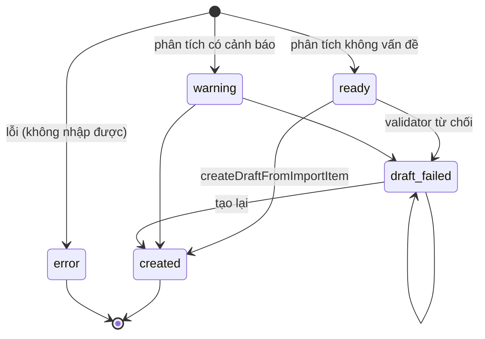

# Data Model: F028 — Import Word/MathType (`lessons_docx`) qua Pandoc

**Spec**: [spec.md](spec.md) · **Plan**: [plan.md](plan.md) · Nguồn sự thật bảng: [DATABASE_DESIGN](../../docs/07-backend/DATABASE_DESIGN.md)

## 1. Entity

### ImportJob — `content.import_jobs` (Có sẵn — F021/F024; mở rộng CHECK)

`kind` nhận thêm `lessons_docx` (CHECK `import_jobs_kind_ck`). `result_refs` của job `lessons_docx`: `{items_total, items_importable}`. `errors[]`: lỗi cấp file (`row = 1`, `field = file`) hoặc lỗi theo câu (`row = item_no`).

### ImportItem — `content.import_items` (Mới)

Mixin `entx.TenantOptional` (T*, như `import_jobs`): `tenant_id` NULL = job platform, ghi dưới PlatformScope; RLS chỉ lọc tenant; soft-delete.

| Trường | Kiểu (ent / SQL) | Ràng buộc | Ghi chú |
|---|---|---|---|
| `import_item_id` | UUIDv7 | PK | mixin |
| `tenant_id` | uuid NULL | RLS, FK `ref.tenants` | = tenant của job (R8) |
| `created_at`, `created_by`, `updated_at`, `updated_by`, `deleted_at`, `deleted_by`, `delete_reason`, `version` | | | mixin (R21) |
| `import_id` | uuid | NOT NULL, FK `content.import_jobs` | job `lessons_docx` |
| `item_no` | int32 | ≥ 1; UNIQUE `(import_id, item_no) WHERE deleted_at IS NULL` | thứ tự xuất hiện trong file |
| `source_label` | `varchar(32)` (`MaxLen(32)`) | | "Câu 12" |
| `status` | `varchar(32)` | CHECK `ready`,`warning`,`error`,`created`,`draft_failed` | §2 |
| `question_type` | `varchar(32)` NULL | CHECK `single_choice`,`multiple_choice` | |
| `stem_preview` | `varchar(200)` | | trích đề (nội dung học tập, không PII) |
| `issues` | jsonb | mảng ≤ 50 `{code, field, message, severity}` | |
| `formulas` | jsonb | mảng ≤ 50 `{latex, display}` | LaTeX đã chuẩn hóa |
| `images` | jsonb | mảng ≤ 20 `{ref, path, alt, mime}` | `ref` = `media_ref` giữ chỗ trong `payload`; `path` = phần trong zip (`word/media/…`) |
| `payload` | jsonb | object ≤ 256 KB | trường soạn thảo của `createQuestion`: `type`, `stem`, `render_payload`, `answer_key`, `scoring_rule`, `hints`, `explanation`, `subject_id`, `topic_id`, `curriculum_version_id`, `objective_ids`, `grade_levels`, `difficulty`, `content_language`, `tags` |
| `question_id`, `question_version_id` | uuid NULL | có khi `status = created` | Draft đã tạo |

**Quan hệ**: `import_items.import_id` → `import_jobs.import_id` (một job nhiều câu); `question_id` → `content.questions`.
**Index**: `import_items_no_uq (import_id, item_no) WHERE deleted_at IS NULL` (keyset của `listContentImportItems`); `import_items_status_idx (import_id, status, item_no) WHERE deleted_at IS NULL`.
**Quyền DB**: mặc định của baseline (SELECT/INSERT/UPDATE cho `learning_app`, `learning_platform`, không DELETE/TRUNCATE); view `content.import_items_live` cho `learning_readonly`.

## 2. Vòng đời / trạng thái

Câu chỉ được tạo một lần (`created` là trạng thái cuối). Job không đổi trạng thái sau khi phân tích xong.

## 3. Quy tắc kiểm tra dữ liệu

- Mẫu tài liệu và mã vấn đề: [CONTENT_PRODUCTION_PLAN §8](../../docs/02-learning/CONTENT_PRODUCTION_PLAN.md#8-import-wordmathtype-confirmed), research R3–R4.
- Công thức qua `mathx.ValidateLatex` (ADR-0055 §7); SVG sanitize khi tạo Draft (F027).
- Draft luôn version 1 `draft` (R11); không bao giờ publish từ import.

## 4. Event / outbox

| Event | Khi nào | Payload schema |
|---|---|---|
| `media.uploaded` | Ảnh nhúng của câu vào pipeline khi tạo Draft | Schema owner F027 — F028 phát cùng schema |
