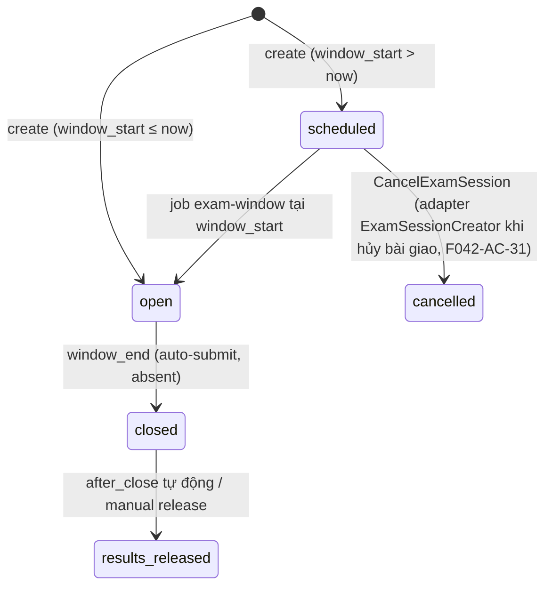

# Data Model: F042 — Exam Engine: 7 hình thức đề, random theo blueprint, thi có giờ, chấm lại đề

**Spec**: [spec.md](spec.md) · **Plan**: [plan.md](plan.md) · Nguồn sự thật bảng: [DATABASE_DESIGN](../../docs/07-backend/DATABASE_DESIGN.md)

Database `eduworld_learning`, schema `assessment`. Bảng T dùng mixin `Base` (`tenant_id`, `created_at`, `updated_at`, `deleted_at`, `deleted_by`, `delete_reason varchar(64)`, `version`), RLS theo `app.tenant_id`.

## 1. Entity

### ExamSession — `assessment.exam_sessions` (Có sẵn §2.6 + Thêm cột)

| Trường | Kiểu (ent / SQL) | Ràng buộc | Ghi chú |
|---|---|---|---|
| `exam_session_id` | UUIDv7 | PK | Có sẵn |
| `tenant_id`, `school_id` | uuid | NOT NULL, RLS | Có sẵn |
| `blueprint_version_id` | uuid | NOT NULL | Có sẵn, ghim lúc tạo (ADR-0043) |
| `exam_type` | `varchar(64)` | CHECK `IN ('practice_test','mock','chapter','semester','subject','custom')` | Có sẵn (EXAM_ENGINE §5, DATABASE_DESIGN; API `ExamSession.type`) |
| `is_official` | boolean | NOT NULL | Có sẵn |
| `window_start`, `window_end` | timestamptz | NOT NULL, CHECK `window_end > window_start` | Có sẵn |
| `duration_sec` | int | CHECK `duration_sec > 0` | Có sẵn (EXAM_ENGINE §5, DATABASE_DESIGN; API `ExamSession.duration_seconds`) |
| `target` | jsonb | CHECK `octet_length ≤ 65536` | Có sẵn: snapshot `targets[]` + `student_ids` đã mở rộng |
| `created_by` | uuid | NOT NULL | Có sẵn |
| `title` | `varchar(255)` | NOT NULL | Thêm cột |
| `subject_id` | uuid | NOT NULL | Thêm cột; kiểm scope môn |
| `grade_level` | smallint | 1–12 | Thêm cột |
| `status` | `varchar(64)` | CHECK `IN ('scheduled','open','closed','results_released','cancelled')` | Thêm cột |
| `audience` | `varchar(64)` | CHECK `IN ('assigned','library')` DEFAULT `'assigned'` | Thêm cột [Confirmed] |
| `variant_strategy` | `varchar(64)` | CHECK `IN ('fixed','independent_draw','per_student')` | Thêm cột (snapshot từ blueprint) |
| `variant_count` | smallint | ≥ 1 | Thêm cột |
| `feedback_timing` | `varchar(64)` | CHECK `IN ('after_submit','after_close','never')` | Thêm cột |
| `result_release` | `varchar(64)` | CHECK `IN ('immediate','after_close','manual')` | Thêm cột |
| `show_correct_answers`, `show_explanations` | boolean | NOT NULL | Thêm cột |
| `late_start_policy` | `varchar(64)` | CHECK `IN ('full_duration','until_window_end')` DEFAULT `'until_window_end'` | Thêm cột |
| `accommodations` | jsonb | CHECK `octet_length ≤ 16384` | Thêm cột: `[{student_id, extra_time_percent}]` |
| `max_attempts` | smallint | 1–10 | Thêm cột |
| `score_policy` | `varchar(64)` | CHECK `IN ('best','last','first')` | Thêm cột |
| `assignment_id`, `course_id` | uuid | NULL | Thêm cột; liên kết F041 |
| `results_released_at`, `results_released_by` | timestamptz, uuid | NULL | Thêm cột |
| `deleted_at`, `deleted_by`, `version` | | | mixin `Base` |

**Index**: `(tenant_id, school_id, status, window_start) WHERE deleted_at IS NULL`; `(tenant_id, assignment_id) WHERE deleted_at IS NULL`.

### ExamPaper — `assessment.exam_papers` (Có sẵn §2.6 + Thêm cột)

| Trường | Kiểu (ent / SQL) | Ràng buộc | Ghi chú |
|---|---|---|---|
| `exam_paper_id`, `exam_session_id`, `seed`, `items` | | `items` jsonb CHECK `octet_length ≤ 262144` | Có sẵn; `items` = `[{section_id, position, question_version_id, points}]` |
| `tenant_id` | uuid | NOT NULL, RLS | |
| `variant_no` | smallint | ≥ 1 | Thêm cột |
| `student_id` | uuid | NULL | Thêm cột; chỉ với `per_student` |
| `expected_p` | `numeric(5,4)` | NULL | Thêm cột; F044 ghi khi cân bằng |
| `generator_version` | `varchar(64)` | NOT NULL | Thêm cột |

**Index**: partial unique `(exam_session_id, variant_no) WHERE student_id IS NULL AND deleted_at IS NULL`. Bất biến sau khi tạo (trigger chặn UPDATE `items`).

### ExamParticipation — `assessment.exam_participations` (Mới)

| Trường | Kiểu (ent / SQL) | Ràng buộc | Ghi chú |
|---|---|---|---|
| `exam_session_id` | uuid | PK phần 1 | |
| `student_id` | uuid | PK phần 2 | |
| `tenant_id`, `school_id` | uuid | NOT NULL, RLS | |
| `status` | `varchar(64)` | CHECK `IN ('not_started','in_progress','submitted','graded','absent')` | |
| `attempts_used` | smallint | NOT NULL DEFAULT 0 | |
| `last_attempt_id` | uuid | NULL | |
| `effective_duration_sec` | int | NOT NULL | Đã cộng gia hạn |
| `deleted_at`, `deleted_by`, `version` | | | |

### Attempt — `assessment.attempts` (Thêm cột, DDL §3.4)

| Trường | Kiểu (ent / SQL) | Ràng buộc | Ghi chú |
|---|---|---|---|
| `exam_paper_id` | uuid | NULL | Biến thể được chọn |
| `submit_reason` | `varchar(64)` | CHECK `IN ('manual','auto_timeout','window_closed')` | |
| `active_device_token` | `varchar(128)` | NULL | Hash token thiết bị đang active |
| `client_platform` | `varchar(64)` | NULL | Đối chiếu khi cần (EXAM_ENGINE §12) |
| `game_session_id` | uuid | NULL | |

Dùng `context_type = 'exam_session'`, `context_id = exam_session_id`, `mode = 'exam'`; partial UNIQUE `attempts_one_open_uq` đã có bảo đảm một attempt mở.

### RegradeRequest — `assessment.regrade_requests` (Có sẵn §2.16 — owner F031, F042 chỉ dùng)

Cột và ràng buộc do F031 định nghĩa (DATABASE_DESIGN §2.16, F031 data-model); F042 tạo yêu cầu `scope = exam_session` (`exam_session_id`, `corrected_version_id` khi `use_new_key`) và cập nhật `affected_attempts`, `re_evaluated_attempts`, `status` khi chạy chấm lại đề. Không thêm cột.

### AttemptScoreRevision — `assessment.attempt_score_revisions` (Có sẵn §2.16)

Append-only; F042 ghi `old_score`, `new_score`, `reason`, `regrade_request_id`; điểm hiệu lực = revision mới nhất.

## 2. Vòng đời / trạng thái

Attempt đề: `in_progress → submitted → graded`; `in_progress → expired → submitted` (auto-submit) → `graded`.

## 3. Quy tắc kiểm tra dữ liệu

- `feedback_timing` của session không được `immediate`; `result_release = after_close` ⇒ `feedback_timing ∈ {after_close, never}` ([ACTIVITY_ENGINE §8.1](../../docs/02-learning/ACTIVITY_ENGINE.md#81-feedbacktiming-và-resultrelease)).
- `deadline_at = min(started_at + effective_duration, window_end)` với `until_window_end`; `full_duration` bỏ giới hạn `window_end`.
- `extra_time_percent` trong 1–100 [Confirmed]; học sinh trong `accommodations` phải thuộc `target`.
- Mỗi rule blueprint: pool ≥ `count × variant_count` với `independent_draw`.

## 4. Event / outbox

| Event | Khi nào | Payload schema |
|---|---|---|
| `exam.started` | Start attempt | `specs/events/payloads/learning/exam.started.v1.schema.json` |
| `exam.submitted` | Nộp (manual/timeout) | `exam.submitted.v1` |
| `exam.graded` | Chấm xong | `exam.graded.v1` |
| `exam.results_released` | Công bố | `exam.results_released.v1` |
| `exam.regraded` | Chạy xong regrade | `exam.regraded.v1` |
| `attempt.re_evaluated` | Mỗi attempt chấm lại | Schema owner F031 — F042 phát cùng schema khi chấm lại đề |
| `exam.opened`, `exam.closed` | Chuyển trạng thái cửa sổ | `exam.opened.v1`, `exam.closed.v1` (EVENT_DESIGN §4.3) |
