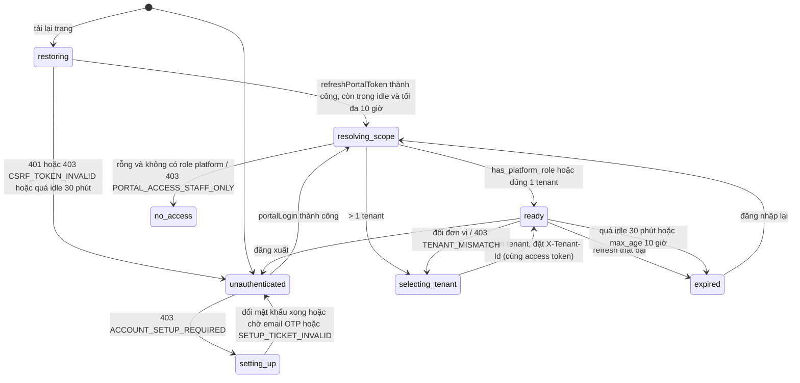

# Data Model: F051 — Portal shell: đăng nhập, chọn tenant sau đăng nhập, menu theo quyền, bộ lọc tenant

**Spec**: [spec.md](spec.md) · **Plan**: [plan.md](plan.md) · Nguồn sự thật bảng: [DATABASE_DESIGN](../../docs/07-backend/DATABASE_DESIGN.md)

## 1. Entity

Không áp dụng — F051 là client (`src/cms/frontend/apps/portal`), không tạo/sửa bảng hay migration. Dữ liệu bền vững thuộc module `identity` (F010, F012). Dưới đây là **model phía client** để code đúng, không phải bảng.

### Trạng thái phiên (bộ nhớ, `session/sessionMachine.ts`)

| Trường | Kiểu TS | Nguồn | Ghi chú |
|---|---|---|---|
| `status` | `'unauthenticated' \| 'resolving_scope' \| 'selecting_tenant' \| 'ready' \| 'no_access' \| 'expired'` | máy trạng thái | |
| `scope` | `{ kind: 'platform' } \| { kind: 'tenant'; tenantId: string; alias: string; name: string; tenantType: TenantType }` | `listMyTenants` + lựa chọn | Quyết định `X-Tenant-Id` |
| `tenants` | `MyTenant[]` | `listMyTenants` | |
| `hasPlatformRole` | `boolean` | `MyTenantsResponse.has_platform_role` | |
| `returnUrl` | `string` | URL trước đăng nhập | Giữ khi hết phiên (AC-07) |
| `accessToken` | `{ token: string; expiresAt: number; authTime: number; mfa: boolean }` | `portalLogin`/`refreshPortalToken` | Chỉ RAM (`tokenStore`), không vào kho trình duyệt |
| `setupTicket` | `{ ticket: string; requiredSteps: ('update_password' \| 'configure_otp')[] } \| null` | `403 ACCOUNT_SETUP_REQUIRED` | Chỉ RAM, xóa khi rời màn thiết lập |

### Cache truy vấn TanStack Query

| Query key | operationId | Làm mới |
|---|---|---|
| `['me','tenants']` | `listMyTenants` | sau đăng nhập, sau `TENANT_MISMATCH` |
| `['me','permissions', scopeKey]` | `getMyPermissions` (gồm `disabled_menus`, `disabled_actions`) | `refetchInterval` = `principal_cache_ttl`, focus, sau 403 (`PERMISSION_DENIED`, `FEATURE_DISABLED`) |
| `['me','principal', scopeKey]` | `getMe` | cùng permissions |
| `['admin','tenants', q]` | `listTenants` | khi gõ tìm (debounce) |

`scopeKey` = `'platform'` hoặc `tenantId`. Đổi tenant → `queryClient.clear()` (AC-20).

### Lưu trữ trình duyệt (chỉ tiện ích per-viewer, bọc try/catch)

| Khóa | Kho | Giá trị | Ghi chú |
|---|---|---|---|
| `ew.portal.<userSub>.rememberedTenantId` | `localStorage` | uuid | Checkbox "Nhớ lựa chọn cho lần sau" |
| `ew.portal.<userSub>.lastWorkspace` | `localStorage` | mã workspace | |
| `ew.portal.<userSub>.prefs` | `localStorage` | `{ locale, theme: 'light'\|'dark', compact: boolean, siderCollapsed: boolean }` | |
| `ew.portal.tenantFilter` | `sessionStorage` | `string[]` tenant_id | Chỉ System Admin (AC-22) |
| `ew.portal.lastActivityAt` | `localStorage` | ISO-8601 UTC | Lần tương tác cuối, để cưỡng chế idle 30 phút khi tải lại/mở lại tab (AC-29, ADR-0086 mục 7); không phải secret |
| `ew.portal.deviceId` | `localStorage` | uuid | `device_id` gửi kèm `portalLogin` (khóa rate limit, ADR-0091); không phải secret |
| `ew.portal.otpHint` | `localStorage` | `boolean` | Lần trước đăng nhập có nhập mã → làm nổi bật ô mã (AC-30); không phải secret |
| `ew.portal.sessionTenantId` | `sessionStorage` | uuid | Tenant phiên của tab để khôi phục khi F5 (AC-28) |
| `__Secure-ew_portal_rt`, `__Host-ew_portal_csrf` | cookie (backend đặt) | — | Portal chỉ **đọc** cookie CSRF để gửi `X-EW-CSRF`; không ghi cookie nào |

Không lưu token, mật khẩu, mã OTP, `setup_ticket`, token đặt lại mật khẩu, email, tên người dùng hay dữ liệu học sinh trong kho trình duyệt (AC-02, R14).

### Danh mục menu/action sinh từ catalog (`src/generated/menu-catalog.ts`, ADR-0090)

| Trường | Kiểu TS | Ghi chú |
|---|---|---|
| `workspaces[]` | `{ key: WorkspaceKey; labelKey: string; menus: MenuDef[] }` | 5 workspace |
| `MenuDef` | `{ key: MenuKey; path: string; labelKey: string; requiredPermissions: string[]; order: number; actions: ActionDef[] }` | `requiredPermissions` any-of |
| `ActionDef` | `{ key: ActionKey; labelKey: string; requiredPermissions: string[] }` | `operation_ids`, `can_disable` không cần ở client |
| `MenuKey`, `ActionKey` | union string literal | Khóa sai → lỗi biên dịch (`ActionGate`) |

## 2. Vòng đời / trạng thái

## 3. Quy tắc kiểm tra dữ liệu

- Định tuyến sau đăng nhập là hàm thuần của `MyTenantsResponse` ([ADMIN_PORTAL §1.3b](../../docs/04-admin-portal/ADMIN_PORTAL.md)).
- Không bao giờ có hai `scope` tenant trong một phiên; mọi query key chứa `scopeKey`.

## 4. Event / outbox

Không áp dụng — client không phát/tiêu thụ event (R25).
