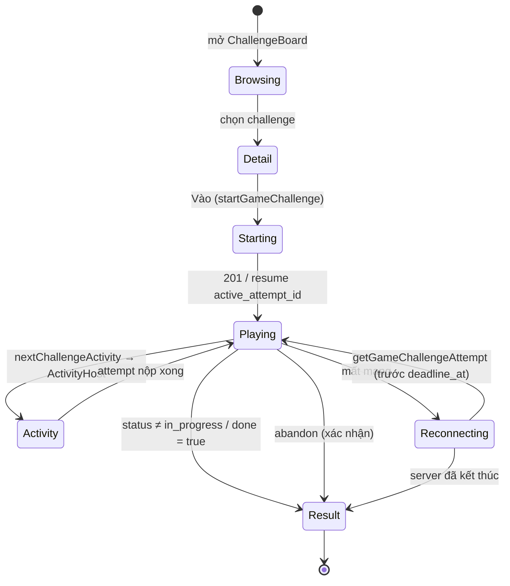

# Data Model: F069 — Godot — tiến trình, kho đồ, shop, bộ sưu tập, thành tựu, challenge solo

**Spec**: [spec.md](spec.md) · **Plan**: [plan.md](plan.md) · Nguồn sự thật bảng: [DATABASE_DESIGN](../../docs/07-backend/DATABASE_DESIGN.md)

## 1. Entity

Không áp dụng — game client không có dữ liệu bền vững (dữ liệu phiên chỉ trong RAM, không ghi `user://`; token theo F061 — access token RAM, refresh token trong `SecureStorage`, ADR-0086). Nguồn sự thật là module game (F074 sổ cái XP, F075 ví/kho/shop/thành tựu, F076 challenge). Dưới đây chỉ là model trong bộ nhớ để parse contract (`from_dict` bỏ trường lạ, thiếu trường bắt buộc → log cảnh báo không PII và tải lại).

| Model (RefCounted) | Trường | Nguồn contract |
|---|---|---|
| `ProgressionModel` | `level`, `title {code, label}`, `xp_total`, `xp_in_level`, `xp_to_next` (null = cấp tối đa), `daily_xp_remaining`, `curve_version`, `max_level`, `next_level_rewards[]`, `capped` (từ message gần nhất) | OpenAPI `ProgressionStatus`; AsyncAPI `progression.xp.updated` |
| `LevelUpModel` | `from_level`, `to_level`, `title_code`, `title`, `rewards: Array[RewardModel]` | AsyncAPI `progression.level.reached` |
| `RewardModel` | `kind` (`xp`/`currency`/`item`/`badge`/`title`), `amount`, `currency_code`, `item_id`, `label` | `RewardGrantSummary`, AsyncAPI `RewardList` |
| `XpEntryModel` / `LevelModel` | `amount`, `source_code`, `source_label`, `capped`, `created_at` / `level`, `xp_required`, `title_code`, `rewards[]` | `XpLedgerEntry`, `ProgressionLevel` |
| `WalletModel` | `currency_code`, `balance`, `daily_earn_remaining` | `Wallet` |
| `LedgerEntryModel` | `ledger` (`currency`/`item`), `delta`, `balance_after`, `reason_code`, `item_id`, `item_name`, `kind`, `source_label`, `created_at` | `CurrencyLedgerEntry`, `ItemLedgerEntry` |
| `InventoryItemModel` | `item_id`, `kind`, `rarity`, `quantity`, `acquired_at`, `name` | `InventoryItem` |
| `ShopItemModel` | `shop_item_id`, `item_id`, `name`, `description`, `kind`, `rarity`, `price`, `currency_code`, `purchase_limit`, `purchased_count`, `owned`, `available_to`, `thumbnail_url` | `ShopItem`, `PurchaseResult` |
| `AchievementModel` | `achievement_id`, `code`, `title`, `description`, `category`, `unlocked`, `unlocked_at`, `tier`, `progress_current`, `progress_target`, `rewards[]`, `hidden` (delta) | `AchievementProgress` |
| `CollectionModel` | `collection_id`, `code`, `title`, `type`, `owned_count`, `total_count`, `completed_at`, `items[{item_id, name, rarity, owned, how_to_obtain (delta)}]` | `CollectionProgress`, `CollectionDetail` |
| `ChallengeSummary` / `ChallengeDetail` | `challenge_id`, `challenge_type`, `title`, `area_id`, `available_difficulties[]`, `party_required`, `available_to`, `attempts_left`, `active_attempt_id` (delta) / + `description`, `rules_summary`, `time_limit_seconds`, `lives`, `cooldown_until`, `first_clear_rewards[]`, `difficulties[]` (delta) | `GameChallengeSummary`, `GameChallengeDetail` |
| `ChallengeAttemptModel` | `challenge_attempt_id`, `challenge_id`, `challenge_version`, `difficulty`, `status`, `score`, `lives_left`, `activities_completed`, `started_at`, `deadline_at`, `ended_at`, `rewards[]`, `activity_seq` (đếm cục bộ để sinh key) | `GameChallengeAttempt`, `ChallengeNextActivity`, AsyncAPI `challenge.attempt.updated` |

## 2. Vòng đời / trạng thái

`AppState.blocking_activity` = `&"challenge"` trong `Starting…Result`; khi trở về rỗng, `LevelUpQueue` phát batch đang giữ.

## 3. Quy tắc kiểm tra dữ liệu

- `ChallengeStore` chỉ nhận message có `challenge_attempt_id` khớp attempt hiện tại; bỏ message của attempt khác.
- `ProgressionStore` không tự cộng `delta`: luôn thay bằng `xp_total`/`xp_in_level` của message.
- `WalletStore` chỉ thay số dư bằng `balance`/`balance_after` của server; không trừ cục bộ trước khi có response.

## 4. Event / outbox

Không áp dụng — client không phát domain event.
