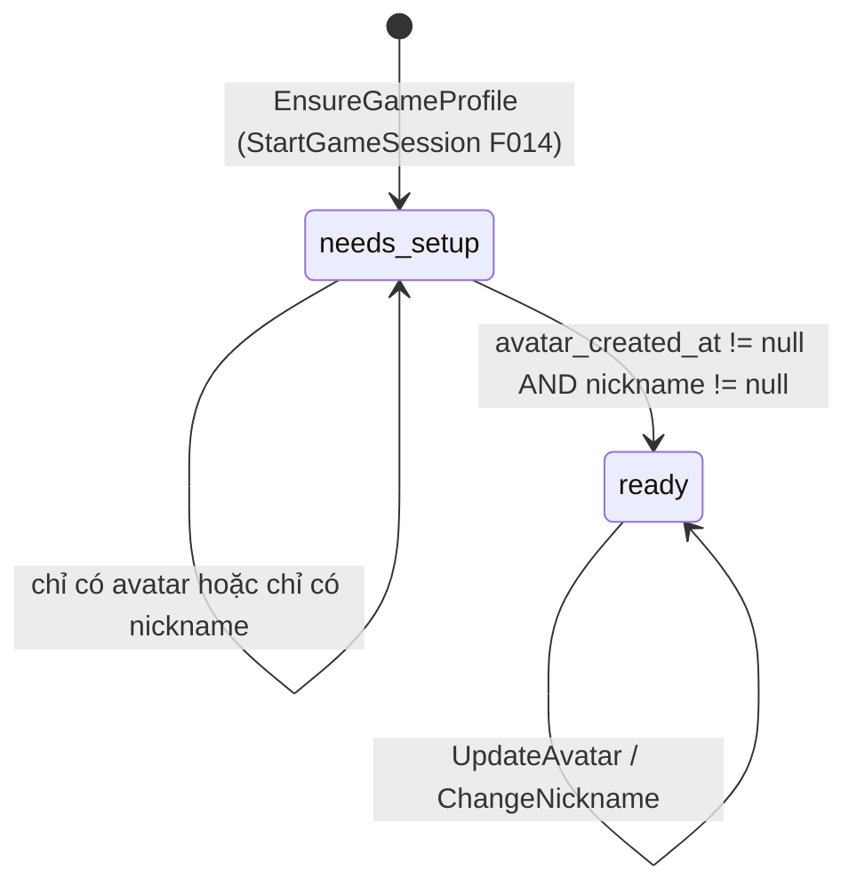

# Data Model: F070 — Hồ sơ người chơi, nickname, tạo avatar lần đầu, trang phục, emote

**Spec**: [spec.md](spec.md) · **Plan**: [plan.md](plan.md) · Nguồn sự thật bảng: [DATABASE_DESIGN](../../docs/07-backend/DATABASE_DESIGN.md) (§1.4, §2, §2.8, §2.8a, §3.13)

Database `eduworld_game`. Cột chung của bảng T/TA/G theo DATABASE_DESIGN §2 (không lặp).

## 1. Entity

### GameProfile — `game.game_profiles` (Có sẵn §2.8, T, thêm cột)

| Trường | Kiểu (ent / SQL) | Ràng buộc | Ghi chú |
|---|---|---|---|
| `student_id` | uuid | PK | = `ref.students.student_id` (không FK chéo DB) |
| `tenant_id` | uuid | NOT NULL, FK `ref.tenants`, RLS | R8 |
| `school_id` | uuid | NOT NULL | |
| `nickname` | `varchar(32)` (`MaxLen(32)`, độ dài chuẩn mọi nơi — DATABASE_DESIGN §1, CHARACTER_SYSTEM §5.3) | NULL tới khi chọn; partial unique `(tenant_id, lower(nickname)) WHERE deleted_at IS NULL AND nickname IS NOT NULL` | Đổi từ "UNIQUE trong school_id" → theo tenant (Clarifications) |
| `level` | int | NOT NULL DEFAULT 1 | F074 ghi |
| `xp_total` | bigint | NOT NULL DEFAULT 0 | F074 ghi |
| `curve_version` | int | NULL | F074 |
| `title_code` | `varchar(64)` | NULL | F074 |
| `avatar_config` | jsonb | NULL; CHECK `octet_length(avatar_config::text) <= 16384` | shape CHARACTER_SYSTEM §5.1 |
| `avatar_config_hash` | `varchar(128)` | NULL | Mới — SHA-256 hex của JSON chuẩn hóa |
| `avatar_created_at` | timestamptz | NULL | đặt một lần |
| `last_area_id` | `varchar(64)` | NULL | F071 ghi |
| `settings` | jsonb | NOT NULL DEFAULT '{}'; CHECK ≤ 8192 byte | |
| `preferred_language` | `varchar(64)` | NULL | Mới — `vi-VN`/`en-US` (`supported_locales`) |
| `last_game_login_at` | timestamptz | NULL | ghi trong `StartGameSession` (F014) |
| `deleted_at`, `deleted_by`, `delete_reason` | | | R21 |

**Index**: `game_profiles_nickname_uq` (trên); `(tenant_id, school_id)`.

### NicknameChange — `game.nickname_changes` (Mới, TA)

| Trường | Kiểu | Ràng buộc | Ghi chú |
|---|---|---|---|
| `nickname_change_id` | UUIDv7 | PK | |
| `tenant_id`, `student_id` | uuid | NOT NULL | |
| `old_nickname` | `varchar(32)` | NULL | |
| `new_nickname` | `varchar(32)` | NOT NULL | |
| `reason` | `varchar(64)` | CHECK IN (`initial`,`player_change`,`reset`) | `reset` do F121 |
| `changed_by` | uuid | NOT NULL | |
| `changed_at` | timestamptz | NOT NULL | |

**Index**: `(tenant_id, student_id, changed_at DESC)`; `REVOKE UPDATE, DELETE, TRUNCATE`.

### AvatarPreset — `game.avatar_presets` (Có sẵn §2.8a, T)

`student_id`, `slot smallint` (CHECK `slot BETWEEN 1 AND 3`), `name varchar(64)` (Mới cột, khớp OpenAPI `AvatarPreset.name`), `avatar_config jsonb` (CHECK ≤ 16384), `updated_at`; PK `(student_id, slot)`.

### CharacterCatalog — `game.character_catalogs`, `game.character_catalog_versions` (Mới, G, mẫu §3.13)

| Bảng | Cột |
|---|---|
| `character_catalogs` | `catalog_id uuid` PK, `code varchar(64)` UNIQUE (`default`), `current_version_id uuid`, `latest_version_no int` |
| `character_catalog_versions` | `catalog_version_id uuid` PK, `catalog_id`, `version int`, `status varchar(64)`, `payload jsonb` (CHECK ≤ 65536, theo `character-catalog.schema.json` — Cần thêm), `change_note varchar(500)`, `snapshot_key varchar(512)`, `snapshot_sha256 varchar(64)`, `published_at`; UNIQUE `(catalog_id, version)` |

`payload`: `presets[]` (`preset_code`, `avatar_config`, `thumbnail_asset_id`), `body_types[]`, `skin_tones[]`, `hair_colors[]` (mỗi phần tử `code varchar(64)` + `name {vi,en}`), `default_item_ids[]`, `default_emote_ids[]`, `nickname_parts { vi: {adjectives[], nouns[]}, en: {...} }` (mỗi từ ≤ 32 ký tự).

### ItemDefinition — `game.item_definitions`, `game.item_definition_versions` (Có sẵn §2.8, INVENTORY_ECONOMY §8, G)

F070 tạo bảng (F075 mở rộng): `item_id varchar(64)` PK (mã, vd. `hair_ponytail_01`), `current_version_id`; version: `kind varchar(64)`, `equip_slot varchar(64)`, `rarity varchar(64)`, `name jsonb {vi,en}`, `sources varchar(64)[]` (CHECK cardinality ≤ 20; `default` = miễn phí cho mọi học sinh), `asset_refs jsonb`, `status`.

### InventoryItem — `game.inventory_items` (Có sẵn §2.8, T)

F070 tạo bảng và chỉ đọc: `student_id`, `item_id varchar(64)`, `school_id`, `quantity int DEFAULT 1`, `acquired_at`, `reward_grant_id`; PK `(student_id, item_id)`. Ghi bởi F075.

### Valkey (tạm, ADR-0004)

`ew:game:nick:opt:<student_id>` hash `nickname_option_id → nickname`, TTL `nickname_suggestion_ttl`. Mất dữ liệu → option hết hiệu lực (F070-AC-09).

## 2. Vòng đời / trạng thái

## 3. Quy tắc kiểm tra dữ liệu

- `body_type`, `skin_tone`, `hair.color` ∈ danh mục hiện hành; mọi `item_id` ∈ `default_item_ids`/`default_emote_ids` hoặc `inventory_items` của học sinh ([CHARACTER_SYSTEM §5.1](../../docs/01-game-design/CHARACTER_SYSTEM.md)).
- Slot: `hair`, `outfit`, `head`, `face`, `back`, `hand`, `pet`, `title`, `frame`, `badge_showcase_1..3`, `emote_1..N` (N = `emote_wheel_slots`); mỗi slot ≤ 1 item; `item.equip_slot` phải khớp ([INVENTORY_ECONOMY §2.1](../../docs/01-game-design/INVENTORY_ECONOMY.md)).
- Nickname chỉ từ `nickname_option_id`; số `player_change` trong tháng ≤ `nickname_change_monthly_limit`.

## 4. Event / outbox

| Event | Khi nào | Payload schema |
|---|---|---|
| `avatar.created` | Lần đầu lưu avatar | `specs/events/payloads/game/avatar.created.v1.schema.json` — Cần thêm (`student_id`, `preset_code?`) |
| `avatar.updated` | Đổi avatar | `avatar.updated.v1.schema.json` — Cần thêm (`student_id`, `avatar_config_hash`) |
| `game_profile.updated` | Đổi nickname/avatar/level | `game_profile.updated.v1.schema.json` — Cần thêm (`student_id`, `tenant_id`, `nickname`, `avatar_config_hash`, `avatar_config` ≤ 4 KB cho hub F091, `level`, `source_version`) |
