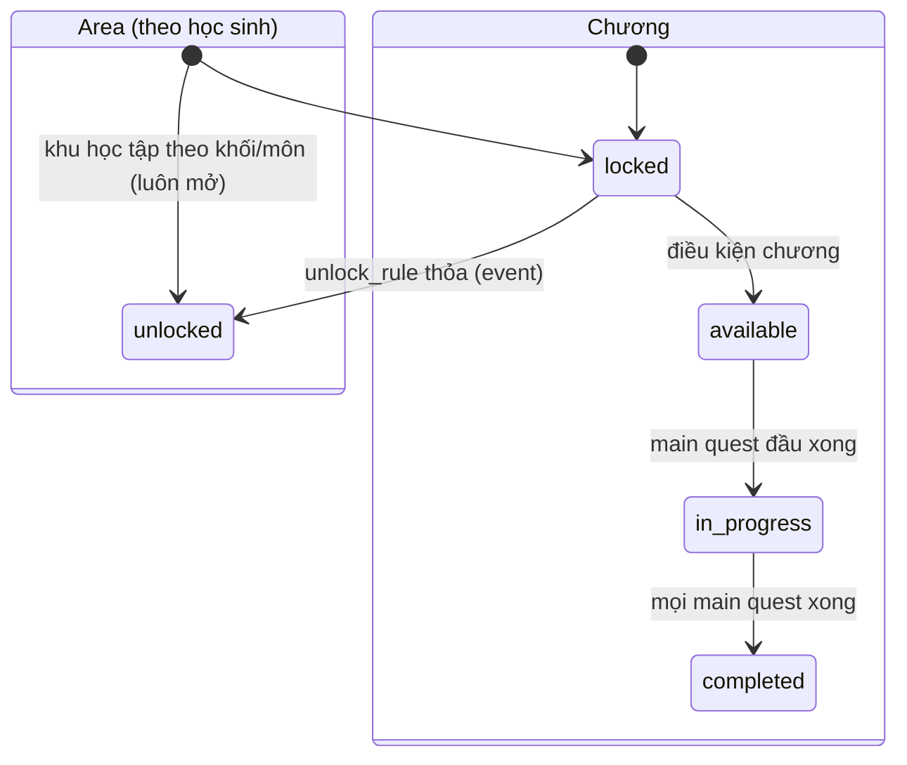

# Data Model: F071 — Thế giới: 8 vùng đất, zone, world map, cổng, mở khóa, mạch truyện, NPC và hội thoại

**Spec**: [spec.md](spec.md) · **Plan**: [plan.md](plan.md) · Nguồn sự thật bảng: [DATABASE_DESIGN](../../docs/07-backend/DATABASE_DESIGN.md) (§2.8, §2.8a, §2.16, §2.17, §3.13)

Database `eduworld_game`. Cột chung T/TA/G theo DATABASE_DESIGN §2.

## 1. Entity

### Mẫu nội dung có version (mixin, mọi bảng G có version)

- Bảng định danh: `current_version_id uuid` (NULL = chưa publish), `latest_version_no int`.
- Bảng version: `version int`, `status varchar(64)` (`draft/in_review/approved/published/archived/rejected`), `payload jsonb` (CHECK ≤ 65536, theo JSON Schema loại), `change_note varchar(500)`, `publish_at`, `snapshot_key varchar(512)`, `snapshot_sha256 varchar(64)`, `based_on_version_id`, `published_at`, `published_by`; UNIQUE `(<item>_id, version)`; version `published` bất biến (R11).

### GameContentRelease — `game.content_releases` (Có sẵn §3.13, append-only)

Như `content.content_releases`: `release_id`, `tenant_id NULL`, `item_type varchar(64)` (`world_area`, `story_chapter`, `npc_dialogue`, `level`, `character_catalog`, `item`; F072/F073 thêm `quest`, `minigame_config`), `item_id varchar(64)`, `action varchar(16)`, `from_version_id`, `to_version_id`, `reason varchar(500)`, `released_by`, `released_at`, `idempotency_key varchar(64)`; UNIQUE `(item_type, item_id, idempotency_key)`.

### WorldArea — `game.world_areas`, `game.world_area_versions` (Có sẵn §2.8a, G, thêm cột)

| Trường (version) | Kiểu | Ghi chú |
|---|---|---|
| `area_id` | `varchar(64)` | PK bảng định danh; mã ổn định (`main_hub`, `learning_zone.math`…) |
| `region_code` | `varchar(64)` | 8 vùng |
| `name_i18n` | jsonb `{vi,en}` (CHECK ≤ 1024) | Mới — thay `display_name varchar(128)` |
| `area_class` | `varchar(64)` | Mới — `hub`, `learning`, `practice`, `social`, `quest`, `exam`, `challenge`, `arena` |
| `subject_code` | `varchar(64)` NULL | Mới — môn của khu học tập |
| `scene_ref` | `varchar(255)` | |
| `bundle_id` | `varchar(64)` | Mới |
| `capacity` | int | mặc định `hub_instance_capacity` |
| `access_policy` | jsonb | `room_type`, `grade_levels`, `public` |
| `unlock_rule` | jsonb (CHECK ≤ 8192) | `world-area.schema.json` |
| `layout` | jsonb (CHECK ≤ 65536) | Mới — `spawn_points[]`, `portals[] {portal_id, target_area_id}`, `interactables[] {interactable_id, kind, collection_id?}` |

### StoryChapter — `game.story_chapters`, `game.story_chapter_versions` (Có sẵn §2.8a, G, thêm cột)

`chapter_code varchar(64)`, `region_code varchar(64)`, `title_i18n jsonb {vi,en}` (Mới, thay `title varchar(128)`), `order int`, `main_quest_ids uuid[]` (CHECK cardinality ≤ 50), `boss_id uuid NULL`, `subject_code varchar(64) NULL` (Mới), `unlock_rule jsonb` (Mới: `after_chapter`, `min_subject_chapters`).

### NpcDialogue — `game.npc_dialogues`, `game.npc_dialogue_versions` (Có sẵn §2.8, G)

`dialogue_id uuid`, `npc_id varchar(64)`; version `payload` theo `npc-dialogue.schema.json`, `grade_levels int[]` (tách cột để lọc). UNIQUE published theo `(npc_id, grade band)` kiểm trong use case.

### LevelPackage — `game.level_definitions`, `game.level_versions` (Có sẵn §2.8, G, thêm cột)

`level_id uuid`, `area_id varchar(64)` (Mới); version: `bundle_id varchar(64)`, `bundle_url varchar(2048)`, `bundle_sha256 varchar(64)`, `size_bytes bigint`, `platforms varchar(64)[]` (CHECK ≤ 8), `requires_client varchar(64)`.

### LevelSession — `game.level_sessions` (Có sẵn §3.13, T)

DDL §3.13 (một active/học sinh, `content_versions jsonb` ≤ 64 KB).

### AreaUnlock — `game.world_area_unlocks` (Có sẵn §2.8a, T)

`student_id`, `area_id varchar(64)`, `rule_version int`, `unlocked_at`; UNIQUE `(student_id, area_id) WHERE deleted_at IS NULL`.

### ExplorationProgress — `game.exploration_progress` (Có sẵn §2.8a, T)

`student_id`, `area_id`, `discoveries varchar(64)[]` (≤ 500), `collectibles varchar(64)[]` (≤ 500), `completion_pct numeric(5,2)`, `completed_at` (Mới), `updated_at`; PK `(student_id, area_id)`.

### StoryProgress — `game.story_progress` (Có sẵn §2.8a, T)

`student_id`, `chapter_code`, `chapter_version_id`, `status varchar(32)` (`available/in_progress/completed`; không có dòng = `locked`), `main_quests_completed int`, `completed_at`; PK `(student_id, chapter_code)`.

### Projection — `ref.mastery_summary` (Mới), `ref.schools` (Có sẵn §2.17, thêm cột)

- `ref.mastery_summary`: `student_id`, `tenant_id`, `objective_id`, `level varchar(64)` (`beginning/developing/proficient/mastered`), `value numeric(5,4)`, `source_version bigint`; PK `(student_id, objective_id)`. Nguồn `learning_objective.progressed`. Dùng lại ở F072.
- `ref.schools.settings_subset jsonb` (Mới, ≤ 8192): `enabled_subject_codes[]`.

### Valkey (tạm)

- `ew:game:presence:<student_id>` → `{game_session_id, area_id, room_id, level_session_id, entered_at}`, TTL theo timeout heartbeat của F014.
- `ew:game:cv:<item_type>:<item_id>:<version>` snapshot bất biến; `ew:game:current:<item_type>:<item_id>` con trỏ cache.

## 2. Vòng đời / trạng thái

## 3. Quy tắc kiểm tra dữ liệu

- Khu `area_class = learning` có `subject_code` và `grade_levels`; publish từ chối `unlock_rule` chứa `min_level`/`event_participation` trên khu học tập ([WORLD_DESIGN §7.2](../../docs/01-game-design/WORLD_DESIGN.md)).
- `completion_pct = (discoveries + collectibles + quest khu vực hoàn thành) / tổng của version hiện hành × 100`, chặn ≤ 100 (phần quest do F072 cung cấp).
- Instance key: `(tenant_id, school_id, area_id, grade_band)` — không trộn trường (AC-WLD-003).
- Con trỏ chỉ trỏ version `published` của chính item (trigger như DDL §3.13).

## 4. Event / outbox

| Event | Khi nào | Payload schema |
|---|---|---|
| `content.published` | Publish item game | `specs/events/payloads/game/content.published.v1.schema.json` — Cần thêm (như bản learning, `item_type` game) |
| `world.area_entered` | `enterWorldArea` (gộp ≤ 1/area/phút) | `world.area_entered.v1.schema.json` — Cần thêm |
| `world.area_unlocked` | Mở khóa lần đầu | `world.area_unlocked.v1.schema.json` — Cần thêm |
| `world.discovery_found` | Ghi khám phá | `world.discovery_found.v1.schema.json` — Cần thêm |
| `world.area_completed` | `completion_pct` đạt 100 | `world.area_completed.v1.schema.json` — Cần thêm |
| `story.chapter_completed` | Chương hoàn thành (một lần) | `story.chapter_completed.v1.schema.json` — Cần thêm |
