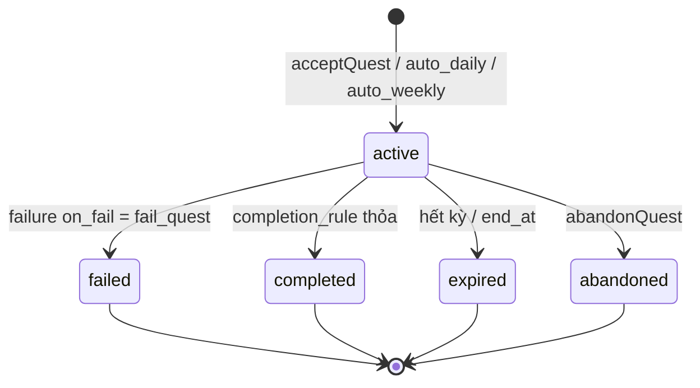

# Data Model: F072 — Quest Engine: 12 loại quest, bước, tiến độ qua event, lọc theo khối

**Spec**: [spec.md](spec.md) · **Plan**: [plan.md](plan.md) · Nguồn sự thật bảng: [DATABASE_DESIGN](../../docs/07-backend/DATABASE_DESIGN.md) (§2.8, §2.17, §3.13)

Database `eduworld_game`. Cột chung theo DATABASE_DESIGN §2; mẫu bảng có version theo [F071 data-model](../071-world-areas-npc-story/data-model.md) §1 (lõi phát hành).

## 1. Entity

### QuestDefinition — `game.quest_definitions` (Có sẵn §2.8, G owner_scope)

| Trường | Kiểu | Ràng buộc | Ghi chú |
|---|---|---|---|
| `quest_id` | UUIDv7 | PK | |
| `code` | `varchar(64)` | UNIQUE partial | `math.g3.market_multiplication` |
| `owner_scope` | `varchar(64)` | CHECK `platform` | game content chỉ platform (ADR-0027) |
| `tenant_id` | uuid | NULL | |
| `current_version_id`, `latest_version_no` | | | con trỏ ADR-0043 |

### QuestVersion — `game.quest_versions` (Có sẵn §2.8, G, thêm cột tách)

| Trường | Kiểu | Ghi chú |
|---|---|---|
| `quest_version_id` | UUIDv7 PK | |
| `quest_id`, `version` | uuid, int | UNIQUE `(quest_id, version)` |
| `status` | `varchar(64)` | mẫu chung |
| `payload` | jsonb (CHECK ≤ 65536) | toàn bộ `quest.schema.json` v2 |
| `quest_type` | `varchar(64)` | Mới (tách) — CHECK 12 giá trị |
| `grade_levels` | `smallint[]` | Mới (tách), CHECK cardinality ≤ 9; GIN index |
| `subject_id` | uuid | Mới (tách) |
| `area_id` | `varchar(64)` NULL | Mới (tách) |
| `giver_npc_id` | `varchar(64)` NULL | Mới (tách) |
| `story_chapter_code` | `varchar(64)` NULL | Mới (tách) |
| `objective_ids` | uuid[] (≤ 50) | Mới (tách) |
| `available_from`, `available_to` | timestamptz NULL | Mới (tách) |
| cột phát hành | | mẫu §3.13 |

### QuestProgress — `game.quest_progress` (Có sẵn §2.8, T, đổi khóa)

| Trường | Kiểu | Ràng buộc | Ghi chú |
|---|---|---|---|
| `quest_progress_id` | UUIDv7 | PK | Đổi từ PK `(student_id, quest_version_id)` |
| `tenant_id`, `student_id`, `school_id` | uuid | NOT NULL, RLS | |
| `quest_id`, `quest_version_id` | uuid | NOT NULL | ghim |
| `status` | `varchar(64)` | CHECK IN (`active`,`completed`,`expired`,`abandoned`,`failed`) | |
| `step_states` | jsonb (CHECK ≤ 65536) | NOT NULL | `{step_id: {status, progress{count, collected_ids[]}, attempt_ids[]}}` |
| `start_trigger` | `varchar(64)` | | `npc`, `quest_board`, `auto_daily`, `auto_weekly`, `chain`, `discovery`, `level_reached` |
| `period_key` | `varchar(16)` NULL | | `2026-11-15`, `2026-W46` |
| `completion_no` | int | NOT NULL DEFAULT 1 | lần hoàn thành thứ n (repeatable) |
| `party_id` | uuid NULL | | F103 |
| `started_at`, `completed_at`, `expires_at`, `failed_at` | timestamptz | | giờ server |
| `version` | int | | optimistic lock |
| `deleted_at`, `deleted_by`, `delete_reason` | | | R21 |

**Index**: `quest_progress_one_active_uq (tenant_id, student_id, quest_id) WHERE status = 'active' AND deleted_at IS NULL`; `quest_progress_period_uq (tenant_id, student_id, quest_id, period_key) WHERE period_key IS NOT NULL AND deleted_at IS NULL`; `(tenant_id, student_id, status)`; `(status, expires_at) WHERE status = 'active'`.

### QuestStepAttempt — `game.quest_step_attempts` (Mới, T)

`tenant_id`, `quest_progress_id`, `step_id varchar(64)`, `student_id`, `attempt_id uuid` UNIQUE, `started_on date` (ICT), `status varchar(64)` (`in_progress`,`passed`,`not_passed`,`expired`,`abandoned`), `correct_count int`, `item_count int`, `graded_at`, `deleted_at`, `deleted_by`. Index `(tenant_id, quest_progress_id, step_id, started_on)` để đếm `max_attempts_per_day`.

### PeriodicQuestGrant — `game.periodic_quest_grants` (Mới, T)

`tenant_id`, `student_id`, `kind varchar(64)` (`daily`,`weekly`), `period_key varchar(16)`, `quest_ids uuid[]` (≤ 10), `granted_at`, `deleted_at`, `deleted_by`; PK `(student_id, kind, period_key)`.

### Gán tenant — `infra.tenant_resource_assignments` (Có sẵn §2.0/§2.17)

`resource_type = 'quest'`, `resource_id = quest_id`; chỉ đọc ở F072 (ghi bởi saga F045, seed).

## 2. Vòng đời / trạng thái

Bước: `locked → active` (mọi `depends_on` completed) `→ completed` (server xác nhận); `reset_step` đưa bước về `active` với tiến độ 0.

## 3. Quy tắc kiểm tra dữ liệu

- Khả dụng = đã gán tenant ∧ khối ∈ `grade_levels` ∧ trong `availability` ∧ `prerequisites` ∧ `learning_requirements` (mức trong `ref.mastery_summary`) ∧ môn bật ([QUEST_SYSTEM §4](../../docs/01-game-design/QUEST_SYSTEM.md#4-start-triggers)).
- `once`: không có progress `completed`; `repeatable`: `now ≥ completed_at + cooldown_hours` ∧ số `completed` < `max_completions`; `per_period`: unique theo `period_key`.
- `pass_rule`: `correct_count / item_count ≥ min_correct_ratio` ∧ `item_count ≥ min_questions`; mặc định `quest_pass_rule`.
- Publish: schema v2; `vi`+`en`; tham chiếu tồn tại (area/NPC/interactable trong layout F071; nội dung đã publish); `objective_ids` ≥ 1 cho `learning`, `daily`, `weekly`, `challenge`, `party`, `boss`; chuỗi bước học tập liên tiếp ≤ `learning_block_max_items` theo grade band thấp nhất; loại bước có handler.

## 4. Event / outbox

| Event | Khi nào | Payload schema |
|---|---|---|
| `quest.accepted` | Nhận/cấp quest | `specs/events/payloads/game/quest.accepted.v1.schema.json` — Cần thêm |
| `quest.step_completed` | Bước hoàn thành | `quest.step_completed.v1.schema.json` — Cần thêm |
| `quest.completed` | Hoàn thành (một lần/progress) | `quest.completed.v1.schema.json` — Cần thêm (`quest_progress_id`, `quest_id`, `quest_version_id`, `quest_type`, `objective_ids[]`, `party_id?`, `story_chapter_code?`, `area_id?`, `rewards[]` ý định) |
| `quest.abandoned` | Bỏ / hết hạn / thất bại | `quest.abandoned.v1.schema.json` — Cần thêm (`reason` `player`/`expired`/`failed`, `step_id?`) |
