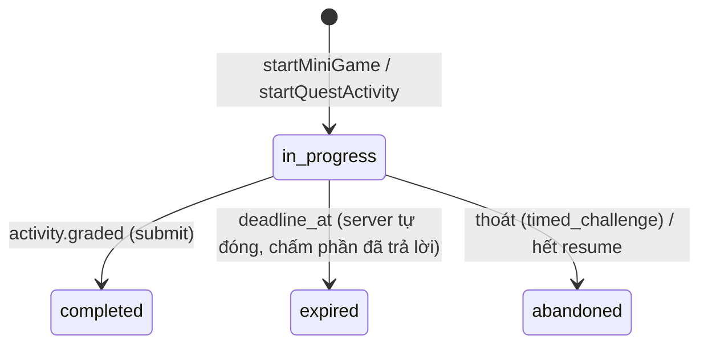

# Data Model: F073 — Mini-game Engine: `MiniGameConfig`, plugin `minigame`, scene Godot 11 loại

**Spec**: [spec.md](spec.md) · **Plan**: [plan.md](plan.md) · Nguồn sự thật bảng: [DATABASE_DESIGN](../../docs/07-backend/DATABASE_DESIGN.md) (§2.8, §2.17, §3.4, §3.13)

## 1. Entity

### MiniGameConfig — `game.minigame_configs`, `game.minigame_config_versions` (Có sẵn §2.8, G owner_scope, `eduworld_game`)

Mẫu bảng có version theo lõi phát hành F071 (§3.13). Bảng định danh: `minigame_config_id` UUIDv7 PK, `code varchar(64)` UNIQUE partial, `owner_scope = platform`, `current_version_id`, `latest_version_no`.

| Trường (version) | Kiểu | Ghi chú |
|---|---|---|
| `minigame_config_version_id` | UUIDv7 PK | |
| `version`, `status` | int, `varchar(64)` | mẫu chung |
| `payload` | jsonb (CHECK ≤ 65536) | `minigame-config.schema.json` |
| `minigame_type` | `varchar(64)` | Mới (tách) — CHECK 11 giá trị |
| `grade_levels` | `smallint[]` | Mới (tách), ≤ 9 |
| `subject_id` | uuid | Mới (tách) |
| `question_types` | `varchar(64)[]` | Mới (tách) — loại câu nguồn có thể trả (từ kết quả validate), ≤ 11 |

Gán tenant: `infra.tenant_resource_assignments` `resource_type = 'minigame_config'`.

### MiniGamePlay — `game.minigame_plays` (Mới, T, `eduworld_game`)

| Trường | Kiểu | Ràng buộc | Ghi chú |
|---|---|---|---|
| `play_id` | UUIDv7 | PK | |
| `tenant_id`, `student_id`, `school_id` | uuid | NOT NULL, RLS | |
| `minigame_config_id`, `minigame_config_version_id` | uuid | NOT NULL | ghim |
| `attempt_id` | uuid | UNIQUE | attempt ở learning |
| `context_type` | `varchar(64)` | CHECK IN (`free_play`,`quest_step`,`assignment`) | `assignment` chỉ ghi khi nhận `activity.graded` |
| `context_id` | uuid | NULL | |
| `play_date` | date | NOT NULL | ngày ICT, đếm `max_plays_per_day` |
| `status` | `varchar(64)` | CHECK IN (`in_progress`,`completed`,`expired`,`abandoned`) | |
| `learning_score`, `max_score` | numeric(7,2) | NULL | |
| `game_score` | int | NULL | |
| `completion_met` | bool | NULL | |
| `rewards_eligible` | bool | NULL | |
| `started_at`, `completed_at` | timestamptz | | giờ server |
| `deleted_at`, `deleted_by` | | | R21 |

**Index**: `(tenant_id, student_id, minigame_config_id, play_date)`.

### MiniGameConfigSnapshot — `ref.minigame_config_versions` (Mới, projection, `eduworld_learning`)

`minigame_config_id uuid`, `minigame_config_version_id uuid` PK, `version int`, `minigame_type varchar(64)`, `grade_levels smallint[]`, `snapshot jsonb` (CHECK ≤ 65536), `published_at`, `source_version bigint`. Bất biến; chỉ consumer ghi.

### Attempt — `assessment.attempts` (Có sẵn §3.4, `eduworld_learning`, thêm cột)

`game_score int NULL` (Mới) — chỉ cho attempt plugin `minigame`; `context_type` dùng `minigame_session` (free_play) / `quest_step`. Điểm học tập vẫn là `score`/`max_score`.

## 2. Vòng đời / trạng thái

## 3. Quy tắc kiểm tra dữ liệu

- Bảng tương thích `minigame_type` ↔ `QuestionType` theo [MINIGAME_ENGINE §2](../../docs/08-game-client/MINIGAME_ENGINE.md#2-loại-mini-game-và-tương-thích-câu-hỏi) (tên loại câu theo OpenAPI `QuestionType`: `fill_in_blank`, `numeric`, `drag_drop`).
- `question_count` ≤ số câu khả dụng của `question_source`; `difficulty` 1–5 (`adaptive` bị từ chối trong Release).
- Game points: `points_per_correct` khi đúng; `time_bonus` từ `answered_at − served_at` (giờ server) và bằng 0 khi khối ≤ 5; `streak_bonus` theo chuỗi đúng; `wrong_penalty ≥ 0`, = 0 khi khối ≤ 5.
- `rewards_eligible = completion_met ∧ plays_today ≤ limits.max_plays_per_day`.

## 4. Event / outbox

| Event | Khi nào | Payload schema |
|---|---|---|
| `content.published` (`item_type = minigame_config`) | Publish version cấu hình | `specs/events/payloads/game/content.published.v1.schema.json` — owner F071; F073 đề xuất khối `minigame_config` (`minigame_config_id`, `version_id`, `version`, `snapshot`) |
| `minigame.completed` | Ghi kết quả lượt chơi (một lần) | `specs/events/payloads/game/minigame.completed.v1.schema.json` — Cần thêm (`play_id`, `minigame_config_version_id`, `attempt_id`, `context_type`, `context_id?`, `learning_score`, `max_score`, `game_score`, `completion_met`, `rewards_eligible`, `reward_rule_id?`) |
| `activity.graded` (learning) | Chấm xong attempt | `specs/events/payloads/learning/activity.graded.v1.schema.json` — owner F030, Cần sửa (khối `minigame {minigame_config_id, minigame_config_version_id, game_score, completion_met, context_type, context_id}`) |
