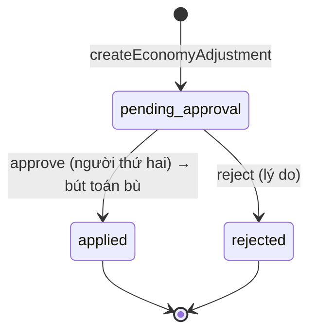

# Data Model: F075 — Kinh tế Xu, Shop cosmetic, inventory, collection, achievement, badge

**Spec**: [spec.md](spec.md) · **Plan**: [plan.md](plan.md) · Nguồn sự thật bảng: [DATABASE_DESIGN](../../docs/07-backend/DATABASE_DESIGN.md) (§2.8, §2.8a, §2.13, §3.13)

Database `eduworld_game`. Cột chung theo loại bảng theo DATABASE_DESIGN §2; bảng G có version theo mẫu §3.13 (`current_version_id`, `latest_version_no`, version có `status`, `payload jsonb` CHECK ≤ 65536 byte, `change_note varchar(500)`, `publish_at`, `snapshot_key varchar(512)`, `snapshot_sha256 varchar(64)`).

## 1. Entity

### Currency — `gamification.currencies` (Có sẵn §2.8a, G)

`currency_code varchar(64)` PK (`xu`), `name_vi varchar(128)`, **Thêm cột** `name_en varchar(128)` (ADR-0056), `daily_cap int` (mặc định theo `xu_daily_cap`), `status varchar(64)`.

### Wallet — `gamification.wallets` (Có sẵn §2.8a, T)

| Trường | Kiểu | Ràng buộc |
|---|---|---|
| `tenant_id`, `student_id` | uuid | NOT NULL, RLS |
| `currency_code` | `varchar(64)` | FK `currencies` |
| `balance` | bigint | NOT NULL DEFAULT 0, CHECK `balance >= 0` |
| `version` | int | optimistic concurrency |
| `updated_at` | timestamptz | |

PK `(student_id, currency_code)`; khóa `FOR UPDATE` khi ghi.

### CurrencyLedgerEntry — `gamification.currency_ledger` (Có sẵn DDL §2.8a, TA, P tháng)

`entry_id`, `tenant_id`, `student_id`, `currency_code varchar(64)`, `delta bigint` (≠ 0), `balance_after bigint` (≥ 0), `reason_code varchar(64)` (CHECK `reward`/`shop_purchase`/`adjustment`/`refund`/`duplicate_conversion`), `source_type varchar(64)`, `source_id uuid`, `idempotency_key varchar(64)`, `created_by uuid` NULL, `created_at`. PK `(entry_id, created_at)`; UNIQUE `(idempotency_key, created_at)` + kiểm tra ứng dụng; REVOKE UPDATE/DELETE/TRUNCATE.

### ItemLedgerEntry — `gamification.item_ledger` (Có sẵn §2.8a, TA, P tháng)

Như `currency_ledger` với `item_id varchar(64)` (mã vật phẩm, RB-308), `delta int`, `reason_code varchar(64)` (CHECK `reward`/`shop_purchase`/`collection`/`adjustment`/`duplicate_conversion`).

### ItemDefinition — `game.item_definitions`, `game.item_definition_versions` (Có sẵn §2.8 + §3.13, G)

- `item_definitions`: `item_id varchar(64)` PK (mã ổn định, không phải UUID — DATABASE_DESIGN §2.8), `kind varchar(64)` (CHECK enum `ItemKind`), `rarity varchar(64)` (CHECK `ItemRarity`), `equip_slot varchar(64)` NULL, `stackable bool`, `max_stack int`, `current_version_id`, `latest_version_no`, `deleted_at`, `deleted_by`.
- `item_definition_versions`: `item_version_id` PK, `item_id`, `version`, `status varchar(64)`, `payload jsonb` (Cần thêm `specs/schemas/item.schema.json`: `name`/`description` song ngữ, `asset_refs`, `sources[]`, `grade_restriction`, `tradable` const false).

### InventoryItem — `game.inventory_items` (Có sẵn §2.8, T; Thêm cột)

`tenant_id`, `student_id`, `item_id varchar(64)`, `school_id`, **Thêm cột** `quantity int NOT NULL DEFAULT 1 CHECK (quantity >= 1)`, `acquired_at`, `reward_grant_id uuid` NULL, `deleted_at`, `deleted_by`. PK `(student_id, item_id)`.

### ShopItem — `gamification.shop_items`, `gamification.shop_item_versions` (Có sẵn §2.8a, G)

Version: `item_id varchar(64)`, `item_kind varchar(64)`, `price_amount int` CHECK > 0, `currency_code varchar(64)` CHECK = `xu`, `purchase_limit int`, `available_from`, `available_to`, `grade_levels int[]`, **Thêm cột** `event_id uuid` NULL, `season_id uuid` NULL (mặt hàng giới hạn theo sự kiện/mùa), `payload jsonb` (`shop-item.schema.json`). Gán tenant: `infra.tenant_resource_assignments (resource_type = 'shop_item')`; không có dòng gán nào = mọi tenant.

### ShopPurchase — `gamification.shop_purchases` (Có sẵn §2.8a, T)

`purchase_id`, `tenant_id`, `student_id`, `shop_item_version_id`, `price_amount int`, `currency_ledger_entry_id uuid`, `idempotency_key varchar(64)`, `created_at`. Index `(student_id, shop_item_version_id)`; đếm theo `shop_item_id` (join version) cho `purchase_limit`.

### Collection — `gamification.collections`, `collection_versions`, `collection_items` (Có sẵn §2.8a, G)

Version: `code varchar(64)`, `collection_type varchar(64)` (CHECK `CollectionType`), `items jsonb`, `completion_rewards jsonb`, `visibility varchar(64)` (`always`/`hidden_until_first`), `payload jsonb` (Cần thêm `specs/schemas/collection.schema.json`). `collection_items`: `collection_version_id`, `item_id varchar(64)`, `source_hint jsonb` (song ngữ "cách nhận"), `objective_id uuid` NULL (knowledge card). PK `(collection_version_id, item_id)`.

### CollectionProgress — `gamification.collection_progress` (Có sẵn §2.8a, T)

`tenant_id`, `student_id`, `collection_id`, `owned_item_ids varchar(64)[]` (CHECK `cardinality ≤ 500`), `owned_count int`, `completed_at`. PK `(student_id, collection_id)`.

### Achievement — `gamification.achievements`, `achievement_versions` (Có sẵn §2.8a, G)

Version: `code varchar(64)`, `category varchar(64)`, `trigger jsonb`, `progress_metric jsonb`, `visibility varchar(64)`, `tiers jsonb`, `payload jsonb` (`achievement.schema.json`). Index GIN `(trigger)` hoặc cột phụ **Thêm cột** `trigger_event_types varchar(64)[]` để chọn nhanh.

### StudentAchievement — `gamification.student_achievements` (Có sẵn §2.8a, T; Thêm cột)

`tenant_id`, `student_id`, `achievement_id`, `tier varchar(64)`, `progress int`, **Thêm cột** `progress_state jsonb` (tập ngày/khóa đã đếm, CHECK ≤ 4096 byte), `unlocked_at`. PK `(student_id, achievement_id, tier)`.

### AchievementProgressEvent — `gamification.achievement_progress_events` (Mới, TA)

`progress_event_id`, `tenant_id`, `student_id`, `achievement_id`, `event_id`, `event_type varchar(64)`, `created_at`; UNIQUE `(student_id, achievement_id, event_id)` — event giao lại không cộng tiến độ lần hai (thêm khi triển khai, spec Clarifications 2026-11-23). `student_achievements` khi triển khai là một dòng mỗi `(student_id, achievement_id)` (bậc cao nhất trong `tier`), mở khóa từng bậc ghi bằng `reward_grants` `trigger_kind = achievement`.

### EconomyAdjustment — `gamification.economy_adjustments` (Mới, T)

| Trường | Kiểu | Ràng buộc |
|---|---|---|
| `adjustment_id` | UUIDv7 | PK |
| `tenant_id`, `student_id` | uuid | NOT NULL, RLS |
| `kind` | `varchar(64)` | CHECK `currency`/`item`/`xp` |
| `currency_code` | `varchar(64)` | NULL |
| `item_id` | `varchar(64)` | NULL; CHECK theo `kind` |
| `delta` | bigint | ≠ 0 |
| `reason` | `varchar(1000)` | NOT NULL, ≥ 10 ký tự |
| `ticket_ref` | `varchar(128)` | NULL |
| `status` | `varchar(64)` | CHECK `pending_approval`/`applied`/`rejected` |
| `created_by`, `approved_by` | uuid | CHECK `approved_by IS NULL OR approved_by <> created_by` |
| `ledger_entry_id` | uuid | NULL tới khi `applied` |
| `idempotency_key` | `varchar(64)` | UNIQUE partial |
| `created_at`, `applied_at`, `deleted_at`, `deleted_by` | | |

## 2. Vòng đời / trạng thái

## 3. Quy tắc kiểm tra dữ liệu

- `wallets.balance` = Σ `currency_ledger.delta` theo `(student_id, currency_code)`; lệch → cảnh báo ([INVENTORY_ECONOMY §4.2](../../docs/01-game-design/INVENTORY_ECONOMY.md)).
- Vật phẩm không xếp chồng: tối đa một dòng inventory; nhận lại → quy đổi Xu `duplicate_item_xu`.
- `purchase_limit` đếm theo `shop_item_id` qua mọi version.
- Knowledge card không bị thu hồi; mọi thu hồi chỉ qua `economy_adjustments`.

## 4. Event / outbox

| Event | Khi nào | Payload schema |
|---|---|---|
| `currency.credited` / `currency.debited` | Mỗi bút toán Xu | `specs/events/payloads/game/` — Cần thêm |
| `shop.item_purchased` | Mua thành công | Cần thêm |
| `item.granted` | Vật phẩm vào inventory | Cần thêm |
| `collection.item_added` / `collection.completed` | Tiến độ collection | Cần thêm |
| `achievement.progressed` / `achievement.unlocked` | Tiến độ/mở khóa | Cần thêm |
| `economy.adjusted` | Điều chỉnh được duyệt | Cần thêm |
