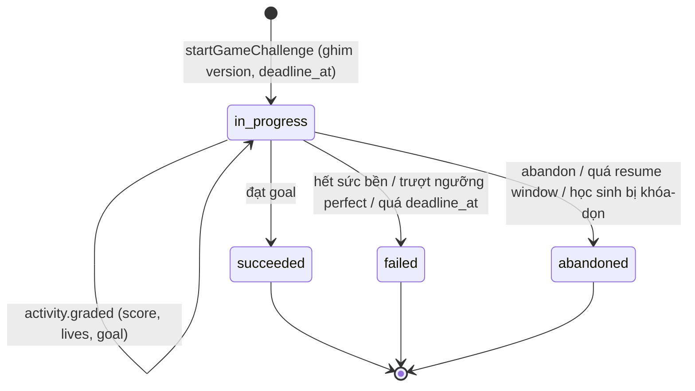

# Data Model: F076 — Challenge Engine solo, 5 mức khó, room host dùng chung

**Spec**: [spec.md](spec.md) · **Plan**: [plan.md](plan.md) · Nguồn sự thật bảng: [DATABASE_DESIGN](../../docs/07-backend/DATABASE_DESIGN.md) (§2.8a, §3.13)

Database `eduworld_game`.

## 1. Entity

### Challenge — `game.challenges`, `game.challenge_versions` (Có sẵn §2.8a, G)

- `challenges`: `challenge_id` PK, `code varchar(64)` UNIQUE partial, `current_version_id`, `latest_version_no`, `deleted_at`, `deleted_by`.
- `challenge_versions`: `challenge_version_id` PK, `challenge_id`, `version int`, `status varchar(64)`, `challenge_type varchar(64)`, `grade_levels int[]`, `subject_id uuid`, `objective_ids uuid[]` (CHECK `cardinality ≤ 30`), `area_id varchar(64)`, `config jsonb` (đủ payload `challenge.schema.json`, CHECK ≤ 65536 byte), cột phát hành §3.13. UNIQUE `(challenge_id, version)`; index GIN `(grade_levels)` cho lọc khối.

### ChallengeAttempt — `game.challenge_attempts` (Có sẵn §2.8a, T; Thêm cột)

| Trường | Kiểu (ent / SQL) | Ràng buộc | Ghi chú |
|---|---|---|---|
| `challenge_attempt_id` | UUIDv7 | PK | |
| `tenant_id`, `student_id`, `school_id` | uuid | NOT NULL, RLS | |
| `challenge_id` | uuid | NOT NULL | **Thêm cột** — đếm lượt qua mọi version |
| `challenge_version_id` | uuid | NOT NULL | ghim (ADR-0043) |
| `difficulty` | `varchar(64)` | CHECK `easy`/`normal`/`hard`/`expert`/`legendary` | |
| `party_id` | uuid | NULL | luôn NULL ở F076 |
| `status` | `varchar(64)` | CHECK `in_progress`/`succeeded`/`failed`/`abandoned` | |
| `score` | int | NOT NULL DEFAULT 0 | |
| `lives_left` | int | NULL | chỉ `survival` |
| `goal_progress` | numeric(10,2) | NOT NULL DEFAULT 0 | **Thêm cột** — theo `goal.metric` |
| `activities_completed` | int | NOT NULL DEFAULT 0 | **Thêm cột** |
| `period_key` | `varchar(16)` | NOT NULL | **Thêm cột** — `YYYY-MM-DD` (ICT) hoặc `YYYY-Www` (`weekly`) / mã mùa (`seasonal`) |
| `first_clear` | bool | NOT NULL DEFAULT false | **Thêm cột** — lần `succeeded` đầu tiên của học sinh với challenge |
| `started_at`, `deadline_at`, `ended_at` | timestamptz | `deadline_at` NULL khi không giới hạn | giờ server |
| `learning_attempt_ids` | uuid[] | CHECK `cardinality ≤ 200` | index GIN (**Thêm index**) |
| `processed_attempt_ids` | uuid[] | CHECK `cardinality ≤ 200` | **Thêm cột** — chống áp lặp kết quả chấm |
| `idempotency_key` | `varchar(64)` | UNIQUE partial | |
| `deleted_at`, `deleted_by`, `delete_reason` | | | R21 |

**Index**: UNIQUE `(student_id) WHERE status = 'in_progress' AND deleted_at IS NULL` (DATABASE_DESIGN ghi partial index — nâng thành UNIQUE); `(tenant_id, student_id, started_at DESC)`; `(tenant_id, student_id, challenge_id, period_key)` đếm lượt; `(status, deadline_at) WHERE status = 'in_progress'` cho job.

### Room checkpoint (`src/backend/pkg/roomhost`)

Không có bảng riêng: checkpoint của challenge = cột của `challenge_attempts` (nguồn sự thật PostgreSQL). Valkey (ephemeral, VALKEY_DESIGN §3.1): `ew:rt:room:<challenge_attempt_id>` (HASH owner_node, type `challenge_solo`, tenant_id, state_version), `ew:rt:room:<id>:lease` (owner, TTL 10 s).

## 2. Vòng đời / trạng thái

## 3. Quy tắc kiểm tra dữ liệu

- Lượt đã dùng = số attempt `(student_id, challenge_id, period_key)` không tính `abandoned` do lỗi hệ thống; ngưỡng `retry.max_attempts_per_day` của version hoặc `challenge_attempts_per_day`.
- Cooldown: `now < ended_at + cooldown_seconds_after_fail` của lần `failed` gần nhất (mức Hard trở lên theo `challenge_fail_cooldown`).
- Dải câu: `question_difficulty_min..max` của mức; khối 1–3 chỉ mức trong `g1_3_challenge_rules` ([CHALLENGE_BOSS_SYSTEM §2.2](../../docs/01-game-design/CHALLENGE_BOSS_SYSTEM.md)).
- Kết quả chấm chỉ áp một lần mỗi `attempt_id` (`processed_attempt_ids`).

## 4. Event / outbox

| Event | Khi nào | Payload schema |
|---|---|---|
| `challenge.started` | Tạo attempt | `specs/events/payloads/game/challenge.started.v1.schema.json` — Cần thêm |
| `challenge.completed` | `succeeded`/`failed`/`abandoned` | `specs/events/payloads/game/challenge.completed.v1.schema.json` — Cần thêm (`challenge_attempt_id`, `challenge_id`, `challenge_version_id`, `status`, `score`, `difficulty`, `reward_multiplier`, `first_clear`, `objective_ids[]`) |
