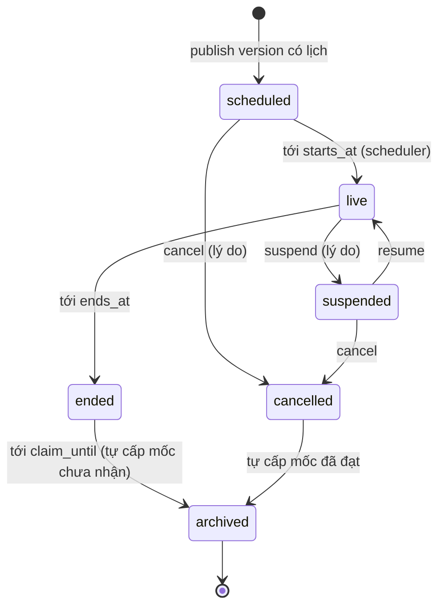

# Data Model: F077 — Event & Season live-ops: vòng đời sự kiện, community goal, season track, sự kiện trường

**Spec**: [spec.md](spec.md) · **Plan**: [plan.md](plan.md) · Nguồn sự thật bảng: [DATABASE_DESIGN](../../docs/07-backend/DATABASE_DESIGN.md) (§2.8c, §2.17, §3.13)

Database `eduworld_game`, schema `game`. Bảng G/T dùng chung theo `owner_scope` (H trong DATABASE_DESIGN §2): `tenant_id NULL` ⇔ `owner_scope = 'platform'`.

## 1. Entity

### Event — `game.events`, `game.event_versions` (Có sẵn §2.8c, G/T)

- `events`: `event_id` PK, `tenant_id` NULL, `owner_scope varchar(16)` (CHECK `platform`/`tenant`), `code varchar(64)`, `event_kind varchar(32)`, `template_id uuid` NULL (sự kiện tenant), `current_version_id`, `latest_version_no`, `deleted_at`, `deleted_by`. UNIQUE `(tenant_id, code) WHERE deleted_at IS NULL`.
- `event_versions`: `event_version_id` PK, `event_id`, `version int`, `status varchar(16)`, `payload jsonb` (`event.schema.json`, CHECK ≤ 65536 byte), `start_at`, `end_at`, **Thêm cột** `effective_from timestamptz` (áp luật mới, `event_rule_change_effective`), cột phát hành §3.13. UNIQUE `(event_id, version)`.

### EventTemplate — `game.event_templates`, `game.event_template_versions` (Có sẵn §2.8c, G)

`template_id`, `code varchar(64)`, `current_version_id`; version: `allowed_params jsonb`, `payload jsonb` (Cần thêm `specs/schemas/event-template.schema.json`: `event_kind`, `max_duration_days`, `quest_options[]`, `challenge_options[]`, `reward_options[]`, text song ngữ). Gán tenant: `infra.tenant_resource_assignments (resource_type = 'event_template')`.

### EventRun — `game.event_runs` (Có sẵn §2.8c, G/T)

| Trường | Kiểu | Ràng buộc |
|---|---|---|
| `event_run_id` | UUIDv7 | PK |
| `tenant_id` | uuid | NULL với sự kiện platform |
| `event_id`, `event_version_id` | uuid | NOT NULL |
| `status` | `varchar(16)` | CHECK `scheduled`/`live`/`suspended`/`ended`/`cancelled`/`archived` |
| `starts_at`, `ends_at`, `claim_until` | timestamptz | NOT NULL |
| `suspended_reason` | `varchar(500)` | DATABASE_DESIGN §2.8c; lý do API ≤ 1000 → lưu vào audit, cột cắt theo `varchar(500)` — **Sửa** lên `varchar(1000)` (ADR-0041 bảng "lý do") |
| `status_changed_by` | uuid | NULL khi scheduler |
| `status_version` | int | **Thêm cột** — optimistic lock chống chuyển trùng |
| `deleted_at`, `deleted_by` | | |

Index `(status, starts_at)`, `(status, ends_at)`, `(status, claim_until)`.

### EventParticipation — `game.event_participation` (Có sẵn, T)

`tenant_id`, `event_run_id`, `student_id`, `school_id`, `joined_at`, `event_points int`, `claimed_milestones varchar(64)[]` (CHECK `cardinality ≤ 50`), **Thêm cột** `auto_granted_milestones varchar(64)[]`. PK `(event_run_id, student_id)`.

### EventPointEntry — `game.event_point_ledger` (Có sẵn, TA, P tháng)

`entry_id`, `tenant_id`, `event_run_id`, `student_id`, `delta int`, `source_code varchar(64)`, `source_event_id uuid`, `capped bool`, `created_at`. UNIQUE `(source_event_id, student_id, created_at)` + kiểm tra ứng dụng; chỉ INSERT.

### CommunityGoal — `game.community_goals`, `community_goal_contributions`, `community_goal_progress` (Có sẵn §2.8c)

- `community_goals` (G/T): `goal_id`, `tenant_id` NULL, `event_run_id`, `goal_code varchar(64)`, `metric varchar(32)`, `scope varchar(16)` (`school`/`tenant`/`platform`), `target bigint`, `per_student_daily_cap int`, `milestones jsonb`. UNIQUE `(event_run_id, goal_code)`.
- `community_goal_contributions` (TA, P ngày): `tenant_id`, `goal_id`, `scope_id uuid` (school_id / tenant_id / hằng platform), `student_id`, `grade_level smallint` (khối tại thời điểm đóng góp, từ `ref.students` — ADR-0095; không `class_id`), `amount int`, `source_event_id uuid`, `contributed_on date`, `created_at`. UNIQUE `(goal_id, source_event_id, created_at)`; index `(goal_id, student_id, contributed_on)`.
- `community_goal_progress` (T; với scope `platform` ghi một dòng mỗi tenant + tổng tính khi đọc): `goal_id`, `scope_id`, `total bigint`, `milestones_reached smallint[]`, `recomputed_at`. PK `(goal_id, scope_id)`.

### SeasonTrack — `game.season_tracks`, `game.season_track_versions` (Có sẵn §2.8c, G)

`season_track_id`, `season_id`, `code varchar(64)`, `current_version_id`; version `payload jsonb` (`season-track.schema.json`). UNIQUE `(season_id) WHERE deleted_at IS NULL`.

### SeasonPointEntry — `game.season_point_ledger` (Có sẵn, TA, P tháng)

`entry_id`, `tenant_id`, `season_id`, `student_id`, `delta int`, `source_code varchar(64)`, `source_event_id uuid`, `capped bool`, `created_at`. UNIQUE `(source_event_id, student_id, created_at)`.

### SeasonTrackProgress — `game.season_track_progress` (Có sẵn, T)

`tenant_id`, `season_id`, `student_id`, `school_id`, `points int`, `tier smallint`, `claimed_tiers smallint[]`, `auto_granted_at`. PK `(season_id, student_id)`.

### Season projection — `ref.seasons` (Có sẵn §2.8c)

`season_id`, `starts_at`, `ends_at`, `theme_code varchar(64)`, **Thêm cột** `status varchar(64)` (`started`/`ended`), `source_version bigint`.

### Ghi chú triển khai (2026-11-23 — spec Clarifications)

- Migration `20261230000770_f077_liveops.sql` (entddl + phần viết tay). Ledger chưa partition; UNIQUE idempotent `(event_run_id | season_id | goal_id, source_event_id, student_id)`; cột `earned_on`/`contributed_on` (date ICT) cho trần ngày.
- Mảng của data-model là `jsonb` (`reached_milestones`, `claimed_milestones`, `auto_granted_milestones`, `milestones_reached`, `claimed_tiers`, `auto_granted_tiers`); khóa kỹ thuật `participation_id`/`progress_id` + UNIQUE nghiệp vụ partial.
- Cột thêm: `events.school_id`, `events.school_params`; `event_runs.audience`, `school_id`, `cancelled_at`, `archived_at`, `status_version`; `event_versions.effective_from`, `decoration_areas`; `event_template_versions.code/event_kind/allowed_params/max_duration_days`; `season_track_versions.season_id`; `ref.seasons(code, name, ended_at, status, source_version)`. `suspended_reason varchar(1000)`.
- RLS: bảng G/T (`events`, `event_versions`, `event_runs`, `community_goals`) đọc dòng platform + dòng tenant phiên, ghi chỉ dòng tenant phiên (dòng platform do `game_platform`); `community_goal_progress` không FORCE RLS để hàm `SECURITY DEFINER game.community_goal_platform_total` cộng tổng goal platform.

## 2. Vòng đời / trạng thái

## 3. Quy tắc kiểm tra dữ liệu

- Điểm sự kiện/điểm mùa/đóng góp: idempotent theo `source_event_id`; trần ngày theo ICT; bản ghi bị cắt có `capped = true`.
- Mốc/cấp đã đạt không bao giờ giảm (bỏ qua version mới làm tăng ngưỡng đối với học sinh đã đạt) — [EVENT_SEASON_SYSTEM §5.3](../../docs/01-game-design/EVENT_SEASON_SYSTEM.md).
- Sự kiện tenant: `payload` chỉ chứa giá trị trong `allowed_params` của template version đã gán.
- Một vùng tối đa một bộ trang trí trong cùng khoảng thời gian (kiểm khi publish).

## 4. Event / outbox

| Event | Khi nào | Payload schema |
|---|---|---|
| `event.scheduled` / `started` / `suspended` / `resumed` / `ended` / `cancelled` | Chuyển trạng thái run | `specs/events/payloads/game/` — Cần thêm |
| `event.participation_started`, `event.milestone_claimed` | Tham gia, nhận mốc | Cần thêm |
| `community_goal.milestone_reached`, `community_goal.completed` | Đạt mốc | Cần thêm |
| `season_track.tier_reached`, `season_track.reward_claimed` | Đạt cấp, nhận/tự cấp | Cần thêm |
