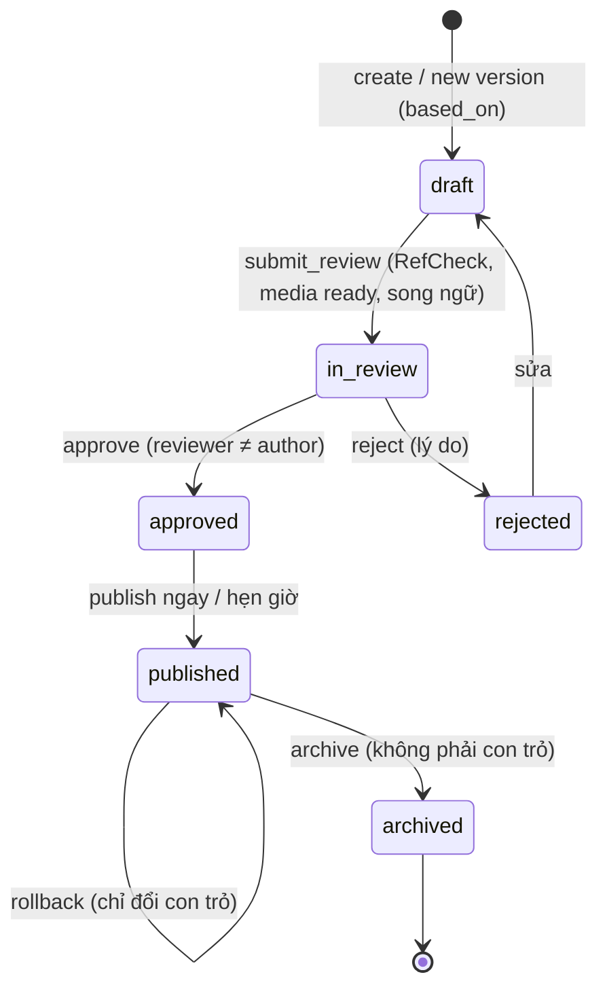

# Data Model: F078 — Game Operations Console backend: workflow nội dung game, thumbnail 3D, catalog cho nhà trường

**Spec**: [spec.md](spec.md) · **Plan**: [plan.md](plan.md) · Nguồn sự thật bảng: [DATABASE_DESIGN](../../docs/07-backend/DATABASE_DESIGN.md) (§2.8, §2.16, §2.17, §3.13)

Database `eduworld_game`.

## 1. Entity

### GameConfigItem / GameConfigVersion — bảng item/version theo loại (Có sẵn, G)

Mỗi `config_type` có cặp bảng của feature sở hữu (vd. `game.quest_definitions`/`quest_versions`, `gamification.reward_rules`/`reward_rule_versions`, `game.events`/`event_versions`). F078 yêu cầu mọi cặp có các cột phát hành theo DATABASE_DESIGN §3.13 và thêm cột workflow nếu thiếu:

| Trường (bảng version) | Kiểu | Ghi chú |
|---|---|---|
| `status` | `varchar(64)` | CHECK `draft`/`in_review`/`approved`/`rejected`/`published`/`archived` |
| `title` | `varchar(255)` | **Thêm cột** nếu thiếu — API giới hạn 200 |
| `payload` | jsonb CHECK ≤ 65536 byte | theo JSON Schema của loại |
| `author_id`, `reviewer_id`, `published_by` | uuid | **Thêm cột** nếu thiếu; CHECK `reviewer_id IS NULL OR reviewer_id <> author_id` |
| `review_note` | `varchar(2000)` | **Thêm cột** — `note` của transition |
| `change_note` | `varchar(500)` | §3.13 |
| `publish_at`, `effective_from` | timestamptz | §3.13 |
| `snapshot_key` | `varchar(512)` | §3.13 |
| `snapshot_sha256` | `varchar(64)` | §3.13 |
| `based_on_version_id` | uuid | §3.13 |
| `thumbnail_asset_id`, `turntable_asset_id` | uuid | **Thêm cột** — FK `game.media_assets` |

Bảng item: `current_version_id` (NULL = chưa publish/đã gỡ), `latest_version_no int`, `deleted_at`, `deleted_by`.

### ContentRelease — `game.content_releases` (Có sẵn §3.13, append-only)

Như `content.content_releases`: `release_id`, `tenant_id` (NULL), `item_type varchar(64)` (= `config_type` dạng snake: `quest`, `minigame_config`…), `item_id`, `action varchar(16)` (`publish`/`rollback`/`unpublish`), `from_version_id`, `to_version_id`, `reason varchar(500)`, `scheduled_for`, `released_by`, `released_at`, `idempotency_key varchar(64)`; **Thêm cột** `status varchar(16)` (`scheduled`/`done`/`cancelled`) cho hẹn giờ. UNIQUE `(item_type, item_id, idempotency_key)`; index `(item_type, item_id, released_at DESC)`, `(status, scheduled_for) WHERE status = 'scheduled'`.

### ContentManifest — `game.content_manifests` (Có sẵn §3.13, T)

F078 dựng lại khi con trỏ hoặc gán đổi; không đổi cấu trúc.

### ClientManifest — `game.client_manifests` (Có sẵn §2.16, G)

`client_version`, `platform`, `manifest jsonb`, `published_at`; F078 đọc bản mới nhất mỗi nền tảng để `RefCheck`.

### MediaAsset — `game.media_assets`, `game.media_usages` (Có sẵn §3.13, G)

Như `content.media_assets`; **Sửa** CHECK `kind` thêm `render_thumbnail`, `render_turntable` (DESIGN_SYSTEM §7); owner luôn `platform`; bucket `ew-media-public`.

### PreviewSession — `game.preview_sessions` (Mới, G)

| Trường | Kiểu | Ràng buộc |
|---|---|---|
| `preview_session_id` | UUIDv7 | PK |
| `token_hash` | `varchar(128)` | UNIQUE — SHA-256 hex của `preview_token` (không lưu token thô) |
| `config_type` | `varchar(64)` | |
| `config_id`, `config_version_id` | uuid | |
| `created_by` | uuid | |
| `expires_at` | timestamptz | `created_at + 30 phút` |
| `created_at`, `deleted_at`, `deleted_by` | | |

### RenderJob — `game.render_jobs` (Mới, G)

`render_job_id` UUIDv7 PK, `config_type varchar(64)`, `config_version_id uuid`, `source_asset_id uuid`, `kind varchar(64)` (`render_thumbnail`/`render_turntable`), `status varchar(16)` (`queued`/`running`/`done`/`failed`/`dead`), `attempts int`, `last_error varchar(1000)`, `result_asset_id uuid`, `created_at`, `updated_at`. UNIQUE `(config_version_id, source_asset_id, kind)` (chống trùng).

### TenantResourceAssignment — `infra.tenant_resource_assignments` (Có sẵn §2.17)

`assignment_id`, `resource_type varchar(64)` (`quest`, `minigame_config`, `item`, `shop_item`, `event_template`), `resource_id uuid`, `tenant_id uuid`, `assigned_by uuid`, `assigned_at`, `deleted_at`, `deleted_by`. UNIQUE `(resource_type, resource_id, tenant_id) WHERE deleted_at IS NULL`.

## 2. Vòng đời / trạng thái

## 3. Quy tắc kiểm tra dữ liệu

- Con trỏ chỉ trỏ tới version `published` của chính item (trigger như `content.check_release_target`, DATABASE_DESIGN §3.13).
- Version `published` không `UPDATE` payload (trigger chặn).
- `RefCheck`: `area_id`/`npc_id`/`scene_ref`/`interactable_id` có trong `client_manifests` mới nhất; nội dung tham chiếu (question set, activity, quest…) có version `published`.
- Hẹn giờ: `publish_at ≥ now + scheduled_publish_min_lead`.

## 4. Event / outbox

| Event | Khi nào | Payload schema |
|---|---|---|
| `content.version_submitted` / `content.version_approved` / `content.version_rejected` / `content.version_archived` | Transition | `specs/events/payloads/game/` — Cần thêm |
| `content.published` | Đổi con trỏ (publish ngay/hẹn giờ tới hạn) | `specs/events/payloads/game/content.published.v1.schema.json` — owner F071; F078 thêm khối `catalog` (quest/minigame_config) |
| `content.rolled_back` / `content.unpublished` / `content.publish_scheduled` | Rollback / gỡ xuất bản / hẹn giờ | `specs/events/payloads/game/` — Cần thêm |
| `content.manifest_updated` | Manifest tenant dựng lại | Schema owner F026 — F078 phát cùng schema |
| `media.uploaded` | Presign xong và file tới quarantine | Cần thêm |

Gán/gỡ gán tài nguyên game: module game nhận lệnh qua facade `applyTenantAssignment` (module identity gọi, F045) và **không** phát `tenant_data.assigned`/`tenant_data.unassigned` — event đó do module identity phát (owner F045) sau khi module sở hữu ghi xong.
