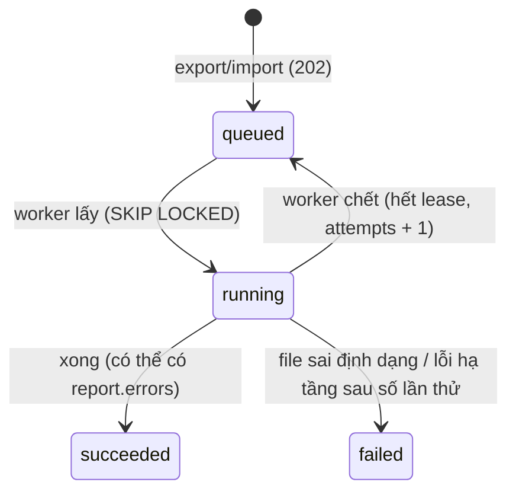

# Data Model: F082 — Game Studio — quản lý sticker/GIF và dịch nội dung game (`/game-admin/translations*`)

**Spec**: [spec.md](spec.md) · **Plan**: [plan.md](plan.md) · Nguồn sự thật bảng: [DATABASE_DESIGN](../../docs/07-backend/DATABASE_DESIGN.md)

Sticker pack/GIF: bảng `chat.sticker_packs`, `chat.stickers`, `chat.gif_assets`, `chat.gif_tags`, `chat.chat_asset_versions` thuộc F118 (DATABASE_DESIGN §2.12, §3.8a) — F082 không đổi. Hai bảng dưới thuộc module game, dữ liệu platform (G, không `tenant_id`).

## 1. Entity

### TranslationState — `game.config_translation_states` (Mới, G)

| Trường | Kiểu (ent / SQL) | Ràng buộc | Ghi chú |
|---|---|---|---|
| `config_version_id` | uuid | PK | id version của bảng version theo loại (F071–F078) |
| `config_type` | `varchar(64)` (`MaxLen(64)`) | NOT NULL | khớp `GameConfigType` |
| `config_id` | uuid | NOT NULL | |
| `translation_status` | `varchar(64)` (`MaxLen(64)`) | CHECK IN (`complete`,`partial`,`outdated`) | |
| `missing_pointers` | jsonb | CHECK `jsonb_array_length ≤ 500` | JSON pointer thiếu ngôn ngữ bắt buộc |
| `translation_meta` | jsonb | CHECK `octet_length ≤ 65536` | `{pointer: {source_sha256, translated_in_version_id, translated_at}}` (research R3) |
| `computed_at`, `created_at`, `updated_at` | timestamptz | NOT NULL | |
| `deleted_at`, `deleted_by` | timestamptz, uuid | | R21; xóa mềm theo version |

**Index**: `(config_type, translation_status) WHERE deleted_at IS NULL`; `(config_id) WHERE deleted_at IS NULL`.

### TranslationJob — `game.translation_jobs` (Mới, G)

| Trường | Kiểu (ent / SQL) | Ràng buộc | Ghi chú |
|---|---|---|---|
| `job_id` | UUIDv7 | PK | mixin `Base` |
| `kind` | `varchar(64)` | CHECK IN (`export`,`import`) | |
| `status` | `varchar(64)` | CHECK IN (`queued`,`running`,`succeeded`,`failed`) | |
| `format` | `varchar(64)` | CHECK IN (`xliff`,`csv`) | |
| `source_language`, `target_language` | `varchar(8)` | CHECK IN (`vi`,`en`) | |
| `only_missing`, `dry_run` | bool | NOT NULL DEFAULT | |
| `request` | jsonb | CHECK `octet_length ≤ 65536` | `content_types[]`, `content_ids[]` |
| `input_asset_id` | uuid | FK `game.media_assets`, NULL với export | file nhập |
| `result_storage_key` | `varchar(512)` | | `ew-exports/translations/<job_id>.<xlf|csv>` |
| `report` | jsonb | CHECK `octet_length ≤ 524288` | `total`, `updated`, `skipped`, `errors[]` ≤ 500 |
| `error_message` | `varchar(1000)` | | job `failed` |
| `requested_by` | uuid | NOT NULL | chỉ người tạo đọc (F082-AC-16) |
| `idempotency_key` | `varchar(64)` | | |
| `attempts` | int | DEFAULT 0 | |
| `started_at`, `finished_at`, `created_at`, `updated_at` | timestamptz | | |
| `deleted_at`, `deleted_by` | timestamptz, uuid | | R21 |

**Index**: UNIQUE `(requested_by, idempotency_key) WHERE deleted_at IS NULL`; `(status, created_at) WHERE status IN ('queued','running') AND deleted_at IS NULL`.

## 2. Vòng đời / trạng thái

`translation_status` của version: tính lại mỗi lần lưu draft; version đã publish giữ nguyên trạng thái cuối (bất biến như version).

## 3. Quy tắc kiểm tra dữ liệu

- Văn bản game bắt buộc đủ `game_text_required_languages` trước `submit_review` ([CONTENT_MODEL §8](../../docs/02-learning/CONTENT_MODEL.md)); NFC khi lưu.
- Nhập dịch không bao giờ ghi version `published`/`approved`/`archived` (ADR-0043); quy tắc version: [research R2](research.md).
- Chỉ dữ liệu platform; bản ghi `owner_scope = tenant` bị loại khỏi export/import.
- Parser XML tắt DTD/entity ngoài; chuỗi đích ≤ `maxLength` của field theo schema loại.

## 4. Event / outbox

| Event | Khi nào | Payload schema |
|---|---|---|
| `audit.recorded` (`game_translation.exported`, `game_translation.imported`) | Job export/import kết thúc | Theo audit pipeline F015 (không nội dung văn bản) |
| (F078) sự kiện tạo/sửa version | Import tạo/ghi Draft qua command F078 | Theo F078 |
| `content.rolled_back` (module chat, Mới) | Rollback sticker pack/GIF về version từng publish | [`specs/events/payloads/chat/content.rolled_back.v1.schema.json`](../events/payloads/chat/content.rolled_back.v1.schema.json) |
| `content.unpublished` (module chat, Mới) | Gỡ sticker pack/GIF khỏi thư viện | [`specs/events/payloads/chat/content.unpublished.v1.schema.json`](../events/payloads/chat/content.unpublished.v1.schema.json) |
