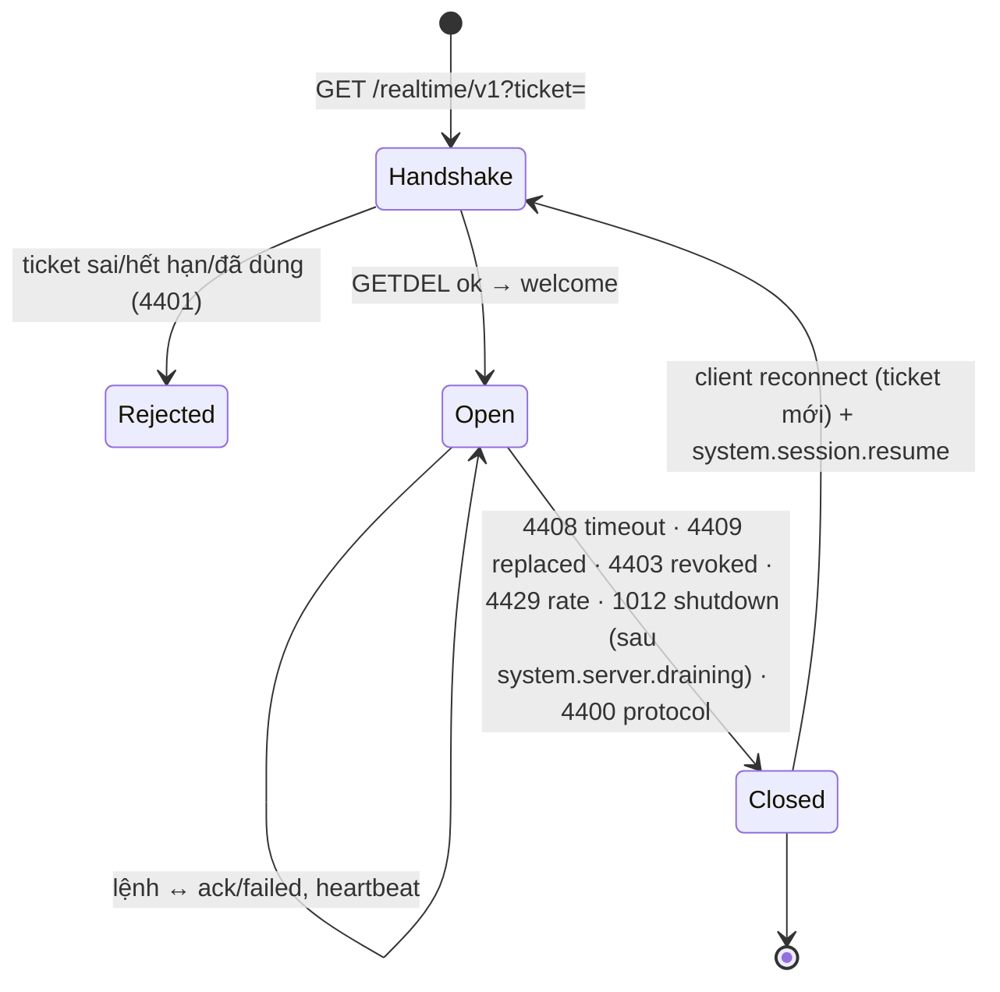

# Data Model: F090 — realtime: ticket, WebSocket, heartbeat/reconnect, định tuyến lệnh, cắt kết nối khi thu hồi

**Spec**: [spec.md](spec.md) · **Plan**: [plan.md](plan.md) · Nguồn sự thật bảng: [DATABASE_DESIGN](../../docs/07-backend/DATABASE_DESIGN.md) · Key Valkey: [VALKEY_DESIGN §3](../../docs/07-backend/VALKEY_DESIGN.md)

## 1. Entity

Không áp dụng — feature không tạo/sửa bảng PostgreSQL: `realtime` không có database (ADR-0074, DATABASE_DESIGN §1.2); module game chỉ đọc/cập nhật `game.game_sessions` đã có (F014: `last_heartbeat_at`). Mọi trạng thái của feature là **ephemeral** trong Valkey (ADR-0004), liệt kê dưới đây để code đúng tên key, TTL và owner.

### Key Valkey (tên thật sau key builder `ew:<module>:`)

| Key | Kiểu | TTL | Owner | Trạng thái |
|---|---|---|---|---|
| `ew:game:rt:ticket:<sha256>` | STRING JSON `{user_id, tenant_id, school_id, game_session_id, device_id, iat}` | `realtime_ticket_ttl` (`SET NX EX`; gateway `GETDEL`) | game · game_session | Có sẵn (§3.1 `ew:rt:ticket`) |
| `ew:gateway:rt:conn:<user_id>` | HASH `{node, conn_id, game_session_id, since}` | `presence_ttl` (gia hạn mỗi heartbeat) | realtime | Có sẵn — thêm field `game_session_id` |
| `ew:gateway:rt:node:<node_id>:alive` | STRING | 10 s (gia hạn 3 s) | realtime | Có sẵn |
| `ew:gateway:rt:node:<node_id>:conns` | SET conn_id | 1 h (gia hạn) | realtime | Có sẵn |
| `ew:gateway:rt:nodes` | ZSET node → số kết nối | không TTL, watcher dọn | realtime | Có sẵn |
| `ew:gateway:rt:resume:<token>` | LIST message JSON (≤ số message của `resume_window`) | `resume_window` | realtime | Có sẵn |
| `ew:gateway:rt:resume:<token>:meta` | HASH `{user_id, game_session_id, last_seq, subs}` (`subs` = JSON mảng topic ≤ 64 phần tử) | `resume_window` | realtime | **Mới** |
| `ew:gateway:rt:cmd:<user_id>:<cmd_id>` | STRING JSON kết quả ack/failed | `resume_window` | realtime | **Mới** |
| `ew:<module>:rl:ws_ticket:<user_id>:<window>` | STRING counter | = window | game · `pkg/httpx` | Có sẵn (`ew:rl:*`) |

Kênh Pub/Sub dùng: `ew:rt:user:<user_id>`, `ew:rt:party:<id>`, `ew:rt:room:<id>:out`, `ew:chat:fanout:<id>`, `ew:rt:broadcast`, `ew:rt:node:<node_id>:in` (VALKEY_DESIGN §3.2, có sẵn). Payload theo `RtPubSubEnvelope` ([research R1](research.md)).

## 2. Vòng đời / trạng thái

## 3. Quy tắc kiểm tra dữ liệu

- Ticket chỉ dùng một lần (`GETDEL`), không lưu bản rõ.
- Một kết nối hiệu lực mỗi học sinh: ghi `ew:gateway:rt:conn:<user_id>` bằng `HSET` + đọc giá trị cũ trong cùng script Lua; giá trị cũ ở node khác → publish `ew:rt:node:<node>:in` `{close: conn_id, code: 4409}`.
- Resume chỉ hợp lệ khi `meta.user_id` và `meta.game_session_id` khớp ticket mới.
- Không key nào chứa PII; value chỉ ID.

## 4. Event / outbox

| Event | Khi nào | Payload schema |
|---|---|---|
| `audit.recorded` (gateway, JetStream `ew.evt.realtime.audit.recorded`) | Đóng `4429` do vi phạm rate limit lặp lại | `specs/events/payloads/common/audit.recorded.v1.schema.json` — schema chung (F003) |
| `audit.recorded` (module game outbox) | Từ chối ticket cho người không phải học sinh | Schema chung `specs/events/payloads/common/audit.recorded.v1.schema.json` (owner F003) |
