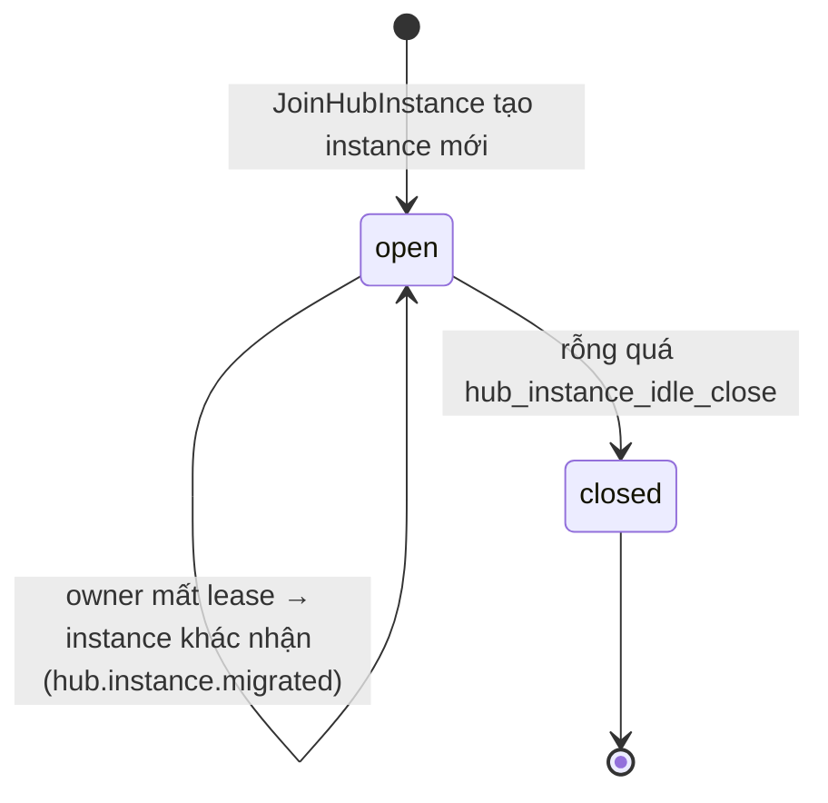

# Data Model: F091 — Hub instance, presence, đồng bộ vị trí

**Spec**: [spec.md](spec.md) · **Plan**: [plan.md](plan.md) · Nguồn sự thật bảng: [DATABASE_DESIGN](../../docs/07-backend/DATABASE_DESIGN.md) (§2.9, §2.16, §2.17)

Database `eduworld_competition`.

## 1. Entity

### Room — `multiplayer.rooms` (Có sẵn §2.9, T — Thêm cột)

| Trường | Kiểu (ent / SQL) | Ràng buộc | Ghi chú |
|---|---|---|---|
| `room_id` | UUIDv7 | PK | |
| `tenant_id` | uuid | NOT NULL, FK `ref.tenants`, RLS | R8 |
| `room_type` | `varchar(64)` | CHECK `hub_instance`/`private_instance`/`lobby`/`battle`/`coop` | F091 chỉ ghi `hub_instance` |
| `area_id` | `varchar(64)` | NOT NULL | khớp `ref.world_areas` |
| `school_id` | uuid | NULL cho room liên trường | |
| `grade_band` | `varchar(64)` | CHECK `g1_3`/`g4_5`/`g6_7`/`g8_9`, NULL với room không theo khối | **Thêm cột** |
| `capacity` | int | CHECK 1–40 | |
| `status` | `varchar(64)` | CHECK `open`/`closed` | |
| `created_at`, `closed_at` | timestamptz | | |
| `deleted_at`, `deleted_by`, `delete_reason` | | | R21 |

**Index**: `rooms_partition_open_idx (tenant_id, area_id, school_id, grade_band) WHERE status = 'open' AND deleted_at IS NULL`.

### SessionMembership — `multiplayer.session_memberships` (Có sẵn §2.9, T — Thêm cột theo [MULTIPLAYER_GAMEPLAY §10](../../docs/03-social-multiplayer/MULTIPLAYER_GAMEPLAY.md))

| Trường | Kiểu | Ràng buộc | Ghi chú |
|---|---|---|---|
| `membership_id` | UUIDv7 | PK | **Thêm cột** |
| `tenant_id` | uuid | NOT NULL, RLS | |
| `room_id` | uuid | NOT NULL, FK `rooms` | |
| `room_type` | `varchar(64)` | NOT NULL | **Thêm cột** |
| `school_id`, `student_id`, `game_session_id` | uuid | NOT NULL (trừ `school_id`) | `game_session_id` **Thêm cột** |
| `party_id`, `match_id`, `encounter_id` | uuid NULL | | **Thêm cột** (F100+) |
| `joined_at`, `left_at` | timestamptz | `left_at` cập nhật một lần | |
| `leave_reason` | `varchar(64)` | CHECK `left`/`disconnected`/`kicked`/`timeout`/`room_closed`/`transferred`/`replaced_by_other_device` | **Thêm cột** |
| `disconnects` | int | DEFAULT 0 | |
| `deleted_at`, `deleted_by` | | | R21 |

**Index**: `session_memberships_active_uq (room_id, student_id) WHERE left_at IS NULL AND deleted_at IS NULL`; `(tenant_id, student_id, joined_at DESC)`. Hub chỉ ghi khi `audit_hub_membership` bật cho tenant.

### Integrity signal — `competition.integrity_signals` (Có sẵn §2.16, T, P)

Ghi `signal_type = 'hub_speed'`/`'hub_bounds'`, `match_id` NULL, `evidence jsonb` = `{room_id, violations_per_min, sample}` (≤ 4 KB, không PII).

### Projection `ref` (chỉ consumer ghi; `source_version bigint`)

| Bảng | Trạng thái | Cột | Nguồn |
|---|---|---|---|
| `ref.tenants`, `ref.students` | Có sẵn §2.17 | theo §2.17 | identity · `tenant.*`, `student.synced`, `user.status_changed`, `student.cleaned_up/restored` |
| `ref.player_profiles` | Có sẵn — **Thêm cột** `avatar_config jsonb` (CHECK `octet_length <= 4096`) | `student_id` PK, `tenant_id`, `nickname varchar(32)`, `avatar_thumb_key varchar(512)`, `level`, `avatar_config`, `source_version` | game · `game_profile.updated` |
| `ref.world_areas` | **Mới** (G) | `area_id varchar(64)` PK, `capacity int`, `max_speed_mps numeric(5,2)`, `bounds jsonb` (≤ 16 KB), `spawn_points jsonb` (≤ 8 KB), `allowed_grade_bands varchar(64)[]` (cardinality ≤ 4), `requires_unlock bool`, `status varchar(64)`, `source_version` | game · `content.published`/`content.unpublished` (`item_type = world_area`) |
| `ref.area_unlocks` | **Mới** | `tenant_id`, `student_id`, `area_id varchar(64)`, `unlocked_at`, `source_version`; PK `(student_id, area_id)` | game · `world.area_unlocked` |
| `ref.friendships` | **Mới** (owner F091; F100, F104 chỉ đọc — DATABASE_DESIGN §2.17) | `tenant_id`, `user_low_id`, `user_high_id`, `active bool`, `source_version`; PK `(user_low_id, user_high_id)` | chat · `friend.added/removed` |
| `ref.blocks` | **Mới** (owner F091; F100, F104 chỉ đọc — DATABASE_DESIGN §2.17) | `tenant_id`, `blocker_id`, `blocked_id`, `active bool`, `source_version`; PK `(blocker_id, blocked_id)` | chat · `user.blocked/unblocked` |

### Key Valkey (tạm, tên thật có prefix module)

| Key | Kiểu | TTL | Owner |
|---|---|---|---|
| `ew:competition:rt:room:<room_id>` | HASH `{owner_instance, type, tenant_id, school_id, grade_band, area_id, capacity, members, state_version}` | 2 h gia hạn | competition · room |
| `ew:competition:rt:room:<room_id>:lease` | STRING owner | 10 s, gia hạn 3 s | competition · room |
| `ew:competition:rt:area:<area_id>:<tenant_id>:<school_id>:<grade_band>:instances` | ZSET room_id → số người | 2 h | competition · room |
| `ew:competition:rt:room:<room_id>:held:<student_id>` | STRING (giữ chỗ khi mất kết nối) | `disconnect_grace` hub | competition · room — **Mới** |
| `ew:gateway:presence:user:<user_id>` | HASH `{status, activity, area_id, room_id, hidden, updated_at}` | `presence_ttl` | realtime · presence (thêm field `hidden`) |
| `ew:gateway:presence:tenant:<tenant_id>:online` | ZSET user → last_seen_ms | dọn > `presence_ttl` | realtime · presence |

## 2. Vòng đời / trạng thái

Thành viên: `joined` → (`disconnected`, giữ chỗ trong `disconnect_grace`) → `joined` | `left` (`left_reason`).

## 3. Quy tắc kiểm tra dữ liệu

- Partition = `(tenant_id, school_id, grade_band)`; `grade_band` suy từ `ref.students.grade_level` ([GLOSSARY](../../docs/00-overview/GLOSSARY.md)).
- Một membership active mỗi học sinh mỗi room; một hub instance active mỗi học sinh (join khu mới → leave room cũ trong cùng command).
- Số người ≤ `min(ref.world_areas.capacity, hub_instance_capacity)`; chọn/giữ chỗ bằng script Lua trên ZSET (unique membership PG là chốt chặn).
- Vị trí hợp lệ khi quãng đường ≤ `max_speed_mps` × Δt × 1,2 và nằm trong `bounds`.

## 4. Event / outbox

| Event | Khi nào | Payload schema |
|---|---|---|
| `audit.recorded` | Vi phạm vị trí vượt ngưỡng 20/phút | Schema chung `specs/events/payloads/common/audit.recorded.v1.schema.json` (owner F003) |
| (tiêu thụ) `content.published`, `content.unpublished` (game, `item_type = world_area`) | game publish/gỡ area | `specs/events/payloads/game/content.published.v1.schema.json` — owner F071 (khối `world_area`: capacity, `max_speed_mps`, biên, spawn, khối được vào); `content.unpublished` owner F078 |
| (tiêu thụ) `world.area_unlocked`, `game_profile.updated` | | `specs/events/payloads/game/…` — Cần thêm (owner F071/F070) |
| (tiêu thụ) `friend.added/removed`, `user.blocked/unblocked` | | `specs/events/payloads/chat/…` — Cần thêm (F095) |
