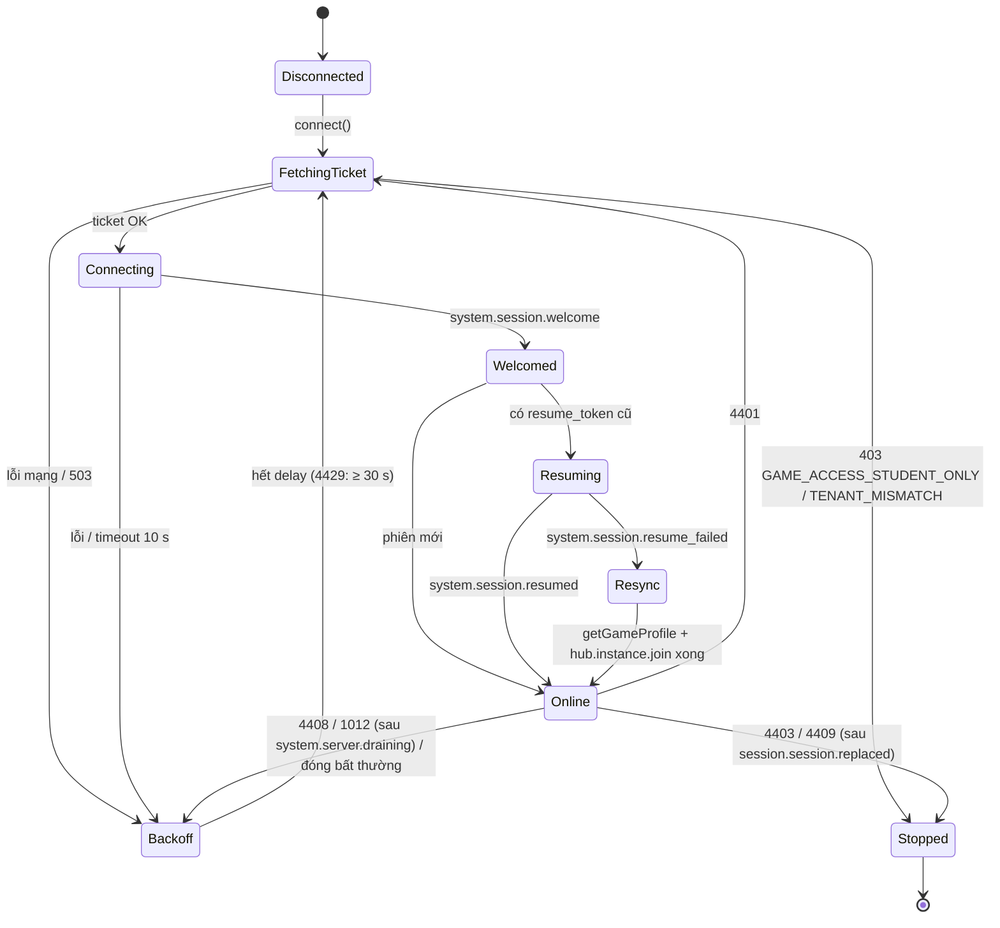

# Data Model: F092 — `RealtimeClient` Godot và Main Hub nhiều người chơi

**Spec**: [spec.md](spec.md) · **Plan**: [plan.md](plan.md) · Nguồn sự thật bảng: [DATABASE_DESIGN](../../docs/07-backend/DATABASE_DESIGN.md)

## 1. Entity

Không áp dụng — game client không có dữ liệu bền vững: access token, ticket, `resume_token`, trạng thái hub chỉ ở RAM (server-authoritative; refresh token do F061 giữ trong `SecureStorage` theo ADR-0086). Mô hình trạng thái trong `AppState`/service (typed) để code nhất quán:

| Model (GDScript `class_name`) | Trường | Nguồn |
|---|---|---|
| `RealtimeSession` | `state: int` (enum `Disconnected, FetchingTicket, Connecting, Welcomed, Resuming, Resync, Online, Backoff, Stopped`), `conn_id: String`, `resume_token: String`, `last_seq: int`, `heartbeat_s: int`, `timeout_s: int`, `max_frame_bytes: int`, `max_move_hz: int` | `system.session.welcome` |
| `PendingCommand` | `id: String` (UUIDv7), `type: String`, `deadline_ms: int`, `callback: Callable` | `send_command` |
| `HubRoomState` | `room_id: String`, `area_id: String`, `self_eid: int`, `tick_rate_hz: int`, `max_speed_mps: float`, `players: Dictionary[int, PublicPlayerModel]` | `hub.instance.assigned`, `hub.player.joined/left` |
| `PublicPlayerModel` | `user_id: String`, `nickname: String` (≤ 32, DATABASE_DESIGN), `avatar_config: Dictionary`, `level: int` | `PublicPlayer` |
| `SnapshotSample` | `tick: int`, `server_ms: int`, `p: Vector3`, `yaw: float`, `anim: String` | `hub.snapshot.updated` / `HubEntity` |
| `NetStats` | `rtt_p50_ms`, `rtt_p95_ms`, `reconnects`, `resume_ok`, `resume_failed` | heartbeat, state machine |

## 2. Vòng đời / trạng thái

## 3. Quy tắc kiểm tra dữ liệu

- Message vào: parse JSON → kiểm `v == 1`, `type` khớp mẫu `^[a-z_]+\.[a-z_]+\.[a-z_]+$` ≤ 64, `seq` > `last_seq` (trùng → bỏ); trường thiếu/sai kiểu → bỏ message, log debug (không log payload).
- Message ra: tổng kích thước ≤ `max_frame_bytes`; chuỗi theo `maxLength` AsyncAPI.
- `hub.player.move`: lượng tử `p` 1 cm, `r` 1°; gửi khi vượt ngưỡng hoặc keepalive 1 Hz.

## 4. Event / outbox

Không áp dụng (client không phát domain event).
