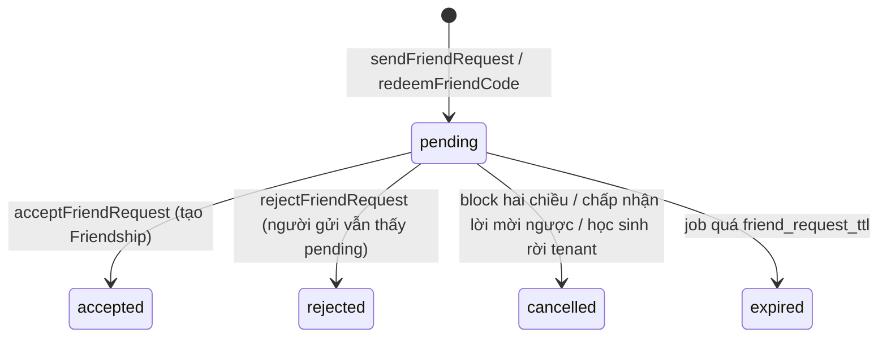

# Data Model: F095 — Bạn bè, block, mute (module social)

**Spec**: [spec.md](spec.md) · **Plan**: [plan.md](plan.md) · Nguồn sự thật bảng: [DATABASE_DESIGN](../../docs/07-backend/DATABASE_DESIGN.md) (§2.11, §2.17)

Database `eduworld_chat`, schema `social` (T: `tenant_id` + soft-delete + RLS). Cột chung T (`created_at`, `updated_at`, `deleted_at`, `deleted_by`, `delete_reason varchar(64)`) không lặp lại.

## 1. Entity

### FriendRequest — `social.friend_requests` (Có sẵn — Thêm cột)

| Trường | Kiểu | Ràng buộc | Ghi chú |
|---|---|---|---|
| `request_id` | UUIDv7 | PK | |
| `tenant_id` | uuid | NOT NULL, FK `ref.tenants`, RLS | |
| `requester_id`, `addressee_id` | uuid | NOT NULL, CHECK khác nhau | |
| `status` | `varchar(32)` | CHECK `pending`/`accepted`/`rejected`/`cancelled`/`expired` | |
| `source` | `varchar(64)` | CHECK `direct`/`friend_code` | **Thêm cột** |
| `expires_at` | timestamptz | NOT NULL | `friend_request_ttl` |
| `responded_at` | timestamptz | | **Thêm cột** |

**Index**: UNIQUE `(requester_id, addressee_id) WHERE status = 'pending' AND deleted_at IS NULL`; `(tenant_id, addressee_id, status, created_at DESC)`; `(status, expires_at) WHERE status = 'pending'` (job hết hạn).

### Friendship — `social.friendships` (Có sẵn — Đổi khóa)

| Trường | Kiểu | Ràng buộc | Ghi chú |
|---|---|---|---|
| `friendship_id` | UUIDv7 | PK | **Thêm cột** (thay PK cặp vì soft-delete cho phép kết bạn lại) |
| `tenant_id` | uuid | NOT NULL, RLS | |
| `user_low_id`, `user_high_id` | uuid | NOT NULL, CHECK `user_low_id < user_high_id` | |

**Index**: UNIQUE `(user_low_id, user_high_id) WHERE deleted_at IS NULL`; `(tenant_id, user_low_id)`, `(tenant_id, user_high_id)`.

### FriendCode — `social.friend_codes` (Có sẵn — Thêm cột)

| Trường | Kiểu | Ràng buộc | Ghi chú |
|---|---|---|---|
| `friend_code_id` | UUIDv7 | PK | **Thêm cột** |
| `tenant_id` | uuid | NOT NULL, RLS | |
| `code` | `varchar(12)` | CHECK `^[A-Z0-9]{6,12}$` | |
| `owner_id` | uuid | NOT NULL | |
| `expires_at` | timestamptz | NOT NULL | `friend_code_ttl` |

**Index**: UNIQUE `(tenant_id, code) WHERE deleted_at IS NULL` (mã cũ soft-delete khi tạo mã mới hoặc hết hạn — job dọn đặt `deleted_at`, không xóa vật lý); UNIQUE `(owner_id) WHERE deleted_at IS NULL`.

### Block — `social.blocks` / Mute — `social.mutes` (Có sẵn — Đổi khóa)

| Trường | Kiểu | Ràng buộc |
|---|---|---|
| `block_id` / `mute_id` | UUIDv7 | PK (**Thêm cột**) |
| `tenant_id` | uuid | NOT NULL, RLS |
| `blocker_id`, `blocked_id` / `muter_id`, `muted_id` | uuid | NOT NULL, CHECK khác nhau |

**Index**: UNIQUE `(blocker_id, blocked_id) WHERE deleted_at IS NULL`; index ngược `(tenant_id, blocked_id)` để kiểm hai chiều. Tương tự cho `mutes`.

### Projection `ref` (Có sẵn §2.17, consumer ghi)

`ref.tenants` (`tenant_type`, `status`, `settings_subset` chứa `cross_school_social_enabled`), `ref.students` (`school_id`, `grade_level`, `status`, `deleted_at`), `ref.player_profiles` (`nickname varchar(32)`, `avatar_thumb_key`, `level`; **Thêm cột** `avatar_config jsonb` ≤ 4 KB cho `PlayerCard`).

### Key Valkey (tạm)

| Key | Kiểu | TTL | Trạng thái |
|---|---|---|---|
| `ew:chat:social:friends:<user_id>` | SET user_id bạn bè | 10 phút; xóa khi đổi quan hệ | **Mới** |
| `ew:chat:social:presence:<user_id>` | HASH `{status, activity, area_id, hidden, ts}` | `presence_ttl` | **Mới** |
| `ew:chat:rl:friend_requests:<user_id>:<yyyymmdd>` | STRING counter | 48 h | Có sẵn (`ew:rl:*`) |

## 2. Vòng đời / trạng thái

## 3. Quy tắc kiểm tra dữ liệu

- Cùng tenant bắt buộc; cùng `school_id` trừ khi tenant `unit` bật liên trường ([ADR-0054](../../docs/adr/ADR-0054-tuong-tac-xa-hoi-lien-truong-cross-school-social-interaction.md)).
- Block bất kỳ chiều → mọi lời mời bị từ chối `SOCIAL_SCOPE_VIOLATION`.
- `friend_limits` kiểm trong transaction (`COUNT` bạn active + lời mời pending với `FOR UPDATE` trên hàng requester).
- Accept khóa theo cặp (advisory lock `hashtextextended(low||high)`) để unique tình bạn không bị đua.

## 4. Event / outbox

| Event | Khi nào | Payload schema |
|---|---|---|
| `friend_request.sent` | Tạo lời mời | `specs/events/payloads/chat/friend_request.sent.v1.schema.json` — Cần thêm (`request_id`, `requester_id`, `addressee_id`, `source`, `expires_at`) |
| `friend.added` / `friend.removed` | Chấp nhận / hủy kết bạn / chặn | `friend.added.v1`, `friend.removed.v1` — Cần thêm (`user_low_id`, `user_high_id`, `reason?`) |
| `user.blocked` / `user.unblocked` | Chặn / bỏ chặn | `user.blocked.v1`, `user.unblocked.v1` — Cần thêm (`blocker_id`, `blocked_id`) |
| `user.muted` / `user.unmuted` | Tắt / bỏ tắt tiếng | `user.muted.v1`, `user.unmuted.v1` — Cần thêm (`muter_id`, `muted_id`) |
| `audit.recorded` | Mỗi command ghi | schema audit chung — Cần thêm |
