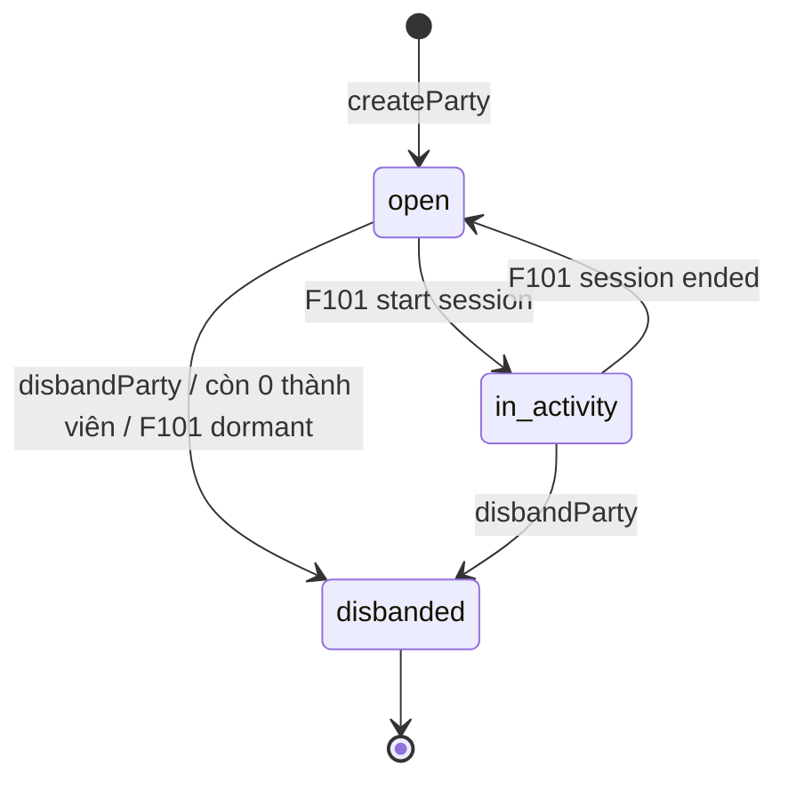

# Data Model: F100 — Party: tạo/tham gia/mời/kick/chuyển leader/giải tán, một party active, giới hạn

**Spec**: [spec.md](spec.md) · **Plan**: [plan.md](plan.md) · Nguồn sự thật bảng: [DATABASE_DESIGN](../../docs/07-backend/DATABASE_DESIGN.md) (§2.9, §2.16, §2.17, §3.7)

Database `eduworld_competition`, schema `multiplayer`. Mọi bảng T: `tenant_id NOT NULL` + RLS, cột audit chuẩn (mixin `Base`), `deleted_at`/`deleted_by` (trừ bảng append-only).

## 1. Entity

### Party — `multiplayer.parties` (Có sẵn §3.7 · Thêm cột `state_version`)

| Trường | Kiểu (ent / SQL) | Ràng buộc | Ghi chú |
|---|---|---|---|
| `party_id` | UUIDv7 | PK | |
| `tenant_id`, `school_id` | uuid | NOT NULL, RLS | của leader lúc tạo |
| `name` | `varchar(128)` (`MaxLen(128)`) | CHECK `char_length BETWEEN 1 AND 40` | đã kiểm duyệt (research R2) |
| `leader_id` | uuid | NOT NULL | khớp thành viên `role = leader` |
| `party_type` | `varchar(64)` | CHECK `friend/study_party/quest/competition_team/custom` (`study_group` cũ còn trong CHECK tới WP-R, dữ liệu đã đổi — ADR-0095 D7) | |
| `visibility` | `varchar(64)` | `private/friends`, mặc định `private` (giá trị `class` cũ còn trong CHECK tới WP-R, dữ liệu đã đổi `private`, code đọc `class` như `private` — ADR-0095) | |
| `invitation_policy` | `varchar(64)` | CHECK `leader_only/members` | |
| `max_members` | smallint | CHECK 2–8 | mặc định `party_max_members` |
| `grade_band` | `varchar(64)` | NOT NULL | Có sẵn §2.16 (grade band thấp nhất) |
| `status` | `varchar(64)` | CHECK `open/in_activity/disbanded` | |
| `current_activity_id`, `current_game_session_ref` | uuid | | F101 ghi |
| `state_version` | bigint | NOT NULL DEFAULT 0 | **Mới** — tăng mỗi thay đổi membership/cài đặt/activity; `expected_version` của F101 |
| `created_at`, `updated_at`, `disbanded_at` | timestamptz | | |
| `deleted_at`, `deleted_by` | | | chỉ dữ liệu tạo nhầm (R21) |

**Index**: `parties_tenant_status_idx (tenant_id, status) WHERE deleted_at IS NULL`; `(school_id, status)`.

### PartyMember — `multiplayer.party_members` (Có sẵn §3.7)

`party_id` FK, `student_id`, `tenant_id`, `school_id`, `role varchar(64)` (`leader`/`member`), `joined_at`, `left_at`, `left_reason varchar(64)` CHECK (`left`/`kicked`/`disbanded`/`timeout`/`policy`), `deleted_at`, `deleted_by`; PK `(party_id, student_id, joined_at)`.

**Index**: `party_members_one_active_party_uq (student_id) WHERE left_at IS NULL AND deleted_at IS NULL`; `party_members_one_leader_uq (party_id) WHERE left_at IS NULL AND role = 'leader' AND deleted_at IS NULL`; unique `(party_id, student_id) WHERE left_at IS NULL` (§2.9).

### PartyInvitation — `multiplayer.party_invitations` (Có sẵn §2.9 · DDL Mới)

| Trường | Kiểu | Ràng buộc | Ghi chú |
|---|---|---|---|
| `invitation_id` | UUIDv7 | PK | |
| `tenant_id`, `school_id` | uuid | NOT NULL, RLS | |
| `party_id` | uuid | FK `parties` | |
| `inviter_id`, `invitee_id` | uuid | NOT NULL, CHECK khác nhau | |
| `status` | `varchar(64)` | CHECK `pending/accepted/rejected/expired/cancelled` | |
| `created_at`, `expires_at`, `responded_at` | timestamptz | `expires_at` NOT NULL | giờ server |
| `deleted_at`, `deleted_by` | | | |

**Index**: unique `(party_id, invitee_id) WHERE status = 'pending' AND deleted_at IS NULL`; `(invitee_id, status, expires_at)`; `(expires_at) WHERE status = 'pending'` cho job.

### PartyHistory — `multiplayer.party_histories` (Có sẵn §2.16, TA, P tháng theo `occurred_at`)

`history_id` UUIDv7, `tenant_id`, `school_id`, `party_id`, `event_type varchar(64)`, `actor_id uuid NULL` (NULL = hệ thống), `data jsonb` (CHECK `octet_length(data::text) <= 4096`, không nội dung chat/PII), `occurred_at`; PK `(history_id, occurred_at)`; `REVOKE UPDATE, DELETE, TRUNCATE`.

### PartyPolicy — `multiplayer.party_policies` (Có sẵn §2.16, chỉ đọc ở F100)

`policy_id`, `tenant_id`, `scope_type varchar(64)` (`school`; dòng `class` cũ đã soft-delete — ADR-0095), `scope_id uuid`, `school_id`, `rules jsonb` (`allowed_party_types`, `same_grade_only`, `cross_grade_band`, `max_members_cap`; khóa `cross_class` cũ bị gỡ), `version int`; UNIQUE `(scope_type, scope_id) WHERE deleted_at IS NULL`. Cấp platform lấy từ cấu hình (không có dòng).

### Projection `ref.*` (consumer ghi, use case chỉ đọc; có `source_version bigint`)

| Bảng | Trạng thái | Cột | Nguồn event |
|---|---|---|---|
| `ref.tenants`, `ref.students`, `ref.player_profiles` | Có sẵn §2.17 | theo §2.17; `ref.students.school_id`, `grade_level` là nguồn trường/khối của luật party (ADR-0095) | identity (`student.synced`; tiêu thụ `student.placement_changed` — owner F010), game |
| `ref.enrollments` | Không còn đọc/ghi (ADR-0095); DROP ở WP-R | — | `enrollment.changed` chỉ được ack, không chiếu |
| `ref.friendships` | Có sẵn (F091) | `tenant_id`, `user_low_id`, `user_high_id`, `active`, `source_version`; PK `(user_low_id, user_high_id)` — tra theo cặp đã chuẩn hóa thứ tự | `friend.added`, `friend.removed` (consumer của F091) |
| `ref.blocks` | Có sẵn (F091) | `tenant_id`, `blocker_id`, `blocked_id`, `active`, `source_version`; PK `(blocker_id, blocked_id)` | `user.blocked`, `user.unblocked` (consumer của F091) |
| `ref.sanctions` | **Mới** | `sanction_id`, `user_id`, `tenant_id`, `sanction_type varchar(64)`, `until timestamptz` | `sanction.applied`, `sanction.lifted` |

## 2. Vòng đời / trạng thái

Lời mời: `pending → accepted | rejected | expired | cancelled` ([PARTY_SYSTEM §13.2](../../docs/03-social-multiplayer/PARTY_SYSTEM.md)).

## 3. Quy tắc kiểm tra dữ liệu

- Đếm thành viên active ≤ `max_members` trong transaction `FOR UPDATE` (DATABASE_DESIGN §3.7).
- Leader rời/bị kick → leader mới = thành viên online gia nhập sớm nhất, nếu không ai online → gia nhập sớm nhất.
- Kick chặn mời lại: tồn tại `party_members(party_id, student_id, left_reason = 'kicked', left_at > now() - party_kick_reinvite_block)`.
- `state_version` tăng đúng 1 trong cùng transaction với mỗi thay đổi.

## 4. Event / outbox

| Event | Khi nào | Payload schema |
|---|---|---|
| `party.created` | Tạo party | `specs/events/payloads/competition/party.created.v2.schema.json` — Cần thêm |
| `party.settings_updated` | Sửa cài đặt | `party.settings_updated.v1` — Cần thêm |
| `party.invitation_sent` / `_accepted` / `_rejected` / `_expired` / `_cancelled` | Vòng đời lời mời | `party.invitation_<x>.v1` — Cần thêm |
| `party.member_joined` / `_left` / `_kicked` | Thay đổi thành viên | `party.member_<x>.v1` — Cần thêm |
| `party.leader_transferred` | Chuyển leader (manual/leader_left) | `party.leader_transferred.v1` — Cần thêm |
| `party.disbanded` | Giải tán | `party.disbanded.v1` — Cần thêm |
| `audit.recorded` | Theo plan §Bảo mật | envelope audit (F015) |
