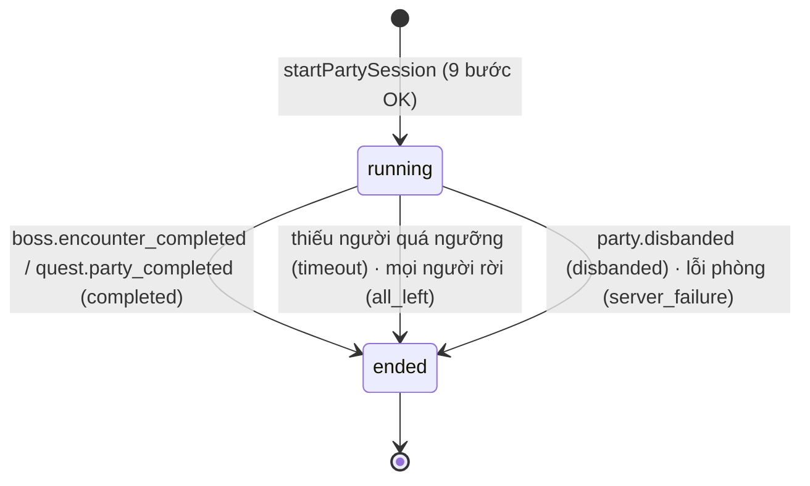

# Data Model: F101 — Party Lobby, Start Session, leader/thành viên mất kết nối

**Spec**: [spec.md](spec.md) · **Plan**: [plan.md](plan.md) · Nguồn sự thật bảng: [DATABASE_DESIGN](../../docs/07-backend/DATABASE_DESIGN.md) (§2.9) · [MULTIPLAYER_GAMEPLAY §10](../../docs/03-social-multiplayer/MULTIPLAYER_GAMEPLAY.md) · [VALKEY_DESIGN §3.1](../../docs/07-backend/VALKEY_DESIGN.md)

Database `eduworld_competition`, schema `multiplayer`. Bảng `parties`, `party_members` do F100 tạo.

## 1. Entity

### PartyActivity — `multiplayer.party_activities` (Có sẵn §2.9 · Thêm cột)

| Trường | Kiểu (ent / SQL) | Ràng buộc | Ghi chú |
|---|---|---|---|
| `party_activity_id` | UUIDv7 | PK | sinh trước khi gọi module game (research R2) |
| `tenant_id`, `school_id` | uuid | NOT NULL, RLS | **Thêm cột** |
| `party_id` | uuid | FK `parties` | |
| `activity_type` | `varchar(64)` | CHECK theo `PartyActivityType` | `explore`/`quest`/`boss`/… (research R4) |
| `activity_ref` | `varchar(64)` | NOT NULL | `area_id` / `quest_id` / `boss_id` |
| `game_mode` | `varchar(64)` | | **Thêm cột** |
| `room_id` | uuid | NOT NULL | `rooms.room_id` (`explore`, `quest` — `private_instance` do competition cấp) hoặc `encounter_id` (`boss`, không FK) |
| `external_ref` | uuid | | **Thêm cột** — `encounter_id` / `party_quest_session_id` do module game trả (`startPartyActivity`) |
| `room_type` | `varchar(64)` | CHECK `private_instance/boss` | **Thêm cột** |
| `status` | `varchar(64)` | CHECK `running/ended` | **Thêm cột** |
| `min_members`, `max_members` | smallint | | **Thêm cột** — chốt lúc start |
| `allow_continue_on_disconnect` | boolean | NOT NULL | **Thêm cột** |
| `started_at`, `ended_at` | timestamptz | | giờ server |
| `end_reason` | `varchar(64)` | CHECK `completed/timeout/all_left/disbanded/server_failure` | **Thêm cột** |
| `result_summary` | jsonb | CHECK `octet_length <= 4096` | chỉ tiến độ chung (vd. `phases_cleared`), **không** điểm/kết quả cá nhân (FR-PTY-013) |
| `deleted_at`, `deleted_by` | | | |

**Index**: unique `(party_id) WHERE status = 'running' AND deleted_at IS NULL` (một activity chạy/party); `(room_id)`.

### Room — `multiplayer.rooms` (Có sẵn §2.9 · Thêm cột `tenant_id`)

`room_id` UUIDv7, `tenant_id`, `room_type varchar(64)` (F101 chỉ tạo `private_instance`), `area_id varchar(64)`, `school_id`, `capacity smallint` (≤ `private_instance_capacity`), `status varchar(64)` (`open/running/closing/closed`), `created_at`, `closed_at`. State live ở Valkey `ew:rt:room:<room_id>` (F091).

### SessionMembership — `multiplayer.session_memberships` (Có sẵn §2.9 · Thêm cột theo MULTIPLAYER_GAMEPLAY §10)

| Trường | Kiểu | Ghi chú |
|---|---|---|
| `session_membership_id` | UUIDv7 PK | **Thêm cột** |
| `tenant_id`, `school_id`, `student_id` | uuid NOT NULL | `tenant_id` **Thêm cột** |
| `room_id` | uuid NOT NULL | |
| `room_type` | `varchar(64)` | **Thêm cột** |
| `party_id`, `party_activity_id` | uuid | **Thêm cột** |
| `game_session_id` | uuid | **Thêm cột** — từ header gateway/Principal |
| `joined_at`, `left_at` | timestamptz | |
| `leave_reason` | `varchar(64)` | **Thêm cột** — CHECK `left/disconnected/kicked/timeout/room_closed/transferred/replaced_by_other_device` |
| `disconnects` | smallint | Có sẵn |

**Index**: unique `(room_id, student_id) WHERE left_at IS NULL`; `(tenant_id, student_id, joined_at DESC)`. Retention 90 ngày theo MULTIPLAYER_GAMEPLAY §10.

### Lobby state — Valkey (Rebuildable/Ephemeral)

| Key | Kiểu | TTL | Trạng thái |
|---|---|---|---|
| `ew:party:<party_id>` | HASH {leader_id, status, state_version, activity_type, activity_ref, game_mode, leader_disconnected_at} | 24 h | Có sẵn (thêm field) |
| `ew:party:<party_id>:members` | HASH user_id → {role, ready, status, joined_at} | 24 h | Có sẵn |
| `ew:party:<party_id>:lock` | STRING NX | 5 s | **Mới** |
| `ew:party:<party_id>:leader_grace` | STRING | `party_leader_grace` | **Mới** |
| `ew:party:active` | ZSET party_id → last_online_ms | không TTL (sweeper dọn) | **Mới** |

## 2. Vòng đời / trạng thái

Leader: `online → grace (party_leader_grace) → online` hoặc `→ auto-transfer` hoặc `→ dormant → disbanded (party_dormant_timeout)` ([PARTY_SYSTEM §9](../../docs/03-social-multiplayer/PARTY_SYSTEM.md)).

## 3. Quy tắc kiểm tra dữ liệu

- Start chỉ khi party `open`, `expected_version = state_version`, mọi thành viên online `ready`, `min_members ≤ online ≤ max_members`, không có activity `running`.
- Chọn hoạt động reset mọi `ready`; mất kết nối ở lobby reset `ready` của người đó.
- `result_summary` không chứa khóa điểm/attempt/mastery (test kiểm schema).

## 4. Event / outbox

| Event | Khi nào | Payload schema |
|---|---|---|
| `party.activity_selected` | Leader chọn hoạt động | `specs/events/payloads/competition/party.activity_selected.v1.schema.json` — Cần thêm |
| `party.activity_started` | Start thành công | `party.activity_started.v1` — Cần thêm (`party_activity_id`, `activity_type`, `activity_ref`, `room_id`, `room_type`, `member_ids`) |
| `party.activity_ended` / `party.activity_completed` | Kết thúc / kết thúc `completed` | `party.activity_ended.v1`, `party.activity_completed.v1` — Cần thêm |
| `party.leader_transferred` (`leader_disconnected`), `party.disbanded` (`inactivity`) | Worker | Schema owner F100 — F101 phát cùng schema |
