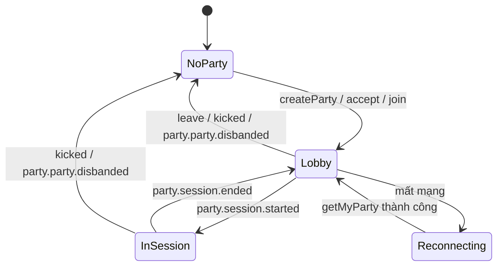

# Data Model: F102 — Giao diện party trong Godot: panel, lời mời, lobby, ready

**Spec**: [spec.md](spec.md) · **Plan**: [plan.md](plan.md) · Nguồn sự thật bảng: [DATABASE_DESIGN](../../docs/07-backend/DATABASE_DESIGN.md)

## 1. Entity

Không áp dụng — game client không có dữ liệu bền vững cho party (party không ghi `user://`; token theo F061/ADR-0086). Nguồn sự thật là module competition (F100, F101). Dưới đây chỉ là model trong bộ nhớ để parse contract.

| Model (RefCounted) | Trường | Nguồn contract |
|---|---|---|
| `PartyModel` | `party_id`, `name`, `leader_id`, `party_type` (`study_party` thay `study_group` — ADR-0095), `visibility` (`private`/`friends`; không `class` — ADR-0095), `invitation_policy`, `max_members`, `status`, `state_version`, `members: Array[PartyMemberModel]`, `current_activity`, `chat_channel_id` | OpenAPI `Party`, AsyncAPI `party.state.snapshot` |
| `PartyMemberModel` | `student_id`, `nickname`, `avatar_config`, `level`, `role`, `ready`, `presence` (`online`/`away`/`in_activity`/`disconnected`/`offline`), `joined_at` | OpenAPI `PartyMember`, AsyncAPI `PartyMemberState` |
| `InvitationModel` | `invitation_id`, `party_id`, `party_name`, `inviter` (nickname, avatar), `member_count`, `status`, `expires_at` (giờ server) | OpenAPI `PartyInvitation`, AsyncAPI `party.invitation.received` |
| `EligibleActivityModel` | `activity_type`, `activity_ref`, `title`, `min_members`, `max_members`, `all_eligible`, `members[{student_id, eligible, reason_code}]` | `listPartyEligibleActivities` (Cần thêm — F101) |

## 2. Vòng đời / trạng thái

## 3. Quy tắc kiểm tra dữ liệu

- `PartyStore` bỏ message có `state_version` ≤ bản đang giữ; lớn hơn bản giữ + 1 → `getParty` tải lại.
- Model bỏ qua trường lạ, thiếu trường bắt buộc → log cảnh báo (không PII) và tải lại snapshot.

## 4. Event / outbox

Không áp dụng — client không phát domain event.
