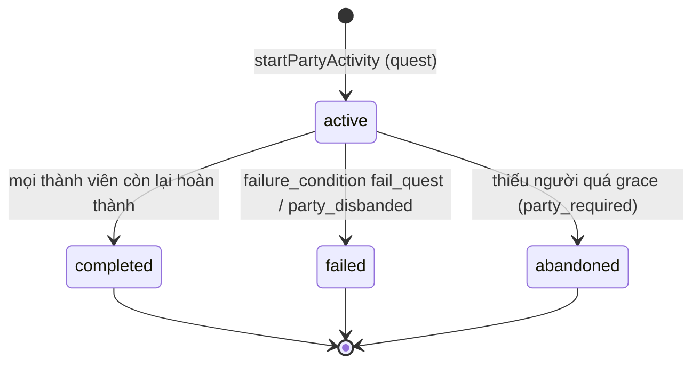

# Data Model: F103 — Boss battle nhiều phase và quest co-op (shared progress, bước `interdependent`)

**Spec**: [spec.md](spec.md) · **Plan**: [plan.md](plan.md) · Nguồn sự thật bảng: [DATABASE_DESIGN](../../docs/07-backend/DATABASE_DESIGN.md) (§2.8, §2.8a) · [CHALLENGE_BOSS_SYSTEM §6](../../docs/01-game-design/CHALLENGE_BOSS_SYSTEM.md)

Database `eduworld_game`, schema `game`. Mọi bảng T: `tenant_id NOT NULL` + RLS, mixin `Base`, `deleted_at`/`deleted_by`. `boss_definitions`/`boss_versions`, `quest_definitions`/`quest_versions` (G) do F076/F072/F078 tạo; F103 chỉ đọc theo version ghim.

## 1. Entity

### BossEncounter — `game.boss_encounters` (Có sẵn §2.8a · Thêm cột)

| Trường | Kiểu (ent / SQL) | Ràng buộc | Ghi chú |
|---|---|---|---|
| `encounter_id` | UUIDv7 | PK | = `room_id` của room `boss` |
| `tenant_id`, `school_id` | uuid | NOT NULL, RLS | `school_id` **Thêm cột** |
| `boss_version_id` | uuid | NOT NULL | ghim (ADR-0043) |
| `mode` | `varchar(64)` | CHECK `solo/party` | |
| `party_id`, `party_activity_id` | uuid | `party_activity_id` UNIQUE khi NOT NULL | `party_activity_id` **Thêm cột** — khóa idempotent của `startPartyActivity` |
| `status` | `varchar(64)` | CHECK `lobby/phase_active/phase_transition/phase_retry/defeated/ended` | |
| `current_phase` | `varchar(64)` | | `phase_id` |
| `phase_index`, `phase_retries` | smallint | NOT NULL DEFAULT 0 | **Thêm cột** |
| `energy_remaining` | numeric(5,4) | 0–1 | |
| `state_version` | bigint | NOT NULL DEFAULT 0 | **Thêm cột** |
| `deadline_at`, `phase_deadline_at` | timestamptz | | **Thêm cột** — giờ server |
| `outcome` | `varchar(64)` | CHECK `defeated/time_up/abandoned` | **Thêm cột** |
| `checkpoint` | jsonb | CHECK ≤ 64 KB | |
| `owner_node` | `varchar(128)` | | |
| `started_at`, `ended_at` | timestamptz | | |

**Index**: partial `(status) WHERE status IN ('lobby','phase_active')` (có sẵn); `(tenant_id, party_id)`.

### BossEncounterMember — `game.boss_encounter_members` (Có sẵn · Thêm cột)

`encounter_id`, `student_id`, `tenant_id`, `grade_level smallint` (**Thêm** — khối lúc vào, chọn `per_grade`), `ready boolean` (**Thêm**), `joined_at`, `left_at`, `left_reason varchar(64)` (**Thêm** — CHECK `left/disconnected/kicked/party_left/disbanded`); PK `(encounter_id, student_id)`.

### BossEncounterContribution — `game.boss_encounter_contributions` (Có sẵn)

`encounter_id`, `student_id`, `tenant_id`, `phase_id varchar(64)`, `correct_count int`, `activities_completed int`, `contribution_pct numeric(5,2)`, `eligible bool`; UNIQUE `(encounter_id, student_id, phase_id)`. Không trả cho thành viên khác ngoài `contribution_met`.

### BossPhasePlan — `game.boss_phase_plans` (**Mới**)

`boss_phase_plan_id` UUIDv7, `tenant_id`, `encounter_id`, `phase_id varchar(64)`, `retry_no smallint`, `student_id`, `requirement_id varchar(64)`, `plan_id uuid` (module learning, không FK), `expires_at`, `created_at`; UNIQUE `(encounter_id, phase_id, retry_no, student_id, requirement_id)`.

### BossAnswerResult — `game.boss_answer_results` (**Mới**, TA)

`answer_result_id` UUIDv7, `tenant_id`, `encounter_id`, `student_id`, `plan_id uuid`, `item_index smallint`, `phase_id varchar(64)`, `retry_no smallint`, `is_correct bool`, `counted bool` (false khi trả lời quá nhanh/trễ), `received_at`; UNIQUE `(plan_id, item_index, student_id)`; `REVOKE UPDATE, DELETE, TRUNCATE`. Không lưu response thô (R14).

### PartyQuestSession — `game.party_quest_sessions` (**Mới**)

| Trường | Kiểu | Ràng buộc | Ghi chú |
|---|---|---|---|
| `party_quest_session_id` | UUIDv7 | PK | `external_ref` trả cho F101 |
| `tenant_id`, `school_id` | uuid | NOT NULL, RLS | |
| `party_id` | uuid | NOT NULL | |
| `party_activity_id` | uuid | UNIQUE | khóa idempotent |
| `quest_version_id` | uuid | NOT NULL | ghim |
| `shared_progress_policy` | `varchar(64)` | CHECK `individual/shared_steps/collective_count` | QUEST_SYSTEM §6 |
| `status` | `varchar(64)` | CHECK `active/completed/failed/abandoned` | |
| `member_ids` | uuid[] | ≤ 8 | thành viên còn tham gia |
| `shared_step_states` | jsonb | CHECK ≤ 16 KB | `{step_id: {status, completed_by, collective_progress}}` |
| `role_assignments` | jsonb | CHECK ≤ 8 KB | `{step_id: {role: student_id}}` |
| `shared_clues` | jsonb | CHECK ≤ 8 KB | `[{step_id, role, shared_by, shared_at}]` (không chứa nội dung) |
| `started_at`, `ended_at` | timestamptz | | |
| `end_reason` | `varchar(64)` | CHECK `completed/failed/disbanded/abandoned` | |

### PartyQuestContribution — `game.party_quest_contributions` (**Mới**)

`party_quest_session_id`, `student_id`, `tenant_id`, `step_id varchar(64)`, `metric_value int`, `min_contribution_met bool`, `updated_at`; PK `(party_quest_session_id, student_id, step_id)`. Nguồn: `activity.graded` của attempt mode `quest` (dedupe `infra.processed_events`).

### QuestProgress — `game.quest_progress` (Có sẵn §2.8)

F103 dùng `party_id` và `step_states`; bước chung ghi đồng thời vào `step_states` của từng thành viên trong cùng transaction với session.

### Valkey

| Key | Kiểu | TTL | Trạng thái |
|---|---|---|---|
| `ew:rt:room:<encounter_id>`, `:lease`, `:ckpt` | như VALKEY_DESIGN §3.1 | như bảng | Có sẵn (thêm owner `game · boss`) |
| `ew:game:clue:<quest_version_id>:<step_id>:<role>` | STRING (render dữ kiện, không đáp án) | 1 h | **Mới** — Rebuildable |

## 2. Vòng đời / trạng thái

Encounter theo [CHALLENGE_BOSS_SYSTEM §3.3](../../docs/01-game-design/CHALLENGE_BOSS_SYSTEM.md): `lobby → phase_active ⇄ phase_retry → phase_transition → (phase_active | defeated)`, `phase_active → ended` (hết giờ/lượt/thiếu người).

## 3. Quy tắc kiểm tra dữ liệu

- Tổng `energy_share` các phase = 1 (kiểm khi publish — F078); `energy_remaining` không âm.
- Bước khung chia sẻ chỉ khi người hoàn thành ở cùng instance party; bước học tập không bao giờ chia sẻ.
- Mỗi role của bước `interdependent` có đúng một người giữ trong phiên; một người có nhiều role chỉ khi `allow_multi_role`.
- `eligible` = đạt `min_contribution` ở mọi phase người đó tham gia (CHALLENGE_BOSS_SYSTEM §3.4).

## 4. Event / outbox

| Event | Khi nào | Payload schema |
|---|---|---|
| `boss.encounter_started` | Vào phase đầu | `specs/events/payloads/game/boss.encounter_started.v1.schema.json` — Cần thêm |
| `boss.phase_completed` | Phase đạt rule | `boss.phase_completed.v1` — Cần thêm |
| `boss.encounter_completed` | Kết thúc | `boss.encounter_completed.v1` — Cần thêm (`encounter_id`, `boss_version_id`, `party_id?`, `party_activity_id?`, `result` defeated/ended, `contributions[{student_id, eligible}]`) |
| `quest.party_completed` | Phiên quest chung kết thúc | `quest.party_completed.v1` — **Mới** (`party_quest_session_id`, `party_activity_id`, `party_id`, `quest_version_id`, `outcome`, `member_ids`) |
