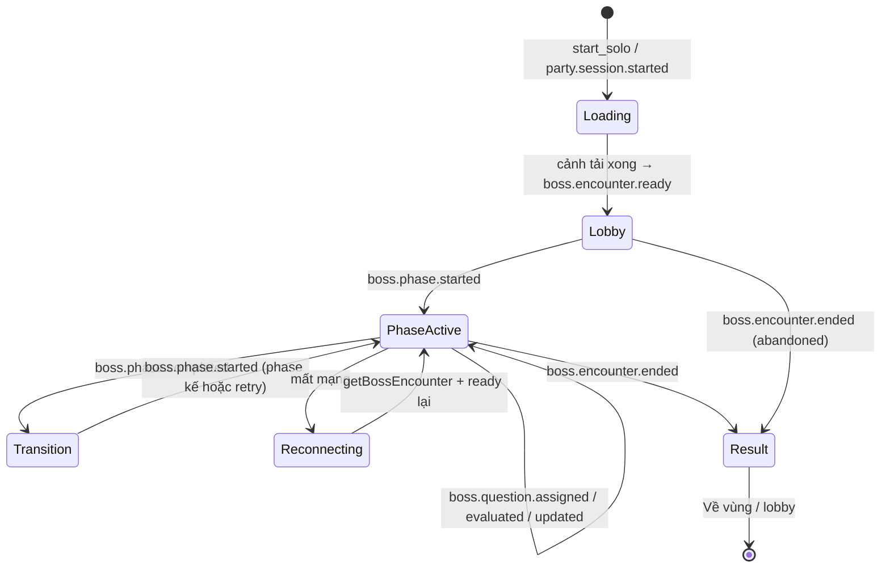

# Data Model: F110 — Godot — màn boss co-op, thẻ dữ kiện bước `interdependent`, danh sách bạn bè

**Spec**: [spec.md](spec.md) · **Plan**: [plan.md](plan.md) · Nguồn sự thật bảng: [DATABASE_DESIGN](../../docs/07-backend/DATABASE_DESIGN.md)

## 1. Entity

Không áp dụng — game client không có dữ liệu bền vững (ADR-0064; không ghi `user://`). Nguồn sự thật là module game (F103: encounter, phiên quest chung, vai, thẻ) và module chat module social (F095). Dưới đây chỉ là model trong bộ nhớ để parse contract (`from_dict` bỏ trường lạ; thiếu trường bắt buộc → log cảnh báo không PII và tải lại).

| Model (RefCounted) | Trường | Nguồn contract |
|---|---|---|
| `BossSummary` | `boss_id`, `code`, `title`, `area_id`, `phase_count`, `modes[]`, `party_size_min`, `party_size_max`, `defeated_before` | OpenAPI `BossSummary` |
| `BossEncounterModel` | `encounter_id`, `boss_id`, `boss_version`, `mode`, `party_id`, `status` (`lobby`/`phase_active`/`phase_transition`/`phase_retry`/`defeated`/`ended`), `state_version`, `current_phase`, `energy_remaining_pct`, `phase_deadline_at`, `members[{student_id, nickname, ready, connected, contribution_met}]`, `my_correct_count` (đếm từ `boss.answer.evaluated` của mình) | OpenAPI `BossEncounter`; AsyncAPI `boss.encounter.updated`, `boss.phase.*`, `boss.encounter.ended` |
| `BossQuestionModel` | `encounter_id`, `phase_id`, `requirement_id`, `question_instance_id`, `render` (`QuestionRender`, không đáp án), `deadline_at`, `state` (`open`/`sending`/`evaluated`/`closed`) | AsyncAPI `boss.question.assigned` (Cần thêm, F103) |
| `PartyQuestProgressModel` | `quest_id`, `step_id`, `collective_progress` (0–1), `my_contribution_met` | AsyncAPI `quest.progress.updated.party_progress` (Cần sửa, F103) |
| `RoleAssignmentModel` | `quest_id`, `step_id`, `role`, `title`, `icon_key`, `student_id`, `nickname`, `is_me` | `quest.roles.assigned` (Cần thêm) |
| `ClueCardModel` | `role`, `title`, `render` (dữ kiện đã render), `shared` (boolean), `shared_by_nickname` | `getQuestStepClues`, `quest.clue.shared` (Cần thêm) |
| `FriendModel` | `user_id`, `nickname`, `avatar_config`, `level`, `presence` (enum chung: `online`/`in_activity`/`in_match`/`away`/`offline`), `activity`, `area_id` | `PlayerCard`, AsyncAPI `presence.friend.updated` |
| `FriendRequestModel` | `request_id`, `requester`, `addressee`, `status` (đi: luôn hiển thị `pending` tới khi biến mất), `created_at` | `FriendRequest` |
| `FriendCodeModel` | `code`, `expires_at` | `FriendCode` |
| `RelationModel` | `kind` (`block`/`mute`), `user_id`, `nickname`, `avatar_thumbnail_url`, `created_at` | `PlayerRelation` |

## 2. Vòng đời / trạng thái

`AppState.blocking_activity = &"boss"` từ `Lobby` tới `Result`.

## 3. Quy tắc kiểm tra dữ liệu

- `BossStore` bỏ `boss.encounter.updated` có `state_version` ≤ bản đang giữ; lớn hơn bản giữ + 1 → `getBossEncounter`.
- `BossStore` không tự giảm/tăng `energy_remaining_pct`; chỉ thay bằng giá trị server.
- `CoopQuestStore` khóa thẻ theo `(quest_id, step_id, role)`; thẻ trùng bị bỏ.
- `FriendsStore` gộp `presence.friend.updated` theo `user_id`, phát `friends_changed` tối đa 1 lần/giây.

## 4. Event / outbox

Không áp dụng — client không phát domain event.
