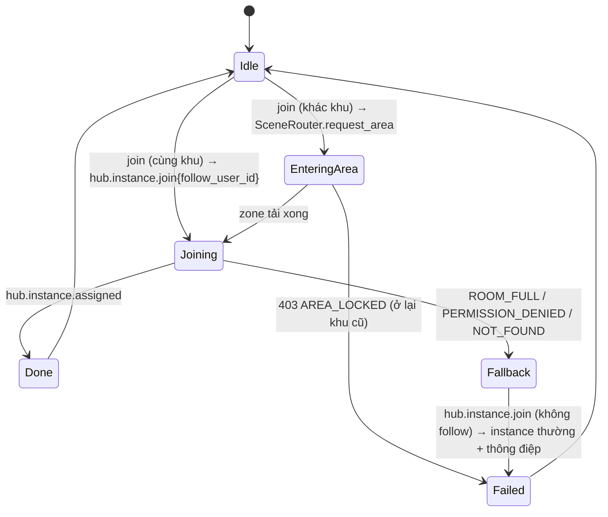

# Data Model: F111 — Godot — club trong game, Event center, nhóm "Vừa chơi cùng", nút "Tham gia bạn"

**Spec**: [spec.md](spec.md) · **Plan**: [plan.md](plan.md) · Nguồn sự thật bảng: [DATABASE_DESIGN](../../docs/07-backend/DATABASE_DESIGN.md)

## 1. Entity

Không áp dụng — game client không có dữ liệu bền vững (ADR-0064; không ghi `user://`). Nguồn sự thật: module game (sự kiện, community goal, season track — F077), module chat module social (club — F120; bạn bè, gợi ý — F095), module competition (instance hub — F091). Dưới đây chỉ là model trong bộ nhớ để parse contract (`from_dict` bỏ trường lạ; thiếu trường bắt buộc → log cảnh báo không PII và tải lại).

| Model (RefCounted) | Trường | Nguồn contract |
|---|---|---|
| `FriendSuggestionModel` | `player` (`user_id`, `nickname`, `level`, `avatar_config`, `presence`), `source` (`recently_played`), `context_kind` (`party`/`match`/`club`/`coop`), `last_played_at` | `listFriendSuggestions` (Cần thêm, F095) |
| `FriendModel` (F110, mở rộng) | thêm `area_id`, `activity` từ `presence.friend.updated` | AsyncAPI `presence.friend.updated` |
| `JoinFriendIntent` | `friend_id`, `nickname`, `target_area_id`, `command_id`, `state` (`idle`/`entering_area`/`joining`/`done`/`failed`), `fail_code` | Lệnh `hub.instance.join` (`follow_user_id` — Cần sửa, F091) |
| `SocialPolicyModel` | `student_club_creation` (`disabled`/`requires_approval`/`auto`), `club_creation_eligible`, `cross_school_enabled` | `PlayerBootstrap.policies.social` (Cần thêm, F013/F015) |
| `ClubModel` | `club_id`, `club_type`, `name`, `description`, `icon_id`, `status`, `member_count`, `max_members`, `my_role`, `chat_channel_id`, `version` (bỏ qua `school_id`, `owner_id` khi hiển thị) | OpenAPI `Club` |
| `ClubMemberModel` | `user_id`, `nickname`, `avatar_thumbnail_url`, `role`, `joined_at` | `ClubMember` |
| `ClubGoalModel` | `goal_id`, `title`, `metric`, `target`, `progress`, `my_contribution`, `week_start`, `status` | `ClubGoal` |
| `ClubEventModel` | `event_id`, `title`, `description`, `event_kind`, `starts_at`, `ends_at` | `ClubEvent` |
| `ClubInvitationModel` | `invitation_id`, `club_id`, `club_name`, `inviter_nickname`, `status`, `expires_at` | `ClubInvitation` (+ `club_name`, `inviter_nickname` ≤ 32 — Cần sửa, F120) |
| `ClubJoinRequestModel` | `request_id`, `club_id`, `requester_id`, `requester_nickname`, `status`, `created_at` | `ClubJoinRequest` |
| `LiveEventModel` | `event_id`, `event_run_id`, `event_kind`, `owner_scope`, `name`, `short_tagline`, `description`, `banner_url`, `starts_at`, `ends_at`, `status`, `joined`, `event_points`, `daily_points_remaining`, `quest_ids[]`, `milestones[]`, `community_goal`, `claim_deadline_at` | `GameEventSummary`, `GameEventDetail`; AsyncAPI `event.status.changed`, `event.progress.updated` |
| `EventMilestoneModel` | `milestone_id`, `points_required`, `rewards[]`, `reached`, `claimed` | `EventMilestone` |
| `CommunityGoalModel` | `goal_id`, `event_run_id`, `metric`, `scope`, `target`, `progress`, `milestones_reached[]`, `my_contributed`, `by_grade[]` (`grade_level` 1–9, `progress`), `updated_at` | `CommunityGoalProgress`; `event.community_goal.updated` |
| `SeasonTrackModel` | `season_id`, `season_name`, `starts_at`, `ends_at`, `points`, `tier`, `max_tier`, `points_per_tier`, `daily_points_remaining`, `tiers[]` | `SeasonTrack`; `season.track.updated` |
| `SeasonTierModel` | `tier`, `points_required`, `rewards[]`, `reached`, `claimed`, `milestone` | `SeasonTrackTier` |
| `SeasonHistoryItemModel` | `season_id`, `season_name`, `final_tier`, `points`, `auto_granted_tiers[]`, `ended_at` | `SeasonTrackHistoryItem` |

## 2. Vòng đời / trạng thái

Club phía client: `pending_approval` (chỉ xem, "Đang chờ nhà trường duyệt") → `active` (đủ hành động) → `locked`/`archived` (chỉ xem). Sự kiện: `scheduled` ("Sắp diễn ra") → `live` → `suspended` (ẩn thành phần) ↔ `live` → `ended` (chỉ nhận mốc tới `claim_deadline_at`) → biến khỏi danh sách; `cancelled` → gỡ thẻ.

## 3. Quy tắc kiểm tra dữ liệu

- `LiveEventStore` thay `event_points`, `daily_points_remaining`, `progress` bằng giá trị server (không cộng `delta`); mốc chỉ `claimed = true` sau `RewardClaimResult.claimed`.
- `CommunityGoalModel.by_grade` sắp theo `grade_level` tăng dần, không tính thứ hạng, không tên; bỏ khi `grade_band = g1_3`; khối không có trong response (server ẩn khi < 5 học sinh) không được suy ra (ADR-0095).
- `ClubStore` lọc bỏ `club_type = study_group` nếu dữ liệu cũ còn trả về (ADR-0084, ADR-0095); `ClubCreateDialog` chặn `name` ngoài 2–64 ký tự, `description` > 500 ký tự (theo `ClubCreate`).
- `SuggestionGroup` bỏ người có trong `FriendsStore` (bạn, lời mời đi đang chờ, danh sách chặn) — chỉ lọc thêm, server là nguồn lọc chính.
- Thời gian còn lại = số ngày làm tròn lên từ `ends_at` theo `Clock` (giờ server); ≤ 1 ngày hiển thị "Hôm nay là ngày cuối"; không hiển thị giờ/phút/giây.

## 4. Event / outbox

Không áp dụng — client không phát domain event.
