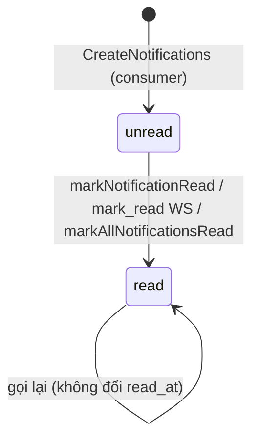

# Data Model: F123 — Thông báo trong game: realtime, lưu bền vững, không push

**Spec**: [spec.md](spec.md) · **Plan**: [plan.md](plan.md) · Nguồn sự thật bảng: [DATABASE_DESIGN](../../docs/07-backend/DATABASE_DESIGN.md)

Database `eduworld_chat`.

## 1. Entity

### Notification — `social.notifications` (Mới, T, P tháng theo `created_at`)

| Trường | Kiểu (ent / SQL) | Ràng buộc | Ghi chú |
|---|---|---|---|
| `notification_id` | UUIDv7 | PK `(notification_id, created_at)` | |
| `tenant_id` | uuid | NOT NULL, FK `ref.tenants`, RLS | R8 |
| `recipient_id` | uuid | NOT NULL | học sinh nhận |
| `school_id` | uuid | | lọc/báo cáo |
| `kind` | `varchar(64)` | CHECK theo enum `kind` chung REST và WS (contracts §6) | Không có cột `category` (RB-513) |
| `message_code` | `varchar(128)` | NOT NULL | khóa `ui.notification.<code>` |
| `params` | jsonb | CHECK `octet_length(params::text) <= 4096`; giá trị chuỗi ≤ 255 | không PII ngoài nickname |
| `title`, `body` | jsonb | CHECK `<= 2048` / `<= 8192` byte | `LocalizedName`/`LocalizedText` dự phòng |
| `ref_type` | `varchar(64)` | | |
| `ref_id` | uuid | | |
| `action` | jsonb | CHECK `<= 1024` byte | `{kind, id}` deep link |
| `source_event_id` | uuid | NOT NULL | event nguồn |
| `created_at` | timestamptz | NOT NULL | giờ server |
| `read_at` | timestamptz | | đặt một lần |
| `deleted_at`, `deleted_by`, `delete_reason` | | | R21 (không xóa vật lý, ADR-0070) |

**Index**: UNIQUE `(recipient_id, source_event_id, kind, created_at)` — khóa idempotent (gồm cột partition; consumer kiểm thêm `processed_events`); `(tenant_id, recipient_id, created_at DESC) WHERE deleted_at IS NULL`; `(recipient_id) WHERE read_at IS NULL AND deleted_at IS NULL` (đếm chưa đọc).

### Projection dùng lại

`ref.students` (trạng thái, `tenant_id`, `school_id`), `ref.tenants` (F095). Không cần bảng mới khác.

### Key Valkey (tạm)

| Key | Kiểu | TTL | Trạng thái |
|---|---|---|---|
| `ew:chat:ntf:unread:<user_id>` | STRING counter | 7 ngày; mất → đếm lại từ PG | **Mới** |

## 2. Vòng đời / trạng thái

## 3. Quy tắc kiểm tra dữ liệu

- Người nhận phải là học sinh `active` trong `ref.students` cùng `tenant_id` của event (F123-AC-06).
- `params` chỉ chứa khóa cho phép theo `message_code` (bảng whitelist trong `MessageCatalog`); nickname lấy từ `ref.player_profiles`.
- Bài giao: người nhận = kết quả `listAssignmentRecipients` (đã trừ học sinh miễn).

## 4. Event / outbox

| Event | Khi nào | Payload schema |
|---|---|---|
| (không phát domain event mới) | Thông báo chỉ giao realtime + REST | — |
| (tiêu thụ) `friend_request.sent` | F095 | `specs/events/payloads/chat/friend_request.sent.v1.schema.json` — Cần thêm (F095) |
| (tiêu thụ) `party.invitation_sent` | F100 | `specs/events/payloads/competition/party.invitation_sent.v1.schema.json` — Cần thêm |
| (tiêu thụ) `assignment.published` | F041 | `specs/events/payloads/learning/assignment.created.v1.schema.json` — Có sẵn (dùng chung) |
| (tiêu thụ) `assignment.results_released` | F041 | `specs/events/payloads/learning/assignment.results_released.v1.schema.json` — Cần thêm |
| (tiêu thụ) `level.reached`, `achievement.unlocked` | F074/F075 | `specs/events/payloads/game/` — Cần thêm |
